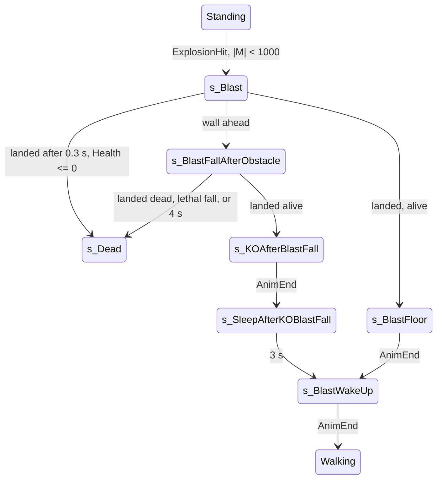

# Explosion blast (thrown by an explosion) and fall damage

Units:
- uc:SBase.SPlayerController:ExplosionHit (global, empty)
- uc:SBase.SPlayerController:CanBeBlasted (global, false)
- uc:SBase.SPlayerController:s_PlayerWalking.CanBeBlasted
- uc:SBase.SPlayerController:s_PlayerWalking.ExplosionHit
- uc:SBase.SPlayerController:s_PlayerJump.CanBeBlasted
- uc:SBase.SPlayerController:s_PlayerJump.ExplosionHit
- uc:SBase.SPlayerController:s_PlayerRolling.CanBeBlasted
- uc:SBase.SPlayerController:s_PlayerRolling.ExplosionHit
- uc:SBase.SPlayerController:s_Berserk360.CanBeBlasted
- uc:SBase.SPlayerController:s_Berserk360.ExplosionHit
- uc:SBase.SPlayerController:s_BTW.CanBeBlasted
- uc:SBase.SPlayerController:s_BTW.ExplosionHit
- uc:SBase.SPlayerController:s_Coop_S_Base.CanBeBlasted
- uc:SBase.SPlayerController:s_Coop_S_Base.ExplosionHit
- uc:SBase.SPlayerController:GrabFence.CanBeBlasted
- uc:SBase.SPlayerController:GrabFence.ExplosionHit
- uc:SBase.SPlayerController:OnFence.CanBeBlasted
- uc:SBase.SPlayerController:OnFence.ExplosionHit
- uc:SBase.SPlayerController:s_GrabBase.ExplosionHit
- uc:SBase.SPlayerController:s_TerminatePawn_Base.ExplosionHit
- uc:SBase.SPlayerController:s_StandUp.ExplosionHit
- uc:SBase.SPlayerController:s_Blast.BeginState
- uc:SBase.SPlayerController:s_Blast.PlayerMove
- uc:SBase.SPlayerController:s_Blast.MyNotifyLanded
- uc:SBase.SPlayerController:s_Blast.CanBeBlasted
- uc:SBase.SPlayerController:s_BlastFallAfterObstacle.MyNotifyLanded
- uc:SBase.SPlayerController:s_BlastFallAfterObstacle.PlayerMove
- uc:SBase.SPlayerController:s_KOAfterBlastFall.AnimEnd
- uc:SBase.SPlayerController:s_SleepAfterKOBlastFall.PlayerMove
- uc:SBase.SPlayerController:s_BlastFloor.AnimEnd
- uc:SBase.SPlayerController:s_BlastFloor.PlayerMove
- uc:SBase.SPlayerController:s_BlastWakeUp.AnimEnd
- uc:SBase.SPlayerController:s_BlastWakeUp.PlayerMove
- uc:SBase.SBasePawn:SetVelocityAndOrientationForBlast
- uc:SBase.SPlayerController:ServerSetVelocityAndOrientationForBlast
- rep:SBase.SPlayerController.ServerSetVelocityAndOrientationForBlast
- uc:SBase.SPlayerController:s_PlayerJump.EndState
- uc:SBase.SPlayerController:s_PlayerJump.NotifyBump
- uc:SBase.SPlayerController:MyFalling
- uc:SBase.SPlayerController:MyNotifyLanded
- def:SBase.SBasePawn (Fell_*), def:SBase.SPawnAttaque, def:SBase.SPAWNDEFENSE
- def:SBase.SPlayerController (BlastDistMax, BlastSpeedMin, BlastSpeedMax)

## Purpose
Explosions of type SDamage_Explosion throw the victim in the air; walls and floors end the flight with a KO, a wake
up or death. Separately, falls deal damage proportional to the drop height. Fall damage is the hand-off point between
the traversal physics (which tracks the highest point of a fall) and the damage pipeline.

## Data
| Field | Owner | Type | Default | Notes |
|---|---|---|---|---|
| BlastDistMax | SPlayerController | float | 1000 | momentum length limit for blasting |
| BlastSpeedMax / BlastSpeedMin | SPlayerController | float | 800 / 350 | speed at length 0 / at 1000 |
| fTimeOfBlast | SPlayerController | float | 0 | owner side |
| m_LastSpecialMoveTime | SPlayerController | float | -10 | blast obstacle timer |
| fZMaxFalling | SPlayerController | float | 0 | highest Z of the current fall; written by native code |
| Fell_MinHeightForDmg | SBasePawn subclass | float | spy 600, merc 450 (base 300) | |
| Fell_MaxHeightForDmg | SBasePawn subclass | float | spy 1500, merc 1000 (base 800) | |
| Fell_MaxHeightForBigLand | SBasePawn subclass | float | 450 both | landing animation choice (locomotion spec) |

## Rules

### Starting a blast (owner, from ClientDamage with SDamage_Explosion)
1. `ExplosionHit(M)` receives the raw momentum of the hit (`damage-pipeline.md` rule 34). Variants:
   - walking family, jump family, rolling, berserk, coop (spy being boosted), terminate, stand-up: if `|M| < 1000`:
     action SA_BLAST_LOOP (239); speed s = `800 + (350 - 800) * |M| / 1000`; d = M / |M|; d.Z = 1; d = Normal(d);
     `SetVelocityAndOrientationForBlast(d * s)`; `ChangeState('s_Blast')`;
   - back-to-wall: the same, with SA_BTW_OUT first;
   - fences (`GrabFence`, `OnFence`): only if also `vector(Pawn.Rotation) . M < 0`;
   - grab family (`s_GrabBase`): `ChangeState('s_Blast')` first, then SA_BLAST_LOOP_AFTERGRAB (240) and the same
     velocity; the head camera is detached;
   - every other state: nothing (no blast; death is resolved by `TellClientServerWaitForFatalBlast`).
2. `CanBeBlasted(M)` (the server's copy of the same decision, used by the damage handlers): `|M| < 1000` in the same
   states (fences add the facing test; `s_Blast` itself returns true for `|M| < 1000`); false elsewhere.
3. `SetVelocityAndOrientationForBlast(v)`: on a non-authority owner also sends
   `ServerSetVelocityAndOrientationForBlast(100 * v)` (the server applies PHYS_Falling, `Velocity = arg * 0.01`, and
   the rotation); locally `Velocity = v` and the pawn faces `-Normal(v with Z = 0)` (back toward the blast).
4. With shipped values every SDamage_Explosion that is not spawn-protected deals 200 damage, so a blast always carries
   a dead or dying pawn; the alive branches below are kept exactly but are reachable only if Health exceeds 200.

### s_Blast
5. Ignores fire, gadgets, goggles, sticky blast and the fatal-blast notice. Damage: PRE + SRTD only.
6. BeginState: stop the zip line sound; owner: `fTimeOfBlast = now`, blast rumble, end an active shock (input, flag,
   action 55, merc weapon electric end).
7. PlayerMove: probe = box trace with actors (35, 35, 87.5) from the pawn to `Location + Velocity * dt * 1.2`; if it
   hits a surface with `HitNormal.Z < 0.5` and `(HitNormal with Z 0) . (Velocity with Z 0) < -0.7` (unnormalised
   vectors): `m_LastSpecialMoveTime = now`, action SA_BLAST_OBSTACLE (241), `ChangeState('s_BlastFallAfterObstacle')`.
   Spy camera update; no jump; zero acceleration input.
8. Landing (`MyNotifyLanded`): ignored during the first 0.3 s after `fTimeOfBlast`; then the global landing, and on the
   owner: action SA_BLAST_FLOOR (242); Health <= 0 gives `ChangeState('s_Dead')` (unless GameEnded), else
   `ChangeState('s_BlastFloor')`.
9. `s_BlastFloor`: damage ignored. Channel 0 AnimEnd (owner): SA_BLAST_WAKEUP (243), `ChangeState('s_BlastWakeUp')`.
10. `s_BlastWakeUp` (s_Inactive, ignores sticky blast): channel 0 AnimEnd (owner): `GotoWaitingState()`.

### Blast into an obstacle
11. `s_BlastFallAfterObstacle`: damage PRE + SRTD only; ignores sticky blast and the fatal notice.
    PlayerMove: if more than 4.0 s since `m_LastSpecialMoveTime`: SA_DIE_FALLING (45),
    `DamagePawn_C2S(self, Health, self, Location, (0,0,-1), SFell)`, `s_Dead`.
12. Landing (owner): if Health <= 0: SA_LAND_AFTER_BLAST_WALL (249), `s_Dead`. Else fall damage per rule 17 using
    fZMaxFalling (lethal: SA_DIE_FALLING, full-health SFell, `s_Dead`); then SA_LAND_AFTER_BLAST_WALL and
    `ChangeState('s_KOAfterBlastFall')`.
13. `s_KOAfterBlastFall` (s_Inactive): channel 0 AnimEnd (owner): `m_LastSpecialMoveTime = now`,
    `ChangeState('s_SleepAfterKOBlastFall')`. `s_SleepAfterKOBlastFall`: view rotation; after 3.0 s action
    SA_WAKE_AFTER_BLAST_WALL (250) and `ChangeState('s_BlastWakeUp')`.

### Fall damage
14. The engine fall damage is disabled (`SBasePawn.TakeFallingDamage` is empty). All fall damage uses
    h = fZMaxFalling - Location.Z and the pawn's Fell_* values.
15. Normal falls: `s_PlayerJump.EndState` (also for PlayerFalling, PlayerFallToBackGrab, PlayerFallingFromRoll,
    s_PreSplitJump, s_SplitJump, PlayerFallingInerte, PlayerFallingKO) on the server: if h > Fell_MinHeightForDmg,
    `PawnTakeDamage(int((h - Min) / (Max - Min) * default.Health), Pawn, Location, (0,0,1), SFell)`. The damage is
    applied in the falling state (handler: `state-damage-reactions.md` rule 11). EndState runs on any exit from the
    jump family (landing, catching a ledge, pipe, ladder, zip line), and a death inside EndState pre-empts the state
    change that triggered it (UE2 GotoState semantics: a state change made during EndState wins).
    Spy: damage = (h - 600) / 9 hp, lethal from h = 1500 at full health. Merc: damage = (h - 450) / 5.5 hp, lethal
    from h = 1000.
16. `s_PlayerJump.NotifyBump` with a Mover whose `Velocity.Z < Pawn.Velocity.Z` sets `fZMaxFalling = Location.Z`
    (landing on a descending lift or platform does not count the drop).
17. Client-computed falls (owner, `DamagePawn_C2S`): blast obstacle landing (rule 12), the KO fall
    (`knockout-and-terminate.md` rule 28, with a 10 hp minimum), the ledge-grab fall (200 DamTypeGrabBreak,
    `spy-grab.md`). The formula is the same: Dmg = (h - Min) / (Max - Min) * default.Health, and the owner sets
    `fZMaxFalling = Location.Z` after applying it.
18. SFell with Damage 0 is dropped by the pipeline before any effect. SFell feedback: rumble `Vibration_SautHaut`; the
    spy visor effect is not reset for SFell.
19. Falling-related controller events: `MyFalling` (native, start of a fall) on a non-authority owner sends a move
    without moving; on the owner, it leaves back-to-wall, plays the fall action (unless the current clip is
    'LandStAlAk0'), and goes to `PlayerFalling`, or to `PlayerFallToBackGrab` (zero velocity) when a spy with weak
    stick input finds a feet-ledge behind him with nothing 175 uu below (traversal spec). `MyNotifyLanded` (global)
    leaves footprints, records `fTimeOfLastLanding` and replicates a no-move.

## States

## Constants
| Name | Value | Unit | Provenance | Source |
|---|---|---|---|---|
| blast momentum limit | 1000 | uu (momentum length) | decoded | BlastDistMax |
| blast speed | 800 - 0.45 * |M| | uu/s | decoded | BlastSpeedMax, BlastSpeedMin |
| blast vertical component | d.Z set to 1 before normalising | - | decoded | ExplosionHit |
| landing grace | 0.3 | s | decoded | s_Blast.MyNotifyLanded |
| obstacle probe | 1.2 * Velocity * dt, box 35/35/87.5 | uu | decoded | s_Blast.PlayerMove |
| obstacle test | HitNormal.Z < 0.5 and dot < -0.7 | - | decoded | same |
| obstacle fall timeout | 4.0 | s | decoded | s_BlastFallAfterObstacle.PlayerMove |
| post-obstacle sleep | 3.0 | s | decoded | s_SleepAfterKOBlastFall |
| server velocity scale | x100 sent, x0.01 applied | - | decoded | ServerSetVelocityAndOrientationForBlast |
| spy fall window | 600 to 1500 | uu | decoded | def:SBase.SPawnAttaque |
| merc fall window | 450 to 1000 | uu | decoded | def:SBase.SPAWNDEFENSE |

## Network
- Blasts are started on the owner by the ClientDamage RPC and reported to the server with a reliable RPC carrying
  the velocity; the server switches the pawn to PHYS_Falling with that velocity.
- Normal fall damage is server authoritative (server fZMaxFalling and Location). Blast, KO and ledge falls are owner
  authoritative (`DamagePawn_C2S`).

## Edge cases
- A blast victim's death state is reached on landing; until then the pawn is in `s_Blast` with Health <= 0.
- If the owner's state is not blastable but the server's was (or the reverse), the owner either ignores the fatal
  notice (already in s_Blast) or plays the normal death animation on the spot.
- Catching a ledge after a long drop still applies fall damage because EndState runs on every exit from the jump
  family; a lethal one kills the player on the ledge.
- `PlayerFallingKO` inherits `PlayerFalling.EndState`, which calls `s_PlayerJump.EndState`. On a KO fall the owner
  sends its own fall damage (`DamagePawn_C2S`, minimum 10) and then requests `s_LyingOnGround`; when the server leaves
  the falling state it can apply the server-side fall damage a second time, unless native code has already reset the
  server's fZMaxFalling. Keep both calls; verify with a trace (Open questions).

## Evidence
- State function sha1 prefixes: s_Blast BeginState cc47459c, PlayerMove e52dc339, MyNotifyLanded d98ff359;
  s_BlastFallAfterObstacle MyNotifyLanded caa7069a, PlayerMove 85ca6b01; s_SleepAfterKOBlastFall PlayerMove cf866b91;
  s_BlastFloor AnimEnd f0495eb1; s_BlastWakeUp AnimEnd 3b9a4b4e; s_PlayerWalking ExplosionHit cf84225e;
  s_PlayerJump EndState 3d606209, NotifyBump 061be96c; SetVelocityAndOrientationForBlast 0dce2b251516.
- local/re-out/uc/SBase/SPlayerController.uc, SBasePawn.uc; defaults local/formats/classdefaults_effective.json.
- Native action cases 239 to 243, 249, 250 (clips BlstStAlDn2, BlstStAlIt2, BlstStAlEd2, LandStXxFd2, WakeStSpFd2,
  WakeStSpDn0) in Bridge anim_catalog/execaction_cases.txt.

## Open questions
- Whether a ledge catch after a long fall damages in the original (rule 15 edge case); verify in game.
- Double fall damage on a KO fall: charge a merc off a 600 uu drop and compare his Health before and after landing
  with the two expected contributions.

### Resolved
- Where native code writes `fZMaxFalling`. Resolved: setPhysics sets it to Location.Z on entering Falling from any
  other mode; physFalling and physFallingInRootMotion raise it to the current Location.Z at the end of every call;
  physWalking and MyDoJump do not write it. Evidence: physics-dispatch.md, physics-falling.md 8 (ANSWERS-physics 3).
- The momentum vector of native explosions. Resolved: the frag passes `victim - frag`, not normalised, so its length
  is the distance to the centre; mines pass `victim - mine` (an extinguisher gets its own forward vector). Evidence:
  natives2-damage.md rules 4, 5 (ANSWERS-natives2 20, 21).
