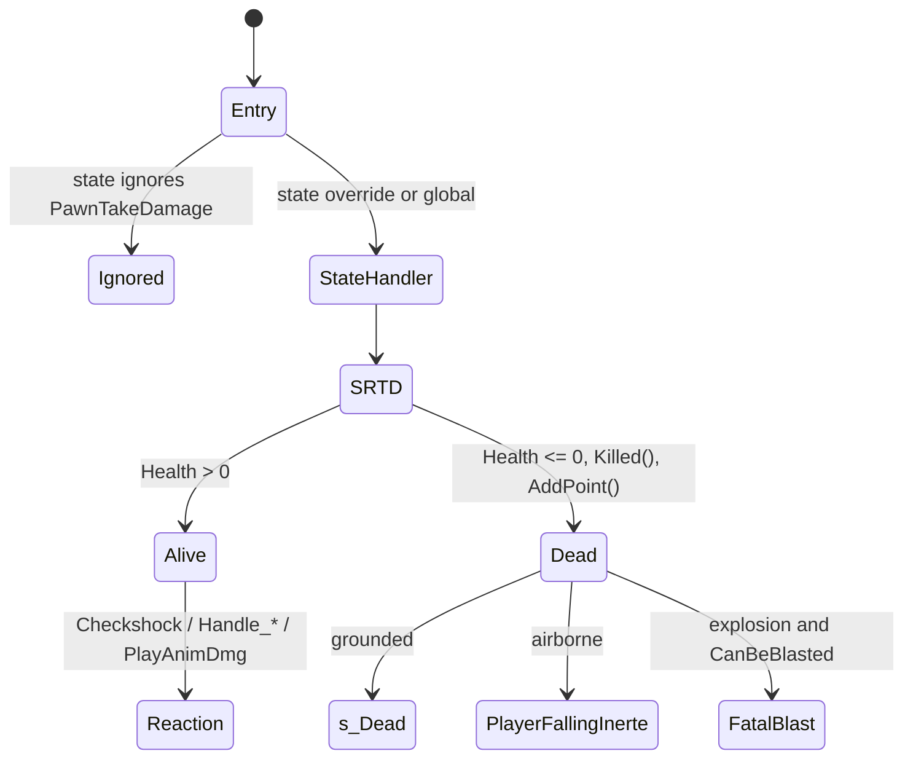

# Damage pipeline: entry points, StandardReactionsToDamage, client feedback

Units:
- uc:Engine.Controller:PawnTakeDamage
- rep:Engine.Controller.PawnTakeDamage
- uc:SBase.SPlayerController:PawnTakeDamage
- uc:SBase.SPlayerController:StandardReactionsToDamage
- uc:SBase.SPlayerController:DamagePawn_C2S
- rep:SBase.SPlayerController.DamagePawn_C2S
- uc:SBase.SPlayerController:ClientDamage
- rep:SBase.SPlayerController.ClientDamage
- nat:SBase.SPlayerController.ClientDamageHudEffect
- uc:SBase.SPlayerController:PlayAnimDmg
- uc:SBase.SPlayerController:s_PlayerWalking.PlayAnimDmg
- uc:SBase.SPlayerController:s_PlayerJump.PlayAnimDmg
- rep:SBase.SPlayerController.PlayAnimDmg
- uc:SBase.SPlayerController:PlayAnimDeath
- rep:SBase.SPlayerController.PlayAnimDeath
- uc:SBase.SPlayerController:TellClientServerWaitForFatalBlast
- rep:SBase.SPlayerController.TellClientServerWaitForFatalBlast
- uc:SBase.SPlayerController:ClientStopBinoculars
- rep:SBase.SPlayerController.bShootedPawn
- uc:SBase.SBasePawn:TakeDamage
- uc:SBase.SBasePawn:TakeFallingDamage
- uc:SBase.SBasePawn:EncroachedBy
- uc:SBase.SBasePawn:PlayDying
- uc:SBase.SBasePawn:PlayFirstPersonDamage
- def:SBase.SBasePawn (damage subset)
- def:SBase.SPlayerController (damage subset)

## Purpose
Every hit point a player loses goes through one function pair on the victim's controller: a state-dependent
`PawnTakeDamage` that decides the reaction, and the shared `StandardReactionsToDamage` (abbreviated SRTD below) that
applies protection rules, hit-zone scaling, health loss, statistics, the damage history and the kill hand-off. The
pawn's own `TakeDamage` is deliberately empty, so engine paths that damage actors (HurtRadius, projectile impacts,
decoration crush, telefrag) never hurt an `SBasePawn`. This spec defines the global versions and the client feedback
RPCs. Per-state reaction overrides are in `state-damage-reactions.md`.

## Data
SDamageType (Engine.Actor enum, byte). Index, name, producers in the shipped script/natives:

| # | Name | Produced by |
|---|---|---|
| 0 | NoDamageType | marker for cleared history slots |
| 1 | SDamage_Charged | merc charge and berserk (35), GPO `DamageActorType` 1 |
| 2 | SDamage_DropAttacked | drop attack (17 at pill 1) |
| 3 | SDamage_ElbowShock | elbow strike (0 damage) |
| 4 | SDamage_Explosion | mines, GPO explosions, bomb target |
| 5 | SDTBase | bullets, crush via CrushedBy, KilledBy, terminate (300), thrown GPO bump, frag grenade class default |
| 6 | SDTBase_NoAnim | damage volumes (class default), GPO `DamageActorType` 6 |
| 7 | SDTExtincteurProjection | not produced by script |
| 8 | SDTFlash | flash-bang (native) |
| 9 | SDTFragFlash | not produced by script |
| 10 | SDTLSD | not produced by script |
| 11 | SDTSnipeShot | merc rifle fired from `s_Binoculars_Def` |
| 12 | SDTStickyShocker | spy shocker gun (0), taser and spawn shock (pill -10), charge into a shocked spy |
| 13 | SFell | fall damage |
| 14 | Crushed | Mover/SLift `EncroachDamage` path |
| 15 | Suicided | `ServerResign` |
| 16 | Gibbed | engine only, unreachable for SBasePawn |
| 17 | DamTypeTelefragged | engine only, unreachable for SBasePawn |
| 18 | DamTypeGrabChoke | grab choke kill (passed to `Killed` directly) |
| 19 | DamTypeGrabBreak | grab neck break, ledge-grab fall (200) |
| 20 | SDamage_Jammered | jammer (gadget absent in 4.0) |
| 21 | SDamage_Poison | poison mine |
| 22 | SDTStickyBlast | sticky blast (200) |

Fields (owner class, type, default, provenance):

| Field | Owner | Type | Default | Notes |
|---|---|---|---|---|
| Health | Engine.Pawn | int | 100 (def:SBase.SPawnAttaque, def:SBase.SPAWNDEFENSE effective) | replicated (Net, RepOffset 94), config flag, no ini override in the install |
| LastDamages[10] | SPlayerController | struct DamageInfos {DamageType byte, Damage int, PillTag int, Time int} | zero | server-side history, newest at index 0 |
| ShockInstigator / ShockInstigatorTime | SPlayerController | Pawn / float | None / 0 | set by SRTD for SDTStickyShocker |
| PoisonInstigator / PoisonLastHealth | SPlayerController | Controller / int | None / 0 | stats only |
| bShootedPawn | SPlayerController | bool | false | replicated reliable to owner; toggled on the shooter when he lands a hit |
| fSpawnProtectionEnd | SPlayerController | float | 0 | see `spawn-protection-and-scoring.md` |
| fTimeWhenHit | SPlayerController | float | 0 | adrenaline/heartbeat timer start |
| AdrenalineTime | SPlayerController | float | 5.0 | heartbeat sound stops 5 s after the last hit anim |
| fLyingOnGroundDuration | SPlayerController | float | 7.0 | written by ClientDamage for drop attacks |
| DES_fSeuilFlashBang_Cos | SPlayerController | float | 0.0 | flash facing threshold (not set in defaults) |
| GPODamageInstigator | SGameInfo | Pawn | None | set only while a GPO processes damage |
| HealthRefill, NbPointsRefillable | SPawnAttaque | float, int | 0, 0 | spy regeneration pool, see `health.md` |

## Rules

### Entry points
1. `Engine.Controller.PawnTakeDamage(Damage, instigatedBy, HitLocation, Momentum, DamageType, optional PillTag,
   optional PercentDamageRefillable)` is declared in Controller with replication `reliable if (Role < ROLE_Authority)`.
   On the server it runs locally. If an owning client calls it on its own controller it is sent to the server
   (a reliable client-to-server RPC). Calls a client makes on another player's controller do nothing, because clients
   do not have other players' controllers.
2. All server code that hurts a player calls `PawnTakeDamage` on the victim's controller. Callers: weapons, taser,
   charge/berserk, drop attack, grab, terminate, movers, GPO bump, `CrushedBy`, `KilledBy`, `ServerResign`, fall
   damage at the end of a jump, spawn shock, and the native damage volume / explosion code (see Open questions).
3. `DamagePawn_C2S(Target, Damage, instigatedBy, HitLocation, Momentum, DamageType, optional PillTag, optional
   PercentDamageRefillable)` is a reliable client-to-server RPC. The server calls
   `SPlayerController(Target.Controller).PawnTakeDamage` with the same arguments, without any validation of target,
   amount, type or distance. Then, on the server:
   - if DamageType is SDamage_Charged and Target and instigatedBy exist, the instigator has an SPlayerController, and
     the two are on different teams (or the mode is GM_MercDeathMatch): instigator `Stats.Merc_ChargeHits += 1`;
   - if DamageType is DamTypeGrabBreak and Target.Health <= 0: target `Stats.Merc_DeathFromLedgeGrab += 1`.
   Callers (all on the owning client): blast-landing and KO-landing fall damage, ledge-grab fall death, sticky blast,
   charge bumps, the drop-attacked pawn that lands on another pawn.
4. `SBasePawn.TakeDamage`, `SBasePawn.TakeFallingDamage` and `SBasePawn.EncroachedBy` have empty bodies. Consequences:
   `Actor.HurtRadius`, `Projectile` wall/target impacts, `Decoration` and `Pawn` landing crush, and the engine
   telefrag/gib path (`Pawn.EncroachedBy` to `gibbedBy` to `Died`) never affect an SBasePawn. `Pawn.Died` and
   `Pawn.PlayDying` are never reached by any SBase flow; there is no ragdoll and no engine `Dying` state for players
   (see `death-and-respawn.md`).

### Global PawnTakeDamage (used by every state that does not override or ignore it)
5. If `Pawn.Health <= 0`, return.
6. Run SRTD (rules 10 to 31).
7. If after SRTD `Pawn.Health <= 0`:
   - if (DamageType is not SDamage_Explosion, or `CanBeBlasted(Momentum)` is false) and DamageType is not
     SDTStickyBlast: if `Pawn.Base != None`, call `PlayAnimDeath(Momentum, Pawn.Health)` and, unless the controller is
     in `GameEnded`, `MirrorState('s_Dead')`; if `Pawn.Base == None` (airborne), unless in `GameEnded`,
     `MirrorState('PlayerFallingInerte')`;
   - else if DamageType is SDamage_Explosion: `TellClientServerWaitForFatalBlast()`;
   - a lethal SDTStickyBlast does nothing more here (the owner already put itself in `s_Blast`).
8. Else (still alive), by DamageType: SDamage_Charged returns; SDamage_ElbowShock returns; SDamage_DropAttacked does
   `MirrorState('s_FallDropAttacked')` and returns; SDTStickyShocker calls `Checkshock(PillTag)` (bPlayAnim false)
   and continues. Then, if `SBPawn.IK_Type` is neither IKT_PIPH nor IKT_JCVD and DamageType is not SDTBase_NoAnim,
   call `PlayAnimDmg(PillTag, Momentum * 1000)`.
9. `CanBeBlasted` is evaluated on the server in the server's current state, with the raw (not normalised) Momentum
   argument. Global `CanBeBlasted` returns false and global `ExplosionHit` does nothing; standing, jumping and a few
   other states override them (see `blast-and-fall-damage.md`).

### StandardReactionsToDamage (server only)
Arguments: Damage, PercentDamageRefillable, instigatedBy, HitLocation, Momentum, DamageType, PillTag (passed by
reference; the computed pill is written back to the caller's variable).

10. If `SBPawn.Health <= 0`, or (DamageType == SFell and Damage == 0): return with no effect at all.
11. Instigator fallback A: if instigatedBy is None, the game is an SGameInfo and `GPODamageInstigator != None`:
    instigatedBy = GPODamageInstigator.
12. Instigator fallback B: if instigatedBy is still None and the game is an SGameInfo:
    DamageVolume = `SGameInfo.FindDamageVolume(Pawn, DamageType)` (first touching SDamageVolume with bActive, the same
    DamageType and a non-None TriggerController); if found, instigatedBy = DamageVolume.TriggerController.Pawn
    (may be None if that player is between lives).
13. KillerController = instigatedBy.Controller if instigatedBy is not None; else DamageVolume.TriggerController if
    rule 12 found a volume; else None.
14. If DamageType == SDTStickyShocker: ShockInstigator = instigatedBy, ShockInstigatorTime = Level.TimeSeconds.
15. Spawn protection (see `spawn-protection-and-scoring.md` for the full table): return early when the victim is a spy
    hit by SDamage_Explosion before fSpawnProtectionEnd, or in GM_MercDeathMatch when hit by an explosion before
    fSpawnProtectionEnd, or by SDTBase/SDTBase_NoAnim/SDTSnipeShot before fSpawnProtectionEnd - 2 s.
    Note: rules 11 to 14 have already run, so a protected hit still records ShockInstigator.
16. Hit confirmation: if instigatedBy and its Controller exist and DamageType is SDTBase, SDTSnipeShot or
    SDamage_Jammered, invert the instigator controller's `bShootedPawn` (replicated to that shooter; the HUD uses the
    change as a hit marker).
17. If the victim is in binocular vision, `ClientStopBinoculars()` (RPC to the victim's owner: leaves the binocular
    state back to `RPreviousState`).
18. If `Pawn == None`, return.
19. Keep the raw Momentum for the client (NotNormalizedMomentum); set the local Momentum to `Normal(Momentum)`.
20. Pill and ActualDamage (formulas in float32, `int()` truncates toward zero):
    - Branch A, if (PillTag <= 0 or PillTag > 15) and DamageType != SDTStickyShocker:
      PillTag = `GetApproxPillFromHit(HitLocation) + 1` (values 1, 4, 5, 8, 9, see `hit-zones-and-weapons.md`);
      ActualDamage = Damage (no zone scaling); if DamageType is SDamage_Poison set `SBPawn.bPoisonned = true`.
    - Branch B, otherwise: if SDamage_Poison set `bPoisonned = true`; then the first match of:
      1. SDamage_Jammered: `Client_Jammed(instigatedBy)`, ActualDamage = 0;
      2. SDTSnipeShot: PillTag == 1 gives ActualDamage = current Health (always lethal); PillTag > 0 gives
         `int(Damage * DamageSnipeLookupTable[PillTag-1] * 0.01)`; else Damage;
      3. SDTStickyShocker with PillTag == -10 (taser family): if `!SBPawn.bStickyShocking`,
         ActualDamage = `int(default.Health * 0.51)` = 51 and `TimeShock = now - 2 * RealTimeInvulSticky` (forces the
         next Checkshock past its immunity window); else ActualDamage = 0;
      4. PillTag > 0: ActualDamage = `int(Damage * DamageLookupTable[PillTag-1] * 0.01)`;
      5. else ActualDamage = Damage.
21. If DamageType == SDamage_Explosion: ActualDamage = 200, regardless of the Damage argument or distance.
22. Lethal drop technique: if DamageType == SDamage_DropAttacked, the instigator's SPawnType differs from the victim's,
    and ((victim is a merc and `GRI.bAvlb_SPY_LeathalDropTech`) or (victim is a spy and
    `GRI.bAvlb_MERC_LeathalDropTech`)): ActualDamage = current Health. Both options default to false
    (`Engine.PersistentData.InitPersistentData`).
23. bCountForStats = KillerController != None and KillerController != self and KillerController is an
    SPlayerController and (teams differ, or GM_MercDeathMatch). If bCountForStats and ActualDamage > 0:
    counted = `Min(ActualDamage, Health)`; victim `Stats.DamageTaken += counted`; killer `Stats.DamageGiven += counted`.
24. `CountPoisonDrain()` (stats only; see `health.md`).
25. `SBPawn.Health -= ActualDamage`. Health is not clamped and may become negative.
26. If DamageType == SDamage_Poison and bCountForStats: PoisonInstigator = KillerController. If PoisonInstigator is
    not None: PoisonLastHealth = Health.
27. Drop attack stats when DamageType == SDamage_DropAttacked and bCountForStats: attacker `DropAttacks += 1`; victim
    `DropAttacksTaken += 1` and, if Health <= 0, `DeathFromDropAttack += 1`.
28. If the victim is a spy (SPAWNOFFENSE): `HealthRefill = 0` and
    `NbPointsRefillable += int(float(ActualDamage * PercentDamageRefillable) * 0.01)` (integer product first).
29. History: for i = 9 down to 1, `LastDamages[i] = LastDamages[i-1]`; then
    `LastDamages[0] = {ActualDamage, DamageType, PillTag, int(Level.TimeSeconds)}`.
30. Feedback: `ClientDamage(NotNormalizedMomentum, DamageType, HitLocation, instigatedBy)`. Then, if the victim is a
    spy and `SBPawn.GlassEffect != 0`: unless DamageType is SFell, `SetDesiredGlassValueOnClients(0, 1.0)`; and always
    `SetPerturbationGlassOnClients()` (visor effects, HUD area).
31. If Health <= 0 (the kill hand-off):
    - clear the victim's inputs and HUD use state: bCanTalkToGuy = false, bAltFire = 0, HUD gadget choice hidden,
      ballistic gauge 0, bFire = 0, TimerUSe = 0, fThrowForce = 0, bUsingNow = false;
    - `Level.Game.Killed(KillerController, self, Pawn, DamageType)` (see `death-and-respawn.md`);
    - if KillerController is not None: if the killer's PRI.Team differs from the victim pawn's PRI.Team,
      `AddPoint(killer team index, killer, 0)` (AP_D_KillWithWeapon); else if the killer is the victim,
      `AddPoint(team, self, 17)` (AP_C_Suicide); else `AddPoint(team, killer, 18)` (AP_C_KillFriend).
32. There is no team check anywhere in SRTD: friendly fire applies to every damage type, and teamkills cost points.

### ClientDamage (reliable server-to-owner RPC, runs in the owner's current state)
33. If the help screen is shown, close it (`ShowHelp()`).
34. By DamageType:
    - SDamage_Explosion: `ExplosionHit(Momentum)` (state dependent; may start the blast, see blast spec);
    - SDTFlash: camera origin and forward are the controller Location/Rotation for a spy, pawn location plus eye
      offset and pawn rotation for a merc; d = `Normal(HitLocation - origin)`; if `d . forward < 0.0` return; if a
      world-only trace from the origin to HitLocation hits anything, return;
    - SDamage_DropAttacked: rumble `Vibration_SautHaut`; fLyingOnGroundDuration = 1.0 if the attacker has the same
      SPawnType as the victim, else the default 7.0;
    - SFell: `Vibration_SautHaut`;
    - SDamage_Charged or SDamage_ElbowShock: `Vibration_Bousculade`;
    - any other: `Vibration_CoupParDefaut`.
35. `ClientDamageHudEffect(DamageType)` (native, HUD overlays: see Open questions).
36. If SDTFlash: `ClientStopBinoculars()`.
37. If DamageType != SDTFlash and IK_Type is neither IKT_PIPH nor IKT_JCVD: a merc gets `m_camera.Shake(800, 20000,
    500)`; a spy with `WeaponLoaded == 0` gets `Tilt(400, 20000, 500)` and `Shake(100, 20000, 500)`.
38. States in the grab family replace ClientDamage so only explosions give feedback; charging and berserk states
    re-enable the laser first and then run the global version (see `state-damage-reactions.md`).

### PlayAnimDmg (reliable server-to-owner RPC, simulated; runs in the owner's current state)
39. Global version: if this is the local player, play `snd_HeartBeat` (SLOT_Misc, volume 1, radius 100);
    `fTimeWhenHit = now`; a = `Normal(Momentum) . vector(SBPawn.Rotation)`; a > 0.6 gives SA_DMG_SPECIAL_FRONT (51);
    a < -0.6 gives SA_DMG_SPECIAL_BACK (52); otherwise side = `vector(Rotation) x (0,0,1)` and
    `Normal(Momentum) . side > 0` gives SA_DMG_SPECIAL_LEFT (49), else SA_DMG_SPECIAL_RIGHT (50).
40. `s_PlayerWalking` (and all standing/walking/crouching substates) override: set fTimeWhenHit, heartbeat as above;
    if the pawn is moving (Velocity not zero) use the global version; else choose by pill with
    a = `Normal(Momentum) . vector(Rotation)`:
    pill 1 gives SA_DMG_HEAD (57); pill 2 gives CHEST_LEFT (60) if |a| < 0.6, CHEST_BACK (58) if a > 0, else
    CHEST_FRONT (59); pill 9 gives CHEST_RIGHT (61) if |a| < 0.6, CHEST_BACK if a < 0, else CHEST_FRONT; pills 6, 7, 8
    give LEG_RIGHT (65); pills 13, 14, 15 give LEG_LEFT (64); pills 3, 4, 5 give ARM_LEFT (62); pills 10, 11, 12 give
    ARM_RIGHT (63); other values play nothing. Note the asymmetric sign test between pill 2 and pill 9.
41. `s_PlayerJump` (and PlayerFalling family) override: plays nothing.
42. The heartbeat stops in PlayerTick once `fTimeWhenHit + AdrenalineTime < now` (then fTimeWhenHit = -10).
43. First person (merc weapon) mirror: `SBasePawn.PlayFirstPersonDamage(action)` maps actions 49, 60, 62, 64 to
    weapon pain 2; 50, 61, 63, 65 to pain 3; 51, 59 to pain 1; 52, 58 to pain 0 (called by the native action code).

### PlayAnimDeath (reliable server-to-owner RPC, simulated)
44. Set `Pawn.Health = PawnHealth` (so the owner's copy matches the server even before property replication).
45. If Momentum is exactly (0,0,1): SA_DIE_FALLING (45). Else `ChooseDeathAnimation(Momentum)` (native) gives
    DIE_Forward 40, DIE_Backward 41, DIE_Left 42, DIE_Right 43, DIE_InPlace 44; any other result plays nothing.
    The action plays the clip (decoded, execute-action.md cases 40 to 46, rule 5.4): PlayDeath(d) with
    ADeath{St,Cr}{Down, Forward, Back, Left, Right} (the 2H variants for the merc) and tween 0.1; the drop-attack death
    (46) plays XxxxStAlAk0 / XxxxCrAlAk0 (spy) or their 2 versions (merc).
    Kills delivered with Momentum (0,0,1) (KilledBy, CrushedBy, terminate, drop attack, grab release) therefore use
    the falling death animation.
45a. `ChooseDeathAnimation(M)` (native 1405): M exactly zero gives DIE_InPlace. Otherwise with F the forward axis of
    the pawn's Rotation and m = SafeNormal(M), `a = F . m`: a > 0 and a >= 0.7 asks DIE_Forward, a <= 0 and
    a <= -0.7 asks DIE_Backward, else DIE_Left when `m.X F.Y - m.Y F.X >= 0`, DIE_Right otherwise (so the corpse falls
    the way the momentum pushes). The asked direction then goes through the room check (GetValidDeathDirection):
    directions are tried in the order asked, its opposite, then the other axis (Left when the asked one was Forward or
    Backward, else Forward), then that one's opposite; none passing gives DIE_InPlace. A direction D (world vector of
    local (1, 0, 0), (-1, 0, 0), (0, -1, 0), (0, 1, 0) for Forward, Backward, Left, Right) passes when the box of
    extent (R + 20, R + 20, H - 15) at `Location + 2R D` touches no BSP (SinglePointCheck with bActors 0), and two
    zero-extent lines from `Location + 1.5R D` and `Location + 2.5R D` straight down by 1.25 H (flags 0x2df, the pawn
    as source) both hit something (R, H: the pawn's collision radius and height).
46. States that ignore PlayAnimDeath on the owner (`s_Dead`, `s_LyingOnGround`, `s_TerminatedPawn`, `s_BaseSpectating`,
    `s_Cinematic`) play no death animation.

### TellClientServerWaitForFatalBlast (reliable server-to-owner RPC, simulated)
47. If `Pawn.Base != None`: `PlayAnimDeath((0,0,0), Health)` and, unless in GameEnded, `ChangeState('s_Dead')`; else,
    unless in GameEnded, `ChangeState('PlayerFallingInerte')`. The blast states ignore this call, so when the
    preceding ClientDamage already started a blast the death resolves on landing instead.

## States
No states are owned here; the dispatch below shows where the pipeline hands over.

## Constants
| Name | Value | Unit | Provenance | Source |
|---|---|---|---|---|
| default Health | 100 | hp | decoded | def:Engine.Pawn, effective for SPawnAttaque/SPAWNDEFENSE |
| explosion damage | 200 | hp | decoded | uc:SBase.SPlayerController:StandardReactionsToDamage |
| taser damage factor | 0.51 of default Health (51) | hp | decoded | same |
| zone scale factor | 0.01 per table unit | - | decoded | same |
| valid real pill range | 1 to 15 | - | decoded | same |
| history depth | 10 | entries | decoded | const MaxDamageSaved = 10 |
| flash facing threshold | 0.0 (cos 90 deg) | - | decoded | def:SBase.SPlayerController (unset) |
| AdrenalineTime | 5.0 | s | decoded | def:SBase.SPlayerController |
| merc hit camera shake | 800, 20000, 500 | engine units | decoded | ClientDamage |
| spy unarmed hit tilt/shake | 400/100, 20000, 500 | engine units | decoded | ClientDamage |
| hit anim momentum scale | 1000 | - | decoded | PawnTakeDamage |
| front/back hit threshold | 0.6 | cos | decoded | PlayAnimDmg |

## Network
- Damage is applied only on the server (SRTD reads and writes server state; Health replicates to everyone through
  Pawn replication, RepOffset 94).
- `PawnTakeDamage` (Controller) and `DamagePawn_C2S` are reliable client-to-server RPCs. `DamagePawn_C2S` is fully
  client authoritative. A faithful port must keep the RPC and its effects; adding server validation is a deliberate
  deviation and should sit behind an option.
- `ClientDamage`, `PlayAnimDmg`, `PlayAnimDeath`, `TellClientServerWaitForFatalBlast`, `ClientStopBinoculars`,
  `Client_Jammed` are reliable server-to-owner RPCs. They execute in the owner's current state, which may differ from
  the server's state for a short time.
- Third parties see hit and death animations only through the owner: `ChangeEnumAction` runs only where the
  controller's RemoteRole is not AutonomousProxy (the owning client or a listen-server host), and the resulting
  actions travel to the server in the move packets and from there to other clients (see the locomotion/netcode specs).
- `bShootedPawn` replicates reliably to the shooter (bNetOwner condition through the controller).
- On a listen server the host's own controller has Role Authority and RemoteRole not AutonomousProxy, so all of the
  above run locally and synchronously.

## Edge cases
- A pawn already at Health <= 0 ignores all further damage, so a corpse cannot be killed twice or give a second
  kill credit.
- SFell with Damage 0 is dropped before anything else (no history entry, no ClientDamage).
- Spawn protection returns after ShockInstigator is set but before history and feedback; the hit leaves no trace.
- A sniper headshot (pill 1, SDTSnipeShot) kills regardless of the table; the history keeps PillTag 1, which
  `BroadcastDeathMessage` uses for the headshot message.
- An approximate pill (branch A) never scales damage; only real pills from `TraceBone` do.
- A sticky shocker with PillTag 0 or above 15 falls into branch B step 5 and deals its Damage argument unscaled
  (0 for the shocker gun, 35 for the charge into a shocked spy).
- Explosion damage is always 200 even when the source requested less; any explosion that is not spawn-protected kills.
- `AddPoint` casts the killer to SPlayerController; a non-player killer controller would make the call fail.
  Only player controllers exist in Versus.
- Health can go negative; any code that reads it treats <= 0 as dead.

## Evidence
- REA recheck 2026-10-26 (game build through the REA tools): ChooseDeathAnimation 0x10acd3e0 (zero test, 0.7
  thresholds, side test) and GetValidDeathDirection 0x10acd4d0 (try order; box R + 20, R + 20, H - 15 at 2R against
  the BSP; floor lines at 1.5R and 2.5R, 1.25 H down, flags 0x2df) confirm rule 45a as written.
- uc:SBase.SPlayerController:StandardReactionsToDamage sha1 3d3a25f936e2 (3105 bytes),
  uc:SBase.SPlayerController:PawnTakeDamage sha1 088e308b126d (flags Net, NetReliable),
  uc:SBase.SPlayerController:DamagePawn_C2S sha1 4d94ca474482, uc:SBase.SPlayerController:ClientDamage
  sha1 8b5fc3e1064d, PlayAnimDmg 9d8325f0ab45, s_PlayerWalking.PlayAnimDmg 48670acc, PlayAnimDeath 6e8befd2bc53,
  TellClientServerWaitForFatalBlast 8943647cc4db.
- local/re-out/uc/SBase/SPlayerController.uc (functions above), local/re-out/uc/SBase/SBasePawn.uc (TakeDamage,
  EncroachedBy, PlayFirstPersonDamage), local/re-out/uc/Engine/Controller.uc (replication block),
  local/re-out/uc/Engine/Actor.uc (SDamageType enum, HurtRadius), local/re-out/uc/Engine/Pawn.uc (Died, gibbedBy).
- Token check: `python -B -m ucdecomp dis ... SBase SPlayerController.StandardReactionsToDamage` confirms constants
  200, 0.51, the MercDM test `GameMode == 7` and the AddPoint indices 0, 17, 18.
- Natives: ClientDamageHudEffect 0x10ab0ae0 (native 1388), ChooseDeathAnimation 0x10acd390 (native 1405; body
  0x10acd3e0, editor 0x11212f30), GetValidDeathDirection 0x10acd4d0 (editor 0x11206c00), TraceBone 0x10a25270
  (native 1122).
- Defaults: local/formats/classdefaults_effective.json (SBase.SBasePawn, SBase.SPawnAttaque, SBase.SPAWNDEFENSE,
  SBase.SPlayerController).

## Open questions
- `ClientDamageHudEffect` (0x10ab0ae0) chooses the HUD overlay per damage type (flash white-out, red flash,
  electric). Owned by the HUD spec; needs Ghidra to list per-type effects.
- Which other natives call `PawnTakeDamage` directly (flash-bang, taser `UseBulletSet`) and with which HitLocation,
  Momentum and PillTag; the damage volume, frag, mines, gameplay object blast and poison are decoded (Resolved).
- Whether the server ticks `PlayerTick` for remote players (affects server-side copies of shock timers). Measure by
  reading `iDontUpdatePadInput` on the server-side controller of a shocked remote client.

### Resolved
- `ChooseDeathAnimation` mapping. Resolved: thresholds 0.7 on the forward axis, the side by the sign of the 2D cross
  product, no stance term, then a room check that can turn the corpse to another direction or in place. Rule 45a.
  Evidence: game 0x10acd3e0 and 0x10acd4d0, editor 0x11212f30 and 0x11206c00 (decompiled under local/re-out).
- (part) Death clips. Resolved: PlayDeath(d) plays ADeath{St,Cr}{Down, Forward, Back, Left, Right} (2H for the merc)
  with tween 0.1, d from the SA_DIE_* action; the drop-attack death (46) plays XxxxStAlAk0 / XxxxCrAlAk0 or the 2
  versions. Rule 45. Evidence: execute-action.md cases 40 to 46, rule 5.4 (ANSWERS-actions 23).
- Natives calling `PawnTakeDamage` (part). Resolved: damage volume `(HitPoints, None, A.Location, A - volume,
  DamageType, 0, 0)`; frag `(int((1 - d / Range) Damage), owner pawn, A raised by 0.5 H, A - frag, SDamage_Explosion
  or SDTBase, 0, PercentDamageRefillable)`; mines likewise from the mine with PcOwner.Pawn; gameplay object blast
  with instigator None and DamageActorType; poison `(1500, PoisonnedBy or Instigator, Location, (0, 0, -1), SDTBase,
  3, 0)`. The explosion momentum is victim minus centre, not normalised, so its length is the distance. Evidence:
  natives2-damage.md rules 1, 4, 5, 6, 8 (ANSWERS-natives2 18, 20, 21, 23, 25).
- Native blasts and players. Resolved: never through HurtRadius; native blasts deliver PawnTakeDamage to the victim's
  SPlayerController, and HurtRadius only reaches TakeDamage. Evidence: natives2-damage.md Data (ANSWERS-natives2 22).
