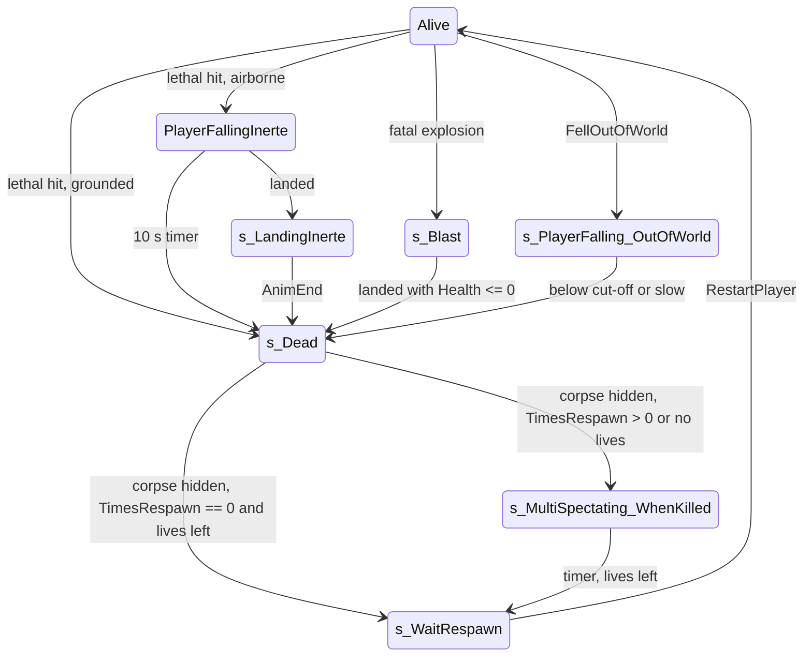

# Death, kill bookkeeping, corpse and respawn

Units:
- uc:SBase.SGameInfo:Killed
- uc:SBase.SGameInfo:BroadcastDeathMessage
- uc:SBase.SGameInfo:UpdateTeamNumLives
- uc:SBase.SGameInfo:sCheckEndGame (death hook only)
- uc:SBase.SDeathMessage:GetString
- def:SBase.SDeathMessage
- uc:SBase.SPlayerController:s_Dead.BeginState
- uc:SBase.SPlayerController:s_Dead.EndState
- uc:SBase.SPlayerController:s_Dead.Timer
- uc:SBase.SPlayerController:s_Dead.PlayerMove
- uc:SBase.SPlayerController:s_Dead.PlayerTick
- uc:SBase.SPlayerController:s_Dead.Fire
- uc:SBase.SPlayerController:s_Dead.ServerReStartPlayer
- uc:SBase.SPlayerController:s_Dead.bIsDamageVolumeSensitive
- uc:SBase.SPlayerController:s_MultiSpectating_WhenKilled.BeginState
- uc:SBase.SPlayerController:s_MultiSpectating_WhenKilled.Timer
- uc:SBase.SPlayerController:s_WaitRespawn@code
- uc:SBase.SPlayerController:s_WaitRespawn.ServerReStartPlayer
- uc:SBase.SPlayerController:s_WaitRespawn.EndState
- uc:SBase.SPlayerController:ServerRespawn
- uc:SBase.SPlayerController:Respawn
- uc:SBase.SPlayerController:UnPossess (corpse removal part)
- uc:SBase.SPlayerController:AntiBugTellServerIAmDead
- uc:SBase.SPlayerController:Resign
- uc:SBase.SPlayerController:ServerResign
- uc:SBase.SPlayerController:PlayerFallingInerte.BeginState
- uc:SBase.SPlayerController:PlayerFallingInerte.Timer
- uc:SBase.SPlayerController:PlayerFallingInerte.MyNotifyLanded
- uc:SBase.SPlayerController:PlayerFallingInerte.NotifyBump
- uc:SBase.SPlayerController:PlayerFallingInerte.DropAttack
- uc:SBase.SPlayerController:s_LandingInerte.MyFalling
- uc:SBase.SPlayerController:s_LandingInerte.AnimEnd
- uc:SBase.SPlayerController:s_FallDownDying.BeginState
- uc:SBase.SPlayerController:s_FallDownDying.AnimEnd
- uc:SBase.SPlayerController:s_FallDownDying@code
- uc:SBase.SPlayerController:FellOutOfWorld
- uc:SBase.SPlayerController:s_PlayerFalling_OutOfWorld.BeginState
- uc:SBase.SPlayerController:s_PlayerFalling_OutOfWorld.EndState
- uc:SBase.SPlayerController:s_PlayerFalling_OutOfWorld.PlayerTick
- uc:SBase.SPlayerController:s_PlayerFalling_OutOfWorld.MyNotifyLanded
- uc:SBase.SPlayerController:ReinitPawnBecauseOfDivergences (dead branch)
- uc:SBase.SBasePawn:SetVelocityForDyingPawn
- uc:SBase.SPlayerController:ServerSetVelocityForDyingPawn
- uc:SBase.SBasePawn:AnimEnd (channel 0 death pose chain)
- nat:SBase.SBasePawn.ChooseDeathAnimation
- def:SBase.SPlayerController (fTempsAvantClignote)

## Purpose
Covers what happens from the moment Health reaches 0: kill credit and lives, the death message, the controller state
flow to `s_Dead` (directly, after a fall, after a blast, after a grab), the corpse (death animation, blinking,
hiding), and the respawn or permanent spectating. There is no ragdoll and no engine `Dying` state: the corpse is the
pawn itself, posed by death animations, kept until `UnPossess` destroys it at respawn.

## Data
| Field | Owner | Type | Default | Notes |
|---|---|---|---|---|
| PRI.Deaths | PlayerReplicationInfo | int | 0 | replicated |
| PRI.Kills | PlayerReplicationInfo | int | 0 | replicated |
| PRI.NumLives | PlayerReplicationInfo | int | from match settings | replicated; SteeE Story: spy 4, merc 3 (map settings) |
| PRI.bResigned | PlayerReplicationInfo | bool | false | |
| GRI.TimesRespawn | GameReplicationInfo | int | from MatchInfo.TimesRespawn | respawn delay in seconds (SteeE 10) |
| GRI.TotalTeamLives[2] | GameReplicationInfo | int | | recomputed on each end-game check |
| fRespawnDate | SPlayerController | float | 0 | time of entering s_Dead, then reused as respawn date |
| fTempsAvantClignote | SPlayerController | float | 5.0 | corpse visible time before blinking; 1.0 after a strangle |
| RespawnTimeCount | SPlayerController | int | 0 | reset in s_Dead |
| bInstantRespawn | SPlayerController | bool | false | set by falling out of the world |
| fRespawnZLocation | SPlayerController | float | 0 | out-of-world fall cut-off |
| BroadcastScoreTime | SGameInfo | float | 0 | now + 2 s after each kill |
| SDeathMessage strings | | localized | DeathString[0..16] "killed", [17] "choke to death", Grabbed1 "has broken", Grabbed2 "'s neck", SnipedString "sniped", SuicideString "committed suicide.", ResignedString "has resigned from the game.", SomeoneString "Someone" | def:SBase.SDeathMessage (English) |

## Rules

### Killed (server, SGameInfo)
1. `Killed(Killer, Killed, KilledPawn, DamageType)` is called by `StandardReactionsToDamage` on lethal damage, by the
   grab release code (`spy-grab.md`), and by `s_PlayerFalling_OutOfWorld` (Killer = Killed, SFell).
2. If Killed is not None:
   - `Killed.PRI.Deaths += 1`; `Killed.PRI.NumLives -= 1`;
   - if Killer is not None and Killer != Killed:
     - enemies (team index differs) or GM_MercDeathMatch: `Killer.PRI.Kills += 1`; DamageVolume =
       `FindDamageVolume(Killed.Pawn, DamageType)`; if DamageType == Crushed, or `GPODamageInstigator` is not None and
       Killer is its controller, or DamageVolume is not None and Killer is its TriggerController:
       `CountEnvironmentalKill(Killer, Killed)` (`environmental-damage.md`); if the victim carried a flag:
       `CarriedFlag.CarrierKiller = Killer`;
     - teammates: Killer `Stats.TeamKills += 1`; victim `Stats.DeathFromTeammate += 1` (no Kills change);
   - if Killer is the victim: victim `Stats.Suicides += 1`; in GM_MercDeathMatch also `Kills -= 1`;
   - if Killer is None: nothing more (no Kills, no stats);
   - `BroadcastDeathMessage(Killer, Killed, DamageType)`;
   - if `Killed.PRI.NumLives < 1`: team broadcast of SGameMessages switch 56 ("<name> used his last life") to the
     victim's team.
3. `BroadcastScoreTime = now + 2.0`; then `if sCheckEndGame() then sEndGame()` (end conditions are owned by the game
   mode spec; deaths matter through NumLives: a team with players but no lives left loses by END_TEAMDEATH).
4. Engine `GameInfo.ScoreKill` is never called (SGameInfo.Killed does not call super); points are given by AddPoint in
   SRTD (`spawn-protection-and-scoring.md`).

### Death message
5. `BroadcastDeathMessage`: switch = the DamageType byte; if SDTSnipeShot and the victim's `LastDamages[0].PillTag == 1`,
   switch = 23 and the killer's `Stats.Merc_SniperHeadshots += 1`; else if the victim resigned, switch 24. Broadcast
   `DeathMessageClass` with (Killer PRI or None, victim PRI).
6. `SDeathMessage.GetString` (static): names default to "Someone"; switch 18 (DamTypeGrabChoke) gives
   "<victim> choke to death"; 19 (DamTypeGrabBreak) gives "<killer> has broken <victim>'s neck"; 23 gives
   "<killer> sniped <victim>"; 24 gives "<victim> has resigned from the game."; else if killer PRI equals victim PRI
   (and not None) "<victim> committed suicide."; else if switch < 18 "<killer> killed <victim>"; else
   "<killer> killed <victim>" (DeathString[5]).

### Paths into s_Dead
7. Grounded lethal hit: the damage handler calls `PlayAnimDeath` then `MirrorState('s_Dead')`.
8. Airborne lethal hit (global and jump handlers): `MirrorState('PlayerFallingInerte')`.
   `PlayerFallingInerte.BeginState`: `ResetZones()`; on the owner: 10 s timer, action SA_FALL_INERTE (106); if the
   previous physics was OnLadder, OnPipe or OnVerticalPlane (fence), `SetVelocityForDyingPawn(-200 * X)` (X = pawn
   facing; also sent to the server as `ServerSetVelocityForDyingPawn(100 * v)`, which sets PHYS_Falling and velocity
   v); a merc switches to third person (bBehindView, camera detached, walking camera). Merc weapon `AnimateFall`.
   Timer (10 s): action SA_LAND_INERTE (101), `ChangeState('s_Dead')`. Landing (owner): SA_LAND_INERTE and
   `ChangeState('s_LandingInerte')` (unless GameEnded); weapon `AnimateLand`. `DropAttack` events are ignored.
   `NotifyBump` on the owner: if the bumped actor is an SBasePawn whose top (Z + 0.8 * CollisionHeight) is at or
   below our feet (Z - CollisionHeight): a sticky-skinned target triggers `StickyBlast(Other)`, else
   `TellServerToFallAttack(Other)` (a falling corpse can drop-attack someone, `drop-attack.md`).
9. `s_LandingInerte` (extends s_Inactive): any `AnimEnd` (any channel) gives `ChangeState('s_Dead')` unless GameEnded;
   falling again gives `PlayerFallingInerte`.
10. Fatal blast: the owner is blown away in `s_Blast` and enters `s_Dead` when it lands with Health <= 0
    (`blast-and-fall-damage.md`); if the owner was not blastable the server's `TellClientServerWaitForFatalBlast`
    does rule 7 or 8 on the owner.
11. Knock-down while dying (`s_FallDownDying`, used when a grabbing spy is drop-attacked to death): BeginState turns
    off binoculars/reticle/laser and leaves back-to-wall; label `DIE_InPlaceWhileGrabbing` plays SA_GRAB_DROPATTACKED
    (29) on the owner; channel 0 `AnimEnd` gives `ChangeState('s_Dead')`.
12. `s_FallDown` when the knock-down animation ends with Health <= 0 gives `s_Dead` (`knockout-and-terminate.md`).
13. Grab deaths: the held merc goes `s_GrabbedByPlayer_Released_STRANGLE` and reaches `s_Dead` 4 s later, or
    `s_GrabbedByPlayer_Released_DMG` and reaches `s_Dead` at its animation end (`spy-grab.md`).
14. Falling out of the world: the native `FellOutOfWorld` event (owner side) while PHYS_Falling enters
    `s_PlayerFalling_OutOfWorld` (ignores damage). BeginState: `ResetZones()`; owner: action SA_FALL_DEAD (107), trace
    15000 uu down; `fRespawnZLocation = hit Z + 8 * CollisionHeight` if something is hit, else `Location.Z - 1500`;
    remember the camera position; black fade 0 to 255 over 0.5 s. Server: drop any flag, clear inputs, and if
    Health > 0: `Killed(self, self, Pawn, SFell)` and `AddPoint(team, self, 17)` (suicide). Then (both)
    `Pawn.Health = 0`, `bInstantRespawn = true`. Owner PlayerTick: when `Location.Z <= fRespawnZLocation` or speed
    < 100 uu/s, action 0 and `ChangeState('s_Dead')`; landing does the same. EndState: move pawn and controller to
    StartSpot location and rotation, hide the pawn; owner: reset camera effects, fade 255 to 0 over 1.5 s.
15. `ReinitPawnBecauseOfDivergences` (server, desync recovery) with Health <= 0 just does `MirrorState('s_Dead')`.
16. `AntiBugTellServerIAmDead` (reliable owner-to-server RPC, sent every second by the owner's s_Dead timer on a
    client): the server enters `s_Dead` if it is not already there. `s_WaitRespawn` ignores it.

### s_Dead
17. Ignores damage, death and hit animations, smoke, falling, goggles and binoculars; `bIsDamageVolumeSensitive`
    returns false; `Fire` and `ServerReStartPlayer` do nothing.
18. BeginState (on every machine that enters it):
    - stop the zip line sound; weird effect 0;
    - GM_DiskHunt: `DropDisks()`;
    - server: un-mark the pawn from spy markers (`DetectedByMarqueurSpy`), destroy any UsedObject;
    - clear all 10 `LastDamages` types to NoDamageType;
    - owner: unload the selected gadget; if still shocking, clear the shock (input, flag, actions 56 and 55, weapon
      electric end); weird effect 1;
    - server: voice chat to mates off unless always allowed, stop hack comms, clear voice target, enemies stop hearing
      him, `bLyingOnGround = false`, restore voice routing for up to 3 chat partners;
    - `bCrouchWithRoll = false`, `btoCought = false`, `fRespawnDate = now`;
    - pick a tip index (0 for a new profile, else random over the team's tip list);
    - `DiscardPickup()`, `DiscardFlag()`, empty the HUD alarm list; third person view, camera detached, walking camera;
      `SBPawn.DeleteAllInventory()`; `RespawnTimeCount = 0`; reset goggles;
    - timer: 0.2 s repeating on the server or a standalone/listen game (`NetMode != NM_Client`), 1.0 s repeating on a
      client;
    - `BeginRespawnWeaponPick()` (MercDeathMatch weapon choice, owner only).
19. Timer: on a client, send `AntiBugTellServerIAmDead()`. t = now - fRespawnDate. If t > fTempsAvantClignote or
    bInstantRespawn:
    - if t < fTempsAvantClignote + 2.5 and not bInstantRespawn: toggle `SBPawn.bHidden` (blinking corpse);
    - else: hide the pawn, `SetCollision(false, false, false)`, then if `GRI.TimesRespawn != 0` or
      `PRI.NumLives == 0`: `PRI.bIsSpectator = true` and `MirrorState('s_MultiSpectating_WhenKilled')`; else
      `ServerRespawn()`.
    With the server timer at 0.2 s: visible about 5.0 to 5.2 s, blinking until about 7.6 s, then hidden. Corpses killed
    by a grab strangle use fTempsAvantClignote 1.0 (blink from about 1 s, hidden about 3.6 s after entering s_Dead).
20. PlayerMove: camera rotation update and the usual move replication with zero acceleration. PlayerTick: native
    input, position update, PlayerMove, MercDeathMatch respawn weapon key.
21. EndState: weird effect 0 (owner), `btoCought = false`, `bFireMode = 0`, `fTempsAvantClignote` back to default,
    `bInstantRespawn = false`.

### Spectating while waiting and respawn
22. `s_MultiSpectating_WhenKilled.BeginState`: `fRespawnDate = GRI.TimesRespawn`; timer `max(0.2, TimesRespawn)`
    once; `fRespawnDate += now`; server: any spectator watching this pawn is moved back to himself; voice to mates off
    unless allowed. `fGrabDate = now + 1`; `Server_FindNextFriend(false)` (start spectating a team mate).
    Fire cycles the spectated friend; every 1 s the target is re-validated.
23. Timer (fires on every machine; acts only on the server): if `PRI.NumLives > 0`: show the HUD, `bIsSpectator =
    false`, `ServerRespawn()`. With no lives left the player stays a spectator for the rest of the match.
24. `ServerRespawn()` (reliable RPC; acts only with authority): voice routing back on, `UnPossess()` (the corpse pawn
    is destroyed here: `Pawn.RemoteRole = SimulatedProxy`, `UnPossessed`, saved moves cleared, view target reset,
    `Pawn.Destroy()`), then `GotoState('s_WaitRespawn')`.
25. `s_WaitRespawn` label Begin: on the server `ServerReStartPlayer()`, which calls `Level.Game.RestartPlayer(self)`
    (spawn point choice and spawn shock: `spawn-protection-and-scoring.md`). EndState resets bFireMode and the
    local desired rotation.
26. Respawn timeline with TimesRespawn = 10 (SteeE): death, about 7.6 s of corpse, 10 s of spectating, then a new
    pawn: about 17.6 s in total. With TimesRespawn = 0 and lives left: respawn straight after the corpse phase.
27. `Resign` exec sends `ServerResign()`. The server refuses before the match has begun, for pure spectators, with
    NumLives < 1, in GameEnded or in `s_BlastFloor`. Otherwise `bResigned = true` and: if the pawn is alive,
    `NumLives = 1` and `PawnTakeDamage(Health + 100, Pawn, Location, (0,0,0), Suicided)` (normal death path, NumLives
    reaches 0, message switch 24); else `NumLives = 0`, broadcast message 24 and switch 56, and run the end-game check.

### Corpse pose
28. Death animations are chosen on the owner (`PlayAnimDeath`, SA_DIE_*). The native action handler plays the clip
    (decoded, execute-action.md cases 40 to 46, rule 5.4): PlayDeath(d) plays ADeath{St,Cr}{Down, Forward, Back,
    Left, Right} (the 2H variants for the merc) with tween 0.1, d from the action (44 in place, 40 forward, 41
    backward, 42 left, 43 right); the drop-attack death (46) plays XxxxStAlAk0 / XxxxCrAlAk0 (spy) or their 2
    versions (merc). Reloaded's ExecuteAction wrapper passes these actions through unchanged. When a spy's channel 0 death clip ends (any of 'XxxxDnAlFd0',
    ADeathCr*, ADeathSt*, 'XxxxCrAlAk0', 'XxxxStAlAk0', 'StrkCrAlBk0'), `SBasePawn.AnimEnd` sets PHYS_Walking and plays
    'XxxxDnAlBk0' (lying on the back). A merc ending 'StrkCrAlBk0' does the same.

## States

## Constants
| Name | Value | Unit | Provenance | Source |
|---|---|---|---|---|
| corpse visible time | 5.0 | s | decoded | fTempsAvantClignote default |
| corpse visible time after strangle | 1.0 | s | decoded | s_GrabbedByPlayer_Released_STRANGLE.BeginState |
| blink duration | 2.5 | s | decoded | s_Dead.Timer |
| s_Dead timer | 0.2 server / 1.0 client | s | decoded | s_Dead.BeginState |
| airborne corpse timeout | 10.0 | s | decoded | PlayerFallingInerte.BeginState |
| dying push off ladder/pipe/fence | 200 | uu/s | decoded | PlayerFallingInerte.BeginState |
| out-of-world probe | 15000 | uu | decoded | s_PlayerFalling_OutOfWorld |
| out-of-world cut-off | hit Z + 8 * CollisionHeight, or Z - 1500 | uu | decoded | same |
| out-of-world stop speed | 100 | uu/s | decoded | same |
| minimum spectate timer | 0.2 | s | decoded | s_MultiSpectating_WhenKilled.BeginState |
| score broadcast delay | 2.0 | s | decoded | Killed |
| last-life message | SGameMessages 56 | - | decoded | Killed |

## Network
- `Killed`, lives, kills, messages and respawn decisions are server only. Deaths, Kills, NumLives, Score replicate in
  the PRI.
- The owner drives most transitions into `s_Dead` (landing, animation end, timers) with `ChangeState`; the server
  follows through `PCChangeServerState`, and as a safety net the client's s_Dead timer sends
  `AntiBugTellServerIAmDead` every second.
- The corpse blink toggles `bHidden` on both machines independently (server every 0.2 s, client every 1 s); bHidden
  also replicates from the server, so remote viewers see the server's blinking.
- Corpse removal is by `Pawn.Destroy()` on the server at respawn; clients lose the actor when the channel closes.

## Edge cases
- A team that runs out of lives is detected in the same `Killed` call through `sCheckEndGame`.
- `NumLives` decreases also for suicides and teamkills.
- With `GRI.TimesRespawn == 0` and NumLives already 0, rule 19 still sends the player to spectating (permanent).
- A falling corpse can drop-attack a pawn below it (rule 8); kill credit for that goes to the dead player.
- `Pawn.Died`/`PlayDying` are never used; do not port the engine death path for SBasePawn.
- The crash seen in the RE+ infection-mode research (a pawn killed from a map script keeps walking physics with no
  controller) does not occur in this flow because the controller keeps the pawn until `UnPossess`.

## Evidence
- uc:SBase.SGameInfo:Killed sha1 b10d5a56b22b; BroadcastDeathMessage 5c4b1759f361; UpdateTeamNumLives 58e0ce862751;
  uc:SBase.SDeathMessage:GetString fb23e354a6bd; s_Dead BeginState 65baa40b, Timer 7d297296, EndState 65cba9d2;
  s_MultiSpectating_WhenKilled BeginState 463f217b, Timer 8b465213; ServerRespawn b6afa6e0f015; ServerResign
  210eaff07067; PlayerFallingInerte BeginState a1e63779, Timer 26d89e25, MyNotifyLanded b3ebe213, NotifyBump
  d06cb3f5; s_PlayerFalling_OutOfWorld BeginState 55579f97, PlayerTick 48143db8; AntiBugTellServerIAmDead
  fa429da9775d; SBasePawn.AnimEnd fade18fa570d.
- local/re-out/uc/SBase/{SGameInfo,SPlayerController,SBasePawn,SDeathMessage,SFlag}.uc.
- Natives: ChooseDeathAnimation 0x10acd390; ExecuteAction 0x10ad6800 (hooked in the live game by
  Reloaded.Core.dll+0x23740); death action cases 40 to 46 in Bridge anim_catalog/execaction_cases.txt
  (editor-build addresses 0x112170ee to 0x11217543).

## Open questions
- Native `FellOutOfWorld` trigger condition (KillZ or zone flag) and whether it fires on the server for remote pawns.
- Exact corpse hide time: measure on a dedicated server with a scripted kill and a 60 Hz trace of `bHidden`.

### Resolved
- What the Reloaded.Core hook on `ExecuteAction` changes for death actions. Resolved: pass-through for every action;
  the only change is the fGEZLocation shift of 46 around action 234 for the local player's own pawn. Rule 28.
  Evidence: execute-action.md rule 6, net-reloaded.md, reloaded-hooks.md rule 10 (ANSWERS-actions 12).
- The death clips per SA_DIE_* action. Resolved: rule 28; the momentum-to-direction mapping of
  ChooseDeathAnimation is damage-pipeline.md rule 45a. Evidence: execute-action.md cases 40 to 46, rule 5.4
  (ANSWERS-actions 23).
- `ChooseDeathAnimation` mapping. Resolved: damage-pipeline.md rule 45a (forward axis thresholds 0.7, the side test,
  and the room check of GetValidDeathDirection).
