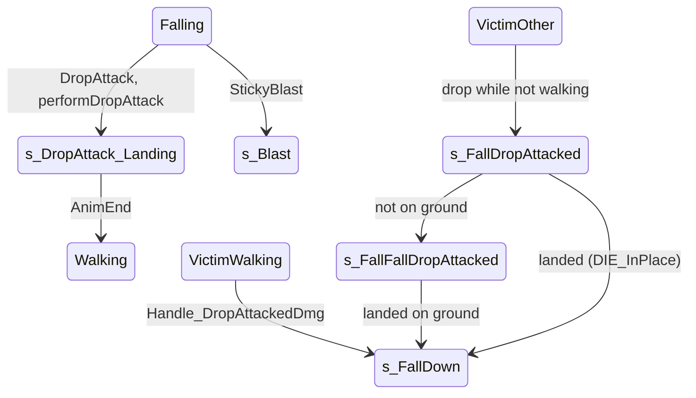

# Drop attack (landing on someone's head) and sticky blast

Units:
- uc:SBase.SPlayerController:DropAttack (global, empty)
- uc:SBase.SPlayerController:s_PlayerWalking.DropAttack
- uc:SBase.SPlayerController:s_PlayerRolling.DropAttack
- uc:SBase.SPlayerController:s_PlayerRolling.performDropAttack
- uc:SBase.SPlayerController:s_ZipLine.DropAttack
- uc:SBase.SPlayerController:PlayerFalling.DropAttack
- uc:SBase.SPlayerController:PlayerFallingInerte.DropAttack
- uc:SBase.SPlayerController:s_Coop_S_Base.DropAttack
- uc:SBase.SPlayerController:s_Coop_S_Base.performDropAttack
- uc:SBase.SPlayerController:s_Binoculars_Def.DropAttack
- uc:SBase.SPlayerController:s_Binoculars_Att.DropAttack
- uc:SBase.SPlayerController:performDropAttack
- uc:SBase.SPlayerController:s_GrabbingPlayer_Begin.performDropAttack
- uc:SBase.SPlayerController:s_GrabbingPlayer_RealBegin.performDropAttack
- uc:SBase.SPlayerController:s_GrabbingPlayer.performDropAttack
- uc:SBase.SPlayerController:TellServerForDropAttack
- rep:SBase.SPlayerController.TellServerForDropAttack
- uc:SBase.SPlayerController:TellServerToFallAttack
- rep:SBase.SPlayerController.TellServerToFallAttack
- uc:SBase.SPlayerController:CanBeDropAttacked (global and overrides)
- uc:SBase.SPlayerController:DropAttack_PawnFound
- uc:SBase.SPlayerController:DropAttackedDontMove
- uc:SBase.SPlayerController:s_DropAttacked_Incoming.{BeginState, DropAttackedDontMove, PlayerTick, PlayerMove}
- uc:SBase.SPlayerController:Handle_DropAttackedDmg
- uc:SBase.SPlayerController:s_FallDropAttacked.BeginState
- uc:SBase.SPlayerController:s_FallDropAttacked.MyNotifyLanded
- uc:SBase.SPlayerController:s_FallDropAttacked.PlayerMove
- uc:SBase.SPlayerController:s_FallFallDropAttacked.MyNotifyLanded
- uc:SBase.SPlayerController:s_DropAttack_Landing.{EndState, AnimEnd, BeginState, PlayerMove}
- uc:SBase.SPlayerController:StickyBlast
- uc:SBase.SPlayerController:TellClientToStickyBlast
- rep:SBase.SPlayerController.TellClientToStickyBlast
- uc:SBase.SPlayerController:s_FallAfterGrabbedFromLedge.NotifyBump
- uc:SBase.SPlayerController:PlayerFallingInerte.NotifyBump

## Purpose
A player who lands on another player's head from a fall or jump knocks him down (and, with the optional lethal
technique, kills him). The same contact with a player wearing sticky-shocker skin blows the attacker away instead.

## Data
| Item | Value | Notes |
|---|---|---|
| drop attack call | `PawnTakeDamage(17, attacker, (0,0,0), (0,0,1), SDamage_DropAttacked, 1)` | pill 1, no regenerable part |
| damage after the head multiplier | int(17 * 300 * 0.01) = 51 | zone table pill 1 |
| GRI.bAvlb_SPY_LeathalDropTech / bAvlb_MERC_LeathalDropTech | false / false | spy-on-merc / merc-on-spy drop kills outright |
| points | AddPoint(team, controller, 16) = 2 (AP_D_KnockOut) | see rules 3 and 5 for who receives them |
| SGameMessages 16 | "<attacker> has neutralized <victim>" | |
| sticky blast | `DamagePawn_C2S(self, 200, sticky pawn, Location, me - sticky, SDTStickyBlast, 0)` | always lethal |

## Rules

### Detection
1. The native falling physics calls the controller event `DropAttack(PawnToAttack)` when the pawn lands on another
   pawn (exact conditions in Open questions). The global event is empty; states that implement it:
   - `s_PlayerWalking` family, `PlayerFalling` family (PlayerFalling, PlayerFallToBackGrab, PlayerFallingFromRoll),
     `s_Binoculars_Def`, `s_Binoculars_Att`: `performDropAttack(PawnToAttack)`;
   - `s_PlayerRolling`, `s_Coop_S_Base` family: their own performDropAttack (rule 4, without the landing state);
   - `s_ZipLine` family: with authority `performDropAttack`; on a remote owner `ChangeState('s_DropAttack_Landing')`
     and `TellServerForDropAttack(PawnToAttack)`;
   - `PlayerFallingInerte` / `PlayerFallingKO`: ignored (but see rule 6).
2. `DropAttack_PawnFound` (returns false) and `DropAttackedDontMove(AttackedBy)` (server sets the victim's
   `m_AttackedBy`; ignored in `s_Inactive` and `s_DropAttacked_Incoming`) are native callbacks; `s_DropAttacked_Incoming`
   is never entered by script (Open questions).

### Applying the drop
3. Global `performDropAttack(P)` (authority only, P not None, attacker alive):
   `P.Controller.PawnTakeDamage(17, attacker, (0,0,0), (0,0,1), SDamage_DropAttacked, 1)`;
   `MirrorState('s_DropAttack_Landing')`; `AddPoint(0, attacker, 16)` (team 0 total, attacker score, either side);
   if P is still alive, broadcast message 16.
4. Variants without `s_DropAttack_Landing`: `s_PlayerRolling` and `s_Coop_S_Base` (same as rule 3 otherwise);
   `s_GrabbingPlayer_Begin`, `s_GrabbingPlayer_RealBegin`, `s_GrabbingPlayer` (no alive check on the attacker; the
   spy keeps holding his merc).
5. `TellServerForDropAttack(P)` (reliable owner-to-server RPC, zip line): same damage call, `AddPoint(0, attacker,
   16)`, message 16 (always, even if P died).
6. `TellServerToFallAttack(Other)` (reliable owner-to-server RPC) is sent by the owner from `NotifyBump` in
   `PlayerFallingInerte`, `PlayerFallingKO` and `s_FallAfterGrabbedFromLedge` when Other is an SBasePawn whose top
   (Z + 0.8 * CollisionHeight) is at or below our feet (Z - CollisionHeight), unless Other has sticky skin (rule 12).
   Server: if `Other.Controller.CanBeDropAttacked()`: `Other.m_AttackedBy = attacker`; if the two have different
   SPawnType: `AddPoint(0, Other's controller, 16)` when the attacker is a spy, else `AddPoint(1, Other's controller,
   16)` (the victim's score receives the points: original quirk); attacker music 'Jingl_AsomDrop_Attac', victim
   'Jingl_AsomDrop_Def'; the damage call of rule 3; message 16 if Other survived. Note: a falling corpse or a
   knocked-out falling player can therefore drop-attack.
7. `CanBeDropAttacked()` is false by default and true in: the walking family (including rolling, landing, throw,
   mine-on-wall, revive), ladders, back-to-wall, the jump and falling family, zip lines, the terminate states,
   `s_InteractWithObject` family, `OnLedge` and hoist states, sticky cam and camera network use, binoculars,
   `s_Maintain_Use`, `s_Berserk360`, `s_OnPipe`, `s_GrabbingPlayer`, `OnFence`, `s_Hack_Use`, computer states,
   `s_UseObject_Mirador`, `s_PlayerCharging`. It is false while knocked down, lying, standing up, blasted, dead, in
   grab transitions and while being held. It gates only rule 6; rules 3 to 5 do not ask the victim.

### Victim reactions (server, after the pipeline)
8. Pipeline: pill 1 gives 51 damage unless the lethal technique applies (victim's Health). ClientDamage on the victim:
   rumble and `fLyingOnGroundDuration = 1.0` if attacker and victim have the same SPawnType, else 7.0. Stats
   DropAttacks / DropAttacksTaken / DeathFromDropAttack for enemy drops.
9. Reaction by the victim's state (`state-damage-reactions.md`): walking family, binoculars, sticky cam, mirador,
   berserk, charge, terminate and coop-goto call `Handle_DropAttackedDmg`; the global handler, jump family,
   back-to-wall, release, coop and interaction states call `MirrorState('s_FallDropAttacked')`; `s_FallDown`, grab
   transitions and lying states ignore it; the holding spy runs the grab rule (`spy-grab.md`).
10. `Handle_DropAttackedDmg(attacker)`: `ChooseDeathAnimation(victim - attacker)` gives DIE_Forward
    `MirrorState('s_FallDown', 'DIE_DropAttacked')`; DIE_Backward, DIE_Left, DIE_Right, DIE_InPlace give the matching
    label; other results do nothing.
11. `s_FallDropAttacked` (airborne or non-walking victim): BeginState: if this pawn was finishing a spy, release that
    spy (`MercCantTerminate`); if `Physics == PHYS_Walking` play the jump action (SA_JUMP_ST_0H for an unarmed spy, else
    SA_JUMP_ST_2H) and stay; else drop the weapon state on the owner (`WeaponLoaded = 0`), action SA_FALL_INERTE (106)
    and `GotoState('s_FallFallDropAttacked')`. Landing (owner): `ChangeState('s_FallDown', 'DIE_InPlace')`.
    `s_FallFallDropAttacked` landing (owner): if not on a pawn, SA_LAND_INERTE and `ChangeState('s_FallDown')` (no
    label); if it landed on a pawn, `DamagePawn_C2S(that pawn, 17, self, (0,0,0), (0,0,1), SDamage_DropAttacked, 1)`
    (the victim's body drop-attacks whoever is below; the owner stays in this state until it lands on the ground).
    PlayerMove: no jump, view rotation, zero acceleration.
12. `s_DropAttack_Landing` (attacker after a successful drop): BeginState (owner): action SA_DROPATTACK_LAND (7,
    forced), merc weapon idle and pain animation 0. Channel 0 AnimEnd (owner): uncrouch if crouched, then
    SA_WALK_ST_0H / `s_PlayerWalkingSt0H` if unarmed else SA_WALK_ST_2H / `s_PlayerWalkingSt2H`. EndState clears
    `m_AttackTarget`. Falling is ignored.

### Sticky blast
13. `StickyBlast(Other)` is raised by native code (and by the NotifyBump paths of rule 6) when the pawn lands on or
    bumps a pawn with `bStickySkinned` (sticky shocker skin). On the owner: `DamagePawn_C2S(self, 200, Other,
    Location, Location - Other.Location, SDTStickyBlast, 0)`, action SA_BLAST_LOOP (239), velocity
    `-2 * 350 * Normal(vector(Rotation) with Z = -1.5)` through `SetVelocityAndOrientationForBlast`, and
    `ChangeState('s_Blast')`. On the server it is forwarded to the owner with `TellClientToStickyBlast(Other)`.
    The blast states and the blast KO states ignore further StickyBlast calls (s_Blast, s_BlastFallAfterObstacle,
    s_BlastFloor, s_BlastWakeUp, s_KOAfterBlastFall, s_SleepAfterKOBlastFall); s_FallAfterGrabbedFromLedge does not
    (spy-grab.md rule 36). No state defines its own version, so every other state runs this global one.
14. The 200 damage kills (Health is 100); kill credit goes to the sticky pawn's controller (team check as usual).

## States

## Constants
| Name | Value | Unit | Provenance | Source |
|---|---|---|---|---|
| drop base damage | 17 | hp | decoded | performDropAttack |
| drop pill | 1 (head, 300 %) | - | decoded | same |
| drop result | 51 | hp | decoded | computed in float32 |
| head-over-feet test | Other.Z + 0.8 * Other.CH <= Z - CH | uu | decoded | NotifyBump |
| lying after same-type drop | 1.0 | s | decoded | ClientDamage |
| sticky blast damage | 200 | hp | decoded | StickyBlast |
| sticky blast speed | 700 along Normal(facing.X, facing.Y, -1.5), backwards | uu/s | decoded | StickyBlast |

## Network
- `performDropAttack` requires authority: on a dedicated server the `DropAttack` event must be raised by the server's
  own physics of the attacker (except zip lines, which ask with `TellServerForDropAttack`).
- `TellServerToFallAttack`, `TellServerForDropAttack`, `DamagePawn_C2S` are reliable owner-to-server RPCs with no
  distance validation.
- `TellClientToStickyBlast` is a reliable server-to-owner RPC.

## Edge cases
- Two drops kill a full-health spy or merc (51 + 51) because a drop has no regenerable part; with the lethal option
  the first drop kills.
- Dropping on a team mate costs no points (team check in SRTD only for kills) but gives 2 points through AddPoint and
  the victim lies only 1 s.
- A victim who is already knocked down, lying or in a grab transition is not affected by a performDropAttack hit
  except for the 51 damage (the `s_FallDown` handler ignores it entirely; the lying state applies the damage then asks
  for `s_FallDropAttacked`).

## Evidence
- Function sha1 prefixes: performDropAttack 43f237ae82a6, TellServerForDropAttack d8c35015cdbc, TellServerToFallAttack
  e55b9c7c5146, Handle_DropAttackedDmg c0811640c03a, StickyBlast ea0661b15a80, s_FallDropAttacked BeginState ef7a3af5,
  MyNotifyLanded 6638c7a7, s_FallFallDropAttacked MyNotifyLanded 4e6de115, s_DropAttack_Landing BeginState 011fb801.
- local/re-out/uc/SBase/SPlayerController.uc (lines around 4977 to 5045, 15612 to 15640, 15969 to 16343).
- Native action cases 7 (LandStAkDA0/2), 45, 46 (LandStXxDn2) in Bridge anim_catalog/execaction_cases.txt.

## Open questions
- Native trigger of the `DropAttack` event: minimum fall speed or height, which pawns qualify (team? state via
  `CanBeDropAttacked`?), whether `DropAttack_PawnFound` and `DropAttackedDontMove` are called during the fall to
  freeze the victim, and on which machine. Search Ghidra for the event name thunks; trace: drop from 300 uu and from
  100 uu onto a standing and a crouched merc.
- Native trigger of `StickyBlast` (contact with a sticky-skinned pawn during which movements).
