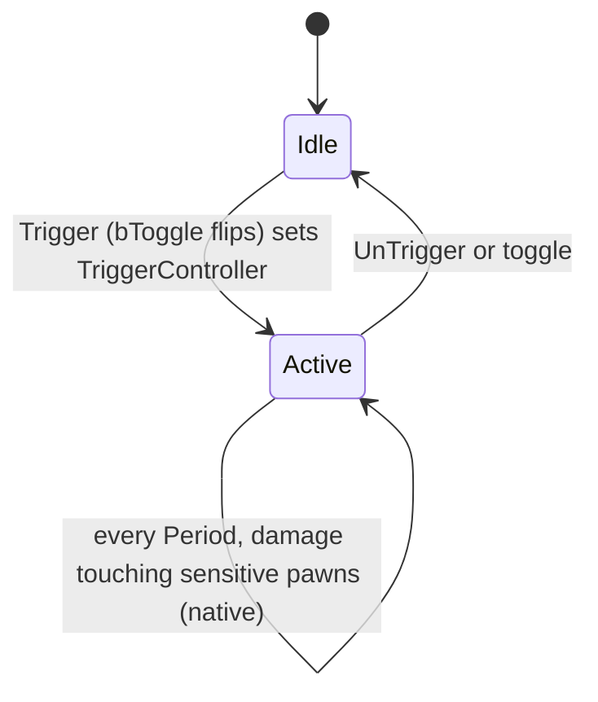

# Environmental damage: crushers, damage volumes, destructible objects, explosions, kill attribution

Units:
- uc:Engine.Mover:EncroachingOn
- uc:Engine.Mover:Trigger
- uc:Engine.Mover:TriggerOpenOnceOnly.SubTrigger
- def:Engine.Mover (MoverEncroachType, EncroachDamage)
- uc:SBase.SLift:EncroachingOn
- uc:Engine.Actor:CrushedBy
- uc:Engine.Actor:HurtRadius
- uc:SBase.SBasePawn:CrushedBy
- uc:SBase.SBasePawn:KilledBy
- uc:SBase.SGameInfo:CountEnvironmentalKill
- uc:SBase.SGameInfo:FindDamageVolume
- uc:SBase.SDamageVolume:Touch
- uc:SBase.SDamageVolume:Trigger
- uc:SBase.SDamageVolume:UnTrigger
- def:SBase.SDamageVolume
- eng:SBase.SDamageVolume.Tick (native class tick, vtable 0x10bfd848)
- uc:SBase.SPlayerController:bIsDamageVolumeSensitive
- uc:SBase.SPlayerController:s_Dead.bIsDamageVolumeSensitive
- uc:SBase.SPlayerController:GameEnded.bIsDamageVolumeSensitive
- uc:SBase.SPlayerController:s_GrabbedFromLedge_Begin.bIsDamageVolumeSensitive
- uc:SBase.SPlayerController:s_FallAfterGrabbedFromLedge.bIsDamageVolumeSensitive
- uc:SBase.SBasicGamePlayObject:TakeDamage
- uc:SBase.SGamePlayObject:TakeDamage
- uc:SBase.SGamePlayObject:Trigger
- uc:SBase.SGamePlayObject:s_Flying.Bump
- uc:SBase.SGamePlayObject:s_PickedUp.TakeDamage
- uc:SBase.SGamePlayObject:s_WaitForDamageReset.{BeginState, Timer}
- nat:SBase.SGamePlayObject.ProcessDamage
- def:SBase.SGamePlayObject
- uc:SBase.SAnimatedMesh:s_Wait.Trigger
- uc:Engine.AnimNotify_Trigger:Notify
- nat:SBase.SMagicEvent.NativeTrigger
- def:SBase.SProjFrag, def:SBase.SMineProx, def:SBase.SMineLaser, def:SBase.SBombTargetObjectiveTrigger (damage fields)

## Purpose
Damage that comes from the level rather than a weapon: movers that crush, volumes that hurt while you stand in them,
destructible objects that explode, thrown objects, and explosive gadgets. The central question for the port is who
gets the kill credit, because the original resolves an instigator through several fallbacks and counts
"environmental kills" for the Enhanced stats.

## Data
| Field | Owner | Type | Default | Notes |
|---|---|---|---|---|
| MoverEncroachType | Mover | enum | ME_ReturnWhenEncroach (1) | 0 Stop, 1 Return, 2 Crush, 3 Ignore, 4 WaitAndRetry |
| EncroachDamage | Mover | int | 0 | |
| Instigator | Actor | Pawn | None | set on movers and animated meshes by Trigger |
| SDamageVolume.bActive | | bool | false (SteeE instances true or toggled) | |
| SDamageVolume.bToggle | | bool | false | |
| SDamageVolume.DamageType | | SDamageType | SDTBase_NoAnim | |
| SDamageVolume.HitPoints | | int | 5 (SteeE: 10, molotov 30) | damage per period |
| SDamageVolume.Period | | float | 1.0 | |
| SDamageVolume.DamagedClass | | class | SBasePawn | |
| SDamageVolume.TriggerController | | Controller | None | kill credit |
| SDamageVolume.LastTouched / LastDamageTime | | Actor / float | | per volume, single entry |
| SGameInfo.GPODamageInstigator | | Pawn | None | set only during ProcessDamage |
| SGamePlayObject damage fields | | | bCanDamageActor false, DamageActorPoints 0, DamageActorRange 0, DamageActorType NoDamageType, ShakeRange 2000, ResetDamageTime 0, PercentDamageRefillable 0, TakeDamageTypes empty, DestroyOnEventFrom empty, DamagedMeshes empty, HitPoints 0 | def:SBase.SGamePlayObject |
| SProjFrag | | | Damage 334, Range 500, MyDamageType SDTBase, PercentDamageRefillable 30, MomentumTransfer 50000, ShakeRange 2000 | frag grenade |
| SMineProx | | | MyDamage 215, MyRange 400, MyDamageType SDamage_Explosion, PercentDamageRefillable 30 | proximity mine |
| SMineLaser | | | MyDamage 215, MyDamageType SDamage_Explosion | laser mine |
| SBombTargetObjectiveTrigger | | | DamageActorPoints 15, DamageActorRange 200, DamageActorType SDamage_Explosion | |

## Rules

### Movers and lifts
1. `Mover.EncroachingOn(Other)` (server physics callback when the mover would move into Other):
   - Other is a pawn with no controller, or a Decoration: `Other.TakeDamage(10000, None, ..., Crushed)` (no effect on
     an SBasePawn) and return false;
   - fragments, gibs, projectiles are destroyed;
   - if `EncroachDamage != 0` and the type is not Crush: a pawn gets
     `Controller.PawnTakeDamage(1000 * EncroachDamage, Instigator, Other.Location, (0,0,0), Crushed)` (authority only);
     other actors `TakeDamage(EncroachDamage, ..., Crushed, 1)`;
   - player bump events and `UnderLift` notification for pawns;
   - then by type: Stop (group stops, return true), Return (group returns, mover hit sound, return true), Crush
     (`Other.CrushedBy(Instigator)`, return false), Ignore (false), WaitAndRetry (state `s_WaitAndRetry`, true).
2. `SLift.EncroachingOn` is the same except: it does nothing within 2 s of its last encroach, there is no type
   switch (it always reverses toward the previous key and returns false), and `LastEncroachTime = int(now)`.
3. `SBasePawn.CrushedBy(EventInstigator)` (server):
   - if this pawn holds a merc (`m_AttackTarget.m_AttackedBy == self`): that merc gets
     `PawnTakeDamage(Health + 100, EventInstigator, (0,0,0), (0,0,1), SDTBase)` (note: the crushed spy's Health is
     used, not the merc's); if he was alive and now is dead and the instigator exists:
     `CountEnvironmentalKill(EventInstigator.Controller, merc controller)`;
   - this pawn gets `PawnTakeDamage(Health + 100, EventInstigator, (0,0,0), (0,0,1), SDTBase)`; if it died now and the
     instigator exists: `CountEnvironmentalKill(EventInstigator.Controller, own controller)`.
   The damage type is SDTBase, so `Killed` does not count it again (rule 12).
4. `SBasePawn.KilledBy(EventInstigator)`: `PawnTakeDamage(Health + 100, EventInstigator, (0,0,0), (0,0,1), SDTBase)`
   (no environmental count). Nothing in Versus calls it: no script does, and the game binary's only use of the
   KilledBy name is its registration (FName::StaticInit, name 0x9e2; no other code loads that name), so the port has
   no caller either. `SBasePawn.EncroachedBy` is empty (no telefrag).
5. Mover instigator: `Mover.Trigger(Other, EventInstigator)` uses `Other.Instigator` when EventInstigator is None; the
   `TriggerOpenOnceOnly` state stores `Instigator = EventInstigator` when it opens. `SAnimatedMesh` (state `s_Wait`)
   stores a non-None EventInstigator as its Instigator before animating; `AnimNotify_Trigger.Notify` fires its event
   with the mesh as Other and `Pawn(Owner)` (None) as instigator, so a mover triggered by a mesh notify inherits the
   mesh's Instigator. On SteeE the crane duct mover (`Mover2064`, Tag 'tueletube', MoverEncroachType 2 = Crush,
   InitialState TriggerOpenOnceOnly, KeyPos (0,0,-3920)) therefore credits a crush to whoever triggered the crane,
   if that pawn reached the crane mesh's Trigger (see Open questions).

### Damage volumes
6. `SDamageVolume.Trigger(Other, EventInstigator)`: bToggle flips bActive; otherwise an inactive volume becomes active.
   When the result is active: instigator = EventInstigator, else `Other.Instigator`, else `GPODamageInstigator`; if
   found, `TriggerController = instigator.Controller`. When the result is inactive, `TriggerController = None`.
   `UnTrigger`: inactive and no TriggerController.
7. `Touch(Other)`: if Other differs from LastTouched, `LastDamageTime = 0`; `LastTouched = Other`.
8. The damage itself is native (Open questions). Expected contract: while bActive, every Period seconds, each touching
   actor of DamagedClass whose controller returns true from `bIsDamageVolumeSensitive()` receives
   `Controller.PawnTakeDamage(HitPoints, None, ..., DamageType)`; a new toucher is hit immediately (LastDamageTime 0).
9. `bIsDamageVolumeSensitive()` is true except in `s_Dead`, `GameEnded`, `s_GrabbedFromLedge_Begin` and
   `s_FallAfterGrabbedFromLedge`.
10. Kill credit through the pipeline: with instigatedBy None and no GPO instigator, SRTD looks up
    `FindDamageVolume(Pawn, DamageType)`: the first touching SDamageVolume that is active, has the same DamageType and
    a TriggerController; its controller is the killer. Volumes that were never triggered (SteeE's six permanent
    10 hp volumes) have no TriggerController: their kills have no killer ("Someone killed <victim>", no points).
11. SteeE molotov: GPO `SGamePlayObject215` (TakeDamageTypes SDTBase, SDTStickyShocker, SDamage_Explosion; HitPoints 10;
    DamageActorType SDTBase_NoAnim, 50 points, range 200) fires event 'molotov' when destroyed; `SMagicEvent232`
    (Tag 'molotov') relays 'moloaie' after 1.0 s and again after 32.0 s (both with Type 2, EVT_TriggerUntrigger); the
    volume `SDamageVolume228` (Tag 'moloaie', HitPoints 30, bToggle, inactive at start) is expected to be on from
    1 s to 32 s (31 s), which matches the plan's reading; how the native relay sends a Type 2 event (one Trigger, or
    Trigger plus UnTrigger) decides this and is an open question. Its TriggerController comes from the instigator the
    magic event forwards (its queue stores one per event).

### Environmental kill count
12. `SGameInfo.Killed` counts an environmental kill for an enemy kill (or MercDeathMatch) when DamageType is Crushed,
    or the killer is the current `GPODamageInstigator`'s controller, or a damage volume with the same DamageType that
    the victim touches has the killer as TriggerController. `CrushedBy` counts its own (rule 3).
13. `CountEnvironmentalKill(Killer, Killed)`: ignored if either is None or they are the same, or they are team mates
    outside MercDeathMatch; else killer `Stats.EnvironmentalKills += 1`, victim `Stats.DeathFromEnvironmental += 1`.

### Destructible objects (GPO)
14. `SBasicGamePlayObject.TakeDamage`: ignored unless bDamageable (or a sticky shocker hit on a
    bStickyDamageIsLikeChaff object, which sparks and locks the object as if chaffed for StickyNeutralizationTime,
    default 10 s); otherwise `HitPoints = max(HitPoints - Damage, 0)` and the object is destroyed at 0.
15. `SGamePlayObject.TakeDamage(Damage, EventInstigator, HitLocation, Momentum, DamageType, PillTag)`:
    - if TakeDamageTypes is not empty and DamageType is not in it: ignore;
    - TakeDamageSound; sticky-as-chaff handling as rule 14;
    - `Instigator = EventInstigator`;
    - momentum: if non-zero, M = 300 * M / |M|, M.X += 50 * FRand() - 25, M.Y += 50 * FRand() - 25,
      M.Z = max(|M.Z| as int, 300);
    - pushable objects: `Velocity += M * 5 / Mass`, state `s_Flying`;
    - set `GPODamageInstigator = EventInstigator` (if not None) for the duration of the native `ProcessDamage(Damage)`,
      then restore the previous value. Any pawn damage the native code deals during ProcessDamage with no instigator
      is therefore credited to EventInstigator (SRTD fallback A).
16. `SGamePlayObject.Trigger(Other, EventInstigator)`: instigator defaults to `Other.Instigator`; a damageable object
    with HitPoints > 0 listed to be destroyed by Other (`DestroyOnEventFrom`) takes `TakeDamage(HitPoints,
    EventInstigator, Location, (0,0,200), TakeDamageTypes[0] or SDTBase)` (full destruction, which may chain explosions
    with the same instigator); otherwise it toggles its triggered skin or mesh and its lights.
17. Native `ProcessDamage` (0x10a8fc40, body 0x10a8fc90; decoded in natives2-damage.md rule 1): subtract Damage
    from HitPoints; swap to the DamagedMeshes entry whose Percent threshold is reached (optionally disabling collision
    and firing its Event with EventType); spawn SpawnableObjects in their percent range (`SpawnDamageEmitter` on
    clients); when destroyed, with bCanDamageActor and DamageActorRange > 0, every visible actor with
    `int(d2) < DamageActorRange^2` and a clear 0x286 line takes `int((DamageActorRange - dist) DamageActorPoints /
    DamageActorRange)` of DamageActorType with no instigator, a pawn through its player controller's PawnTakeDamage
    (spy hold rule, spy first), anything else through TakeDamage; pawns out of reach within ShakeRange are shaken
    (the shake only exists for such an object); with ResetDamageTime > 0 go to `s_WaitForDamageReset` (`WaitReset`
    event).
18. `s_WaitForDamageReset` ignores triggers, touches, damage, pickup and throw; after ResetDamageTime it restores
    HitPoints, mesh, skin and lights.
19. Thrown or pushed GPO (`s_Flying.Bump`): non-pawns bounce (velocity reversed with +-25 uu/s jitter on X and Y);
    pawns: ignored below 20 uu/s; BumpDamage = |Velocity| * Mass / 500; instigator = Owner if it is an SBasePawn, else
    the Owner controller's pawn; if BumpDamage > 8: `PawnTakeDamage(int(BumpDamage), instigator, Location, Velocity,
    SDTBase)`. A picked-up object (`s_PickedUp`) takes no damage.
20. `Actor.HurtRadius` calls `TakeDamage` on victims, so it never damages SBasePawns (their TakeDamage is empty). Every
    explosion that hurts players does so from native code with `PawnTakeDamage`.

### Explosive damage on players
21. Damage type decides the pawn-side result: SDamage_Explosion (mines, gas tanks with DamageActorType 4, bomb target)
    always deals 200 (lethal) unless spawn protection applies, and may blast; SDTBase from a frag grenade (class
    default) or a GPO with DamageActorType 5 is scaled by the native code and goes through the approximate pill (no
    zone table); SDTBase_NoAnim (DamageActorType 6) gives no hit animation; SDamage_Charged (DamageActorType 1, used by
    several SteeE GPOs with 600 points and 400 uu range) causes the charge knock-back reaction and 3 s KO on survivors.

### Native area damage (decoded, natives2-damage.md rules 1, 4, 5, 6)

- Gameplay object blast (ProcessDamage at 0 HP): every visible actor (world line 0x286) within DamageActorRange by
  centre distance takes `int((DamageActorRange - dist) x DamageActorPoints / DamageActorRange)`, momentum from the
  object to the victim, type DamageActorType, instigator None (the script wrapper supplies GPODamageInstigator);
  stage events fire with instigator None.
- Frag (SProjFrag.Explode): `int((1 - dist / Range) x Damage)`; pawns need sight by one of three lines (centre, then
  +-0.9 H); type SDamage_Explosion inside fDistForBlast, else SDTBase; momentum victim - frag (not normalised);
  instigator the owner pawn; HitLocation the victim raised by 0.5 H; PillTag 0.
- Mines (SMineProx / SMineLaser.Explosion): reach from the reference point (MyRange, or MyDamageRange for the laser
  mine), falloff over MyDamageRange from the mine, instigator PcOwner.Pawn; among non-pawns only gameplay objects and
  extinguishers are hurt.
- Damage volume: see devices/damage-volume.md rule "Native damage tick".
- Native blasts reach players only through PawnTakeDamage on their SPlayerController; HurtRadius only reaches
  TakeDamage (natives2-damage.md Data).

## States

## Constants
| Name | Value | Unit | Provenance | Source |
|---|---|---|---|---|
| crush damage | Health + 100 SDTBase | hp | decoded | SBasePawn.CrushedBy |
| encroach damage | 1000 * EncroachDamage, Crushed | hp | decoded | Mover/SLift.EncroachingOn |
| uncontrolled pawn crush | 10000 via TakeDamage (no effect) | hp | decoded | same |
| lift encroach cooldown | 2 | s | decoded | SLift.EncroachingOn |
| damage volume period | 1.0 | s | decoded | def:SBase.SDamageVolume |
| GPO momentum | 300 + jitter 25, Z >= 300 | uu | decoded | SGamePlayObject.TakeDamage |
| GPO push | M * 5 / Mass | uu/s | decoded | same |
| bump damage | |V| * Mass / 500, threshold 8, min speed 20 | hp | decoded | s_Flying.Bump |
| destroy-on-event push | (0, 0, 200) | - | decoded | SGamePlayObject.Trigger |
| SteeE molotov window | 1 s to 32 s after the event | s | decoded | SMagicEvent232 map data |
| SteeE duct drop | 3920 | uu | decoded | Mover2064 map data |

## Network
- Everything here is server side. Movers and GPOs replicate their movement, mesh and skin (RepSkin) to clients;
  `SpawnDamageEmitter`/`KillDamageEmitter` are reliable server-to-client calls on the GPO.
- SDamageVolume has RemoteRole None (server only).

## Edge cases
- `GPODamageInstigator` is global: if a GPO explosion's native code damages a pawn whose own damage call has a real
  instigator, that instigator wins; only None instigators use the GPO fallback.
- A spy crushed while holding a merc kills both, and each death counts as an environmental kill for the crusher.
- `FindDamageVolume` returns the first matching volume; overlapping volumes with different triggerers credit the
  first in touch order.
- Kill credit from a volume needs the same DamageType on the volume and on the damage; a native call with a different
  type finds no volume.

## Evidence
- uc:Engine.Mover:EncroachingOn sha1 850b9a1609fe; Engine.Mover:Trigger faa937d3b714; SBase.SLift:EncroachingOn
  e0fa2e15db70; SBase.SBasePawn:CrushedBy cfd8f0620805; KilledBy 4d214f5ae7d0; SBase.SGameInfo:CountEnvironmentalKill
  9c45b15d8951; FindDamageVolume 1488dcce31b3; SBase.SDamageVolume:Trigger db5589ef0e1d; Touch 6eb8ed3eadb8;
  SBase.SGamePlayObject:TakeDamage 1fe4f245c8aa; Trigger f59b192f4df2; s_Flying.Bump b0369a952578;
  SBase.SBasicGamePlayObject:TakeDamage 0e047980c60a; Engine.Actor:HurtRadius 1af2494613dd;
  SBase.SAnimatedMesh:s_Wait.Trigger 80b0f51f01e8; Engine.AnimNotify_Trigger:Notify 15b4bf1c561e.
- SteeE actors read with scctpkg from Packages/Maps/SteeE.sdc: Mover2064, SDamageVolume228/269/1985/2005/2016/2026/2046,
  SMagicEvent232, SGamePlayObject215 and the 600-point objects (SGamePlayObject1787, 386, 377, 2417, 258, 275, 315,
  355, 2408, 316, 291, 276, 354, 2400, 883, 306 with DamageActorType 1; 368 and 433 with type 4).
- Natives: SGamePlayObject.ProcessDamage 0x10a8fc40, NativeHitWall 0x10a90870, SMagicEvent.NativeTrigger (native
  1793), SDamageVolume vtable 0x10bfd848, SProjFrag::Explode 0x10ab4780, SMineProx.Explosion 0x10ac1190,
  SMineLaser.Explosion 0x10a93ee0 (Ghidra annotations re/ghidra/annotations/game.json, Bridge docs/GADGET_TIMINGS.md).

## Open questions
- Whether the crane control use passes the spy as instigator through SInterrupteur to the crane SAnimatedMesh
  (objectives spec), and whether the crane notify uses AnimNotify_Trigger or a scripted notify.

### Resolved
- SDamageVolume native tick. Resolved: real-time period strictly exceeded, every touching actor of DamagedClass,
  pawns only through bIsDamageVolumeSensitive, `PawnTakeDamage(HitPoints, None, A.Location, A - volume, DamageType,
  0, 0)`. Evidence: natives2-damage.md rule 6 (ANSWERS-natives2 23).
- `ProcessDamage` area damage. Resolved: centre distance, line of sight 0x286, linear falloff, instigator None,
  DamageActorType; stage events with instigator None. Rule "Native area damage". Evidence: natives2-damage.md rule 1
  (ANSWERS-natives2 18).
- Native explosions of grenades and mines. Resolved: frag `int((1 - dist / Range) Damage)`, SDamage_Explosion inside
  fDistForBlast else SDTBase, momentum victim - frag (not normalised), instigator the owner pawn, PillTag 0; mines
  as in rule "Native area damage". Evidence: natives2-damage.md rules 4, 5 (ANSWERS-natives2 20, 21).
