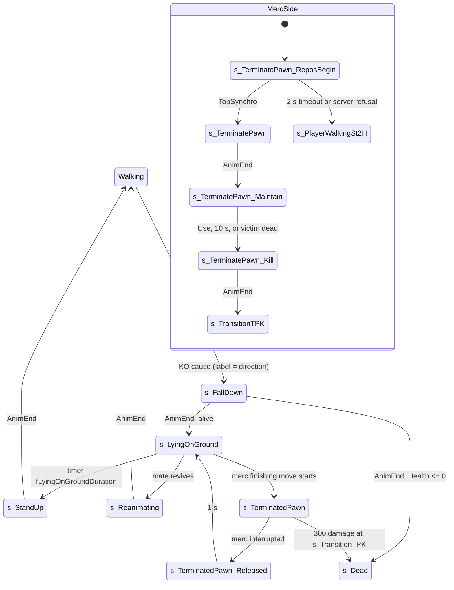

# Knock-out (downed) state, waking, reviving and the merc finishing move

Units:
- uc:SBase.SPlayerController:s_Inactive.PlayerMove
- uc:SBase.SPlayerController:s_Inactive.PlayerTick
- uc:SBase.SPlayerController:s_Inactive.CanActivateLaser
- uc:SBase.SPlayerController:s_Inactive.HearPC
- uc:SBase.SPlayerController:s_FallDown.BeginState
- uc:SBase.SPlayerController:s_FallDown.AnimEnd
- uc:SBase.SPlayerController:s_FallDown.PlayerTick
- uc:SBase.SPlayerController:s_FallDown@code (labels DIE_Forward, DIE_Backward, DIE_Left, DIE_Right, DIE_InPlace,
  DIE_DropAttacked, DIE_InPlaceWhileGrabbing)
- uc:SBase.SPlayerController:s_LyingOnGround.BeginState
- uc:SBase.SPlayerController:s_LyingOnGround.Timer
- uc:SBase.SPlayerController:s_LyingOnGround.EndState
- uc:SBase.SPlayerController:s_LyingOnGround.PlayerTick
- uc:SBase.SPlayerController:s_LyingOnGround.CanBeReanimated
- uc:SBase.SPlayerController:s_StandUp.BeginState
- uc:SBase.SPlayerController:s_StandUp.AnimEnd
- uc:SBase.SPlayerController:s_StandUp.EndState
- uc:SBase.SPlayerController:s_StandUp.PlayerTick
- uc:SBase.SPlayerController:s_StandUp.ExplosionHit
- uc:SBase.SPlayerController:s_Reanimating.BeginState
- uc:SBase.SPlayerController:PlayerFallingKO.BeginState
- uc:SBase.SPlayerController:PlayerFallingKO.MyNotifyLanded
- uc:SBase.SPlayerController:FindPawnToReanimate
- uc:SBase.SPlayerController:FindPawnToReanimateOrTerminate
- uc:SBase.SPlayerController:AskServerToReanimatePawn
- rep:SBase.SPlayerController.AskServerToReanimatePawn
- uc:SBase.SPlayerController:CanBeReanimated
- uc:SBase.SPlayerController:s_ReanimateFriend_0H.BeginState
- uc:SBase.SPlayerController:s_ReanimateFriend_0H.AnimEnd
- uc:SBase.SPlayerController:s_ReanimateFriend_0H.PlayerMove
- uc:SBase.SPlayerController:s_ReanimateFriend_2H.BeginState
- uc:SBase.SPlayerController:s_ReanimateFriend_2H.AnimEnd
- uc:SBase.SPlayerController:s_ReanimateFriend_2H.PlayerMove
- uc:SBase.SPlayerController:AskServerToTerminatePawn
- rep:SBase.SPlayerController.AskServerToTerminatePawn
- uc:SBase.SPlayerController:bIsTerminatingPawn
- uc:SBase.SPlayerController:MercCantTerminate
- uc:SBase.SPlayerController:s_TerminatePawn_Base.BeginState
- uc:SBase.SPlayerController:s_TerminatePawn_Base.MyFalling
- uc:SBase.SPlayerController:s_TerminatePawn_Base.PlayerMove
- uc:SBase.SPlayerController:s_TerminatePawn_Base.ReceiveAnEvent
- uc:SBase.SPlayerController:s_TerminatePawn_Base.ServerSendAnEvent
- uc:SBase.SPlayerController:s_TerminatePawn_Base.SendAnEventToServer
- uc:SBase.SPlayerController:s_TerminatePawn_ReposBegin.BeginState
- uc:SBase.SPlayerController:s_TerminatePawn_ReposBegin.Timer
- uc:SBase.SPlayerController:s_TerminatePawn_ReposBegin.TopSynchro
- uc:SBase.SPlayerController:s_TerminatePawn.BeginState
- uc:SBase.SPlayerController:s_TerminatePawn.AnimEnd
- uc:SBase.SPlayerController:s_TerminatePawn.PlayerMove
- uc:SBase.SPlayerController:s_TerminatePawn_Maintain.BeginState
- uc:SBase.SPlayerController:s_TerminatePawn_Maintain.Timer
- uc:SBase.SPlayerController:s_TerminatePawn_Maintain.PlayerMove
- uc:SBase.SPlayerController:s_TerminatePawn_Kill.BeginState
- uc:SBase.SPlayerController:s_TerminatePawn_Kill.EndState
- uc:SBase.SPlayerController:s_TerminatePawn_Kill.AnimEnd
- uc:SBase.SPlayerController:s_TransitionTPK.BeginState
- uc:SBase.SPlayerController:s_TerminatePawn_Fall.BeginState
- uc:SBase.SPlayerController:s_TerminatePawn_Fall.EndState
- uc:SBase.SPlayerController:s_TerminatedPawn.BeginState
- uc:SBase.SPlayerController:s_TerminatedPawn.Timer
- uc:SBase.SPlayerController:s_TerminatedPawn.MercCantTerminate
- uc:SBase.SPlayerController:s_TerminatedPawn_Released.BeginState
- uc:SBase.SPlayerController:GoInSmoke
- uc:SBase.SPlayerController:PlayerTick (merc smoke section)
- uc:SBase.SPlayerController:FindGasInstigator
- uc:SBase.SPlayerController:CountGasKO
- uc:SBase.SPlayerController:PCChangeServerState (gas KO credit part)
- uc:SBase.SPlayerController:GotoWaitingState
- rep:SBase.SPlayerController.GotoWaitingState
- rep:SBase.SBasePawn.m_PawnToTerminate
- def:SBase.SPlayerController (KO subset)

## Purpose
A knocked-out player falls, lies on the ground for a duration that depends on the cause, and stands up. While lying
he can be revived by a team mate, shot, or (a spy, by a merc) finished with the terminate move. This spec defines
those states, the durations, the wake-up protections and the finishing move. Causes of a knock-out are specified in
their own specs and summarised in the table in the Data section.

## Data
KO causes and lying time (`fLyingOnGroundDuration`, read by `s_LyingOnGround`; reset to 7.0 when lying ends):

| Cause | Entry on the victim | Lying time |
|---|---|---|
| enemy drop attack, standing | `s_FallDown` with a direction label | 7.0 s |
| drop attack by a pawn of the same SPawnType | `s_FallDown` | 1.0 s |
| drop attack while jumping, on a ladder etc. | `s_FallDropAttacked` then `s_FallDown` DIE_InPlace on landing | 7.0 s |
| 12th elbow strike within 8 s, or any elbow strike on a crouched target | `s_FallDown` with a direction label | 7.0 s |
| taser, end of the freeze, in a walking state | `s_FallDown` DIE_InPlace | 7.0 s |
| smoke grenade or sticky cam gas (mercs) | `s_FallDown` DIE_InPlace, or `s_FallDropAttacked` if airborne | 7.0 s |
| charge or berserk hit | `s_Charge_GoBackward` then `s_LyingOnGround` | 3.0 s (fKOAfterBerserkOrCharge) |
| knocked off a ledge by a charge (falling) | `PlayerFallingKO` then `s_LyingOnGround` | 3.0 s |
| grab knock-out release (merc) | `s_GrabbedByPlayer_Released_KO` then `s_LyingOnGround` | 7.0 s |
| lost a counter-grab (spy) | `s_GrabRelease_Counter` then `s_LyingOnGround` | 3.0 s (fKOAfterCounterGrab) |
| drop attacked while grabbing (spy) | `s_FallDown` DIE_InPlaceWhileGrabbing | 7.0 s |
| terminate move interrupted (spy) | `s_TerminatedPawn_Released` then `s_LyingOnGround` | 1.0 s |
| blast into an obstacle | `s_KOAfterBlastFall` then `s_SleepAfterKOBlastFall` | 3.0 s (`blast-and-fall-damage.md`) |

Fields:

| Field | Owner | Type | Default | Notes |
|---|---|---|---|---|
| fLyingOnGroundDuration | SPlayerController | float | 7.0 | |
| fLyingOnGroundTime | SPlayerController | float | 0 | time lying started (owner) |
| fKOAfterBerserkOrCharge | SPlayerController | float | 3.0 | |
| fKOAfterCounterGrab | SPlayerController | float | 3.0 | |
| fWakeInvulnerabilityTime | SPlayerController | float | 3.8 | grab and elbow protection after waking |
| fLastTimeWakeUp | SPlayerController | float | 0 | set when lying ends and when standing up ends |
| fMaxTimeMaintainingPawn | SPlayerController | float | 10.0 | longest hold in the finishing move |
| iNbDropAttackBeforePawnDies | SPlayerController | int | 3 | never read by script |
| fNbSecondsbetweenDropAttackBeforePawnDies | SPlayerController | float | 55.0 | never read by script |
| bSleeping | SBasePawn | bool | false | bit 0x00200000 at +0xAF0; native: set by SA_REMOVE_COLLISION (320) while Health > 0, cleared by SA_STANDUP (11) |
| bCanBeTerminated | SBasePawn | bool | false | bit 0x00000200 at +0xAF0; native: set by 320, cleared by 11 |
| bLyingOnGround | SBasePawn | bool | false | bit 0x00004000 at +0xAF0; set by 320, cleared by script |
| iLastWakeTime | SBasePawn | int | 0 | +0x63C; written by AnimateStandUp (SA_STANDUP): int(now + wake clip length), whole seconds |
| m_PawnToTerminate | SBasePawn | SBasePawn | None | replicated reliable from server |
| bCanBeGrabbed | SBasePawn | bool | true | replicated |
| btoCought, bInSmoke, fSmoke_FallDate, fSmoke_EndOfCoughDate, fSmoke_NextMovementCoughDate | SPlayerController | | | smoke cough and faint bookkeeping (owner) |
| SmokeInstigator(Time), StickyCamInstigator(Time) | SPlayerController | Pawn, float | | stats only |

## Rules

### Common behaviour of the s_Inactive family
1. `s_Inactive` and its children (`s_FallDown`, `s_FallDownDying`, `s_LyingOnGround`, `s_StandUp`, `s_Reanimating`,
   `s_KOAfterBlastFall`, `s_SleepAfterKOBlastFall`, `s_BlastWakeUp`, `s_LandingInerte`, `s_TerminatedPawn`,
   `s_PlayerFalling_OutOfWorld`) ignore fire, alt fire, gadgets, goggles, binoculars, smoke, cloak and
   `DropAttackedDontMove`; `CanActivateLaser` is false; a taser (pill -10) is converted to pill 5 (`shock-and-taser.md`).
2. PlayerMove: a merc's view rotation is locked to the pawn yaw; a spy's camera turns freely (yaw and pitch from the
   turn/look inputs times 32 times DeltaTime, inverted horizontally if the spy invert option is set, pitch clamped to
   15000 up and 50536 down in unsigned units). The pawn receives zero acceleration.
3. Gadget selection is refused while in `s_FallDropAttacked`, `s_LyingOnGround` or `s_FallDown`.
4. `HearPC` routes voice to the talking partner and that partner's team mates (voice spec).

### s_FallDown (falling down)
5. Entered with `MirrorState('s_FallDown', Label)` (server) or `ChangeState('s_FallDown', Label)` (owner). Damage
   handling: `state-damage-reactions.md` rule 21.
6. BeginState (every machine): binoculars off, reticle hidden, laser off. Server: if this pawn was finishing a spy
   (`m_PawnToTerminate` set), call that spy's `MercCantTerminate()` (releases him). Owner:
   `Goggle.ResetVisionMode(true)`; leave back-to-wall (SA_BTW_OUT); if Health > 0: camera attached to bone 'B Head',
   HUD perturbation 1.5 s, and for a merc: first person view, HUD slot reset and a sleep overlay
   (SFXT_TextureColorSleep 0 to 255 over 7.5 s, linear), weird effect 1. A spy's camera goes to walking mode. If the
   player is still shocking and input frozen: clear bTazered, input, action 56 and weapon electric end.
7. Label code (owner only, runs right after BeginState): DIE_Forward plays SA_DIE_FORWARD (40), DIE_Backward
   SA_DIE_BACKWARD (41), DIE_Left 42, DIE_Right 43, DIE_InPlace 44, DIE_DropAttacked SA_DIE_DROPATTACK (46),
   DIE_InPlaceWhileGrabbing SA_GRAB_DROPATTACKED (29). No label plays nothing.
8. PlayerTick: `bFire = 0` then the global tick.
9. Channel 0 AnimEnd on the owner: Health <= 0 gives `ChangeState('s_Dead')` (unless GameEnded); else
   `ChangeState('s_LyingOnGround')`.
10. `s_FallDownDying` (grabbing spy drop-attacked to death): see `death-and-respawn.md` rule 11.

### s_LyingOnGround
11. BeginState: enemy team stops hearing him (`OtherTeamCantHearMe`), he hears spy bullet comms
    (`ServerHearSpybullets(true)`). Owner: action SA_REMOVE_COLLISION (320) (decoded, execute-action.md case 320:
    m_AttackedBy = m_AttackTarget = None, set bCanBeTerminated and bLyingOnGround, and bSleeping while Health > 0,
    collision col(1, 0, 0): actors on, blocking off); `fLyingOnGroundTime = now`;
    `SetTimer(fLyingOnGroundDuration, false)`; a merc wearing a gas mask uses it once (`SGadGasMask.Use(1.0)`).
    Server: unless he can always talk to mates, `TalkToMate(false)`.
12. PlayerTick: `bFire = 0`, global tick. Damage: global handler (full damage from bullets and explosions).
13. Timer (owner): `ChangeState('s_StandUp')`.
14. `CanBeReanimated` returns true only in this state.
15. EndState (every machine): `TimeShock = now`, `fLastTimeWakeUp = now`, `fLyingOnGroundDuration = 7.0`. Owner: weird
    effect 0; a merc gets an overlay fade 255 to 1 over 0.25 s. Server: `TalkToMate(true)`.

### s_StandUp and s_Reanimating
16. `s_StandUp.BeginState`: server and merc: the wake-up shock (`TimeShock = now - RealTimeInvulSticky - 1`,
    `Checkshock(0, false)`, see `shock-and-taser.md` rule 26). If the specials-chat key is held, spy bullet comms off.
    Owner: action SA_STANDUP (11) (decoded, execute-action.md case 11 and rule 5.12: clear bStillGrabbed,
    bCanBeTerminated and bSleeping, m_AttackedBy = m_AttackTarget = None, collision col(1, 1, 1) and bCollideWorld,
    Walking, then AnimateStandUp picks the wake clip from the current channel 0 clip and sets
    `iLastWakeTime = int(TimeSeconds + frames / rate)` of that clip when its rate is positive, the time the wake clip
    ends, so the 3.8 s grab and 4.0 s elbow protections of rules 22 and 23 count from the end of the stand-up); a merc gets the overlay fade (255 to 1 over 0.25 s) and a cross-eye blur 1 to 0 over 4.5 s.
    Binoculars off.
17. `s_Reanimating.BeginState` (revived by a mate): no wake-up shock. Owner: SA_STANDUP (11); a merc gets the overlay
    fade; both sides get the cross-eye blur 1 to 0 over 4.5 s. Binoculars off. Other functions as `s_StandUp`.
18. Channel 0 AnimEnd (owner): detach the head camera, `GotoWaitingState()` (walking state by team, stance and weapon).
19. EndState: reticle back unless the laser was on, laser restored, `btoCought = false`, `TimeShock = now`,
    `fLastTimeWakeUp = now`; a merc: overlay constant 1, weapon back to `s_Selected` with the idle animation,
    `bDrawWeapon = true`, first person view. Server: `bLyingOnGround = false`; voice routing restored for up to 3 chat
    partners.
20. `ExplosionHit` during the stand-up blasts the player like a standing player (`blast-and-fall-damage.md`).
21. PlayerTick: `bFire = 0`.

### Wake-up protections (exact list; there is no general invulnerability)
22. Grabs: a target is grabbable only if `now - iLastWakeTime > 3.8` (normal grab and ledge grab client tests; the
    server ledge-grab test is inverted, see `spy-grab.md`).
23. Elbow target selection: `now - iLastWakeTime > 4.0` (3.8 + 0.2).
24. Smoke and gas: a merc ignores `GoInSmoke` for 2.0 s after `fLastTimeWakeUp`.
25. Shocks: `TimeShock = now` at the end of lying and at the end of standing up starts a new immunity window of
    `RealTimeInvulSticky` (merc: 12.5 s after the wake-up shock). A merc is also grab-immune for 5 s after the wake-up
    shock (`TimeShockForGrab`).
26. Bullets, explosions, drops after standing, charges and berserk hits apply immediately after waking.

### PlayerFallingKO (knocked off something by a charge)
27. Entered by `s_Charge_GoBackward.MyFalling` (owner `ChangeState`). BeginState: `ResetZones()`, reticle off;
    owner: action SA_FALL_INERTE (106). It inherits `PlayerFallingInerte` (10 s timeout to `s_Dead`, falling-corpse
    drop attack in NotifyBump).
28. Landing (owner): action SA_LAND_INERTE; if Health <= 0: merc overlay fade, `ChangeState('s_LandingInerte')`;
    else h = fZMaxFalling - Location.Z; Dmg = 0; if h > Fell_MinHeightForDmg:
    `Dmg = (h - Fell_MinHeightForDmg) / (Fell_MaxHeightForDmg - Fell_MinHeightForDmg) * default.Health` and
    fZMaxFalling = Location.Z; then `Dmg = max(Dmg, 10)`; if `Health - Dmg <= 0`: overlay fade (merc),
    `ChangeState('s_LandingInerte')`, `DamagePawn_C2S(self pawn, Health, Pawn, Location, (0,0,-1), SFell)`; else
    `DamagePawn_C2S(self pawn, int(Dmg), ...)`, `fLyingOnGroundDuration = 3.0`, `ChangeState('s_LyingOnGround')`.

### Smoke and gas faint (mercs)
29. `GoInSmoke(tCough, tFaint, tHud, blur)` is called on the owner by the native smoke and sticky cam emitters every
    tick the merc is inside (values from the gadget spec: smoke 1.5, 6, 6, 0.8; sticky cam 2.5, 1, 2, 0.25). Mercs
    only and only if `now - fLastTimeWakeUp > 2`: first contact sets `fSmoke_FallDate = now + tFaint`,
    `fSmoke_NextMovementCoughDate = now`, `btoCought = true`; later contacts may only bring the fall date earlier;
    `fSmoke_EndOfCoughDate = now + tCough`; HUD smoke blur `blur` to 0 over tHud; `bInSmoke = true`. With authority
    (listen host or server copy), remember the gas instigator for stats.
30. Merc PlayerTick while `btoCought`: no jumping while in smoke; if in smoke, `now > fSmoke_FallDate` and the pawn
    is not in root motion: clear `btoCought`, `CountGasKO()` (stats), action SA_COUGHT_STOP (48), then
    `ChangeState('s_FallDropAttacked')` if `Pawn.Base == None`, else `ChangeState('s_FallDown', 'DIE_InPlace')`.
    Else if `now > fSmoke_EndOfCoughDate`: stop coughing (the faint countdown restarts on the next contact). Else
    every 1.0 s: action SA_COUGHT_START (47) and a cough sound (volume 10, radius 100). `bInSmoke` is cleared every
    tick. While coughing a merc moves slower (`s_PlayerWalkingWeapon`: forward x0.39 or x0.5 backwards, strafe x0.4
    standing; x0.7 / x0.65 / x0.66 crouched).
31. Gas KO credit on the server: when the server accepts a client request for `s_FallDown` with label DIE_InPlace or
    for `s_FallDropAttacked` (and is not already in `s_FallDropAttacked`), it looks up the nearest SSmokeEmitter within
    its RadiusEffect as smoke instigator (if not recorded in the last 0.5 s and not shocked recently) and calls
    `CountGasKO()` (stats: Merc_KnockedFromSmoke / FromStickyCam and Spy_SmokeKOs / StickyCamKOs).

### Reviving a downed team mate
32. Spy: the Use priority in the spy walking states is grab, then `FindPawnToReanimate()`, then elbow, then
    interaction. Merc: `FindPawnToReanimateOrTerminate()` after interactions and before berserk/elbow.
33. Target test (owner): another pawn of the same SPawnType, Health > 0, distance < 250 uu (3D), `bSleeping`, and in
    front: `Normal(target - me) . Normal(vector(my Rotation)) > -0.5` (within about 120 degrees of facing).
34. `AskServerToReanimatePawn(target)` (reliable RPC): if the reviver is alive and the target's state allows it
    (`CanBeReanimated`, only `s_LyingOnGround`): target `MirrorState('s_Reanimating')`; reviver
    `MirrorState('s_ReanimateFriend_0H')` if WeaponLoaded == 0 else `'s_ReanimateFriend_2H'`. No points are awarded.
35. Reviver states: BeginState plays SA_REANIMATE (12) (forced in the 2H variant; the 0H merc variant also plays the
    weapon revive animation); camera use refused; PlayerMove rotates the view and gives zero acceleration, no jump;
    channel 0 AnimEnd on the owner: `GotoWaitingState()`.

### The finishing move (merc terminates a downed spy)
36. Trigger (merc owner, Use pressed, `FindPawnToReanimateOrTerminate`): for each other pawn within 250 uu with
    Health > 0 (reviving takes priority for sleeping team mates): if the target has `bCanBeTerminated`, I am a merc,
    the target is in front (dot > -0.5), and my feet and the target's feet are within 10 uu in height
    (`|(myZ - myCH) - (targetZ - targetCH)| < 10`):
    - P = target feet; standing spot S = P - 110 * vector(target Rotation);
    - box trace (extent 35, 35, 80) from my location raised so its centre is 95 uu above my feet, to S + (0,0,95),
      must hit nothing;
    - then S.Z += my CollisionHeight; `vVandammePos = S`; `vWallJumpDir = vector(target Rotation)`; action
      SA_FAST_REPOS_SANS_RECAL (328); `m_PawnToTerminate = target`; local `GotoState('s_TerminatePawn_ReposBegin')`;
      `AskServerToTerminatePawn(target)`.
37. Server `AskServerToTerminatePawn(target)`: valid if I am alive, the 2D distance from me to the target's feet is
    < 350 uu, the target is alive and `bCanBeTerminated`, and the same box trace is clear. Valid: compute S as above,
    `vWallJumpDir`, `GotoState('s_TerminatePawn_ReposBegin')`, link both pawns' `m_PawnToTerminate` to each other.
    Invalid: send `ServerSendAnEvent(SE_TerminatePawnPb)` to a remote merc (his terminate state answers with
    SA_WALK_ST_2H and `ChangeState('s_PlayerWalkingSt2H')`), or do that directly for a local merc.
38. `s_TerminatePawn_ReposBegin`: owner 2.0 s timeout back to `s_PlayerWalkingSt2H`; `bCanBeGrabbed = true`. The pawn
    walks to S with PHYS_Repositionnal (native); when it arrives the native `TopSynchro` event on the server calls
    `MirrorStateForRepos('s_TerminatePawn', Location, Rotation.Yaw)` (the owner is moved to the server position).
39. `s_TerminatePawn.BeginState`: action SA_TERMINATEPAWN_BEGIN (317; the native case plays the merc clip 'AtakDnMmBg2'
    and the victim clip 'AtkdDnMmBg0'); `bCanBeGrabbed = true`; server: if the victim is alive, victim
    `MirrorState('s_TerminatedPawn')`; owner: camera on 'B Head' offset (13, 0, 9), weapon hidden, third person,
    no reticle. Channel 0 AnimEnd (owner): `ChangeState('s_TerminatePawn_Maintain')`.
40. `s_TerminatePawn_Maintain`: remembers the Use button; owner timer fMaxTimeMaintainingPawn (10 s). A new Use press,
    the timer, or the victim's Health <= 0 plays SA_TERMINATEPAWN_KILL (318) and `ChangeState('s_TerminatePawn_Kill')`.
41. `s_TerminatePawn_Kill`: channel 0 AnimEnd (owner) gives `ChangeState('s_TransitionTPK')`; EndState restores the
    view, reticle and weapon.
42. `s_TransitionTPK.BeginState`: `ChangeState('s_PlayerWalkingCr2H')` with SA_WALK_CR_2H if crouched, else
    St2H/SA_WALK_ST_2H; server: if the victim is alive, `victim.PawnTakeDamage(300, merc, (0,0,0), (0,0,1), SDTBase)`
    (always lethal; kill credit and points to the merc; falling death animation).
43. Interruptions: the merc falling (`s_TerminatePawn_Fall`, which releases the victim and starts a normal fall),
    being shocked (ClientStickyShock override: view restored, `GotoWaitingState`), being charged, elbowed or drop
    attacked, dying, or being knocked down (`s_FallDown` calls the spy's `MercCantTerminate`). In all cases a living
    victim gets `MirrorState('s_TerminatedPawn_Released')`. Bullets hitting the merc do not interrupt.
44. Victim state `s_TerminatedPawn` (extends s_Inactive; ignores falling, drops, death animation): server checks every
    0.2 s; if his `m_PawnToTerminate` is None and he is alive, release. `MercCantTerminate` (server) releases if alive.
45. `s_TerminatedPawn_Released` (owner): action SA_TERMINATEPAWN_RELEASE (319), lying time 1.0 s,
    `ChangeState('s_LyingOnGround')`.
46. Desync recovery on the merc (`ReinitPawnBecauseOfDivergences`) during `s_TerminatePawn`, `_Maintain` or `_Kill`
    kills the living victim with the same 300 SDTBase hit.
47. `iNbDropAttackBeforePawnDies` (3) and `fNbSecondsbetweenDropAttackBeforePawnDies` (55 s) are never read by
    script. A full-health spy dies to the second drop attack anyway (51 + 51 > 100 with no regeneration from drops).
    Do not implement a "3 hits in 55 s" rule unless Ghidra shows native code reading these fields.

## States

## Constants
| Name | Value | Unit | Provenance | Source |
|---|---|---|---|---|
| default lying time | 7.0 | s | decoded | fLyingOnGroundDuration |
| lying after charge/berserk/KO fall | 3.0 | s | decoded | fKOAfterBerserkOrCharge |
| lying after counter-grab | 3.0 | s | decoded | fKOAfterCounterGrab |
| lying after same-type drop or released terminate | 1.0 | s | decoded | ClientDamage, s_TerminatedPawn_Released |
| wake grab protection | 3.8 | s | decoded | fWakeInvulnerabilityTime |
| wake elbow protection | 4.0 | s | decoded | FindPawnToElbowShotAndGoForIt |
| wake smoke protection (merc) | 2.0 | s | decoded | GoInSmoke |
| merc sleep overlay | 0 to 255 over 7.5 | s | decoded | s_FallDown.BeginState |
| wake cross-eye | 1 to 0 over 4.5 | s | decoded | s_StandUp/s_Reanimating |
| revive/terminate search radius | 250 | uu | decoded | FindPawnToReanimate(OrTerminate) |
| facing test | dot > -0.5 | cos | decoded | same |
| terminate height tolerance | 10 | uu | decoded | FindPawnToReanimateOrTerminate |
| terminate standing offset | 110 behind the victim's facing | uu | decoded | same |
| terminate clearance box | 35, 35, 80 at 95 above feet | uu | decoded | same |
| terminate server 2D range | 350 | uu | decoded | AskServerToTerminatePawn |
| terminate approach timeout | 2.0 | s | decoded | s_TerminatePawn_ReposBegin |
| terminate hold max | 10.0 | s | decoded | fMaxTimeMaintainingPawn |
| terminate damage | 300 SDTBase | hp | decoded | s_TransitionTPK |
| victim check period | 0.2 | s | decoded | s_TerminatedPawn |
| KO fall minimum damage | 10 | hp | decoded | PlayerFallingKO.MyNotifyLanded |
| merc cough cadence | 1.0 | s | decoded | PlayerTick |

## Network
- KO entry: the server requests it with `MirrorState` (drops, elbows, charges) or the owner with `ChangeState` (taser,
  smoke). Lying, standing and most exits are owner-driven (`ChangeState` from owner timers and animation ends), so the
  owner's clock and animation lengths decide the timings; the server follows.
- `GotoWaitingState` is a reliable server-to-owner RPC when called on the server; on the owner it runs locally.
- Revive and terminate requests are reliable owner-to-server RPCs validated on the server (terminate) or only checked
  for the target's state (revive: no distance check on the server).
- The downed flags (`bSleeping`, `bCanBeTerminated`, `bLyingOnGround`, `iLastWakeTime`) are not replicated; each
  machine sets them in its native action handler when it executes the KO actions. The server executes the owner's
  actions after receiving them in move packets (locomotion/netcode spec).

## Edge cases
- `s_FallDown` ignores everything except explosions, SDTBase, SDTBase_NoAnim, snipes and crush: a falling player
  cannot be shocked, drop-attacked or elbowed again during the fall animation.
- Lying players take full bullet damage and can be killed normally; they cannot be drop-attacked (CanBeDropAttacked
  false) or grabbed (the server grab test requires the target state's `CanBeGrabbed`, which is false in every
  `s_Inactive` state).
- A merc terminating a spy is grabbable (`CanBeGrabbed` true, bCanBeGrabbed forced true in every terminate state).
- `fLyingOnGroundDuration` set by a drop attack ClientDamage persists until the next lying ends; a drop by a team mate
  followed by an elbow KO before lying would give 1.0 s.
- The revive request does not re-check distance on the server.

## Evidence
- REA recheck 2026-10-26 (game ExecuteAction 0x10ad6840): case 320 clears m_AttackedBy and m_AttackTarget, sets
  bLyingOnGround and bCanBeTerminated (0x4200 at +0xAF0), bSleeping only while Health > 0, SetCollision(1, 0, 0)
  (0x10ad72cc; the helper 0x10990130 takes bCollideActors and bBlockActors on the stack, bBlockPlayers in EAX); case
  11 clears 0x00200200 and bit 3 of +0xAE4, SetCollision(1, 1, 1), bCollideWorld, then AnimateStandUp 0x10ade230,
  which writes `iLastWakeTime = int(TimeSeconds + frames / rate)` when the rate is above 0 (0x10ade5ed to 0x10ade64c).
- State function sha1 prefixes (uc-index): s_FallDown BeginState 19bae1a3, AnimEnd 428d1959; s_LyingOnGround
  BeginState e5713564, Timer ac9b0634, EndState f7f1d9ea; s_StandUp BeginState 39145f0d, AnimEnd 01084689, EndState
  801bf2b5; s_Reanimating BeginState 81194680; PlayerFallingKO MyNotifyLanded 5958ff74; s_TerminatePawn BeginState
  95a72b4a; s_TerminatePawn_Maintain Timer 6a8d788f; s_TransitionTPK BeginState b5c63bce; s_TerminatedPawn Timer
  257de1b7; FindPawnToReanimateOrTerminate 0d1df0d2a2fb; AskServerToTerminatePawn 015c81a858b9;
  AskServerToReanimatePawn 840323fdb43f; GoInSmoke 8150e8a560a9.
- Field offsets: local/reflect/game.json (SBase.SBasePawn.bSleeping, bCanBeTerminated, bLyingOnGround at 2800 with the
  bit masks above; iLastWakeTime at 1596; SPlayerController.iNbDropAttackBeforePawnDies at 2988,
  fNbSecondsbetweenDropAttackBeforePawnDies at 2920).
- Native action cases (Bridge anim_catalog/execaction_cases.json, editor build): 11 SA_STANDUP writes
  +0x630, +0x62C, +0xAF0 twice; 320 SA_REMOVE_COLLISION writes +0x630, +0x62C, +0xAF0 three times; 317 to 319 name
  'AtakDnMmBg2', 'AtkdDnMmBg0', 'AtakDnMmKo2', 'AtkdDnMmKo0', 'AtkdDnMmEd0'. Game ExecuteAction 0x10ad6800, hooked by
  Reloaded.Core.dll+0x23740 in the live game.
- Bridge docs/GADGET_TIMINGS.md (smoke faint, sticky cam faint, taser rows).

## Open questions
- Who sets and clears `bCanBeGrabbed` (the KO actions 320 and 11 do not touch it).
- Whether only spies get `bCanBeTerminated`: action 320 sets it with no team test, so the question is whether a merc
  ever plays 320 (the finishing clips are merc-on-spy).
- Whether native code reads `iNbDropAttackBeforePawnDies` / `fNbSecondsbetweenDropAttackBeforePawnDies`
  (search for SPlayerController+0xBAC / +0xB68 in Ghidra). Trace scenario: three enemy drop attacks on one spy within
  55 s with health topped up by an infirmary between drops.
- Clip lengths of the fall, stand-up and finishing animations (from the converted animation data) to give total KO
  times; measure one KO end to end in game for comparison.

### Resolved
- Which native action sets and clears the downed flags and iLastWakeTime. Resolved: SA_REMOVE_COLLISION (320) clears
  m_AttackedBy and m_AttackTarget, sets bCanBeTerminated and bLyingOnGround (and bSleeping while Health > 0) and sets
  collision (1, 0, 0); SA_STANDUP (11) clears bStillGrabbed, bCanBeTerminated and bSleeping, restores collision
  (1, 1, 1) and bCollideWorld, sets Walking, and AnimateStandUp sets iLastWakeTime from the wake clip's length. The
  Reloaded wrapper does not touch these actions. Rules 11 and 16. Evidence: execute-action.md cases 11, 320, rule
  5.12 (ANSWERS-actions 11).
