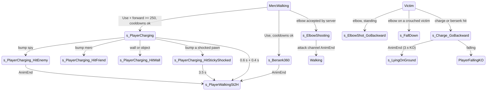

# Melee: elbow strike (spy and merc), merc charge, merc berserk spin

Units:
- uc:SBase.SPlayerController:FindPawnToElbowShotAndGoForIt
- uc:SBase.SPlayerController:CanElbowShock
- uc:SBase.SPlayerController:s_PlayerWalking.CanElbowShock
- uc:SBase.SPlayerController:CanBeElbowShocked
- uc:SBase.SPlayerController:s_PlayerWalking.CanBeElbowShocked
- uc:SBase.SPlayerController:s_PlayerJump.CanBeElbowShocked
- uc:SBase.SPlayerController:AskServerToElbowAttack
- rep:SBase.SPlayerController.AskServerToElbowAttack
- uc:SBase.SPlayerController:Handle_ElbowDmg
- uc:SBase.SPlayerController:ForceRotateTo
- rep:SBase.SPlayerController.ForceRotateTo
- uc:SBase.SPlayerController:s_ElbowShooting.BeginState
- uc:SBase.SPlayerController:s_ElbowShooting.EndState
- uc:SBase.SPlayerController:s_ElbowShooting.AnimEnd
- uc:SBase.SPlayerController:s_ElbowShooting.PlayerMove
- uc:SBase.SPlayerController:s_ElbowShooting@code (labels EnemyIsStanding, EnemyIsCrouched)
- uc:SBase.SPlayerController:s_ElbowShot_GoBackward.BeginState
- uc:SBase.SPlayerController:s_ElbowShot_GoBackward.EndState
- uc:SBase.SPlayerController:s_ElbowShot_GoBackward.AnimEnd
- uc:SBase.SPlayerController:s_ElbowShot_GoBackward.PlayerMove
- uc:SBase.SPlayerController:s_PlayerWalkingWeapon.PlayerMove (merc Use: charge, berserk, elbow entry and post-charge slow-down)
- uc:SBase.SPlayerController:s_PlayerWalkingMario.PlayerMove (spy Use priority, reference only)
- uc:SBase.SPlayerController:FindTargetToCharge
- uc:SBase.SPlayerController:s_PlayerCharging.{PawnTakeDamage, ClientStickyShock, ClientDamage, MyFalling, GoInSmoke, CanActivateLaser, NotifyHitWall, NotifyBump, EndState, BeginState, CanBeDropAttacked, Timer, FinDeCharge, PlayerMove, ComputeTargetDistance, PlayerTick}
- uc:SBase.SPlayerController:s_PlayerCharging_Hit.{CanBeGrabbed, BeginState, CanActivateLaser, EndState, Checkshock, PlayerMove, AnimEnd}
- uc:SBase.SPlayerController:s_PlayerCharging_HitEnemy.{BeginState}
- uc:SBase.SPlayerController:s_PlayerCharging_HitFriend.{BeginState}
- uc:SBase.SPlayerController:s_PlayerCharging_HitWall.{BeginState}
- uc:SBase.SPlayerController:s_PlayerCharging_HitStickyShocked.{CanBeGrabbed, BeginState, Timer, PlayAnimDmg, AnimEnd}
- uc:SBase.SPlayerController:Handle_ChargedDmg
- uc:SBase.SPlayerController:s_Charge_GoBackward.{BeginState, EndState, MyFalling, AnimEnd, PlayerMove}
- uc:SBase.SPlayerController:s_Berserk360.{EndState, BeginState, CanBeDropAttacked, CanBeBlasted, ExplosionHit, PawnTakeDamage, ClientDamage, MyFalling, CanActivateLaser, NotifyHitWall, NotifyBump, AnimEnd, PlayerMove}
- uc:SBase.SPlayerController:DestroyGPO
- rep:SBase.SPlayerController.DestroyGPO
- uc:SBase.SPlayerController:Client_Vibration_Charge_Obstacle
- def:SBase.SPlayerController (melee subset)
- uc:SBase.SPlayerController:ResetMercCam (as used by s_Berserk360.EndState)
- uc:SBase.SWeaponDefense:s_ElbowShocking.{BeginState, EndState, AnimEnd, AnimateUnDraw_GRAB}
- uc:SBase.SWeaponDefense:s_Charging.{BeginState, EndState}, s_Charging_End.{BeginState, AnimEnd}, s_Charging_Bump.{BeginState, AnimEnd} (clips only)
- nat:SBase.SBasePawn.ExecuteAction cases 8, 9, 10, 315 (clips, channels, blends)
- uc:SBase.SBasePawn:AnimEnd (channel 19)

## Purpose
Close-range attacks that knock players back or down without (elbow) or with modest (charge, berserk) damage. The
merc's Use button chooses between charge, berserk spin and elbow; the spy's Use button elbows a merc when no grab or
revive is possible.

## Data
| Field | Type | Default | Notes |
|---|---|---|---|
| fTimeBetweenElbowAttack | float | 2.5 | spy elbow cooldown (client side) |
| fLastElbowAttackTime | float | 0 | |
| iElbow_TimeForKO | int | 8 | elbow history window (s) |
| iElbow_NbHitsMaxPerTime | int | 12 | elbow count that would KO (unreachable, see rule 11) |
| fElbowDamage | float | 0 | knockback strength, server only |
| iChargeDamage | float | 35.0 | damage of a charge or berserk hit |
| fChargeDuration | float | 1.0 | |
| fChargeTempsRotationPersonne | float | 9.0 | steering weight without a target |
| fChargeTempsRotationEnnemi | float | 5.0 default, overwritten at charge start with now + fChargeDuration | |
| fChargeSeuilPad | float | 0.5 | forward input threshold factor |
| fPadXMaxLu | float | 500.0 | input scale |
| iSecondBetweenTwoChargesWithoutEnnemy | int | 4 | |
| iSecondBetweenTwoChargesWithEnnemy | int | 2 | |
| fSecondBetweenChargeAndBerserk | float | 3.0 | |
| fSecondBetweenTwoBerserks | float | 3.0 | |
| fLastChargingTime, fLastBerserkTime | float | -10.0 | |
| fKOAfterBerserkOrCharge | float | 3.0 | lying time after being charged or spun into |
| bIsCharging, bFinDeChargeEnCours | bool | false | |
| TargetPawn | SBasePawn | None | charge homing target |
| vNormalFence | vector | | reused as the charge heading |
| GRI.bAvlb_SPY_Elbow, bAvlb_MERC_Elbow, bAvlb_MERC_Charge, bAvlb_MERC_Berserk | bool | true | options |

## Rules

### Who presses Use and what happens
1. Merc (`s_PlayerWalkingWeapon.PlayerMove`, after the walking speed scaling of this frame): if Use was just pressed,
   `aForward >= fPadXMaxLu * fChargeSeuilPad` (250), not crouched, (`now - fLastChargingTime > 4`, or
   `> 2 and FindTargetToCharge()`), `now - fLastBerserkTime > 3`, the weapon is not reloading, no usable interaction,
   and the charge option is on: action SA_CHARGING (4), weapon state `s_Charging`, `ChangeState('s_PlayerCharging')`.
   Else, if Use was just pressed and the merc is not shocking: try `DoInteraction()`, then
   `FindPawnToReanimateOrTerminate()` (`knockout-and-terminate.md`); if neither, berserk when: not crouched,
   (`aForward < 250` or the charge option is off), `now - fLastBerserkTime > 3`, `now - fLastChargingTime > 3`, a
   weapon exists and is not in `s_Reloading`, `s_FullReloading`, `s_ElbowShocking`, `s_Reanimation` or
   `s_FireGrenade`, no usable interaction, berserk option on: action SA_BERSERK_ATTACK (315),
   `fLastBerserkTime = now`, `ChangeState('s_Berserk360')`. Otherwise `FindPawnToElbowShotAndGoForIt(true)`.
   With default options a merc elbows only while berserk or charge is cooling down or his weapon is busy.
2. Spy (`s_PlayerWalkingMario`): Use (press edge, not jumping, not rolling): grab, then revive, then
   `FindPawnToElbowShotAndGoForIt(bCantRollCuzColl)`, then interaction. bCantRollCuzColl is true when the roll test of
   the same frame was blocked by a pawn.
3. Post-charge slow-down for mercs walking with the weapon (not coughing): t = now - fLastChargingTime; speed factor
   f = 0.5 if t < 2, else `min(0.5 + (t - 2), 1.0)`; inputs are multiplied by 0.9 * f (normal is 0.9).

### Elbow strike
4. `FindPawnToElbowShotAndGoForIt(bCantRollCuzColl)` refuses when: the side's elbow option is off, `CanElbowShock()`
   is false (true only in the `s_PlayerWalking` family when not back-to-wall and not rolling), the weapon is
   reloading or firing, crouched and unable to uncrouch, shocking, a spy within 2.5 s of his last elbow, or a usable
   interaction is offered. It also refuses (and a spy with no weapon drawn clears bFireMode) while the attack channel
   (19) is playing 'AtakStAlFd2', 'AtakStAlFd0' or 'AtakStAlDn0' at a non-zero rate.
5. Target search over all SBasePawns m other than self: (a spy may only target mercs; a merc may target anyone,
   team mates included), distance (3D) < 150, m not shocking, `now - m.iLastWakeTime > 4.0`, and in front:
   `Normal(m - me) . Normal(vector(my Rotation)) > 0.5` for a merc, `> 0.8` for a spy. A candidate sets bFound; a box
   trace with actors (35, 35, 87.5, or the crouch height in Z when crouched) from me to m must hit nothing or m. Then
   `AskServerToElbowAttack(m, 0, me, (0,0,0), m - me, SDamage_ElbowShock)`, `fLastElbowAttackTime = now`, return true.
6. No target: if (bFound or I am a merc) and bCantRollCuzColl, play SA_ELBOW_ATTACK_MISSED (9, forced) and, for a
   merc, weapon `s_ElbowShocking` (a whiff); return true. Else false.
7. Server `AskServerToElbowAttack(T, Damage, instigatedBy, HitLocation, Momentum, DamageType)` (reliable RPC): refuse
   if the attacker is dead. If `T.Controller.CanBeElbowShocked()` (server-side state of the target: true in the
   walking family when not shocking and in the jump family; false otherwise) and distance < 350:
   - `T.m_AttackedBy = attacker`;
   - `T.Controller.PawnTakeDamage(Damage (0), instigatedBy, HitLocation, Momentum, DamageType, 0, 100)`;
   - `AddPoint(0, attacker, 16)` (2 points to the attacker and to team 0's total, for either side);
   - turn the attacker toward the target: Dir = `Normal(T - me)`; `ForceRotateTo(rotator(Dir), 1, 3)` if
     `(Dir x X).Z < 0` else `ForceRotateTo(rotator(Dir), -1, 3)` (RPC to the owner; consumed by native rotation code);
   - `MirrorState('s_ElbowShooting', label)`: label EnemyIsCrouched for a spy hitting a crouched merc, otherwise
     EnemyIsStanding.
8. `s_ElbowShooting` (attacker): BeginState: laser off; owner `iDontUpdatePadInput = 1`; server sound 'Coup_crosse1'
   (weapon drawn) or 'Coup_coude1' (radius 100). Labels (owner): EnemyIsStanding plays SA_ELBOW_ATTACK (8) and a
   merc weapon goes to `s_ElbowShocking`; EnemyIsCrouched plays SA_ELBOW_ATTACK_GROUND (10). AnimEnd on channel 19
   (owner): `GotoWaitingState()`. EndState: input unfrozen (owner), laser restored. PlayerMove: spy camera update, merc
   `UpdateRotation(dt, 3.0)`.
9. Quirk to keep: the global PlayerTick clears a non-zero `iDontUpdatePadInput` as soon as `now > iTimeToStopStickyShock`
   (an old deadline), so the elbow input freeze lasts one frame and an SA_DMG_ELECTRIC_STOP_ANIM action is issued.
10. Victim (`Handle_ElbowDmg(Momentum, instigatedBy)`, server, after SRTD recorded the 0-damage hit):
    - `fElbowDamage = Momentum . vector(controller Rotation)` (Momentum is the raw attacker-to-victim vector);
    - `m_AttackedBy = instigator`;
    - NbElbowHit = number of `LastDamages` entries of type SDamage_ElbowShock with `now - Time < 8` (Time stored as
      whole seconds, so the window is 8 to 9 s); includes the hit just recorded;
    - stats count when the instigator is an enemy player (or MercDeathMatch);
    - if the victim is not crouched and NbElbowHit < 12: stats ElbowStrikes / ElbowStrikesTaken, then
      `MirrorState('s_ElbowShot_GoBackward', , , attacker)`;
    - else: stats StrikeAttacks / StrikeAttacksTaken, broadcast SGameMessages 17 ("<victim> has been knocked down by
      <attacker>'s strike attack"), and `MirrorState('s_FallDown', label)` with label from
      `ChooseDeathAnimation(victim - attacker)`: Forward, Backward, Left, Right or InPlace.
11. Because the history holds 10 entries, NbElbowHit never reaches 12: an elbow knocks down only a crouched victim;
    otherwise it always knocks back. Reproduce the count, not a shortcut.
12. `s_ElbowShot_GoBackward` (victim, owner side effects): end a freeze-shock if active; leave back-to-wall (with a
    stance action); attacker from `ActorPassedByMirrorState`; action SA_ELBOW_ATTACKED_GOBACK (17); merc weapon blast
    animation; c = `clamp(1 - (fElbowDamage + 1) / 2, 0, 1)` and a cross-eye blur c to 0 over (2 + 5c) s; reticle and
    laser off; merc `bElbowBackward = true`. View locked to the pawn, no jump, zero acceleration (the push back is the
    clip's root motion). Channel 0 AnimEnd (owner): `GotoWaitingState()` and fire again if the button is held.
    EndState: reticle and laser restored, `bElbowBackward = false`.
13. `fElbowDamage` is not replicated; on a remote owner it keeps its previous local value (0 initially, giving c = 0.5).

### Merc charge
14. `s_PlayerCharging.BeginState`: `bIsCharging = true`; `fGrabDate = now` (rumble cadence); a HUD pulse time
    `fRespawnDate = now + FRand() * 0.5 + 0.25` (with fChargeDuration 1); reticle and laser off;
    `fChargeTempsRotationEnnemi = now + 1.0`; owner: `bFinDeChargeEnCours = false`, timer 0.6 s; heading
    `vNormalFence = Normal(aForward * X + aStrafe * Y)` from the horizontal view axes; `TargetPawn = None`.
15. Target lock (`ComputeTargetDistance` is replaced by `FindTargetToCharge` while charging; called from the global
    PlayerTick): keep an existing TargetPawn; else among visible pawns of the other SPawnType with Health > 0, with
    d = T.Location - (0,0,10) - me, `X(MyDesiredRotation) . Normal(d) > 0.8` and `|d| < 1500`, take the nearest.
16. PlayerMove (every frame, owner and server move processing): k = dt * 50.
    - No target: A = (vector(MyDesiredRotation) * 9 + vNormalFence * k) / (k + 9), A.Z = 0.
    - Target: c = 14 * ((now - chargeStart) + 1) (from fChargeDuration - (fChargeTempsRotationEnnemi - now) + 1);
      A = (vector(MyDesiredRotation) * c + Normal(T - me) * k) / (k + c), A.Z = 0; `vNormalFence = A`.
    - `MyDesiredRotation = rotator(A)`; pawn rotation = that; view yaw = that, pitch kept.
    - `GroundSpeed = clamp(GroundSpeed + dt * 750, 400, 770)`; move with acceleration `A * GroundSpeed * 7.7922`.
17. PlayerTick: global tick; every 0.35 s camera tilt (350, 40000, 1200) and charge rumble; the HUD perturbation pulse
    of 0.16 s on the frame that crosses the pulse time.
18. End of charge (owner): the 0.6 s timer calls `FinDeCharge()`: first call sets bFinDeChargeEnCours, timer 0.4 s,
    weapon `s_Charging_End`, action SA_RUN_ST_2H; the second call `ChangeState('s_PlayerWalkingSt2H')`. A shock or
    smoke also starts the ending; falling ends the weapon charge and starts a normal fall. Total charge 1.0 s.
19. Bumps (owner, `NotifyBump`, movers ignored; facing means `(Other - me) . vector(Rotation) > 0`):
    - spy in front: turn toward him (`ForceRotateTo` as rule 7); if he is shocking: `ChangeState('s_PlayerCharging_HitStickyShocked')`
      and `DamagePawn_C2S(self, 35, spy, my location, me - spy, SDTStickyShocker, 0, 100)` (the merc shocks himself
      and takes 35 unscaled damage); else `DamagePawn_C2S(spy, 35, me, spy location, spy - me, SDamage_Charged, 0, 100)`
      and `ChangeState('s_PlayerCharging_HitEnemy')`;
    - merc in front: turn toward him; if he is shocking, the same self-shock; else `ChangeState('s_PlayerCharging_HitFriend')`,
      35 SDamage_Charged to him and 35 SDamage_Charged to self (both from the other);
    - anything else: if it is an SBasicGamePlayObject in front, `DestroyGPO(gpo, 35, SDamage_Charged)`;
      `ChangeState('s_PlayerCharging_HitWall')`.
    `NotifyHitWall` (owner): GPO walls get `DestroyGPO`; rumble; HUD perturbation 2.0 s; `s_PlayerCharging_HitWall`.
    `DestroyGPO` is a reliable owner-to-server RPC: `gpo.TakeDamage(35, pawn, (0,0,0), (0,0,1), type, 0)`.
20. Hit states (`s_PlayerCharging_Hit` family): reticle off, `bCanBeGrabbed = true` and `CanBeGrabbed` true (except
    HitStickyShocked), laser off; Checkshock forces the shock animation. HitEnemy: action SA_BUMP_ENEMY (3), weapon
    `s_ElbowShocking`, sound rifle butt or elbow (radius 100, server). HitFriend: action SA_BUMP_WALL (2), weapon
    `s_Charging_Bump`, same sounds. HitWall: action 2, weapon bump, rifle butt sound. Channel 0 AnimEnd (owner):
    SA_WALK_ST_2H and `s_PlayerWalkingSt2H`, fire if held. HitStickyShocked: `TimeShock = 0` (so the self-shock is
    accepted), owner 3.5 s timer then SA_WALK_ST_2H and `s_PlayerWalkingSt2H`; weapon `s_Dmg_Electric`; no hit
    animation, AnimEnd ignored, not grabbable.
21. Charge victim (`Handle_ChargedDmg`, called by most handlers when alive): `m_AttackedBy = instigator`; if Health > 0,
    `MirrorState('s_Charge_GoBackward', , , instigator)`. The 35 damage uses the approximate pill (PillTag 0), so it is
    never zone scaled; PercentDamageRefillable 100 makes all of it regenerable for a spy.
22. `s_Charge_GoBackward` (owner side): goggles reset; a spy keeps a walking camera; a merc with Health > 0 gets the
    head camera, 1.5 s HUD perturbation, a sleep overlay 0 to 255 over 3.5 s and weird effect 1, weapon hidden; end a
    freeze-shock; leave back-to-wall; attacker from `ActorPassedByMirrorState`; action SA_CHARGE_ATTACKED_GOBACK (316);
    merc weapon blast animation, no reticle; cross-eye blur as rule 12; laser off. Falling gives `PlayerFallingKO`.
    Channel 0 AnimEnd: `fLyingOnGroundDuration = 3.0`, `ChangeState('s_LyingOnGround')`. PlayerMove: a spy may turn the
    camera; a merc's view is locked; zero acceleration.

### Merc berserk spin
23. `s_Berserk360.BeginState`: reticle and laser off; owner cross-eye blur 1 to 0 over 3.5 s; camera on 'B Head'
    (13, 0, 9), third person, weapon hidden. EndState: owner resets the merc camera, shows the weapon, fires again if
    held; laser and reticle back.
24. Hits (server `NotifyBump`): another SBasePawn that is not already in `s_Charge_GoBackward`, while the channel 0
    clip position is below 0.8 (GetAnimParams frames are normalised 0 to 1, anim.md Data):
    `PawnTakeDamage(35, me, Other.Location, Other - me, SDamage_Charged, 100)` (the 100
    lands in the PillTag parameter: approximate pill, PercentDamageRefillable 0); `Merc_BerserkHits += 1` for an enemy
    (or MercDeathMatch); rifle butt sound; `Client_Vibration_Charge_Obstacle()` to the owner. Team mates are hit too.
    Each pawn is hit once per spin in practice because the first hit puts him in `s_Charge_GoBackward`.
25. `NotifyHitWall` (owner): GPO walls get `DestroyGPO(gpo, 35, SDamage_Charged)`; rumble; HUD perturbation 2.0 s.
26. Channel 0 AnimEnd (owner): SA_WALK_ST_2H, `s_PlayerWalkingSt2H`. PlayerMove: fire disabled, desired rotation =
    pawn yaw with camera pitch, zero acceleration (the spin is root motion). Blast and drop reactions as standing.

### Animation, camera and what each machine sees
27. **Body clips** (ExecuteAction, the same code on every machine that runs the action: owner, server, proxies):
    - SA_ELBOW_ATTACK (8): `SetBlendParams(19, 1.0, 0, 0, 'B Spine1')`, then on channel 19 'AtakStAlFd2' rate 1.0
      tween 0 when `WeaponLoaded != 0`, else 'AtakStAlFd0' rate 1.5 tween 0. A merc always has `WeaponLoaded = 2`, so
      he plays AtakStAlFd2 (the merc set SPerso.Def has no AtakStAlFd0 at all).
    - SA_ELBOW_ATTACK_MISSED (9): the same blend and the same two clips with the test inverted (`WeaponLoaded == 0`
      gives AtakStAlFd0 r1.5, else AtakStAlFd2 r1.0); the result is identical.
    - SA_ELBOW_ATTACK_GROUND (10): `SetBlendParams(19, 1.0)` with no start bone (whole body), 'AtakStAlDn0' rate 1.5
      tween 0 on channel 19.
    - SA_BERSERK_ATTACK (315): `IK_Type = 1` (IKT_NONE, no weapon aim), channel 0 'AtakStAlTu' rate 1.0 tween 0.1,
      `vMoveAfterRM = 0`, `rRotAfterRM = 0`, `iLockRootMotionType = 3` (translation and yaw from the root track),
      `setPhysics(PHYS_RootMotion)` with additional physics PHYS_Walking. The actor spins with the root track's yaw
      (one full turn) and returns to its start point (the root track ends at (0, 0, 0)).
    Channel 19 is an overlay above the walk blender: the legs keep the stand or walk set (channel 0 and the walk
    channels), the upper body from B Spine1 strikes. Channel 0 is not touched by the elbow.
28. **End of the elbow overlay** (`SBasePawn.AnimEnd`, channel 19): `BlendToAlpha(19, 0, 0.2)`; the clip holds its
    last frame (0.944 for 18 frames) while the alpha falls to 0 over 0.2 s.
29. **Clip notifies** (sounds played by the clips themselves, on the machines that draw them): merc AtakStAlFd2
    RA_FendAir_Hard (radius 80) at 0.233 s; merc AtakStAlDn0 RA_FendAir_Hard at 0.067 s; merc AtakStAlTu
    RA_matos_Run (20) at 0.201 s, RA_matos_Walk (14) at 0.373 s, RA_FendAir_Soft (100) at 0.412 s, RA_FendAir_Hard
    (100) at 0.459 s, RA_ono_DefChargeB (100) at 0.703 s. The script sounds of rules 8 and 24 (Coup_crosse1 or
    Coup_coude1, radius 100) come on top, from the server.
30. **Merc first-person view model during the elbow** (weapon state `s_ElbowShocking`, entered by rules 6, 8 and 20 on
    the owner): BeginState `bNoReticule = true`, `PlayAnim('FirstAtakCrFd2')` (channel 0 of the view model, rate 1,
    tween 0: the rifle-butt strike seen from the eyes, 17 frames at 15 fps), laser off. Fire, AltFire, Reload and
    FullReload are ignored. AnimEnd on view model channel 0: laser back unless the controller is in `s_Berserk360`,
    `AnimateWaiting()`, `PreviousState` (None counts as `s_Selected`) is entered. EndState: reticle back unless the
    laser was on. `AnimateUnDraw_GRAB` (grabbed mid strike): `s_Selected`, PreviousState `s_Selected`,
    'FirstGrbdStBg2' on channel 0 tween 0.
    The other melee view model clips, for reference (same class): `s_Charging` LoopAnim 'FirstAtakChFd2' tween 0.3,
    EndState LoopAnim 'FirstWalkStFd2' tween 0.3; `s_Charging_End` 'FirstAtakChEd2' then `s_Selected`;
    `s_Charging_Bump` 'FirstAtakChit2', AnimateWaiting, `s_Selected`; `s_Reanimation` and `s_Death` 'FirstAtakCrFd2'.
    All on view model channel 0.
31. **Merc first person during the berserk spin** (`s_Berserk360.BeginState`, run on every machine that enters the
    state, not gated to the owner): `m_camera.AttachCamToBone(true, 'B Head', (13, 0, 9))`, `bBehindView = true`,
    `bFirstPersonWithPawn = true`, the rifle's `bDrawWeapon = false`; the owner also gets the cross-eye blur 1 to 0
    over 3.5 s. The owner therefore stops drawing the first-person rifle and draws his own body, seen from a camera
    13 uu in front of and 9 uu above the head bone, which turns with the spinning head (camera pitch and roll swing by
    several thousand units, measured). `s_Berserk360.EndState` on the owner: `ResetMercCam()`
    (`AttachCamToBone(false)`, `bBehindView = false`, reticle back unless the laser was on, `bFirstPersonWithPawn =
    false`, controller rotation and MyDesiredRotation set to the pawn's rotation), `bDrawWeapon = true`, fire again
    if held.
32. **Merc first person during the elbow**: no camera change (the camera rotation stays on the view; measured), the
    pawn body is not drawn, only the view model of rule 30. ForceRotateTo (rule 7) turns the view toward the target.
33. **What other players see**: the proxy plays the relayed action batch through the same ExecuteAction (rule 27),
    so an observer sees AtakStAlFd2 on channel 19 from B Spine1 over the stand set for an elbow or a whiff, and
    AtakStAlTu on channel 0 with the root spin for a berserk. The merc's batch for an elbow is [8, 56] (56 is
    SA_DMG_ELECTRIC_STOP_ANIM from the rule 9 quirk, measured one tick after 8); 56 only blends channel 23 out.
34. **Timings** (measured on the real game, 60 Hz): berserk state 1.465 s (clip 1.333 s plus the 0.1 s tween and one
    tick); the bumped spy is hit 0.466 s after Use (owner clip position 0.26); elbow strike state 1.149 s (clip 1.133
    s plus one tick), weapon `s_ElbowShocking` 1.082 s (view model clip 1.067 s plus one tick), then the 0.2 s
    channel 19 blend out.
35. **Push distances** (each clip's root track, confirmed by the goldens): elbow victim standing StrkStAlBk2 223 uu
    straight back (measured 223.3); charge or berserk victim StrkCrAlBk0 279 uu (measured 278.6); the spinning merc
    ends where he started (root track net 0; measured drift 12.6 uu from the collision with the spy).

## States

## Constants
| Name | Value | Unit | Provenance | Source |
|---|---|---|---|---|
| elbow reach (client / server) | 150 / 350 | uu | decoded | FindPawnToElbowShotAndGoForIt, AskServerToElbowAttack |
| elbow cone merc / spy | dot > 0.5 / 0.8 | cos | decoded | same |
| elbow box | 35, 35, 87.5 | uu | decoded | same |
| elbow damage | 0 | hp | decoded | same |
| elbow points | AP_D_KnockOut (2) to team 0 | points | decoded | AskServerToElbowAttack |
| spy elbow cooldown | 2.5 | s | decoded | fTimeBetweenElbowAttack |
| elbow KO count | 12 within 8 s (unreachable) | hits | decoded | Handle_ElbowDmg |
| charge damage | 35 | hp | decoded | iChargeDamage |
| charge forward threshold | 250 | input units | decoded | fPadXMaxLu * fChargeSeuilPad |
| charge cooldown | 4 (2 with a target) | s | decoded | iSecondBetweenTwoCharges* |
| charge and berserk spacing | 3 | s | decoded | fSecondBetweenChargeAndBerserk, fSecondBetweenTwoBerserks |
| charge duration | 0.6 + 0.4 | s | decoded | s_PlayerCharging |
| charge speed ramp | 400 to 770 at 750 per s | uu/s | decoded | s_PlayerCharging.PlayerMove |
| charge accel scale | 7.7922 | - | decoded | same |
| charge steering weights | 9 (no target), 14 * (t + 1) (target), k = 50 * dt | - | decoded | same |
| charge target cone / range | dot > 0.8 / 1500 | cos / uu | decoded | FindTargetToCharge |
| post-charge slow-down | x0.5 for 2 s, back to x1 over 0.5 s | - | decoded | s_PlayerWalkingWeapon.PlayerMove |
| self-shock recovery after charging a shocked pawn | 3.5 | s | decoded | s_PlayerCharging_HitStickyShocked |
| berserk hit window | clip position < 0.8 | normalised frame (0 to 1, AnimLast = 1 - 1/N) | decoded | s_Berserk360.NotifyBump; anim.md Data |
| knockback root motion | SA_ELBOW_ATTACKED_GOBACK (17) L5, SA_CHARGE_ATTACKED_GOBACK (316) L7, SA_BUMP_WALL (2) L7, SA_BERSERK_ATTACK (315) L3; all with walking collision, end offset 0 | lock mode | decoded | execute-action.md |
| camera tilt while charging | 350, 40000, 1200 every 0.35 s | - | decoded | s_PlayerCharging.PlayerTick |
| elbow body clip (merc) | AtakStAlFd2 on c19 from B Spine1, alpha 1, rate 1.0, tween 0; 18 frames at 15 fps, 1.133 s | - | decoded | ExecuteAction cases 8, 9 (editor 0x11215980); SPerso.Def |
| elbow body clip (unarmed spy) | AtakStAlFd0 on c19 from B Spine1, rate 1.5 | - | decoded | cases 8, 9 |
| ground elbow clip | AtakStAlDn0 on c19, no start bone, rate 1.5 | - | decoded | case 10 |
| berserk clip | AtakStAlTu on c0, rate 1.0, tween 0.1, 21 frames at 15 fps, 1.333 s, lock 3, PHYS_RootMotion + walking, IK_Type 1 | - | decoded | case 315 |
| elbow overlay blend out | 0.2 | s | decoded, measured | SBasePawn.AnimEnd channel 19; golden combat.merc-elbow frames 239 to 252 |
| merc view model elbow clip | FirstAtakCrFd2 on view model c0, rate 1, tween 0, 17 frames at 15 fps, 1.067 s | - | decoded | SWeaponDefense.s_ElbowShocking.BeginState; SWeaponFirst Default set |
| berserk camera | AttachCamToBone 'B Head' offset (13, 0, 9), bBehindView, bFirstPersonWithPawn, weapon hidden | uu | decoded | s_Berserk360.BeginState |
| berserk state length | 1.465 | s | measured | golden combat.merc-berserk (179.4998 to 180.9647) |
| berserk hit time after Use | 0.466 (owner clip position 0.26) | s | measured | same, spy 100 uu in front |
| elbow state length / weapon state length | 1.149 / 1.082 | s | measured | golden combat.merc-elbow (226.7811 to 227.9298 / 227.8632) |
| elbow victim push | 223 | uu | decoded (StrkStAlBk2 root track), measured 223.3 | golden combat.merc-elbow |
| charge or berserk victim push | 279 | uu | decoded (StrkCrAlBk0 root track), measured 278.6 | golden combat.merc-berserk |

## Network
- Elbow: detection on the owner, validation on the server (target state and 350 uu), effect on the server.
- Charge: collision is detected on the charging merc's owner and the damage is sent with `DamagePawn_C2S`
  (client authoritative). The victim's reaction is server side. `DestroyGPO` is also owner initiated.
- Berserk: collision is detected on the server (`NotifyBump` with authority) and the damage applied directly.
- `ForceRotateTo` is a reliable server-to-owner RPC; `Client_Vibration_Charge_Obstacle` is a reliable
  server-to-owner RPC.
- Animation: the owner plays 315 (berserk) and 9 (whiff) itself; 8 and 10 come from the `s_ElbowShooting` labels on
  the owner after the server's MirrorState. Each action goes into the owner's action batch, the server replays it
  (NativeExecuteReceivedActionForServer) and relays it to every other viewer, whose proxy replays it through
  ExecuteAction (rule 33). The view model clips (rule 30) and the head camera (rule 31) exist on the owner only.

## Edge cases
- A merc can elbow, charge and berserk his own team mates; there is no team filter, and teamkills cost points.
- Charging into a shocked spy hurts and shocks the charging merc instead.
- `FindTargetToCharge` keeps a stale `TargetPawn` from the walking state until the next charge starts (the 2 s
  "with enemy" cooldown can pass on an old target).
- A berserk spin cannot hit a pawn already being knocked back by a charge.

## Evidence
- REA recheck 2026-10-26 (game ExecuteAction 0x10ad6840): cases 8, 9, 10 and 315 play the clips, rates, tweens and
  channels of rule 27 (case 315: IK_Type 1, vMoveAfterRM and rRotAfterRM 0, iLockRootMotionType 3, PHYS_RootMotion).
- Function sha1 prefixes: FindPawnToElbowShotAndGoForIt a0435b8fb776, AskServerToElbowAttack 41c2ea31b2c7,
  Handle_ElbowDmg 72106229812f, Handle_ChargedDmg 6ecd17817a4f, FindTargetToCharge 2f00e3c5388b, DestroyGPO
  9c9c0cf0dbb0; state functions s_PlayerWalkingWeapon.PlayerMove 684d690d, s_PlayerCharging NotifyBump 10d704c0,
  PlayerMove 729a42ab, BeginState af402927, FinDeCharge 2366a6c3; s_Berserk360 NotifyBump 8117ddb9; s_ElbowShooting
  BeginState fe1958ae; s_ElbowShot_GoBackward BeginState e6d1302e; s_Charge_GoBackward BeginState 4eaff62e.
- local/re-out/uc/SBase/SPlayerController.uc; defaults local/formats/classdefaults_effective.json.
- Native action cases 2 to 4, 8 to 10, 17, 315, 316 (clips AtakChAlEd2, AtakStAlFd2, AtakStAlCh2, AtakStAlFd0,
  AtakStAlDn0, StrkCrAlBk2, StrkStAlBk2, AtakStAlTu, StrkCrAlBk0) in Bridge anim_catalog/execaction_cases.txt.
- Rules 27 to 35: ExecuteAction editor 0x11215980 (game 0x10ad6840), split cases 008, 009, 010 and 315 under
  local/re-out/c/actions/cases/editor (8: `SetBlendParams(0x13, 1.0, 0, 0, 'B Spine1')`, `PlayAnim(0x13,
  AtakStAlFd2, 1.0, 0.0)` when WeaponLoaded, else AtakStAlFd0 1.5; 315: `IK_Type = 1`, `PlayAnim(0, AtakStAlTu, 1.0,
  0.1)`, `iLockRootMotionType = 3`, `setPhysics(5)`, additional physics walking). s_Berserk360.BeginState and
  EndState, ResetMercCam and SWeaponDefense.s_ElbowShocking in local/re-out/uc/SBase/SPlayerController.uc and
  SWeaponDefense.uc. Clip frames, rates, notifies and root tracks: .content/shared/chars/SPerso/Def.anim.json and
  SWeaponFirst/Default.anim.json. Measured timings, channels and pushes: local/difftest/golden-combat/combat.merc-berserk
  and combat.merc-elbow (run1 and run2 agree), records `L.anim`, `L.ws`, `L.cs`, `L.crot`, `T.loc`.

## Open questions
- Native consumer of `ForceRotateTo` (FRTarget, FRSide, FRStep): found, the merc view native
  `NativeRotationCameraDefenseur` (native 1383, editor 0x111edf60). With FRStep 3 it adds dt to FRTimeElapsed, turns
  MyDesiredRotation toward FRTarget and ends (FRStep 0, iDontUpdatePadInput 0) once the yaw gap is within the step
  of the tick; the same native also runs the double-tap quick turn (FRStep 0 to 2, aStrafe beyond 4000, FRTarget =
  yaw + 0x7ff8 or - 0x7ff8 within fFastTurnBackDoubleTapSpeed). Resolved for PC: its only caller, the global
  `UpdateRotationDefenseur`, is never reached (spec/movement/input-and-rotation.md, view rotation), so on PC
  ForceRotateTo stores FRTarget and nothing turns the merc, as in the port; the double-tap quick turn does not
  exist on PC either.

- Whether a proxy merc in our port draws the relayed 315 and 8 clips: not confirmed by reading (the relay and the
  shared ExecuteAction look complete); the two-world test of the brief settles it.

### Resolved
- Distance of the knockback, charge-hit and berserk pushes. Resolved: StrkStAlBk2 223 uu, StrkCrAlBk0 279 uu, the
  berserk spin net 0 (rule 35). Evidence: root tracks in Def.anim.json, goldens combat.merc-elbow and merc-berserk.
- Unit of the channel 0 frame returned by `GetAnimParams`. Resolved: normalised 0 to 1 (AnimLast = 1 - 1/N), so the
  berserk window is the first 80 percent of the clip. Rule 24. Evidence: anim.md Data (ANSWERS-actions 15).
- (part) Knockback root motion. Resolved: 17 L5, 316 L7, 2 L7, 315 L3, all with walking collision and end offset 0;
  the push-back distance is the clip's root track (still to read from the converted animation data). Evidence:
  execute-action.md cases 2, 17, 315, 316 (ANSWERS-actions 15).

## Implementation brief (wave 12b: melee clips on the merc)
What the port has right: the body clips of rule 27 (src/OpenScct.Game/Movement/MovesetActions.cs, cases
SA_ELBOW_ATTACK to SA_BERSERK_ATTACK), the channel 19 blend (src/OpenScct.Game/Animation/ActionAnimation.cs `End`),
the channel 19 blend out (src/OpenScct.Game/Animation/PawnAnimEnd.cs), the Use choice
(SPlayerController.s_PlayerWalkingWeapon.cs `UseEdgeWeapon`), the elbow search and server check
(SPlayerController.CombatMelee.cs) and the states (SPlayerController.CombatMeleeStates.cs). The clips exist in
DEF_01.glb and Def.anim.json, and SimPawnView draws every channel the simulation holds.

What is wrong:
1. Berserk, merc's own screen (the main cause of "no clip in first person"). `s_Berserk360.BeginState` in
   src/OpenScct.Game/SBase/SPlayerController.CombatMeleeStates.cs raises `CombatFx.Notify(pc, CombatFx.HeadCamera, ...)`
   and hides the rifle, but never calls `AttachCamToBone(true, 'B Head', (13, 0, 9))` and never sets `bBehindView` or
   `bFirstPersonWithPawn` (rule 31). Nothing in game/Scripts consumes the HeadCamera notify (no reader at all). So the
   view stays first person: game/Scripts/Play/PlayRoot.cs (`firstPerson = pc is { bBehindView: false } ?
   session.LocalPawn : null`) hides the merc's own body, and game/Scripts/Views/FirstPersonView.cs hides the rifle
   because `bDrawWeapon` is false. The merc sees an empty, steady view for 1.47 s. `EndState` likewise calls the
   notify instead of `ResetMercCam()`.
   Fix: in BeginState use the ladder's path (`MovementService.HooksOf(pc).AttachCameraToBone(pc, true,
   MovementK.MercLadderCameraBone, MovementK.MercLadderCameraOffset)`, `bBehindView = true`, `bFirstPersonWithPawn =
   true`, `bDrawWeapon = false`; see `MercLadderCamera` in SPlayerController.Movement.Ladder.cs), not gated to the
   owner, keep the blur owner-only; in EndState (owner) call `ResetMercCam()` before `bDrawWeapon = true`.
   The same dead notify replaces AttachCamToBone in s_Charge_GoBackward (merc victim), s_GrabbedFromLedge_Begin,
   s_GrabbedByPlayer and s_TerminatePawn (CombatMeleeStates.cs line 740, CombatGrabStates.cs 825, CombatTerminate.cs
   419): same bug class, other topics.
2. Elbow, merc's view model. `SWeaponDefense.s_ElbowShocking.BeginState` in
   src/OpenScct.Game/SBase/SWeaponDefense.MeleeStates.cs plays `FirstButtStFd2` (the button press clip of
   `s_Interacting`) on view model channel 4 (ACTIONCHANNEL). The original plays `FirstAtakCrFd2` on view model
   channel 0 with `bNoReticule = true` (rule 30), and its AnimEnd is on channel 0 with AnimateWaiting and a return to
   PreviousState. `ViewModelClips.DataOf` (src/OpenScct.Game/Equipment/ViewModelAnim.cs) has no entry for
   FirstAtakCrFd2, so add `K.FirstAtakCrFd2 = new(17, 15f)` (src/OpenScct.Game/Equipment/K.cs) or an unknown clip
   ends at once. The charge states (`s_Charging`, `s_Charging_End`, `s_Charging_Bump`) also use channel 4 where the
   original uses channel 0 (and s_Charging's tween 0.3 and its EndState walk loop are missing); move them with it.
3. Others' view: from reading, the relay and the proxy replay are complete (ProxyAnimation.PlayNewActions runs the
   same ExecuteAction), so the berserk and elbow clips should reach a proxy. It is not proven: no test or smoke
   checks a proxy merc's channel 19 or a berserk on a proxy. Write the two-world test below first; if it fails, the
   gap is in the relay of the merc's batch, not in the clips.

Failing tests to write first (tests/OpenScct.Game.Tests/Combat/MeleeAndGrabTests.cs, then a net test):
- `ABerserkPutsTheMercCameraOnHisHead`: merc standing, Use edge with the cooldowns clear; assert state s_Berserk360,
  `pc.bBehindView`, `pc.bFirstPersonWithPawn`, the SPlayerCam attached to 'B Head' with offset (13, 0, 9), rifle
  `bDrawWeapon == false`, pawn channel 0 'AtakStAlTu', Physics PHYS_RootMotion. Tick until AnimEnd: s_PlayerWalkingSt2H,
  `bBehindView == false`, `bFirstPersonWithPawn == false`, camera detached, `bDrawWeapon == true`; total about 1.47 s.
- `AMercWhiffPlaysTheRifleButtOnTheViewModel`: berserk, then Use again within 3 s with nobody in reach; assert pawn
  channel 19 'AtakStAlFd2' alpha 1 from B Spine1, weapon s_ElbowShocking, `ViewAnim.Sequence(0) == FirstAtakCrFd2`,
  `bNoReticule`; after 1.07 s the weapon is back in s_Selected with the wait loop on channel 0; channel 19 alpha 0
  0.2 s after its AnimEnd.
- Net: `AProxyDrawsTheMercBerserkAndElbow` (server world plus one client world, as the existing proxy tests do): the
  owner merc berserks, then elbows a spy; on the observing client the proxy merc has channel 0 'AtakStAlTu' within
  the relay delay and later channel 19 'AtakStAlFd2' alpha 1.

Smoke and screenshot check from real keys (game/Scripts/Smoke/PlayCombatSmoke.cs, merc leg, key events only):
- Shift while standing still, with a spy bot about 100 uu in front: on the frames 0.2 s to 1.2 s after the press,
  `PlayRoot` passes no first-person pawn (the local merc is drawn), its SimPawnView channel 0 is AtakStAlTu with the
  clip frame rising, and the drawn camera stays within 2 uu of 'B Head' plus (13, 0, 9) in the head's axes
  (SimPawnView.TryGetBone). Screenshot at 0.5 s: the merc's arms and body in view, turned away from the start yaw.
  The spy's state goes to s_Charge_GoBackward with 65 health.
- Shift again within 3 s with nobody in reach: `FirstPersonView.ChannelFrame(0)` rises from 0 to the end over about
  1.07 s while the sequence is FirstAtakCrFd2; screenshot at 0.4 s shows the rifle butt thrust.
- Two-player run (host plus one client, the merc on the host): the client's SimPawnView of the merc shows channel 0
  AtakStAlTu during the spin and channel 19 AtakStAlFd2 during the elbow; screenshot from the client at the same
  moments; the B R Hand bone moves at least 20 uu from its idle place.
