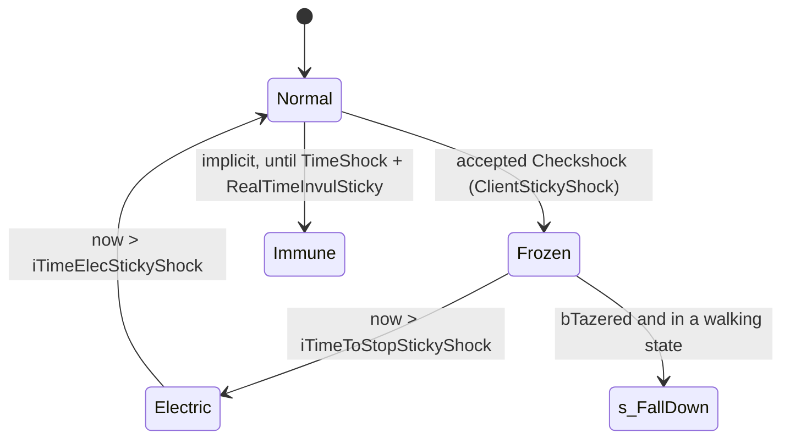

# Electric shock, taser and jammer reactions

Units:
- uc:SBase.SPlayerController:Checkshock
- uc:SBase.SPlayerController:s_Inactive.Checkshock
- uc:SBase.SPlayerController:s_PlayerCharging_Hit.Checkshock
- uc:SBase.SPlayerController:ClientStickyShock
- rep:SBase.SPlayerController.ClientStickyShock
- uc:SBase.SPlayerController:s_TerminatePawn_Base.ClientStickyShock
- uc:SBase.SPlayerController:s_GrabbingPlayer.ClientStickyShock
- uc:SBase.SPlayerController:s_PlayerCharging.ClientStickyShock
- uc:SBase.SPlayerController:s_Coop_S_Goto.ClientStickyShock
- uc:SBase.SPlayerController:s_Hoist_S_Jump.ClientStickyShock
- uc:SBase.SPlayerController:s_ShortLadder_S_Jump.ClientStickyShock
- uc:SBase.SPlayerController:PlayerTick (shock, taser and jammer sections only)
- uc:SBase.SPlayerController:Client_Jammed
- rep:SBase.SPlayerController.Client_Jammed
- uc:SBase.SPlayerController:s_StandUp.BeginState (merc wake shock)
- uc:SBase.SGadTazerLauncher:DamagePawn
- nat:SBase.SGadTazerLauncher.UseBulletSet
- def:SBase.SPawnAttaque (Shock_*)
- def:SBase.SPAWNDEFENSE (Shock_*)
- def:SBase.SPlayerController (TempsInvulSticky, RealTimeInvulSticky, fRainFreezeFactor, fJammerDuration)

## Purpose
A shocker-gun hit, a taser hit, a spawn shock and a few melee cases put the victim in the "sticky shock" condition:
input frozen for a freeze time, an electric flag for a longer time, and a re-shock immunity window. This spec covers
the timers, the immunity test, the taser knock-down and the per-state variants. The damage numbers (0 for the gun,
51 for the taser family) are applied earlier by the pipeline (`damage-pipeline.md` rule 20).

## Data
| Field | Owner | Type | Default | Notes |
|---|---|---|---|---|
| Shock_FreezeDuration | SBasePawn subclass | float | spy 3.0, merc 3.5 | def:SBase.SPawnAttaque / SPAWNDEFENSE |
| Shock_Duration[15] | SBasePawn subclass | float | spy all 0.0, merc all 1.0 | indexed by pill - 1 |
| Shock_HeadShotHudSfxDuration | SBasePawn | float | 9.0 | |
| bWet | SBasePawn | bool | false | not replicated; set locally by rain/water code |
| bStickyShocking | SBasePawn | bool | false | not replicated; set on the owner by ClientStickyShock, read on the server too |
| bStickyShockedInTheHead | SBasePawn | bool | false | |
| TempsInvulSticky | SPlayerController | float | 8.0 | immunity added after the shock time |
| RealTimeInvulSticky | SPlayerController | float | 5.0 initially | recomputed on each accepted shock |
| TimeShock | SPlayerController | float | 0 | last accepted shock time |
| TimeShockForGrab | SPlayerController | float | 0 | last accepted shock time, read by grab checks |
| fRainFreezeFactor | SPlayerController | float | 1.3 | |
| iDontUpdatePadInput | PlayerController | int | 0 | non-zero freezes the player's input |
| iTimeToStopStickyShock, iTimeElecStickyShock | SPlayerController | int | 0 | whole-second deadlines |
| bTazered | SPlayerController | bool | false | |
| fJammerDuration | SPlayerController | int | 4 | |
| fTimeToStopJammer | SPlayerController | int | 0 | |
| bJammered | SPlayerController | bool | false | |

## Rules

### Checkshock(PillTag, bPlayAnim) (server, called from damage handlers)
1. Accept the shock when (PillTag != -10 and `now - TimeShock > RealTimeInvulSticky`) or (PillTag == -10 and
   `!SBPawn.bStickyShocking`).
2. On acceptance:
   - freeze = `Shock_FreezeDuration`, times `fRainFreezeFactor` (1.3) if `SBPawn.bWet`;
   - shock = freeze + `Shock_Duration[PillTag - 1]` (see Edge cases for out-of-range pills);
   - `RealTimeInvulSticky = shock + TempsInvulSticky`; `TimeShock = now`; `TimeShockForGrab = now`;
   - `ClientStickyShock(PillTag, bPlayAnim)` (reliable RPC to the owner; local on a listen host);
   - if PillTag == 1, the victim is a merc, `ShockInstigator` exists, `ShockInstigatorTime == now` and the
     instigator has an SPlayerController: instigator `Stats.Spy_ShockerGunHeadshots += 1`.
3. On rejection: if PillTag != -10 and the same instigator conditions hold and the instigator is a spy, play
   `StikyShok_Paf1` on the instigator's client (an "immune target" cue).
4. Always clear `ShockInstigator`.
5. Resulting windows (dry): merc freeze 3.5 s, electric 4.5 s, immunity 12.5 s from the shock; spy freeze 3.0 s,
   electric 3.0 s, immunity 11.0 s. Wet: merc 4.55 / 5.55 / 13.55 s, spy 3.9 / 3.9 / 11.9 s.
6. State variants: in every `s_Inactive` state (falling down, lying, standing up, blast KO states, landing inert,
   terminated) a PillTag of -10 is replaced by 5 before rule 1, so a taser on a downed player is treated as an
   ordinary shock subject to immunity (the 51 damage was already applied by the pipeline if he was not shocking).
   In the `s_PlayerCharging_Hit` family bPlayAnim is forced to true.

### ClientStickyShock(PillTag, bPlayAnim) (owner, in the owner's current state)
7. Cancel use and fire: bAltFire = 0, HUD ballistic gauge 0, bFire = 0, TimerUSe = now, fThrowForce = 0,
   bUsingNow = false.
8. Recompute freeze and shock exactly as rule 2 and store `RealTimeInvulSticky` locally.
9. Rumble `Vibration_StickyShock(freeze)`.
10. `bStickyShockedInTheHead = (PillTag == 1)`; `bStickyShocking = true`; `iDontUpdatePadInput = 1`.
11. Leave binoculars if active.
12. Action: SA_DMG_ELECTRIC (53) if bPlayAnim else SA_DMG_ELECTRIC_NOANIMS (54), both forced. Native (decoded,
    execute-action.md cases 53 to 56, rule 5.5), both: event BeginStickySkin, set bStickyShocking, event
    evStickyShockSfx(1), IK_Type 1 (the old value saved in IK_TypeBeforeDamage), then PlayDamage: blend channel 23 in
    (53 with no start bone, 54 from B Head) and loop ADamage{St,Cr}Electric{0,2} on c23 with tween 0.2; for 54 a
    moving pawn plays the head flinch clip on c17 instead.
13. Merc: weapon state `s_Dmg_Electric`. Both: `Goggle.ResetVisionMode()`; torch gadget `Malfunction(shock)`.
14. PillTag == -10 sets `bTazered = true`.
15. PillTag == 1: `HudShutDown(1.0, freeze + 9.0)`.
16. `SetHudPerturbationLength(shock)`.
17. Deadlines: `iTimeElecStickyShock = int(now + shock)`, `iTimeToStopStickyShock = int(now + freeze)` (truncated to
    whole seconds of Level.TimeSeconds).
18. Sounds `StikyShok_Paf1` and `RA_onoPaf` (ClientPlaySound).
19. State variants of ClientStickyShock:
    - `s_TerminatePawn_Base` (merc finishing a spy): detach the head camera, restore first person view and reticle,
      weapon back to `s_Selected`, `GotoWaitingState()`, then the global version (the finishing move is abandoned; the
      damage handler also releases the spy);
    - `s_GrabbingPlayer` (spy holding a merc): a taser (PillTag -10) first tries `CheckForRoomToFreeGrabbedGuy(KO)`
      and, if there is no room, uses PillTag 2 instead; then the global version with bPlayAnim false;
    - `s_PlayerCharging`: the global version with bPlayAnim false, then end the charge (`FinDeCharge`) if it is not
      already ending;
    - `s_Coop_S_Goto`, `s_Hoist_S_Jump`, `s_ShortLadder_S_Jump`: the global version, then `GotoWaitingState()`.

### Shock end (owner PlayerTick, every frame)
20. If `iDontUpdatePadInput != 0` and `now > iTimeToStopStickyShock`: set it to 0, action SA_DMG_ELECTRIC_STOP_ANIM
    (56), merc weapon `s_Dmg_Electric_End` if it is in `s_Dmg_Electric` or `s_Selected`; then if bTazered: clear it
    and, if the controller is in `s_PlayerWalkingSt2H`, `s_PlayerWalkingSt0H`, `s_PlayerWalkingCr0H` or
    `s_PlayerWalkingCr2H`, `ChangeState('s_FallDown', 'DIE_InPlace')` (the taser knock-down,
    `knockout-and-terminate.md`). Otherwise (input not frozen) run `ComputeCrouchOrRoll()`.
21. If `SBPawn.bStickyShocking` and `now > iTimeElecStickyShock`: clear it, action SA_DMG_ELECTRIC_STOP (55), merc
    weapon `s_Dmg_Electric_End` under the same condition. 55 blends c23 out over 0.2 s, restores IK_Type and the
    skins (event RestoreSkins), clears bStickyShocking and raises evStickyShockSfx(0); 56 (rule 20) only restores the
    IK and keeps bStickyShocking.
22. The `Fire` exec requires `iDontUpdatePadInput == 0` and `!SBPawn.bStickyShocking`, so a merc cannot start firing
    for the whole electric time (4.5 s dry), not only the freeze. `AltFire` (gadgets) also requires
    `iDontUpdatePadInput == 0` and refuses while shocking. The spy shocker gun's own auto-fire loop in `s_Selected`
    only waits for the freeze (`!bStickyShocking || now > iTimeToStopStickyShock`); for spies freeze and electric
    times are equal anyway.
23. Several states end the shock early on the owner: `s_Blast.BeginState`, `s_FallDown.BeginState` (also clears
    bTazered), `s_ElbowShot_GoBackward.BeginState`, `s_Charge_GoBackward.BeginState`, `s_Dead.BeginState`.

### Other gameplay effects of being shocked
24. `bStickyShocking` blocks: being grabbed (client and server grab tests), grabbing, being elbow struck while walking
    (`CanBeElbowShocked` false), being chosen as an elbow target, and starting an elbow strike. A merc charging into a
    shocked spy is shocked himself (`melee-elbow-charge-berserk.md`).
25. `TimeShockForGrab` gives a 5 s grab immunity after every accepted shock (`fGrabInvulneralbilityTimeAfterStickyShock`
    5.0, server grab test).

### Merc wake-up shock
26. When a merc's controller enters `s_StandUp` on the server (not `s_Reanimating`): `TimeShock = now -
    RealTimeInvulSticky - 1`, then `Checkshock(0, false)`. The check always passes, so every merc stand-up applies a
    no-animation shock: input frozen for the freeze time, electric flag, HUD perturbation, shock sounds, torch
    malfunction, 12.5 s shock immunity and 5 s grab immunity. Reproduce as written (see Open questions).

### Taser and taser-like hits
27. Merc taser gadget (`SGadTazerLauncher`, RefireRate 1.0 s, fBulletRange 200 uu, fBulletAngle 60): `Use` calls the
    native `UseBulletSet` (reliable RPC to the server), which picks the targets and calls the event `DamagePawn`
    (target selection, HitLocation and StartTrace: spec/equipment/tazer.md rules 2 to 5).
    `DamagePawn` does `PawnTakeDamage(0, merc, HitLocation, (HitLocation - StartTrace)*1000, SDTStickyShocker, -10, 0)`
    and counts `Merc_TaserHits` on an enemy (or in MercDeathMatch).
28. Pipeline effect of PillTag -10: 51 damage when the victim is not already shocking (else 0), immunity bypass,
    then the state handler's Checkshock with -10. A standing or crouching player in a walking state is knocked down
    at the end of the freeze (rule 20); a spy tasered in other states (ledge, pipe, jump) is only frozen.
29. Spawn shock (`spawn-protection-and-scoring.md`) uses the same call with the spawning pawn as instigator.

### Jammer (SDamage_Jammered)
30. The pipeline calls `Client_Jammed(instigatedBy)` and deals 0 damage. Owner: `fTimeToStopJammer = int(now + 4)`;
    if not already jammed, action SA_JAMMER_START (271) and HUD message "Jammered"; `bJammered = true`.
31. Owner PlayerTick while jammed: if `now > fTimeToStopJammer`, action SA_JAMMER_STOP (272) and clear; else
    k = `max(0.5, 1 - (fTimeToStopJammer - now) / 4)`, `aForward *= k`, `aStrafe *= k`, no jump. No 4.0 SBase class
    produces this damage type; keep it for completeness.

## States

## Constants
| Name | Value | Unit | Provenance | Source |
|---|---|---|---|---|
| merc freeze | 3.5 | s | decoded | def:SBase.SPAWNDEFENSE |
| spy freeze | 3.0 | s | decoded | def:SBase.SPawnAttaque |
| merc extra electric time | 1.0 | s | decoded | def:SBase.SPAWNDEFENSE Shock_Duration |
| spy extra electric time | 0.0 | s | decoded | def (unset array) |
| wet multiplier | 1.3 | - | decoded | def:SBase.SPlayerController fRainFreezeFactor |
| immunity after shock | 8.0 | s | decoded | TempsInvulSticky |
| headshot HUD shutdown | freeze + 9.0 | s | decoded | Shock_HeadShotHudSfxDuration |
| grab immunity after shock | 5.0 | s | decoded | fGrabInvulneralbilityTimeAfterStickyShock |
| taser damage | 51 | hp | decoded | pipeline |
| taser range | 200 (fBulletAngle 60 is not read; the cone is in tazer.md rule 3) | uu | decoded | def:SBase.SGadTazerLauncher, game 0x10aa0b50 |
| jammer duration | 4 | s | decoded | fJammerDuration |
| jammer minimum speed factor | 0.5 | - | decoded | PlayerTick |

## Network
- Acceptance, immunity bookkeeping and the taser damage run on the server.
- `ClientStickyShock` and `Client_Jammed` are reliable server-to-owner RPCs. Freeze and electric timers, input
  freezing and the taser knock-down run on the owner, which then requests `s_FallDown` with `ChangeState` (sent to the
  server with `PCChangeServerState`).
- `bStickyShocking` is not replicated. The server's copy is written only where server code writes it (for example the
  `s_InteractWithObject` handler sets it to true) or where owner-side code runs on a listen host. Server-side tests of
  `bStickyShocking` (grab, elbow, taser damage) therefore see a stale value for remote players (see Open questions).

## Edge cases
- Pill out of range: `Shock_Duration[PillTag - 1]` with PillTag 0 or -10 reads index -1 or -11. UnrealScript logs an
  out-of-bounds error and clamps the index into range. Every shipped Shock_Duration array is uniform, so the result is
  the same value either way; the port should clamp.
- The immunity test uses the server copy of `RealTimeInvulSticky`; the owner recomputes it independently, and `bWet`
  is evaluated on each machine, so the two copies can differ when rain state differs.
- `iTimeToStopStickyShock` truncation makes the freeze end between freeze - 1 s and freeze s after the hit, depending
  on the fractional part of Level.TimeSeconds (example: hit at 12.3 s, merc freeze ends at the first tick after
  15.0 s, 2.7 s later).
- A spy taser hit while already shocking deals 0 damage and is rejected by rule 1.

## Evidence
- uc:SBase.SPlayerController:Checkshock sha1 ce696f2e991e; ClientStickyShock e01d43dfb1b0; Client_Jammed
  788576dcf7b6; PlayerTick 5e6178b93ec9 (shock section at the start of the function); s_Inactive.Checkshock
  b9249e55; s_PlayerCharging_Hit.Checkshock bd9696da; s_StandUp.BeginState 39145f0d;
  uc:SBase.SGadTazerLauncher:DamagePawn 149c94624a75.
- local/re-out/uc/SBase/SPlayerController.uc, SGadTazerLauncher.uc, SWeaponAttaque.uc (s_Selected auto fire).
- Bridge docs/GADGET_TIMINGS.md rows "Shocker gun hit on a merc" and "Taser on a spy" (same values, independent read).

## Open questions
- Server copy of `bStickyShocking` for remote players: measure with two machines, shock a remote merc, read the
  server-side pawn flag while frozen.
- Merc wake-up shock: confirm in game that a merc standing up from a KO is input frozen for about 3.5 s and hears the
  shock sound (two-pawn rig, knock the merc down with a drop attack, log `iDontUpdatePadInput` and the action list).

### Resolved
- `SGadTazerLauncher.UseBulletSet` (native 1301): target selection, HitLocation and StartTrace. Resolved: game
  0x10aa0b50, spec/equipment/tazer.md (every pawn in a distance-dependent cone, no team test; HitLocation the aim
  point, StartTrace the merc's Location).
- What the native action handler does for SA_DMG_ELECTRIC and SA_DMG_ELECTRIC_NOANIMS. Resolved: BeginStickySkin,
  bStickyShocking, evStickyShockSfx(1), IK_Type 1 with the old value saved, PlayDamage on channel 23 (53 no start
  bone, 54 from B Head) looping ADamage{St,Cr}Electric{0,2} with tween 0.2 (54 on a moving pawn: the head flinch on
  c17); 55 blends c23 out over 0.2 and restores the skins. Rules 12, 21. Evidence: execute-action.md cases 53 to
  56, rule 5.5 (ANSWERS-actions 13).
