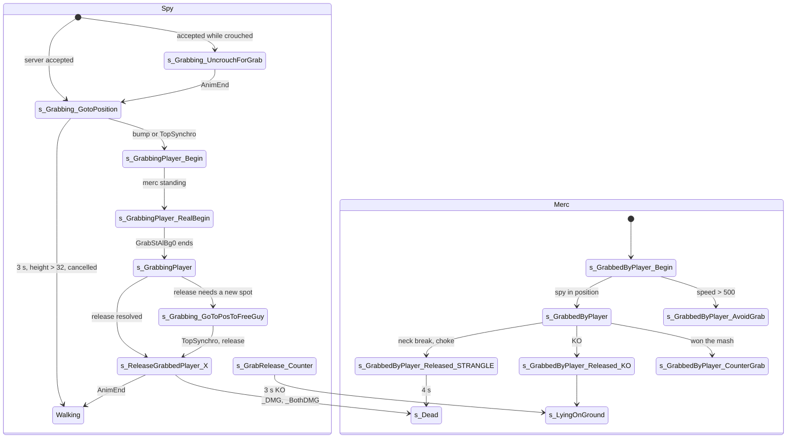

# Spy grab: catching a merc, holding him as a shield, neck break, choke, knock-out, counter-grab, ledge grab

Units:
- uc:SBase.SPlayerController:AskToGrabPawn
- uc:SBase.SPlayerController:OnLedge.AskToGrabPawn
- uc:SBase.SPlayerController:CanGrabPawn
- uc:SBase.SPlayerController:OnLedge.CanGrabPawn
- uc:SBase.SPlayerController:CanBeGrabbed (global and the state overrides)
- uc:SBase.SPlayerController:AskServerToGrabPawn
- rep:SBase.SPlayerController.AskServerToGrabPawn
- uc:SBase.SPlayerController:AskServerToGrabPawnFromLedge
- rep:SBase.SPlayerController.AskServerToGrabPawnFromLedge
- uc:SBase.SPlayerController:MirrorStateForMercGrabbedFromLedge
- uc:SBase.SPlayerController:PCChangeClientStateForMercGrabbedFromLedge
- rep:SBase.SPlayerController.PCChangeClientStateForMercGrabbedFromLedge
- uc:SBase.SPlayerController:AskServerToUnGrabPawn
- rep:SBase.SPlayerController.AskServerToUnGrabPawn
- uc:SBase.SPlayerController:AskServerToUnGrabPawnAndFreeGuy
- rep:SBase.SPlayerController.AskServerToUnGrabPawnAndFreeGuy
- uc:SBase.SPlayerController:CheckForRoomToFreeGrabbedGuy
- uc:SBase.SPlayerController:GetFreeLocationToRelease
- uc:SBase.SPlayerController:CheckForGround
- uc:SBase.SPlayerController:GrabServerReleaseRequest
- rep:SBase.SPlayerController.GrabServerReleaseRequest
- uc:SBase.SPlayerController:GrabAborted
- rep:SBase.SPlayerController.GrabAborted
- uc:SBase.SPlayerController:CountMercGrabDeath
- uc:SBase.SPlayerController:ServerSetVoiceComWhenGrabbing
- uc:SBase.SPlayerController:DampRotation
- uc:SBase.SBasePawn:GrabSendServerCounterValue
- rep:SBase.SBasePawn.GrabSendServerCounterValue
- uc:SBase.SBasePawn:AnimEnd (channel 0 'GrbdStLgRail' branch)
- uc:SBase.SPlayerController:s_GrabBase.{ClientDamage, CanActivateLaser, CanInteract, DoInteraction, ExplosionHit}
- uc:SBase.SPlayerController:s_Grabbing_UncrouchForGrab.{DoInteraction, BeginState, AnimEnd, PlayerMove}
- uc:SBase.SPlayerController:s_Grabbing_GotoPosition.{DoInteraction, EndState, BeginState, PlayerTick, NotifyBump, PlayerMove, TopSynchro}
- uc:SBase.SPlayerController:s_Grab_GotoPosition.{NotifyBump, EndState, BeginState, PlayerMove, TopSynchro}
- uc:SBase.SPlayerController:s_Grabbing_GoToPosToFreeGuy.{BeginState, TopSynchro}
- uc:SBase.SPlayerController:s_GrabbingPlayer_Begin.{performDropAttack, PlayerMove}
- uc:SBase.SPlayerController:s_GrabbingPlayer_RealBegin.{GrabAborted, performDropAttack, AnimEnd, BeginState, PlayerMove}
- uc:SBase.SPlayerController:s_GrabbingPlayer.{CanUseCam, VoiceChatButtonToggle, performDropAttack, GoInSmoke, CanBeDropAttacked, CanActivateLaser, CanUncrouchAndUndraw, CanInteract, DoInteraction, CanIUseBinocular, PawnTakeDamage, ClientStickyShock, Timer, PlayerTick, Fire, EndState, BeginState, UpdateRotation, PlayerMove, UpdatePawnRotationMario}
- uc:SBase.SPlayerController:s_GrabbedByPlayer_Begin.{PlayerTick, BeginState, Timer, EndState, GrabAborted, PlayerMove}
- uc:SBase.SPlayerController:s_GrabbedByPlayer.{GoInSmoke, PawnTakeDamage, EndState, BeginState, AnimEnd, PlayerTick, PlayerMove}
- uc:SBase.SPlayerController:s_GrabbedByPlayer_AvoidGrab.{BeginState, PlayerMove}
- uc:SBase.SPlayerController:s_Grab_Avoided.{BeginState, PlayerMove}
- uc:SBase.SPlayerController:s_AbortGrab.BeginState
- uc:SBase.SPlayerController:s_GrabbedByPlayer_Released.{BeginState, AnimEnd, PlayerMove}
- uc:SBase.SPlayerController:s_GrabbedByPlayer_Released_KO.{BeginState, AnimEnd}
- uc:SBase.SPlayerController:s_GrabbedByPlayer_Released_STRANGLE.{BeginState, EndState, PlayerTick, AnimEnd}
- uc:SBase.SPlayerController:s_GrabbedByPlayer_Released_DMG.{AnimEnd}
- uc:SBase.SPlayerController:s_GrabbedByPlayer_Released_Grabbing_LD.{BeginState, EndState}
- uc:SBase.SPlayerController:s_GrabbedByPlayer_Released_GrabbingDMG.{BeginState, AnimEnd, EndState}
- uc:SBase.SPlayerController:s_GrabbedByPlayer_CounterGrab.{BeginState, PlayerMove, AnimEnd, EndState}
- uc:SBase.SPlayerController:s_ReleaseGrabbedPlayer.{ClientDamage, PawnTakeDamage, PlayerMove, AnimEnd, BeginState, EndState}
- uc:SBase.SPlayerController:s_ReleaseGrabbedPlayer_LD.{BeginState}
- uc:SBase.SPlayerController:s_ReleaseGrabbedPlayer_KO.{BeginState}
- uc:SBase.SPlayerController:s_ReleaseGrabbedPlayer_Strangle.{BeginState}
- uc:SBase.SPlayerController:s_ReleaseGrabbedPlayer_DMG.{BeginState, AnimEnd, EndState}
- uc:SBase.SPlayerController:s_ReleaseGrabbedPlayer_BothDMG.{BeginState}
- uc:SBase.SPlayerController:s_ReleaseGrabbedPlayer_Grabbed_DMGED.{BeginState}
- uc:SBase.SPlayerController:s_GrabRelease_Counter.{BeginState, AnimEnd, EndState}
- uc:SBase.SPlayerController:s_GrabBaseWithBlastDamageOnly.{PawnTakeDamage}
- uc:SBase.SPlayerController:s_GrabFromLedgeBase.{PawnTakeDamage}
- uc:SBase.SPlayerController:s_GrabbingFromLedge_Begin.{BeginState, Timer, PlayerMove, AnimEnd, ReceiveAnEvent, ServerSendAnEvent, SendAnEventToServer}
- uc:SBase.SPlayerController:s_GrabbingFromLedge_Go.{PlayerMove, AnimEnd}
- uc:SBase.SPlayerController:s_GrabbedFromLedge_Begin.{bIsDamageVolumeSensitive, TopSynchro, NotifyBump, Timer, PlayerTick, BeginState, EndState, GrabAborted, AltFire, Fire, GadLaserSwitch, GadTorcheSwitch, GadgetQuickChoice, SwitchBinocularVision, SwitchROF, PlayerMove}
- uc:SBase.SPlayerController:s_FallAfterGrabbedFromLedge.{bIsDamageVolumeSensitive, NotifyBump, MyNotifyLanded, PlayerMove}
- uc:SBase.SPresenceTrigger:Touch (bDetectGrab)
- def:SBase.SPresenceTrigger
- rep:SBase.SBasePawn.m_AttackTarget
- rep:SBase.SBasePawn.m_AttackedBy
- rep:SBase.SBasePawn.bCanBeGrabbed
- def:SBase.SPlayerController (grab subset), def:SBase.SBasePawn (vGrabOffset, GrabbingSpeed)

## Purpose
The spy's grab is the core melee of SCCT Versus. A spy close behind a merc grabs him, then holds him (moving slowly,
using him as a shield, optionally talking to him over voice), and ends the hold by breaking his neck (Use, lethal),
knocking him out (Fire, 51 damage then KO), or choking him to death after 15 s. Damage to either player can force an
early release. A merc can counter by winning a button-mash match. A spy hanging from a ledge can also pull a merc
standing above him over the edge to his death.

## Data
| Field | Owner | Type | Default | Notes |
|---|---|---|---|---|
| fGrabDistance | SPlayerController | float | 160.0 | client test; the server doubles it to 320 during its test |
| fGrabHalfAngle | SPlayerController | float | 0.5 | cosine |
| iGrabAreaShift | SPlayerController | int | 7200 | yaw units added to the target's facing in the angle test (39.55 deg) |
| fWakeInvulnerabilityTime | SPlayerController | float | 3.8 | |
| fGrabInvulneralbilityTimeAfterStickyShock | SPlayerController | float | 5.0 | server test only |
| fGrabFromLedgeDist1 / Dist2 | SPlayerController | float | 150 / 100 | forward / lateral box (uu) |
| fGrabFromLedgeHalfAngle | SPlayerController | float | -1.1 | facing test always passes |
| fGrabCounterGrabMatchDuration | SPlayerController | float | 3.0 | used by native code |
| fGrabMatchStartedTime | SPlayerController | float | 0 | set at grab start on both sides |
| iGrabMyCounterGrabValue / iGrabMateCounterGrabValue | SPlayerController | int | 0 / 0 | counter-grab match (server copy on the spy) |
| GrabReleaseMethode | SPlayerController | enum GrabReleaseMethode_ | NoRelease | |
| bGrabIsReleasing | SPlayerController | bool | false | owner side latch |
| fGrabFromLedgeStartTime | SPlayerController | float | 0 | |
| vGrabOffset | SBasePawn | vector | (70.8485, 0, 0) | merc position relative to the spy while held |
| GrabbingSpeed / RunningSpeed | SBasePawn | float | 65.6 / 385.0 | |
| m_LedgeGrabArmsZone | SBasePawn | vector | (39, 0, 117) | |
| m_AttackTarget / m_AttackedBy | SBasePawn | SBasePawn | None | spy's target / merc's attacker; replicated reliable |
| bCanBeGrabbed | SBasePawn | bool | true | replicated |
| GRI.bAvlb_SPY_Grab | GameReplicationInfo | bool | true | option |
| SPresenceTrigger.bDetectGrab | SPresenceTrigger | bool | true | default; DetectedClass default SPAWNDEFENSE |

GrabReleaseMethode_: NoRelease 0, KO 1, Normal 2, Strangled 3, Timed 4, GrabbedDamaged 5, GrabbingDamaged 6,
GrabbedAvoid 7, Grabbing_Cancelled 8, Grabbing_Stopped 9, Grabbed_MovedWhileTryingToBeGrabbed 10, BothDie 11,
GrabbingCountered 12.

Grab actions (SBasePawn constants, executed by the native action handler which also plays the partner's clip):
SA_GRAB_CATCH 18, SA_GRAB_REPOS 19, SA_GRAB 20, SA_GRAB_RELEASE 21, SA_GRAB_RELEASE_GRABBED_LD 22,
SA_GRAB_RELEASE_KO 23, SA_GRAB_RELEASE_STRANGLE 24, SA_GRAB_RELEASE_DMG 25, SA_GRAB_RELEASE_GRABBED_DMGED 26,
SA_GRAB_AVOIDED 27, SA_GRAB_RELEASE_BOTH_DIE 28, SA_GRAB_DROPATTACKED 29, SA_GRABBED_AVOID 30, SA_GRABBED_CATCH 31,
SA_GRABBED 32, SA_GRABBED_RELEASE 33 to 37, SA_GRABFROMLEDGE_GO 312, SA_GRABFROMLEDGE_BEGIN 313,
SA_GRABBEDFROMLEDGE_FALL 314, SA_SERVER_REPOS 321, SA_COUNTER_GRAB_LOOP 324, SA_COUNTER_GRAB_GO 325,
SA_EXIT_REPOS 326, SA_GRABBED_RELEASE_DROPTECH 327.

## Rules

### Starting a grab (spy owner)
1. Use button priority in the spy walking states: not rolling, then `AskToGrabPawn()`, then revive, then elbow, then
   interaction.
2. `AskToGrabPawn()` refuses if the spy is shocking or `bAvlb_SPY_Grab` is false. If crouched, the spy must be able
   to uncrouch; MyLoc.Z is raised by (default CollisionHeight - CollisionHeight) and the height tolerance h (15 uu) is
   increased by (default CollisionHeight - CrouchHeight).
3. For each merc pawn T (not self) with `CanGrabPawn(T)`, `T.bCanBeGrabbed` and not shocking:
   - TL = T.Location, raised the same way if T is crouched (skip T if he cannot uncrouch);
   - axes X, Y, Z from `rotator(TL - MyLoc)`; G = TL - (vGrabOffset.X*X + vGrabOffset.Y*Y + vGrabOffset.Z*Z)
     (the spot 70.85 uu short of the merc along the line from the spy);
   - ground probe: world trace from G down by (CollisionHeight + h); no hit ends the search (the loop exits, no grab);
   - the probe hit must satisfy `|hitZ + CollisionHeight - TL.Z| < h` and `|MyLoc.Z - TL.Z| < h`, else the search
     ends; then extent Z -= (that difference / 2 + 2) and G = hit + (0, 0, 1.1 * CollisionHeight);
   - a world-only box trace (spy radius, radius, adjusted height) from MyLoc to G must be clear: then
     `AskServerToGrabPawn(T)` and return true.
   Note the loop stops at the first candidate that fails the ground probe or the height test (it does not try
   further mercs).
4. `CanGrabPawn(T)` (global): `now - T.iLastWakeTime > 3.8`, distance (3D) < fGrabDistance, the merc is in front:
   `Normal(T2D - me2D) . Normal(vector(my Rotation)) > 0.75` (within 41.4 deg), and the facing test with the merc's
   yaw shifted by +7200: `Normal(vector(T.Rotation + (0,7200,0))) . Normal(vector(my Rotation)) > 0.5`. The spy must
   be behind the merc and the accepted sector is skewed by 39.55 deg toward one side.

### Server validation and approach
5. `AskServerToGrabPawn(T)` (reliable RPC): refuse if the spy is dead. Crouch adjustments as rule 2. Require
   `T.Controller.CanBeGrabbed()` (true only in the merc walking stances St2H and Cr2H and a few other states, see the
   table in Evidence), then double fGrabDistance (320) for the test and require `CanGrabPawn(T)`, `T.bCanBeGrabbed`,
   neither pawn shocking, and `T.Controller.TimeShockForGrab < now - 5.0`. Repeat the geometry of rule 3; any failure
   restores fGrabDistance and returns.
6. Success: `m_AttackTarget = T`, `T.m_AttackedBy = spy`; if the merc was finishing a spy, release that spy; then:
   - spy crouched (and able to uncrouch): merc `MirrorState('s_GrabbedByPlayer_Begin', , , spy pawn)`, spy
     `MirrorState('s_Grabbing_UncrouchForGrab')`;
   - else merc `MirrorState('s_GrabbedByPlayer_Begin', , , spy pawn)` and spy
     `MirrorState('s_Grabbing_GotoPosition')`;
   - spy `Stats.Spy_Grabs += 1`; spy hears spy-bullet comms; music stings (attacker and defender jingles).
   fGrabDistance is restored to 160.
7. `s_Grabbing_UncrouchForGrab`: if the spy cannot uncrouch, `AskServerToUnGrabPawn(Grabbing_Stopped)` and
   `GotoWaitingState()`; else actions SA_WANTS_TO_UNCROUCH and SA_WAIT_CR2ST_0H; on the channel 0 animation end
   (owner): SA_WALK_ST_0H, `AskToGrabPawn()` (harmless re-request), `ChangeState('s_Grabbing_GotoPosition')`.
8. `s_Grabbing_GotoPosition` (spy): start time recorded. Owner PlayerTick: after 3.0 s,
   `AskServerToUnGrabPawn(Grabbing_Cancelled)` and `GotoWaitingState()`; otherwise while the target exists: action
   SA_GRAB_REPOS (19) unless already repositioning; reposition target = T.Location minus the grab offset along the
   spy-to-merc axes, sent with `SetInfoForVandamme`; if `|T.Z - spy.Z| > 32`, `AskServerToUnGrabPawn(Grabbing_Stopped)`
   and `GotoWaitingState()`. If the target is gone while repositioning, `GotoWaitingState()`.
   Server: on `NotifyBump` with the target, or on the native `TopSynchro` (reposition finished), if both are alive:
   merc `MirrorState('s_GrabbedByPlayer', , , spy pawn)` and spy `MirrorState('s_GrabbingPlayer_Begin')`; otherwise
   `AskServerToUnGrabPawn(Grabbing_Cancelled)` and `GotoWaitingState()` if alive.
9. Merc `s_GrabbedByPlayer_Begin`: the merc turns toward away from the spy: yaw damped toward
   `rotator(merc - spy).Yaw` at 20000 units/s (`DampRotation`). Owner: if crouched, stand up; rumble; cancel use.
   Server: a repeating 0.001 s timer: if the merc's speed exceeds 500 uu/s, `AskServerToUnGrabPawn(GrabbedAvoid)` (the
   merc escapes: merc `s_GrabbedByPlayer_AvoidGrab`, action SA_GRABBED_AVOID 30, back to walking; spy `s_Grab_Avoided`,
   action SA_GRAB_AVOIDED 27, back to `s_PlayerWalkingSt0H`). If the owner sees `m_AttackedBy == None`, it goes to
   `s_GrabbedByPlayer_Released_Grabbing_LD`.
10. Spy `s_GrabbingPlayer_Begin`: waits until the target is not crouched, then `ChangeState('s_GrabbingPlayer_RealBegin')`.
    `s_GrabbingPlayer_RealBegin`: owner grab camera, action SA_GRAB_CATCH (18); GrabReleaseMethode = NoRelease; when
    clip 'GrabStAlBg0' ends on channel 0, `ChangeState('s_GrabbingPlayer')`.

### Holding (spy s_GrabbingPlayer, merc s_GrabbedByPlayer)
11. Spy BeginState: owner grab camera, action SA_GRAB (20), `btoCought = false`, a single 15.0 s timer. Server:
    `bCanTalkToGuy = CanHackEnemyComs()`, `AddPoint(0, spy, 9)` (AP_A_Grab_Begin, 0 points in POINT_Multiple). Both:
    `iGrabMyCounterGrabValue = 0`, `fGrabMatchStartedTime = now`.
12. Merc BeginState: `m_LastSpecialMoveTime = now`; owner: if not already PHYS_FollowParent, actions SA_GRABBED_CATCH
    and SA_GRABBED (executed directly, with m_AttackedBy temporarily self), weapon undrawn; HUD perturbation 17 s;
    camera on 'B Head' offset (13, 0, 9). `fGrabMatchStartedTime = now`, own `iGrabMyCounterGrabValue = 0`.
    Merc PlayerTick: rumble, weapon placed at the head bone, and if `m_AttackedBy == None` (owner) go to
    `s_GrabbedByPlayer_Released_Grabbing_LD`. Animation end re-plays the held loop. Smoke only blurs the HUD.
13. Spy movement (PlayerMove): input vector clamped to length 6000; scaled by GrabbingSpeed / RunningSpeed
    (0.17039); view rotation free (yaw and pitch at 50 * DeltaTime * input * sensitivity, pitch limited to 15000 up and
    50536 down unsigned); pawn rotation follows the movement direction at 48000 units/s (80000 * 0.6, step capped at
    32000 / 48000 s) using 0.6 of the inputs; `GroundSpeed = RunningSpeed * |accel| / 3000`, set to 0 below
    0.47 * GrabbingSpeed (30.8 uu/s); no jumping. Use (press edge) requests `CheckForRoomToFreeGrabbedGuy(Normal)`.
14. Fire (spy, not in inventory) requests `CheckForRoomToFreeGrabbedGuy(KO)`. The 15 s timer (owner): if no release is
    pending, `CheckForRoomToFreeGrabbedGuy(Timed)` and `GrabReleaseMethode = Timed`. Every PlayerTick: if the target is
    gone, `ChangeState('s_ReleaseGrabbedPlayer_LD')`; if a release method is pending, retry
    `CheckForRoomToFreeGrabbedGuy(method)`; smoke on the spy: after its faint time (rule 30 of the knockout spec) the
    spy releases with KO.
15. Voice: `VoiceChatButtonToggle` sends `ServerSetVoiceComWhenGrabbing(on)`: the spy talks to the held merc only
    (team voice muted while on). EndState (server) switches it off.

### Choosing where to release (owner)
16. `CheckForRoomToFreeGrabbedGuy(type, optional bTest)`: refuse if no target or a release is already latched. With the
    target's `bBlockNonZeroExtentTraces` temporarily false, `GetFreeLocationToRelease(L, R, spy, vGrabOffset)`:
    - found: if not bTest: `GrabReleaseMethode = type`, latch `bGrabIsReleasing`; if L and R are the spy's current
      location and rotation, `AskServerToUnGrabPawn(type)`; else reposition the spy to L facing R
      (`vVandammePos`, `SetInfoForVandamme`) and `ChangeState('s_Grabbing_GoToPosToFreeGuy')`; there, the native
      `TopSynchro` (owner, once) sends `AskServerToUnGrabPawnAndFreeGuy(method)`, which places the merc at
      spy + vGrabOffset rotated by the spy rotation and then runs `AskServerToUnGrabPawn`;
    - not found: for Strangled, Timed, GrabbingDamaged (converted to BothDie) and GrabbedDamaged: latch and
      `AskServerToUnGrabPawn` at once; other types do nothing (the request is dropped).
17. `GetFreeLocationToRelease(L, R, master, offset)`: R = master yaw (pitch, roll 0); first test: box trace (master
    radius, radius, height, world only) from master to master + X*offset.X + Y*offset.Y, plus `CheckForGround` at the
    end; if both pass, L = master location, R = master rotation. Otherwise snap the yaw to the nearest of 0, 16384,
    32768, -16384 (sectors: (-8192, 8192) to 0, [8192, 32768) to 16384, [32768, 49151] to 32768, else -16384), add
    8192, and try offsets rotated to S+45, S-45, S+90, S-90, S+135, S-135, S+180, S+0 degrees in that order (traces
    with actors, plus ground check); the first that passes sets R. If none passes: push back along the facing by
    t = offset.X + radius - (facing . (firstHit - master)) + 30; if t <= 0 fail; else two traces (to the pushed merc
    spot and back to the pushed spy spot) and a ground check must pass, giving L = master - X*t; else fail.
18. `CheckForGround(P)`: P.Z += 2; box trace (radius, radius, height - 2) down 35 uu; if nothing, a line trace from
    P.Z - (height - 2) down 35 uu; true if either hits.

### Release resolution (server, AskServerToUnGrabPawn(way))
19. `GrabReleaseMethode = NoRelease` (server copy). If the caller is a spy:
    - if way is neither GrabbingDamaged nor BothDie and the spy's Health is exactly 0, return (no release);
    - unless way is Grabbing_Cancelled, GrabbedAvoid, Grabbing_Stopped, GrabbingCountered or
      Grabbed_MovedWhileTryingToBeGrabbed: if way is GrabbedDamaged and the merc is already dead, do not credit the
      kill again (bRemovePoint false); then merc `Health -= int(default.Health * 0.51)` (51);
    - if the merc's Health <= 0: for GrabbingDamaged and BothDie keep the (negative) value
      (`min(Health, 10)`); otherwise Health = 0 and way becomes Strangled.
20. Then: voice com off, `bCanTalkToGuy = false`, spy-bullet comms off if the key is up, and by way:
    - BothDie: merc Health 0, `Killed(spy controller, merc controller, spy pawn, DamTypeGrabBreak)`,
      `CountMercGrabDeath` (merc `Merc_DeathFromGrab += 1`), merc `s_GrabbedByPlayer_Released_STRANGLE`, spy
      `s_ReleaseGrabbedPlayer_BothDMG`;
    - Normal (neck break): merc Health 0, Killed(..., DamTypeGrabBreak), CountMercGrabDeath, merc STRANGLE state, spy
      `s_ReleaseGrabbedPlayer` if alive;
    - KO: broadcast SGameMessages 20 ("<merc> has fallen unconscious"); merc `s_GrabbedByPlayer_Released_KO` if alive;
      `AddPoint(0, spy, 16)` (AP_D_KnockOut, 2 points); spy `s_ReleaseGrabbedPlayer_KO` if alive;
    - Strangled: merc Health 0; if bRemovePoint, Killed(..., DamTypeGrabChoke) and CountMercGrabDeath; merc STRANGLE;
      spy `s_ReleaseGrabbedPlayer_Strangle` if alive;
    - Timed: merc Health 0, Killed(..., DamTypeGrabChoke), CountMercGrabDeath, merc STRANGLE, spy Strangle state;
    - GrabbingCountered: merc `s_GrabbedByPlayer_CounterGrab` if alive, spy `s_GrabRelease_Counter`;
    - GrabbingDamaged: merc `s_GrabbedByPlayer_Released_GrabbingDMG` if alive, spy `s_ReleaseGrabbedPlayer_DMG`;
    - GrabbedDamaged: merc Health 0 and `s_GrabbedByPlayer_Released_DMG`; spy `s_ReleaseGrabbedPlayer_Grabbed_DMGED`
      if alive;
    - Grabbing_Cancelled: unlink, merc `s_GrabbedByPlayer_AvoidGrab` if alive, spy `s_Grab_Avoided` if alive;
    - GrabbedAvoid (called on the merc's controller): attacker `s_Grab_Avoided` if alive, unlink, merc
      `s_GrabbedByPlayer_AvoidGrab` if alive;
    - Grabbing_Stopped: merc `GrabAborted()` (owner goes back to walking), unlink the merc's attacker;
    - Grabbed_MovedWhileTryingToBeGrabbed: both `s_AbortGrab` (BeginState `GotoWaitingState()`).
21. Consequences: a neck break or a choke always kills; a knock-out costs the merc 51 hp and kills him if he had 51 or
    less (reported as a choke); grab kills call `Killed` directly, so there is no damage history, no hit feedback, no
    DamageGiven/DamageTaken stats and no kill points (AP_A_Grab_Kill is never awarded), but Kills, Deaths, NumLives
    and the death message ("has broken ... 's neck" or "choke to death") are normal.

### Release states
22. Spy `s_ReleaseGrabbedPlayer` family (damage: `state-damage-reactions.md` rule 20): BeginState plays SA_GRAB_RELEASE
    (21); variants: _LD 22, _KO 23, _Strangle 24, _DMG SA_GRAB_RELEASE_DMG 25 (then `s_Dead` at the animation end),
    _BothDMG 28 (then `s_Dead`), _Grabbed_DMGED 26; `s_GrabRelease_Counter` plays nothing itself and at the end of a
    root-motion animation goes to `s_LyingOnGround` for 3.0 s if alive, else `s_Dead`. Generic animation end: walking
    0H if WeaponLoaded is 0 or 1, else 2H. EndState (owner): unlatch `bGrabIsReleasing`, set the walking action.
23. Merc `s_GrabbedByPlayer_Released` family: BeginState weird effect 1 (owner); generic animation end: SA_WALK_ST_2H
    and `s_PlayerWalkingSt2H`. Variants:
    - _KO: goggles reset, weapon hidden; at the animation end once `m_AttackedBy` is None: sleep overlay 0 to 255 over
      3 s and `s_LyingOnGround` (7.0 s);
    - _STRANGLE: `fGrabDate = now`, `fTempsAvantClignote = 1.0`, rumble, weapon hidden; PlayerTick: after 4.0 s the
      view turns 180 deg, the head camera detaches and the owner goes to `s_Dead`; HUD perturbation cleared at exit;
    - _DMG: at the animation end once unlinked, `s_Dead`;
    - _Grabbing_LD (the spy vanished): unlatch, effects off, action SA_GRABBED_RELEASE_GRABBING_LD (37); at exit the
      merc is moved back by vGrabOffset along his own axes;
    - _GrabbingDMG (the spy was killed): at the animation end once unlinked, back to walking; exit restores the camera
      and the weapon;
    - `s_GrabbedByPlayer_CounterGrab`: action SA_COUNTER_GRAB_GO (325), view locked to the pawn, at the animation end
      back to walking; exit restores camera, weapon, HUD.

### Damage while holding
24. Merc held (`s_GrabbedByPlayer`): full damage. If he dies by a non-explosion, the spy's client is asked to release
    with GrabbedDamaged (no room needed). A shock that does not come from the holding spy also shocks the spy
    (pill 2).
25. Spy holding (`s_GrabbingPlayer`): full damage. If he dies by anything other than a drop attack or explosion, his
    own client is asked to release with GrabbingDamaged (forced; if there is no room it becomes BothDie and the merc
    dies too). A shock not coming from the held merc also shocks the merc; the spy is shocked too; a taser on the spy
    first tries a KO release of the merc.
26. Drop attack on the holding spy: `bCanTalkToGuy = false`; merc `Health -= 51`; if the merc is still alive he goes to
    `s_GrabbedByPlayer_Released_KO`, else Health 0, `Killed(spy, merc, spy pawn, DamTypeGrabBreak)`,
    CountMercGrabDeath and the STRANGLE state; the spy goes to `s_FallDownDying` (if he died) or `s_FallDown`, label
    DIE_InPlaceWhileGrabbing (the spy keeps the kill credit for the merc).
27. During all approach and release transitions both players only take explosion and grab-break damage.

### Counter-grab
28. `GrabSendServerCounterValue(val, PType)` (reliable RPC on the sender's own pawn; nothing in the shipped game
    calls it, see Resolved, so this rule never runs in play). Server, on the pawn P:
    - merc value (PType SPAWNDEFENSE): spy controller S = `P.m_AttackedBy.Controller`;
      `S.iGrabMateCounterGrabValue = val`;
    - spy value: S = `P.Controller`; `S.iGrabMyCounterGrabValue = val`;
    - if both values are not -1: if `Mate > My` (merc mashed more) the spy gets message 58 ("You lose counter grab
      match"), the merc 57 ("You win ..."), and `S.GrabServerReleaseRequest(GrabbingCountered)` (owner tries a normal
      release with that type; without room nothing happens); else the spy gets 57 and the merc 58. Ties go to the spy.
      Both values reset to -1.
29. Both values start at 0 at grab start, so the first value to arrive is compared with 0 (or with -1 left from a
    previous match). Reproduce this ordering exactly.

### Ledge grab (spy hanging, merc above)
30. In `OnLedge`, Use (press edge) with the native `bTestGrabLedgeGeo()` true and `OnLedge.AskToGrabPawn()` (first merc
    with `OnLedge.CanGrabPawn`, `bCanBeGrabbed`, not shocking; spy not shocking; grab option on) sets
    `m_AttackTarget`, plays SA_GRABFROMLEDGE_BEGIN (313), local `GotoState('s_GrabbingFromLedge_Begin')` and sends
    `AskServerToGrabPawnFromLedge(T)`.
31. `OnLedge.CanGrabPawn(T)`: T can uncrouch if crouched; idealZ = spyZ + 210 - spyCH + T.CH; d = spy2D - T2D;
    `d . X` within 150 and `d . Y` within 100 (spy axes); `|idealZ - T.Z| < 10`; T in front of the spy
    (dot > 0.75); woke more than 3.8 s ago. The facing test (dot < 1.1) always passes.
32. Server `AskServerToGrabPawnFromLedge(T)`: spy alive; a crouched spy is refused with `SE_GrabFromLedgePb`. If
    `T.Controller.CanBeGrabbed()`: if T is crouched and cannot uncrouch, return without any answer. Refuse with
    `SE_GrabFromLedgePb` when ALL of: T woke within 3.8 s, T was not shocked in the last 5 s, `|d.X| < 225`,
    `|d.Y| < 150`, `|idealZ - T.Z| < 10`, T in front (dot > 0.75) (the facing term always passes). This inverted test
    is the original behaviour: geometry is otherwise not re-validated. Then the merc must have a clear box path
    (35, 35, 87.5) to I = spy + 94 * vector(spy Rotation) at the merc's height (94 = 39 + 16 + 35 + 4), else refuse.
    Success: merc action SA_SERVER_REPOS (321, effective only where it may execute), merc
    `MirrorStateForMercGrabbedFromLedge(spy)` (sets the merc's reposition target I, yaw = spy yaw + 32768, links the
    pawns, server `GotoState('s_GrabbedFromLedge_Begin')`, and RPC `PCChangeClientStateForMercGrabbedFromLedge` that
    does the same on the merc's owner with action SA_REPOS 148 if not stale); spy server
    `GotoState('s_GrabbingFromLedge_Begin')`; `Spy_LedgeGrabs += 1`; spy-bullet comms; music. If the merc's state is
    not grabbable, nothing is sent.
33. Spy `s_GrabbingFromLedge_Begin`: `bCanStop = false`, owner 1.5 s timeout back to `OnLedge` (SA_ONLEDGE 112). The
    pull starts when both happened: the spy's 'GrabLgBgRail' clip ended (channel 0, owner) and the merc reported ready
    (`SE_GrabFromLedgeMercIsReady`); the second of the two plays SA_GRABFROMLEDGE_GO (312) and enters
    `s_GrabbingFromLedge_Go`, whose channel 0 end returns to `OnLedge`. `SE_GrabFromLedgePb` returns to `OnLedge` at once.
34. Merc `s_GrabbedFromLedge_Begin` (immune to damage volumes): owner 1.5 s timer: if still repositioning, SA_EXIT_REPOS
    (326), tell the spy `SE_GrabFromLedgePb`, `GrabAborted()`; else head camera, weapon hidden, third person,
    `bCanStop = true`. Server: `TopSynchro` (reposition done) sets PHYS_None and tells the spy `MercIsReady`; a bump
    while repositioning sends Pb and aborts. Owner PlayerMove: if the attacker is gone, or 3.0 s passed and the pawn
    is not in root motion: abort (exit repos, or restore camera and weapon and go to the waiting state) and send Pb.
    Fire and gadgets are disabled; damage per `state-damage-reactions.md` rule 17.
35. When the merc's 'GrbdStLgRail' clip ends on channel 0 (`SBasePawn.AnimEnd`, on each machine that plays it):
    PHYS_Falling, velocity = 77.5 * facing with Z = -681, clip 'FallStAlFr0', `m_LastSpecialMoveTime = now`,
    `Controller.GotoState('s_FallAfterGrabbedFromLedge')`.
36. `s_FallAfterGrabbedFromLedge` (immune to damage volumes, ignores fatal-blast notices): landing on the owner:
    `DamagePawn_C2S(self, 200, attacker spy, Location, (0,0,-1), DamTypeGrabBreak)` (kill credited to the spy, stat
    `Merc_DeathFromLedgeGrab`), action SA_LAND_AFTER_BLAST_WALL (249), `s_Dead`. Falling more than 4.0 s: SFell
    self-kill (`blast-and-fall-damage.md`). Landing on a pawn's head first triggers a drop attack or sticky blast.

### Presence triggers that see a held merc
37. `SPresenceTrigger.Touch(Other)`: if Other is of DetectedClass (default merc) fire the event (or untrigger if
    bUntrigger); else if bDetectGrab and Other is a spy whose controller state is `s_GrabbingPlayer` and whose target
    is of DetectedClass, fire the event with the spy as instigator. Touch fires once on entry, so a spy who starts a
    grab already inside the volume does not fire it.

## States

## Constants
| Name | Value | Unit | Provenance | Source |
|---|---|---|---|---|
| grab distance (client / server) | 160 / 320 | uu | decoded | fGrabDistance, AskServerToGrabPawn |
| front cone | dot > 0.75 (41.4 deg) | cos | decoded | CanGrabPawn |
| behind test | dot > 0.5 with +7200 yaw shift | cos, yaw units | decoded | CanGrabPawn |
| height tolerance | 15 (+ crouch delta) | uu | decoded | AskToGrabPawn |
| grab offset | 70.8485 | uu | decoded | def:SBase.SBasePawn vGrabOffset |
| approach timeout | 3.0 | s | decoded | s_Grabbing_GotoPosition |
| approach height abort | 32 | uu | decoded | same |
| escape speed | 500 | uu/s | decoded | s_GrabbedByPlayer_Begin.Timer |
| escape check period | 0.001 | s | decoded | same |
| hold limit (choke) | 15.0 | s | decoded | s_GrabbingPlayer.BeginState |
| KO and choke damage to merc | 51 | hp | decoded | AskServerToUnGrabPawn |
| strangle to dead | 4.0 | s | decoded | s_GrabbedByPlayer_Released_STRANGLE |
| carry speed factor | 65.6 / 385 = 0.17039 | - | decoded | s_GrabbingPlayer.PlayerMove |
| carry turn rate | 48000 | yaw units/s | decoded | UpdatePawnRotationMario override |
| carry stop threshold | 0.47 * 65.6 = 30.8 | uu/s | decoded | PlayerMove |
| merc turn while being caught | 20000 | yaw units/s | decoded | s_GrabbedByPlayer_Begin.PlayerMove |
| merc HUD perturbation | 17.0 | s | decoded | s_GrabbedByPlayer.BeginState |
| counter-grab window | 3.0 | s | decoded value, use native | fGrabCounterGrabMatchDuration |
| ledge box | 150 / 100 (server 225 / 150) | uu | decoded | OnLedge.CanGrabPawn, AskServerToGrabPawnFromLedge |
| ledge height | 210 - spyCH + mercCH, tol 10 | uu | decoded | same |
| ledge pull spot | 94 in front of the spy | uu | decoded | same |
| ledge fall velocity | 77.5 forward, -681 down | uu/s | decoded | SBasePawn.AnimEnd |
| ledge fall death | 200 DamTypeGrabBreak | hp | decoded | s_FallAfterGrabbedFromLedge |
| ledge timeouts | 1.5 (both), 3.0 (merc abort) | s | decoded | ledge states |

## Network
- Grab requests are reliable owner-to-server RPCs (`AskServerToGrabPawn`, `AskServerToGrabPawnFromLedge`,
  `AskServerToUnGrabPawn`, `AskServerToUnGrabPawnAndFreeGuy`, `ServerSetVoiceComWhenGrabbing`,
  `GrabSendServerCounterValue`). The server validates the start (rules 5, 32); releases are not validated.
- The release location is computed by the spy's owner; the server only places the merc for the GoToPosToFreeGuy path.
- `GrabServerReleaseRequest` and `GrabAborted` are reliable server-to-owner RPCs.
- `m_AttackTarget`, `m_AttackedBy`, `bCanBeGrabbed`, `m_PawnToTerminate` replicate reliably from the server; the
  merc's attacker reference is also passed with `MirrorState` (`ActorPassedByMirrorState`) so the owner has it before
  property replication.
- Repositioning (PHYS_Repositionnal) and `TopSynchro` are native (`SetInfoForVandamme`, `MirrorStateForRepos`).

## Edge cases
- If the server refuses a grab the spy's owner stays in its walking state (nothing was changed locally).
- A spy at exactly 0 Health cannot release (rule 19), except through GrabbingDamaged/BothDie.
- A merc killed by other damage while held is not credited again to the spy (bRemovePoint false), and the kill
  credit stays with the original shooter.
- A KO release on a merc with 51 hp or less kills him with the choke message.
- Counter-grab with no free release spot is silently ignored.
- The ledge server check does not re-test the box unless the merc woke within 3.8 s and was not recently shocked; a
  stale client test is otherwise accepted.

## Evidence
- Function sha1 prefixes: AskToGrabPawn 02dc9820b071, AskServerToGrabPawn 2506e4b74474, AskServerToGrabPawnFromLedge
  aeab3bc5d498 (token dump confirms the negated wake test at 0x0172), AskServerToUnGrabPawn cbf9e56f497a,
  CheckForRoomToFreeGrabbedGuy 5fa65b5ed737, GetFreeLocationToRelease fe4b198fa406, CanGrabPawn d08845defc5f,
  OnLedge.CanGrabPawn 45f9fce3, GrabSendServerCounterValue 865d98f1a516, s_GrabbingPlayer BeginState a660f104,
  PlayerMove bc46839c, PlayerTick 17d02442, s_GrabbedByPlayer BeginState 06d3392b, s_GrabbedFromLedge_Begin PlayerMove
  886b8d6a, s_FallAfterGrabbedFromLedge MyNotifyLanded 803da2d2, SPresenceTrigger.Touch a28272d02a47.
- States whose `CanBeGrabbed` returns true (effective after inheritance): s_PlayerWalkingSt2H, s_PlayerWalkingCr2H,
  s_GrabbingPlayer, s_ReanimateFriend_2H, camera-network wait states, s_InteractWithObject family, s_BasePutMineOnWall
  family, s_PlayerCharging_Hit family (not HitStickyShocked), s_TerminatePawn/_Maintain/_Kill, s_Hack_Use,
  s_ThrowReady, s_UseObject_Mirador, s_StickyCam_MenuInteraction, s_UseObject_CamNetwork, s_Binoculars_Def family.
  Mercs with an undrawn weapon (0H stances) are not grabbable.
- local/re-out/uc/SBase/{SPlayerController,SBasePawn,SPresenceTrigger,SGameMessages}.uc; defaults in
  local/formats/classdefaults_effective.json; localized text in classdefaults_localized.json (SBase.SGameMessages).
- Native action cases 18 to 37, 312 to 314, 321, 324 to 327 in Bridge anim_catalog/execaction_cases.txt
  (clip names GrabStAlBg0, GrabStAlXxb, GrabStAlKo0, GrabStAlXxC, GrabStAlxxa, GrbdStAlBg0, GrbdStAlKo0,
  GrbdStAlXxa, GrbdStAlEd0, GrbdStMmEd, GrabStMmEd1, GrbdStAlXxb).

## Open questions
- The native action handler's pairing (which actions move or animate the partner pawn, PHYS_FollowParent attachment
  of the held merc, who clears `m_AttackedBy` at release).
- `bTestGrabLedgeGeo` (native 1802, 0x10aac090) geometry test.
- Whether the ledge pull clip 'GrbdStLgRail' ends at the same time on server and owner (the GotoState is local).

### Resolved
- Counter-grab counting. Resolved: nothing sends it. No script calls `GrabSendServerCounterValue`, and the name is
  not in the game exe, the editor exe or Reloaded.Core.dll, so no native raises it either; iGrabMyCounterGrabValue is
  only zeroed by the grab states. The mash match never runs in the shipped game and a merc cannot counter-grab; rule
  28 is reachable only through a direct call (the port has none, as the original). Evidence: search of
  local/re-out/uc/SBase and of the three binaries.
