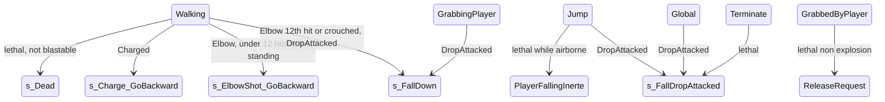

# State damage reactions: which PawnTakeDamage handler runs in each controller state

Units:
- uc:SBase.SPlayerController:s_PlayerWalking.PawnTakeDamage
- uc:SBase.SPlayerController:s_PlayerJump.PawnTakeDamage
- uc:SBase.SPlayerController:s_InteractWithObject.PawnTakeDamage
- uc:SBase.SPlayerController:s_Berserk360.PawnTakeDamage
- uc:SBase.SPlayerController:s_PlayerCharging.PawnTakeDamage
- uc:SBase.SPlayerController:s_Blast.PawnTakeDamage
- uc:SBase.SPlayerController:s_BlastFallAfterObstacle.PawnTakeDamage
- uc:SBase.SPlayerController:s_GrabBaseWithBlastDamageOnly.PawnTakeDamage
- uc:SBase.SPlayerController:s_GrabFromLedgeBase.PawnTakeDamage
- uc:SBase.SPlayerController:s_GrabbedByPlayer.PawnTakeDamage
- uc:SBase.SPlayerController:s_GrabbingPlayer.PawnTakeDamage
- uc:SBase.SPlayerController:s_ReleaseGrabbedPlayer.PawnTakeDamage
- uc:SBase.SPlayerController:s_FallDown.PawnTakeDamage
- uc:SBase.SPlayerController:s_TerminatePawn_Base.PawnTakeDamage
- uc:SBase.SPlayerController:s_Coop_S_Base.PawnTakeDamage
- uc:SBase.SPlayerController:s_Coop_S_Goto.PawnTakeDamage
- uc:SBase.SPlayerController:s_ShortLadder_P_Base.PawnTakeDamage
- uc:SBase.SPlayerController:s_BTW_Base.PawnTakeDamage
- uc:SBase.SPlayerController:s_Binoculars_Def.PawnTakeDamage
- uc:SBase.SPlayerController:s_Binoculars_Att.PawnTakeDamage
- uc:SBase.SPlayerController:s_UseObject_Mirador.PawnTakeDamage
- uc:SBase.SPlayerController:s_UseObject_StickyCam_SmoothToPosition.PawnTakeDamage
- uc:SBase.SPlayerController:s_UseObject_StickyCam.PawnTakeDamage
- uc:SBase.SPlayerController:s_Maintain_Enter.PawnTakeDamage
- uc:SBase.SPlayerController:s_Maintain_Use.PawnTakeDamage
- uc:SBase.SPlayerController:s_Maintain_Leave.PawnTakeDamage
- uc:SBase.SPlayerController:s_Hack_Enter.PawnTakeDamage
- uc:SBase.SPlayerController:s_Hack_Use.PawnTakeDamage
- uc:SBase.SPlayerController:s_Hack_Leave.PawnTakeDamage
- uc:SBase.SPlayerController:s_Computer_Enter.PawnTakeDamage
- uc:SBase.SPlayerController:s_Computer_Use.PawnTakeDamage
- uc:SBase.SPlayerController:s_Computer_Leave.PawnTakeDamage
- uc:SBase.SPlayerController:s_PutFlagInDropZone.PawnTakeDamage
- uc:SBase.SPlayerController:s_PlaceBomb.PawnTakeDamage
- uc:SBase.SPlayerController:s_PlaceBomb_End.PawnTakeDamage
- uc:SBase.SPlayerController:s_GrabBase.ClientDamage
- uc:SBase.SPlayerController:s_ReleaseGrabbedPlayer.ClientDamage
- uc:SBase.SPlayerController:s_Berserk360.ClientDamage
- uc:SBase.SPlayerController:s_PlayerCharging.ClientDamage

Also covered, with no unit of their own (an `ignores PawnTakeDamage` is not a function): the states s_BlastFloor,
s_PlayerFalling_OutOfWorld, s_Dead, s_BaseSpectating, GameEnded and s_Cinematic.

## Purpose
`PawnTakeDamage` is a state function. UnrealScript resolves it by the controller's current state on the server, then
the state's parents (`extends`), then the global version. This spec gives the porter a complete dispatch table and the
exact behaviour of each override, so the C# state classes can be generated with the same reactions. All handlers run
on the server. The shared step "SRTD" is `StandardReactionsToDamage` (`damage-pipeline.md` rules 10 to 31).
Interaction-cancel side effects (hack, computer, bomb, flag, sticky cam) are listed here because they are damage
reactions, but the objective consequences belong to the objectives spec.

## Data
Common sub-steps used below:
- PRE: `if Pawn.Health <= 0 return` before SRTD.
- DEATH-G: grounded check: if `Pawn.Base != None` then `PlayAnimDeath(Momentum, Health)` + `MirrorState('s_Dead')`,
  else `MirrorState('PlayerFallingInerte')` (both skipped while in GameEnded).
- DEATH-D: `PlayAnimDeath(Momentum, Health)` + `MirrorState('s_Dead')` without the grounded check.
- BLASTOK: `DamageType != SDamage_Explosion || !CanBeBlasted(Momentum)`.
- NOSB: `DamageType != SDTStickyBlast`.
- FATAL: `TellClientServerWaitForFatalBlast()`.
- ANIM: `PlayAnimDmg(PillTag, Momentum * 1000)` (owner side; see the pill/anim rules in `damage-pipeline.md`).
- IKOK: `SBPawn.IK_Type` is neither IKT_PIPH nor IKT_JCVD.
- H-CH, H-EL, H-DR: `Handle_ChargedDmg`, `Handle_ElbowDmg`, `Handle_DropAttackedDmg` (`melee-elbow-charge-berserk.md`,
  `drop-attack.md`).
- CS(x): `Checkshock(PillTag, x)` (`shock-and-taser.md`).

## Rules

### Dispatch table (effective handler after inheritance)
1. Global handler (131 states): every traversal state (ledges, fences, ladders, pipes, hand over hand, zip lines,
   Vandamme, wall jumps, barrier jumps, feet/waist ledges), the `s_Inactive` family (`s_LyingOnGround`, `s_StandUp`,
   `s_Reanimating`, `s_KOAfterBlastFall`, `s_SleepAfterKOBlastFall`, `s_BlastWakeUp`, `s_LandingInerte`,
   `s_TerminatedPawn`), `s_TerminatedPawn_Released`, `s_ElbowShooting`, `s_ElbowShot_GoBackward`,
   `s_Charge_GoBackward`, all `s_PlayerCharging_Hit*`, `s_DropAttack_Landing`, `s_DropAttacked_Incoming`,
   `s_FallDropAttacked`, `s_FallFallDropAttacked`, `s_TransitionTPK`, `s_AbortGrab`, `s_GrabBase`, pickup and
   go-to states, `s_UseObject`, `s_WaitRespawn`, `s_ClientIsReinit`, `s_WaitForClientToReinit`, `s_doNothing`,
   engine `PlayerWaiting`, `WaitingForPawn`, `PlayerFlying`, `BaseSpectating`, `spectating`.
2. `s_PlayerWalking` handler (36 states): `s_PlayerWalking`, `s_PlayerWalkingMario`, `s_PlayerWalkingWeapon`,
   `s_PlayerWalkingSt0H/St2H/Cr0H/Cr2H`, all stance transitions, `s_PlayerRolling`, `s_PlayerRollingUp`,
   `PlayerLanding`, `PlayerLandingSilent`, `s_PlayerHit`, wall jump prepare states, mine-on-wall states, throw states,
   `s_ReanimateFriend_0H/2H`, `s_StickyCam_MenuInteraction`, `s_UseObject_StickyCam_Leave`, camera-network wait states.
3. `s_PlayerJump` handler (8): `s_PlayerJump`, `s_PreSplitJump`, `s_SplitJump`, `PlayerFalling`,
   `PlayerFallToBackGrab`, `PlayerFallingFromRoll`, `PlayerFallingInerte`, `PlayerFallingKO`.
4. `s_GrabBaseWithBlastDamageOnly` handler (17): every grab approach, release and post-release state of both sides
   except the ones listed in rules 5 to 7 (`s_Grab_Avoided`, `s_Grab_GotoPosition`, `s_Grabbing_GoToPosToFreeGuy`,
   `s_Grabbing_GotoPosition`, `s_Grabbing_UncrouchForGrab`, `s_GrabbingPlayer_Begin`, `s_GrabbingPlayer_RealBegin`,
   `s_GrabbedByPlayer_Begin`, `s_GrabbedByPlayer_AvoidGrab`, `s_GrabbedByPlayer_Released` and its `_KO`,
   `_STRANGLE`, `_DMG`, `_Grabbing_LD`, `_GrabbingDMG` children, `s_GrabbedByPlayer_CounterGrab`).
5. `s_GrabFromLedgeBase` handler (4): `s_GrabFromLedgeBase`, `s_GrabbedFromLedge_Begin`, `s_GrabbingFromLedge_Begin`,
   `s_GrabbingFromLedge_Go`.
6. `s_ReleaseGrabbedPlayer` handler (8): `s_ReleaseGrabbedPlayer` and `_LD`, `_KO`, `_Strangle`, `_DMG`, `_BothDMG`,
   `_Grabbed_DMGED`, `s_GrabRelease_Counter`.
7. Single-state handlers: `s_GrabbedByPlayer`, `s_GrabbingPlayer`, `s_Berserk360`, `s_PlayerCharging`, `s_Blast`,
   `s_BlastFallAfterObstacle` (also used by `s_FallAfterGrabbedFromLedge`), `s_FallDown` (also `s_FallDownDying`),
   `s_TerminatePawn_Base` (all six terminate states), `s_InteractWithObject` (5 states), `s_Coop_S_Base` (5),
   `s_Coop_S_Goto` (3), `s_ShortLadder_P_Base` (5), `s_BTW_Base` (15), `s_Binoculars_Def` (2), `s_Binoculars_Att`,
   `s_UseObject_StickyCam` (also `s_UseObject_CamNetwork`), `s_UseObject_StickyCam_SmoothToPosition`,
   `s_UseObject_Mirador`, `s_Maintain_Enter`, `s_Maintain_Use`, `s_Maintain_Leave`, `s_Hack_Enter`, `s_Hack_Use`,
   `s_Hack_Leave`, `s_Computer_Enter`, `s_Computer_Use`, `s_Computer_Leave`, `s_PutFlagInDropZone`, `s_PlaceBomb`,
   `s_PlaceBomb_End`.
8. Damage ignored entirely (no SRTD, no history, no feedback): `s_BlastFloor`, `s_PlayerFalling_OutOfWorld`,
   `s_Dead`, `s_BaseSpectating`, `s_MultiSpectating`, `s_MultiSpectating_WhenKilled`, `s_Spectating_Visitor`,
   `GameEnded`, `s_Cinematic`.

### Handler behaviour
9. Global: see `damage-pipeline.md` rules 5 to 8 (PRE, SRTD, dead: BLASTOK and NOSB gives DEATH-G, explosion gives
   FATAL; alive: Charged and Elbow return, DropAttacked gives `MirrorState('s_FallDropAttacked')`, Sticky gives
   CS(false) then continues, then ANIM if IKOK and not SDTBase_NoAnim).
10. s_PlayerWalking: PRE, SRTD. Dead: if BLASTOK and NOSB then DEATH-D, else FATAL (also for a lethal sticky blast).
    Alive: Charged gives H-CH; Elbow gives H-EL; Sticky gives CS(true); DropAttacked gives H-DR; any other type gives
    ANIM only if DamageType is not SDamage_Explosion, `SBPawn.WeaponLoaded == 0` and not SDTBase_NoAnim (a merc with
    his gun up, or a spy with the shocker drawn, gets no hit animation).
11. s_PlayerJump: PRE, SRTD. Dead: BLASTOK and NOSB gives DEATH-G, explosion gives FATAL. Alive: Charged H-CH,
    Elbow H-EL, DropAttacked `MirrorState('s_FallDropAttacked')`, Sticky CS(false) and continue; then ANIM if IKOK and
    not NoAnim (the owner's jump states define PlayAnimDmg as empty, so in practice nothing plays).
12. s_InteractWithObject: as s_PlayerWalking, except that dead uses only BLASTOK (a lethal sticky blast gives DEATH-D)
    and Sticky gives CS(true) followed by `SBPawn.bStickyShocking = true`.
13. s_Berserk360: no PRE, SRTD. Dead: BLASTOK gives DEATH-D else FATAL. Alive: Charged H-CH, Elbow H-EL, Sticky
    gives `MirrorState('s_PlayerWalkingSt2H')` then CS(true), DropAttacked H-DR, other types nothing.
14. s_PlayerCharging: no PRE, SRTD. Dead as s_Berserk360. Alive: Charged H-CH, Elbow H-EL, Sticky CS(true),
    DropAttacked H-DR, other nothing.
15. s_Blast and s_BlastFallAfterObstacle: PRE, SRTD, nothing else. Death is resolved on landing by the blast states.
16. s_GrabBaseWithBlastDamageOnly: SRTD only when DamageType is SDamage_Explosion or DamTypeGrabBreak; every other
    damage is ignored completely (bullets, shocks, drops, elbows do nothing during grab transitions). No death state
    change here: an explosion death is resolved by the client's blast (s_GrabBase `ExplosionHit` starts `s_Blast`).
17. s_GrabFromLedgeBase: SRTD. Dead: BLASTOK gives `PlayAnimDeath` + `MirrorState('s_FallDropAttacked')`, else
    FATAL; then, if this is the spy and the state is `s_GrabbingFromLedge_Begin`, the merc's `GrabAborted()`.
    Alive: Charged, Elbow, Sticky (after CS(false)) and DropAttacked all return; for the spy they first do
    `MirrorState('s_FallDropAttacked')` and, for Charged/Elbow, H-CH/H-EL. The merc side only shocks.
18. s_GrabbedByPlayer (merc held as a shield): SRTD. Dead: non-explosion asks the grabbing spy's client to release
    with `GrabServerReleaseRequest(GrabbedDamaged)`; explosion gives FATAL. Alive and Sticky: CS(false) on the merc,
    and if the shooter is not the grabbing spy, the spy's `Checkshock(2)` (the shock conducts to the holder).
19. s_GrabbingPlayer (spy holding a merc): SRTD. If dead and DamageType is neither DropAttacked nor Explosion:
    `GrabServerReleaseRequest(GrabbingDamaged)` on itself (RPC to its own client); if dead by drop or explosion: FATAL.
    Then, dead or alive: Sticky shocks the held merc with `Checkshock(PillTag)` when the shooter is not that merc, then
    the spy with `Checkshock(PillTag)`; DropAttacked runs the drop-on-grabber rule in `spy-grab.md` (section
    "Damage while holding").
20. s_ReleaseGrabbedPlayer: PRE, SRTD. Dead: BLASTOK and NOSB gives DEATH-D; explosion gives FATAL. Alive: Charged
    and Elbow return; DropAttacked gives `MirrorState('s_FallDropAttacked')`; Sticky CS(false); no hit animation.
21. s_FallDown (knocked down, falling): PRE. Explosion: a merc runs SRTD, then FATAL if dead, else ANIM if IKOK and
    not NoAnim; a spy runs SRTD only. SDTBase, SDTBase_NoAnim, SDTSnipeShot and Crushed run SRTD only. Every other
    type is ignored (drop, elbow, charge, shocks, taser, fall, poison, sticky blast, jammer). No death state change:
    the owner's `s_FallDown.AnimEnd` goes to `s_Dead` when Health <= 0.
22. s_TerminatePawn_Base (merc doing the finishing move): no PRE, SRTD. Dead: BLASTOK gives `PlayAnimDeath` +
    `MirrorState('s_FallDropAttacked')`, else FATAL; then if the victim spy is alive, the spy's
    `MirrorState('s_TerminatedPawn_Released')`. Alive: Charged H-CH, Elbow H-EL, Sticky CS(true), DropAttacked H-DR,
    each followed by releasing the spy the same way; other types (bullets) do nothing and the move continues.
23. s_Coop_S_Base (spy being boosted, short ladder climber): no PRE, SRTD. Dead: BLASTOK gives `PlayAnimDeath` +
    `MirrorState('s_FallDropAttacked')`, else FATAL. Alive: Charged H-CH, Elbow H-EL, Sticky CS(false),
    DropAttacked `MirrorState('s_FallDropAttacked')`, other: ANIM if WeaponLoaded == 0 and not NoAnim.
24. s_Coop_S_Goto: as s_Coop_S_Base, but dead gives DEATH-D and DropAttacked gives H-DR.
25. s_ShortLadder_P_Base: same body as s_Coop_S_Base.
26. s_BTW_Base (back to wall): no PRE, SRTD. Dead: BLASTOK gives DEATH-D else FATAL. Alive: Charged H-CH, Elbow
    returns, DropAttacked `MirrorState('s_FallDropAttacked')`, Sticky CS(false) and continue; then ANIM if
    WeaponLoaded == 0 or the type is Sticky.
27. s_Binoculars_Def (merc scoped): no PRE, SRTD. Dead: BLASTOK DEATH-D else FATAL. Alive: Charged H-CH, Elbow H-EL,
    Sticky CS(true), DropAttacked H-DR, other: ANIM if WeaponLoaded == 0 and not NoAnim.
28. s_Binoculars_Att (spy binoculars): `bBinocularVision = false` first; SRTD. Dead as s_Binoculars_Def. Alive: as
    s_Binoculars_Def for Charged/Elbow/Sticky/Drop; Explosion returns; any other type leaves the binoculars with
    `ChangeState('s_PlayerWalkingCr0H')` or `'s_PlayerWalkingSt0H'` by crouch, then ANIM if not NoAnim.
29. s_UseObject_Mirador and s_UseObject_StickyCam: SRTD, dead BLASTOK DEATH-D else FATAL; alive: Sticky CS(true) and
    continue, Charged/Elbow/Drop give H-CH/H-EL/H-DR and return; then choose a walking state by crouch and weapon and
    `MirrorState(that, , true)` (leave the camera or tower). The sticky cam version special-cases a PreviousState of
    `s_PlayerWaiting`, `s_ElbowShot_GoBackward` or `s_PlayerCharging`.
30. s_UseObject_StickyCam_SmoothToPosition: SRTD, `CleanStickyCamOnClient()`, dead as rule 29; alive: Charged,
    Elbow return after H-CH/H-EL; DropAttacked `MirrorState('s_FallDropAttacked')`; Sticky leaves to PreviousState
    (on a pipe, back to wall or Vandamme) or `s_UseObject_StickyCam_Leave`, then CS(false); other: ANIM if IKOK and
    not NoAnim.
31. Interaction wrappers that cancel and then run the global handler: `s_Maintain_Enter` and `s_Maintain_Use`
    (`MirrorState('s_Maintain_Leave', 'TriggerHack_Failed')` if alive), `s_Maintain_Leave` and `s_Hack_Leave`
    (`GotoWaitingState()`), `s_Hack_Enter` (`MirrorState('s_Hack_Leave', 'TriggerHack_Failed')` if alive),
    `s_Computer_Enter` (`MirrorState('s_Computer_Leave')` if alive, then broadcast message 23), `s_Computer_Leave`
    (`MirrorState('s_PlayerWalkingSt0H')` if alive), `s_PutFlagInDropZone` (re-attach the carried flag to bone
    'B L Thigh' at (10,0,-10), then `MirrorState('s_PlayerWalkingSt0H')` if alive), `s_PlaceBomb`
    (`MirrorState('s_PlaceBomb_End')` if alive), `s_PlaceBomb_End` (`MirrorState('s_PlayerWalkingSt0H')` if alive,
    global, then undraw action if still armed).
32. s_Hack_Use and s_Computer_Use: s_Computer_Use broadcasts message 23 (objective interrupted) on every call
    (s_Hack_Use sends no message), then PRE, SRTD.
    Dead: BLASTOK and NOSB gives DEATH-G, explosion FATAL. Alive: Charged H-CH, Elbow H-EL, DropAttacked
    `MirrorState('s_FallDropAttacked')`; Sticky: if alive `MirrorState('s_PlayerWalkingSt0H')` (s_Hack_Use also
    `GotoWaitingState()`), then CS(false); other: ANIM and leave the terminal (`s_Hack_Leave` or
    `MirrorState('s_PlayerWalkingSt0H')`). s_Computer_Use plays ANIM only if IKOK and not NoAnim.

### ClientDamage overrides (owner side)
33. `s_GrabBase` family (23 states, including every grab state of both sides except `s_GrabbingPlayer` and the
    release family): only explosions give feedback: `ExplosionHit(Momentum)`, detach the head camera, HUD effect, and
    the merc/spy camera shake of the global version. No rumble, no other types.
34. `s_ReleaseGrabbedPlayer` family: the global ClientDamage.
35. `s_Berserk360` and `s_PlayerCharging`: switch the laser back on (`RallumeLaserEteint`), then the global version.
36. Other overrides (`s_BasePutMineOnWall`, `s_ShortLadder_P_*`, `s_Hoist_P_Waiting`, `s_Maintain_*`, `s_Hack_*`,
    `s_StickyCam_MenuInteraction`) belong to the interaction specs; they wrap the global version with UI cleanup.

## States
The handlers do not own states; the transitions they request are summarised here.

## Constants
| Name | Value | Unit | Provenance | Source |
|---|---|---|---|---|
| shock conducted to the grabbing spy | pill 2 | - | decoded | s_GrabbedByPlayer.PawnTakeDamage |
| interrupt broadcast | SGameMessages switch 23 | - | decoded | s_Computer_Use, s_Computer_Enter (not s_Hack_Use) |
| flag re-attach offset | (10, 0, -10) on 'B L Thigh' | uu | decoded | s_PutFlagInDropZone.PawnTakeDamage |

## Network
- All handlers run on the server in the server-side state of the victim's controller. The server-side state follows
  the owner through `ChangeState` and `PCChangeServerState`, so for a few frames after a client-initiated transition
  the server may still use the previous state's handler.
- `MirrorState` (server sets its state and sends `PCChangeClientState` reliably) is the only way a handler changes
  the owner's state. The owner applies it if its timestamp is not older than the last applied one.

## Edge cases
- Because `s_FallDown` ignores drops, elbows, charges and shocks, a knocked-down player cannot be chain-stunned during
  the fall animation; bullets, snipes, explosions and crush still hurt.
- During every grab transition both players are immune to bullets and shocks (only explosions and the grab-break type
  apply). Once the grab is established, the merc (`s_GrabbedByPlayer`) and the spy (`s_GrabbingPlayer`) take full
  damage.
- A merc killed while doing the finishing move goes to `s_FallDropAttacked` (not `s_Dead`) and resolves death on
  landing.
- Global handler states include `s_LyingOnGround`: a lying player takes full bullet damage; a drop attack on him would
  request `s_FallDropAttacked`, but `CanBeDropAttacked` is false while lying so the drop is never delivered.

## Evidence
- Effective handler resolution computed from local/re-out/uc/SBase/SPlayerController.uc by walking `extends` chains
  and `ignores` lists for all 280 states.
- Handler sha1 prefixes (uc-index): s_PlayerWalking 3c82c614, s_PlayerJump 19096221, s_Berserk360 32338f10,
  s_PlayerCharging b9554050, s_Blast fce6e027, s_BlastFallAfterObstacle 97053947, s_GrabBaseWithBlastDamageOnly
  bb043e76, s_GrabFromLedgeBase 5744d4fe, s_GrabbedByPlayer 071d18f8, s_GrabbingPlayer 97ac7fbc,
  s_ReleaseGrabbedPlayer cad5886d, s_FallDown e661e60c, s_TerminatePawn_Base 875d6907; s_GrabBase.ClientDamage
  29e23cd3.

## Open questions
- None specific to dispatch. The owner-side state at the moment an RPC such as `PlayAnimDmg` arrives can differ from
  the server state; a real-game trace of a hit during a jump-to-land transition would show which animation the
  original plays (expected: none if the owner is still in the jump family).
