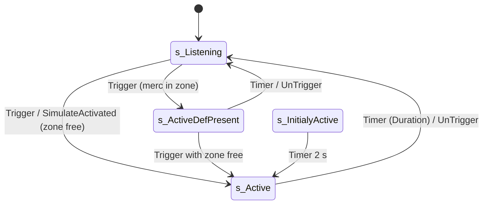

# SAlarm (map alarms: locks, events, HUD alarm)

Units:
- def:SBase.SAlarm
- uc:SBase.SAlarm:AlarmStateChange
- uc:SBase.SAlarm:PawnDefenseEntered
- uc:SBase.SAlarm:IsDefenseInAlarmZone
- uc:SBase.SAlarm:SetAlarmListening
- uc:SBase.SAlarm:RestartCountdown
- uc:SBase.SAlarm:SetAlarmActive
- uc:SBase.SAlarm:SimulateActivated
- uc:SBase.SAlarm:s_Listening.Trigger
- uc:SBase.SAlarm:s_Listening.UnTrigger
- uc:SBase.SAlarm:s_Listening.SimulateActivated
- uc:SBase.SAlarm:s_Listening.Timer
- uc:SBase.SAlarm:s_Listening.EndState
- uc:SBase.SAlarm:s_Active.SimulateActivated
- uc:SBase.SAlarm:s_Active.BeginState
- uc:SBase.SAlarm:s_Active.EndState
- uc:SBase.SAlarm:s_Active.Timer
- uc:SBase.SAlarm:s_Active.Trigger
- uc:SBase.SAlarm:s_Active.UnTrigger
- uc:SBase.SAlarm:s_ActiveDefPresent.BeginState
- uc:SBase.SAlarm:s_ActiveDefPresent.EndState
- uc:SBase.SAlarm:s_ActiveDefPresent.Timer
- uc:SBase.SAlarm:s_ActiveDefPresent.SimulateActivated
- uc:SBase.SAlarm:s_ActiveDefPresent.Trigger
- uc:SBase.SAlarm:s_ActiveDefPresent.UnTrigger
- uc:SBase.SAlarm:s_InitialyActive.BeginState
- uc:SBase.SAlarm:s_InitialyActive.Timer
- rep:SBase.SAlarm.MessagePriority
- rep:SBase.SAlarm.Duration
- rep:SBase.SAlarm.bAlarmOn
- rep:SBase.SAlarm.StartTime
- eng:ASAlarm::Tick
- eng:ASAlarm::GetOptimizedRepList
- nat:SBase.SHud.AddAlarm
- nat:SBase.SHud.RemoveAlarm

## Purpose

The map's security alarm. Lasers, cameras, volumetric sensors, switches, objectives and SMagicEvent chains fire an
event at the alarm's `Tag`; the alarm then, for `Duration` seconds: fires its own `Events` (lights, doors, sounds,
shakers), locks its objective triggers (`ObjectiveTriggersToLock`, terminals, bomb targets, flags) and movers
(`MoversToLock`, doors usually closed first), tells the mercs (and for low priorities the spies) on the HUD, shows
the countdown, and marks the device that raised it. When the time runs out (or the alarm is untriggered) all of it is
undone. It is the main way maps gate objectives and doors. 558 alarms on 72 of the 84 maps.

## Data

| Field | Type | Default | Meaning |
|---|---|---|---|
| `MessagePriority` | byte, edit, rep (initial) | 5 | 0 and 1: spies are told too; 2 and up: the instigating player is told; above 4: HUD alarm box and alarm loop |
| `Duration` | int, edit, rep (initial) | 60 | seconds the alarm stays raised after the last (re)start |
| `Events` | array<name>, edit | empty | fired (Trigger) on raise, untriggered on stand-down |
| `ObjectiveTriggersToLock` | array<SObjectiveTrigger>, edit | empty | `Lock` on raise, `UnLock` on stand-down; None entries skipped |
| `MoversToLock` | array<MoverLockInfo>, edit | empty | per mover: `ActionBeforeLock` None, Trigger or Untrigger, then `Lock`; `UnLock` on stand-down |
| `AlarmName`, `AlarmDescription`, `AlarmDescriptionSpy` | localized string, edit | "Unnamed alarm", "Unnamed alarm is active", "Unnamed alarm activated" | HUD texts (spec/hud/messages.md rule 1) |
| `bAlarmOn` | bool, rep | false | raised; every machine's HUD follows it |
| `bLocalAlarmOn` | bool | false | last value of `bAlarmOn` this machine acted on |
| `StartTime` | float, rep | 0 | `GRI.PreciseElapsedTime()` at the last (re)start |
| `TriggerActor` | SBasicGamePlayObject | None | the gameplay object that raised it, marked on HUDs |
| Defaults | | | `bHidden`, `bNoDelete`, `bAlwaysRelevant`, `RemoteRole=ROLE_SimulatedProxy`, no movement replication, `native`, `nativereplication` |

`MoverLockInfo.EActionBeforeLock`: 0 `ActionBeforeLock_None`, 1 `ActionBeforeLock_Trigger`, 2 `ActionBeforeLock_Untrigger`.

## Rules

1. Auto state `s_Listening`; `s_InitialyActive` is the other editable start state.
2. `s_Listening.Trigger(Other, I)`: tell the instigator (rule 9); mark `Other` (rule 10); a spy pawn instigator
   (`SPawnAttaque` with a player controller and stats) adds 1 to `Spy_AlarmsTriggered`; then `SetAlarmActive`.
   `UnTrigger` calls `SetAlarmListening`. `SimulateActivated` is the state's own Trigger.
3. `SetAlarmActive`: when no merc is in the alarm zone (rule 11): `TriggerEvent` every `Events` name (Other = the
   alarm, no instigator), `Lock` every objective trigger, for each mover do its `ActionBeforeLock` (Trigger or
   UnTrigger with Other = the alarm) and `Lock` it, go to `s_Active`, then `RestartCountdown`. With a merc in the zone:
   `RestartCountdown`, go to `s_ActiveDefPresent` (nothing triggered or locked).
4. `RestartCountdown`: `StartTime = GRI.PreciseElapsedTime()`, `SetTimer(Duration, false)`.
5. `s_Active.BeginState`: `bAlarmOn = true`; the mercs (team 1) get `SGameMessages` switch 1 with the alarm as
   object; for `MessagePriority < 2` the spies (team 0) get switch 24. `s_ActiveDefPresent.BeginState` is the same
   with switch 40 for the mercs.
6. `s_Active.Trigger`: tell the instigator, mark `Other`; then when the local player's `GRI.ElapsedTime` (whole
   seconds) is above `StartTime`, re-send switch 1 to the mercs and `RestartCountdown`. A burst of triggers within the
   same game second therefore restarts the countdown once. `SimulateActivated` is the same without the instigator
   message. `s_ActiveDefPresent.Trigger` and `SimulateActivated` do the same with switch 40 and then, if the zone is
   now free of mercs, `SetAlarmActive` (the real raise).
7. `s_Active.Timer` (Duration over): `SetAlarmListening`. `s_Active.UnTrigger`: `bAlarmOn = false`, switch 1 to the
   mercs again, `SetAlarmListening`, clear the marked device. `s_ActiveDefPresent.Timer`: straight to `s_Listening`
   (no untriggers, nothing was locked). `s_ActiveDefPresent.UnTrigger`: `bAlarmOn = false`, switch 40, clear the
   marked device, `s_Listening`.
8. `SetAlarmListening`: `UntriggerEvent` every `Events` name, `UnLock` every objective trigger and every mover, go to
   `s_Listening`. Leaving `s_Active`/`s_ActiveDefPresent` clears the marked device and `bAlarmOn`; leaving
   `s_Listening` clears `bAlarmOn` (it is set again by the next BeginState). `s_Listening.Timer` (a countdown left
   from `s_ActiveDefPresent`) clears the marked device and `bAlarmOn`.
9. Instigator message (Trigger in every state): for `MessagePriority >= 2`, the instigator's player controller gets
   `AddMessageOnHud(1)` ("You've been detected") when the priority is below 4 or a merc is in the zone, else
   `AddMessageOnHud(2)` ("Area isolated" in a versus match, detected otherwise). `AddMessageOnHud(n)` is the HUD's
   `AddHudNumberMessageToStack(n, 4)`, a reliable server-to-owner call. No instigator: nothing.
10. Marked device: when `Other` is an `SBasicGamePlayObject` other than the current one, the previous one leaves the
    HUD (`RemoveFromHud`, not always relevant), the new one is shown (`AddOnHud`: the malfunction marker for objects
    of priority 5 and up) and made always relevant. Cleared at stand-down.
11. Merc in the zone: some controlled `SPAWNDEFENSE` whose zone is an `SAlarmZoneInfo` with `Event == Tag`.
    `SAlarmZoneInfo.ActorEntered` of a merc calls `PawnDefenseEntered` (= `SetAlarmListening`) on the alarms tagged
    with its Event, and with `bDetectIntruders` triggers its Event for others. No converted map places an
    `SAlarmZoneInfo`, so on the shipped maps this test is always false and `s_ActiveDefPresent` is never entered.
12. Native tick (every machine, after the actor tick): when `bAlarmOn != bLocalAlarmOn`, `AlarmStateChange`:
    `bLocalAlarmOn = bAlarmOn`; on, every pawn's player controller's HUD `AddAlarm(self)`; off, `RemoveAlarm(self)`
    and the marked device is cleared. Only HUDs of the machine exist, so each machine updates its own players.
13. `SHud.AddAlarm`: nothing if already listed; otherwise into the first empty slot, else inserted at the front. If no
    alarm above priority 4 was listed and the new one is above 4, the HUD's `Snd_HiPrioAlarm`
    (`Interface.Objectifs.Alarme`) starts on the player (volume 1, radius 100, pitch 1, play flags loop and 2D).
    `SHud.RemoveAlarm`: removes it; if no alarm above 4 is left, that sound stops.
14. `s_InitialyActive`: a repeating 2 s timer calls `SetAlarmActive` (the first raise replaces the timer with the
    countdown).
15. `Event` set on an SAlarm (two maps: `MachineAlarmVocal`) is never fired: neither the script nor the native code
    of the class uses it.

## States

## Constants

| Name | Value | Unit | Provenance | Source |
|---|---|---|---|---|
| default Duration | 60 | s | decoded | def:SBase.SAlarm |
| default MessagePriority | 5 | | decoded | def:SBase.SAlarm |
| merc / spy team | 1 / 0 | | decoded | s_Active.BeginState |
| merc switch, normal / merc in zone | 1 / 40 | | decoded | s_Active, s_ActiveDefPresent |
| spy switch | 24 | | decoded | s_Active.BeginState |
| spies told below priority | 2 | | decoded | s_Active.BeginState |
| instigator told from priority | 2 | | decoded | s_Listening.Trigger |
| "area isolated" from priority | 4 | | decoded | s_Listening.Trigger |
| HUD text time | 4 | s | decoded | SPlayerController.AddMessageOnHud |
| high-priority alarm above | 4 | | decoded | ASHud::execAddAlarm |
| alarm loop volume / radius / pitch | 1 / 100 / 1 | | decoded | ASHud::execAddAlarm |
| initially active retry | 2 | s | decoded | s_InitialyActive.BeginState |

## Map data (survey of the 84 converted maps)

`MessagePriority` set on 341 alarms: 0 (170), 2 (84), 3 (73), 1 (11), 4 (3); the other 217 keep 5. `Duration` 0 to
1000000 (20, 10, 5, 15, 12 most common); 0 is `SetTimer(0)`, which clears the timer, so such an alarm stays raised
until it is untriggered, and the very long ones (10000 to 1000000) are raised for the rest of the round. `Events` on 97 alarms reach SGamePlayObjects, STriggerLights, Movers,
SInterrupteurs, SoundTriggers, SAmbientSoundTriggers, SAnimatedMeshes, SShakers. `ObjectiveTriggersToLock` on 203
(SComputerObjectiveTrigger 257 entries, SFlag 42, SBombTargetObjectiveTrigger 39, some None). `MoversToLock` on 23
(Trigger before lock 69 entries, None 7). `InitialState=s_Listening` on 27 (the default); none starts
`s_InitialyActive`. Raised by SLaserTrigger (1190 edges), SVolumetricSensor (238), SCamera (152), SMagicEvent
(116), SInterrupteur (65), SObjective, Mover, SComputerObjectiveTrigger, SoundTrigger, SMission, SShaker, Trigger,
SFlag, SPresenceTrigger. Editor-only props seen: `Group`, `DrawScale`, `Mesh`, `EMF*`/`Heat*`, `bBlockCamera`,
`bTryToMoveEncroachedActor`, `bIgnoreEchelonLighting` (the alarm is hidden; none has an effect).

## Network

Server-authoritative: only the server's copy is triggered. `ASAlarm::GetOptimizedRepList` does not call the Actor
list: `Duration` and `MessagePriority` in the first bunch, `bAlarmOn` and `StartTime` on change, nothing else. Every
client's copy runs rule 12 from its own tick, so a replicated `bAlarmOn` puts the alarm on (or off) that client's
HUD and the HUD reads `Duration`, `StartTime` and `MessagePriority` for the box. The merc and spy lines go as
`ReceiveLocalizedMessage` to each player's controller; `AddMessageOnHud` reliably to the instigator's machine. The
marked gameplay object is made always relevant so its HUD marker reaches everyone.

## Edge cases

- The "re-tell and restart" test compares whole game seconds with a precise start time: within the first second
  after a (re)start, further triggers only mark devices and tell the instigator.
- `s_Active.UnTrigger` sends the merc line once more (the HUD shows the alarm as off: `bAlarmOn` is false).
- The script reads the local player's GRI for that test; the stock "dedicated" host is a listen server, so it always
  has one. A host with no local player reads the game's GRI here (estimated).
- An `ObjectiveTriggersToLock` or `MoversToLock` entry of None is skipped (the script logs an access warning).
- `AlarmStateChange` reaches only pawns with a player controller and a HUD, so AI and spectators without a pawn get no
  alarm entry (the HUD empties the list at match start).

## Evidence

- `local/re-out/uc/SBase/SAlarm.uc`, `SAlarmZoneInfo.uc`, `SHud.uc` (natives 1444, 1445, AddHudNumberMessageToStack),
  `SPlayerController.uc` (AddMessageOnHud), `SNoiseEmitter.uc` (FakeAlarms calls SimulateActivated).
- Game exe: `ASAlarm` vtable 0x10bf66e8 differs from AActor's in slot 23 (GetOptimizedRepList 0x10a8ea90) and slot
  29 (Tick 0x10a8ec90: calls AActor::Tick, then compares bits 0 and 1 of the bool word at +0x35c and raises the event
  named AlarmStateChange). `ASHud::execAddAlarm` 0x10a91a60, `execRemoveAlarm` 0x10a91b90 (AlarmsList at +0x518,
  `Snd_HiPrioAlarm` at +0x574, `PlayerOwner` at +0x3e0, `MessagePriority` at alarm +0x358).
- `.content/svmap/*/sim/gameplay.json` survey (above).

## Open questions

1. Does the alarm loop (`Interface.Objectifs.Alarme`) stop on its own, or only through `RemoveAlarm`? Scenario: raise
   a priority 5 alarm and listen past its Duration.
2. The ported HUD plays the loop as a flat sound; the play flag 0x02 (loop) is not carried by the sim event, so the
   loop relies on the Sound's own flags.
