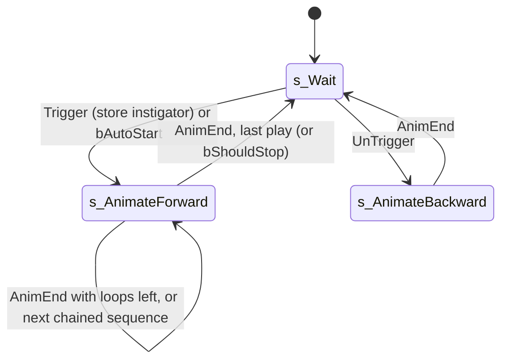

# SAnimatedMesh and animation notifies

Units:
- def:SBase.SAnimatedMesh
- uc:SBase.SAnimatedMesh:PostNetBeginPlay
- uc:SBase.SAnimatedMesh:AnimEnd
- uc:SBase.SAnimatedMesh:s_Wait.BeginState
- uc:SBase.SAnimatedMesh:s_Wait.Trigger
- uc:SBase.SAnimatedMesh:s_Wait.UnTrigger
- uc:SBase.SAnimatedMesh:s_AnimateForward.BeginState
- uc:SBase.SAnimatedMesh:s_AnimateForward.AnimEnd
- uc:SBase.SAnimatedMesh:s_AnimateForward.Trigger
- uc:SBase.SAnimatedMesh:s_AnimateForward.UnTrigger
- uc:SBase.SAnimatedMesh:s_AnimateBackward.BeginState
- uc:Engine.AnimNotify_Trigger:Notify
- def:Engine.AnimNotify_Trigger
- def:Engine.AnimNotify_Sound
- def:Engine.AnimNotify_StopSound
- nat:Engine.Actor.AttachToBone
- nat:Engine.Actor.FreezeAnimAt
- nat:Engine.Actor.PlayAnim

## Purpose

A skeletal-mesh prop that plays a list of animation sequences when triggered, optionally loops or chains them,
carries other actors on its bones, and lets its sequences' notifies fire events and sounds. SteeE has two: the crane
(`SAnimatedMesh277`, Tag `blast`, `sqt_grue_seq`) whose notifies drive the whole crane chain, and the collapsing
wall (`SAnimatedMesh451`, Tag `blast01`, `sqt_mur_seq`), hidden until triggered.

## Data

| Field | Type | Default | Meaning |
|---|---|---|---|
| `Animations` | array of name | empty | sequences, played in order |
| `LoopStatus_0forInfinite` | array of int | empty | plays per sequence; 0 loops forever |
| `bChainedAnims` | bool | false | advance to the next sequence automatically |
| `bAutoStart` | bool | false | start on the first entry to `s_Wait` |
| `ActorsToAttach` | array of {BoneName, ActorName} | empty | actors hung on bones at start |
| `iCurrentAnim`, `iLoopLeft` | int | 0 | runtime |
| `bShouldContinue`, `bShouldStop` | bool | false | runtime requests |
| `fLastRootMotionTimeCalled` | float | | unused by script |
| Class defaults | | | `RemoteRole=ROLE_SimulatedProxy`, `bNoDelete`, `bAlwaysRelevant`, `bUpdateSimulatedPosition`, `bReplicateAnimations`, `nativereplication` |

`AnimNotify_Trigger`: `EventName` (name). `AnimNotify_Sound`: `Sound`, `Volume` (default 1.0), `Radius` (int),
`BoneName`. Notify records in a sequence: normalized time `t` in [0, 1] over the sequence's frame count `N` and a
notify object.

## Rules

1. `PostNetBeginPlay` (simulated, so on server and every client): `Super.PostNetBeginPlay`; for every
   `ActorsToAttach` entry `AttachToBone(ActorName, BoneName)`. Then on the authority only: `SetPhysics(PHYS_None)`,
   `SetDrawType(DT_Mesh)`; pad `LoopStatus_0forInfinite` up to `Animations.Length`, filling 1, except the last
   entry is 0 when `bChainedAnims`; `iCurrentAnim = 0`; `PlayAnim(Animations[0])` then `FreezeAnimAt(0.0)`
   (the mesh shows frame 0, not moving).
2. Auto state `s_Wait`. `BeginState`: if `bAutoStart`, clear it and go to `s_AnimateForward`.
   The port defers this actor's initial-state entry until rule 1 has prepared the channel and loop counts. Its
   level startup currently requests `SetInitialState` before `PostNetBeginPlay`; entering immediately starts an
   automatic prop and then freezes it permanently (Aquarium's two palms). Triggered props still start frozen.
   `Trigger(Other, EventInstigator)`: if `EventInstigator != None` store it as `Instigator`; go to
   `s_AnimateForward`. `UnTrigger`: go to `s_AnimateBackward`.
3. `s_AnimateForward.BeginState`: `iLoopLeft = LoopStatus[iCurrentAnim] - 1`; `PlayAnim(Animations[iCurrentAnim])`
   (rate 1, no tween, channel 0); un-hide (`bHidden = false`); `SetPhysics(PHYS_None)` then
   `SetPhysics(PHYS_RootMotion)`.
4. `s_AnimateForward.AnimEnd`, in order:
   a. If `bShouldStop`: clear it, go to `s_Wait`.
   b. Else if `iLoopLeft != 0` and not `bShouldContinue`: if `iLoopLeft > 0` decrement it; replay the same sequence
      (same un-hide and physics reset). A start value of -1 (LoopStatus 0) loops forever.
   c. Else advance: `iCurrentAnim += 1`, wrapping to 0 at the end. If `bChainedAnims` or `bShouldContinue`: clear
      `bShouldContinue`; if the index wrapped to 0 go to `s_Wait`, else set `iLoopLeft` for the new sequence and play
      it. Otherwise go to `s_Wait`.
5. `s_AnimateForward.Trigger`: `bShouldContinue = true` (skip remaining loops at the next end).
   `s_AnimateForward.UnTrigger`: `bShouldStop = true` (stop at the next end).
6. `s_AnimateBackward.BeginState`: `iCurrentAnim -= 1`, wrapping to the last index; play that sequence backwards;
   un-hide; physics reset as rule 3. Its `AnimEnd` is the global one: go to `s_Wait`.
7. Global `AnimEnd`: go to `s_Wait`.
8. After a one-shot sequence ends the channel holds its last frame, so the mesh keeps its final pose in `s_Wait`. A
   new Trigger in `s_Wait` restarts the sequence from frame 0 (the pose jumps back) and replays every notify.
9. Timing of a sequence with `N` frames at rate `R` played at rate 1: the channel frame is normalized over `N` and
   advances by `R / N` per second; a one-shot sequence ends (AnimEnd) when the frame reaches `(N - 1) / N`, i.e.
   after `(N - 1) / R` seconds (decoded, anim.md rule 2: AnimLast = 1 - 1/N). The actor plays in PHYS_RootMotion
   (rule 3), and in root motion the end logic runs one tick after the frame first crosses AnimLast, so AnimEnd
   arrives one tick later than in other physics. A notify at normalized time `t` fires on the first animation
   update at or after `t * N / R` seconds.
10. Notify firing (engine, decoded in anim.md rule 2): each update fires the earliest unfired notify with a time in
    (old frame, new frame], stops the frame there and keeps the leftover time for the next pass (up to 4 passes, so
    several notifies in one tick fire in time order). A frame of exactly 0 is first nudged to 1e-4 without advancing,
    so a notify at exactly frame 0 never fires at the start, nor after a loop wrap; the crane's start sound at
    t = 0.000222 fires on the second update after `PlayAnim`. Firing is quantized to animation updates (ticks).
11. `AnimNotify_Trigger.Notify(Owner)`: `Owner.TriggerEvent(EventName, Owner, Pawn(Owner))`: `Other` is the
    animated actor and the instigator is `None` for a non-pawn. It only has effect on the authority
    (`events.md` rule 7). Receivers that want a responsible pawn use `Other.Instigator`, which is the pawn stored in
    rule 2.
12. `AnimNotify_Sound.Notify` (native): plays `Sound` at the owner (or at `BoneName` when set) with `Volume` and
    `Radius`. Native, so it runs on every machine that updates the animation: each client hears it locally.
    `AnimNotify_StopSound.Notify` (native, body not decoded) stops its `Sound` on the owner (RiveD's
    `MAL_anm.ventilateur_mesh` fan ends its loop with it).

## States

## Constants

| Name | Value | Unit | Provenance | Source |
|---|---|---|---|---|
| `sqt_grue_seq` frames, rate | 451, 40 | frames, fps | decoded | `Packages/Animations/sqt13_anm.ukx` MeshAnimation `sqt_grue_anm` |
| crane sequence end | 450 / 40 = 11.25 | s | decoded (end rule) | rule 9; the plan's 11.28 s is N / R |
| `sqt_mur_seq` frames, rate | 101, 30 | frames, fps | decoded | `sqt_mur_anm` |
| wall sequence end | 100 / 30 = 3.333 | s | decoded (end rule) | rule 9 |
| crane notifies (t, frame, time) | see table below | | decoded | sqt13_anm.ukx |
| crane DrawScale | 10 | | decoded | SAnimatedMesh277 |

Crane notifies (`t * 451 / 40`):

| t | Frame | Time (s) | Notify | Payload |
|---|---|---|---|---|
| 0.000222 | 0.1 | 0.0025 | AnimNotify_Sound268 | `Squ_Grue_Seq_Start`, Volume 4.0, Radius 200 |
| 0.170732 | 77 | 1.925 | AnimNotify_Sound402 | `Seq_Grue_Loop`, Volume 3.6, Radius 200 |
| 0.219512 | 99 | 2.475 | AnimNotify_Sound269 | `Seq_Grue_Loop`, Volume 2.8, Radius 200 |
| 0.636297 | 286.97 | 7.174 | AnimNotify_Sound270 | `Squ_Grue_Seq_Stop`, Volume 4.0, Radius 200 |
| 0.841020 | 379.3 | 9.483 | AnimNotify_Sound272 | `Squ_Grue_Seq_Drop`, Volume 6.0, Radius 200 |
| 0.910887 | 410.81 | 10.270 | AnimNotify_Trigger236 | EventName `tueletube` |
| 0.972239 | 438.48 | 10.962 | AnimNotify_Trigger281 | EventName `blast01` |

The list order in the package puts `blast01` before `tueletube`; firing follows time, so `tueletube` fires first.
Wall notify: AnimNotify_Sound271 `MC_mur_destroy`, Radius 300, Volume 1.0, at t 0.00099 (0.0033 s).

SteeE attachments on the crane: `Dummy01` Light386, `Dummy02` Light397, `Dummy03` Light400, `Dummy04` Light403,
`Dummy05` Light372. These are Light actors with `LightType=LT_None` (they cast no light), drawn as unlit additive
flare sprites (`sfx.Flare.def_flare`, DrawScale 2): aircraft warning lamps on the boom.

## Network

- `RemoteRole=ROLE_SimulatedProxy`, `bAlwaysRelevant`. With `DrawType == DT_Mesh` and `bReplicateAnimations`, the
  Actor replication sends `SimAnim` (sequence name, loop flag, byte rate, byte frame, byte tween rate) so clients start
  the same sequence; `bHidden` replicates through the Actor rules (the wall appearing). The class is
  `nativereplication`, so the exact list is native.
- Server: triggers, state changes, notify events (rule 11), `AnimEnd`-driven state.
- This port's SimAnim (estimated; the native replication is not decoded): `PlayAnim` sends the sequence, rate x 64
  and start frame 0, or 255 for a backward play (it starts at the end); a play with plays of the same sequence left
  sets `AnimLoop`; the end of a one-shot sends rate 0 and the end frame, unless `AnimEnd` plays again in that tick.
  A client's proxy plays its own channel from it (a rate above 0 after a held channel or another sequence starts it,
  rate 0 holds the frame, `AnimLoop` wraps it at the end), so its notify sounds play locally and the views draw that
  channel.
- Every machine: bone attachments (rule 1 runs before the authority check), notify sounds (rule 12), the pose.

## Edge cases

- The crane is triggered once in SteeE because its switch is once-only. A second `blast` after the sequence ended
  would replay the whole sequence and fire `tueletube` and `blast01` again; during the sequence it would only set
  `bShouldContinue`, which has no effect on a single one-shot sequence.
- `s_Wait.Trigger` keeps the old `Instigator` when the new trigger has none.
- The attached flare actors are `bStatic` and not `bMovable` by Light class default, but the native attachment
  path accepts them. Their render-only references must still follow the crane's bones.
- `AnimEnd` arrives once per end on the authority; on clients `AnimEnd` would also be called by the engine, but the
  state functions are not simulated and are absorbed.

## Evidence

- `local/re-out/uc/SBase/SAnimatedMesh.uc`, `Engine/AnimNotify_Trigger.uc`, `Engine/AnimNotify_Sound.uc`,
  `Engine/Actor.uc` (AnimRep, SimAnim replication condition).
- `Packages/Animations/sqt13_anm.ukx`: 2 MeshAnimations (`sqt_grue_anm` 19 bones, `sqt_mur_anm` 11 bones),
  2 AnimNotify_Trigger (`AnimNotify_Trigger236` tueletube, `AnimNotify_Trigger281` blast01), 6 AnimNotify_Sound.
  Notify record layout `{f32 Time, u16, compact notify ref}` per the scctpkg meshanim reader.
- SteeE.sdc exports `SAnimatedMesh277`, `SAnimatedMesh451`, `Light386`, `Light397`, `Light400`, `Light403`, `Light372`.
- Channel timing rule: memory note `scct-anim-channel-timing` (frame normalized over N, last frame (N-1)/N, rate
  per second over N), and the three integer-frame sound notifies (0.1, 77, 99 of 451) confirm normalization over N.
- Natives: PlayAnim `0x10a23610`, FreezeAnimAt `0x10a23af0`, AttachToBone `0x10a27330`, SetDrawType `0x10a24ee0`,
  SetPhysics `0x10a2a920`.

## Open questions

1. Resolved by native inspection below: static, non-movable Light actors are accepted by `AttachToBone`.
2. Does a dedicated server update skeletal animation for this actor (needed for notifies and `AnimEnd`)? Scenario:
   run the crane chain on a dedicated server and check the duct falls and the wall swaps.
3. `PHYS_RootMotion` on an actor whose root bone track is a single key: confirm it does not move the actor.
4. A trace of the crane's `AnimEnd` time would still confirm the decoded rule end to end (11.25 s plus one tick in
   root motion, versus the plan's 11.28 s).

### Resolved

1. Static light attachment (2026-11-01): the game thunk at `0x10a27330` calls `0x10991840`, which validates the
   skeletal mesh, bone index and live attachment object, writes `AttachmentBone` at offset `0x2b8`, and calls
   the attachment's `SetBase` virtual slot `0xbc`. The base implementation at `0x109913a0` prevents base cycles
   but does not reject a static or non-movable actor. Thus the five crane flare references cannot be dropped
   merely because the converter stores plain lights only in the render pack. `AttachedEffects` resolves those
   authored map asset references directly against render lights and samples the corresponding bone each frame.
   `MapLightSprites` draws the visible `DT_Sprite` lights using the exported texture and material blend; the
   crane's `LT_None` lamps remain additive sprites rather than illuminating lights or coronas. The same path
   restores 586 visible Light sprites across 14 maps, including sky-zone lamps and moons. `play-crane`
   verifies the five sprite nodes and positions through the authored switch/notify/wall chain;
   `map-light-sprites` verifies representative additive, translucent and masked sprites, and compares
   rendered pixels with those nodes shown and hidden when run with a graphics device.
   Static evidence: original game SHA-256 `a98873aaec1de21fdcccc0afb9985e3ddcf38a9ddce1207214872d6428ec9950`;
   REA observations `ev_122c6005ca1c5c01a6a11930458a70aa1d5e54501a12ae8baf791eb35807d16a`
   (attachment body), `ev_75a56f97d3ed0edb081e4a242d90bc55bd431613d6c8fad0ca55bec0deb54269`
   (instructions), and `ev_3c2a8304a0ad879ebf424d1b03754e5ced85e4b9b645c9c7a8e180b8d2e90ea0`
   (SetBase bytes, corroborating the existing decoded listing). Local evidence bundle:
   `local/map-parity-attach-to-bone-evidence.json`. This establishes the native acceptance path, not a captured
   original-game rendering comparison.

2. Visible Light sprite geometry and lighting (2026-11-01): `FDynamicActor::Render` at `0x10a14fe0` dispatches
   `DT_Sprite` with a texture to `0x10a142d0`. That routine forms the quad from the two view axes, DrawScale and
   DrawScale3D X/Y, with half the texture's size on each axis. It supplies constant neutral vertex colour
   (RGB 0.5, alpha 1), enables static vertex colouring and performs no per-actor light selection or `bUnlit`
   test. Applying mesh lighting instead made the four GAR_Moon sprites black in their zero-ambient sky zones;
   the port's sprite materials therefore use the fullbright path. Texture alpha/masking and Actor.Style still
   select the blend. All 586 current sprites use square textures and default ScaleGlow. REA observations
   `ev_ee022816af8bc35bc805df04f397d017d8b6cf4c9cbce49d6cf69ce018feb76d` (pseudocode) and
   `ev_f390165a530eec41433dbb3c9881187da241aa47b4b55e00d3d448d402e3baf5` (instructions), from the same
   binary SHA-256 above, are retained in `local/map-parity-light-sprite-evidence.json`. The graphical smoke
   confirms rendered pixels for SteeE's additive flare, ClarD's translucent sky lights and StatE's masked moon;
   an original-game frame comparison remains unverified.

4. (rule) The end rule for a non-looping clip. Resolved: the clip ends at AnimLast = 1 - 1/N, after (N - 1) /
   (N x normalised rate) seconds, AnimEnd in that tick and one tick later in root motion. Rule 9. Evidence: anim.md
   rule 2 (ANSWERS-actions 16).
5. A notify at frame 0. Resolved: the first advance only nudges the frame to 1e-4 and the notify window excludes the
   start frame, so a notify at exactly 0 does not fire at the start nor after a loop wrap; the crane start sound
   (t = 0.000222) fires on the second update. Rule 10. Evidence: anim.md rule 2 (ANSWERS-actions 16).
