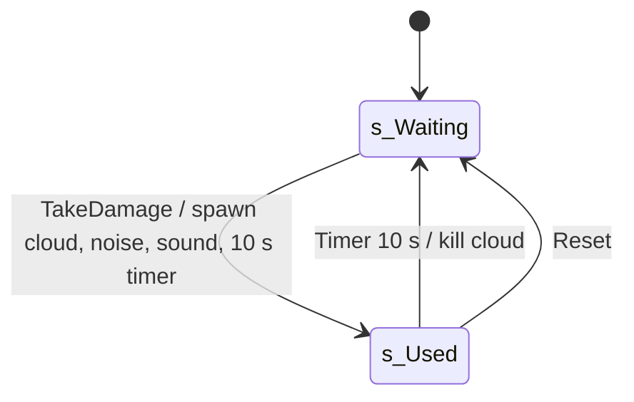

# SExtincteur (fire extinguisher spray)

Units:
- def:SBase.SExtincteur
- uc:SBase.SExtincteur:Reset
- uc:SBase.SExtincteur:s_Waiting.TakeDamage
- uc:SBase.SExtincteur:s_Used.TakeDamage
- uc:SBase.SExtincteur:s_Used.Timer
- def:SBase.SExtincteurEmitter

## Purpose

A wall-mounted extinguisher that, when shot, sprays a white cloud for 10 s, makes a bang that every player's HUD
shows as a noise, and then re-arms. It does not explode and deals no damage (the explosive extinguishers in SteeE
are SGamePlayObjects, see `gameplay-object.md`). SteeE has 7.

## Data

| Field | Type | Default | Meaning |
|---|---|---|---|
| `sndImpact` | Sound | `Armes_impacts.Impacts.RA_Explo_Extincteur` | burst sound |
| `Emitter` | SExtincteurEmitter | None | current cloud |
| `used` | bool | false | unused by script |
| Defaults | | | `StaticMesh=SGameplayObjects.Objects.F_extincteur_kal`, `DT_StaticMesh`, `CollisionHeight=75` (radius 22), `bCollideActors`, `bBlockActors`, `bBlockPlayers`, `RemoteRole=ROLE_SimulatedProxy`, `bNoDelete`, `nativereplication` |

`def:SBase.SExtincteurEmitter` (native class): one sprite emitter, up to 250 particles of `smoke_extincteur`
(4 x 4 frames, random frame), emitted at 15 per second (`InitialParticlesPerSecond`, automatic initial spawning off),
lifetime 1.6 s, start speed X 160 to 200 and Z 30 in the emitter's frame (`UseRotationFrom=PTRS_Actor`), velocity
scaled to 0.5 by the end of life, size from 2 growing x2 at 0.1, x15 at 0.3, x200 at 1.5 of life, fade in to 0.1,
fade out from 0.8, slow spin. `RemoteRole=ROLE_SimulatedProxy`, `bNoDelete=False`.

## Rules

1. Auto state `s_Waiting`. `TakeDamage(Damage, I, HitLocation, Momentum, ...)` with any damage and any type:
   spawn an `SExtincteurEmitter` at `HitLocation` facing `rotator(-Momentum)` (the spray points back toward where the
   shot came from), `NotifyNoise(1.0)`, `PlaySound(sndImpact, SLOT_Misc)`, `SetTimer(10.0, false)`, go to `s_Used`.
2. `s_Used.TakeDamage`: ignored (further shots do nothing).
3. `s_Used.Timer` (10 s after the shot): `Emitter.Kill()` (stop emitting; existing puffs live out their 1.6 s), go
   back to `s_Waiting` (re-armed).
4. `Reset`: kill any cloud and go to `s_Waiting`.
5. `NotifyNoise(1.0)` sends `ClientNotifyNoise(self, 1.0)` to every player controller: each player's HUD marks a
   loud noise at the extinguisher (`events.md` rule 12).
6. The extinguisher itself never breaks, never changes mesh and keeps blocking.

## States

## Constants

| Name | Value | Unit | Provenance | Source |
|---|---|---|---|---|
| spray duration / re-arm | 10.0 | s | decoded | s_Waiting.TakeDamage |
| noise loudness | 1.0 | | decoded | s_Waiting.TakeDamage |
| particle life | 1.6 | s | decoded | def:SBase.SExtincteurEmitter |
| emission rate | 15 | particles/s | decoded | def:SBase.SExtincteurEmitter |
| max particles | 250 | | decoded | def:SBase.SExtincteurEmitter |

SteeE: SExtincteur262, 4135, 4132, 4927, 4930, 4933, 4942 (three stacked at about (-2137, 2224) on three floors).

## Network

Server handles damage and the timer. The cloud actor is spawned on the server and replicated
(`ROLE_SimulatedProxy`); `Kill` on the server is expected to reach clients through the emitter's replication. The
burst sound is server-played (heard through sound replication); the noise marker is a reliable call to each
player's controller.

## Edge cases

- A zero-damage hit (any `TakeDamage` call) still triggers the spray.
- Damage from any type, including the shooter's own team, sets it off.
- The cloud is spawned at the hit point, not at the nozzle.

## Evidence

- `local/re-out/uc/SBase/SExtincteur.uc`, `SBase/SExtincteurEmitter.uc`, `Engine/Actor.uc` (NotifyNoise),
  `SBase/SPlayerController.uc` (ClientNotifyNoise to `SHud.NotifyHotSound`).
- SteeE.sdc: 7 `SExtincteur` exports.

## Open questions

1. What the native `SExtincteurEmitter` C++ adds (it includes its own header): candidates are blocking sight for
   vision modes or bots, or replicating `Kill`. Scenario: look through a cloud in thermal and night vision; compare
   with an ordinary smoke emitter.
2. Does `Kill` replicate to clients, or does the client cloud stop only when the actor is destroyed? Scenario:
   two-machine session, time the cloud's end on the client.
3. Whether the cloud affects the spy's visibility meter (light/shadow system). Scenario: stand in the cloud and
   read the light meter.
