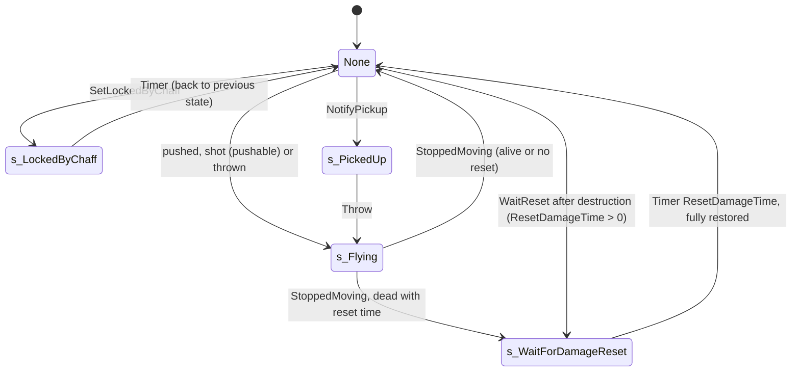

# SBasicGamePlayObject and SGamePlayObject (breakables, swaps, explosives)

Units:
- def:SBase.SBasicGamePlayObject
- uc:SBase.SBasicGamePlayObject:Destroyed
- uc:SBase.SBasicGamePlayObject:PostBeginPlay
- uc:SBase.SBasicGamePlayObject:PreBeginPlay
- uc:SBase.SBasicGamePlayObject:Timer
- uc:SBase.SBasicGamePlayObject:AcceptStickableGPO
- uc:SBase.SBasicGamePlayObject:AddOnHud
- uc:SBase.SBasicGamePlayObject:RemoveFromHud
- uc:SBase.SBasicGamePlayObject:SetLockedByChaff
- uc:SBase.SBasicGamePlayObject:Malfunction
- uc:SBase.SBasicGamePlayObject:TakeDamage
- uc:SBase.SBasicGamePlayObject:s_LockedByChaff.BeginState
- uc:SBase.SBasicGamePlayObject:s_LockedByChaff.EndState
- uc:SBase.SBasicGamePlayObject:s_LockedByChaff.Tick
- uc:SBase.SBasicGamePlayObject:s_LockedByChaff.SetLockedByChaff
- uc:SBase.SBasicGamePlayObject:s_LockedByChaff.Timer
- rep:SBase.SBasicGamePlayObject.bSecondaryObjective
- rep:SBase.SBasicGamePlayObject.InteractionObj
- def:SBase.SGamePlayObject
- uc:SBase.SGamePlayObject:AcceptStickableGPO
- uc:SBase.SGamePlayObject:BeginPlay
- uc:SBase.SGamePlayObject:PostBeginPlay
- uc:SBase.SGamePlayObject:Trigger
- uc:SBase.SGamePlayObject:UnTrigger
- uc:SBase.SGamePlayObject:SetLockedByChaff
- uc:SBase.SGamePlayObject:TakeDamage
- uc:SBase.SGamePlayObject:WaitReset
- uc:SBase.SGamePlayObject:Touch
- uc:SBase.SGamePlayObject:NotifyPickup
- uc:SBase.SGamePlayObject:Throw
- uc:SBase.SGamePlayObject:StoppedMoving
- uc:SBase.SGamePlayObject:SpawnDamageEmitter
- uc:SBase.SGamePlayObject:KillDamageEmitter
- uc:SBase.SGamePlayObject:s_LockedByChaff.BeginState
- uc:SBase.SGamePlayObject:s_LockedByChaff.EndState
- uc:SBase.SGamePlayObject:s_PickedUp.BeginState
- uc:SBase.SGamePlayObject:s_PickedUp.TakeDamage
- uc:SBase.SGamePlayObject:s_Flying.BeginState
- uc:SBase.SGamePlayObject:s_Flying.Landed
- uc:SBase.SGamePlayObject:s_Flying.Bump
- uc:SBase.SGamePlayObject:s_Flying.HitWall
- uc:SBase.SGamePlayObject:s_WaitForDamageReset.BeginState
- uc:SBase.SGamePlayObject:s_WaitForDamageReset.Timer
- nat:SBase.SGamePlayObject.ProcessDamage
- nat:SBase.SGamePlayObject.NativeHitWall
- rep:SBase.SGamePlayObject.Throw
- rep:SBase.SGamePlayObject.SpawnDamageEmitter
- rep:SBase.SGamePlayObject.KillDamageEmitter
- def:SBase.SGrenadeExplosion
- uc:SBase.SGrenadeExplosion:PostBeginPlay
- uc:SBase.SGrenadeExplosion:Tick
- uc:SBase.SGrenadeExplosion:Timer
- def:SBase.SFlashLight_FragGrenade
- uc:SBase.SFlashLight_FragGrenade:PostBeginPlay
- uc:SBase.SGameInfo:CountEnvironmentalKill
- uc:SBase.SPlayerController:DestroyGPO

## Purpose

The general-purpose interactive prop. In SteeE it is used for: shootable explosive extinguishers (600 damage blasts),
breakable doors that only an adjacent explosion can break, gas bombs, soda cans and the molotov bottle (explode and
fire events), shootable lamps that go dark for 60 s, pushable tin cans, a breakable TV, and the crane set-piece's
mesh swaps (the wall from intact to breached, the crane's collision) plus two hidden explosives. 67 instances (14 more
as SVitre, see `vitre.md`).

## Data

SBasicGamePlayObject (all `var` editable unless noted):

| Field | Type | Default | Meaning |
|---|---|---|---|
| `bDamageable` | bool | false | can lose HitPoints |
| `HitPoints` | int | 0 (raised to 1 when damageable) | |
| `TakeDamageSound`, `DestroySound` | Sound | None | |
| `bCanBeChaffed` | bool | false | chaff/sticky lock allowed |
| `bStickyDamageIsLikeChaff` | bool | false | sticky shocker locks instead of damaging |
| `StickyNeutralizationTime` | int | 10 | s |
| `iPriority` | int | -1 on SGPO | interaction priority; 5 or more shows malfunction markers |
| `InteractionClass` | class | None | spawned interaction (switches, infirmary) |
| `bInitialyUsable` | bool | true | |
| `sDescriptionText` | localized string | "" | interaction prompt |
| `UsableBy`, `TriggerMethode`, `bTriggerOnceOnly`, `iAttenteAvantActivation`, `iAttenteAvantDesactivation`, `fInteractionRadius` (-1), `fInteractionHeight` (-1), `bInteractInFront` | | | used by interactions (switch spec) |
| `ERControl` | SGPOControl | None | lock relay |
| `ChaffLockPreviousState` | name | None | |
| Defaults | | | `RemoteRole=ROLE_SimulatedProxy`, `bReplicateMovement=False`, `bSkipActorPropertyReplication=True`, `bCollideActors`, `nativereplication` |

SGamePlayObject adds:

| Field | Type | Default | Meaning |
|---|---|---|---|
| `DamagedMeshes` | array of {StaticMesh, Percent, bDisableCollision, Skin, Event, EventType} | empty | damage stages |
| `SpawnableObjects` | array of {SpawnClass, MinPercent, MaxPercent, SpawnParticle, Scaled, SpawnedActor} | empty | spawns per damage band |
| `TakeDamageTypes` | array of SDamageType | empty | if non-empty, only these types do anything |
| `DestroyOnEventFrom` | array of Actor | empty | senders whose Trigger destroys it |
| `TriggeredMesh`, `TriggeredSkin` | StaticMesh, Material | None | Trigger swap targets |
| `ObjectLights` | array of STriggerLight | empty | lights owned by the object |
| `bCanDamageActor`, `DamageActorPoints`, `DamageActorRange`, `DamageActorType` | bool, int, int, SDamageType | false, 0, 0, NoDamageType | blast on destruction |
| `ShakeRange` | int | 2000 | uu |
| `ResetDamageTime` | int | 0 | s; 0 = stays destroyed |
| `PercentDamageRefillable` | int | 0 | |
| `OnResetEvent`, `OnResetEventType` | name, EEventType | None, Trigger | fired at start and on reset |
| `bPushable`, `bPickable` | bool | false | physics props |
| `BounceSound` | Sound | None | |
| Runtime | | | `InitialHitPoints`, `InitialStaticMesh`, `InitialSkin`, `InitialBlockActors`, `InitialBlockPlayers`, `OriginalColHeight`, `bAlreadyDestroyed`, `PickupInteraction` |
| Defaults | | | `Mass=8`, `ShakeRange=2000`, `iPriority=-1`, `bNoDelete` |

SDamageType indices used below: 0 NoDamageType, 1 SDamage_Charged, 4 SDamage_Explosion, 5 SDTBase,
6 SDTBase_NoAnim, 12 SDTStickyShocker, 14 Crushed.

## Rules

### Start-up

1. SBasic `PreBeginPlay` (simulated): if `sDescriptionText` is set, copy it to the interaction's `Description`, or if
   the interaction does not exist yet, retry by `Timer` after `1 + 2 * FRand()` s, then every 3 s on clients.
2. SBasic `PostBeginPlay`: if `InteractionClass` is set: un-hide a hidden object as an empty static mesh and spawn the
   interaction at the object's pose (priority and in-front copied). If not `bInitialyUsable`, the interaction is made
   unusable (this touches `InteractionObj` even when there is none: harmless access warning). A damageable object
   with `HitPoints == 0` gets `HitPoints = 1`. Not simulated, so it never runs on a client (net-replication.md
   rule 19.2): the interaction exists on the server only and reaches clients as `InteractionObj`. The same holds for
   the interactions spawned by SGPO (pickup) and `SComputerObjectiveTrigger`. A client copy would join that client's
   Use menu and send the server an object it cannot resolve, leaving the player stuck in the menu.
3. SGPO `BeginPlay` (simulated): neither pickable nor pushable means `bWorldGeometry = true` (counts as world for
   traces and movement).
4. SGPO `PostBeginPlay`: `OriginalColHeight = CollisionHeight`; pickable: spawn a pickup interaction and enable
   movement replication; pushable: enable movement replication and both trace-blocking flags. Store
   `InitialHitPoints`, `InitialStaticMesh`, `InitialSkin = Skins[0]` (if any), `RepSkin = InitialSkin`, initial
   blocking flags. Any `ObjectLights` set `bCanBeChaffed`. Any of `TriggeredMesh`, `TriggeredSkin` or
   `DamagedMeshes` clears `bSkipActorPropertyReplication` (so mesh, skin, hidden and blocking changes replicate).
   Fire `OnResetEvent` by `OnResetEventType` (alternating types flip after firing). Then SBasic `PostBeginPlay`.

### Trigger and UnTrigger

5. `Trigger(Other, I)`: if `I` is None, `I = Other.Instigator`.
   a. If `bDamageable`: if `HitPoints <= 0`, return (dead objects ignore triggers). If `Other` is in
      `DestroyOnEventFrom`: `TakeDamage(HitPoints, I, Location, (0, 0, 200), TakeDamageTypes[0] or SDTBase)` and
      return.
   b. Swap: if `TriggeredSkin` is set, toggle `Skins[0]`/`RepSkin` between it and `InitialSkin`. Else if the current
      mesh is not `InitialStaticMesh`, restore `InitialStaticMesh`. Else if `TriggeredMesh` is set, switch to it. So
      each Trigger toggles the mesh. `SetStaticMesh` changes the collision with the mesh.
   c. Pass `Trigger(Other, I)` to every non-None `ObjectLights` entry (each answers by its own trigger method).
6. `UnTrigger(Other, I)`: if damageable and dead, return. Skin back to initial if swapped, else mesh back to initial if
   swapped. Pass `UnTrigger` to every light.
7. A non-damageable object (the SteeE wall and crane collision) therefore never takes the `DestroyOnEventFrom` path:
   its Trigger is a pure mesh toggle, even though `DestroyOnEventFrom` is set.

### Damage

8. SGPO `TakeDamage(Damage, I, HitLocation, Momentum, DamageType)`:
   a. If `TakeDamageTypes` is non-empty and does not contain `DamageType`: return.
   b. Play `TakeDamageSound` (SLOT_Misc, volume 1, radius 200, pitch 1).
   c. Sticky-as-chaff: if `bStickyDamageIsLikeChaff` and the type is `SDTStickyShocker`: spawn an `SSparkShocker` at
      the hit, `SetLockedByChaff(StickyNeutralizationTime)`, return.
   d. `Instigator = I`. Momentum: if non-zero, `M = 300 * M / |M|`, then `M.X += 50 * FRand() - 25`,
      `M.Y += 50 * FRand() - 25`, `M.Z = max(|M.Z|, 300)` (truncated to an integer before the max).
   e. Pushable: `Velocity += M * 5 / Mass` and go to `s_Flying`.
   f. Kill credit wrapper: save `SGameInfo.GPODamageInstigator`; if `I` is set, make it `I`; `ProcessDamage(Damage)`;
      restore the saved value. Everything `ProcessDamage` causes (blast damage, events, chained objects) sees the
      wrapper's instigator.
   This override does not check `bDamageable`; the native does (rule 9).
9. `ProcessDamage(Damage)` (native, contract inferred from the script around it and from SteeE data; see Open
   questions):
   a. No effect unless `bDamageable` and not already destroyed.
   b. `HitPoints = max(HitPoints - Damage, 0)`.
   c. Damage percent `d = (InitialHitPoints - HitPoints) * 100 / InitialHitPoints` (integer).
   d. Damage stages: the `DamagedMeshes` entry whose `Percent` is reached by `d` (the highest such entry) is applied
      once when first reached: the mesh becomes `StaticMesh` (None empties it: the object vanishes), `Skins[0] =
      RepSkin = Skin` when set, collision and trace blocking off when `bDisableCollision`, and its `Event` fired by
      `EventType` with `Other = self` and the object's instigator. SteeE's lamps author a None mesh together with an
      "off" Skin; they are expected to keep their mesh and only change skin, which suggests a None mesh is ignored
      when a Skin is given (unconfirmed, see Open questions).
   e. Spawns: for every `SpawnableObjects` entry with `MinPercent <= d <= MaxPercent`, spawn it once: with
      `SpawnParticle` set, call `SpawnDamageEmitter(i)` (replicated to clients, rule 19); otherwise spawn
      `SpawnClass` at the object and keep it in `SpawnedActor`.
   f. At `HitPoints == 0` (destroyed): play `DestroySound`; mark destroyed (`bAlreadyDestroyed`, no further damage);
      turn object lights off; if `bCanDamageActor`, apply `DamageActorPoints` of `DamageActorType` to actors within
      `DamageActorRange` of the object; shake players within `ShakeRange`; if `ResetDamageTime > 0`, call the
      `WaitReset` event.
10. `WaitReset`: unless flying, go to `s_WaitForDamageReset`.
11. `s_WaitForDamageReset` ignores Trigger, UnTrigger, Touch, SetLockedByChaff, TakeDamage, ProcessDamage,
    NotifyPickup and Throw. `BeginState`: `SetTimer(ResetDamageTime)`, pickup interaction disabled. `Timer`: clear
    `bAlreadyDestroyed`, `bDamageable = true`, `HitPoints = InitialHitPoints`, initial mesh and skin, every light back
    to its `bInitialyOn` state, pickup re-enabled, `SetCollision(true, InitialBlockActors, InitialBlockPlayers)`,
    both trace-blocking flags on, fire `OnResetEvent` by type, kill or destroy every spawned actor, `GotoState('None')`.
12. SBasic `TakeDamage` (used by classes that do not override it, such as switches): ignore unless damageable (or a
    sticky shot on a sticky-as-chaff object); sound; sticky-as-chaff lock; `HitPoints = max(HitPoints - Damage, 0)`;
    at 0 play `DestroySound` and `Destroy()` (a `bNoDelete` actor cannot be destroyed, so it just stays at 0 HP).

### Pushable and pickable props

13. `Touch(Other)`: a pushable object touched by an SBasePawn heavier than 40: `Velocity += Other.Velocity` when the
    pawn moves; `Velocity.Z = 50` unless already falling (then the old Z is kept); go to `s_Flying`.
14. `s_Flying.BeginState`: `bCollideWorld`, `bBounce`, `bFixedRotationDir`; raise `|RotationRate.Pitch|` and
    `|RotationRate.Roll|` to at least 10000; `SetCollision(true, true, InitialBlockPlayers)`; `PHYS_Falling`.
    `Landed` calls `HitWall`. `HitWall` calls the native `NativeHitWall` (bounce and stop, contract in Open
    questions). `Bump(Other)`: a non-pawn reverses `Velocity` with +-25 random on X and Y; a pawn is ignored below
    speed 20, otherwise `BumpDamage = |Velocity| * Mass / 500` and, above 8, the pawn's controller takes it
    (`SDTBase`, instigator the owner pawn or the owner controller's pawn).
15. `StoppedMoving` (native event): pickup re-enabled, owner cleared, `SetCollision(true, initial blocking)`, then
    `s_WaitForDamageReset` if dead with a reset time, else state `None`.
16. `NotifyPickup(Controller)`: no physics, owner = controller, pickup interaction detached and disabled,
    `s_PickedUp` (no collision, ignores damage), collision off; returns false.
    `Throw(Thrower, ThrowVelocity)` (client-to-server call): set velocity and instigator, clear the thrower's hand
    item, detach from the pawn, place at the left hand bone `+ (8, -5, 0)`, re-base the pickup interaction, go to
    `s_Flying`. Not used by SteeE (no pickable objects).

### Chaff lock

17. SGPO `SetLockedByChaff(Length)`: when chaffable and it has lights, do nothing if every light is None or
    `LT_None` already. Otherwise SBasic: `SetTimer(Length)`, remember the current state once, go to
    `s_LockedByChaff`, forward to `ERControl.LockChaff(Length)`. In the lock state a new lock only restarts the timer;
    `Timer` returns to the remembered state.
18. SGPO `s_LockedByChaff.BeginState`: `Malfunction()` (team message 21 to the merc team about `ERControl`); with
    lights: all lights off, and show the "off" look: `TriggeredSkin`, else `TriggeredMesh`, else the
    `DamagedMeshes` entry with the highest `Percent`. `EndState`: forget the remembered state; if alive (or not
    damageable) and it has lights: lights on, initial skin or mesh back.

### Effects and helpers

19. `SpawnDamageEmitter(i)` (simulated, sent reliably from the authority): if entry `i` has a `SpawnParticle`, spawn an
    `SSpawnableEmitter` at the object, base it on the object, insert the particle emitter (reset on trigger, enabled,
    start range scaled by `DrawScale3D` when `Scaled`), trigger it, and store the actor. `KillDamageEmitter(i)`:
    destroy it and trigger the particle emitter again (switches it off).
20. `AddOnHud` (event): when `iPriority >= 5`, every SBasePawn's controller adds a malfunction marker at the object's
    location. `RemoveFromHud`: every controller removes it. Called from native code.
21. SBasic `Destroyed` (simulated): the authority destroys the interaction.
22. `AcceptStickableGPO`: SBasic true (sticky cams and mines may attach); SGPO true only when neither pickable nor
    pushable.
23. `SPlayerController.DestroyGPO(gpo, Damage, Type)` (client-to-server call used by the merc charge):
    `gpo.TakeDamage(Damage, Pawn, 0, (0, 0, 1), Type)` with `SDamage_Charged`.

### Explosion visual

24. `SGrenadeExplosion` (an Emitter, `RemoteRole=ROLE_SimulatedProxy`, `LifeSpan=23` s): `PostBeginPlay`
    (simulated) spawns an `SFlashLight_FragGrenade`, whose own `PostBeginPlay` sets `LifeSpan` to 0.5 s (a
    brightness 255, radius 22 flash). Four sprite emitters: a rising smoke column (lifetime 6 to 8 s), shrapnel
    sparks with collision, a ground smoke ring and a 0.2 to 0.5 s fireball. `Tick` only calls the parent; `Timer` is
    empty.

### Kill credit

25. `SGameInfo.CountEnvironmentalKill(Killer, Killed)`: return if either is None or they are the same controller,
    or they are on the same team outside Merc Deathmatch; else the killer's stats `EnvironmentalKills += 1` and the
    victim's `DeathFromEnvironmental += 1`.
26. The chain that makes a blast credit the player who caused it: rule 8f sets `GPODamageInstigator` during
    `ProcessDamage`; a pawn damaged with no instigator takes `GPODamageInstigator` as its instigator
    (`SPlayerController.StandardReactionsToDamage`); `SGameInfo.Killed` gives the killer a kill against an enemy and
    counts an environmental kill when the damage type is `Crushed`, the killer is the current
    `GPODamageInstigator`'s controller, or the victim stands in an active damage volume of that type triggered by
    the killer. A blast that kills a teammate of the instigator is a team kill; one that kills the instigator is a
    suicide.
27. Chained objects pass credit by `Other.Instigator`: an extinguisher destroyed by a spy has `Instigator` = spy;
    the door whose `DestroyOnEventFrom` names it receives `Trigger(extinguisher, None)`, takes the spy from
    `Other.Instigator`, and its own `TakeDamage` re-wraps `GPODamageInstigator` with the spy.

### Native ProcessDamage (decoded, natives2-damage.md rule 1; game 0x10a8fc40)

1. Nothing unless bDamageable and not bAlreadyDestroyed; `HitPoints = max(HitPoints - Damage, 0)` (Damage 0 still
   runs the rest).
2. When HitPoints reaches 0: bAlreadyDestroyed; every player controller hears DestroySound from the object (volume 1,
   radius 200); NotifyNoise(0.5) with a sound; with bCanDamageActor and DamageActorRange > 0, every actor of the level
   within DamageActorRange (centre distance) with a clear world line of sight (flags 0x286) takes
   `int((DamageActorRange - dist) x DamageActorPoints / DamageActorRange)` (linear falloff), momentum
   `A.Location - object.Location`, type DamageActorType, instigator None (the script wrapper sets
   GPODamageInstigator): a pawn through PawnTakeDamage (PillTag 0, PercentDamageRefillable), other actors through
   TakeDamage, so objects chain; no team test. Pawns outside the range but within ShakeRange get
   `ClientShake(50 S / d2, 2000 S / d2, 500, true, true, true)` with S = ShakeRange^2 (integer division), only for
   blasting objects. Every ObjectLights entry gets LightOff; ResetDamageTime > 0 raises WaitReset.
3. `pct = int((1 - HitPoints / InitialHitPoints) x 100)` (100 without initial hit points; compute the ratio in
   double before truncating).
4. Spawns on every call: an entry with no spawned actor and `MinPercent <= pct <= MaxPercent` spawns (or raises
   SpawnDamageEmitter); one with a spawned actor and `pct > MaxPercent` kills it.
5. Stage on every call: the DamagedMeshes entry with the highest Percent not above pct (the first on a tie) is
   re-applied and its event fired again (stages are not remembered). A Skin stage sets RepSkin and Skins[0] and keeps
   the mesh; otherwise StaticMesh None hides the object, else SetStaticMesh. Collision: no Skin, no mesh and 0 HP, or
   bDisableCollision: collision off and attached actors destroyed; else the initial blocking flags. The event by
   EventType: 0 trigger, 1 untrigger, 2 and 3 alternate.

### Native NativeHitWall (decoded, natives2-damage.md rule 2; game 0x10a90870)

Self damage `int(0.02 speed)` above 100 uu/s when damageable; the wall (not a pawn) takes `int(speed Mass 0.002)`,
and a damageable non-blocking gameplay object is passed through. Bounce: `V = 0.5 (V - 2 (V . N) N)`, rotation rates
x 0.75. It settles when not hitting a pawn and either below 60 uu/s on a floor (N.Z > 0.7) or without bBounce: a tall
object (height above radius) tips (cylinder R x R, Velocity.Z 60); others stop with PHYS_Rotating and raise
StoppedMoving. Still bouncing above 40 uu/s with a mesh: BounceSound (radius 100), NotifyNoise(0.5) and a random spin
from the C runtime rand() (not the script FRand stream).

## States

## Constants

| Name | Value | Unit | Provenance | Source |
|---|---|---|---|---|
| destroy-on-event momentum | (0, 0, 200) | | decoded | Trigger |
| momentum normalization | 300, jitter +-25 X/Y, Z at least 300 | uu | decoded | TakeDamage |
| push impulse | Momentum x 5 / Mass | uu/s | decoded | TakeDamage |
| touch push threshold | pawn Mass > 40 | | decoded | Touch |
| bump damage | |V| x Mass / 500, applied above 8, ignored below speed 20 | hp | decoded | s_Flying.Bump |
| flying spin floor | 10000 | rot units/s | decoded | s_Flying.BeginState |
| sticky neutralization | 10 | s | decoded | def |
| ShakeRange default | 2000 | uu | decoded | def |
| explosion visual LifeSpan / flash | 23 / 0.5 | s | decoded | SGrenadeExplosion, SFlashLight_FragGrenade |
| hand offset on throw | (8, -5, 0) from `B L Hand` | uu | decoded | Throw |

SteeE archetypes (instance data):

| Archetype | Count | Mesh | HP | Types accepted | Stage at destruction | Blast | Other |
|---|---|---|---|---|---|---|---|
| explosive extinguisher | 16 | `squ_mer_obj_extinct` | 1 | all | `_broken` mesh at Percent 0 | 600 (`SDamage_Charged`) in 400 uu, `SGrenadeExplosion` 100..100, `LaserMine_Explo` | 386 fires `doorblast2`, 1787 fires `doorblast3` |
| hidden crane explosive (2889, 346) | 2 | same, `bHidden` | 1 | Crushed only | None mesh, collision off, Percent 0 | 600 (`SDamage_Charged`) in 500 uu, grenade explosion | `DestroyOnEventFrom` crane, Tag `blast01` |
| breakable door (266, 2843) | 2 | `SQU13_DoorBreakable01` | 1 | NoDamageType only (unshootable) | None mesh at 100, collision flag false | none | Tag `doorblast3`/`doorblast2`, `DestroyOnEventFrom` its extinguisher, Event `PORTE2`/`PORTE1` (dust emitters), `Squ_Doorblast` |
| gas bomb (368, 433) | 2 | `sqt_bombgaz` | 20 | SDTBase, Explosion, StickyShocker | None mesh, collision off at 100 | 600 (`SDamage_Explosion`) in 400 uu | Events `boomgaz3`/`boomgaz2` (emitters), `Squ_Explo_Gaz` |
| soda can pack (736, 747, 758, 1826) | 4 | `sqt_canetteB` | 10 | SDTBase, Explosion, StickyShocker | None mesh, collision off at 100 | 20 (SDTBase) in 200 uu, shake 200 | Events `canette1..5` (emitters), `Squ_Explo_Coke` |
| molotov (215) | 1 | `sqt_molotov` | 10 | SDTBase, StickyShocker, Explosion | None mesh at 100 | 50 (SDTBase_NoAnim) in 200 uu, shake 100 | Event `molotov` (SMagicEvent fire, emitter), `Squ_Explo_Molotov` |
| TV (259) | 1 | `squ_F_ordistuff_1` | 5 | SDTBase, StickyShocker, Explosion | `_1kc` mesh at 100 | bCanDamageActor false (5 in 100 uu unused) | Event `telespark` (light, buzz off, sparks), `Squ_tv_crash` |
| lamp (2766, 5110, 5116, 5122, 5129, 8335, 8340) | 7 | `squ_appliqueDynamik`, `squ_light_officeC` | 1 | all | skin `Lustre` / `SQU13_Neon01_OFF` at 100 | none | 1 to 3 ObjectLights, `ResetDamageTime 60`, `RA_Break_light` |
| tin can (pushable) | 20 | `squ_ini_tin` | 100 | all | none | none | `SMetalSpark` or `SSparkBeton` at 0..0, `Ra_Impact_canettes` |
| bottle (`squ_F_FlaconCSR_Ref`) | 10 | | 1 (raised from 0) | all | none | none | no stages: just goes to 0 HP |
| wall (261) | 1 | `sqt_murkc_avant` | 10, not damageable | NoDamageType | (apres at 0, unused) | none (range 2000, points 0) | `TriggeredMesh sqt_murkc_apres`, Tag `blast01` |
| crane collision (3357) | 1 | `sqt_grue_coll01` | 10, not damageable | all | (coll02 at 0, unused) | none | `TriggeredMesh sqt_grue_coll02`, Tag `blast01` |

## Network

- Server: Trigger, damage, ProcessDamage, reset timers, chaff, pushing.
- Clients: see the result through Actor replication once `bSkipActorPropertyReplication` is cleared (rule 4):
  `RepSkin`, `bHidden`, blocking flags, trace flags, `AmbientGlow`, `DrawType`. `StaticMesh` has a script condition of
  `false` in Actor's replication block, so the mesh swap reaches clients only through this class's native
  replication (`nativereplication`); see Open questions.
- `SpawnDamageEmitter`/`KillDamageEmitter`: reliable from the authority, simulated, on an unowned actor: expected to
  run on the server and every client (`sound-music.md` Network). `Throw`: reliable from the client. SteeE uses no
  particle templates, so these are not called there.
- Pushable cans replicate movement (`bReplicateMovement`, `bUpdateSimulatedPosition`).
- `GPODamageInstigator` and kill bookkeeping are server state.

## Edge cases

- Damage that is filtered out by `TakeDamageTypes` plays no sound and gives no push.
- Triggering a destroyed damageable object does nothing; triggering a non-damageable swap object toggles it each time
  (a second `blast01` would close the wall again).
- `DestroyOnEventFrom` uses `TakeDamageTypes[0]` as the damage type, so the breakable doors (types `[NoDamageType]`)
  pass their own filter only through this path: bullets, grenades and charges cannot break them.
- The hidden crane explosives accept only `Crushed`, so they cannot be set off by players before the crane does it.
- A door broken to a None mesh with `bDisableCollision` false relies on the native to drop collision; if it did
  not, an invisible 22 x 22 cylinder could remain (see Open questions).
- Momentum jitter uses `FRand`, which Reloaded.Core hooks: keep it on the seeded sim RNG.

## Evidence

- `local/re-out/uc/SBase/SBasicGamePlayObject.uc`, `SBase/SGamePlayObject.uc`, `SBase/SGrenadeExplosion.uc`,
  `SBase/SFlashLight_FragGrenade.uc`, `SBase/SGameInfo.uc` (Killed, CountEnvironmentalKill, FindDamageVolume),
  `SBase/SPlayerController.uc` (StandardReactionsToDamage instigator fallback, DestroyGPO).
- Reflection states `SBase.SGamePlayObject.*` (probe and ignore masks, stub list of `s_WaitForDamageReset`).
- SteeE.sdc: 67 `SGamePlayObject` exports (table above).
- RE+ MapBuilderPatterns.md: Trigger toggles TriggeredMesh both ways (SetPieceLabD measured), collision follows the
  swapped mesh, ObjectLights answer by their own trigger method.
- Natives: ProcessDamage `0x10a8fc40`, NativeHitWall `0x10a90870`, SetStaticMesh `0x10a24ea0`, SetCollision
  `0x10a24bf0`, Spawn `0x10a27800`; `Core.Object.FRand` is redirected into Reloaded.Core.dll (R0 spike).

## Open questions

1. When `AddOnHud` and `RemoveFromHud` are called (not part of ProcessDamage). Scenario set: shoot an extinguisher
   with a merc 100, 300, 399, 401 uu away (line of sight and behind a crate); break a breakable door and walk through
   its centre; these would also confirm the decoded rules end to end.
3. Mesh replication on a client in a two-machine session (the native list sends `StaticMesh` on every change while
   `DT_StaticMesh`, net/model.md rule 8): check the client can walk through the breached wall.

### Resolved

1. ProcessDamage: percent formula, stage rule, events, spawn bands, blast, shake, collision, Skin stages. Resolved:
   rule "Native ProcessDamage" (pct = int((1 - HP / InitialHP) 100); the highest stage at or below pct is re-applied
   and its event re-fired on every call; a Skin stage keeps the mesh; bands spawn while inside and kill above
   MaxPercent; blast to every visible actor of the level by centre distance with linear falloff and instigator
   None; shake only for blasting objects; collision off at destruction without Skin or mesh, or with
   bDisableCollision). Evidence: natives2-damage.md rule 1 (ANSWERS-natives2 18).
2. NativeHitWall: bounce, sound, StoppedMoving. Resolved: rule "Native NativeHitWall". Evidence: natives2-damage.md
   rule 2 (ANSWERS-natives2 19).
4. DestroySound volume and radius. Resolved: every player controller hears it with volume 1, radius 200. Evidence:
   natives2-damage.md rule 1.3.2 (ANSWERS-natives2 18).
