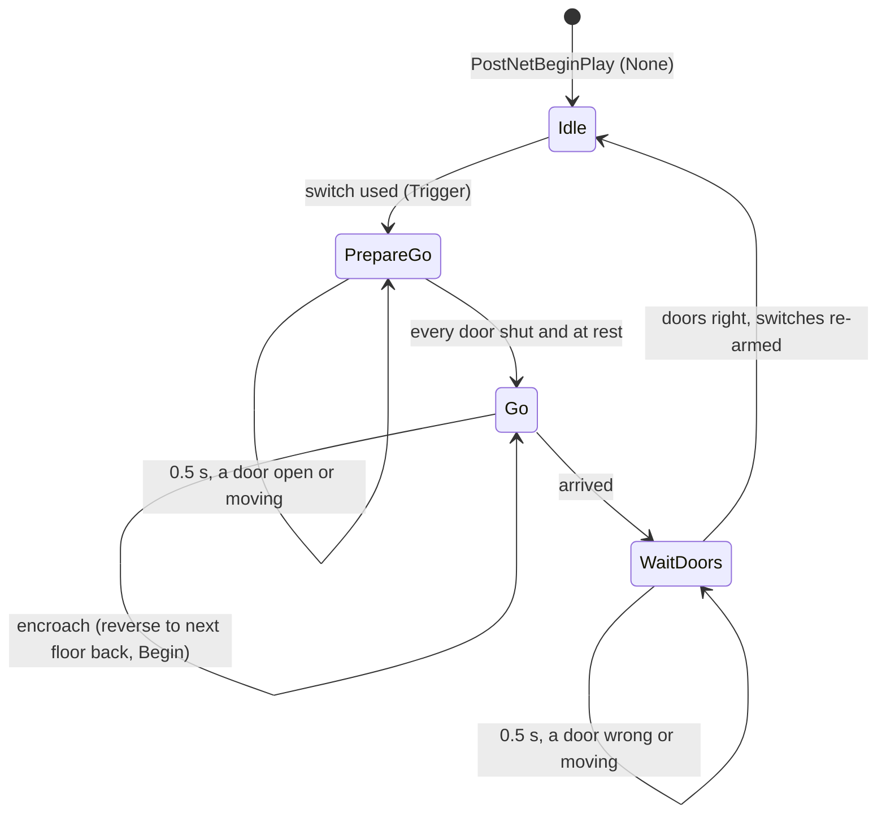

# SLift and SLiftDoor (elevators)

Units:
- def:SBase.SLift
- uc:SBase.SLift:PostNetBeginPlay
- uc:SBase.SLift:Trigger
- uc:SBase.SLift:EncroachingOn
- uc:SBase.SLift:KeyFrameReached
- uc:SBase.SLift:PrepareGo.BeginState
- uc:SBase.SLift:PrepareGo.Timer
- uc:SBase.SLift:Go.Arrived
- uc:SBase.SLift:Go@code
- uc:SBase.SLift:WaitDoors.BeginState
- uc:SBase.SLift:WaitDoors.Timer
- def:SBase.SLiftDoor
- uc:SBase.SLiftDoor:EncroachingOn

## Purpose

An `SLift` is a Mover cabin with one key per floor. The level designer lists, per floor (`DoorsAndSwitches[k]`
for key `k`), the landing doors of that floor (plain `Mover`s, normally `TriggerToggle`) and the call switches
(`SInterrupteur`) that send the cabin there, plus the cabin's own doors (`LiftDoors`, class `SLiftDoor`). Using
a switch makes the lift shut every door, travel straight to that switch's floor, then open the doors of that floor
and its own. 41 lifts on 28 maps (Club, Fact, Miss, Offs, Orph, Shad, Skys, Stat, TME30/32/33, VertE, VertX), 82
lift doors on 26 of them.

Door convention used by every map: **key 1 is shut, key 0 is open**, for landing doors and cabin doors alike. At
load the landing doors of the floor the cabin stands at sit at key 0 (open), the others at key 1, and the cabin
doors at key 0.

## Data

SLift (extends Mover; `InitialState = None`):

| Field | Type | Meaning |
|---|---|---|
| `DoorsAndSwitches` | array of {Doors: array<Mover>, Switches: array<SInterrupteur>} | per key (floor) |
| `LiftDoors` | array<SLiftDoor> | cabin doors (based on the lift) |
| `DestinationKey` | int | floor being sent to |
| `LastEncroachTime` | int | whole seconds of the last encroach reaction (starts 0) |
| `i`, `j` | int | class-level loop counters shared by every function |

Mover fields maps set on lifts and what reads them: `KeyPos[]`/`BasePos`/`BaseRot` (floors), `KeyNum` (start
floor; 13 lifts start at key 1 or 2), `MoveTime` (seconds per floor; 0.5 to 4.0), `MoveAmbientSound` (loop while
travelling), `EncroachDamage` (one lift, 100), `PlayerBumpEvent`, `Tag` (the switches' event). Set but not read by
SLift: `MoverEncroachType` (8 lifts; SLift.EncroachingOn has no type switch), `NumKeys` (4 lifts set 1; no chaining),
`OpeningSound`/`ClosingSound`/`LoopSound` (MissD/E/P set them; SLift never calls DoOpen/DoClose and nothing in the
scripts reads LoopSound), `OldPos`, `SavedPos`/`SavedRot` (editor leftovers, overwritten).

SLiftDoor (extends Mover; `InitialState = TriggerToggle`): no fields of its own. Maps set the usual Mover fields
(`KeyPos[1]`, `MoveTime` 0.5/0.6, `MoverEncroachType` 4 on 8 doors, `EncroachDamage` 25 on one, sounds); some
SLiftDoors are light holders (no mesh, collision off, light properties) that only ride the cabin.

## Rules

1. `PostNetBeginPlay` (authority): for every floor `i` and switch `s` of it: `s.Event = Tag`, and
   `s.InteractionObj.bUsable = (i != KeyNum)` (the switches of the floor the cabin is at are unusable). Every
   cabin door: `SetBase(self)`. Then `GotoState('None')`.
2. `Trigger(Other, EventInstigator)` (outside the lift states): every switch gets `Event = Tag` and
   `bUsable = false`; every cabin door `SetBase(self)`; `DestinationKey` becomes the floor `i` whose switch list
   holds `Other` (the switch's interaction triggers with the switch itself as `Other`; with several matches the
   last floor wins; with none it keeps its old value); then `GotoState('PrepareGo')`. Mover's SpecialBehaviors,
   IsTriggerable and the instigator fallback are not used.
3. `PrepareGo` (ignores Trigger, UnTrigger). `BeginState`: each landing door of the current floor whose key is not
   1 is triggered (`Trigger(self, None)`); **every** cabin door is triggered whatever its key (a toggle); then a
   repeating 0.5 s timer.
4. `PrepareGo.Timer`: bad = false. For every floor's landing doors: a door still moving (`KeyNum != PrevKeyNum`)
   makes it bad; else one at key 0 is triggered and makes it bad. For every cabin door: moving makes it bad; else
   one at key 0 is triggered and makes it bad. When nothing was bad: `GotoState('Go')`. So the lift waits until
   every door of every floor and of the cabin is shut and at rest.
5. `Go` (ignores Trigger, UnTrigger) code `Begin:` `InterpolateTo(DestinationKey, MoveTime * |KeyNum -
   DestinationKey|)` (one leg straight to the floor, `MoveTime` per floor travelled, the Mover glide), `MakeNoise(1)`,
   `AmbientSound = MoveAmbientSound`, wait for the interpolation, `Arrived()`.
6. `Arrived`: each landing door of the arrival floor whose key is not 0 is triggered; each cabin door:
   `BasePos = Location - KeyPos[KeyNum]` (its key frame follows the cabin) and triggered; `GotoState('WaitDoors')`.
7. `WaitDoors` (ignores Trigger, UnTrigger). `BeginState`: repeating 0.5 s timer. `Timer`: bad as in rule 4 but
   wanting the arrival floor's landing doors and the cabin doors at key 0 (one at key 1 is triggered) and the other
   floors' doors at key 1 (one at key 0 is triggered). When nothing was bad: every switch gets `Event = Tag` and
   `bUsable = (floor != KeyNum)`, then `GotoState('None')`. The 0.5 s timer keeps running afterwards and now calls
   the global Mover `Timer` (RealPosition upkeep) twice a second.
8. `KeyFrameReached` (simulated): `PrevKeyNum = KeyNum`, `PhysAlpha = 0`, `ClientUpdate -= 1`, `AmbientSound = None`,
   and on non-clients with `ClientUpdate == 0` `RealPosition = Location`. No chaining through keys and no
   `StopSound`.
9. `SLift.EncroachingOn(Other)` (authority):
   a. Within 2 s of `LastEncroachTime` (`Level.TimeSeconds - LastEncroachTime < 2`): false, nothing else.
   b. None: false. A controllerless pawn or a Decoration: `TakeDamage(10000, None, Location, 0, Crushed)`, false.
      Fragment, Gib, Projectile: destroyed, false.
   c. `EncroachDamage != 0`: a pawn gets `Controller.PawnTakeDamage(1000 * EncroachDamage, Instigator, Location, 0,
      Crushed)`; anything else `TakeDamage(EncroachDamage, Instigator, Location, 0, Crushed, 1)` (no type test).
   d. A player pawn with a controller: `Bump(Other)` when `PlayerBumpEvent` is set (`UnderLift` is an empty bot hook).
   e. Stop the leg: `bInterpolating = false`, `AmbientSound = None`, `LastEncroachTime = int(TimeSeconds)`.
      `DestinationKey = KeyNum - 1` when it was going up (`PrevKeyNum < KeyNum`), else `KeyNum + 1`;
      `GotoState('Go', 'Begin')` (restarts the travel code); return **false** (the step is not refused). With 2 keys
      this sends the cabin back to the floor it left; with 3 keys going 0 to 2 it stops at floor 1.
10. `SLiftDoor.EncroachingOn(Other)`: at rest (`KeyNum == PrevKeyNum`) false; moving: the Mover `EncroachingOn`
    runs (its damage and encroach type, e.g. WaitAndRetry sends the door back and retries), but the function returns
    nothing, so the step is never refused (the pawn is pushed, not blocked).
11. Carrying: pawns standing on the cabin are based on it and ride its moves; the cabin doors (rules 1, 2) and the
    switches inside the cabin (map `AttachTag` = the lift's Tag) ride it the same way.

## States

## Constants

| Name | Value | Unit | Provenance | Source |
|---|---|---|---|---|
| door check interval | 0.5 | s | decoded | PrepareGo/WaitDoors.BeginState |
| encroach cooldown | 2 | s | decoded | SLift.EncroachingOn |
| travel time | MoveTime x floors | s | decoded | Go@code |
| crush damage, scale | 10000, 1000 x EncroachDamage | hp | decoded | SLift.EncroachingOn |

## Network

- Server runs every rule. Clients get the cabin's legs through the Mover replication (SimInterpolate, SimOldPos,
  RealPosition, AmbientSound, Velocity; `SLift` adds nothing to the native list) and start them in the Mover's
  native net receive (rep-map-actors.md rule 3). That receive is ported in the client's PostNetReceive hook
  (`PawnProxies.NetReceive.PostMover`).
- `SLiftDoor`'s native list additionally sends `BasePos` and `Base` (net-replists.md rule 26), so a client's cabin
  doors are based on the client's cabin and use the moved BasePos after `Arrived`.
- Switch usability reaches clients through the interaction objects' own replication.
- Mover physics sets `Velocity = move / DeltaTime` each tick and stamps `fLastTimeMoverMoves` while the vertical
  speed is above 0.1 (game 0x10a21970), which the move protocol reads for pawns riding a lift.

## Edge cases

- A switch whose interaction is missing is skipped (Access None in the script).
- A landing door listed as None reads as key 0 at rest and cannot be triggered, so the door check never passes and
  the lift stays in PrepareGo/WaitDoors (as in the original).
- Because PrepareGo toggles every cabin door on entry, a cabin door already shut opens first and is shut again by
  the next check.
- The encroach reaction only fires when a pawn's cylinder crosses the cabin's collision surface (mover.md rule 20).

## Open questions

1. Decompiled `SLiftDoor.EncroachingOn` shows no return after `super.EncroachingOn`; taken as returning false.
2. game 0x10a21970 decompiles the `fLastTimeMoverMoves` test as `|Velocity.Z| < 0.1`; the port follows the earlier
   decoding in net-proxy.md rule 18 (`> 0.1`). Worth a byte check.
