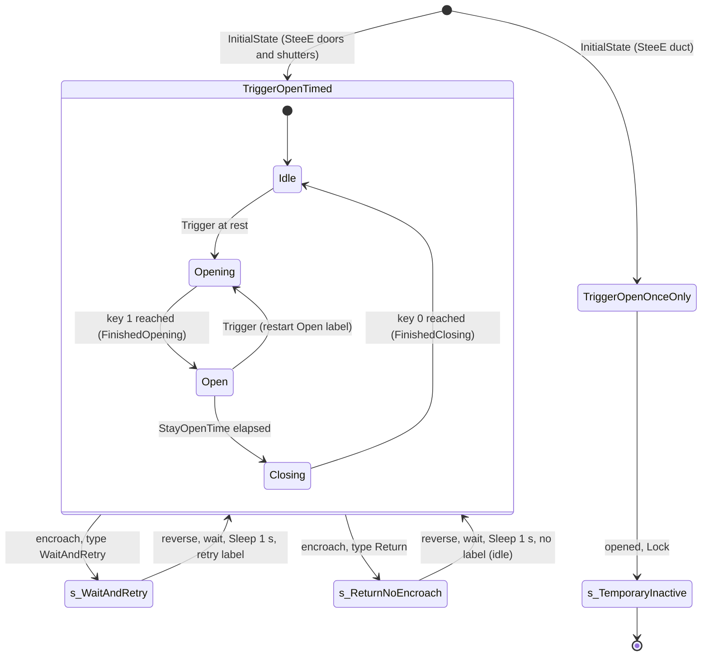

# Mover

Units:
- def:Engine.Mover
- uc:Engine.Mover:StartInterpolation
- uc:Engine.Mover:Timer
- uc:Engine.Mover:InterpolateTo
- uc:Engine.Mover:SetKeyframe
- uc:Engine.Mover:KeyFrameReached
- uc:Engine.Mover:FinishNotify
- uc:Engine.Mover:FinishedClosing
- uc:Engine.Mover:FinishedOpening
- uc:Engine.Mover:DoOpen
- uc:Engine.Mover:DoClose
- uc:Engine.Mover:BeginPlay
- uc:Engine.Mover:PostBeginPlay
- uc:Engine.Mover:MakeGroupStop
- uc:Engine.Mover:MakeGroupReturn
- uc:Engine.Mover:MakeGroupReturnNoEncroach
- uc:Engine.Mover:EncroachingOn
- uc:Engine.Mover:Bump
- uc:Engine.Mover:TakeDamage
- uc:Engine.Mover:Trigger
- uc:Engine.Mover:UnTrigger
- uc:Engine.Mover:SubTrigger
- uc:Engine.Mover:SubUnTrigger
- uc:Engine.Mover:IsTriggerable
- uc:Engine.Mover:Lock
- uc:Engine.Mover:UnLock
- uc:Engine.Mover:s_WaitAndRetry.EncroachingOn
- uc:Engine.Mover:s_WaitAndRetry@code
- uc:Engine.Mover:s_ReturnNoEncroach.EncroachingOn
- uc:Engine.Mover:s_ReturnNoEncroach.SendClosingEvent
- uc:Engine.Mover:s_ReturnNoEncroach.SendOpeningEvent
- uc:Engine.Mover:s_ReturnNoEncroach@code
- uc:Engine.Mover:OpenTimedMover.DisableTrigger
- uc:Engine.Mover:OpenTimedMover.EnableTrigger
- uc:Engine.Mover:OpenTimedMover@code
- uc:Engine.Mover:StandOpenTimed.Attach
- uc:Engine.Mover:StandOpenTimed.DisableTrigger
- uc:Engine.Mover:StandOpenTimed.EnableTrigger
- uc:Engine.Mover:BumpOpenTimed.Bump
- uc:Engine.Mover:BumpOpenTimed.DisableTrigger
- uc:Engine.Mover:BumpOpenTimed.EnableTrigger
- uc:Engine.Mover:TriggerOpenTimed.Trigger
- uc:Engine.Mover:TriggerOpenTimed.UnTrigger
- uc:Engine.Mover:TriggerOpenTimed.SubTrigger
- uc:Engine.Mover:TriggerOpenTimed.DisableTrigger
- uc:Engine.Mover:TriggerOpenTimed.EnableTrigger
- uc:Engine.Mover:CloseTimedMover.DisableTrigger
- uc:Engine.Mover:CloseTimedMover.EnableTrigger
- uc:Engine.Mover:CloseTimedMover@code
- uc:Engine.Mover:TriggerCloseTimed.Trigger
- uc:Engine.Mover:TriggerCloseTimed.UnTrigger
- uc:Engine.Mover:TriggerCloseTimed.SubTrigger
- uc:Engine.Mover:TriggerCloseTimed.DisableTrigger
- uc:Engine.Mover:TriggerCloseTimed.EnableTrigger
- uc:Engine.Mover:TriggerToggle.Trigger
- uc:Engine.Mover:TriggerToggle.UnTrigger
- uc:Engine.Mover:TriggerToggle.SubTrigger
- uc:Engine.Mover:TriggerToggle@code
- uc:Engine.Mover:TriggerControl.Trigger
- uc:Engine.Mover:TriggerControl.UnTrigger
- uc:Engine.Mover:TriggerControl.SubTrigger
- uc:Engine.Mover:TriggerControl.SubUnTrigger
- uc:Engine.Mover:TriggerControl.BeginState
- uc:Engine.Mover:TriggerControl@code
- uc:Engine.Mover:TriggerPound.Trigger
- uc:Engine.Mover:TriggerPound.UnTrigger
- uc:Engine.Mover:TriggerPound.SubTrigger
- uc:Engine.Mover:TriggerPound.SubUnTrigger
- uc:Engine.Mover:TriggerPound.BeginState
- uc:Engine.Mover:TriggerPound@code
- uc:Engine.Mover:BumpButton.Bump
- uc:Engine.Mover:BumpButton.BeginEvent
- uc:Engine.Mover:BumpButton.EndEvent
- uc:Engine.Mover:BumpButton@code
- uc:Engine.Mover:TriggerOpenOnceOnly.DisableTrigger
- uc:Engine.Mover:TriggerOpenOnceOnly.EnableTrigger
- uc:Engine.Mover:TriggerOpenOnceOnly.SubTrigger
- uc:Engine.Mover:TriggerOpenOnceOnly.SubUnTrigger
- uc:Engine.Mover:TriggerOpenOnceOnly@code
- uc:Engine.Mover:TriggerCloseOnceOnly.DisableTrigger
- uc:Engine.Mover:TriggerCloseOnceOnly.EnableTrigger
- uc:Engine.Mover:TriggerCloseOnceOnly.SubTrigger
- uc:Engine.Mover:TriggerCloseOnceOnly.SubUnTrigger
- uc:Engine.Mover:TriggerCloseOnceOnly@code
- uc:Engine.Mover:s_TemporaryInactive.BeginState
- uc:Engine.Mover:s_TemporaryInactive.Lock
- uc:Engine.Mover:s_TemporaryInactive.UnLock
- uc:Engine.Actor:CrushedBy
- uc:SBase.SBasePawn:CrushedBy
- rep:Engine.Mover.BasePos
- rep:Engine.Mover.RealPosition
- rep:Engine.Mover.SimInterpolate
- rep:Engine.Mover.SimOldPos
- rep:Engine.Mover.BaseRot
- nat:Engine.Actor.FinishInterpolation
- nat:Engine.Actor.SetPhysics
- nat:Engine.Actor.MakeNoise

## Purpose

A Mover is a static-mesh actor (in this build movers are mesh actors, not brushes) that travels between up to 8
keyframes under `PHYS_MovingBrush`. Its `InitialState` decides how it answers triggers, bumps and standing players;
`MoverEncroachType` decides what it does when its motion runs into an actor. SteeE uses 24 movers: 20 hackable
window shutters, 3 presence-opened doors and 1 invisible crushing duct dropped by the crane.

## Data

Fields that drive behaviour (types, class default from `def:Engine.Mover`):

| Field | Type | Default | Meaning |
|---|---|---|---|
| `KeyPos[8]`, `KeyRot[8]` | vector, rotator | zero | offsets of each key from `BasePos`/`BaseRot` (world axes, not rotated by `BaseRot`) |
| `BasePos`, `BaseRot` | vector, rotator | placement Location/Rotation | origin of the keys |
| `NumKeys` | byte, const | 2 | number of keys used |
| `KeyNum`, `PrevKeyNum` | byte | 0, set to `KeyNum` at BeginPlay | target key and key it left; equal means at rest |
| `MoveTime` | float | 1.0 s | time of each leg |
| `StayOpenTime` | float | 4.0 s | wait at the open key (timed states) |
| `DelayTime`, `DelayTimeLastKey` | float | 0, 0 | wait before opening, before closing |
| `OtherTime` | float | 0 | TriggerPound wait at open |
| `MoverEncroachType` | enum | `ME_ReturnWhenEncroach` (1) | 0 Stop, 1 Return, 2 Crush, 3 Ignore, 4 WaitAndRetry |
| `MoverGlideType` | enum | `MV_GlideByTime` (1) | 0 MoveByTime (linear), 1 GlideByTime (eased) |
| `BumpType` | enum | `BT_PlayerBump` (0) | 0 player, 1 pawn, 2 any |
| `EncroachDamage` | int | 0 | damage on encroach (not with crush type) |
| `DamageThreshold` | float | 0 | `bDamageTriggered` threshold |
| `bTriggerOnceOnly`, `bDamageTriggered`, `bUseTriggered`, `bSlave`, `bIsLeader` | bool | false | |
| `ReturnGroup` | name | None | movers sharing it move as a group led by `bIsLeader` |
| `SpecialBehaviors` | array of {EventFromActor, InitialState, DelayTime, DelayTimeLastKey, MoveTime, StayOpenTime, MoverEncroachType} | empty | per-sender overrides |
| `OpeningEvent`, `OpenedEvent`, `ClosingEvent`, `ClosedEvent`, `BumpEvent`, `PlayerBumpEvent`, `Event` | name | None | fired at the stages below |
| `OpeningSound`, `OpenedSound`, `ClosingSound`, `ClosedSound`, `MoveAmbientSound` | Sound | None | |
| `bClosed` | bool | true | |
| `bAllowLock` | bool | true | |
| Original* copies | | | of DelayTime, DelayTimeLastKey, MoveTime, StayOpenTime, MoverEncroachType, taken at BeginPlay |
| `PhysAlpha`, `PhysRate`, `OldPos`, `OldRot` | | | interpolation state |
| `ClientUpdate` | int | 0 | count of interpolations started minus keys reached |
| `RealPosition`, `SimOldPos`, `SimInterpolate` | vector | | replication helpers |
| Other defaults | | | `InitialState=BumpOpenTimed`, `Physics=PHYS_MovingBrush`, `RemoteRole=ROLE_SimulatedProxy`, `bNoDelete`, `bAlwaysRelevant`, `bReplicateMovement=False`, `bOnlyDirtyReplication`, `NetPriority=2.7`, `SoundVolume=228`, `CollisionRadius=160`, `CollisionHeight=160`, `bCollideActors`, `bBlockActors`, `bBlockPlayers`, `fLastTimeMoverMoves=-1` |

## Rules

### Interpolation

1. `InterpolateTo(NewKeyNum, Seconds)`: clamp `NewKeyNum` to 0..7. If `NewKeyNum == PrevKeyNum` and
   `KeyNum != PrevKeyNum` (a reversal of the leg in progress): `PhysAlpha = 1 - PhysAlpha`,
   `OldPos = BasePos + KeyPos[KeyNum]`, `OldRot = BaseRot + KeyRot[KeyNum]`. Otherwise: `OldPos = Location`,
   `OldRot = Rotation`, `PhysAlpha = 0`. Then `SetPhysics(PHYS_MovingBrush)`, `bInterpolating = true`,
   `PrevKeyNum = KeyNum`, `KeyNum = NewKeyNum`, `PhysRate = 1 / max(Seconds, 0.005)`, `ClientUpdate += 1`,
   `SimOldPos = OldPos`, and
   `SimInterpolate = (100 * PhysAlpha, 100 * max(0.01, PhysRate), 256 * PrevKeyNum + KeyNum)`.
2. Native motion (each tick while `bInterpolating`, engine routine, contract only):
   `a' = PhysAlpha + dt * PhysRate`, clamped to 1. Eased alpha for `MV_GlideByTime`:
   `s(a) = 3a^2 - 2a^3` (decoded, game 0x10a21a53: constant 3.0 at 0x10c10a34); linear `s(a) = a` for `MV_MoveByTime`. Target pose:
   `P = OldPos + (BasePos + KeyPos[KeyNum] - OldPos) * s(a')`, `R = OldRot + (BaseRot + KeyRot[KeyNum] - OldRot) * s(a')`.
   The mover is moved there with encroachment checks (rule 20). If the move is accepted, `PhysAlpha = a'`; when
   `a' == 1`, `bInterpolating = false` and `KeyFrameReached` is called. If the move is refused, alpha does not
   advance; when the step had crossed 1 the loop tries again with the leftover time `dt x (a' - 1) / (a' - a)` (a
   shorter step towards the key) until a step stays at or below 1. The rotation delta is truncated toward zero
   (`_ftol`), the location is not rounded. Actors based on the mover ride with it.
2a. After the legs of a tick (decoded, game 0x10a21970) the physics sets `Velocity = (Location - start) / DeltaTime`
   on every tick in PHYS_MovingBrush (zero at rest), and stamps `fLastTimeMoverMoves = Level.TimeSeconds` while
   `|Velocity.Z| < 0.1` (byte-checked, see lift.md open question 2).
3. Because `s(1 - a) = 1 - s(a)`, a reversal (rule 1) continues from the exact current position, and the remaining
   time of the reversed leg equals the time already spent on it.
4. `KeyFrameReached` (simulated, called by the engine on every machine that moves the mover):
   `OldKeyNum = PrevKeyNum`, `PrevKeyNum = KeyNum`, `PhysAlpha = 0`, `ClientUpdate -= 1`. Then if
   `0 < KeyNum < OldKeyNum`: `InterpolateTo(KeyNum - 1, MoveTime)` (keep closing through the keys); else if
   `OldKeyNum < KeyNum < NumKeys - 1`: `InterpolateTo(KeyNum + 1, MoveTime)` (keep opening); else stop:
   `StopSound(AmbientSound)`, `AmbientSound = None`, and on non-clients with `ClientUpdate == 0`,
   `RealPosition = Location`. With 2 keys every leg ends here.
5. "Open" means moving toward key `NumKeys - 1`, "close" toward key 0. For 2-key movers `DoOpen` targets key 1 and
   `DoClose` targets `max(0, KeyNum - 1)`.
6. `DoOpen`: `bOpening = true`, `bDelaying = false`, `InterpolateTo(1, MoveTime)`, `MakeNoise(1.0)`,
   `PlaySound(OpeningSound)` (rule 9), `AmbientSound = MoveAmbientSound`, `TriggerEvent(OpeningEvent, self,
   Instigator)`, then `Follower.DoOpen()` if any.
7. `DoClose`: `bOpening = false`, `bDelaying = false`, `InterpolateTo(max(0, KeyNum - 1), MoveTime)`,
   `MakeNoise(1.0)`, `PlaySound(ClosingSound)`, `UntriggerEvent(Event, self, Instigator)`,
   `AmbientSound = MoveAmbientSound`, `TriggerEvent(ClosingEvent, self, Instigator)`, `Follower.DoClose()` if any.
8. `FinishedOpening`: `PlaySound(OpenedSound)`, `TriggerEvent(Event, self, Instigator)`, then the OpenedEvent
   (for a leader, every group member fires its own `OpenedEvent`; otherwise this mover's), then
   `myMarker.MoverOpened()` if set, then `FinishNotify`.
   `FinishedClosing`: `PlaySound(ClosedSound)`, the ClosedEvent (leader: every member's), `SavedTrigger.EndEvent()`
   if set, `SavedTrigger = None`, `Instigator = None`, `myMarker.MoverClosed()` if set, `bClosed = true`,
   `FinishNotify`. Note the asymmetry: `Event` is triggered at full open and untriggered at the start of closing.
9. Sounds: `PlaySound(S, SLOT_None, SoundVolume / 255, false, SoundRadius, SoundPitch / 64)`; a `None` sound plays
   nothing. The ambient loop is the replicated `AmbientSound`.
10. `FinishNotify`: for every controller with a pawn whose `PendingMover == self`, call `MoverFinished()` (an empty
    bot navigation hook in this build); set `bAllowLock = true`; if `bShouldLock`, `GotoState('None')` then `Lock()`.
11. `Lock`: if `bAllowLock`, go to `s_TemporaryInactive`; else set `bShouldLock = true` (the lock is taken at the next
    `FinishNotify`). `UnLock` does nothing outside `s_TemporaryInactive`. In `s_TemporaryInactive` Trigger and
    UnTrigger are ignored, `BeginState` clears `bShouldLock`, `Lock` does nothing, `UnLock` returns to
    `InitialState`. Nothing in SteeE calls `UnLock`.

### Initialisation

12. `BeginPlay` (simulated): copy the five Original* values, `PrevKeyNum = KeyNum`, collect `AntiPortals` whose Tag
    is `AntiPortalTag` (none in SteeE). If not standalone, start a repeating `Timer`: 4 s on a client, 1 s on a
    server; then a client (Role below authority) stops here. Authority continues: `Super.BeginPlay`,
    `KeyNum = clamp(KeyNum, 0, 7)`, `PhysAlpha = 0`, move to `BasePos + KeyPos[KeyNum]` and rotate to
    `BaseRot + KeyRot[KeyNum]`, `RealPosition = Location`. If `ReturnGroup == None`: not a leader, `Leader = self`,
    `Follower = None`; else both None (set in PostBeginPlay).
13. `PostBeginPlay` (authority): a non-slave adopts every mover with the same Tag that has `bSlave` (puts it in state
    `None` and bases it on self). A leader links every other mover with the same `ReturnGroup` into its follower
    chain. A non-leader in a group without a leader stays leaderless only if another member exists; otherwise
    `Leader = self`. In SteeE no mover has a ReturnGroup or bSlave, so `Leader = self` everywhere.
14. `SetInitialState` puts the mover in its `InitialState` (see `events.md`).

### Triggering

15. `Trigger(Other, EventInstigator)` (global): the trigger actor is `Other.Owner` when `Other` is an
    `SInteractObject`, else `Other`. Scan `SpecialBehaviors` in order; at the first entry whose `EventFromActor` is the
    trigger actor, load its DelayTime, DelayTimeLastKey, MoveTime, StayOpenTime, MoverEncroachType and
    `GotoState(entry.InitialState)`. If none matched: `GotoState(InitialState)` and restore the five Original*
    values. Then, if `EventInstigator` is None, use `Other.Instigator`. Then `SubTrigger(Other, EventInstigator)`.
    The `GotoState` here obeys `events.md` rule 16: when already in that state it stops the running state code, which
    the `SubTrigger` of the state then restarts at a label.
16. `UnTrigger` (global): the same scan but comparing `Other` itself (not its owner) and without loading times,
    then `GotoState(...)` as above and `SubUnTrigger`. The global `SubTrigger`/`SubUnTrigger` call the Actor versions,
    which do nothing.
17. `IsTriggerable(Other)`: true when at rest (`KeyNum == PrevKeyNum`). While moving it is true only if
    `Other.ForceTriggerableEvenIfMoving()`, or a `SpecialBehaviors` entry for `Other` names `TriggerOpenOnceOnly` or
    `TriggerCloseOnceOnly`, or `InitialState` is one of those two. Otherwise false. (The script means "no entry
    matched and InitialState is once-only", but its loop never breaks, so the index always ends equal to the array
    length and the `InitialState` test applies even when an entry for `Other` matched with another state.)
18. States that override `Trigger`/`UnTrigger` (TriggerOpenTimed, TriggerCloseTimed, TriggerToggle, TriggerControl,
    TriggerPound) pass the call on to the global version only when `IsTriggerable(Other)`; otherwise it is dropped.
    TriggerOpenOnceOnly, TriggerCloseOnceOnly, BumpButton, BumpOpenTimed, StandOpenTimed do not override them.
19. `TakeDamage`: if `bDamageTriggered` and `Damage >= DamageThreshold`, `Trigger(self, instigatedBy)`.
    `Bump(Other)` (global): if `bUseTriggered` and a non-human player pawn bumped, trigger and `WaitForMover`; then
    filter by `BumpType` (non-pawns only for `BT_AnyBump`; `BT_PlayerBump` needs `IsPlayerPawn`; `BT_PawnBump`
    rejects `bAmbientCreature`), `TriggerEvent(BumpEvent, self, P)` and, for a player pawn,
    `TriggerEvent(PlayerBumpEvent, self, P)`.

### Encroachment

20. Native contract (decoded, collision-movement.md CheckEncroachment): when a step would make the mover overlap
    colliding actors, `ULevel::CheckEncroachment` lists the overlapped actors (mask 0x9f). A mover with
    `bTryToMoveEncroachedActor` first shoves them by the step; otherwise the mover's `EncroachingOn(Other)` decides:
    a true return refuses the step (the mover holds), false lets it proceed. Every blocked overlapped actor gets
    `EncroachedBy(self)` (empty for SBasePawn). Crushing itself is script (rule 21 f, rule 27). Detection needs the
    actor's collision to cross the mover's collision surface: an actor wholly inside a mover's collision is not
    detected (measured in RE+ SetPieceLabD).
21. `EncroachingOn(Other)` (global, authority):
    a. `Other == None`: false.
    b. A pawn without a controller, or a Decoration: `Other.TakeDamage(10000, None, Other.Location, 0, Crushed)`, false.
    c. Fragment, Gib or Projectile: destroy it, false.
    d. If `EncroachDamage != 0` and the type is not crush: a pawn gets
       `Controller.PawnTakeDamage(1000 * EncroachDamage, Instigator, Other.Location, 0, Crushed)`; anything else gets
       `TakeDamage(EncroachDamage, Instigator, ..., Crushed, 1)`. (SteeE: EncroachDamage is 0 everywhere.)
    e. A player pawn with a controller: if `PlayerBumpEvent` is set, `Bump(Other)`; if its controller waits on this
       mover and it does not stand on it, `UnderLift(self)` (empty bot navigation hook).
    f. By type: Stop: `Leader.MakeGroupStop()`, true. Return: `Leader.MakeGroupReturnNoEncroach()`, and
       `PlayMoverHitSound()` (empty) for a pawn, true. Crush: `Other.CrushedBy(Instigator)`, false. Ignore: false.
       WaitAndRetry: remember `CurrentState = GetStateName()`, `GotoState('s_WaitAndRetry')`, true.
22. `MakeGroupStop`: `bInterpolating = false`, stop and clear the ambient sound, `GotoState(, 'None')` (same state,
    no such label: the state code stops), then the follower. The mover freezes where it is until triggered again.
23. `MakeGroupReturn` (unused by SteeE): stop motion and sound; for the leader, jump to the current state's `Open`
    label if closing (`KeyNum < PrevKeyNum`), else `Close`; then the follower.
24. `MakeGroupReturnNoEncroach`: `CurrentState = GetStateName()`, `GotoState('s_ReturnNoEncroach')`, then the follower.
25. `s_ReturnNoEncroach` (ignores Trigger and UnTrigger; `EncroachingOn` returns false): `InterpolateTo(PrevKeyNum,
    MoveTime)` (reverse to the key it came from), wait for it, `Sleep(1.0)`, fire the group's ClosingEvent
    (if it was closing) or OpeningEvent (if opening) only when it is a leader, then `GotoState(CurrentState)` with no
    label. For every SteeE state this has no `Begin` label, so the mover then rests at the key it returned to with
    no state code running: a TriggerOpenTimed shutter blocked while moving stays where it returned to until it is
    triggered again; `FinishedOpening`/`FinishedClosing` are not called for the abandoned leg.
26. `s_WaitAndRetry` (`EncroachingOn` returns false): if it was closing (`KeyNum < PrevKeyNum`): if `PhysAlpha == 0`,
    `KeyNum = PrevKeyNum`; `InterpolateTo(1, MoveTime)`; wait; `Sleep(1.0)`; `GotoState(CurrentState, 'Close')`.
    If it was opening: if `PhysAlpha == 0`, `KeyNum = PrevKeyNum`; `InterpolateTo(max(0, KeyNum - 1), MoveTime)`;
    wait; `Sleep(1.0)`; `GotoState(CurrentState, 'Open')`. So a blocked door goes back the way it came, waits 1 s and
    tries again, forever, and never blocks the actor while reversing.
27. `CrushedBy(EventInstigator)`: Actor calls `KilledBy`. SBasePawn overrides it: if this pawn is grabbing someone
    (`m_AttackTarget.m_AttackedBy == self`), the grabbed pawn first gets
    `PawnTakeDamage(Health + 100, EventInstigator, 0, (0,0,1), SDTBase)` and, if that killed it and there is an
    instigator, `SGameInfo.CountEnvironmentalKill(instigator controller, victim controller)`; then this pawn gets the
    same damage and the same credit test. The kill damage type is `SDTBase`, not `Crushed`.

### State machines

28. `OpenTimedMover` code (shared by TriggerOpenTimed, BumpOpenTimed, StandOpenTimed):
    `Open:` `bClosed = false`, `DisableTrigger()`, if `DelayTime > 0` then `bDelaying = true` and `Sleep(DelayTime)`,
    `DoOpen`, wait for the interpolation, `FinishedOpening`, `Sleep(StayOpenTime)`, if `bTriggerOnceOnly` then
    `GotoState('None')`. `Close:` if `DelayTimeLastKey > 0` sleep it, `DoClose`, wait, `FinishedClosing`,
    `EnableTrigger()`. Then the code ends (mover idle in the same state).
29. TriggerOpenTimed: `SubTrigger` sets `SavedTrigger = Other`, `Instigator = EventInstigator`,
    `SavedTrigger.BeginEvent()`, `GotoState('TriggerOpenTimed', 'Open')`, `bAllowLock = false`. Its Disable/Enable
    hooks are empty, so a trigger while at rest at the open key restarts at `Open`: `InterpolateTo(1)` from key 1 to
    key 1 (no visible motion, but it still takes `MoveTime`, replays `OpeningSound` and the loop), then waits a full
    `StayOpenTime` again. A trigger while moving is dropped (rule 17). An UnTrigger at rest stops the state code
    (rule 15) and leaves the mover where it is (open stays open).
30. BumpOpenTimed: `Bump` filters by BumpType (pawn mass below 10 rejected for `BT_PawnBump`), calls the global Bump,
    takes the pawn as Instigator, calls `WaitForMover`, goes to `Open`; Disable/EnableTrigger switch the Bump probe.
    StandOpenTimed: the same on `Attach` (a pawn starting to stand on it). Not used in SteeE.
31. `CloseTimedMover` / TriggerCloseTimed: mirror image. `Close:` if `KeyNum != 1`, `GotoState('None')` (abandons:
    only works when starting open), delay, `DoClose`, wait, `FinishedClosing`, `Sleep(StayOpenTime)`, once-only exit,
    `Open:` reopen and `FinishedOpening`, `EnableTrigger`.
32. TriggerToggle: `SubTrigger` goes to `Open` if `KeyNum == 0` or it is closing, else `Close`. `Open:`
    `bAllowLock = false`, `bClosed = false`, delay, `DoOpen`, wait, `FinishedOpening`, `SavedTrigger.EndEvent()`,
    stop. `Close:` delay, `bAllowLock = false`, `DoClose`, wait, `FinishedClosing`. A trigger while moving is dropped
    unless the sender forces it, in which case the mover reverses (rule 1).
33. TriggerControl: open while triggered, close when the last trigger is released. `BeginState` zeroes
    `numTriggerEvents`. `SubTrigger` increments it and goes to `Open`; `SubUnTrigger` decrements it and at 0 or below
    clamps to 0, calls `SavedTrigger.BeginEvent()` (on the new `Other`, without a None check) and goes to `Close`.
    `Open:` ends with `SavedTrigger.EndEvent()` and the once-only exit.
34. TriggerPound: `Open:` delay, `DoOpen`, wait, `Sleep(OtherTime)`; `Close:` delay, `DoClose`, wait,
    `Sleep(StayOpenTime)`, once-only exit, then loop to `Open` while `SavedTrigger` is set (UnTrigger to 0 clears it).
    No Finished* calls.
35. BumpButton: Bump (filtered as rule 30) goes to `Open`; `BeginEvent` sets `bSlave`; `EndEvent` clears it, clears
    Instigator and goes to `Close`. `Open:` disable Bump, delay, `DoOpen`, wait, `FinishedOpening`, once-only exit,
    stay open while `bSlave`; `Close:` delay, `DoClose`, wait, `FinishedClosing`, enable Bump.
36. TriggerOpenOnceOnly: `SubTrigger` (and `SubUnTrigger`, which just calls it) increments `numTriggerEvents`,
    stores `SavedTrigger`/`Instigator`, `SavedTrigger.BeginEvent()`, goes to `Open`, `bAllowLock = false`.
    `Open:` `bClosed = false`, disable Trigger and UnTrigger probes, delay, `DoOpen`, wait, `FinishedOpening` (which
    sets `bAllowLock = true` through `FinishNotify`), `Lock()`: the mover enters `s_TemporaryInactive` and stays
    open for the rest of the round. Because the probes are disabled from `Open` on, a second trigger during the leg
    is ignored.
37. TriggerCloseOnceOnly: the mirror (`Close:` disable probes, delay, `DoClose`, wait, `FinishedClosing`, `Lock()`).

### Client-side bookkeeping

38. `Timer` (simulated; 1 s on servers, 4 s on clients, not in standalone): if `Velocity` is not zero, clear
    `bClientPause` and return. On a client with `ClientUpdate == 0`: the first quiet tick sets `bClientPause` when
    `RealPosition != Location`; the next quiet tick, if still paused, snaps with `SetLocation(RealPosition)` when the
    error exceeds 3 uu, else adopts `RealPosition = Location`, then clears the pause. With `ClientUpdate != 0` it
    clears the pause. On a server it sets `RealPosition = Location`.
39. `StartInterpolation`: `GotoState('None')`, `bInterpolating = true`, `SetPhysics(PHYS_None)` (matinee hook, unused).
    `SetKeyframe(n, Loc, Rot)`: clamp n, store `KeyPos[n]`, `KeyRot[n]`, and set `KeyNum = n`.

## States

## Constants

| Name | Value | Unit | Provenance | Source |
|---|---|---|---|---|
| default MoveTime | 1.0 | s | decoded | def:Engine.Mover |
| default StayOpenTime | 4.0 | s | decoded | def:Engine.Mover |
| min leg time | 0.005 | s | decoded | InterpolateTo |
| retry wait | 1.0 | s | decoded | s_WaitAndRetry, s_ReturnNoEncroach |
| client snap threshold | 3 | uu | decoded | Timer |
| server / client timer | 1.0 / 4.0 | s | decoded | BeginPlay |
| crush-type kill damage | Health + 100 | hp | decoded | SBasePawn.CrushedBy |
| controllerless pawn / decoration damage | 10000 | hp | decoded | EncroachingOn |
| encroach damage scale on pawns | 1000 x EncroachDamage | hp | decoded | EncroachingOn |
| glide curve | 3a^2 - 2a^3 | | estimated | UE2 lineage, native physMovingBrush |
| NetPriority | 2.7 | | decoded | def:Engine.Mover |

SteeE movers (instance values; unset fields are class defaults):

| Movers | Tag (sender) | KeyPos[1] | MoveTime / Stay | Encroach | State | Sounds |
|---|---|---|---|---|---|---|
| Mover251, 252, 253 | `close_windows` (SInterrupteur28809) | (0,0,168), (156,2,1), (0,0,160) | 10 / 20 | Return (default) | TriggerOpenTimed | open `Squ_Volets_START`, loop `Squ_volets_loop` |
| Mover256, 257, 258, 259, 261, 262, 263 | `fermeture_fenetre` (SInterrupteur28807) | +-160 or 164 on Z | 10 / 20 | Return | TriggerOpenTimed | same |
| Mover260, 264, 267, 271, 1740, 2292, 2295, 4123, 4124, 4125 | `windows` (SInterrupteur28810) | +-160, 168 on Z or (156,2,1) | 10 / 20 | Return | TriggerOpenTimed | same |
| Mover1079 | `PorteMerc` (SPresenceTrigger1742, 8696) | (-142,0,0) | 1 / 4 | WaitAndRetry | TriggerOpenTimed | `Squ_Door_Open` / `Squ_Door_Close` |
| Mover315 | `Mercporte2` (SPresenceTrigger8690) | (0,-142,0) | 1 / 4 | WaitAndRetry | TriggerOpenTimed | same |
| Mover1750 | `portemerc3` (SPresenceTrigger5814) | (-143,0,0) | 1 / 4 | WaitAndRetry | TriggerOpenTimed | same |
| Mover2064 | `tueletube` (crane anim notify) | (0,0,-3920) | 1 / - | Crush | TriggerOpenOnceOnly | none; skin `sfx.Emitter.noir_transparent` (drawn invisible) |

Shutter cycle from a hack: 10 s moving shut, 20 s held, 10 s reopening, 40 s total. Door cycle: 1 s open, 4 s held,
1 s closing. Duct: 3920 uu in 1.0 s; with the glide curve the peak speed is `1.5 x 3920 = 5880 uu/s` at mid-leg
(estimated).

## Network

- Server runs all state code, triggering and encroachment. `EncroachingOn` is non-simulated, so on a client the
  engine's call is absorbed and returns false: client movers never stop for, return from or crush anything; the
  server's result arrives by replication.
- Replicated (reliable, `Role == ROLE_Authority`): `BasePos`, `RealPosition`, `SimInterpolate`, `SimOldPos`; plus
  `BaseRot` on `bNetInitial`. `Location` is not replicated (`bReplicateMovement=False`); `AmbientSound` replicates
  through the Actor rules. The class is `nativereplication`, so the actual property list and the client-side start
  of interpolation are native (no script `PostNetReceive` exists).
- Vectors replicate rounded to integers (UE2 rule), so `SimInterpolate` carries `PhysAlpha` and `PhysRate` to 0.01.
- Client start of interpolation (decoded, AMover net receive, editor 0x110b3020 and 0x110a70e0), only when
  `SimInterpolate` changed: `OldPos = SimOldPos`, `OldRot` = the current rotation, `PhysAlpha` and `PhysRate` =
  `SimInterpolate.X` and `.Y` x 0.01, `KeyNum` = the low byte and `PrevKeyNum` = the high byte of `SimInterpolate.Z`,
  physics PHYS_MovingBrush, `bInterpolating` on. Ported as `Mover.ClientStartInterpolation`, called from the client's
  PostNetReceive hook (`PawnProxies.NetReceive.PostMover`) when `SimInterpolate` changed in a bunch. The Mover's native list never sends `BasePos` (only `SLiftDoor`
  does, with `Base`).
- Mover physics writes `fLastTimeMoverMoves = Level.TimeSeconds` while `|Velocity.Z| < 0.1` (read by the move
  protocol; net-moves.md).
- `bAlwaysRelevant`, `NetPriority 2.7`, `bOnlyDirtyReplication`.

## Edge cases

- A shutter coming down on a player (Return type) reverses to fully up and then stays up, idle, until the switch is
  hacked again; it does not finish its 40 s cycle.
- A door closing on a player (WaitAndRetry) reopens fully, waits 1 s, closes again, repeating while blocked. If the
  block happens exactly at the start of a leg (`PhysAlpha == 0`) it waits `MoveTime` in place before the 1 s sleep.
- Re-hacking shutters while they hold shut adds a no-motion 10 s leg plus a fresh 20 s hold; while they move the
  hack has no effect on them.
- The SPresenceTrigger door triggers arrive while the door is moving and are dropped; a pawn standing still in the
  trigger does not re-trigger (Touch fires once), so a door can close on a player who walked in while it was moving
  and then stopped.
- The duct crush kills through `SBasePawn.CrushedBy` with credit to the instigator carried from the crane hacker
  (see `steee-chains.md`); a pawn wholly inside the duct's collision when it starts is not detected.
- `SpecialBehaviors` matching in `Trigger` uses the interaction's owner, while `UnTrigger` and `IsTriggerable`
  compare `Other` directly: an SInteractObject sender matches in one and not the other.
- `TriggerControl.SubUnTrigger` calls `BeginEvent` on `SavedTrigger` with no None check.

## Evidence

- `local/re-out/uc/Engine/Mover.uc` (all functions and states), `uc-index.json` (states, labels, latent calls),
  reflection `game.json` states (`Engine.Mover.*` probe and ignore masks, label tables).
- `local/re-out/uc/SBase/SBasePawn.uc` CrushedBy, KilledBy, EncroachedBy; `Engine/Pawn.uc` PlayMoverHitSound
  (empty); `Engine/Controller.uc` WaitForMover/MoverFinished/UnderLift (empty).
- SteeE instances: SteeE.sdc exports `Mover251`..`Mover4125` (read with scctpkg).
- RE+ measurements: `SCCT_Versus_Reloaded_Editor_mb-main/docs/MapBuilderPatterns.md` (TriggerOpenTimed door shut
  2.00 s after full open with StayOpenTime 1.5 and MoveTime 0.5; crates wholly enclosing a pawn not detected).
- Natives: FinishInterpolation `0x10a23440`, SetPhysics `0x10a2a920`, MakeNoise `0x109b0150`, Move `0x10a26d60`,
  SetLocation `0x10a26e10`, SetBase `0x10a24dd0`, PlaySound `0x10a25e50`, StopSound `0x10a25720`.

## Open questions

3. Client interpolation on a reversal: the start rule is decoded (Network), but how a reversal mid-leg looks on a
   client is not. Scenario: two-machine session, compare client and server shutter Z.
4. Whether `MakeNoise` has any effect in versus play (in UE2 only bots hear it). Treat as no effect until shown.
5. Confirm `Lock` permanence for the duct: no SBase code calls `UnLock`; check SMission/round reset paths do not
   reset movers between rounds (Story is one round).

### Resolved

1. Native `physMovingBrush`. Resolved (game 0x10a21970, 2026-10-27): rule 2 above (glide 3a^2 - 2a^3, leftover
   time carried, a refused step keeps alpha and retries with the leftover time, rotation truncated).

2. Native encroachment order. Resolved: CheckEncroachment lists the overlapped actors (mask 0x9f); a mover with
   bTryToMoveEncroachedActor shoves them first, otherwise EncroachingOn decides (true stops the mover); every
   blocked overlapped actor gets EncroachedBy; crushing is script. Rule 20. Evidence: collision-movement.md
   (ANSWERS-physics 29).
3. (part) Which native consumes SimInterpolate and SimOldPos. Resolved: the AMover net receive starts the client
   interpolation from them when SimInterpolate changed (Network). Evidence: editor 0x110b3020, 0x110a70e0;
   net-replists.md (ANSWERS-net rep-map-actors 1 and extra).
