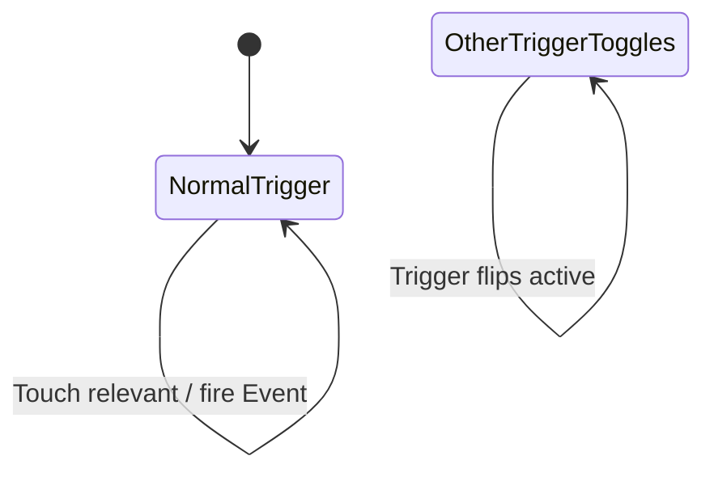

# Proximity triggers: Trigger and SPresenceTrigger

Units:
- def:Engine.Triggers
- def:Engine.Trigger
- uc:Engine.Trigger:PreBeginPlay
- uc:Engine.Trigger:PostBeginPlay
- uc:Engine.Trigger:Reset
- uc:Engine.Trigger:FindTriggerActor
- uc:Engine.Trigger:SpecialHandling
- uc:Engine.Trigger:CheckTouchList
- uc:Engine.Trigger:IsRelevant
- uc:Engine.Trigger:Touch
- uc:Engine.Trigger:Timer
- uc:Engine.Trigger:TakeDamage
- uc:Engine.Trigger:UnTouch
- uc:Engine.Trigger:OtherTriggerToggles.Trigger
- uc:Engine.Trigger:OtherTriggerTurnsOn.Trigger
- uc:Engine.Trigger:OtherTriggerTurnsOff.Trigger
- def:SBase.SPresenceTrigger
- uc:SBase.SPresenceTrigger:Touch
- nat:Engine.Actor.OnlyAffectPawns
- nat:Engine.Actor.TouchingActors

## Purpose

Invisible collision cylinders that fire their `Event` when something relevant enters. SteeE uses 7 `Engine.Trigger`
(ambient one-shot sounds: siren, dog, flies, rats) and 4 `SPresenceTrigger` (the three merc-area doors).

## Data

`Engine.Trigger`:

| Field | Type | Default | Meaning |
|---|---|---|---|
| `TriggerType` | enum | `TT_PlayerProximity` (0) | 0 player, 1 pawn, 2 class, 3 any, 4 shoot, 5 human player |
| `ClassProximityType` | class | None | for type 2 |
| `bInitiallyActive` | bool | true | active flag |
| `bTriggerOnceOnly` | bool | false | collision off after the first firing |
| `ReTriggerDelay` | float | 0 | minimum seconds between firings |
| `RepeatTriggerTime` | float | 0 | re-fire period while something relevant stays inside |
| `DamageThreshold` | float | 0 | type 4 |
| `Message` | localized string | "" | sent to the toucher's instigator |
| `TriggerTime` | float | 0 | last firing time |
| `TriggerActor`, `TriggerActor2` | Actor | | bot navigation helpers (actors whose Event is this Tag) |
| Defaults | | | `InitialState=NormalTrigger`; from Triggers: `CollisionRadius=40`, `CollisionHeight=40`, `bHidden`, `bCollideActors`; `RemoteRole=ROLE_DumbProxy` |

`SBase.SPresenceTrigger`:

| Field | Type | Default | Meaning |
|---|---|---|---|
| `DetectedClass` | class of SBasePawn | `SBase.SPAWNDEFENSE` (merc pawn) | who fires it |
| `bDetectGrab` | bool | true | also fire for a spy carrying a grabbed `DetectedClass` pawn |
| `bUntrigger` | bool | false | fire UnTrigger instead of Trigger |
| Defaults | | | `bCollideActors`, `bUseCylinderCollision`, `bBlockZeroExtentTraces=False`, `bHidden`, `bShouldBaseAtStartup`, collision 22 x 22 (Actor default), `RemoteRole=ROLE_DumbProxy` |

## Rules

### Engine.Trigger

1. `PreBeginPlay`: for types player, pawn, human player, or class with a Pawn subclass, `OnlyAffectPawns(true)`
   (only pawns generate touches).
2. `PostBeginPlay`: if not initially active, `FindTriggerActor` (first and second actor in the whole list whose
   `Event == Tag`). For `TT_Shoot`: `bHidden = false`, `bProjTarget = true`, `SetDrawType(DT_None)`. Save
   `bSavedInitialActive = bInitiallyActive` and `bSavedInitialCollision = bCollideActors`.
3. `Reset`: restore `bInitiallyActive` and collision from the saved values.
4. `IsRelevant(Other)`: false when not active. By type: human player: a human-controlled pawn; player: a pawn that is
   or was a player pawn; pawn: `Pawn.CanTrigger(self)`; class: `Other.Class` is a child of `ClassProximityType`;
   any: true; shoot: a Projectile whose `Damage >= DamageThreshold`.
5. `Touch(Other)`: if relevant: when `ReTriggerDelay > 0`, ignore unless `TimeSeconds - TriggerTime >= ReTriggerDelay`,
   then `TriggerTime = TimeSeconds`. `TriggerEvent(Event, self, Other.Instigator)`. If `Message` is set, send it to
   `Other.Instigator` as a client message. If `bTriggerOnceOnly`, `SetCollision(false)`; else if
   `RepeatTriggerTime > 0`, `SetTimer(RepeatTriggerTime, false)`.
6. `Timer`: re-run `Touch` for every relevant touching actor; keep the timer going while any was found.
7. `UnTouch(Other)`: if relevant, `UntriggerEvent(Event, self, Other.Instigator)`.
8. `TakeDamage`: for an active `TT_Shoot` with `Damage >= DamageThreshold` and an instigator: retrigger delay test,
   `TriggerEvent(Event, self, instigatedBy)`, message to `instigatedBy.Instigator`, once-only collision off.
9. `SpecialHandling(Other)` (bot path helper): returns None, self, the nearer of the two trigger actors, or the result
   of `ShootSpecial`; for a relevant toucher it re-sends Touch. No player effect.
10. States: `NormalTrigger` does nothing extra. `OtherTriggerToggles.Trigger` flips `bInitiallyActive` and, when it
    becomes active, `CheckTouchList` (Touch everything inside). `OtherTriggerTurnsOn.Trigger` activates (with
    CheckTouchList on the off-to-on edge). `OtherTriggerTurnsOff.Trigger` deactivates.
11. A pawn's `Instigator` is itself, so for proximity types the instigator passed on is the touching pawn.

### SPresenceTrigger

12. `Touch(Other)`: if `Other.Class` is `DetectedClass` or a subclass: `UntriggerEvent` when `bUntrigger`, else
    `TriggerEvent(Event, self, Pawn(Other))`.
13. Otherwise, if `bDetectGrab`, `Other` is a spy pawn (`SPawnAttaque`), its controller's state name is exactly
    `s_GrabbingPlayer`, and the class of its `m_AttackTarget` is a child of `DetectedClass`:
    `TriggerEvent(Event, self, Pawn(Other))` (always Trigger, even with `bUntrigger`). This lets a spy carrying a
    grabbed merc open a merc-only door.
14. There is no `UnTouch`, no timer, no retrigger delay: one firing per entry of an actor into the cylinder. A pawn
    already inside when it starts grabbing does not fire.

## States

## Constants

| Name | Value | Unit | Provenance | Source |
|---|---|---|---|---|
| Trigger cylinder | 40 x 40 | uu radius x half-height | decoded | def:Engine.Triggers |
| SPresenceTrigger cylinder | 22 x 22 | uu | decoded | Actor defaults; SteeE instances do not override |
| grab state name | `s_GrabbingPlayer` | | decoded | SPresenceTrigger.Touch |

SteeE instances:

| Actor | Kind | DetectedClass / type | Event | Receivers |
|---|---|---|---|---|
| SPresenceTrigger1742 | presence | SPAWNDEFENSE (default), grab detect | `PorteMerc` | Mover1079 |
| SPresenceTrigger8696 | presence | SBasePawn | `PorteMerc` | Mover1079 |
| SPresenceTrigger8690 | presence | SBasePawn | `Mercporte2` | Mover315 |
| SPresenceTrigger5814 | presence | SBasePawn | `portemerc3` | Mover1750 |
| Trigger436, 357, 433 | player proximity | (ClassProximityType Actor is set but unused by type 0) | `sirene` | SoundTrigger398, 347 |
| Trigger506, 267 | player proximity | | `Chien` | SoundTrigger510, 694 |
| Trigger4176 | player proximity | | `Mouche` | SoundTrigger2052 |
| Trigger4177 | player proximity | | `Rats` | SoundTrigger2053 |

All have `ReTriggerDelay 0`, so every relevant entry fires again (each player entering the siren trigger replays
the siren).

## Network

Server only. Touch, TriggerEvent and UnTouch are non-simulated. Neither class replicates anything gameplay-relevant
(`ROLE_DumbProxy`, hidden).

## Edge cases

- A spy touching SPresenceTrigger8696 opens Mover1079 even though 1742 on the same door is merc-only.
- A pawn standing still inside a presence trigger while its door closes does not reopen it; it must leave and enter.
- `UnTouch` on Engine.Trigger sends UnTrigger to the SoundTriggers, which ignore it.
- `bTriggerOnceOnly` turns collision off; `Reset` restores it (not called in Story).

## Evidence

- `local/re-out/uc/Engine/Trigger.uc`, `Engine/Triggers.uc`, `SBase/SPresenceTrigger.uc`; effective defaults in
  `local/formats/classdefaults_effective.json`.
- SteeE.sdc exports `SPresenceTrigger1742`, `5814`, `8690`, `8696`, `Trigger267`, `357`, `433`, `436`, `506`,
  `4176`, `4177`.
- Natives: OnlyAffectPawns `0x10a24ca0`, TouchingActors `0x10a287b0`, SetCollision `0x10a24bf0`,
  ClassIsChildOf `0x10949870`.

## Open questions

1. Touch generation for cylinders (exact overlap rule, whether a crouching pawn's reduced height matters, and whether
   touches are generated for pawns that spawn inside). Belongs to the collision spec; scenario: walk a spy into
   SPresenceTrigger8696 at several heights.
2. The grab check reads the state name exactly; confirm no other carry state (crouched carry) exists for spies.
