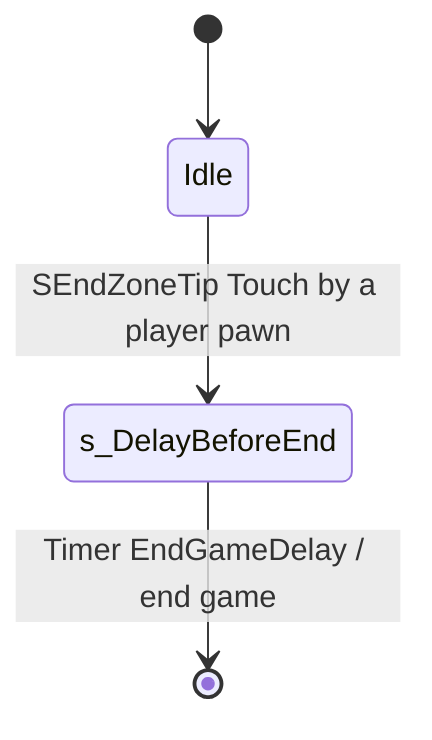

# SZoneTips and SEndZoneTip (tutorial hint zones)

Units:
- def:SBase.SZoneTips
- uc:SBase.SZoneTips:Touch
- uc:SBase.SZoneTips:UnTouch
- uc:SBase.SZoneTips:AddMessage
- uc:SBase.SZoneTips:RemoveMessage
- def:SBase.SEndZoneTip
- uc:SBase.SEndZoneTip:Touch
- uc:SBase.SEndZoneTip:s_DelayBeforeEnd.BeginState
- uc:SBase.SEndZoneTip:s_DelayBeforeEnd.Timer

## Purpose

Invisible cylinders that show a map hint on the HUD while the player stands in them, in offline play only.
SteeE has 12 (objective locations, the crane, the shutters, the courtyard glass). SEndZoneTip (not placed in SteeE)
ends the game when touched.

## Data

| Field | Type | Default | Meaning |
|---|---|---|---|
| `sMessage_ATT[2]` | localized string | | spy text, two parts joined by a space |
| `sMessage_DEF[2]` | localized string | | merc text |
| `bStayPermanently` | bool | true | keep the hint after leaving |
| `bShowOnlyWithIngameHelp` | bool | false | require the profile's in-game help option |
| `TargetController` | SPlayerController | None | current viewer |
| Defaults | | | `CollisionRadius=300`, `CollisionHeight=150`, `bUseCylinderCollision`, `bCollideActors`, `bStatic`, `bNoDelete`, `DT_None`, `RemoteRole=ROLE_None`, `native` |
| SEndZoneTip `EndGameDelay` | int | 5 | s |
| SEndZoneTip `TouchedByTeam` | byte | | |

## Rules

1. `Touch(Other)` (simulated): only when `Level.NetMode == NM_Standalone` and `Other` is a pawn controlled by an
   SPlayerController with an SHud: remember it as `TargetController` and `AddMessage`.
2. `AddMessage(PC)`: if not `bShowOnlyWithIngameHelp`, or the persistent profile has `bDisplayHelpInGame`: a spy
   (`SPawnType == SPAWNOFFENSE`) gets `sMessage_ATT[0] + " " + sMessage_ATT[1]`, a merc gets the DEF text, through
   `SHud.AddTutoMapMessage`.
3. `UnTouch(Other)` (simulated, standalone only): when `Other` is the target controller's pawn, `RemoveMessage` and
   clear the target.
4. `RemoveMessage(PC)`: unless `bStayPermanently`, `AddTutoMapMessage("")` (clears the hint).
5. In any network mode (listen host included) nothing is shown: the SteeE Story slice never shows these hints online.

### The rewrite

5a. OpenSCCT's offline play (tutorials, Visit a Map, offline matches) is a listen server with the player connected
    as a client, so the standalone test would never pass. The player's own machine therefore also counts as
    standalone while an offline session runs on it (`IProfileOptions.OfflineSession`): Touch and UnTouch run for its
    local controller in the client's world, where the HUD is. Online sessions stay as rule 5.
6. SEndZoneTip `Touch` (non-simulated): the parent behaviour, then for a pawn with an SPlayerController remember its
   team (`SPawnType`) and go to `s_DelayBeforeEnd`. `BeginState`: with `EndGameDelay > 0` start a timer of that many
   seconds; else immediately `ReplicateWinningReason(team, END_TEAMDEATH)` and `sEndGame()`. `Timer`: the same end
   call. A later touch by the other team before the timer replaces the team (it re-enters the state code path:
   `GotoState` to the same state does not rerun `BeginState`, so the timer is not restarted).

## States

## Constants

| Name | Value | Unit | Provenance | Source |
|---|---|---|---|---|
| default cylinder | 300 x 150 | uu | decoded | def:SBase.SZoneTips |
| SEndZoneTip delay | 5 | s | decoded | def:SBase.SEndZoneTip |

SteeE instances all set `bShowOnlyWithIngameHelp=True`, `bStayPermanently=False`, identical spy and merc texts, and
cylinders of 100 to 250 radius by 100 height. Example: SZoneTips28836 at (-260, 980, -1043), radius 150: "To access
the sixth mission objective, you must demolish the doors. Hack into the crane to clear a path."

## Network

None. Standalone only (`ROLE_None`, static).

## Edge cases

- Two players offline is impossible, so `TargetController` holding one controller is enough.
- `UnTouch` casts `Pawn(Other).Controller` without a None check on `Other` being a pawn.

## Evidence

- `local/re-out/uc/SBase/SZoneTips.uc`, `SBase/SEndZoneTip.uc`; SteeE.sdc 12 `SZoneTips` exports with English text.

## Open questions

1. SHud `AddTutoMapMessage` display time and layout belong to the HUD spec.
