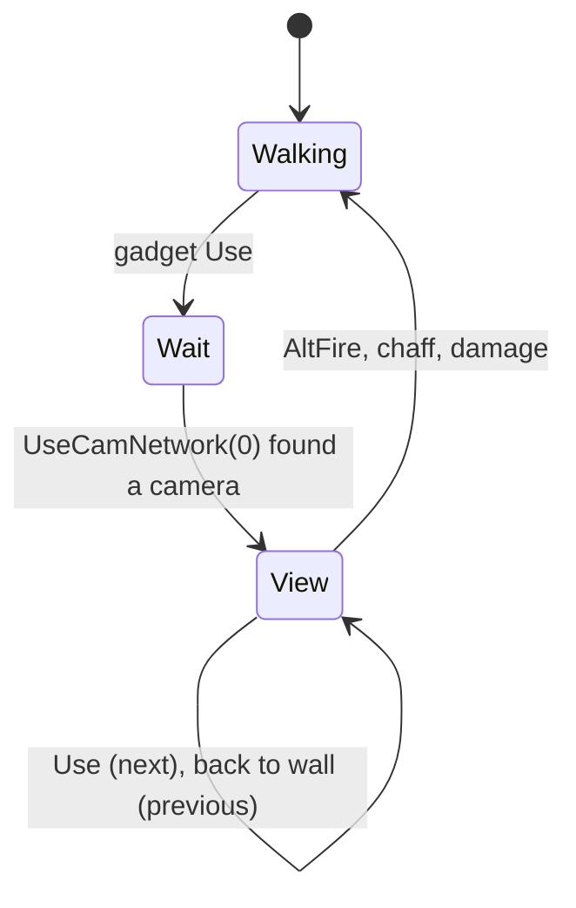

# Camera network gadget (SGadCamNetwork) and the camera view states

Units:
- def:SBase.SGadCamNetwork, uc:SBase.SGadCamNetwork:Use
- uc:SBase.SPlayerController:UseCamNetwork, uc:SBase.SPlayerController:ChangeCamNetworkVision, uc:SBase.SPlayerController:CamNetworkSetFovOnServer,
  uc:SBase.SPlayerController:CamFire
- uc:SBase.SPlayerController:s_UseObject_CamNetworkCrWaitForServer.PlayerMove, uc:SBase.SPlayerController:s_UseObject_CamNetworkStWaitForServer.PlayerMove,
  uc:SBase.SPlayerController:s_UseObject_CamNetwork.* (CanBeGrabbed, GadLaserSwitch, GadTorcheSwitch, SwitchHeadset, BeginState, EndState,
  ClientChaffed, AltFire, WheelUp, WheelDown, PlayerMove)
- uc:SBase.SBasePawn:CamNetworkSwitchVisionModeOnServer, uc:SBase.SBasePawn:CamNetworkSwitchVisionModeOnAllClients
- uc:SBase.SCamNetwork:Fire, uc:SBase.SCamNetwork:Tick, nat:SBase.SCamNetwork.ServerFire, nat:SBase.SCamNetwork.AuthorizeEnergy,
  nat:SBase.SCamNetwork.ComputeEnergyLevel
- The camera actor, the ring, the limits, `FreeCurrentCamera`, `ClampRotation` and `SwitchToVision` are in
  `spec/devices/cam-network.md`; the orientable tick and the base view state `s_UseObject` in `sticky-cam.md`.

## Purpose
The merc's CamNet gadget puts him behind the map's network cameras from anywhere: he steps around the ring with the
Use and back-to-wall keys, turns and zooms the camera he controls, switches its vision mode, and leaves with
Alt-fire. The camera has a shot energy that refills over time.

## Data
| Field | Default | Notes |
|---|---|---|
| SGadCamNetwork.Charge / RefireRate | -10 / 1.0 s | not spent |
| SGadCamNetwork.FirstNetworkCam, LastUsedNetworkCam | None | the ring entry, searched once |
| SCamNetwork.EnergyLevel / EnergyLevelMax / EnergyNeeded / EnergyRefillAmount | 100 / 100 / 50 / 5 | |
| SCamNetwork.EnergyRefill | 0 | seconds accumulated |
| SCamNetwork.ReloadTime / BaseDamage | 0.5 s / 10 | |
| SCamNetwork.FireSingleShotSound / EmptySound | StikyShok_SShot_1 / StikyShok_vide | |
| SBasePawn.bUsingCamNetwork | false | set by the camera actions |

## Rules
1. **Use** (gadget): nothing on a tutorial map. When the owner walks and the HUD is not perturbed: the controller
   changes to the crouched or standing "wait for server" state and calls `UseCamNetwork(0)` (`spec/devices/
   cam-network.md` rules 2 to 4). The gadget's base Use follows.
2. **Wait states** (`s_UseObject_CamNetworkCrWaitForServer` extends `s_PlayerWalkingCr2H`, the standing one extends
   `s_PlayerWalkingSt2H`): `PlayerMove` drops jumps, turns the camera view for a non-merc (`UpdateCamRotation`) and
   sends a still move. `UseCamNetwork` moves on to `s_UseObject_CamNetwork` once the camera is set.
3. **s_UseObject_CamNetwork** (extends the sticky cam view; ignores Fire, ChangeSpeed, PrevStickyCam):
   - `BeginState`: a non-spy can be grabbed; behind view on; on the input machine the palm clip (walking) or no IK,
     the laser and the torch go off, SA_CAMNETWORK_BG, the goggles' current mode is saved and reset to normal (with
     the clip). The controlling merc's camera takes his `DesiredFOV` as its FOV. HUD state `s_Hud_UseObject_CamNetwork`.
   - `EndState`: grabs forbidden again; on the input machine, when alive and not shocked, the saved goggle mode is
     put back (switch from normal to the saved mode, then `Activate`); `UseCamNetwork(leave)`; SA_CAMNETWORK_END; the
     camera's zoom sounds stop and its vision request is replaced by its current mode; `PreviousUsedObject = None`;
     ambient off. On the server, a dead merc frees his camera. Behind view off. Then the sticky cam view's `EndState`.
   - `PlayerMove`: `bFire = 0`; zoom keys (controller only) by `500 x fCoeffZoomSpeed x dt`, sent to the server
     (`CamNetworkSetFovOnServer`); a new press of Use or back-to-wall: the controlling merc's vision mode (1 motion,
     2 EMF) is sent to the camera, the torch and laser go off, back-to-wall steps to `PrevCam` and Use to `NextCam`
     (`UseCamNetwork(1)` / `UseCamNetwork(2)`). Then: the controller resets the FOV of a camera just entered to his
     default, keeps the camera FOV and his view FOV equal (and sends it), zoom sounds, `UpdateRotation`; a passenger
     follows the controller's vision requests (`iChangeToThisVisionMode`, and on entering a camera its current mode)
     and FOV. The controller's ambient sound follows the camera; `PreviousUsedObject = UsedObject`; a still move.
   - `WheelUp` / `WheelDown` (controller only): zoom by `3000 x fCoeffZoomSpeed x m_dT`, sent to the server.
   - `AltFire` and `ClientChaffed`: leave (to the previous state on a pipe, wall or Vandamme, else
     `GotoWaitingState`); `ClientChaffed` also forgets the saved goggle mode.
   - `GadTorcheSwitch` (controller only): the camera's vision is reset (-2), the goggles change by the current mode,
     then the global torch key. `GadLaserSwitch` (controller only): the global laser key.
   - `SwitchHeadset(i)` (controller only, and only for modes the server allows): 3 cycles motion and EMF, with the
     shortcuts of the global key when one mode is withheld; the torch goes off; the camera and the goggles switch.
   - `CanBeGrabbed`: true for a merc.
4. **ChangeCamNetworkVision(i)**: on the goggles' `CurrentMode`: 1 motion tracking and 2 EMF (mercs only), 3 cycles
   motion, EMF, normal; the same mode again resets to normal; then `Activate`.
5. **CamNetworkSwitchVisionModeOnServer(cam, mode)** (pawn, client to server) calls
   `CamNetworkSwitchVisionModeOnAllClients(cam, mode)`, which carries the SCCT "to all clients" flag (it runs on the
   server and on every client that has the pawn) and calls `cam.SwitchToVision(mode)`. The server's change also
   reaches clients through the replicated `iReplicatedVisionMode` (rule 7).
6. **CamNetworkSetFovOnServer(cam, fov)** (client to server): the camera's `fVisionFOV`.
7. **SCamNetwork.Tick** (every machine): `ComputeEnergyLevel(dt)`; a changed replicated vision mode is applied
   (`SwitchToVision`); the globe is drawn at scale 0.1 for the input machine of the controlling merc in the view, and
   for a local passenger, else 1.0; a viewer that is not the controller adopts the replicated angles (a jump over 50
   units plays the rotation sound); zoom and rotation ambient sounds with the 0.2 s linger.
8. **ComputeEnergyLevel(dt)** (native, decoded 0x10ae8fb0): `EnergyRefill += dt`; when its whole seconds went up this
   tick and the level is below the maximum, `EnergyLevel += EnergyRefillAmount` (not clamped).
9. **AuthorizeEnergy(n)** (native, decoded 0x10ae9510): false when `EnergyLevel < n`; else `EnergyLevel -= n` and
   true.
10. **Fire(F)**: with energy for a shot, the single-shot sound on the server (radius 200) and `CamFire(F, cam)`
    (client to server `ServerFire`); else after `ReloadTime` since the last shot the empty sound (radius 60);
    `LastShot = now`. Nothing in 4.0 calls `SCamNetwork.Fire` (the view state ignores Fire): cameras never shoot.
11. **ServerFire(F)** (native, decoded 0x10ae9030, unreachable): a sticky shot (damage type 12) along the camera's
    forward axis from 20 uu ahead, 15000 uu long, hurting the first pawn or gameplay object hit.

## States

## Constants
| Name | Value | Unit | Provenance | Source |
|---|---|---|---|---|
| Energy refill | +5 per whole second | | decoded | ComputeEnergyLevel |
| Shot energy | 50 of 100 | | decoded | def |
| Zoom keys / wheel | 500 / 3000 x 0.1 | deg per s | decoded | s_UseObject_CamNetwork |

## Network
- The camera assignment and FOV live on the server (`UseCamNetwork` and `CamNetworkSetFovOnServer` are client to
  server); the vision mode reaches the owner only.
- Angles go to the server unreliably (`ServerUpdateOrientableRotation`); other viewers adopt the replicated copies.

## Edge cases
- The second merc on a camera is a passenger: no turning, no zoom, no vision switching of his own.
- A chaffed merc is thrown out of the view (`ClientChaffed`).

## Evidence
- local/re-out/uc/SBase/SGadCamNetwork.uc, SCamNetwork.uc, SBasePawn.uc (CamNetworkSwitchVisionMode*),
  SPlayerController.uc (7124 to 7290, states 26180 to 26544); game natives 0x10ae8fb0, 0x10ae9510, 0x10ae9030
  (private Ghidra copy).

## Open questions
- Confirm in the game that `SCamNetwork.Fire` has no caller (no input reaches it in the view state).
