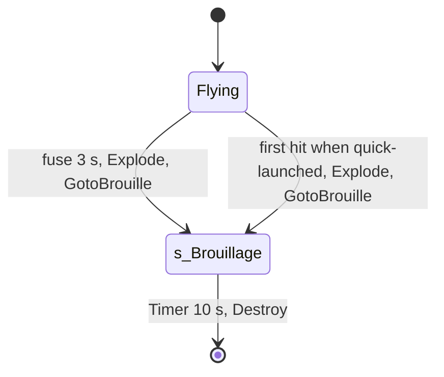

# Chaff grenade (SGadChaffeGrenade, SProjChaffe, SChaffeEmitter)

Units:
- def:SBase.SGadChaffeGrenade, def:SBase.SProjChaffe, def:SBase.SChaffeEmitter
- uc:SBase.SProjChaffe:PostBeginPlay, uc:SBase.SProjChaffe:Timer, uc:SBase.SProjChaffe:GotoBrouille,
  uc:SBase.SProjChaffe:s_Brouillage.BeginState, uc:SBase.SProjChaffe:s_Brouillage.Tick, uc:SBase.SProjChaffe:s_Brouillage.Timer
- nat:SBase.SProjChaffe.NativeStateBrouillageTick, nat:Engine.Projectile.Explode (ASProjChaffe C++ override, game 0x10abe640),
  ASProjChaffe::ChaffExplodeEffect (game 0x10abe6d0, no UFunction id)
- uc:SBase.SPlayerController:ClientChaffed, uc:SBase.SPlayerController:SetHudPerturbation

## Purpose
The spy's chaff grenade jams electronics: 3 s after the throw it bursts, gameplay objects within 300 uu (cameras,
lasers, mines) lock for 10 s (the class decides the real time), merc torches within reach malfunction for 5 s, and
for 10 s every merc within 300 uu in sight of it has his HUD perturbed and his vision goggles reset.

## Data
| Field | Default | Notes |
|---|---|---|
| SGadChaffeGrenade.Charge / RefireRate / CanQuickLaunch | 5 / 2.0 s / true | "Chaff Grenade (5 Units Pack)" |
| SProjChaffe.TempsExplosion | 3 s | inherited fuse |
| SProjChaffe.Range | 300 uu | int |
| SProjChaffe.TempsBrouillage | 10 s | jamming field and lock length asked of objects |
| SProjChaffe.TimeToDisipation | 2 s | HUD perturbation per tick in range |
| SProjChaffe.GadTorcheDisableTime | 5 | torch malfunction seconds, int |
| SProjChaffe.WallReboundFactor / ActorReboundFactor | 0.2 / 0.2 | |
| SProjChaffe.ProjectileSpeed / MaxSpeed | 900 / 1600 | |
| Sounds | launch RA_GrenDegoup, impact SW_GrenRebonds, explode GR_Shaff_effect | |
| SChaffeEmitter | flakes, flash, shrapnel; LifeSpan 10 s | visual |

## Rules
1. **Throw** as `grenade-throw.md` (aimed or quick launch). **PostBeginPlay**: nothing more when quick-launched;
   otherwise the launch sound (radius 100) and, off a dedicated server, the launch trail emitter.
2. **Timer** (the fuse): a client copy destroys itself; the server stops the grenade (no bounce, no physics), hides it
   and calls `Explode(Location, (0, 0, 10))`.
2a. **Quick launch pop** (HitWall override shared with the flash-bang, decoded game 0x10ab8760,
   `grenade-throw.md` rule 10a): a quick-launched chaff grenade explodes at its first hit, the floor under the spy's
   hand, with `Explode(Location, (0, 0, 0))` on the server (physics left falling; a later hit finds `Exploded` set);
   a client copy is destroyed there. An aimed one bounces until the fuse.
3. **Explode** (native override, decoded 0x10abe640), once (`Exploded`): hide the grenade, `ProjectileSpeed = 0`,
   run `ChaffExplodeEffect(HitNormal)`, then a one-shot timer of `TempsBrouillage` and the event `GotoBrouille`
   (enter `s_Brouillage`).
4. **ChaffExplodeEffect** (decoded 0x10abe6d0):
   1. forget the launch trail; event `NotifyNoise(1.0)`;
   2. every player controller (`bIsPlayer`) hears the explosion sound at the grenade (volume 1, radius 100);
   3. spawn `SChaffeEmitter` at the grenade, rotated from the hit normal (yaw from X/Y, pitch from Z), instigated by
      the grenade's instigator;
   4. for each actor of the level (in list order, not hidden) within `Range + its CollisionRadius` (3D, strict) that
      is an `SGadTorche` (the laser torch is a subclass): `Malfunction(GadTorcheDisableTime)`.
5. **s_Brouillage.BeginState**: every actor colliding within `Range` of the grenade that is an
   `SBasicGamePlayObject` gets `SetLockedByChaff(TempsBrouillage)` (classes with their own rule use their own time:
   cameras and lasers 30 s, `spec/devices/gameplay-object.md`).
6. **s_Brouillage.Tick** -> `NativeStateBrouillageTick` (decoded 0x10abe980), every server tick of the 10 s field: for
   each actor of the level (in order, not hidden) that is an `SPAWNDEFENSE`, within `Range` (squared, strict; any
   distance when Range is 0), seen from the grenade (a line with flags 0x286 that hits nothing or the merc) and
   with a controller: `SetHudPerturbation(TimeToDisipation)` and `ClientChaffed()` on that controller.
7. **s_Brouillage.Timer** (10 s after the burst): the grenade is destroyed.
8. **SetHudPerturbation(length)** (server to owner, unreliable): the HUD's `SetHudPerturbationLength(length)`
   (`sticky-shock-effect.md`): while it lasts the merc cannot reload, full reload, scope or switch goggles.
9. **ClientChaffed** (server to owner, reliable): the goggles go back to the normal view at once
   (`ResetVisionMode(true)`). In the camera network view the merc also leaves the view (`camera-network-gadget.md`).

## States

## Constants
| Name | Value | Unit | Provenance | Source |
|---|---|---|---|---|
| Fuse | 3 | s | decoded | SProjGrenade.TempsExplosion |
| Explode normal | (0, 0, 10) | | decoded | SProjChaffe.Timer |
| Field | 10 | s | decoded | TempsBrouillage |
| Range | 300 | uu | decoded | def |
| HUD perturbation per tick | 2 | s | decoded | TimeToDisipation |
| Torch malfunction | 5 | s | decoded | GadTorcheDisableTime |
| Explosion sound radius | 100 | uu | decoded | 0x10abe760 |
| Merc sight line flags | 0x286 | | decoded | 0x10abeab8 |

## Network
- The burst, the locks and the field run on the server. `SetHudPerturbation` (unreliable) and `ClientChaffed`
  (reliable) are server-to-owner calls; on a listen host they run locally. The emitter and the torch flicker reach
  clients through their own actors.

## Edge cases
- A merc stays perturbed while he stays in the field (2 s refreshed every tick) and his goggles are forced back to the
  normal view every tick, so a merc cannot use vision modes inside the field.
- The field affects mercs only. A spy's sticky cam is a gameplay object (through SOrientableObject), but its
  `bCanBeChaffed` is false, so the lock does nothing to it. Mines (`bCanBeChaffed` true) are locked.
- Hidden actors are skipped by the torch and merc scans.

## Evidence
- local/re-out/uc/SBase/SProjChaffe.uc, SGadChaffeGrenade.uc, SPlayerController.uc (ClientChaffed 4085,
  SetHudPerturbation 7572); game natives 0x10abe640, 0x10abe6d0, 0x10abe980, HitWall 0x10ab8760 (private Ghidra copy); event names
  NotifyNoise, GotoBrouille, Malfunction, SetHudPerturbation, ClientChaffed from the name table.
- Bridge docs/GADGET_TIMINGS.md rows "Chaff grenade", "Chaff jamming field", "Chaff on devices" agree.

## Open questions
- Scenario: a merc in motion vision 200 uu from a chaff burst; record RendMap, bPerturbation and the torch state.
