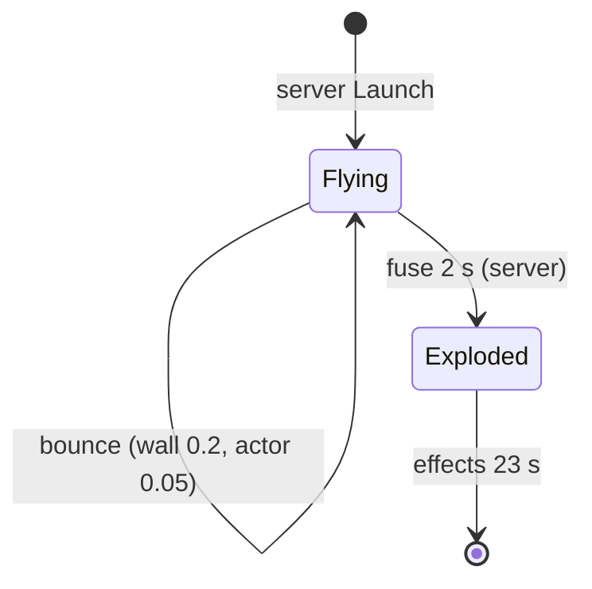

# Frag grenade (SGadFragGrenade, SProjFrag, SGrenadeExplosion)

Units:
- def:SBase.SGadFragGrenade, uc:SBase.SProjFrag:PostBeginPlay, nat:Engine.Projectile.Explode (SProjFrag C++ override, game 0x10ab4780), def:SBase.SProjFrag
- uc:SBase.SGrenadeExplosion:PostBeginPlay, uc:SBase.SGrenadeExplosion:Tick, uc:SBase.SGrenadeExplosion:Timer, def:SBase.SGrenadeExplosion
- uc:SBase.SFlashLight_FragGrenade:PostBeginPlay, def:SBase.SFlashLight_FragGrenade, def:SBase.SFlashLight (its C++ tick override at
  game 0x10abd280 has no UFunction id; coverage should give it an eng: id)
- uc:SBase.SPlayerController:StandardReactionsToDamage (SDamage_Explosion parts), uc:SBase.SPlayerController:s_PlayerWalking.CanBeBlasted,
  uc:SBase.SPlayerController:s_PlayerWalking.ExplosionHit, uc:SBase.SPlayerController:ClientDamage (explosion branch)
- uc:Engine.Actor:HurtRadius (reference for non-pawn damage, if used by the native)

## Purpose
The merc's frag grenade: thrown like any grenade, explodes after a 2 s fuse, damages and blasts pawns and damageable
objects in range, shakes cameras, and leaves a smoke and shrapnel visual.

## Data
| Field | Default | Notes |
|---|---|---|
| SGadFragGrenade.Charge | 4 | ItemLongName says "5 Units Pack" (text and value disagree) |
| SGadFragGrenade.RefireRate / CanQuickLaunch | 2.0 s / false | mercs throw aimed only |
| SProjFrag.TempsExplosion | 2 s | |
| SProjFrag.Damage (int) | 334 | shadows Projectile.Damage (float 0) |
| SProjFrag.Range | 500 uu | |
| SProjFrag.fDistForBlast | 350 uu | |
| SProjFrag.ShakeRange | 2000 uu | |
| SProjFrag.WallReboundFactor / ActorReboundFactor | 0.2 / 0.05 | |
| SProjFrag.Mass | 1000 | |
| SProjFrag.PercentDamageRefillable | 30 | spy health refill share |
| SProjFrag.MomentumTransfer | 50000 | inherited |
| Projectile.MyDamageType | SDTBase | inherited default (the native may pass another type) |
| Projectile.DamageRadius | 220 | inherited, use unknown |
| SProjFrag.bExploding, FragLaunchEmitter | | |
| Sounds | launch RA_GrenDegoup, impact SW_GrenRebonds, explode RA_GrenExpl | |
| SGrenadeExplosion.LifeSpan | 23 s | 4 sprite emitters (smoke, shrapnel, smoke, flash) |
| SFlashLight_FragGrenade | LightBrightness 255, LightRadius 22, fTempsDisparition 0.5 s | LifeSpan set to 0.5 s in PostBeginPlay |
| SFlashLight | LightEffect LE_PointAmbient, LightSaturation 250, bAffectOwnZoneOnly, RemoteRole None | |
| SPlayerController.BlastDistMax / BlastSpeedMax / BlastSpeedMin | 1000 / 800 / 350 | blast reaction |

## Rules
1. **Throw**: aimed only (`grenade-throw.md` Rules 1-4). A merc throw puts the rifle in `s_FireGrenade` (1.733 s,
   no firing). Launch sound (radius 100) and the SFragLaunchEmitter trail on non-dedicated machines.
2. **Fuse**: 2 s after the projectile appears on each machine; the server explodes it (`Explode(Location, 0)`),
   clients destroy their copy.
3. **Explode** (native 0x10ab4780, contract): runs once (`bExploding`). Spawns SGrenadeExplosion (whose
   PostBeginPlay spawns the SFlashLight_FragGrenade light: brightness `255 - 255 * (t - start) / 0.5`, gone at 0.5 s),
   plays RA_GrenExpl, shakes cameras within `ShakeRange` (2000 uu), and damages within `Range` (500 uu). For pawns it
   calls their controller's `PawnTakeDamage` (pawn `TakeDamage` is empty in SBasePawn) with a momentum vector equal
   to the offset from the explosion to the pawn; non-pawn damageable actors get `TakeDamage`. Distance falloff from
   `Damage = 334` and the role of `fDistForBlast` are native and not decoded.
4. **Pawn damage when the type is SDamage_Explosion** (script, `StandardReactionsToDamage`): a spy within 3 s of
   spawning (`fSpawnProtectionEnd`) takes nothing; in Merc Deathmatch anyone spawn-protected takes nothing; otherwise
   `ActualDamage = 200` whatever the passed amount, distance or pill. With 100 health this always kills. Death:
   if `CanBeBlasted(Momentum)` (state dependent; in walking states `|Momentum| < 1000`) the server waits for a fatal
   blast (`TellClientServerWaitForFatalBlast`), else a normal death animation.
5. **Survivor reaction**: `ClientDamage` with SDamage_Explosion calls `ExplosionHit(Momentum)`: in walking states,
   if `d = |Momentum| < 1000`: action SA_BLAST_LOOP, speed `800 + (350 - 800) * d / 1000` (800 at the centre,
   350 at 1000 uu), direction `Normal((Momentum / d) with Z set to 1)`, `SetVelocityAndOrientationForBlast`, state
   `s_Blast` (blast spec). The merc camera shakes (800, 20000, 500); an unarmed spy's camera tilts and shakes.
6. **Visual**: SGrenadeExplosion lives 23 s (particles end around 8 s; Bridge docs/GADGET_TIMINGS.md row
   "Frag explosion").

## States

## Constants
| Name | Value | Unit | Provenance | Source |
|---|---|---|---|---|
| Fuse | 2 | s | decoded | def TempsExplosion |
| Damage field | 334 | | decoded | def Damage |
| Damage range | 500 | uu | decoded (field), use estimated | def Range |
| Blast distance field | 350 | uu | decoded (field), use unknown | def fDistForBlast |
| Shake range | 2000 | uu | decoded (field) | def ShakeRange |
| Pawn explosion damage | 200 flat | HP | decoded | StandardReactionsToDamage |
| Spy spawn protection vs explosions | 3 | s | decoded | EnterStartState, StandardReactionsToDamage |
| Blast threshold / speeds | 1000 uu / 800..350 uu/s | | decoded | ExplosionHit, def |
| Light fade | 0.5 | s | decoded | def fTempsDisparition, native tick (prior) |
| Charges | 4 | | decoded | def Charge |

## Network
- Server: projectile flight, fuse, Explode, damage, stats. Clients: projectile copy (destroyed at the fuse),
  explosion emitter and light (replicated SGrenadeExplosion, local light), `ClientDamage` reactions (reliable RPC).
- Reloaded replaces `ThrowGren` and makes grenade flight server-simulated (`grenade-throw.md`).

## Edge cases
- If the native passes SDamage_Explosion, distance falloff cannot reduce pawn damage (always 200); falloff would then
  only matter for objects and for the in-range test. If it passes SDTBase instead, pill multipliers and spy
  spawn protection rules differ. This must be settled before porting (Open questions).
- The thrower is not excluded by any script rule (self damage depends on the native).
- Frag grenades are not refilled by the ammo stock (`ammo-stock.md`).
- GADGET_TIMINGS lists only the visual; the plan's "damage 334" is the field value, not the damage a pawn takes when
  the type is SDamage_Explosion.

## Evidence
- local/re-out/uc/SBase/SProjFrag.uc, SGrenadeExplosion.uc, SFlashLight_FragGrenade.uc, SFlashLight.uc,
  SGadFragGrenade.uc, SPlayerController.uc 4090-4130, 4296-4425, 4537-4612, 9420-9465; Engine/Actor.uc HurtRadius;
  SBasePawn.uc TakeDamage (empty).
- local/reflect/game_cdo.json SBase.SProjFrag (Damage 334, Range 500, fDistForBlast 350, ShakeRange 2000).
- Bridge docs/GADGET_TIMINGS.md rows "Frag grenade: fuse", "Frag explosion"; gadget_timings.json addresses
  (ASProjFrag::Explode 0x10ab4780, light tick 0x10abd280).

## Open questions
- Self and team damage: the native frag does not skip its thrower or team mates (natives2-damage.md rule 4); whether
  the damage pipeline then drops them is a script rule (damage-pipeline.md); confirm in a two-pawn rig. Scenario: frag at 100, 300, 450, 600 uu from a spy (outside spawn protection) and from a
  merc in Merc Deathmatch; record damage, damage type and blast velocity.

### Resolved
- ASProjFrag::Explode. Resolved: every actor of the level within Range (Range 0 unlimited), sight by up to three
  lines for pawns (centre, then +-0.9 H), `int((1 - dist / Range) Damage)`, SDamage_Explosion inside fDistForBlast
  else SDTBase for pawns (SDamage_Explosion for other actors), momentum victim - frag (not normalised), instigator
  the owner pawn, HitLocation the victim raised by 0.5 H, PillTag 0; HurtRadius is not used for players; shake law
  of the gameplay objects outside Range. Evidence: natives2-damage.md rule 4 (ANSWERS-natives2 20, 22).
