# Grenade throwing (SGadGrenLauncher, SProjGrenade): aimed throw, quick launch, flight and fuse

Units:
- uc:SBase.SGadGrenLauncher:Use, nat:SBase.SGadGrenLauncher.UseGren, nat:SBase.SGadGrenLauncher.QuickUse, nat:SBase.SGadGrenLauncher.ThrowGren,
  def:SBase.SGadGrenLauncher
- uc:SBase.SProjGrenade:PostNetBeginPlay, uc:SBase.SProjGrenade:Timer, nat:SBase.SProjGrenade.Launch, nat:SBase.SProjGrenade.HitWall,
  rep:SBase.SProjGrenade.QuickLaunch, def:SBase.SProjGrenade
- uc:SBase.SGadLaunchEffects:PostBeginPlay, uc:SBase.SGadLaunchEffects:Timer, def:SBase.SGadLaunchEffects, def:SBase.SGrenLaunchEffects
- uc:SBase.SPlayerController:AltFire (grenade branch), uc:SBase.SPlayerController:PlayerTick (throw charge and quick throw parts),
  uc:SBase.SPlayerController:s_PlayerWalkingMario.GadgetQuickChoice, uc:SBase.SPlayerController:RealGadgetQuickLaunch,
  uc:SBase.SPlayerController:s_PlayerWalkingSt0H.BeginState (quick throw), uc:SBase.SPlayerController:Vibration_Gadget
- uc:SBase.SBasePawn:NotifyQuickLaunch, uc:SBase.SHud:SetBallisticValue
- nat:SBase.SGadget.CanUse, nat:SBase.SGadget.DecCharge, nat:SBase.SGadget.ServerDecCharge (as used by grenades)
- rep:Engine.Inventory.Charge

## Purpose
How any grenade-type gadget (smoke, chaff, frag, flash-bang, phospho) leaves the hand: an aimed throw whose strength
is set by holding the gadget button, or (spies, holstered) a quick launch at the feet; then the common projectile
rules (spin, bounce, fuse). Grenade-specific effects are in `smoke-grenade.md` and `frag-grenade.md`.

## Data
| Field | Class | Default | Notes |
|---|---|---|---|
| ProjectileClass | SGadSmokeGrenade / SGadFragGrenade | SProjSmoke / SProjFrag | |
| Charge | smoke / chaff / frag | 5 / 5 / 4 | Inventory `config` int, replicated to the owner |
| RefireRate | smoke, chaff, frag | 2.0 s | |
| CanQuickLaunch | smoke, chaff / frag | true / false | |
| UseThrowForce, bActivatable | SGadGrenLauncher | true | |
| MinimumThrowObjectDelay / MaximumThrowObjectDelay | SPlayerController | 0.25 / 1.0 s | |
| ProjectileSpeed / MaxSpeed | SProjSmoke, SProjFrag | 900 / 1600 uu/s | |
| TempsExplosion | SProjGrenade / SProjFrag | 3 / 2 s (int) | fuse |
| WallReboundFactor / ActorReboundFactor | SProjGrenade 0.5 / 0.5; SProjSmoke 0.2 / 0.2; SProjFrag 0.2 / 0.05 | | |
| MomentumTransfer | SProjGrenade | 50000 | |
| PercentDamageRefillable | SProjGrenade / SProjFrag | 50 / 30 | |
| LaunchEffect | SProjGrenade | SGrenLaunchEffects | 0.1 s flash |
| Collision | projectiles | radius 2, height 2, PHYS_Falling, bBounce | |
| LifeSpan | Projectile | 14 s | |

Controller fields: `TimerUSe`, `bUsingNow`, `bUnCrouchAndUnDraw`, `bQuickGadgetQuery`, `fDateLaunchedLastQuickGadget`,
`fDateFireMode`. Ballistic gauge `SHud.BallisticValue`.

## Rules
1. **Aimed throw start** (exec `AltFire`, right mouse alias `AltFire | GadgetQuickChoice 1 | HoldBreath`): return if
   the team has no gadget slots; requires `!bIsInInventoryMode && iDontUpdatePadInput == 0 && !bWeaponTransit` and not
   shocked. With a grenade launcher selected: if `WeaponLoaded != 0` and `SelectedGadget.CanUse()`: when not already
   charging set `TimerUSe = now`, `bUsingNow = true`. Else if `Charge <= 0`, play Mine_vide (radius 100). The weapon
   must be out: a merc always (unless holstered), a spy only with the Shocker drawn.
2. **Charging** (PlayerTick, while `bUsingNow` and a grenade launcher is selected), with `e = now - TimerUSe`:
   - `e < 0.25`: `v = 1.0` (gauge not updated);
   - else `v = 0` if the weapon is holstered, otherwise `v = min((e - 0.25) / 1.0, 1)`, shown with `SetBallisticValue(v)`
     (a click sound when the gauge starts and at each sixth).
   On release (`bAltFire == 0`): `bUsingNow = false`; if `CheckIfCanFire()` then `SelectedGadget.Use(v)`; gauge 0.
   So a tap under 0.25 s throws at full strength, a hold starts weakest at 0.25 s and reaches full at 1.25 s.
3. **Use(v)**: refused while the weapon is in `s_FullReloading`, `s_Reloading`, `s_FireGrenade` or `s_ElbowShocking`.
   `Force = int((v + 1)^2 * ProjectileSpeed * 0.5)`: 450 at v = 0, 1012 at v = 0.5, 1800 at v = 1 for 900 uu/s
   grenades. `UseGren(Force)`; gadget rumble 0.12 s; for a merc the weapon enters `s_FireGrenade` (1.733 s throw clip,
   no firing, laser off; `merc-rifle.md` Rule 19).
4. **UseGren and ThrowGren** (UseGren native 1312, decoded game 0x10aa03e0). `UseGren(Force)` returns at once when
   the owner's `WeaponLoaded == 0`, when `now - LastUsed < RefireRate`, or (playing `SND_EmptyCharge`,
   radius 100) when `Charge < 1` and charges are not unlimited. Otherwise `LastUsed = now`, and from the weapon mesh's
   `FX` bone: a merc (`SPawnType == SPAWNDEFENSE`) throws with rotation `Controller.MyDesiredRotation` from
   `FX.Origin + 40 * vector(MyDesiredRotation)`; a spy with the `FX` bone's own rotation from
   `FX.Origin + 10 * vector(that rotation)`. It then raises `ThrowGren(Force, Origin, Rotation, false)` and
   `DecCharge(1)` (on the client: one charge less and `ServerDecCharge`). The stock `ThrowGren` (native 1314, game
   0x10aa0a10) only spawns `ProjectileClass` at the origin and rotation (owner and instigator the thrower's) and raises
   its `Launch(Force, QuickLaunch)`; Reloaded replaces it (rva 0x23c80). The port keeps the charge on the server
   (ThrowGren decrements) so the server count is the same. The launch flash (SGrenLaunchEffects: lives 0.1 s, scale
   `1.5 + 2 FRand()`, roll `int(Roll * FRand() * 16000)`) is spawned with the throw.
   **Launch** (native 1358, decoded game 0x10ab8a90): for an aimed throw, with `D = vector(Rotation)` and the owner's
   velocity `V`, `Velocity = D * (Force + 210 + (D . V))`; nothing clamps it to MaxSpeed. So a merc standing still
   throws a frag at 660 (tap at v = 0 after the window: 450 + 210), 1222 (v = 0.5) or 2010 uu/s (v = 1). For a quick
   launch the spawn velocity is kept (none: nothing sets it before Launch), or set to a tenth of the thrower's base
   velocity when that base rises faster than 100 uu/s, and `Force` is added to `Velocity.Z`; the rotation is not
   read. A thrower without a base (in the air) skips both (0x10ab8bd3, 0x10ab8bdd), so his grenade starts at rest. With the force of rule 6a a quick-launched grenade simply drops at 200 uu/s from under the spy's hand.
4a. **What the merc's throw looks like** (sandbox capture of four merc frag throws at pitches -30 to +3 degrees,
   standing and crouched, local/reticle/capture2.py). At the throw, the rifle's `FX` bone sits at the eye plus
   (-14.7 forward, 11.0 right, -12.9 up) along the aim, so the frag spawns 25.3 forward, 11 right and 12.9 under the
   eye. Reloaded's ThrowGren cuts the rotation to multiples of 256 (net-reloaded.md rule 4): a yaw of 16383 throws
   along 16128, 1.4 degrees to the left. In flight (PHYS_Falling, `AActor::physFalling`, game 0x10a2df70) each step
   of at most 0.05 s does `Velocity += 0.5 (Acceleration + (0, 0, -1500)) dt` and moves by the new `Velocity dt`: a
   frag's vertical speed falls by 750 uu/s per second (measured 12.48 per 1/60 s tick), half what a falling pawn
   gets. So a frag leaves along the reticle's aim from just under and right of it and arcs below it; it is not
   aimed at the point under the reticle.
5. **Quick launch** (spies, weapon holstered, `s_PlayerWalkingMario` family): left mouse sends
   `GadgetQuickChoice 0`, right mouse `GadgetQuickChoice 1`. `GadgetQuickChoice(i)`: return if `i >= iNBGadgets`, or
   `i == 1` and the cloak is selected. If `fDateFireMode == 0`, the pawn is a spy and
   `now > fDateLaunchedLastQuickGadget + 2`: `SelectGadget(i)`; if it is a grenade launcher with `CanQuickLaunch`,
   `Charge > 0` (or a tutorial map) and the spy is standing or can stand: `bUnCrouchAndUnDraw = 1`,
   `bQuickGadgetQuery = true`. If it is the cloak: `QuickUse()` (`spy-energy.md`).
6. **Quick launch sequence** (PlayerTick, spy, in a state where `CanUncrouchAndUndraw()` is true): crouched ->
   stand up first; weapon out -> holster first (`s_PlayerWalkingMario_T_2HToOH`); holstered -> clear
   `bUnCrouchAndUnDraw`, and with `bQuickGadgetQuery`: clear it, `fDateLaunchedLastQuickGadget = now`, play
   SA_QUICK_THROW (251) with the force flag set, so a pawn still in SA_QUICK_THROW from the last throw replays the
   clip (and its notify). `s_PlayerWalkingSt0H.BeginState` does the same, once, when the query is pending.
   The upper-body clip ThroStAlMix (1.0 s, channel 22 blend) fires `NotifyQuickLaunch` at 0.4 of its length; on the
   controlling machine that calls `RealGadgetQuickLaunch`: for a spy with a quick-launchable grenade with charges
   (or tutorial), decloak over 2 s (`SetDesiredGlassValue(0, 2)`) and `SelectedGadget.QuickUse()` (rule 6a).
   `NotifyQuickLaunch` then clears the pawn's `bQuickGadgetHasBegun` (set when SA_QUICK_THROW starts the clip).
   The clip's notify is an `AnimNotify_Script` with NotifyName `NotifyQuickLaunch` at time 0.4 (converted
   SPerso.PRO, ThroStAlMix: 15 frames at 15 fps, so 0.373 s into the clip). A jump (ExecuteAction 90, 91) or a grab
   action (126, 143, 153, 172, 196, 199, 204, 283; execute-action.md) cancels a running quick throw: palm
   channel to 0 over 0.1 s, `bQuickGadgetHasBegun` cleared, then `NotifyQuickLaunch` (game 0x10ad6840, the event
   thunk 0x10ae7570 raises name 0xa30e2). Because the flag is already clear, a grenade thrown by a cancel takes the
   force 20 of rule 6a, not -200. RealGadgetQuickLaunch's charge test is `Charge > 0` or a tutorial map.
6a. **QuickUse** (native 1313, decoded game 0x10aa0660). Without `CanQuickLaunch` it only shows a message. Otherwise
   it returns while `now - LastUsed < RefireRate`, and when `Charge < 1` unless a script check allows it (unlimited
   or tutorial charges). Then `LastUsed = now`, and nothing more without an owner.
   - Spy (`SPawnType == SPAWNOFFENSE`): `P` = the origin of the pawn mesh's `B R Hand` bone (name index 0x228, the
     bone the drawn pistol sits on) lowered by 10 uu (0x10aa0743). A box of half size 15 is swept from the pawn's
     `Location` to `P` (flags 0x86, 0x10aa07ae); when it stops short (`Time < 1`) the start is instead the weapon's
     `FX` bone (name index 0x189) raised by 5 uu (0x10aa0844), or, with no weapon, nothing is thrown (the refire
     clock has still started and no charge is used). Rotation: pitch -15000 (0x10aa089d), yaw and roll of the hand
     bone. Force: -200 while `bQuickGadgetHasBegun` is set, else 20 (0x10aa08c7 to 0x10aa08d8). Since
     `NotifyQuickLaunch` calls `RealGadgetQuickLaunch` before clearing the flag, a normal quick launch uses -200.
   - Merc (the branch exists, but no merc grenade has `CanQuickLaunch`): start at the weapon's `FX` bone raised by
     5 uu, rotation pitch -15000 with the yaw and roll of the controller's `MyDesiredRotation`, force 1 (0x10aa09b6).
   - Then `ThrowGren(Force, Start, Rotation, true)` and `DecCharge(1)` (0x10aa30c0 is the charge check, 0x10aa3000
     the charge event). Reloaded's ThrowGren (rva 0x23c80) treats a quick launch exactly as an aimed one: it rounds
     the start to whole units, cuts the rotation to multiples of 256 and raises `Launch(Force, QuickLaunch)`
     unchanged; it has no branch on the flag.
7. **Quick launch cooldown**: 2 s between quick launches; a jump clamps `fDateLaunchedLastQuickGadget` to at least
   `now - 1.6`, so a quick launch is possible again 0.4 s after a jump at the earliest.
8. **Projectile on every machine** (`PostNetBeginPlay`): `SetTimer(TempsExplosion)`; spin yaw rate
   `+(10000 + 5000 FRand())` or `-(10000 + 5000 FRand())` with equal chance, pitch rate `80000 + 10000 FRand()`
   (rotation units per second).
9. **Fuse** (`Timer` at TempsExplosion): on the server `bBounce = false`, `SetPhysics(PHYS_None)`,
   `Explode(Location, (0,0,0))` (native per class); on clients the copy simply destroys itself (the effect comes
   from the server's spawned actors).
10. **Bounce** (`HitWall`, native 1359, body decoded at game 0x10ab8cf0). A falling bouncing actor takes every hit,
    floors included, as `HitWall` (stock UE2 `AActor::physFalling` with `bBounce`). When the wall is the level's BSP
    (the LevelInfo), a zero-extent line from `Location` to `Location + Velocity` (flags 0x86) is traced: when it hits
    nothing, or hits the same BSP on a surface whose poly flags have bit 0x80 (UE2 `PF_FakeBackdrop`, read from
    the hit node's surface), the grenade stops (`PHYS_None`; the native sets the bBounce bit here rather than
    clearing it) and explodes on the server (`Explode(Location, 0)`), or is destroyed on a client; a hit on any other
    actor does not stop it. The native does not return after that stop: the rest of the rule still runs on the
    stopped grenade (the impact sound included, and on a grenade without a fuse a second stop-and-explode when it
    leaves slower than 20). Then `bAlreadyRebounded = true`; `Velocity = (V - 2 (V . N) N) * WallReboundFactor` for walls and actors
    alike (ActorReboundFactor is not read here); `ProjectileSpeed = |Velocity|`; the impact sound plays when that speed
    is above 20 (not on a dedicated server). If `Velocity.Z <= 400`: a grenade with `TempsExplosion == 0` that leaves
    slower than 20 stops and explodes as above (grenades with a fuse keep bouncing until the fuse); else
    `Velocity.Z = (Velocity.Z + 400) / 2`. Finally a mover (bCollideActors, a static mesh, bIsAMover) whose velocity
    direction is within `|N . dir| > 0.9` of the hit normal stops the grenade dead (`Velocity = 0`, `bBounce` off),
    unless the grenade has `bIgnoreEncroachers`. This body (0x10ab8cf0, reached through vtable slot 0x140 from the
    exec at 0x10ab8c80) is the base grenade's; the classes override the slot (rule 10a).
10a. **Quick-launched grenades pop at the first hit.** The `HitWall` overrides of the spy grenades test
    `QuickLaunch` (bit 0 of 0x350) first. Chaff and flash-bang share one override (game 0x10ab8760, vtable slot of
    both classes) and the smoke grenade has its own (0x10ac1c60): with `QuickLaunch` set, on the server
    `Explode(Location, (0,0,0))` at once (physics and bounce left as they are), on a client the copy is destroyed; the
    smoke grenade does nothing more once `Exploded` is set. Without `QuickLaunch` both run the bounce of rule 10
    unchanged, so an aimed grenade keeps bouncing until its fuse. Since a falling grenade takes the floor as a
    `HitWall` too, a quick-launched grenade dropped from under the hand (rule 6a) pops where it first lands, about
    a quarter of a second after the launch for a standing spy, instead of after the 3 s fuse. The frag (0x10ae8be0)
    and phosphorus (0x10ae79c0, which explodes at any hit) have other overrides. Reloaded patches none of these
    functions (its code patches touch `ASProjGrenade::Tick` 0x10ab8990, not `HitWall`; reloaded-hooks.md), and the
    owner's play of Reloaded confirms that quick smoke, chaff and flash grenades pop at once. So Reloaded's
    rl:fix.instas ("launched grenades keep their fuse") does not cover the quick launch; it presumably concerns aimed
    throws (the "nothing behind the hit" stop of rule 10). The stock smoke and flash-bang also explode on touching a
    pawn other than the owner (`ProcessTouch`, 0x10ac1cb0 and 0x10ab87b0; `flash-bang.md` rule 6), aimed or
    quick-launched alike.

## States

```mermaid
stateDiagram-v2
    [*] --> Idle
    Idle --> Charging: AltFire, weapon out, CanUse
    Charging --> Thrown: AltFire released and CheckIfCanFire -> Use(v)
    Charging --> Idle: released with muzzle blocked
    Idle --> QuickQuery: spy holstered, GadgetQuickChoice(i), cooldown 2 s
    QuickQuery --> QuickThrowAnim: standing and holstered -> SA_QUICK_THROW
    QuickThrowAnim --> Thrown: NotifyQuickLaunch at 0.4 s -> QuickUse
    Thrown --> Flying: server spawns projectile, Launch(Force)
    Flying --> Exploded: fuse Timer (server)
    Flying --> Exploded: first HitWall when QuickLaunch (server; a client copy is destroyed)
```

## Constants
| Name | Value | Unit | Provenance | Source |
|---|---|---|---|---|
| Tap window (full strength) | 0.25 | s | decoded | MinimumThrowObjectDelay |
| Charge ramp | 1.0 after the tap window | s | decoded | MaximumThrowObjectDelay |
| Force formula | `int((v + 1)^2 * ProjectileSpeed / 2)` | uu/s | decoded | SGadGrenLauncher.Use |
| Quick launch cooldown | 2 | s | decoded | GadgetQuickChoice |
| Jump clamp | 1.6 | s | decoded | s_PlayerWalkingMario.PlayerMove |
| Quick throw notify | 0.4 of 1.0 s | s | decoded (clip data) | SPerso.ukx ThroStAlMix |
| Spin rates | yaw 10000..15000, pitch 80000..90000 | units/s | decoded | PostNetBeginPlay |
| Launch flash | 0.1 | s | decoded | SGadLaunchEffects |
| Refire | 2.0 | s | decoded (field), use estimated | def RefireRate |
| Quick launch start under B R Hand | 10 | uu | decoded | QuickUse 0x10aa0743 |
| Quick launch clearance box | half size 15, flags 0x86 | uu | decoded | QuickUse 0x10aa0768 |
| Quick launch fallback above the FX bone | 5 | uu | decoded | QuickUse 0x10aa0844 |
| Quick launch pitch | -15000 | rotation units | decoded | QuickUse 0x10aa089d |
| Quick launch force | -200 (clip running), 20 (otherwise), 1 (merc) | uu/s | decoded | QuickUse 0x10aa08c7, 0x10aa09b6 |
| B R Hand at the quick launch (port) | 10 forward, 15 right, 0 up from Location, pawn yaw | uu | estimated | no skeleton in the simulation |
| Quick launch pop | first hit (floor included) | | decoded | HitWall overrides 0x10ab8760, 0x10ac1c60 |

## Network
- Client: input, charge gauge, quick-launch sequence, `UseGren` (origin and rotation chosen on the client).
- Client -> server: `ThrowGren` (reliable). Server: spawn, launch, charge decrement, fuse, explosion.
- Projectiles replicate to all clients (`bNetTemporary` in Engine.Projectile, `QuickLaunch` replicated). A client's
  copy of a quick-launched grenade destroys itself at its own first hit (rule 10a); the cloud, the chaff burst and
  the flash come from what the server's `Explode` spawns.
- `ThrowGren` is replaced by Reloaded.Core.dll in the live game (rva 0x23c80): Reloaded simulates grenades on the
  server and fixes the "grenade at the merc's feet" desync when the host runs at a higher frame rate.

## Edge cases
- A spy with the Shocker drawn throws an aimed grenade with AltFire; holstered he can only quick launch.
- A merc throw during reload is refused at `Use` time, after the charge gauge ran.
- A held AltFire whose release happens with a blocked muzzle throws nothing and keeps the charge.
- Charges and refire are enforced by native `CanUse` / `DecCharge`; Charge -10 marks unlimited gadgets; offline
  standalone games raise any charge in 1..998 to 999 (`SGadget.PostNetBeginPlay`); tutorials set -10.
- Two FRand draws per throw for spin direction and speed, one for the flash, all cosmetic.

## Evidence
- local/re-out/uc/SBase/SGadGrenLauncher.uc, SProjGrenade.uc, SGadLaunchEffects.uc, SGadget.uc,
  SPlayerController.uc 2065-2143 (AltFire), 3398-3423 and 3475-3510 (PlayerTick), 3639-3658, 9818-9848, 10165-10175,
  11780-11793; SBasePawn.uc 1474-1484.
- local/reflect/game.json: UseGren 0x10aa03e0 (1312), QuickUse 0x10aa0660 (1313), ThrowGren 0x64773c80 Reloaded rva
  0x23c80 (1314), Launch 0x10ab8a90 (1358), HitWall 0x10ab8c80 (1359), CanUse 0x10a9f9c0, DecCharge 0x10a9fa30,
  ServerDecCharge 0x10a9fab0.
- Decompiled and disassembled under local/re-out/c/quickgren/game/: QuickUse 0x10aa0660 (and its ThrowGren event
  0x10aa2e60), the HitWall overrides 0x10ab8760 (chaff and flash-bang: the slot 0x7c before `Tick` in each grenade
  class vtable, told apart by ChaffExplodeEffect and the flash-bang's ProcessTouch), 0x10ac1c60 (smoke), 0x10ae8be0 (frag), 0x10ae79c0 (phosphorus), the
  ProcessTouch overrides 0x10ac1cb0 and 0x10ab87b0; field offsets from the typed project (`bits_QuickLaunch` 0x350,
  SProjSmoke `bits_Exploded` 0x364, SBasePawn `SPawnType` 0xadb, `MyWeapon` 0xa84, `bQuickGadgetHasBegun` bit 0x10
  of 0xaf0); bone name indices 0x228 and 0x189 from `TickSWeaponAttaque` 0x10ab7870, which attaches the pistol to
  them (spy-shocker.md rule 14).
- local/re-out/c/transfer/topics/reloaded_core/grenade_opt/10023c80.c (Reloaded ThrowGren).
- local/reflect/game_cdo.json (charges, CanQuickLaunch, RefireRate); SPerso.ukx clip data.
- Bridge docs/GADGET_TIMINGS.md rows 1, 11, 15, 18.

## Open questions
- Where `B R Hand` is at 0.4 of ThroStAlMix (rule 6a's start). The simulation has no skeleton and uses an estimate
  beside the right hip; the pop time depends on the drop height. Scenario: quick-launch a smoke grenade standing on
  flat ground in the sandbox and read the projectile's first `Location` and the cloud's spawn time.
- CanUse: exact test (`Charge > 0` or negative, `now - LastUsed >= RefireRate`?), where LastUsed is written.
- Whether Reloaded's ThrowGren or another hook changes the BSP "nothing behind the hit" explosion of rule 10.
- Port gaps of rule 10 (checked against game 0x10ab8cf0, 2026-10-26): the converted collision data has no
  fake-backdrop surface flag, so the port only stops on "nothing hit"; and the port returns after the stop (no
  impact sound, no second Explode), where the native runs on. Both need converter or Explode-idempotence work
  outside the gadget code.

### Resolved
- Quick throw timing (2026-10-26): the port now throws from the clip's `NotifyQuickLaunch` notify (registered with
  the gadget notifies, SBasePawn.NotifyQuickLaunch); an animation set without the converted clip falls back to an
  immediate launch. The jump and grab cancels raise the notify after clearing the flag, as the native does.
- Flash-bang Explode and the pawn-touch pop (2026-10-26): Explode (0x10ab83d0) and the smoke and flash-bang
  ProcessTouch overrides decoded and ported (`flash-bang.md` rules 3 and 6; FlashBangTests, FlashBangNetTests).
  Reloaded keeps both: no native-table entry, hook or code patch of it touches them (`reloaded-hooks.md`), and its
  ThrowGren spawns the grenade with the thrower as owner as the stock one does.
- Quick launch (owner's report 2026-10-25: quick smoke, chaff and flash grenades pop at once in Reloaded, the port
  waited for the 3 s fuse): QuickUse decoded (rule 6a: start under the hand, pitch -15000, force -200 straight
  down) and the `HitWall` overrides explode a quick-launched grenade at its first hit (rule 10a). The port follows
  both; QuickLaunchPopTests and the play-fx quick legs check the pop time and that no client copy is left.
- A merc with a wall behind him (sandbox capture 2026-10-25, local/lasers/capture.py --side wall): backed into the
  wall east of the SteeE yard lane (stopped at x -1116.9, the wall 35 uu behind his eye, his collision radius) and
  stepped 5 to 120 uu away from it, one rifle shot and one frag throw at each distance; every shot left the clip one
  lower and made an impact, and every throw spawned a frag. The aimed rifle's `FX` bone is 65.4 uu in front of the
  eye (merc-laser.md rule 9a), so the muzzle check (38 to 56 uu behind it) runs 9 to 27 uu in front of the eye; the
  port had used the throw's bone of rule 4a for every use and refused both. The port now takes the aimed bone for
  the laser, the muzzle check, tracers and the laser's fire start, and the throw's bone only for the throw's origin
  (UseGren); play-lasers checks the shot and the throw with the wall behind.
- UseGren origin and direction, Launch velocity, HitWall bounce maths and when bouncing stops: rules 4 and 10
  (decoded game 0x10aa03e0, 0x10ab8a90, 0x10ab8cf0).
- Where the merc's FX bone is and how a frag falls: rule 4a (measured; physFalling decoded at game 0x10a2df70). The
  port's estimated FX bone was 60 forward on the aim line and its frags fell at 1500 uu/s per second, so they started
  75 uu further out and landed well under where the original's land.
