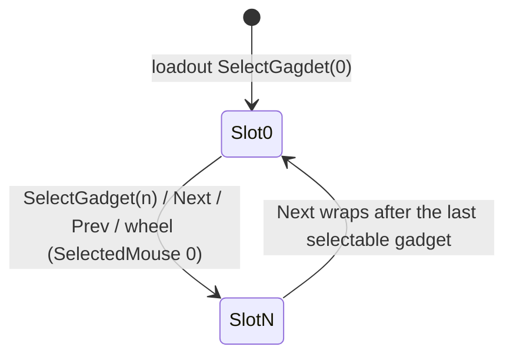

# Gadget inventory and selection

Units:
- uc:SBase.SGadget:GiveTo, uc:SBase.SGadget:PostNetBeginPlay, uc:SBase.SGadget:Destroyed, uc:SBase.SGadget:Load, uc:SBase.SGadget:Unload,
  uc:SBase.SGadget:Use, uc:SBase.SGadget:QuickUse, uc:SBase.SGadget:FullReload, uc:SBase.SGadget:LocalMessage,
  uc:SBase.SGadget:AddChargeOnClientFromServer, uc:SBase.SGadget:BroadcastTeamLocalizedMessageToServer, def:SBase.SGadget
- nat:SBase.SGadget.CanUse, nat:SBase.SGadget.SelectNext, nat:SBase.SGadget.SelectNextPadUp, nat:SBase.SGadget.DecCharge,
  nat:SBase.SGadget.ServerDecCharge, nat:SBase.SGadget.AddCharge, nat:SBase.SGadget.ServerAddCharge, nat:SBase.SGadget.GetUniqueIDByClass,
  nat:SBase.SBasePawn.FindGadgetType
- uc:SBase.SBasePawn:AddGadget, uc:SBase.SBasePawn:DeleteGadget, uc:SBase.SBasePawn:DeleteAllInventory, uc:SBase.SBasePawn:DeleteWeapon,
  uc:SBase.SBasePawn:NextGadget, uc:SBase.SBasePawn:PrevGadget, uc:SBase.SBasePawn:SelectGagdet, uc:SBase.SBasePawn:GetFirstGagdet,
  uc:SBase.SBasePawn:PadUpGadgetSwitch, uc:SBase.SBasePawn:Destroyed (inventory part)
- uc:SBase.SPlayerController:SelectGadget, uc:SBase.SPlayerController:WheelUp, uc:SBase.SPlayerController:WheelDown,
  uc:SBase.SPlayerController:GadgetQuickChoice, uc:SBase.SPlayerController:AltFire (non-grenade branches),
  uc:SBase.SPlayerController:PlayerTick (gadget cycling and AltFire release parts)
- rep:Engine.Inventory.Charge, rep:SBase.SBasePawn.MyGadget, rep:SBase.SBasePawn.MyWeapon, rep:SBase.SGadget.MyGadget,
  rep:SBase.SGadget.IsAPadUpGadget, rep:SBase.STeamInfo.iNBGadgets

## Purpose
Each pawn owns a weapon and a linked list of gadgets. One gadget is "selected" and used with the secondary fire
button; two "pad-up" gadgets (merc torch and laser) are toggled by their own keys and never selected. This spec
defines the list, the selection keys and the generic use path.

## Data
| Field | Owner | Default | Notes |
|---|---|---|---|
| MyGadget | SBasePawn | None | head of the list; replicated to the owner |
| MyGadget | SGadget | None | next link; replicated to the owner |
| SelectedGadget | SBasePawn | None | `travel`, not replicated |
| PadUpGadget | SBasePawn | None | used by the generic (spy) pad-up switch only |
| MyWeapon | SBasePawn | None | replicated to the owner |
| replicateGadgets | SBasePawn | false | set by AddGadget |
| bActivatable | SGadget | false | selectable gadgets set true |
| IsAPadUpGadget | SGadget (const) | false | torch and laser true |
| LastUsed / RefireRate | SGadget | 0 / per class | |
| Charge | Inventory (config) | 1 | -10 means unlimited (cloak, gas mask, cam network, heartbeat) |
| CanQuickLaunch | Inventory (const) | false | |
| iNBGadgets | STeamInfo | 4 | loadout slots per team, replicated |
| SelectedMouse | SPlayerProfile | 1 | 0: wheel selects gadgets; 1: wheel toggles walk/run |
| TimeChoiceGadget | SPlayerController | | repeat timer for the next/previous keys |
| bGadgetJustSelected / LastSwitchGadget | HUD | | HUD feedback, slot index 0..3 |

Gadget ids (SGadget consts): 1 chaff, 2 flare, 3 flash-bang, 4 frag, 5 phospho, 6 pressure, 7 smoke, 8 jammer,
9 mines, 10 multi mines, 11 noise emitter, 12 presence detector, 13 sticky cam, 14 spy bullet, 15 backpack,
16 gas mask, 17 multi presence detector, 18 cam network, 19 tazer.

## Rules
1. **Adding.** `SGadget.GiveTo(Pawn)`: instigator and owner = pawn, `AddGadget(self)`. `AddGadget` appends to the end
   of the list (refusing None and duplicates), sets the owner, clears the item's link, sets `replicateGadgets`.
   `SWeapon.GiveTo` sets instigator, owner and `Pawn.MyWeapon`.
2. **First selection.** `SGadget.PostNetBeginPlay` (each machine): if the owner pawn has no selected gadget and this
   one is `bActivatable` and not pad-up, select it. Tutorial maps set `Charge = -10`; an offline standalone game
   raises a charge in 1..998 to 999. The loadout code then selects slot 0 (`loadouts.md`).
3. **Selectable test** (used by PrevGadget, and assumed for the native `SelectNext`): `bActivatable &&
   !IsAPadUpGadget && !IsA('SGadBomb')`. `SelectNext()` returns the first selectable gadget from this one along the
   list (estimated native contract).
4. **SelectGadget(num)** (keys 1..4 send 0..3): ignore if `num < 0 || num > 3`, or in `s_FallDropAttacked`,
   `s_LyingOnGround`, `s_FallDown` or `s_StickyShock` (no such state exists in 4.0, so that test never triggers).
   Unload the current gadget; `SelectedGadget = MyGadget.SelectNext()`; call `NextGadget()` num times; `Load()` the
   result; flag the HUD if it changed; `LastSwitchGadget = num`. It does not check `iNBGadgets`.
   `SBasePawn.SelectGagdet(num)` (an event, used by code) does the same without the state checks and only if
   `num < iNBGadgets`.
5. **NextGadget()**: refused if dead or in `s_FallDropAttacked`, `s_LyingOnGround`, `s_FallDown`, `s_StickyShock`,
   `s_BasePutMineOnWall`. With nothing selected: select `MyGadget.SelectNext()` and stop. Else unload the current one
   and select `current.MyGadget.SelectNext()` (or wrap to `MyGadget.SelectNext()`), falling back to
   `MyGadget.SelectNext()` if that returns None; HUD flag; `LastSwitchGadget = (LastSwitchGadget + 1)` wrapped to 0
   after 3. It does not call `Load()`; callers do.
6. **PrevGadget()**: refused if no controller, dead, or in the same states. With nothing selected start from the head.
   Find the closest selectable gadget before the current one; if there is none, the last selectable gadget after it
   (wrap-around). Each scan is limited to 10 items. If found: unload, select, `Load()`, HUD flag,
   `LastSwitchGadget - 1` wrapped to 3 below 0.
7. **Cycling keys**: AliasNextItem / AliasPrevItem (keys 6 and 5, `Button BT_NextItem/BT_PrevItem`), polled in
   `PlayerTick`: when held, at least 0.2 s after the last change, the team has gadget slots and the player is not in
   the mine menu: next (`NextGadget` + `Load`) or previous (`PrevGadget`). Mouse wheel (`WheelUp` / `WheelDown`): with
   `SelectedMouse == 0` and slots, next + Load / previous; otherwise `bFastSpeed = true / false` (spy run toggle).
   The scope, sticky cam, mine menu and interaction menus override the wheel.
8. **Using the selected gadget** (exec `AltFire`, see `grenade-throw.md` Rule 1 for the guards): grenade launchers
   start a charged throw; the taser fires only if the weapon is in `s_Selected`; a spy's bomb goes through
   `CanUse` and `ServerPlaceBomb` (with seven failure messages); any other gadget: if `CheckIfCanFire()`,
   `SelectedGadget.Use(1.0)`. If a non-grenade gadget is selected while a throw charge is pending, releasing the
   button calls `AltFire()` again (so switching gadgets during a charge uses the new one).
9. **Quick choice** (left and right mouse also send `GadgetQuickChoice 0/1`): does nothing globally and in the weapon,
   interaction and many traversal states; in the spy's unarmed walking states it selects slot i and quick-launches a
   grenade or toggles the cloak (`grenade-throw.md` Rule 5).
10. **Pad-up gadgets** for mercs are switched by `SPAWNDEFENSE.PadUpGadgetSwitch` (`merc-flashlight.md`,
    `merc-laser.md`). The generic `SBasePawn.PadUpGadgetSwitch` (spies) keeps `PadUpGadget`: same class again ->
    unload and clear; another class -> unload, find, `Load`, `Use(0)`; blocked when scoped with the laser class, when
    interacting, or for the torch class when a vision mode is on.
11. **Charges** are server-owned: `Inventory.Charge` replicates to the owner; natives `DecCharge` /
    `ServerDecCharge` / `AddCharge` / `ServerAddCharge` change it (server RPCs when called on a client);
    `AddChargeOnClientFromServer` lets the server mirror a refill on the client. `FullReload` (gadget) resets
    `Charge` to the class default.
12. **Removal**: `DeleteGadget` unlinks (clearing the selection if it was selected), clears the owner and destroys it;
    `DeleteAllInventory` deletes up to 16 gadgets, the weapon and, for a merc, the third-person weapon dummy.
    `SGadget.Destroyed` removes itself from the owner's list. A pawn's `Destroyed` deletes all inventory.
13. **Every tick** `PlayerTick` clears the HUD gadget-choice flag and `bIsInInventoryMode`, so the inventory mode
    referenced by many guards is never active in 4.0.

## States
No states; the selection is a cursor over the gadget list.

## Constants
| Name | Value | Unit | Provenance | Source |
|---|---|---|---|---|
| Slots | 4 | | decoded | def STeamInfo.iNBGadgets |
| Cycling repeat | 0.2 | s | decoded | PlayerTick |
| HUD slot index range | 0..3 | | decoded | NextGadget, PrevGadget |
| Scan limit | 10 | items | decoded | PrevGadget |
| Delete limit | 16 | items | decoded | DeleteAllInventory |
| Offline charge | 999 | | decoded | SGadget.PostNetBeginPlay |

## Network
- The list (`MyGadget` links), the weapon and `Charge` replicate to the owning client only. `SelectedGadget` is local
  (each machine chooses its own; the server never needs it because gadget actions arrive as RPCs on the gadget
  actors themselves, for example `ThrowGren`).
- `DeleteAllInventory`, `DeleteGadget`, `DeleteWeapon`, `ServerSpawnInventory`, `ServerSpawnWeapon` are
  client -> server RPCs in the SBasePawn replication block.

## Edge cases
- Keys 1..4 work even when the team has fewer slots, unlike the code path `SelectGagdet`.
- With the default profile (`SelectedMouse = 1`) the wheel never changes gadgets; only keys 1..6.
- A selected gadget may have 0 charges; `CanUse` and the empty click handle it.
- Pad-up gadgets and the bomb are skipped by Next and Prev, but `SelectNext` is native and should be checked for the
  same filter.

## Evidence
- local/re-out/uc/SBase/SGadget.uc, SBasePawn.uc 3178-3720, SPlayerController.uc 2032-2063, 2065-2143, 3510-3527,
  3705-3749, 9818-9848; Engine/Inventory.uc; STeamInfo.uc.
- local/reflect/game.json natives: CanUse 0x10a9f9c0 (1288), SelectNext 0x10a9f970 (1289), SelectNextPadUp
  0x10a9f930 (1290), DecCharge 0x10a9fa30, ServerDecCharge 0x10a9fab0, AddCharge 0x10a9faf0, ServerAddCharge
  0x10a9fb70, GetUniqueIDByClass 0x10aa28a0, FindGadgetType 0x10ae4120.
- System/Default_kbd_0.ini (keys), DefaultProfile.ini (`SelectedMouse=1`).

## Open questions
- Decode SelectNext, SelectNextPadUp, CanUse, DecCharge (when the client decrements, when the server does,
  RefireRate and LastUsed handling).
- Whether a gadget with 0 charges stays selectable or is removed (observe after throwing the last smoke grenade).
