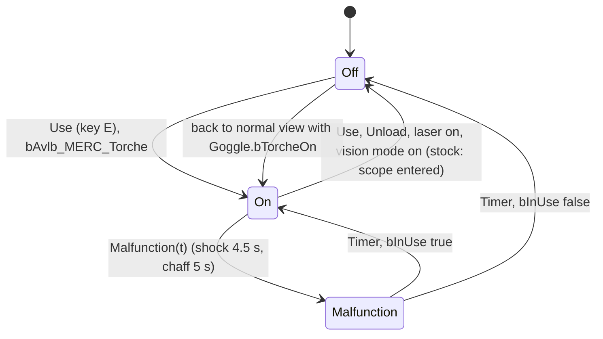

# Merc flashlight (SGadTorche)

Units:
- uc:SBase.SGadTorche:Use, uc:SBase.SGadTorche:TorcheON, uc:SBase.SGadTorche:TorcheOFF, uc:SBase.SGadTorche:Unload,
  uc:SBase.SGadTorche:Malfunction, uc:SBase.SGadTorche:Tick, uc:SBase.SGadTorche:PostNetBeginPlay, uc:SBase.SGadTorche:Destroyed,
  uc:SBase.SGadTorche:s_Malfunction.Tick, uc:SBase.SGadTorche:s_Malfunction.Timer
- uc:SBase.SPAWNDEFENSE:PadUpGadgetSwitch, uc:SBase.SPAWNDEFENSE:AddDefaultGadgets, uc:SBase.SPAWNDEFENSE:PostNetBeginPlay,
  uc:SBase.SPAWNDEFENSE:Destroyed
- uc:SBase.SPlayerController:GadTorcheSwitch
- uc:SBase.SGoggle:GoggleUp.SwitchGoggle, uc:SBase.SGoggle:GoggleDown.SwitchGoggle (torch hand-off only)
- rl:fix.flashlight_sniper, rl:SBase.SGadTorche.NativeTickTorche (rule 12)
- nat:SBase.SGadTorche.NativeTickTorche (the chaff torch malfunction comes from the SProjChaffe C++ Explode override, game 0x10abe640 /
  ChaffExplodeEffect 0x10abe6d0, which has no UFunction id of its own)
- rep:SBase.SGadTorche.bInUse, rep:SBase.SPAWNDEFENSE.Torche, rep:Engine.Actor.LightType
- def:SBase.SGadTorche

## Purpose
The merc's head torch: a toggled spot light that other players see, mutually exclusive with the laser sight and
with the goggle vision modes, knocked into a flicker by a sticky shock or a chaff burst.

## Data
def:SBase.SGadTorche (exact; ItemName is localized to "Flashlight"):

| Field | Default | Notes |
|---|---|---|
| bInUse | false | replicated, reliable, Role == Authority |
| IsAPadUpGadget / bActivatable | true / true | never in the gadget wheel (inventory spec) |
| Charge | 1 | not consumed |
| LightType | LT_None | LT_Steady while on |
| LightEffect | LE_ESpotShadow (22) | shadowed spot |
| LightBrightness / LightRadius | 304 / 32 | |
| LightHue / LightSaturation | 21 / 255 | |
| LightCone | 28 | |
| EchelonRange | 1500 uu | light range |
| SpotWidth / SpotHeight | 400 / 400 | spot size |
| NearPlaneRatio / EchelonBias | 0.0025 / 0.00018 | |
| EchelonLightMaterial | Echelon.Lighting.Torche | light cookie |
| UsesLightBeam | false | true while on |
| LightBeamMesh / LightBeamFalloffScale / LightBeamInitialAlpha | TestMapStaticM.Accessories.LightBeam / 0.4 / 1 | volumetric beam |
| Skins[0] | sfx.Flare.def_flare | corona |
| WantedNormalInfluence | 0.0 | copied to EchelonNormalInfluence at PostNetBeginPlay |
| Flags | bDynamicLight, bDirectional, bCoronaUsesOrientation, bOwnerNoSee, bReplicateInstigator; bHidden, bOnlyOwnerSee, bOnlyRelevantToOwner all false | |
| SndUse | Armes_impacts.Gadgets.Torche_inOut | |
| TextTorcheOn / TextTorcheOff | "Torchlight on" / "Torchlight off" | 2 s auxiliary HUD messages |

Other inputs: `GameReplicationInfo.bAvlb_MERC_Torche` (server setting), `SGoggle.CurrentMode`, `SGoggle.bTorcheOn`,
`SPAWNDEFENSE.TorcheLaser.bInUse`, weapon state, `iDontUpdatePadInput`, `bStickyShocking`.

## Rules
1. **Creation.** `SGameInfo.AddDefaultInventory` calls `SPAWNDEFENSE.AddDefaultGadgets` right after the pawn
   spawns: spawn SGadTorche and SGadTorcheLaser at the pawn and `GiveTo` (owner and instigator = pawn, added to the
   gadget chain). `SPAWNDEFENSE.Torche` / `TorcheLaser` are replicated (Role == Authority). On clients
   `PostNetBeginPlay` re-points their `Instigator` at the pawn. SPawnAttaque spawns no torch.
2. **Key** (E: alias `FireMode | GadTorcheSwitch`): `GadTorcheSwitch` acts only if `iDontUpdatePadInput == 0`,
   not `bStickyShocking`, and the weapon is not in `s_ElbowShocking`, `s_Reloading`, `s_FullReloading` or
   `s_FireGrenade`; then `SBPawn.PadUpGadgetSwitch(class SGadTorche)`. States that override it with no action or a
   different action: `s_Binoculars_Def` (ignored), `s_InteractWithObject`, `s_UseObject_Mirador`,
   `s_UseObject_CamNetwork`, `s_GrabbedFromLedge_Begin`, `GameEnded`, `s_BaseSpectating` (see INDEX.md).
3. **SPAWNDEFENSE.PadUpGadgetSwitch(Torche)** (runs where it is called, the owning client):
   1. Blocking case if any of: the Projo interaction is in use, the controller is in `s_InteractWithObject`, or
      `Goggle.CurrentMode != 5` (a vision mode is on). (A fourth clause, scope plus laser class, does not apply to
      the torch.) Then: if the vision mode is 37 (motion) or 38 (EMF): `Torche.Use(0)` (toggle, so it turns on),
      `Goggle.bTorcheOn = false`, `Goggle.ResetVisionMode()` and stop. Otherwise unload torch and laser and stop.
   2. Normal case: `TorcheLaser.Unload()`, `Torche.Load()` (empty), `Torche.Use(0)`.
4. **Use(Value)** (toggle): return if `!bAvlb_MERC_Torche`. If `bInUse`: message off, `TorcheOFF()`, `bInUse = false`;
   else message on, `TorcheON()`, `bInUse = true`. The local `bInUse` write is immediate; the server value follows.
5. **TorcheON** (client -> server reliable RPC): if the laser is in use, `TorcheLaser.TorcheOFF()`;
   `LightType = LT_Steady`, `UsesLightBeam = true`, owner hears SndUse, `bInUse = true`.
   **TorcheOFF** (RPC): return if `!bInUse`; `LightType = LT_None`, `UsesLightBeam = false`, sound, `bInUse = false`.
6. **Unload()**: message off if on, `TorcheOFF()`, `bInUse = false`. Called on goggle mode entry, scope entry
   (`merc-scope.md` Rule 2; Reloaded relights it, rule 12), laser selection and the blocking case.
7. **Tick**: `NativeTickTorche()` every tick on every machine (native 1300, decoded game 0x10ab6eb0; Reloaded wraps it
   at rva 0x23df0 and calls the stock body, forcing `bInUse` on for the call when one of its settings is set). It sets
   the instigator's `bIgnoreOwnEchelonLights` (a merc is never lit by his own torch). Off (or no instigator):
   `LightType = LT_None`, no corona, the torch parked on the pawn's `Laser` bone. On: `LightType = LT_Steady`, a
   corona except on the owner's own screen; placed on the pawn's `Laser` bone and turned, when `IK_Type` is
   `IKT_NONE`, along that bone, else with pitch = the high word of `iDesiredYawPitch` and
   yaw = `d - int(-0.3 * w(bodyYaw - d))`, d its low word and w the wrap to -32768..32767 (the light leans 30 % of the
   way from the desired aim toward the body). In the camera network it sits at the camera `+ 20 X - 11 Y + 11 Z` and
   points along the camera. `Destroyed` clears LightType and Instigator. The pawn's `Destroyed` destroys both torch
   actors.
8. **Malfunction(Time)** (client -> server reliable RPC; runs locally when called on the server): enter
   `s_Malfunction` and `SetTimer(Time, false)`. In that state each tick, if `bInUse`, the light is on with chance
   1/3 (`Rand(3) == 0`: LT_Steady and beam) and off otherwise, then the native tick runs, which sets LightType from
   `bInUse` again in the same tick: in the stock code a malfunctioning torch that is on stays lit on screen. `Timer` restores on or off
   from `bInUse` and leaves the state. `bInUse` is not changed, so pressing the key during a malfunction still
   toggles the stored state.
9. **Malfunction sources**: a sticky shock on the merc (`Malfunction(freeze + Shock_Duration)` = 4.5 s dry,
   5.55 s wet; `sticky-shock-effect.md`) and a chaff explosion: torches whose owner is within 300 uu plus collision
   radius get `Malfunction(GadTorcheDisableTime = 5)` (native ChaffExplodeEffect 0x10abe6d0, prior decode).
10. **Vision hand-off** (`vision-goggles.md`): switching to any vision mode while the torch is on sets
    `Goggle.bTorcheOn = true` and unloads the torch; returning to normal view turns it back on with `Use(0)` if
    `bTorcheOn` and neither torch nor laser is on. The torch and the vision modes are never on together.
11. **Laser exclusivity**: turning the laser on turns the torch off (server side in `TorcheLaser.TorcheON` and client
    side in `PadUpGadgetSwitch`), and vice versa.
12. **The torch in the scope (Reloaded, Enhanced builds; rl:fix.flashlight_sniper).** Reloaded.Core keeps a table of
    state entry hooks for the local player's controller; on entering `s_Binoculars_Def` (and only when the game's
    version string is the Enhanced build's) its handler runs before the script's BeginState. For the local pawn,
    a merc: once, it saves the torch's `TextTorcheOn` and `TextTorcheOff` lengths and its `SndUse` volume; it
    remembers whether `Torche.bInUse` is set and, when it is, blanks both texts and silences the sound. BeginState
    then unloads the torch as in the stock game (rule 6), silently. On the next frame Reloaded's frame routine calls
    `TorcheON()` (the server RPC, rule 5) and sets `bInUse` locally, and the frame after that it puts the texts and
    the volume back. Between the two, its NativeTickTorche wrapper sets `bInUse` for the duration of the native tick
    (rule 7), so the local light is not dropped for that frame. Result: the torch stays on in the scope, and stays on
    when the scope ends (its EndState does not touch the torch). The rewrite leaves the torch on at scope entry
    (no unload), which is the same for the owner; other players miss Reloaded's one-frame off and on and its two
    switch sounds.

## States

## Constants
| Name | Value | Unit | Provenance | Source |
|---|---|---|---|---|
| Range | 1500 | uu | decoded | def EchelonRange |
| Cone | 28 | UE2 LightCone byte | decoded | def |
| Brightness / radius | 304 / 32 | UE2 light units | decoded | def |
| Hue / saturation | 21 / 255 | byte | decoded | def |
| Spot size | 400 x 400 | uu | decoded | def SpotWidth/Height |
| Flicker on-chance | 1/3 per tick | | decoded | s_Malfunction.Tick |
| Chaff disable | 5 s within 300 uu + radius | s, uu | decoded (prior, native) | SProjChaffe GadTorcheDisableTime, ChaffExplodeEffect 0x10abe6d0 |
| Shock disable | freeze + 1.0 (4.5 s, 5.55 s wet) | s | decoded | ClientStickyShock |
| HUD messages | 2 | s | decoded | Use |

## Network
- Owning client: key handling, `PadUpGadgetSwitch`, `Use`, the local `bInUse` write, goggle hand-off.
- Server: `TorcheON`, `TorcheOFF`, `Malfunction` (all `reliable if Role < ROLE_Authority`), LightType and beam.
- Replicated: `bInUse` (reliable, Role == Authority) and `Actor.LightType` (Net flag in reflection). SGadTorche is a
  `nativereplication` class, so the real property list comes from native code (Open questions). The torch is not
  `bOnlyRelevantToOwner`, so spies see its light; `bOwnerNoSee` hides the actor itself from the merc.
- `AddDefaultGadgets` is declared `reliable if (Role == Authority && bNetOwner)`. It is called on a pawn that has
  just been spawned and never replicated, so the condition evaluates false and it runs on the server, which is why
  the torch is a server actor replicated to everyone. The rewrite should simply create both on the server.

## Edge cases
- In motion or EMF vision the torch key leaves the vision mode and turns the torch on in one press.
- In night/thermal (spy only) or other non-5 modes the key just unloads torch and laser.
- Stock: entering the scope turns the torch off and the scope does not restore it. Enhanced with Reloaded: it stays on
  (rule 12).
- `bAvlb_MERC_Torche` false makes the key do nothing (and the vision hand-off cannot turn it on).
- A malfunction that ends while the torch is stored off leaves it off even if it was on when the malfunction began
  and was toggled during it.

## Evidence
- local/re-out/uc/SBase/SGadTorche.uc, SPAWNDEFENSE.uc, SGoggle.uc, SPlayerController.uc 3660 (GadTorcheSwitch),
  3931-4000 (ClientStickyShock), SProjChaffe.uc.
- Reloaded.Core v4.0d: state entry hook table built at 0x10017d70 (s_Binoculars_Def -> 0x10017c00, gated by the
  version check 0x100112c0), frame routine 0x100a74d0 (TorcheON by name, then the restore a frame later), the
  NativeTickTorche wrapper 0x10023df0 (switch byte 0x1036ab94). SGadTorche offsets: bInUse +0x354, SndUse +0x358,
  TextTorcheOn +0x35c, TextTorcheOff +0x368.
- local/reflect/game.json: SGadTorche.NativeTickTorche points into Reloaded.Core.dll at 0x64773df0 (rva 0x23df0,
  native 1300); stock natives_all.txt lists the same native with a pointer outside the game image (another Reloaded
  load address). bInUse Net rep 13, LightType Net rep 1148.
- local/reflect/game_cdo.json SBase.SGadTorche; Bridge docs/GADGET_TIMINGS.md rows "Chaff on devices", "Torch malfunction".

## Open questions
- NativeTickTorche is replaced by Reloaded.Core.dll (rva 0x23df0): decoded, a wrapper of the stock body that forces
  `bInUse` for one call while its scope switch is set (rule 12). How `UsesLightBeam` is drawn is still open.
- Native replication list of SGadTorche (does LightType or only bInUse reach other clients during a malfunction?).
  Trace: shock a merc whose torch is on and record the torch LightType on a third client.
- Exact chaff radius rule for torches (owner location or torch location; 3D or 2D).
