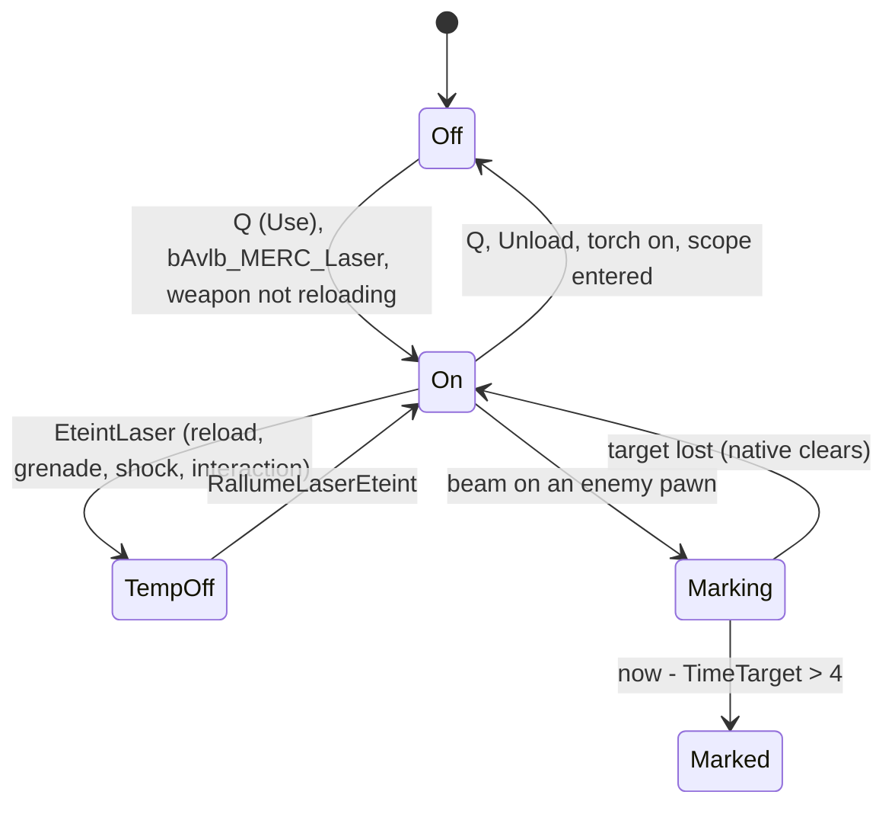

# Merc laser sight and spy marking (SGadTorcheLaser)

Units:
- uc:SBase.SGadTorcheLaser:Use, uc:SBase.SGadTorcheLaser:EventUse, uc:SBase.SGadTorcheLaser:TorcheON, uc:SBase.SGadTorcheLaser:TorcheOFF,
  uc:SBase.SGadTorcheLaser:Unload, uc:SBase.SGadTorcheLaser:Tick, uc:SBase.SGadTorcheLaser:ThrowSpyBullet, uc:SBase.SGadTorcheLaser:Destroyed
- uc:SBase.SPAWNDEFENSE:LaserON, uc:SBase.SPAWNDEFENSE:LaserOFF, uc:SBase.SPAWNDEFENSE:PadUpGadgetSwitch (laser branch)
- uc:SBase.SPlayerController:GadLaserSwitch, uc:SBase.SPlayerController:EteintLaser, uc:SBase.SPlayerController:RallumeLaserEteint
- uc:SBase.SBasePawn:HitBySpyBullet, uc:SBase.SBasePawn:ServerHitBySpyBullet, uc:SBase.SBasePawn:Tick (spy mark expiry only)
- nat:SBase.SGadTorcheLaser.NativeTickTorcheLaser, nat:SBase.SGadTorcheLaser.NativeReplaceLaserLocal, nat:SBase.SGadTorcheLaser.NativeReplaceLaserDistant
- rep:SBase.SGadTorcheLaser.bInUse, rep:SBase.SPAWNDEFENSE.bLaserOn, rep:SBase.SBasePawn.bSpyBulletOn, rep:SBase.SBasePawn.iTeamSpying
- def:SBase.SGadTorcheLaser

## Purpose
The merc's toggled laser aiming beam. While on it hides the reticle, moves the bullet origin to the gun, and marks
a spy who stays in the beam for 4 s (radar mark and voice listening for 90 s).

## Data
def:SBase.SGadTorcheLaser (ItemName localized "Laser"):

| Field | Default | Notes |
|---|---|---|
| bInUse | false | replicated |
| TimeToMark | 4.0 s | |
| TimeTarget | 0 (int) | written by native: int(Level.TimeSeconds) at acquisition |
| TargetPawn | None | written by native |
| vOffsetCasque | (0, -2, 5) | |
| IsAPadUpGadget / bActivatable | true / true | |
| bAlwaysRelevant / bOnlyRelevantToOwner / bOnlyOwnerSee | true / false / false | |
| SndUse | Torche_inOut | |
| TextLaserOn / TextLaserOff | "Laser activated" / "Laser switched off" | 2 s messages |

`SPAWNDEFENSE.bLaserOn` (bool, replicated). `SBasePawn.TimeSpyBullet` = 90 s, `bSpyBulletOn`, `fTimeSpy`,
`iTeamSpying`, `bForceSpied`. Controller: `bLaserEtaitAllume` ("laser was on"), `bNoReticule`.

## Rules
1. **Key** (Q: alias `Roll | GadLaserSwitch`): `GadLaserSwitch` has the same guards as the torch key
   (`merc-flashlight.md` Rule 2). It sets `bNoReticule = true` only if `SBPawn.PadUpGadget` is set and is not the
   laser class, else false; mercs never set `PadUpGadget` (their override does not use it), so for mercs this
   always clears `bNoReticule`. Then `PadUpGadgetSwitch(class SGadTorcheLaser)`.
1a. **Laser key** (OpenSCCT addition): the key list's "Laser" row (`SwitchLaser`, L in the stock merc layout) only
   reaches the spy pistol in the original (`SWeaponAttaque(MyWeapon).ServerSwitchLaser`), so a merc pressing it got
   nothing while his laser sight sat on "Action 1". In the port a merc's `SwitchLaser` runs `GadLaserSwitch` (rule 1).
2. **PadUpGadgetSwitch(Laser)**: blocking case if scoped (`bBinocularVision`), the Projo interaction is in use, or in
   `s_InteractWithObject`: when the vision mode is 37 or 38, call `Goggle.ResetVisionMode()` and continue to step 3;
   otherwise unload torch and laser and stop. Step 3: if the weapon is not in `s_Reloading`: `Torche.Unload()`,
   `TorcheLaser.Load()` (empty), `TorcheLaser.Use(0)`.
3. **Use** (toggle): return if `!GameReplicationInfo.bAvlb_MERC_Laser`. If on: message off unless
   `bLaserEtaitAllume`, `TorcheOFF()`. Else: message on unless `bLaserEtaitAllume`, `TorcheON()`.
4. **TorcheON** (client -> server reliable): turn the torch off if it is on; owner hears SndUse;
   `SPAWNDEFENSE.LaserON()` (`bLaserOn = true`); `bInUse = true`. **TorcheOFF**: sound, `LaserOFF()`, `bInUse = false`.
   **Unload**: message if on, `TorcheOFF()`.
5. **Temporary off** (`EteintLaser`, used by reload, full reload, grenade throw, electric shock, interactions, mine
   placement, elbow attack): only for a merc on the machine that controls him (`RemoteRole != AutonomousProxy`):
   if the laser is on, `bLaserEtaitAllume = true` and `Use(1)` (off, message suppressed).
   **Restore** (`RallumeLaserEteint`): if `bLaserEtaitAllume`: `bNoReticule = true`, `Use(1)` (on, message
   suppressed), `bLaserEtaitAllume = false`.
6. **Effect on shots**: while the server's `SPAWNDEFENSE.bLaserOn`, `GetFireStart` is the weapon `FX` bone minus
   50 uu along its X axis, so the bullet ray starts at the gun instead of the eye and distance damage is measured
   from there (`merc-rifle.md` Rule 10.6). The aim direction is unchanged.
7. **HUD**: the merc reticle page hides the reticle while the laser is on (native HUD rule, prior decode), and
   `bNoReticule` is forced true when the laser is restored.
8. **Tick** (not on a dedicated server): `NativeTickTorcheLaser(dt)` (spawns and shows the beam and corona while
   `bInUse` and the weapon is drawn, `WeaponLoaded == 2`; prior decode). If on and a beam exists:
   - on the merc's own machine (controller is the local player): if `TimeTarget != 0`, `TargetPawn` is alive, of the
     other pawn type, and `now - TimeTarget > TimeToMark`, call `ThrowSpyBullet(TargetPawn)`; return (the local beam is
     placed by `NativeReplaceLaserLocal` from the weapon tick);
   - elsewhere: `NativeReplaceLaserDistant()` (beam from the third-person gun, pitch from the replicated aim).
   If off: `TimeTarget = 0`, `TargetPawn = None`.
9. **Native beam** (NativeTickTorcheLaser 1299 decoded game 0x10a99cc0; placement and target decoded at 0x10a98e00,
   run by NativeReplaceLaserLocal 1297). With no instigator the beam and corona are destroyed. While `bInUse` the
   tick spawns one `SLaserBeam` (mesh SGameplayObjects.Objects.LaserBeam, drawn in normal vision too) and one
   `SCoronaLight`; while `bInUse` and the merc's `WeaponLoaded == 2` the beam is shown and hums (its `LaserSound`,
   volume 64, radius 24), and the corona shows only where the merc's controller is an autonomous proxy (so never on
   the merc's own screen); otherwise both are hidden and silent. Placement and target: the beam starts at the rifle's
   `FX` bone pulled back 50 uu along the bone's X axis and runs toward `pawn.Location + 15000 * X + (0, 0, 55.5)`
   (48.29 when crouched), X the bone's direction; while the merc uses the camera network (`bUsingCamNetwork` with an
   `SCamNetwork` as `UsedObject`) it starts at the camera `+ 20 X - 11 Y + 11 Z` of the camera's rotation and runs
   15000 uu along its view. A multi-line trace skips actors bullets pass (`bBulletGoTru`); the first other hit
   decides: a living `SBasePawn` (`Health >= 1`) becomes `TargetPawn`, with `TimeTarget = int(Level.TimeSeconds)`
   stamped only when the target changes; anything else (or nothing) clears both. The beam is moved to its start,
   turned toward the end and stretched (`DrawScale3D = length * (1,0,0) + 1`). Because the stamp is truncated, the
   mark fires after 3.0 to 4.0 s of continuous aim (`now > int(t0) + 4`). The team test is the script tick's
   (rule 8): the trace itself takes any living pawn.
9a. **Where the beam starts** (sandbox capture 2026-10-25, local/lasers/capture.py --side merc: the SteeE lane, the
   laser switched on by writing `bInUse` and `SPAWNDEFENSE.bLaserOn` as TorcheON does on the server, aimed at pitches
   -4639 to +2572 standing and crouched; the SLaserBeam read every 5 frames). The local merc's beam starts 15.4
   forward, 12.0 right and 12.5 to 12.7 under his eye along `MyDesiredRotation` (within 0.5 uu at every aim and
   stance), so the aimed rifle's `FX` bone is 65.4 forward, 11.1 right and 13.0 under the eye; its X axis (the beam's
   Rotation) is 82 to 98 units under and 185 to 205 units left of the aim. The beam is drawn thin: an additive band
   (LaserBeamShader) whose first 50 uu lie inside the rifle, which the weapon overlay draws over the world. The
   port's simulation places the aimed rifle's `FX` bone there (CombatNatives.MercAimFxCoords: laser, muzzle
   clearance, tracers and the laser's fire start of rule 6); the view draws the local beam from the first-person
   rifle's `FX` bone pulled back 50 uu (within 1 uu of the original's start), the whole mesh drawn and hidden where
   the first-person arms and rifle mark the stencil (the model here is drawn in the world, not as an overlay; the
   bone sits ahead of the drawn barrel, so a mesh started there floated in front of the gun). Other mercs' beams
   (and bots') start at the `FX` bone of the M160 drawn in their right hand (SWeaponDefenseDummy on `B R Hand`).
   The SWeaponDefense actor itself sits at the eye with the aim's rotation (hidden: drawn as the view model).
10. **ThrowSpyBullet(Target)** (client -> server reliable): if `Target.Health > 0`: `Target.HitBySpyBullet(1)` and
    broadcast SGameMessages 60 to team 1 (mercs).
11. **HitBySpyBullet(Team)** (server): `bSpyBulletOn = true`, `fTimeSpy = now`, `iTeamSpying = Team`; every controller
    of the other pawn type gets `bCanListenSpyBulletedGuy = true` and, if it is holding the hack-comm key
    (`bSpecialsChat`), starts hearing the target (`HackCommHear`); `SetEMF()` (the spy shows in EMF vision).
12. **Expiry** (SBasePawn.Tick, server): when `fTimeSpy != 0`, not `bForceSpied`, and `now - fTimeSpy > 90`: clear the
    mark, recount marked pawns of the same team, clear listening for the other side if none is left, tell the
    controller `OtherTeamCantHearMe`, and send message 14 when the marked pawn is a merc. Owned with the radar spec.

## States

## Constants
| Name | Value | Unit | Provenance | Source |
|---|---|---|---|---|
| Mark time | 4 (effective 3..4 after truncation) | s | decoded | def TimeToMark, Tick |
| Mark duration | 90 | s | decoded | def SBasePawn.TimeSpyBullet |
| Beam range | 15000 | uu | decoded (prior) | Bridge out/_effects/laser/SPEC.md |
| Fire start pull-back | 50 | uu | decoded | SWeaponDefense.GetFireStart |
| Aimed rifle FX bone from the eye | 65.4 forward, 11.1 right, 13.0 down; X axis 95 units down, 190 left of the aim | uu, units | measured | rule 9a |
| Message id on mark | SGameMessages 60, team 1 | | decoded | ThrowSpyBullet |

## Network
- Owning client: key, `Use`, `EteintLaser`/`RallumeLaserEteint`, marking decision (`ThrowSpyBullet` is sent by the
  merc's client, so marking is client-decided).
- Server: `TorcheON`, `TorcheOFF`, `ThrowSpyBullet` (reliable `Role < ROLE_Authority`), `HitBySpyBullet`, expiry.
- Replicated: `bInUse`, `SPAWNDEFENSE.bLaserOn`, `bSpyBulletOn`, `iTeamSpying`. The beam actors are local to each
  client. The laser actor is always relevant.

## Edge cases
- The marking test runs every tick after the threshold; nothing in script stops it, so while the beam stays on the
  spy the client re-sends `ThrowSpyBullet` each tick and the server re-marks and re-broadcasts (Open questions).
- Re-marking resets `fTimeSpy`, so a held beam keeps the mark alive.
- The beam only shows with the weapon drawn (`WeaponLoaded == 2`); with it holstered the laser stays logically on.
- The key is refused in both reload states, grenade throw and elbow states (Rule 1 guards); the extra
  `s_Reloading` test in Rule 2 only matters when `PadUpGadgetSwitch` is called from elsewhere (scope exit).

## Evidence
- local/re-out/uc/SBase/SGadTorcheLaser.uc, SPAWNDEFENSE.uc, SPlayerController.uc 1373-1393 and 3668-3683,
  SBasePawn.uc 1430-1460 and 1611-1635.
- local/reflect/game.json: NativeTickTorcheLaser 0x10a99cc0 (1299), NativeReplaceLaserLocal 0x10a98de0 (1297),
  NativeReplaceLaserDistant 0x10a99430 (1298).
- Bridge out/_effects/laser/SPEC.md (native beam decode), docs/overlays/reticle.md (reticle hidden by laser).

## Open questions
- The "mark" seen by the players (Ryan asked): the mark is `HitBySpyBullet` on the server: the spy shows as an enemy
  blip on the mercs' radar, becomes EMF-visible, and the mercs can listen to him for 90 s (rules 10 to 12). There is
  no light or outline on the spy in normal vision.

### Resolved
- Where the local beam starts and where the aimed rifle's `FX` bone is: rule 9a (measured).
- The third-person gun's FX bone (the distant beam's start): the drawn M160 on `B R Hand` carries it (rule 9a).
- When the native sets and clears `TimeTarget`, and which actors stop the beam: rule 9 (decoded game 0x10a98e00).
- Other players' beams (NativeReplaceLaserDistant, decoded game 0x10a99430): from the third-person gun's `FX` bone
  along the signed words of `iDesiredYawPitch` (the bone's direction while `IK_Type == IKT_NONE`), toward
  `Location + (0, 0, 55.5)` (48.0 crouched) `+ 15000 * dir`, cut at the first hit of a line with flags 0xC00BF, else
  15000 uu long; the corona is shown, sitting at the beam's start and turned along it.
