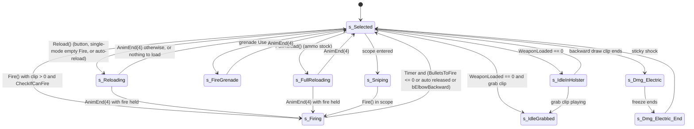

# Merc rifle (SWeaponDefense, "FN2000 Auto")

Units:
- uc:SBase.SWeaponDefense:Fire, uc:SBase.SWeaponDefense:FireWeapon, uc:SBase.SWeaponDefense:ServerSetAccurateRotation,
  uc:SBase.SWeaponDefense:ServerFireWeapon, uc:SBase.SWeaponDefense:TraceFire, uc:SBase.SWeaponDefense:ApplyWeaponJump,
  uc:SBase.SWeaponDefense:GetNbBulletsFromROF, uc:SBase.SWeaponDefense:ServerSetROF, uc:SBase.SWeaponDefense:SwitchROF,
  uc:SBase.SWeaponDefense:ROF_Single, uc:SBase.SWeaponDefense:PreviousMode, uc:SBase.SWeaponDefense:GetROFName,
  uc:SBase.SWeaponDefense:Reload, uc:SBase.SWeaponDefense:FullReload, uc:SBase.SWeaponDefense:GetFireStart,
  uc:SBase.SWeaponDefense:ServerSound, uc:SBase.SWeaponDefense:PostBeginPlay, uc:SBase.SWeaponDefense:Tick,
  uc:SBase.SWeaponDefense:SpawnSFX, uc:SBase.SWeaponDefense:CreateSmoke2, uc:SBase.SWeaponDefense:LocalMessage,
  uc:SBase.SWeaponDefense:EventLocalMessage, uc:SBase.SWeaponDefense:RenderAsFirstPerson
- uc:SBase.SWeaponDefense:s_Firing.BeginState, uc:SBase.SWeaponDefense:s_Firing.Timer, uc:SBase.SWeaponDefense:s_Firing.EndState,
  uc:SBase.SWeaponDefense:s_Firing.AnimEnd, uc:SBase.SWeaponDefense:s_Firing.SwitchROF, uc:SBase.SWeaponDefense:s_Firing.AnimateDraw,
  uc:SBase.SWeaponDefense:s_Firing.AnimateUnDraw, uc:SBase.SWeaponDefense:s_Firing.AnimateUnDraw_GRAB
- uc:SBase.SWeaponDefense:s_Selected.BeginState, uc:SBase.SWeaponDefense:s_Selected.Tick, uc:SBase.SWeaponDefense:s_Selected.SwitchROF,
  uc:SBase.SWeaponDefense:s_Selected.EndState, uc:SBase.SWeaponDefense:s_Selected.AnimEnd
- uc:SBase.SWeaponDefense:s_Reloading.BeginState, uc:SBase.SWeaponDefense:s_Reloading.AnimEnd, uc:SBase.SWeaponDefense:s_Reloading.EndState,
  uc:SBase.SWeaponDefense:s_FullReloading.BeginState, uc:SBase.SWeaponDefense:s_FullReloading.AnimEnd,
  uc:SBase.SWeaponDefense:s_FireGrenade.BeginState, uc:SBase.SWeaponDefense:s_FireGrenade.AnimEnd
- uc:SBase.SWeaponDefense:s_IdleInHolster.BeginState, uc:SBase.SWeaponDefense:s_IdleInHolster.Tick, uc:SBase.SWeaponDefense:s_IdleInHolster.AnimEnd,
  uc:SBase.SWeaponDefense:s_IdleInHolster.EndState, uc:SBase.SWeaponDefense:s_IdleGrabbed.Tick, uc:SBase.SWeaponDefense:s_IdleGrabbed.AnimEnd,
  uc:SBase.SWeaponDefense:s_IdleGrabbed.BeginState
- uc:SBase.SWeaponDefense:s_Dmg_Electric.BeginState, uc:SBase.SWeaponDefense:s_Dmg_Electric.EndState, uc:SBase.SWeaponDefense:s_Dmg_Electric_End.BeginState
- uc:SBase.SWeaponDefense:s_Interacting.BeginState, uc:SBase.SWeaponDefense:s_Interacting.AnimEnd,
  uc:SBase.SWeaponDefense:s_DropMine_Grab.BeginState, uc:SBase.SWeaponDefense:s_DropMine_Grab.AnimEnd,
  uc:SBase.SWeaponDefense:s_DropMine_Grab.AnimateUnDraw_GRAB, uc:SBase.SWeaponDefense:s_DropMine_UnGrab.BeginState,
  uc:SBase.SWeaponDefense:s_DropMine_UnGrab.AnimEnd, uc:SBase.SWeaponDefense:s_DropMine_UnGrab.AnimateUnDraw_GRAB,
  uc:SBase.SWeaponDefense:s_DropMine_Loop.BeginState, uc:SBase.SWeaponDefense:s_DropMine_Loop.AnimateUnDraw_GRAB,
  uc:SBase.SWeaponDefense:s_DropMine.BeginState, uc:SBase.SWeaponDefense:s_DropMine.AnimEnd,
  uc:SBase.SWeaponDefense:s_DropMine.AnimateUnDraw_GRAB, uc:SBase.SWeaponDefense:s_DropMine_Abort.BeginState,
  uc:SBase.SWeaponDefense:s_DropMine_Abort.AnimateUnDraw_GRAB
- uc:SBase.SWeaponDefense:AnimateDraw, uc:SBase.SWeaponDefense:AnimateUnDraw, uc:SBase.SWeaponDefense:AnimateUnDraw_GRAB,
  uc:SBase.SWeaponDefense:AnimateWaiting, uc:SBase.SWeaponDefense:AnimEnd, uc:SBase.SWeaponDefense:AnimateReanimate,
  uc:SBase.SWeaponDefense:AnimateJump, uc:SBase.SWeaponDefense:AnimateLand, uc:SBase.SWeaponDefense:AnimateLandHigh,
  uc:SBase.SWeaponDefense:AnimateFall, uc:SBase.SWeaponDefense:AnimateBlast, uc:SBase.SWeaponDefense:AnimatePain,
  uc:SBase.SWeaponDefense:DrawDispersionReticle, uc:SBase.SWeaponDefense:AltFire, uc:SBase.SWeaponDefense:SpawnFireTrace,
  uc:SBase.SWeaponDefense:CreateSmoke1, uc:SBase.SWeaponDefense:DisplayDebug
- uc:SBase.SPAWNDEFENSE:NotifyDrawUndrawWeapon, uc:SBase.SPAWNDEFENSE:NotifyUnDrawWeapon_GRAB, uc:SBase.SPAWNDEFENSE:NotifyDrawWeapon_GRAB,
  uc:SBase.SPAWNDEFENSE:EyePosition
- uc:SBase.SPlayerController:Fire, uc:SBase.SPlayerController:SwitchROF, uc:SBase.SPlayerController:CheckIfCanFire,
  uc:SBase.SPlayerController:Vibration_Tir, uc:SBase.SPlayerController:s_PlayerWalkingWeapon.PlayerMove (reload and ROF buttons only)
- uc:SBase.SWeapon:GiveTo, uc:SBase.SWeapon:PostNetBeginPlay, uc:SBase.SWeapon:SetEMFWeapon, uc:SBase.SWeapon:UnSetEMFWeapon,
  uc:SBase.SWeapon:Fire, uc:SBase.SWeapon:AltFire, uc:SBase.SWeapon:ServerFireWeapon, uc:SBase.SWeapon:Reload, uc:SBase.SWeapon:FullReload,
  uc:SBase.SWeapon:TraceFire, uc:SBase.SWeapon:ServerSound, uc:SBase.SWeapon:GetFireStart, uc:SBase.SWeapon:RenderHUD
- uc:SBase.SWeaponDefenseDummy:AddMuzzleCount, uc:SBase.SWeaponDefenseDummy:Tick, uc:SBase.SWeaponDefenseDummy:ClientFireMuzzle,
  uc:SBase.SWeaponDefenseDummy:PostNetBeginPlay
- uc:SBase.SFireTrace:PostNetBeginPlay
- nat:SBase.SWeaponDefense.GetAccuracy, nat:SBase.SWeaponDefense.NativeTickSWeaponDefense, nat:Engine.Actor.TraceBone
- rep:SBase.SWeapon.Controller, rep:SBase.SWeaponDefenseDummy.MuzzleCount, rep:SBase.SFireTrace.ImpactLoc
- def:SBase.SWeapon, def:SBase.SWeaponDefense, def:SBase.SWeaponDefenseDummy, def:SBase.SFireTrace

## Purpose
The mercenary's assault rifle: three rate-of-fire modes, a 25-round clip with a reserve, client-side recoil,
server-side hitscan with spread that grows with speed and burst length, distance-banded damage and random
tracers. The scope (sniper mode) is in `merc-scope.md`; the laser sight in `merc-laser.md`.

## Data
All values are exact class defaults (`classdefaults.json`, confirmed in the live `game_cdo.json`).

| Field | Type | Default | Notes |
|---|---|---|---|
| BaseDamage | int | 17 | def:SBase.SWeaponDefense |
| ShootingRange | int | 15000 | not read by `TraceFire`, which uses a literal 15000 |
| MyDamageType | SDamageType | SDTBase (5) | SDTSnipeShot (11) is used instead in the scope |
| PercentDamageRefillable | int | 70 | def:SBase.SWeapon; passed to `PawnTakeDamage` (spy health refill share) |
| WeaponJump | int | 3 | never read by script |
| ClipMaxAmmo / ClipAmmo | int | 25 / 25 | ClipAmmo is `travel` |
| MaxAmmo / Ammo | int | 125 / 125 | Ammo counts every round including the clip; reserve = Ammo - ClipAmmo |
| MinimumAmmoFlashReticule | int | 6 | HUD flag only |
| RateOfFire | float | 0.2 s | shadows SWeaponAttaque.RateOfFire (different class branch) |
| ROFMode | SRateOfFireMode | ROF_Auto (2) | enum ROF_Single 0, ROF_Burst 1, ROF_Auto 2 |
| PreviousROFMode | SRateOfFireMode | ROF_Single (0) | written only by `ROF_Single` |
| MinDispersion / MaxDispersion | float | 0.15 / 0.7 | |
| DispersionActuelle | float | 0.6 | overwritten on the server before every shot |
| BulletInARow, oldBulletInARow, BulletsToFire | int | 0 | |
| TimeAccReset | float | 0 | |
| ValeurReculVer / ValeurReculHor | float | 2.0 / 4.0 | recoil, see Rules 7 |
| DistCac / DistMed / DistLoin | float | 300 / 1200 / 1800 uu | |
| CMax / CoefCaC / CoefMed / CoefMin | float | 1.471 / 1.471 / 0.882 / 0.588 | float32: 1.4709999561, 0.8820000291, 0.5879999995 |
| PourcBTSingle / PourcBTBurst / PourcBTFullAuto | float | 100 / 60 / 40 (%) | tracer chance |
| bCanSnipe, bDrawWeapon, bDrawReticule | bool | true | |
| AFirstShooSt / AFirstReloSt / AFirstReloGrenSt | name | FirstShooStFd2 / FirstReloStFd2 / FirstReloStFd1 | |
| FireSingleShotSound / ReloadSound / EmptySound / SwitchROFSound | Sound | RA_GunDef_1shot / RA_Reload_Def / Ra_ClicVide / Select_gadgets | |
| Skins[3] | Material | SI_rof_auto | swapped to SI_rof_single / SI_rof_burst / SI_rof_auto |
| DummyClass | class | SWeaponDefenseDummy | third-person gun, mesh SWeaponFirst.M160 |
| MuzzleGeneriqueClass / MuzzleCanonClass / MuzzleDouilleClass | class | SMuzzleGenerique / sMuzzleCanon / SDouilleEmitter | |
| AccurateRotation | Rotator | (0,0,0) | server copy of the client aim |
| PreviousState | native name | | bookkeeping, set on most transitions |
| ItemName / MagmaIconName / IconU | | "FN2000 Auto" / W_M160 / 64 | |

Controller-side fields read: `SPlayerController.MyDesiredRotation` (aim), `bElbowBackward`, `aTurnPrevious`,
`bIsInInventoryMode`, `iDontUpdatePadInput`, `bNoReticule`, `bLaserEtaitAllume`; pawn: `WeaponLoaded`, `bWeaponTransit`,
`bStickyShocking`, `Velocity`, `bIsCrouched`, `Base`; HUD: `SHud.bPerturbation`, `bReticuleFlash`, `ReticuleFlashTime`.

Clip lengths (decoded from `SWeaponFirst.ukx`, NumFrames / Rate at play rate 1): FirstShooStFd2 8 / 15 = 0.533 s,
FirstReloStFd2 31 / 15 = 2.067 s, FirstReloStFd1 26 / 15 = 1.733 s, FirstDrawStEd2 11 / 15 = 0.733 s,
FirstGrbdStBg2 16 / 15 = 1.067 s, FirstElecStFd2 6 / 15 = 0.400 s.

Variants (ported in `merc-guns.md`, which also covers how a merc gets them): SWeaponDefense_Uzi RateOfFire 0.1, clip 60, ammo 360, BaseDamage 10,
recoil 6.0 / 4.5, dispersion 0.1..0.35, bands 400/900/1500 with CMax 1.765, CoefCaC 1.688, CoefMed 0.95, CoefMin 0.65,
bCanSnipe false. SWeaponDefense_Shotgun RateOfFire 1.15, clip 6, ammo 50, bands 450/950/1300 with 7.0/6.0/1.57/0.43,
native TraceFire override (nat:SBase.SWeaponDefense_Shotgun.TraceFire at 0x10ab9d00), bCanSnipe false.

## Rules
1. **Trigger.** The Fire key alias is `Button bFire | Function Fire`: `bFire` is held state and the exec `Fire` runs
   once per press. `SPlayerController.Fire` acts only if `!bIsInInventoryMode && iDontUpdatePadInput == 0 &&
   !SBPawn.bStickyShocking && !SBPawn.bWeaponTransit`. It then calls `DiscardPickup()`, and if `WeaponLoaded != 0`
   calls `MyWeapon.Fire(F)`. (A second test of `bStickyShocking` inside is unreachable.)
2. **Weapon Fire** (global and `s_Selected`; ignored in `s_Firing`, `s_Reloading`, `s_FullReloading`,
   `s_FireGrenade`, `s_ElbowShocking`):
   1. If `ClipAmmo == 0`: play EmptySound (radius 60); if `ROFMode == ROF_Single` and `Ammo > 0`, call `Reload()`. Stop.
   2. Else if `CheckIfCanFire()` (Rule 3): `GotoState('s_Firing')`.
3. **Muzzle clearance** (`CheckIfCanFire`, merc branch): let `E` be the weapon's `FX` bone origin (world) and `D` the
   unit vector of the `FX` bone rotation. Trace actors and world from `S = E - 56 D` to `E' = E - 38 D` (an 18 uu
   segment ending 38 uu behind the muzzle). Firing is allowed only if nothing is hit. Runs on the shooting client.
4. **s_Firing.BeginState:** if `CheckIfCanFire()`: `BulletInARow += 1`, `BulletsToFire = GetNbBulletsFromROF()`,
   `FireWeapon()`, rumble. Then always `SetTimer(RateOfFire, looping)` and `CreateSmoke1()` (empty for the rifle and
   the Uzi; the shotgun's barrel smoke, merc-guns.md rule 3).
   `GetNbBulletsFromROF`: Single 1, Burst `min(3, ClipAmmo)`, Auto `ClipAmmo`.
5. **s_Firing.Timer** (every RateOfFire = 0.2 s, engine timer rules): if `BulletsToFire <= 0`, or
   (`ROFMode == ROF_Auto` and fire is not held), or `bElbowBackward`: if not Single spawn the barrel smoke
   (`CreateSmoke2`, SSmokeCanonEmitter on bone FX), set channel 4 alpha 0, `GotoState('s_Selected')`.
   Otherwise if `CheckIfCanFire()`: `BulletInARow += 1`, `FireWeapon()`, rumble (a blocked muzzle skips the shot
   without consuming `BulletsToFire`). `EndState` blends channel 4 to 0 over 0.2 s.
   Resulting cadence: Single one shot then idle after 0.2 s (one shot per press, at most 5 per second);
   Burst shots at t = 0, 0.2, 0.4 s, back to `s_Selected` at 0.6 s (a new press is needed); Auto one shot every
   0.2 s while held, until the clip is empty.
6. **FireWeapon** (client, in this order): `BulletsToFire -= 1`; `ServerSetAccurateRotation(MyDesiredRotation.Yaw,
   .Pitch, .Roll)`; `ServerFireWeapon(BulletInARow)`; if `ClipAmmo > 0` then `ClipAmmo -= 1`, `Ammo -= 1`, and the HUD
   flag `bReticuleFlash = (ClipAmmo < 6)` (with `ReticuleFlashTime = now` when set); `SpawnSFX()` (cosmetic);
   `ApplyWeaponJump()`; play `AFirstShooSt` on channel 4 at alpha 0.8, blended in over 0.2 s instead when channel 0 is
   playing FirstLandStFd2, FirstLandStHi2, FirstJumpStFd2 or FirstFallStFd2. Recoil is applied after the shot is
   requested, so it moves the aim of the next shot.
7. **Recoil** (`ApplyWeaponJump`, client). Each `r` is a fresh `FRand()` drawn in the listed order; `int()` truncates
   toward zero.
   - `Controller.Rotation.Pitch += int((ValeurReculVer + 5 r1) * 33)`, then `Pitch = int(FClamp(Pitch, -13000, 13000))`.
   - `Controller.Rotation.Yaw += int((2 r2 - 1) * (ValeurReculHor + 5 r3) * 50)`; applied with `SetRotation`.
   - `MyDesiredRotation.Pitch += int((ValeurReculVer + 5 r4) * 33)`, clamped the same way.
   - `MyDesiredRotation.Yaw += int((ValeurReculHor + 5 r5) * 33 * (2 r6 - 1))`.
   Rifle ranges: pitch +66..+230 units per shot (always up), camera yaw within +-449, aim yaw within +-296 units.
   In stock script neither kick lasts: the next `UpdateRotation` sets `MyDesiredRotation` back to
   `LocalMyDesiredRotation` (which the kick did not touch) and the mouse model sets the view to it.
7a. **Reloaded recoil** (what a merc player sees with Reloaded; SetRotation wrapper rva 0x24180, view step rva
   0x117b0). Reloaded looks up `ApplyWeaponJump` and `UpdateRotationAttaquant_Mouse` by name. A `SetRotation` on the
   local player's controller from `UpdateRotationAttaquant_Mouse` only raises a flag; from `ApplyWeaponJump`, while
   `bBinocularVision` is off, the rotation is put back and its pitch and yaw change added to two pending offsets.
   Every frame, for the local player of team 1 (mercs) with a living pawn, not `bIsCharging`, not `bGameEnded`, not
   scoped, and a frame time in (0, 0.5) s: pending kicks (pitch taken unsigned, nothing when a part is above 800)
   start an animation with targets `clamp(0.35 * kick + applied, -2400, 2400)` for pitch and yaw and a start fraction
   `clamp(applied pitch / target pitch, 0, 1)`; the animation runs `f = start + (1 - start) * t / 0.033` for
   0.033 s, then `f = 0.1 + 0.9 * (1 - g)^2` with `g = (t - 0.033) / 0.033`, and ends at `f = 0.1`. Each frame the
   change of `round(f * target)` (halves away from zero) moves `LocalMyDesiredRotation` (pitch clamped
   -12000..13000) and the view by the same amount; at the end the applied amounts are forgotten, so 10 % of 35 % of
   each camera kick stays on the aim (about 2 to 8 units a shot) after a peak of 35 % about 0.033 s after the shot.
   When the conditions stop holding, whatever is still applied is taken back.
8. **ServerSetAccurateRotation** (server, reliable, sent before Rule 9 on the same channel): store the three ints in
   `AccurateRotation`.
9. **ServerFireWeapon(iBulletInARow)** (server, reliable): `BulletInARow = iBulletInARow`; increment
   `PRI.Stats.ShotsFired`; if the server copy of the controller is in state `s_Binoculars_Def` then
   `DispersionActuelle = 0` else `DispersionActuelle = GetAccuracy()` (Rule 13); `TraceFire(DispersionActuelle, 0, 0)`;
   play FireSingleShotSound on the pawn (radius 500, heard by all); `Dummy.AddMuzzleCount()`;
   `Dummy.NotifyNoise(1.0)`.
10. **TraceFire(A, Y0, Z0, optional TraceStart)** (server):
    1. Return if there is no instigator or controller.
    2. `bOnMoverMoving = Instigator.Base is a Mover with non-zero Velocity`.
    3. Axes `X, Y, Z = GetAxes(AccurateRotation)`.
    4. Aim origin `StartTrace`: on a moving mover `Instigator.Location + (0,0,48)` crouched or `(0,0,55)` standing;
       otherwise `Instigator.Location + Instigator.EyePosition()` (merc eye = `EyeHeight * Z + WalkBob`). The
       server's pawn of every player is a view target (Engine.Pawn.PossessedBy -> BecomeViewTarget), so its
       EyeHeight eases to BaseEyeHeight each tick (spec/movement/pawn.md, eye position): 55.5 standing, 20 crouched,
       as the measured camera (rule 10a).
    5. `EndTrace = StartTrace + A (u1 - 0.5) * 1000 Y + A (u2 - 0.5) * 1000 Z + 15000 X` with `u1`, `u2` fresh FRand
       in that order. The spread is uniform in a square: half-width `500 A` uu at 15000 uu, so `A = 0.15` gives
       +-75 uu (about +-0.29 degrees) and `A = 0.7` gives +-350 uu (about +-1.34 degrees).
    6. Ray start `wStart`: on a moving mover `StartTrace` (or TraceStart if given); otherwise `GetFireStart()` (or
       TraceStart if given). `GetFireStart` = `FX` bone origin `- 50 * FX X axis` when the server-side
       `SPAWNDEFENSE.bLaserOn` is true, else the eye point.
    7. `Other = TraceBone(bIsAFakeBackdrop, PillTag, HitLocation, HitNormal, EndTrace, wStart, Material, true)`
       (decoded, hit-zones.md rules 1, 2: a zero-extent trace, flags 0x40097 plus 0x20000 for bRealFire, which
       reports pass-through hits without changing the collision shape, plus 0x1000 for the Material; PillTag is
       the struck pill 1 to 15 of a pawn's mesh, else 0; bIsAFakeBackdrop only for a BSP surface with poly flag
       0x80; see combat/hit-zones-and-weapons.md).
       `projRot = rotator(HitNormal)` with a random roll `int(FRand() * 65536)`.
    8. World geometry or Mover hit: if it is a damageable `SBasicGamePlayObject`, `TakeDamage(BaseDamage = 17, ...,
       momentum -HitNormal * 1000, SDTBase, PillTag)`. Unless `bIsAFakeBackdrop`, spawn one impact effect chosen by
       `Material.SurfaceType`: Generic, ConcreteHard, ConcreteDirt, Gravel -> SImpactEffectBeton; MetalHard,
       MetalReverb, MetalSheet -> SImpactEffectMetal; Carpet -> SImpactEffectSoft; BreakingGlass -> SImpactEffectGlass;
       WoodHard, WoodBoomy -> SImpactEffectWood; FenceMetal -> SImpactEffectFence; MediumWater -> SImpactEffectWater;
       SteamPipe -> SImpactSteamPipe; WaterPipe -> SImpactWaterPipe; Sand -> SImpactEffectSand; any other ->
       SImpactEffectBase. FakeCeiling: if this call already had a TraceStart, return at once (no second
       penetration); else add SImpactEffectHole at `Hit + N/4`, SImpactEffectHoleBack at `Hit - 16 N` facing `-N`,
       and recurse `TraceFire(A, Y0, Z0, Hit - 16 N)` (new random spread, eye aim origin, ray from behind the panel).
    9. Non-pawn actor hit: `Other.TakeDamage(17, ..., SDTBase, PillTag)` with no distance scaling.
    10. SBasePawn hit: log `NBSHOTHITDEF:+1`; count `ShotsHit` if the victim is on the other team or the mode is
        Merc Deathmatch. If the server controller is in `s_Binoculars_Def`: `PawnTakeDamage(BaseDamage, ...,
        SDTSnipeShot, PillTag, 70)` (see `merc-scope.md`). Otherwise apply Rule 11 with `d = |HitLocation - wStart|`
        and call `PawnTakeDamage(Dmg, Instigator, HitLocation, (HitLocation - StartTrace) * 1000, SDTBase, PillTag, 70)`.
        A hit SPawnAttaque gets `BloodDropStartTime = now`.
    11. Tracer (skipped in the scope): chance `PourcBT<mode> / 100` tested with `FRand() < p`: Single always,
        Burst 60 %, Auto 40 %. On success spawn SFireTrace at the `FX` bone origin with `AccurateRotation`,
        `ImpactLoc = HitLocation`, owner the instigator.
10a. **The view and the reticle** (measured in the sandbox, local/reticle/capture.py): the merc's first-person camera
    is his eye (`Location + WalkBob + EyeHeight`) looking along `Rotation`, which the mouse keeps equal to
    `MyDesiredRotation`; the trace of rule 10 starts at the same eye along the same aim, so a shot lands on the
    reticle's aim point (spec/hud/merc-reticle.md rules 3a to 3d) within the square spread of rule 10.5 at every range,
    standing, crouched or strafing (no parallax). Captured at 1280 x 720: impacts within 1 to 4 px of the dot with
    `DispersionActuelle` 0.25 (about +-0.48 degrees, 6 px).
11. **Distance damage.** `Dmg = int(BaseDamage * c(d))` with piecewise linear `c`:
    - `d < DistCac`: `c = (CoefCaC - CMax) / DistCac * d + CMax` (constant 1.471 for the rifle);
    - `DistCac <= d < DistMed`: `c = (CoefMed - CoefCaC) / (DistMed - DistCac) * (d - DistCac) + CoefCaC`;
    - `DistMed <= d < DistLoin`: `c = (CoefMin - CoefMed) / (DistLoin - DistMed) * (d - DistMed) + CoefMed`;
    - `d >= DistLoin`: `c = CoefMin`.
    Rifle results: 25 up to 300 uu, falling linearly to 14 at 1200 uu (`int(14.994)`), to 9 at 1800 uu and 9 beyond.
    The victim then scales by its `DamageLookupTable[PillTag - 1] / 100` (spy: 300, 100, 40, 40, 20, 100, 100, 20, 100,
    40, 40, 20, 100, 100, 20), truncated again: e.g. 25 at close range is 75 on pill 1, 25 on body pills, 10 on 40 %
    pills, 5 on 20 % pills. Hit-zone mapping and health are owned by the combat spec.
12. **Weapon tick.** Global `Tick` is `NativeTickSWeaponDefense(dt)`. Decoded part (prior research): every tick
    `if BulletInARow != oldBulletInARow { oldBulletInARow = BulletInARow; TimeAccReset = now + RateOfFire }
    else if now > TimeAccReset { if BulletInARow > 0 { BulletInARow -= 1; oldBulletInARow = BulletInARow };
    TimeAccReset = now + 0.02 }`. `s_IdleGrabbed.Tick` replaces the native with exactly this script logic.
    So the spread stays open for one RateOfFire after the last shot, then BulletInARow drops by 1 every 0.02 s.
13. **Spread.** `GetAccuracy() = min(|Instigator.Velocity| / 600 + MinDispersion + 0.1 * BulletInARow, MaxDispersion)`
    (decoded by prior research, native 0x10abcfc0 -> 0x10abcfe0). Crouch, ROF mode and reload have no direct term.
    On the server the velocity is the server's pawn velocity when the RPC is processed, and BulletInARow is the
    client's count carried by the RPC. Still and not firing: 0.15. Fully open (0.55 above Min) at 240 uu/s or
    after 4 shots in a row standing still; capped at 0.7. The HUD reticle frame is `trunc(10 * disp / (Max - Min))`.
14. **s_Selected.Tick** (client): run the global native tick; if `WeaponLoaded == 0`, go to `s_IdleGrabbed` when
    channel 0 plays FirstGrbdStBg2, else `s_IdleInHolster`, and stop. Otherwise drive the idle/walk view-model
    blend (cosmetic: `side = Normal(Velocity) . (vector(Rotation) x Z) - aTurnPrevious * 0.001`, clamped, channels
    1 and 2, walk rate `clamp(|V| * 0.006, 0, 3)`). Then the **auto-reload**: if `BulletsToFire == 0 && ClipAmmo == 0
    && Ammo > 0 && ROFMode != ROF_Single`, call `Reload()`.
15. **s_Selected.BeginState:** if `ClipAmmo == 0 && ROFMode != ROF_Single && fire held`, call `Fire(1.0)` (empty
    click; the Tick then reloads).
16. **Rate-of-fire switch.** ROF button (`Button bROF`, edge-detected with `bChangeROF` in
    `s_PlayerWalkingWeapon.PlayerMove`, not in inventory mode) -> `SPlayerController.SwitchROF` (requires
    `!bIsInInventoryMode && iDontUpdatePadInput == 0 && !bStickyShocking`) -> weapon `SwitchROF`. In `s_Selected`
    it is refused while fire is held; in `s_Firing` it does nothing. Cycle: Auto -> Burst, Single -> Burst,
    Burst -> Auto (Single is never reached by the button; only the scope sets it). Each switch plays
    SwitchROFSound (radius 60), swaps `Skins[3]` and sends `ServerSetROF(ROFMode)` (reliable). `ROF_Single(bFirst)`:
    when `ROFMode != Single || bFirst`, play the sound, `PreviousROFMode = ROFMode`, set Single, notify the server,
    swap the skin. `PreviousMode()`: if `ROFMode != PreviousROFMode`, play the sound, restore it, notify, swap skin.
    `GetROFName` returns "Single Shot", "Burst Mode", "Full Auto".
17. **Reload** (`Reload`, button `Button bReload` while not in inventory mode and the weapon is not already in
    `s_Reloading`): refused if `SHud.bPerturbation` (shocked or chaffed HUD). If `ClipAmmo < ClipMaxAmmo &&
    Ammo - ClipAmmo > 0`, `GotoState('s_Reloading')` and return true.
    `s_Reloading.BeginState`: if `Ammo == 0 || ClipAmmo == ClipMaxAmmo` go back to `s_Selected`. Else play
    ReloadSound (radius 60), channel 4 alpha 1 with AFirstReloSt (2.067 s), pawn action 6 (third-person reload),
    `bNoReticule = true`, laser off (`EteintLaser`, remembers it in `bLaserEtaitAllume`), reticle message
    "Reloading ..." for 3 s priority 2, `bReticuleFlash = false`.
    `s_Reloading.AnimEnd(4)`: if `MaxAmmo > 0`, `ClipAmmo = min(Ammo, ClipMaxAmmo)` (Ammo itself is unchanged). Channel
    4 alpha 0. If fire is held go to `s_Firing` (shooting resumes at once), else `s_Selected`.
    `s_Reloading.EndState`: channel 4 alpha 0, `RallumeLaserEteint` (laser back on if it was on), `bNoReticule = false`.
18. **FullReload** (ammo stock, see `ammo-stock.md`): refused if `SHud.bPerturbation`; if `Ammo < MaxAmmo` go to
    `s_FullReloading`: same as Rule 17 BeginState without the early exit and with a 2 s message; at AnimEnd(4)
    `Ammo = MaxAmmo`, `ClipAmmo = ClipMaxAmmo`, then as Rule 17. If `Ammo == MaxAmmo` (full) nothing happens even
    if the clip is low.
19. **Grenade throw state** `s_FireGrenade` (extends `s_Reloading`, so Fire, AltFire, Reload, FullReload are
    ignored): ReloadSound, AFirstReloGrenSt on channel 4 (1.733 s), pawn action SA_FIRE_GRENADE, `bNoReticule`, laser
    off; at AnimEnd(4) back to `s_Selected` (EndState inherited: laser restored, reticle back). Entered by
    `SGadGrenLauncher.Use` for mercs (`grenade-throw.md`).
20. **Holster and grab.** `s_IdleInHolster.BeginState`: `bDrawReticule = false`, play FirstDrawStEd2 at rate 4
    (0.183 s). Its Tick redraws (`AnimateDraw`: `bDrawWeapon = true`, FirstDrawStEd2 backward at rate 2, 0.367 s)
    when `WeaponLoaded != 0` and the view model is hidden, and moves to `s_IdleGrabbed` when FirstGrbdStBg2 plays.
    AnimEnd of the forward holster clip hides the view model; of the backward draw clip returns to `s_Selected`.
    `EndState` sets `bDrawReticule = true`. `s_IdleGrabbed` keeps the view model hidden and runs Rule 12 in script.
21. **Electric shock** (`sticky-shock-effect.md`): `s_Dmg_Electric` loops FirstElecStFd2 on channel 5,
    `bNoReticule = true`, laser off; `EndState` clears `bNoReticule` unless the laser was on, restores the laser.
    `s_Dmg_Electric_End` blends channel 5 out over 0.1 s and returns to `s_Selected`.
22. **Third-person muzzle.** The server increments `Dummy.MuzzleCount` per shot (replicated). Every non-dedicated
    machine's `SWeaponDefenseDummy.Tick` spawns SMuzzleGenerique, sMuzzleCanon and SDouilleEmitter at the dummy's
    `FX` bone once per increment, but only when the pawn has no `MyWeapon` there (other players' mercs) or, on a
    listen server, for remote players. The dummy attaches to `B R Hand` when `WeaponLoaded > 0` and to `HOLSTER`
    when 0 (unless lying on the ground). First-person effects come from `SpawnSFX` on the owner.
23. **Tracer actor** (SFireTrace, 7000 uu/s, LifeSpan 2 s): on each client it starts at the dummy `FX` bone when
    the instigator has no controller there, at `Instigator.Location + (0,0,75)` when the instigator's controller
    is in `s_Binoculars_Def`, else at the instigator's weapon `FX` bone. Flight to `ImpactLoc` is native.

24. **Setup and view model** (cosmetic but ported for parity):
    - `PostBeginPlay`: base on the owner; on the server set `Controller = Instigator.Controller`, spawn the
      `DummyClass` actor owned by the pawn, attach it to `B R Hand`, set `SPAWNDEFENSE.WeaponDummy`; on every machine
      play FirstWalkStFd2 on channel 0. `SWeapon.PostNetBeginPlay`: `SBPawn = Instigator`, `UnSetEMFWeapon()`.
    - `SetEMFWeapon` / `UnSetEMFWeapon`: `bEMFIsOn` true / false and `EMFOpacity` 1.0 / 0.3 (EMF vision drawing).
    - `RenderAsFirstPerson`: draw the view model when `bDrawWeapon`, a controller exists and not `bBehindView`.
    - `SpawnSFX` (owner): SMuzzleGenerique at the `FX` bone, attached, relative roll `int(FRand() * 16000)`,
      DrawScale3D `(3.5 + 2 FRand(), 1, 1)`; an sMuzzleCanon spawned at the location vector equal to that scale value
      and then attached to `FX` (the spawn point is a script slip; attachment fixes it); an SDouilleEmitter (casing)
      at the `FX_DOUILLE` bone with its rotation.
    - `AnimateWaiting`: moving faster than 10 uu/s loops FirstWalkStFd2 at rate `clamp(|V| * 0.006, 0, 3)` (tween 0
      after a landing clip, else 0.1 s), otherwise loops FirstWaitStFd2 if not already playing.
    - Global `AnimEnd`: channel 0 after FirstJumpStFd2 plays the fall clip when falling, else waits; after a landing or
      draw clip waits. Channel 5 blends out over 0.2 s unless the electric clip plays. Channel 6 alpha 0.
      `s_Selected.AnimEnd` hides the view model after the grab clip; `s_Selected.EndState` blends channels 1 and 2 out
      over 0.1 s. In `s_Firing`, `AnimateDraw`, `AnimateUnDraw` and `AnimateUnDraw_GRAB` return to `s_Selected`
      first, then play their clip; `s_Firing.AnimEnd(4)` zeroes channel 4 after the shot clip.
    - Other clips: jump loops FirstJumpStFd2; land FirstLandStFd2 or FirstLandStHi2 (tween 0.2 s); fall
      FirstFallStFd2 (tween 0.4 s); blast FirstStrkStFd2 and pain FirstPainSt{Bk,Ft,Lt,Rt}2 on channel 5 at alpha 1.

25. **Draw notifies** (merc pawn, from body anim notifies): `NotifyDrawUndrawWeapon`: when `WeaponLoaded == 0` set 2 and
    call the weapon's `AnimateDraw`, else set 0 and `AnimateUnDraw`. `NotifyUnDrawWeapon_GRAB`: set 0 and
    `AnimateUnDraw_GRAB` (FirstGrbdStBg2). `NotifyDrawWeapon_GRAB`: set 2 and `AnimateDraw`. `SPAWNDEFENSE.EyePosition`
    = `EyeHeight * (0,0,1) + WalkBob` (the bob comes from the native `MyCheckBob`). `AnimateReanimate` plays
    FirstReanStFd2 on channel 4 at alpha 1 (crouched or not).
26. **Base class and empty functions**: SWeapon's `Fire`, `AltFire`, `ServerFireWeapon`, `TraceFire`, `ServerSound` are
    empty, `Reload` and `FullReload` return false, `GetFireStart` is the eye point, `RenderHUD` prints the name and
    ammo (debug). In SWeaponDefense `AltFire`, `DrawDispersionReticle`, `SpawnFireTrace` and `CreateSmoke1` are empty;
    `DisplayDebug` prints state and ammo.
27. **Hand moves** (owner's machine). While the merc works an object (`s_InteractWithObjectWaitingEvent`) the rifle
    goes to `s_Interacting`: laser off, the button clip FirstButtStFd2 on channel 0; any clip end turns the laser back
    on, and the end on channel 0 plays the idle loop and returns to `s_Selected`. A wall mine drives four states from
    the controller's mine states: `s_DropMine_Grab` (FirstMineStBg2, then `s_DropMine_Loop`), `s_DropMine_Loop`
    (FirstMineStNt2 looping), `s_DropMine` (FirstMineStEd2, the mine set) and `s_DropMine_UnGrab` (FirstMineStBg2
    backward, the mine put away); each turns the laser off at its start, and the last two play the idle loop, turn the
    laser back on and return to `s_Selected` at their end on channel 0. `s_DropMine_Abort` plays the idle loop and
    returns to the state before. In all five mine states `AnimateUnDraw_GRAB` (being grabbed) turns the laser back on,
    goes to `s_Selected` and plays the grab clip FirstGrbdStBg2. Clip lengths: FirstButtStFd2 17 frames, FirstMineStBg2
    7, FirstMineStNt2 11, FirstMineStEd2 15, all at 15 fps.

## States

Other weapon states (`s_Interacting`, `s_DropMine*`, `s_Reanimation`, `s_Death`, `s_ElbowShocking`, `s_Charging*`)
only play view-model clips and toggle the laser; they are listed in INDEX.md as not specced here.

## Constants
| Name | Value | Unit | Provenance | Source |
|---|---|---|---|---|
| Trace length | 15000 | uu | decoded | TraceFire literal |
| Spread scale | 1000 | uu per unit of A | decoded | TraceFire |
| Muzzle clearance segment | 38..56 behind FX | uu | decoded | CheckIfCanFire |
| Mover aim height | 48 crouched / 55 standing | uu | decoded | TraceFire |
| Laser fire start pull-back | 50 | uu | decoded | GetFireStart |
| FakeCeiling exit offset | 16 | uu | decoded | TraceFire |
| Recoil pitch factor / camera yaw factor / aim yaw factor | 33 / 50 / 33 | units per recoil unit | decoded | ApplyWeaponJump |
| Recoil random add | 5 | recoil units | decoded | ApplyWeaponJump |
| Pitch clamp | +-13000 | rotation units | decoded | ApplyWeaponJump |
| Burst size | 3 | rounds | decoded | GetNbBulletsFromROF |
| Speed term | 1/600 | per uu/s | decoded (prior) | GetAccuracy 0x10abcfe0 |
| Burst term | 0.1 | per bullet | decoded (prior) | GetAccuracy |
| Decay step | 0.02 | s | decoded | s_IdleGrabbed.Tick, native tick |
| Sound radii | 500 shot / 60 others | uu | decoded | ServerFireWeapon, Fire, Reload |
| Reload message | 3 s (2 s full reload), priority 2 | s | decoded | s_Reloading, s_FullReloading |
| Reload clip | 2.067 | s | decoded (clip data) | SWeaponFirst.ukx FirstReloStFd2 |
| Grenade throw clip | 1.733 | s | decoded (clip data) | FirstReloStFd1 |
| Shot clip alpha / blend | 0.8 / 0.2 s | | decoded | FireWeapon |
| Tracer speed / life | 7000 uu/s / 2 s | | decoded | def:SBase.SFireTrace |

## Network
- Client (owner, autonomous): input, `Fire`, all weapon states, `FireWeapon`, ClipAmmo/Ammo bookkeeping, ROFMode,
  reload timing, recoil, first-person effects. Ammo, ClipAmmo, ROFMode, BulletInARow and DispersionActuelle are not
  replicated (reflection: no Net flag; Ammo and ClipAmmo are `travel`). The server never checks ammo.
- Client -> server (reliable, SWeaponDefense replication `Role < ROLE_Authority`): `ServerSetAccurateRotation`,
  `ServerSetROF`; from SWeapon: `ServerFireWeapon`, `ServerSound` (empty click, reload and switch sounds are played
  by the server on the pawn so others hear them).
- Server: `GetAccuracy`, `TraceFire`, damage, stats, impact effects (through `Level.ImpactManager`), tracer spawn,
  `Dummy.MuzzleCount`, noise. On a listen server the host does both halves locally.
- Replicated to clients: `SWeapon.Controller` (owner only), `SWeaponDefenseDummy.MuzzleCount` (reliable, Role ==
  Authority), `SFireTrace.ImpactLoc`. `LocalMessage` is a server -> client function but is always called from client
  code, so it runs locally.
- Reloaded 4.0d hooks `TraceFire`, `ServerFireWeapon`, `GetFireStart` and impact spawning for client fire prediction
  (`spec/reloaded/FEATURES.md` rl:net.fireprediction); the stock rules above are the server truth.

## Edge cases
- A shot that hits nothing within 15000 uu does nothing (no impact, no damage, but ShotsFired counts).
- Releasing an auto burst early leaves `BulletsToFire > 0`; the auto-reload of Rule 14 then cannot trigger until
  the next press resets it. An empty clip in Single mode reloads only on the next trigger pull.
- Holding fire through an auto-reload resumes firing at the end of the reload clip.
- Burst with 1 or 2 rounds left fires only those.
- A blocked muzzle (Rule 3) at press time does nothing; during auto it skips shots and keeps the timer running.
- FakeCeiling penetration measures the second hit's damage distance from the point 16 uu behind the panel, so a
  target just behind a ceiling takes close-range damage. Only one penetration is possible per shot.
- `ApplyWeaponJump` clamps pitch without normalising; a stored pitch outside -13000..13000 (for example 60000 for a
  downward look) would snap to 13000. Merc rotation code keeps pitch in signed form, so this needs a test only.
- Damage truncation is done on float32 products. Band edges: exactly 300 uu uses the middle band (25), exactly
  1200 uu the far band (14), exactly 1800 uu the minimum (9).
- Stats `ShotsHit` count only enemies (or anyone in Merc Deathmatch); damage is still dealt to team mates, since no
  team test exists in this path.
- `DispersionActuelle` default 0.6 is never used for a shot; it is overwritten first.
- The scope check uses the server's controller state name exactly `s_Binoculars_Def` (not the reloading sub-state).

## Evidence
- REA recheck 2026-10-26: GetAccuracy body 0x10abcfe0 reads BulletInARow +0x41c, Instigator.Velocity, MinDispersion
  +0x370 and caps at MaxDispersion +0x36c, as rule 13. The tick 0x10abcdb0 is not a function in the REA analysis; its
  decay (rule 12) rests on the local game decompile, which matches.
- local/re-out/uc/SBase/SWeaponDefense.uc, SWeapon.uc, SWeaponDefenseDummy.uc, SFireTrace.uc, SPlayerController.uc
  (Fire 3751, SwitchROF 3767, CheckIfCanFire 3603, s_PlayerWalkingWeapon.PlayerMove 10828-10849).
- local/formats/classdefaults.json (SBase.SWeaponDefense, SWeapon, _Uzi, _Shotgun); local/reflect/game_cdo.json.
- local/reflect/game.json: GetAccuracy 0x10abcfc0 (native 1286), NativeTickSWeaponDefense 0x10abcdb0 (1285),
  TraceBone 0x10a25270 (1122); Core.Object.FRand and Engine.Actor.SetRotation point into Reloaded.Core.dll
  (rva 0x242f0 and 0x24180).
- Bridge docs/overlays/reticle.md sections 1.2-1.3 (GetAccuracy and decay decode), docs/FIRST_PERSON.md rows 23-49.
- Packages/Animations/SWeaponFirst.ukx clip frames and rates (read with scctpkg meshanim).
- System/Default_kbd_0.ini (Fire, ROF, Reload aliases).

## Open questions
- The rest of the native tick (0x10abcdb0): the view-model placement at the eye plus WalkBob, the empty and reload
  reticle flashes (TextEmpty when Ammo is 0, TextReload below MinimumAmmoFlashReticule) and an owner-side call on the
  pawn; owned by the view and HUD specs. Scenario for the spread: two-pawn rig, merc fires 10-round auto bursts at a
  wall standing, walking and crouch-walking; record DispersionActuelle on the server per shot.
- Core.Object.FRand is replaced by Reloaded.Core.dll (rva 0x242f0): the distribution is stock (`rand() / 32768`),
  but with fire prediction on a server the first two FRand calls of TraceFire return a hash of per-shot inputs
  (reloaded-hooks.md rule 1, inputs decoded in part). Finish the inputs and decide how the port's RNG reproduces it.
- Which Reloaded setting flags (the three bytes the view step tests besides the controller's own flags) turn the
  recoil step off; the port treats them as off.
- Engine timer catch-up at 60 Hz for 0.2 s (12 or 13 ticks) and the first Timer after BeginState. Measure shot
  timestamps of a 25-round auto burst on the server.
- Whether exec `Fire` also fires on key release (UE2 alias semantics); measure presses vs shots in Single mode.
- x87 extended precision versus float32 for the damage products at band edges (only matters for exact edges).

### Resolved
- GetAccuracy and the tick decay. Resolved: GetAccuracy (0x10abcfc0, body 0x10abcfe0) is
  `0.1 BulletInARow + |Instigator.Velocity| * 0.0016666667 + MinDispersion`, replaced by MaxDispersion when greater
  (no null test on Instigator); the tick (0x10abcdb0) re-arms TimeAccReset to now + RateOfFire on a new shot and
  otherwise, past TimeAccReset, drops BulletInARow by one and re-arms 0.02 s. Rules 12 and 13 as written.
- The two script functions of the Reloaded SetRotation wrapper: `ApplyWeaponJump` (camera kick moved into the view
  offsets) and `UpdateRotationAttaquant_Mouse` (flag). Rule 7a (decoded Reloaded rva 0x24180, 0x117b0).
- Spread by stance: `GetAccuracy` has no crouch or rate-of-fire term; crouching only lowers the speed term through
  the slower crouched walk. Measured through the keys (play-merc): standing still 0.25, 0.35 ... 0.70 over a burst,
  walking at 346 uu/s 0.70 from the first shot, back to row 0 within 0.5 s.
- TraceBone: PillTag, bIsAFakeBackdrop, trace flags, extent. Resolved: zero extent, flags 0x40097 (pill bit
  0x40000), bRealFire adds 0x20000 (no SingleResult), Material 0x1000; PillTag 0 unless a pawn's capsule or sphere
  was hit; a second pass over pawns within 3 x CollisionHeight keeps the nearest hit; bIsAFakeBackdrop only for BSP
  poly flag 0x80. Rule 7 of the fire sequence. Evidence: hit-zones.md rules 1, 2 (ANSWERS-actions 10).
