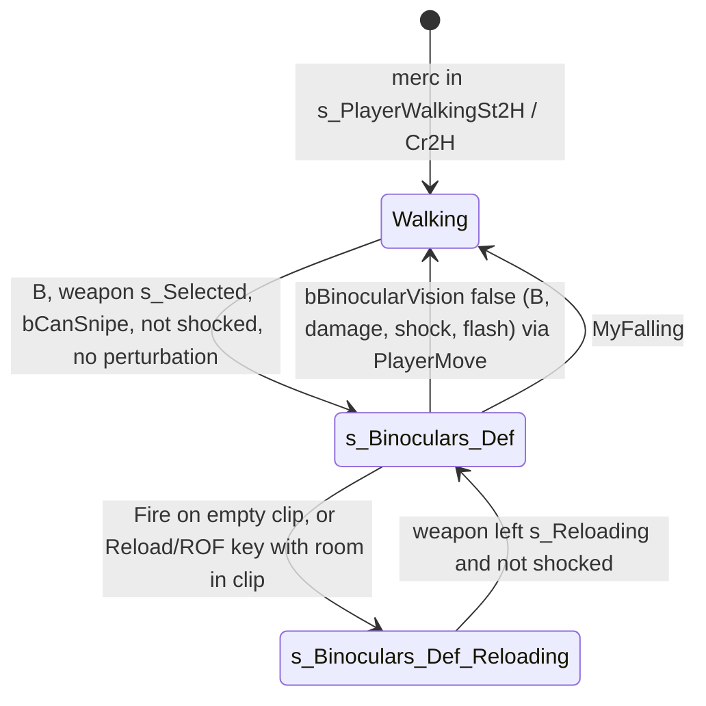

# Merc scope (sniper mode, state s_Binoculars_Def)

Units:
- uc:SBase.SPlayerController:SwitchBinocularVision, uc:SBase.SPlayerController:CanIUseBinocular,
  uc:SBase.SPlayerController:s_PlayerWalking.CanIUseBinocular, uc:SBase.SPlayerController:ClientStopBinoculars,
  uc:SBase.SPlayerController:WeaponNotifiedSnipingDrawEnded
- uc:SBase.SPlayerController:s_Binoculars_Def.BeginState, uc:SBase.SPlayerController:s_Binoculars_Def.EndState,
  uc:SBase.SPlayerController:s_Binoculars_Def.PlayerTick, uc:SBase.SPlayerController:s_Binoculars_Def.PlayerMove,
  uc:SBase.SPlayerController:s_Binoculars_Def.UpdateRotationDefenseur, uc:SBase.SPlayerController:s_Binoculars_Def.UpdateRotationDefenseur_Mouse,
  uc:SBase.SPlayerController:s_Binoculars_Def.ZoomIn, uc:SBase.SPlayerController:s_Binoculars_Def.ZoomOut,
  uc:SBase.SPlayerController:s_Binoculars_Def.WheelUp, uc:SBase.SPlayerController:s_Binoculars_Def.WheelDown,
  uc:SBase.SPlayerController:s_Binoculars_Def.Fire, uc:SBase.SPlayerController:s_Binoculars_Def.SwitchROF,
  uc:SBase.SPlayerController:s_Binoculars_Def.ClientStopBinoculars, uc:SBase.SPlayerController:s_Binoculars_Def.WeaponNotifiedSnipingDrawEnded,
  uc:SBase.SPlayerController:s_Binoculars_Def.MyFalling, uc:SBase.SPlayerController:s_Binoculars_Def.ProcessCrouch,
  uc:SBase.SPlayerController:s_Binoculars_Def.PawnTakeDamage, uc:SBase.SPlayerController:s_Binoculars_Def.ShowMenu,
  uc:SBase.SPlayerController:s_Binoculars_Def.CanIUseBinocular, uc:SBase.SPlayerController:s_Binoculars_Def.CanCrouch,
  uc:SBase.SPlayerController:s_Binoculars_Def.CheckQuickInventory, uc:SBase.SPlayerController:s_Binoculars_Def.CanBeGrabbed,
  uc:SBase.SPlayerController:s_Binoculars_Def.CanBeDropAttacked, uc:SBase.SPlayerController:s_Binoculars_Def.CanBeElbowShocked,
  uc:SBase.SPlayerController:s_Binoculars_Def.DropAttack
- uc:SBase.SPlayerController:s_Binoculars_Def_Reloading.BeginState, uc:SBase.SPlayerController:s_Binoculars_Def_Reloading.PlayerTick,
  uc:SBase.SPlayerController:s_Binoculars_Def_Reloading.CanIUseBinocular
- uc:SBase.SWeaponDefense:s_Sniping.BeginState, uc:SBase.SWeaponDefense:s_Sniping.AnimEnd, uc:SBase.SWeaponDefense:AnimateUndrawSniping
- uc:Engine.PlayerController:SetFOV, uc:Engine.PlayerController:ResetFOV, uc:SBase.SPlayerController:ZoomIn,
  uc:SBase.SPlayerController:ZoomOut (empty outside the scope states)
- def:SBase.SPlayerController (binocular fields)

## Purpose
The merc's scoped rifle mode: three fixed zoom levels, slow aim, a breathing sway the player can hold for up to
5 s, a fire kick, one shot every 0.5 s in forced single-shot mode with zero spread, and snipe damage (head shot
kills). It also opens the voice-hack trace on spies (owned by the voice spec).

## Data
`SPlayerController` defaults (def:SBase.SPlayerController, exact):

| Field | Default | Meaning |
|---|---|---|
| DES_fJumelleSpeed_Def_Zoom1 / Zoom2 / Zoom3 | 4.8 / 2.9 / 1.5 | aim speed at FOV 30 / 20 / 10 |
| BinocularBreathAmplitudeZoom1 / 2 / 3 | 8.0 / 6.5 / 6.0 | sway amplitude (rotation units per tick) |
| BinocularHoldBreathTime | 5.0 s | breath reserve (also the running value) |
| BinocularWaitFireTime | 0.5 s | minimum time between scoped shots |
| BinocularTotalKickTime | 0.4 s | fire kick duration |
| BinocularKickAmplitude / BinocularKickFOVAmplitude | 100 / 20 | kick pitch and FOV amplitudes |
| BinocularWalkSpeed | 0.2 | input scale while scoped |
| DefenderFOV | 95 | merc DefaultFOV (set on spawn) |
| fSensibiliteSouris | 1.0 | sensitivity factor (profile overrides at runtime) |

Runtime fields: `fBinocularVisionFOV` (30, 20 or 10), `fPreviousBinocularVisionFOV`, `fBinocularZoomEffectTime`,
`bChangeZoom`, `bBinocularVision`, `RPreviousState`, `BinocularBreath` (radians), `BinocularBreathUp`,
`BinocularBreathRight`, `BinocularBreathFactorUp/Right`, `BinocularCannotBlockTime`, `bJustWasHoldBreath`,
`bBinocularWaitForEndInspire`, `BinocularBreathLastTimeSeconds`, `bBinocularKick`, `fBinocularKickTime`,
`BinocularTimeBetweenFire`, `AudioZoomFactor`, `BinocularNoiseDuration`, `bLaserPreviously`, `iDateCheckBinoculars`.
Inputs: `bHoldBreath` (Button, on the right mouse alias), `fTurnValue`, `fLookUpValue`, `bReload`, `bROF`.

Snipe damage tables (victim side, exact): spy `DamageSnipeLookupTable` = 650, 300, 150, 150, 150, 150, 150, 150, 300,
150, 150, 150, 150, 150, 150 (percent per PillTag 1..15); merc = 500, 200, 80, 80, 40, 200, 200, 40, 200, 80, 80, 40,
200, 200, 40.

Clip: FirstSnipStBg2 7 frames at 15 fps played at rate 1.6 on channel 6 = 0.292 s (decoded clip data).

## Rules
1. **Entering** (`SwitchBinocularVision`, key B). For a merc, all of these must hold: channel 18 (goggle) not
   animating, `CanIUseBinocular()` (true in `s_PlayerWalking` and children unless rolling; false globally and in
   most traversal states), `now > iTimeToStopStickyShock`, `iDontUpdatePadInput == 0`. If not yet scoped it also
   needs `bFireMode == 0`, `MyWeapon.bCanSnipe`, weapon in `s_Selected`, `!bStickyShocking` and
   `!SHud.bPerturbation`. Then `RPreviousState = current state name`, `ChangeState('s_Binoculars_Def')`, pawn action
   SA_WALK_CR_2H or SA_WALK_ST_2H, `bBinocularVision = true`. Pressing B while scoped sets `bBinocularVision = false`.
2. **BeginState** (in order): `iDateCheckBinoculars = 0`; on the owning client set `bBinocularVision = true` if
   `PreviousState == 's_Binoculars_Def_Reloading'` and play SA_BINOCULAR_USING; `bCanBeGrabbed = true` for mercs;
   clear the HUD tracker locks; if the torch is on, `Torche.Unload()`; if the laser is on, remember
   `bLaserPreviously = true` and `TorcheLaser.Unload()`; `BinocularNoiseDuration = 15`, audio zoom 0.33; clear the
   voice target; spawn the HUD `SMotionTrackingVision` helper if missing; breath reset: if
   `now - BinocularBreathLastTimeSeconds > 5` then reserve 5, phase 0, factors 0, up and right true, else
   `BinocularHoldBreathTime = Min(5, int(BinocularHoldBreathTime + now - last))` (integer seconds);
   `bBinocularKick = false`; weapon `GotoState('s_Sniping')` and `ROF_Single(true)` (saves the previous mode);
   clear grenade charge (`TimerUSe = 0`, `bUsingNow = false`, ballistic 0); `bChangeZoom = true`,
   `fBinocularZoomEffectTime = 1.0`, `fBinocularVisionFOV = 30`, `fPreviousBinocularVisionFOV = DefaultFOV`.
3. **Raise.** Weapon `s_Sniping` plays FirstSnipStBg2 at rate 1.6 on channel 6 (0.292 s). At its AnimEnd the weapon
   calls `WeaponNotifiedSnipingDrawEnded` (HUD state `s_H_Binoculars_Def`, `SetFOV(fBinocularVisionFOV)`) and hides
   the view model (`bDrawWeapon = false`).
4. **Zoom animation** (PlayerMove, every tick): if `bChangeZoom`, `fBinocularZoomEffectTime = 0.4 + dt` and clear the
   flag. While the time is positive subtract dt; once below 0.15 s set
   `FOV = target + (previous - target) * time * 5`, and when it drops below 0 set `FOV = target`. So the FOV holds
   for 0.25 s, jumps to `target + 0.75 * (previous - target)` and reaches the target linearly at 0.4 s.
5. **Zoom levels.** ZoomIn (PageUp, or mouse wheel up inside the scope whatever the mouse setting): 30 -> 20 (audio
   0.66), 20 -> 10 (audio 1.0), with Snd_ZoomIn. ZoomOut (PageDown, wheel down): 10 -> 20 (0.66), 20 -> 30 (0.33),
   with the HUD binocular switch sound. Each change stores the previous FOV, sets `BinocularNoiseDuration = 15`
   (ticks) and `bChangeZoom = true`.
6. **Aim** (`UpdateRotationDefenseur`, used for mouse and pad). With `m = dt * 100`, `View = Normalize(Rotation)`,
   `Des = Normalize(MyDesiredRotation)`, `Dif = Normalize(Des - View)` and `s` the aim speed of the zoom level:
   - `vAcc = fLookUpValue * s * fSensibiliteSouris * dt`. Edge slow-down `k = 1 - (|Des.Pitch| - 6000) / 7000` when
     `|Des.Pitch| > 6000`, else 1; `k = 1` when the input points back toward level.
   - `Des.Pitch += int(vAcc * k)`; `View.Pitch += int(Dif.Pitch / (20 / m))` (that is `Dif * 5 * dt`).
   - Pitch clamp of `Des` after Normalize: FOV 20 -> [-20000, 26000]; FOV 30 -> [-10000, 13000]; FOV 10 -> none.
   - `hAcc = fTurnValue * s * fSensibiliteSouris * dt * 2`; `Des.Yaw += int(hAcc)`; `View.Yaw += int(Dif.Yaw * 5 dt)`.
   So the view chases the aim point with rate 5 per second (exponential lag).
7. **Breath** (same function, after Rule 6). `amp` = 8, 6.5 or 6 by zoom. Factors start at 0 each tick.
   1. Holding (`bHoldBreath`, `BinocularCannotBlockTime == 0`, reserve > 0):
      - first tick: `bJustWasHoldBreath = true`, `BinocularBreathUp = true`, phase `0.2 pi`, `FactorUp = sin(phase) amp`,
        `FactorRight = +-cos(phase) * 4` (minus when BreathRight), subtract `int(FactorUp)` from View and Des pitch,
        `bBinocularWaitForEndInspire = true`, play the inspire sound;
      - while waiting for the end of the inspire: `phase += 0.8 pi dt`; at `phase >= 0.5 pi` stop waiting, else the
        same factor formulas;
      - steady hold: `reserve -= dt`; at `reserve <= 0` set `BinocularCannotBlockTime = 3`; factors 0; the aim
        input of Rule 6 is applied a second time (`Des.Pitch += int(vAcc k)`, `Des.Yaw += int(hAcc)`), so the aim
        moves twice as fast while the breath is held.
   2. Not holding (or blocked):
      - on the first tick after a hold: clear the flag; if lockout is not 3 set it to 1 s; add
        `int(FactorRight - pi/2)` to both yaws and `int(FactorUp - pi/2)` to both pitches (factors are 0 here, so
        both add -1); `phase = 0.5 pi`, `BreathUp = false`, strong breath sound;
      - reserve below 5 (recovering): `gap = 5 / FClamp(reserve, 2, 5) - 1` (0 to 1.5); phase sweeps at `0.8 pi` rad/s
        between `-pi/2` and `+pi/2` (strong breath sound at the top); `FactorUp = sin(phase) * (amp - K * gap)` with
        `K = 140 / 100 / 50` for FOV 30 / 20 / 10; `FactorRight = cos(phase) * 4`; `reserve += dt` up to 5;
        lockout `-= dt`, floored at 0;
      - reserve full: lockout `-= dt`; only if `|fTurnValue| < 30` and `|fLookUpValue| < 30` the phase sweeps as
        above with `BreathRight` re-rolled at each end (`int(RandRange(0, 20)) > 10`), normal breath sound at the
        bottom, `FactorUp = sin(phase) amp`, `FactorRight = +-cos(phase) * 4`; otherwise factors 0.
   3. `View.Yaw += int(FactorRight)`, `View.Pitch += int(FactorUp)`. The factors are per-tick increments, so the
      sway speed depends on the tick rate (60 Hz in the rewrite).
8. **Kick.** Fire sets `bBinocularKick`; the next update sets `fBinocularKickTime = 0.4`. While positive: subtract
   dt (floor 0); `q = 0.5 * fSensibiliteSouris * dt * 50`. If `time > 0.24`: `kick = (0.4 - time) * 100 * q` and,
   when the zoom animation is finished, `FOV = target + (0.4 - time) * 20 * 0.6 * q`. Else `kick = -time * 100 * 0.4 * q`
   and `FOV = target + time * 20 * 0.4 * q`. Add `int(kick)` to View and Des pitch.
   Reloaded (`rl:fix.sniper_kick`) gives every player the same kick: the port uses the profile's default
   sensitivity (4, MouseSensitivity 40) in `q` instead of the player's (the value Reloaded uses is not decoded).
9. **Commit.** If not steadily holding (`bHoldBreath == 0`, reserve <= 0, lockout > 0, or still inspiring): wrap View
   yaw and pitch into (-32767, 32768], add `int(FactorRight)` / `int(FactorUp)` to Des, Normalize and wrap Des,
   `SetRotation(View)`, `UpdateDesiredRotation(Des)`. While steadily holding: `View += (Des - View) * 0.2`, wrap,
   `SetRotation(View)`, `UpdateDesiredRotation(View)` (the aim snaps to the view). Finally
   `LocalMyDesiredRotation = Des`.
10. **Moving while scoped** (PlayerMove): jump disabled; crouch allowed (own `ProcessCrouch`, 0.5 s guard: the stance changes inside the scope with SA_WAIT_CR2ST_2H or SA_WAIT_ST2CR_2H, and a blocked stand-up turns the latch back on); input
    curve standing `t = (-0.05 a/6000 + 0.15) a/6000 + 0.9`, crouched `t = (-0.02468 a/6000 + 0.05065) a/6000 + 0.3117`
    with `a = aForward`, both axes times `t`, then times 0.2; `GroundSpeed = RunningSpeed * |accel| / 3000`, zeroed
    below 15 uu/s crouched or 40 uu/s standing. Movement rules are owned by the locomotion spec.
11. **Fire** (exec in the state): if `ClipAmmo == 0 && Ammo > 0 && !bPerturbation`, `ResetFOV()` and go to
    `s_Binoculars_Def_Reloading`. Else if `BinocularTimeBetweenFire <= 0` and weapon channel 6 is not animating:
    `DiscardPickup()`; if `Ammo > 0`: `bBinocularKick = true`, `MyWeapon.Fire(F)`, `BinocularTimeBetweenFire = 0.5`
    (decremented by dt in PlayerMove). The weapon goes through `s_Firing` in Single mode (one shot) and returns to
    `s_Selected`.
12. **Server damage** (`merc-rifle.md` Rule 9-10): while the server controller is in `s_Binoculars_Def` the shot has
    zero spread, no tracer, no distance scaling, and calls `PawnTakeDamage(17, ..., SDTSnipeShot, PillTag, 70)`. The
    victim: PillTag 1 -> damage = current Health (always lethal); PillTag 2..15 ->
    `int(17 * table[PillTag - 1] / 100)`: spy 51 on pills 2 and 9, 25 elsewhere.
13. **Reload inside the scope**: from PlayerTick, `(bReload or bROF pressed) && Ammo > 0 && ClipAmmo < ClipMaxAmmo
    && !bPerturbation && in s_Binoculars_Def` -> `ResetFOV()`, `ChangeState('s_Binoculars_Def_Reloading')`. That state
    sets `bBinocularVision = true`, puts the HUD in its default state and calls `MyWeapon.Reload()` on the client;
    each tick it resets the FOV and, once the weapon has left `s_Reloading` and the merc is not shocked, sets
    `PreviousState` and returns to `s_Binoculars_Def` (full BeginState again). Fire, ROF and zoom are ignored there.
14. **SwitchROF** in the scope calls `ROF_Single(false)` (no change). AltFire, ChangeSpeed, GadLaserSwitch and
    GadTorcheSwitch are ignored; `CheckQuickInventory` does nothing.
15. **Leaving.** In PlayerMove, when `bBinocularVision` is false: on the owning client play SA_WALK_CR_2H when
    crouched, else SA_WALK_ST_2H (weapon loaded 2) or SA_WALK_ST_0H, then `ChangeState(RPreviousState)`.
    `bBinocularVision` is cleared by B, by `ClientStopBinoculars`, and by `MyFalling` (which also changes state at
    once). `ClientStopBinoculars` comes from a sticky shock and a flash (client side), and from
    `StandardReactionsToDamage` on the machine that runs it when that machine's `bBinocularVision` is true.
    `bBinocularVision` is not replicated: on a dedicated server it is true for a remote merc only after an in-scope
    reload (`s_Binoculars_Def_Reloading.BeginState` sets it on every machine), so ordinary damage closes the scope
    for the host's own pawn but usually not for a remote client (Open questions). `EndState`: store `BinocularBreathLastTimeSeconds = now`; SA_BINOCULAR_END_USING on the client;
    weapon `AnimateUndrawSniping` (FirstSnipStBg2 backward at 1.6 on channel 6, view model shown) and
    `GotoState('s_Selected')`; `bCanBeGrabbed = false`; HUD default state; `ResetFOV()`; audio zoom 0; clear the voice
    target; weapon `PreviousMode()`; if `bLaserPreviously`, turn the laser back on via `PadUpGadgetSwitch`;
    `bPressedJump = false`; `bBinocularVision = false`; clear tracker locks. The torch is not turned back on.
16. **Speed mode.** `GetSpeedMode()` returns 0.8 while `bBinocularVision` (used by locomotion).
17. **Vulnerability while scoped**: `CanBeGrabbed`, `CanBeDropAttacked` and `CanBeElbowShocked` return true, and
    `DropAttack(pawn)` calls `performDropAttack(pawn)` (grab and drop-attack specs). `ShowMenu` first clears
    `bHoldBreath`, then opens the menu. `CanIUseBinocular` is true and `CanCrouch` is true.
18. **Damage while scoped** (state PawnTakeDamage): standard reactions; on death the usual death or fatal blast; on
    survival: Charged, ElbowShock, sticky shock (`Checkshock(PillTag, true)`), DropAttacked handled as elsewhere;
    other types play the hit animation only if the weapon is holstered.

## States

## Constants
| Name | Value | Unit | Provenance | Source |
|---|---|---|---|---|
| Zoom FOVs | 30 / 20 / 10 | degrees | decoded | BeginState, ZoomIn, ZoomOut |
| Audio zoom per level | 0.33 / 0.66 / 1.0 | | decoded | ZoomIn, ZoomOut |
| Zoom transition | 0.4 s, interpolation over last 0.15 s | s | decoded | PlayerMove |
| View lag rate | 5 | 1/s | decoded | UpdateRotationDefenseur (`20 / (dt*100)`) |
| Pitch edge slow-down | from 6000 over 7000 | rotation units | decoded | UpdateRotationDefenseur |
| Pitch clamps | FOV 30: -10000..13000; FOV 20: -20000..26000; FOV 10: none | rotation units | decoded | same |
| Yaw speed factor | 2 (relative to pitch) | | decoded | same |
| Breath phase speed | 0.8 pi | rad/s | decoded | same |
| Inspire start phase | 0.2 pi | rad | decoded | same |
| Horizontal breath amplitude | 4 | units per tick | decoded | same |
| Exhausted amplitude penalty K | 140 / 100 / 50 | units per tick | decoded | same |
| Breath lockouts | 3 s after exhaustion, 1 s after release | s | decoded | same |
| Steady hold snap | 0.2 | fraction per tick | decoded | same |
| Breath reset delay | 5 | s out of scope | decoded | BeginState |
| Kick split | 0.6 of 0.4 s | | decoded | same |
| Raise clip | 0.292 | s | decoded (clip data) | SWeaponFirst.ukx |
| Voice trace length | 6000 * AudioZoomFactor | uu | decoded | PlayerMove (once per whole second) |

## Network
- Client: everything in this state (input, FOV, breath, kick, reload trigger). `ChangeState` on a client also calls
  `ChangeServerState` so the server controller enters `s_Binoculars_Def` (ordering with the fire RPCs is the reliable
  channel order). Rotation reaches the server through `UpdateDesiredRotation` and the move RPCs.
- Server: only uses the state name to switch the shot to snipe rules (merc-rifle Rule 9-10).
- `ClientStopBinoculars` is a reliable server -> client RPC; on the client it clears `bBinocularVision`.

## Edge cases
- Breath reserve restored on re-entry within 5 s is truncated to whole seconds by `int()`.
- At FOV 10 there is no pitch clamp at all; at FOV 20 the clamp is wider than at FOV 30 (as decoded).
- A shot before the 0.292 s raise clip ends is refused (channel 6 animating).
- Holding breath doubles aim speed (Rule 7.1).
- Entering the scope turns the torch off and it stays off on exit. Enhanced 4.0 claims "flashlight stays on in Sniper
  Mode" (spec/enhanced/FEATURES.md enh:rules.flashlight_sniper); the script still unloads it, so the behaviour must
  come from Reloaded.Core (see `merc-flashlight.md` Open questions).
- Reload inside the scope runs the scope EndState and BeginState around it; the ROF mode saved before the scope is
  kept correctly (EndState restores it, BeginState saves it again).
- The scope cannot be entered with `bFireMode` held or during a HUD perturbation (chaff, shock).

## Evidence
- local/re-out/uc/SBase/SPlayerController.uc 7334-7378 (SwitchBinocularVision), 26544-27417 (states).
- local/re-out/uc/SBase/SWeaponDefense.uc s_Sniping, AnimateUndrawSniping, ROF_Single, PreviousMode.
- local/formats/classdefaults.json SBase.SPlayerController; SPawnAttaque and SPAWNDEFENSE DamageSnipeLookupTable.
- Bridge docs/FIRST_PERSON.md row 67, docs/overlays/binoculars.md (HUD page).

## Open questions
- Measure the sway in the original at 60 fps (it is per tick): record `Rotation` for 10 s scoped and still, at each
  zoom level, with and without hold breath, and after exhausting the reserve.
- Whether Reloaded changes the scope vertical speed (`spec/enhanced/FEATURES.md` mentions a "legacy sniper vertical
  speed" option); compare pitch rate per mouse count in the scope.
- Exact `UpdateDesiredRotation` replication cadence while scoped (netcode spec).
- Confirm that a remote client's scope stays open when shot on a dedicated server (trace: shoot a scoped remote merc
  with the rifle and watch his `bBinocularVision` and FOV).
