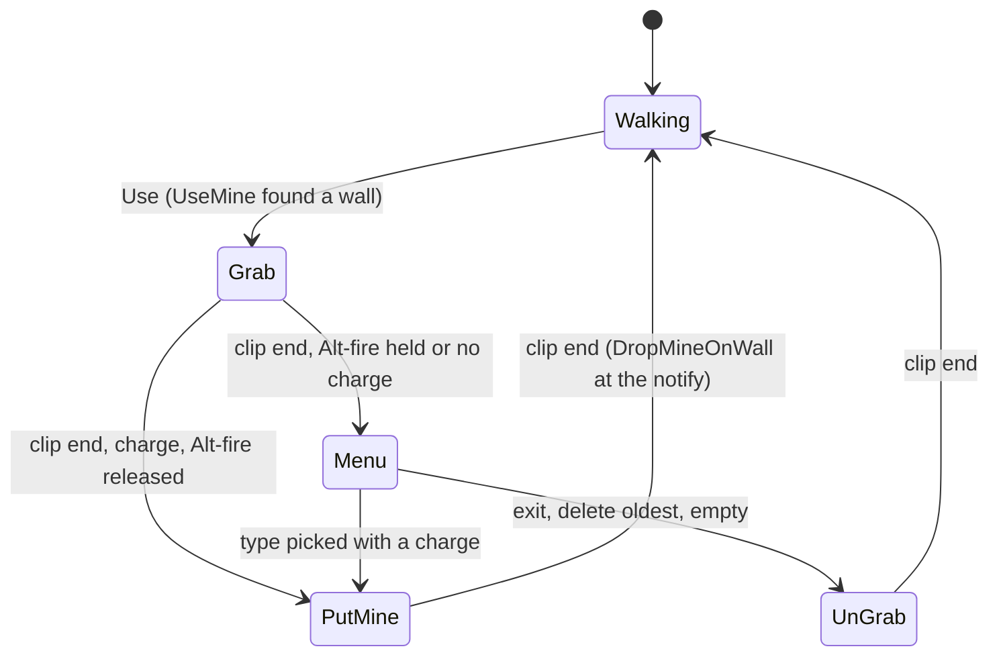

# Merc mine launcher (SGadMultiMinesLauncher) and mines (SMines, SMineProx, SMineLaser, SMinePoison)

Units:
- def:SBase.SGadMultiMinesLauncher, uc:SBase.SGadMultiMinesLauncher:PostNetBeginPlay, uc:SBase.SGadMultiMinesLauncher:Use,
  uc:SBase.SGadMultiMinesLauncher:SpawnMine, uc:SBase.SGadMultiMinesLauncher:ifReachedMaxMineInMap,
  uc:SBase.SGadMultiMinesLauncher:UpdateRemoveMineUsabilityOnClient, nat:SBase.SGadMultiMinesLauncher.UseMine,
  nat:SBase.SGadMultiMinesLauncher.DropMineOnWall, nat:SBase.SGadMultiMinesLauncher.SelectNextMineType,
  nat:SBase.SGadMultiMinesLauncher.SelectPreviousMineType, nat:SBase.SGadMultiMinesLauncher.AskServerToRemoveOldestMine,
  rep:SBase.SGadMultiMinesLauncher.SpawnMine, rep:SBase.SGadMultiMinesLauncher.AskServerToRemoveOldestMine,
  rep:SBase.SGadMultiMinesLauncher.UpdateRemoveMineUsabilityOnClient
- def:SBase.SMines, uc:SBase.SMines:SetInitialState, uc:SBase.SMines:AcceptStickableGPO, uc:SBase.SMines:PreBeginPlay,
  uc:SBase.SMines:Destroyed, uc:SBase.SMines:AddMineCounter, uc:SBase.SMines:PostBeginPlay, uc:SBase.SMines:Timer
- def:SBase.SMineProx, uc:SBase.SMineProx:Touch, uc:SBase.SMineProx:PostBeginPlay, uc:SBase.SMineProx:TakeDamage,
  uc:SBase.SMineProx:Destroyed, uc:SBase.SMineProx:s_Activated.BeginState, uc:SBase.SMineProx:s_LockedByChaff.BeginState,
  uc:SBase.SMineProx:s_LockedByChaff.EndState, nat:SBase.SMineProx.Explosion (`spec/native/natives2-damage.md` rule 5),
  ASMineProx::Tick (game 0x10ac1960) and ASMineProx::CheckArea (0x10ac0fa0), no UFunction ids, rep:SBase.SMineProx.CurrentSkin
- def:SBase.SMineLaser, uc:SBase.SMineLaser:Touch, uc:SBase.SMineLaser:DetectedPawnInLaser, uc:SBase.SMineLaser:PostBeginPlay,
  uc:SBase.SMineLaser:TakeDamage, uc:SBase.SMineLaser:Destroyed, uc:SBase.SMineLaser:DetruitFaisceau,
  uc:SBase.SMineLaser:s_Activated.BeginState, uc:SBase.SMineLaser:s_Activated.Timer, uc:SBase.SMineLaser:s_wait4boom.BeginState,
  uc:SBase.SMineLaser:s_wait4boom.Timer, uc:SBase.SMineLaser:s_LockedByChaff.BeginState, uc:SBase.SMineLaser:s_LockedByChaff.EndState,
  uc:SBase.SMineLaser:s_LockedByChaff.Timer, nat:SBase.SMineLaser.CheckPresence, nat:SBase.SMineLaser.SpawnLaser,
  nat:SBase.SMineLaser.Explosion, ASMineLaser::Tick (0x10a93c40) and ASMineLaser::CheckForOppositeWall (0x10a93930),
  rep:SBase.SMineLaser.DetruitFaisceau
- def:SBase.SLaserBeam_MineLaser, uc:SBase.SLaserBeam_MineLaser:PostNetBeginPlay, rep:SBase.SLaserBeam_MineLaser.fTailleFaisceau
- def:SBase.SMinePoison, uc:SBase.SMinePoison:TakeDamage, uc:SBase.SMinePoison:Destroyed, uc:SBase.SMinePoison:PostBeginPlay,
  nat:SBase.SMinePoison.CheckPresence; def:SBase.SMinePiegeSpy, uc:SBase.SMinePiegeSpy:PostBeginPlay,
  uc:SBase.SMinePiegeSpy:TakeDamage, uc:SBase.SMinePiegeSpy:DetectedPawn, uc:SBase.SMinePiegeSpy:SetLockedByChaff,
  uc:SBase.SMinePiegeSpy:Destroyed, uc:SBase.SMinePiegeSpy:s_Activated.*, uc:SBase.SMinePiegeSpy:s_LockedByChaff.*,
  nat:SBase.SMinePiegeSpy.CheckPresence, nat:SBase.SMinePiegeSpy.SpawnLaser, ASMinePiegeSpy::CheckForOppositeWall (0x10ab5330)
- def:SBase.SMineProxInteraction, uc:SBase.SMineProxInteraction:InitInteract, uc:SBase.SMineProxInteraction:LocalMessage
- uc:SBase.SPlayerController:ReloadMine, nat:SBase.SPlayerController.GetBestMineIndexToRemove,
  rep:SBase.SPlayerController.NbBasicMineInMapIOwn, rep:SBase.SPlayerController.NbTrapMineInMapIOwn
- uc:SBase.SPlayerController:s_BasePutMineOnWall.* (PlayerTick, CanIUseBinocular, BeginState, EndState, CanBeGrabbed, ClientDamage,
  ShowMenu, PlayerMove), uc:SBase.SPlayerController:s_PutMineOnWall_Grab.* (GadgetQuickChoice, BeginState, AnimEnd),
  uc:SBase.SPlayerController:s_PutMineOnWall_InteractionMenu.* (BeginState, EndState, WheelUp, WheelDown, PlayerMove),
  uc:SBase.SPlayerController:s_PutMineOnWall_UnGrab.* (BeginState, EndState, AnimEnd),
  uc:SBase.SPlayerController:s_PutMineOnWall.* (BeginState, EndState, AnimEnd, AnimNotification_InteractNow)
- nat:SBase.SBasePawn.ExecuteAction cases 14, 15, 16 (`spec/native/execute-action.md`)

## Purpose
The merc places up to 3 mines on walls in front of him: a proximity mine that blows when a moving spy comes close,
a laser mine whose beam across to the opposite wall blows when a spy crosses it, and a poison mine. Holding Alt-fire
opens a menu to pick the type or remove the oldest mine. A merc can pick a mine back up for a charge.

## Data
| Field | Default | Notes |
|---|---|---|
| SGadMultiMinesLauncher.Charge / RefireRate | 3 / 2.0 s | "Mine (3 Units Pack)" |
| iNbMineMax | 3 | mines a player may have on the map |
| MineClass[0..2] | SMineProx, SMineLaser, SMinePoison | |
| fMaxOppositeWallDistance[0..2] | 0, 2005, 2005 | uu; the laser and poison mines need a wall in front |
| NbIT | 5 | menu items: 3 types, "Delete oldest", "Exit" |
| MineName / SpawnText | "Proxy Mine", "Laser Mine", "Poison Mine", "Delete oldest", "Exit" / "... Mine Activated" | localized |
| TextCanSpawnMine / TextTooManyMineInMap | "Can't place mine here" / "Mine limit reached" | shipped English localization; unlocalized package defaults are "Cant spawn mine here" / "Device limit reached" |
| iCurrentMineType, CanUse[5], HitLocation, HitNormal, HitActor | | the placement found by UseMine |
| SMines.TempsActivation | 5 s (SMineProx 0) | arming delay |
| SMines.MyDamageRange / MyDamageType | 500 uu / SDamage_Explosion | |
| SMines.fInteractionRadius / bInteractInFront / bCanBeChaffed / bDamageable | 90 / true / true / true | |
| SMines.HeatIntensity / EMFIntensity | 0.5 (halved in rain) / 1.0 | vision |
| SMineProx | MyRange 400, MyDamage 215, fDistForBlast 250, VitesseMin 200, TempsAvantExplosion 0.5, ShakeRange 2000, PercentDamageRefillable 30 | |
| SMineLaser | fDistanceMax 2000, MyDamage 215, fDistForBlast 250, TempsAvantExplosion 0.5, bMineDefenseur true, ShakeRange 2000 | |
| Interaction | SMineProxInteraction: "Remove", priority 30, in front with collisions, usable by both sides | |
| SPlayerController.NbBasicMineInMapIOwn / NbTrapMineInMapIOwn | 0 | replicated counters |

## Rules

### Placing
1. **Use** (Alt-fire, `AltFire` rule of `inventory-selection.md`): only when the owner walks. `UseMine()`; a menu
   item left from last time (delete or exit) resets to type 0. When the found actor is world geometry that is not a
   gameplay object, or a gameplay object that accepts stickables, the controller changes to `s_PutMineOnWall_Grab`;
   otherwise `TextCanSpawnMine` (3 s) and a menu click sound.
2. **UseMine** (native, decoded 0x10a9fc70): `HitActor = None`. From the owner's view rotation (the controller's),
   only when its forward axis X has `X.Z <= 0.4`:
   - eye E = pawn location + walk bob + EyeHeight up; a line E to E + 55 X (single result; level, movers, other
     actors, world-geometry actors);
   - a mover hit, or a hit normal with |Z| > 0.5 (floor or ceiling): clear the hit fields and stop;
   - on a hit, an `SMines` within 12.5 uu or an `SComputerObjectiveTrigger` within 45 uu of the hit point replaces
     the hit actor (the placement then fails as not stickable);
   - `HitLocation` = the hit point (the line end when nothing is hit), `HitNormal` = the hit normal turned to face
     back along -X, `HitActor` = the hit actor;
   - for each of the 3 types: `CanUse[i] = 1`, and for a type that needs an opposite wall, a line from
     `HitLocation + 2 HitNormal` to `HitLocation + fMaxOppositeWallDistance[i] HitNormal` (level, movers, world
     geometry) that hits nothing sets `CanUse[i] = 0`.
3. **s_BasePutMineOnWall** (walking family; ignores Fire, AltFire, GadgetQuickChoice, SelectGadget): no binoculars;
   can be grabbed while in it; `PlayerTick` clears `bUsingNow`; a still move with no jump; `ClientDamage` aborts (the
   ungrab clip SA_DROPMINE_UNGRAB, the rifle's `s_DropMine_UnGrab`, `GotoWaitingState`); `ShowMenu` goes to
   `s_PutMineOnWall_UnGrab`.
4. **s_PutMineOnWall_Grab**: on the input machine the rifle's `s_DropMine_Grab` and the grab clip
   (SA_DROPMINE_GRAB, forced); `TimeChoiceGadget = now + 1`. When the clip on the interact channel (24) ends on the
   input machine: with no charge (outside the tutorial) or Alt-fire still held, the rifle loops (`s_DropMine_Loop`)
   and the menu opens (`s_PutMineOnWall_InteractionMenu`); otherwise the rifle's `s_DropMine` and
   `s_PutMineOnWall`.
5. **s_PutMineOnWall**: on the input machine SA_DROPMINE (forced) and the rifle's `s_DropMine`; the clip's interact
   notify calls `DropMineOnWall()` on the input machine; the clip end goes back to waiting.
6. **DropMineOnWall** (native, decoded 0x10aa00c0):
   1. the mine limit: for the plain launcher, `NbBasicMineInMapIOwn >= iNbMineMax` shows `TextTooManyMineInMap`
      (3 s) and stops;
   2. a type that needs an opposite wall checks it again (as rule 2); no wall: the HUD message 3 (`AddMessageOnHud`)
      and stop;
   3. `LastUsed = now`, `DecCharge(1)`, `SpawnMine(MineClass[type], pawn, HitLocation + 5 HitNormal, rotation of
      HitNormal)`, and the type's `SpawnText` for 3 s.
7. **SpawnMine** (client to server): the mine is turned to face exactly away from the wall when a 20 uu line back
   from it finds the wall within 256 rotation units of its facing (snapped to whole 256 steps); spawned (no collision
   check) owned by the pawn; `iMineType` 0 (1 for the presence detector launcher); `PcOwner` = the pawn's controller;
   `AddMineCounter(1)`; stats `Merc_MinesPlaced`; on a gameplay object the mine takes it as its base.

### The menu
8. **s_PutMineOnWall_InteractionMenu** (ignores the torch and laser keys): on entry the button edges reset; on the
   input machine every type is unusable when there is no charge (outside the tutorial), "Delete oldest" is unusable
   until the server answers `AskServerToRemoveOldestMine(self, 0, test)`; grabs allowed. `WheelUp` /
   `WheelDown` (and the up/down keys on their press edge) select the previous / next item with wrap over the 5 items.
   When Alt-fire is released: "Exit" leaves through `s_PutMineOnWall_UnGrab`; "Delete oldest" asks the server to
   remove it and leaves; a type with a charge goes to `s_PutMineOnWall`; otherwise the empty click and leave.
9. **AskServerToRemoveOldestMine(pc, type, bTest)** (client to server, decoded 0x10aa2a60): among the level's mines
   of this player and type, the one with the smallest `fSpawnedTime`; unless testing it is destroyed; then
   `UpdateRemoveMineUsabilityOnClient(found)` sets `CanUse[NbIT - 2]` on the client.
10. **SelectNextMineType / SelectPreviousMineType** (natives): step `iCurrentMineType` by one over 0..NbIT-1 with wrap.
11. **s_PutMineOnWall_UnGrab**: on the input machine SA_DROPMINE_UNGRAB and the rifle's `s_DropMine_UnGrab`; the clip
    end goes back to waiting.

### Mines
12. **SMines**: `SetInitialState` only marks the script initialised (no auto state). `PreBeginPlay` halves
    `HeatIntensity` in rain. `PostBeginPlay`: the placement sound (radius 24); on the server the arming timer
    (`TempsActivation`, or `Timer` at once when 0) and the gameplay object start (its interaction); `fSpawnedTime =
    now`. `Timer` enters `s_Activated`. `AcceptStickableGPO` false. `Destroyed` (server): the interaction goes and
    the owner's counter drops. `AddMineCounter(n, pc)` (server): the counter of that controller for the mine's kind.
13. **SMineProx** (armed at once): `PostBeginPlay` sets `refloc = Location + 5 X` and the off light. `s_Activated`:
    the light on (`CurrentSkin` replicated) and a 0.5 s looping timer. Native tick (decoded 0x10ac1960) on the server,
    before the actor tick: when not triggered and the timer fires this tick, `CheckArea`; when triggered and more
    than `TempsAvantExplosion` (0.5 s) has passed since the trigger, `Explosion`. After the actor tick: a moving mover
    under the mine (`MoverWhereIAm`) explodes it. Clients copy `CurrentSkin` into skin 1; the bip ambient sound runs
    while the light is on.
14. **CheckArea** (decoded 0x10ac0fa0): for each pawn of the level's list that is a spy (`SPawnAttaque`), within
    `MyRange` of `refloc` (squared, strict), moving faster than `VitesseMin` (3D speed when going up, horizontal
    speed otherwise; squared, strict) and in sight from `refloc` (a line with flags 0x286 hitting nothing or him):
    the trigger time is now, every player hears `BipBeforeExplode` at the mine (volume 1.5, radius 1000) and the mine
    is triggered.
15. **SMineLaser**: armed after 5 s. `PostBeginPlay` sets `refloc = Location + 5 X`. `s_Activated`: the activation
    sound (radius `fDistanceMax / 100`), on the server `SpawnLaser`, and a 0.05 s looping timer whose `Timer` runs
    `CheckPresence` on the server. Native tick (decoded 0x10a93c40) after the actor tick on the server: a moving mover
    explodes it; every 2 s (`now - fLastUpadtedLaser > 2`) the beam is re-measured (`CheckForOppositeWall`).
16. **CheckForOppositeWall** (decoded 0x10a93930): the axes of the mine's rotation are stored (`vAxeX`, `vAxeY`,
    `vAxeZ`); a line from `Location + 2 X` to `Location + fDistanceMax X` (level, movers, other actors, world
    geometry; soft bodies passed over) sets `vMurTouche` to the hit and the beam length `fTailleFaisceau` to its
    distance from the mine; with no hit `vMurTouche = Location` and the length is `fDistanceMax + 0.1`. The beam
    actor gets the length; `fLastUpadtedLaser = now`.
17. **SpawnLaser** (decoded 0x10a93b80): `CheckForOppositeWall`, then spawn the beam (`SLaserBeam_MineLaser`) at the
    mine, rotated towards `vMurTouche`, owned by the mine. With no wall `vMurTouche` is the mine itself, so the
    rotation is zero (yaw and pitch atan2(0, 0)) and the 2000.1 uu beam points along world X, not the mine's facing.
    The beam's tick (ASLaserBeam_MineLaser::Tick, game 0x10abd460) only sets `DrawScale3D.X = fTailleFaisceau` when
    the length changes (and is not 0); it never turns the beam, so a re-measure keeps the spawn rotation.
18. **CheckPresence** (decoded 0x10a93ce0): for each pawn of the list of the opposing side (spies for a merc mine,
    `bMineDefenseur`), within `fTailleFaisceau + CollisionRadius` of the mine (squared, strict), whose direction from
    the mine has cosine c with `vAxeX` such that (distance < 200 and c >= 0) or c > 0.9: when the beam segment
    (mine to `vMurTouche`) crosses the pawn's own collision cylinder, `DetectedPawnInLaser` (enter `s_wait4boom`) and
    stop. A beam of zero length (no wall) never detects.
19. **s_wait4boom**: the warning bip (radius `fDistanceMax / 100`) and a `TempsAvantExplosion` (0.5 s) timer that
    calls `Explosion`.
20. **Explosion** (both mines): `spec/native/natives2-damage.md` rule 5 (damage 215 with linear falloff to 500 uu,
    blast type within 250 uu, shake within 2000 uu, the explosion emitter and sound, then the mine is destroyed).
21. **Damage**: `TakeDamage` explodes either mine (the proximity mine once). Touch by a moving mover explodes it.
22. **Chaff**: `SetLockedByChaff(10)` locks a mine (the base rule). The proximity mine shows its off light while
    locked and its on light again after. The laser mine plays its deactivation sound, removes its beam
    (`DetruitFaisceau`, also on clients) and stops its ambient sound; at the end of the lock it re-enters
    `s_Activated` (a new beam).
23. **Poison mine** (SMinePoison, a subclass of the spy trap SMinePiegeSpy; counted as a basic mine, type 0): placed
    and removed like the others. `PostBeginPlay` moves it 1.5 uu off the wall, then the trap's start moves it 2 uu
    more, makes the beam on the server and arms it at once (`s_Activated`: a 0.05 s timer that runs `CheckPresence` on
    the server). Damage releases the poison cloud (SMinePoisonEmitter) and removes the mine.
    1. **Beam end** (SMinePiegeSpy.CheckForOppositeWall, decoded 0x10ab5330): a line along the mine's facing from 1 uu
       ahead to `fDistanceMax` (2000) ahead, flags 0x80096, soft bodies passed over. `LaserEndLocation` is the first
       hit, or the mine itself when nothing is hit (then the beam has no length and nothing is detected). The beam
       actor's length becomes the distance plus 0.1; `fLastUpadtedLaser = now`. The trap's tick is the plain actor
       tick, so the beam is measured once.
    2. **SpawnLaser** (native 1791, decoded 0x10ab5510): the beam end measured; without a beam actor one is made at
       the mine, turned towards the end, without collision, `HeatIntensity` 0.4, and `bLaserHidden` cleared. The
       texture scaler and draw scale are view effects.
    3. **CheckPresence** (native 1820, decoded 0x10ab43a0): for each spy in the level's pawn list, in order: within
       the beam length plus his collision radius of the mine; with `c` the cosine between the mine's facing and the
       direction to him, `(distance < 200 and c >= 0) or c > 0.9`; and the beam segment crossing his collision
       cylinder. The first such spy: the gas and projectile sounds play at the mine for everyone (volume 1, radius
       100); `PcOwner` is taken from the owner pawn's controller when unset; his controller gets
       `PawnTakeDamage(0, owner pawn, hit point, (hit point - mine) x 1000, SDamage_Poison)` (the poison of
       `state-damage-reactions.md`); his `PoisonnedBy` becomes the owner pawn; a poison cloud (SPoisonEmitter) is
       made at the mine and the mine is destroyed.
    4. The spy trap's own check (SMinePiegeSpy.CheckPresence, native 1325, decoded 0x10ab5140; the presence detector
       launcher, not in the default kit): the first spy within the beam length plus his radius, not behind the beam
       (cosine with the beam direction at least 0) and whose cylinder the beam crosses, goes to `DetectedPawn` (the
       team message 13, the spy marked, the stat, the trap removed).

### Removing and refilling
24. **Pick-up**: a player using the mine's interaction (`InitInteract`) gets `ReloadMine(mine)` and the mine is
    destroyed.
25. **ReloadMine(mine)** (server to owner): for a proximity, laser or poison mine, the first plain mine launcher among
    the first 4 selectable gadgets with fewer than its default charges gets one charge back and the `MineOff` HUD
    message (2 s).
26. **GetBestMineIndexToRemove** (native, decoded 0x10ab24a0): among the interaction manager's objects that are mine
    interactions usable now, the one whose owner lies furthest along the view axis (the pawn's rotation, or the
    desired rotation for a merc) from the eye (Location + EyeHeight on Z + WalkBob); the selected interaction when none
    goes further (strictly; a tie keeps the earlier one). Mine interactions are SMineProxInteraction and its subclasses
    (trap mines, sticky cams). The Use menu's release on such an entry selects this index before the press
    (interaction-system.md rule 14c).

## States

## Constants
| Name | Value | Unit | Provenance | Source |
|---|---|---|---|---|
| Placement reach | 55 | uu | decoded | UseMine 0x10a9fd2d |
| Max view pitch | X.Z <= 0.4 | | decoded | 0x10a9fcc1 |
| Floor / ceiling limit | abs(N.Z) > 0.5 | | decoded | UseMine |
| Mine spacing | 12.5 | uu | decoded | 156.25 squared |
| Terminal spacing | 45 | uu | decoded | 2025 squared |
| Wall offset of a new mine | 5 | uu | decoded | DropMineOnWall |
| Opposite wall probe start | 2 | uu | decoded | UseMine, DropMineOnWall |
| Proximity scan | 0.5 | s | decoded | s_Activated SetTimer |
| Laser scan | 0.05 | s | decoded | 3 / 60 |
| Laser re-measure | 2 | s | decoded | 0x10a93c40 |
| Laser cone | (d < 200 and c >= 0) or c > 0.9 | | decoded | 0x10c10dd8, 0x10c10dd0 |
| Bip before explosion | volume 1.5, radius 1000 | | decoded | CheckArea |
| Trap beam probe start | 1 | uu | decoded | 0x10ab5330 |
| Poison sounds | volume 1, radius 100 | | decoded | 0x10ab43a0 |
| Poison momentum | (hit - mine) x 1000 | | decoded | 0x10ab43a0 |

## Network
- Placement is chosen on the merc's machine (UseMine, DropMineOnWall) and made on the server (`SpawnMine`).
  Detection, the explosion and the counters run on the server; the counters replicate to the owner.
- `CurrentSkin` (proximity light) and the beam length replicate; the beam removal is a reliable server-to-client
  call on the mine.

## Edge cases
- The mine counter is checked on the merc's machine with the replicated counter, so a fast second placement can pass
  the limit before the counter arrives.
- A laser mine whose opposite wall moves away keeps detecting along its old beam until the next 2 s re-measure.
- Mines detect spies only; mercs walk past their own and the enemy's mines (there are no spy mines here).

## Evidence
- local/re-out/uc/SBase/SGadMultiMinesLauncher.uc, SMines.uc, SMineProx.uc, SMineLaser.uc, SLaserBeam_MineLaser.uc,
  SMineProxInteraction.uc, SMinePoison.uc, SMinePiegeSpy.uc, SPlayerController.uc (states 9545 to 9830, ReloadMine
  7970). Game natives 0x10a9fc70, 0x10aa00c0, 0x10aa0390, 0x10aa03c0, 0x10aa2a60, 0x10ab24a0, 0x10ac1960,
  0x10ac0fa0, 0x10a93c40, 0x10a93930, 0x10a93b80, 0x10a93ce0 (private Ghidra copy local/ghidra-work/gadgets);
  vtable slot 0x74 overrides of ASMineProx and ASMineLaser.
- Bridge docs/GADGET_TIMINGS.md rows "Proximity mine", "Laser mine".

## Open questions
- The order of the level's pawn list (assumed to be the actor list order).

### Resolved
- The poison mine's presence check (native 1820) and the spy trap's beam and check (natives 1325, 1791). Resolved:
  rule 23 (game 0x10ab43a0, 0x10ab5140, 0x10ab5330, 0x10ab5510; editor 0x111cdc70, 0x111cd650, 0x111cd300,
  0x111cd8a0).
