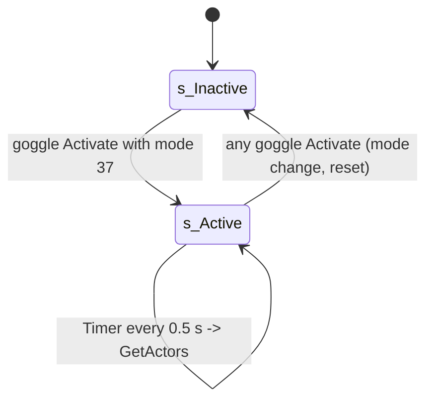

# Merc motion tracking (SMotionTrackingVision, vision mode 37)

Units:
- uc:SBase.SMotionTrackingVision:IsActive, uc:SBase.SMotionTrackingVision:s_Inactive.BeginState, uc:SBase.SMotionTrackingVision:s_Active.BeginState,
  uc:SBase.SMotionTrackingVision:s_Active.Timer, uc:SBase.SMotionTrackingVision:s_Active.IsActive
- nat:SBase.SMotionTrackingVision.GetActors, rl:SBase.SMotionTrackingVision.GetActors, nat:SBase.SMotionTrackingVision.DrawHUD,
  nat:Engine.Canvas.RenderMotionTracking, eng:ASMotionTrackingVision::Tick
- def:SBase.SMotionTrackingVision, def:Engine.MotionTrackingVision
- uc:SBase.SGoggle:Activate (tracker part, see vision-goggles.md)

## Purpose
In motion vision the merc's HUD locks onto anything moving fast enough within range, draws a bracket around it and
keeps it a moment after it stops. The scan runs twice a second on the merc's own machine. This page is the rule set
the port follows; it was decoded from the game, Reloaded.Core and the editor build, and checked against the real
game recorded in the sandbox (section "Captures").

## Data
def:SBase.SMotionTrackingVision (exact; OutTime and FocusTime are `config` in Engine.MotionTrackingVision):

| Field | Default | Unit | Notes |
|---|---|---|---|
| MaxDetectedDistance | 2600 | uu (int) | the scan reach adds the target's CollisionRadius |
| MinDetectedVelocity | 150 | uu/s | full 3D speed, at least this |
| KeepLockTime | 1.5 | s | hold after the first scan that misses the target |
| MinWidth / MaxWidth | 0.1 / 0.45 | of the clip width | screen box width limits (Tick) |
| MinHeight / MaxHeight | 0.1 / 0.6 | of the clip height | screen box height limits (Tick) |
| FocusTime / OutTime | 0.12 / 0.25 | s | bracket zoom-in and fade-out |
| remanencetime / remanenceecho | 0.05 / 4 | s / count | bracket echoes |
| detectsound | Armes_impacts.Gadgets.Vision_movt_detect | | |
| cadre / balayage / TexLaserSentry | SHudTextures.HUD.Vision_lock / balayage_H / Vision_friend | | corner (32 x 32), sweep (16 x 16), friend mark (32 x 32) |
| TextHold | "Hold Fire" | | localized |
| LockedObjects | array of {Actor, ScreenPosition1, ScreenPosition2, StartTime, EndTime, bRemove, ItsMyFriend} | | 0x28 bytes each, at +0x2f8 |
| PlayerOwner | the merc's controller | | |
| RemoteRole / bHidden | ROLE_None / true | | local-only actor |

## Rules
1. **Lifetime.** The goggle spawns one tracker the first time mode 37 activates (owner the goggle, PlayerOwner the
   merc's controller) and keeps it. `SGoggle.Activate` always puts it in `s_Inactive` first and back in `s_Active`
   only for mode 37, so every activation clears the locks. The scope state spawns a second tracker for the HUD
   (`SHud.MyTrackingVision`, the laser target name, `merc-scope.md`); it is not the motion vision.
2. **s_Inactive.BeginState**: remove all `LockedObjects`. `IsActive()` is false.
3. **s_Active.BeginState**: remove all locks, `SetTimer(0.5, looping)`. `Timer` calls `GetActors()`. `IsActive()` true.
4. **Where it runs.** GetActors on the merc's machine (a player's client; a bot's server), from its tracker's
   timer; the screen box (Tick) and DrawHUD only where there is a viewport. Nothing is replicated: the scan reads the
   machine's own copy of every pawn (a client: the proxies' replicated location and velocity).

### GetActors

Native 1422 is bound by Reloaded.Core (body 0x100ca650); the game's own body (0x10ac0a30, editor 0x11220b70) also
jumps to it. In order:
1. Needs PlayerOwner and the viewer pawn, the level and LevelInfo. The viewer pawn is `PlayerOwner.Pawn`; Reloaded
   would use `PlayerOwner.ViewTarget` under a switch (byte 0x1036ab97) that lies in zero-filled data and is never
   written, so it is off in the shipped build. Every lock is marked stale (bRemove).
2. Viewer point V: in state `s_UseObject_CamNetwork` the viewer pawn's `UsedObject` location when set (else the
   pawn's); in `s_MultiSpectating`, `s_Spectating_Visitor` or `s_MultiSpectating_WhenKilled` with a ViewTarget, the
   controller's location; else the pawn's.
3. Every actor of the level's list, in order, not null and not bHidden: `|A - V|^2 < (MaxDetectedDistance +
   A.CollisionRadius)^2`; `MinDetectedVelocity <= |A.Velocity|`; not a spy pawn (the SPawnAttaque vtable, which its
   one-mesh subclass shares) with `DesiredGlassEffect == 255` (the cloak; any other value counts); and a Projectile,
   or a Pawn other than the viewer pawn. Teammates are not left out.
4. Sight: `SingleLineCheck(V to A.Location, flags 0x20086)`: movers, level, level geometry, every hit
   (0x20000 keeps all hits). Hits on actors with `bBulletGoTru` are passed over (their pass-through word is set only
   with 0x20000, collision 0x10a188c0) and the first other hit is kept with every hit after it. When nothing is left,
   a second line with flags 0x86 (single result: the nearest hit, bullet-passable actors count as ordinary hits).
   Then the kept hits are walked while the hit actor has `bSeeThroughInMotionVision` (SVitre panes by class default,
   some map movers); walking off the end is clear; otherwise the line is clear only when the hit actor is A. A world
   line reaches a `bWorldGeometry` actor (SVitre is one) through the level geometry flag (collision-traces.md rule 3).
   So: one pane alone, clear; a pane with a wall behind, blocked; a bullet-passable panel alone, blocked (by the
   0x86 line); a panel then a pane, blocked.
5. In sight: a lock already held is marked fresh (its EndTime is kept, not reset); a new lock is inserted at the head
   of the list {A, StartTime = now, EndTime 0, flags 0} and the audio subsystem plays detectsound for the viewer pawn
   at V (sound id 1: no override; volume 1, radius 64, pitch 1).
6. Then the list is walked: a stale lock with EndTime 0 gets `EndTime = now + KeepLockTime`; a stale lock with
   `now > EndTime + OutTime` is removed. A lock that was stale, came back and goes stale again keeps its old EndTime,
   so it goes at the first scan past it.

### Screen box

ASMotionTrackingVision::Tick (0x10ac0470), after the actor tick, when PlayerOwner has a viewport (`Player`) and a
pawn (or a spectate target): with the controller's calc view (camera location, rotation, FovAngle), each lock with
an actor gets two projected corners in the 640 x 480 HUD frame, depth in Z (below 1 in front):
`Location - Y max(CollisionRadius, 30) + Z max(CollisionHeight, 30)` and `Location + Y r - Z h`, Y and Z the axes of
the viewer pawn's rotation. The width `SP2.X - SP1.X` is kept at most `MaxWidth x ClipX` and at least
`MinWidth x ClipX` about its centre, then the height likewise with MaxHeight and MinHeight of ClipY (ClipX, ClipY
640 x 480 on the merc's HUD canvas). A lock in front (`SP1.Z < 1`), past its focus (`FocusTime + StartTime < now`)
and not fading (fresh, or `now < EndTime`) adds its box to the clean view rectangles (0x10ac0e30): the renderer
redraws the scene inside them in clean monochrome (Bridge docs/VISION_MODES.md).

Reloaded's widescreen hooks: before the width test x and y are scaled about (320, 240) by k and after it x is scaled
back (0x10ac0810, 0x10ac08bd); DrawHUD scales x about 320 by m before drawing (0x10a320cb). k and m are
`min(W, 4/3 H) / H / (4/3)`: 1 at 4:3 and wider, under 1 only on narrower screens (5:4).

The frame on the screen: scaled by the height and centred (`x_px = (W - 640 s) / 2 + x s`, `s = H / 480`, the frame
640 s wide at most W), or stretched with the HUD when widescreen is off. Captures at 1280 x 720 put the zoom's outer
box at x 160..1120 and a steady box at 1.5 pixels a unit both ways.

### DrawHUD

Native 1423 calls UCanvas::RenderMotionTracking (0x10a31fb0) with the HUD, the tracker and TimeSeconds. The merc's
HUD calls it every frame after its Enhanced Reality markers (ASHud::execHudDef 0x10af8060, the goggles' tracker),
and the camera network's HUD state calls it too (`s_Hud_UseObject_CamNetwork.DrawHUD`). Canvas style Alpha (5:
FinalBlend alpha blend with an alpha test). Tiles are given in the 640 x 480 frame (FUN_109ff300 scales them by
SizeX / 640 and SizeY / 480). The canvas colours are doubled as every SHud canvas colour (HUD rule 0).

Colours: corners of an enemy lock (128, 91, 34, A); sweep grey (128, 128, 128); labels (128, 93, 0) with alpha 0;
friend colour `HUD.iColorFriend_R/G/B` (200, 40, 10) with alpha 0x80. For 0.4 s after the merc's shot hit a pawn
(`fDateLastShootedPawn + 0.4 > now`) the corner colour of enemy locks is `c v + (1 - v) 128` per channel, `v = max(0,
5 (now - shot) - 1)`.

For each lock, in list order (sizes in frame units; "scale" multiplies the 32-unit corner):
1. **Focus** (`now < StartTime + FocusTime`, t = now - StartTime): SP1 scaled by t / FocusTime (from 0, 0), SP2
   moved from the clip corner (ClipX, ClipY) to its place by the same fraction, scale `4 - 3 t / FocusTime`, corner
   alpha 0x40. **Held** (past focus, fresh or `now <= EndTime`): the box, scale 1, alpha 0x80. **Fade** (stale and
   `EndTime < now`, r = OutTime + EndTime - now): SP1 scaled by r / OutTime, SP2 moved back toward the clip corner,
   scale `4 - 3 r / OutTime`, alpha `trunc(max(0, 63 r / OutTime) + 1)`.
2. Nothing more when `SP1.Z >= 1` (behind the camera).
3. A friend's lock (`ItsMyFriend`) while `trunc(2 now)` is odd: "Hold Fire" in the canvas MedFont, friend colour at
   alpha 0xff, centred on the box (not above or left of the frame), and two friend marks (32 x scale, texels 0..32):
   at the top right mirrored across and at the bottom left mirrored down.
4. Held only (past focus, `FocusTime + StartTime < now`, fresh or `now < EndTime`): the sweep, two mirrored bands of
   balayage_H (width - 8 wide, 16 high, texels 0..15, x + 4) on one line `SP1.Y + h - (h - 8) frac`, `h` half the
   box height, `frac` the fraction of the seconds since the focus ended: from the middle to 8 under the top once a
   second; colour grey (friend: friend colour) with alpha `trunc(51 - 50 frac)`. Then the labels in TinyFont at
   SP1.X: `"%.2f %s/s"` of the actor's speed times `SHud.fDistanceUnit` with `StrDistanceUnit` under the box, and
   `"%.2f %s"` of the distance from the viewer pawn 10 units lower; label colour as above (alpha 0: an enemy's labels
   do not show).
5. Four corners of cadre (32 x scale, texels 0..31): top left as is, top right mirrored across, bottom left mirrored
   down, bottom right both.
6. Echoes. Until `StartTime + FocusTime + 0.2`: for i = 1..4, the focus box of the time `now - 0.05 i` (a negative
   time scales SP1 below 0), scale `4 - 3 t_i / FocusTime`, alpha `trunc(128 / i + 1)`. After that, only while
   fading: the fade box of `now - 0.05 i`, the corner scale of now, alpha `trunc(max(0, r 128 / i / OutTime) + 1)`.
   An echo is drawn only when its SP1.X is left of the lock's own. Echo colour: friend colour or the corner colour
   without the shot flash.

The goggles' tracker never marks a friend: ItsMyFriend is set only by `ASHud::DrawTargetName` (FUN_10af7920) on the
HUD's own tracker (the scope's laser target name). In motion vision a teammate gets the same bracket as an enemy
(capture: a merc teammate's lock has flags 0).

## States

## Constants
| Name | Value | Unit | Provenance | Source |
|---|---|---|---|---|
| Scan period | 0.5 | s | decoded | s_Active.BeginState |
| Range | 2600 + CollisionRadius | uu | decoded | def, GetActors |
| Speed threshold | 150 (at least) | uu/s | decoded, measured | def, captures |
| Lock hold / fade | 1.5 / 0.25 | s | decoded, measured | def, captures (gone 0.5 s after EndTime) |
| Sight flags | 0x20086, then 0x86 | | decoded | Reloaded GetActors |
| Cloak skip | DesiredGlassEffect 255 on a spy | | decoded, measured | Reloaded GetActors, captures |
| Detect sound | id 1, volume 1, radius 64, pitch 1 | | decoded | GetActors |
| Box extent minimum | 30 | uu | decoded | Tick |
| Box limits | 0.1..0.45 x 640, 0.1..0.6 x 480 | frame units | decoded, measured | Tick, captures (64-unit box at 800 uu) |
| Corner, sweep, friend tile | 32 (texels 31), 16 (15), 32 (32) | frame units | decoded | DrawHUD |
| Zoom | 4 - 3 fraction | | decoded | DrawHUD |
| Alphas | focus 0x40, held 0x80, fade 1..64, sweep 51..1, echoes 128 / i + 1 | | decoded | DrawHUD |
| Colours | lock (128, 91, 34), sweep (128, 128, 128), label (128, 93, 0, 0) | | decoded | DrawHUD data |
| Shot flash | 0.4 s, v = 5 dt - 1 | | decoded | DrawHUD |
| Echoes | 4, 0.05 s apart, 0.2 s after focus | | decoded | DrawHUD |

## Network
Client only (RemoteRole None, not replicated). Detection uses the merc machine's view of the other pawns' positions
and velocities (the proxies). Nothing is sent to the server.

## Edge cases
- Locks are cleared whenever the mode is re-entered or the goggles are reset (chaff resets every tick in the field).
- The scan is not continuous: a target that crosses the threshold between two scans appears up to 0.5 s late.
- The spy's gaits (captures): standing run 423.5 and standing slow walk 169.4 are locked; crouched 221.4 (fast) is
  locked; crouched slow 88.5 is not. With the gun drawn: standing forward at full speed 150.2 is locked (just over
  150), strafing 138.6, crouched 104, slow 87.5 and crouched slow 61.5 are not. A spy is safe from the tracker only
  crouched at the slow speed, or with the gun drawn when not running straight ahead.
- The draw mode does not matter: a tap draw (laser) and a hold draw (no laser) give the same WeaponLoaded (2), the
  same speeds and the same locks (captures). GetActors reads no weapon, laser or draw state.
- The cloak drops when the spy moves faster than 240 uu/s (SPawnAttaque.TickNative, reloaded-hooks.md rule 11), so a
  cloaked spy is unseen by the tracker only at the walk speeds (captures at 169 and 221: no lock while cloaked).
- A projectile is locked while it moves at 150 uu/s or more (captures: smoke grenades thrown at about 560 and 190
  uu/s were locked).
- A teammate is locked like an enemy and drawn the same.
- A box behind the camera is not drawn; its lock still beeps and holds.

## Captures
Recorded in the sandbox with a local copy of the combat rig (local/motion-capture: rig, driver, traces and frames;
game-derived, never committed): Play Level on SteeE, the east yard lane (x -492, floor -1143.5), headless and muted.
The spy scenarios run the local spy on its real input bytes with a merc target whose controller owns a tracker the
rig spawned; the merc scenarios run the local merc in motion vision (SwitchHeadset 1) and save HUD frames.

| Scenario | Result |
|---|---|
| Gaits, unarmed and drawn (tap and hold), 1800 uu | as in Edge cases |
| Lock timings | lock at the first scan with the speed; EndTime = first stale scan + 1.5; gone at the next scan past EndTime + 0.25 (0.5 s after EndTime) |
| Cloak 255 at 169 and 221 uu/s | never locked; uncloaked, locked |
| Through one SVitre pane (SteeE, SVitre1935) | locked |
| Smoke grenade thrown at 560 and 190 uu/s | locked; at 126 uu/s, not |
| HUD at 1280 x 720 | zoom from the centred 4:3 area (x 160..1120), steady 64 x 64 box at 800 uu, corners on a clean view box, labels invisible, a teammate's lock without Hold Fire |

## Evidence
- local/re-out/uc: SMotionTrackingVision.uc, MotionTrackingVision.uc, SGoggle.uc Activate, SHud.uc (CamNetwork
  DrawHUD), Engine/HUD.uc (iColorFriend defaults).
- Game: execGetActors 0x10ac0a30, execDrawHUD 0x10ac0410, Tick 0x10ac0470, clean view list 0x10ac0e30,
  RenderMotionTracking 0x10a31fb0 (exec 0x10a33150), ASHud::execHudDef caller 0x10af8060, DrawTargetName 0x10af7920,
  tile helper 0x109ff300, text helper 0x109ff400, canvas material 0x10a04010, SingleLineCheck 0x10a1d200,
  MultiLineCheck 0x10a1d400, hash line checks 0x10a188c0 and 0x10a18ed0, colour data 0x10c73c78..0x10c73c98.
- Reloaded.Core: GetActors 0x100236f0 (body 0x100ca650), widescreen setup 0x100a9720 (hooks 0x100a9620,
  0x100a73d0, 0x100a7400, 0x100a7480), FOV and factors 0x100a7330, aspect 0x100a4bd0; settings names at
  0x103330ec (widescreen), 0x103330f8 (widescreen_hud), 0x103332b4 (ws_er_small).
- local/reflect/game.json (offsets and bit masks); local/motion-capture (captures, frames).

## Open questions
- A pane with a wall behind it and a bullet-passable panel were not captured: SteeE has no spot where both pawns fit
  on such a line and no bullet-passable actor. Decoded only.
- The camera network viewer (UsedObject) and the spectating viewer were not captured. Decoded only.
- The labels' fonts (VerySmallGUIFont, SmallGUIFont) are not converted; only a friend's labels show, and the goggles'
  tracker has no friends.

### Resolved
- The clean view rectangles: drawn by the motion post pass's second loop (0x10964996..0x10964c7b, ps_1_1
  0x10c4e328 over the sharp scene copy, the grain and the sonar); docs/RENDERING.md, vision modes.
- Decode GetActors twice (stock and Reloaded). Resolved: rule "GetActors" (natives2-events.md rules 5, 6, and this
  pass: insertion at the head, the pass-through skip, the 0x86 retry, the viewer switch off).
- Reloaded's GetActors switch (viewer = ViewTarget). Resolved: off (zero-filled data, never written).
- Why a tap-drawn spy shows and a hold-drawn one does not. Resolved: it does not differ in the original (captures);
  a drawn spy walking straight ahead at full speed (150.2 uu/s) is locked in both modes.
- The screen-size limits (MinWidth...). Resolved: Tick's box limits, not GetActors.
