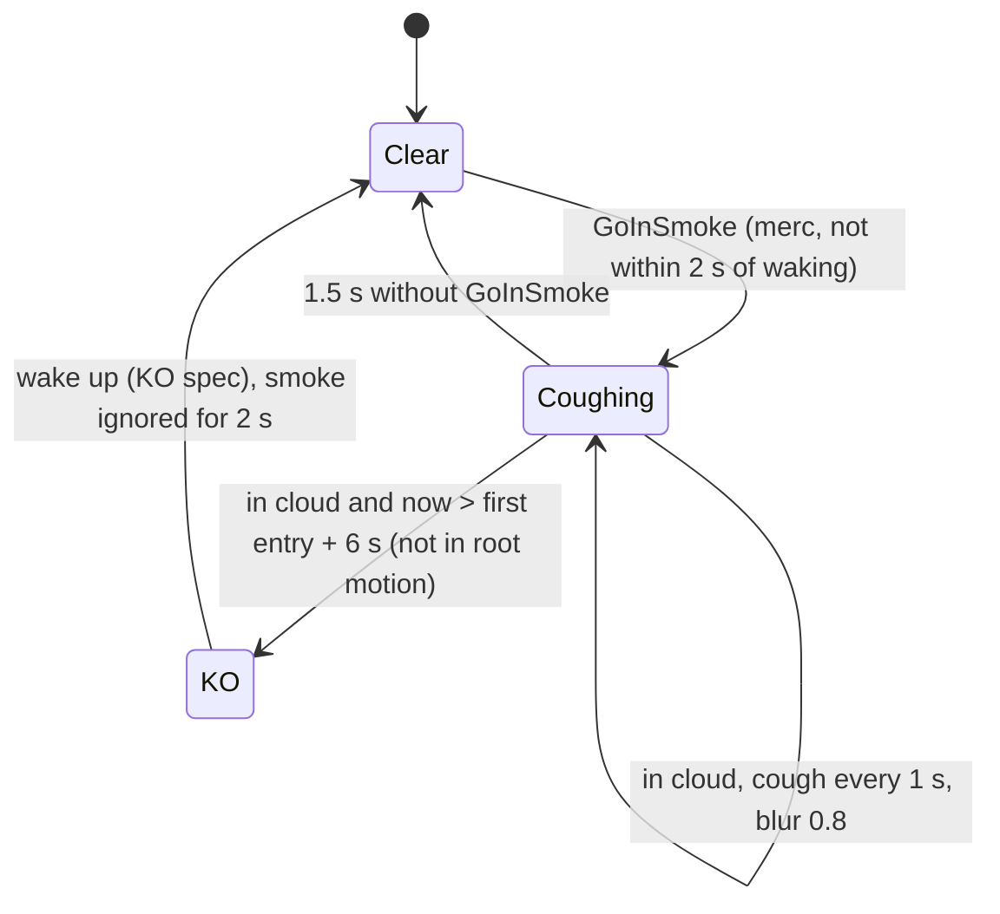

# Smoke grenade (SGadSmokeGrenade, SProjSmoke, SSmokeEmitter) and its effect on mercs

Units:
- def:SBase.SGadSmokeGrenade, uc:SBase.SProjSmoke:PostBeginPlay, nat:Engine.Projectile.Explode (SProjSmoke C++ override, game 0x10ac1b20), def:SBase.SProjSmoke
- uc:SBase.SSmokeEmitter:PostBeginPlay, uc:SBase.SSmokeEmitter:DetectedSPlayerController, uc:SBase.SSmokeEmitter:ToggleSoundOn,
  uc:SBase.SSmokeEmitter:ToggleSoundOff, def:SBase.SSmokeEmitter (its C++ tick override ASSmokeEmitter::Tick at game 0x10a9a130 has
  no UFunction id; coverage should give it an eng: id)
- uc:SBase.SPlayerController:GoInSmoke, uc:SBase.SPlayerController:PlayerTick (merc cough block), uc:SBase.SPlayerController:FindGasInstigator,
  uc:SBase.SPlayerController:CountGasKO, uc:SBase.SPlayerController:PCChangeServerState (smoke KO stats part),
  uc:SBase.SPlayerController:s_PlayerWalkingWeapon.PlayerMove (cough slowdown part),
  uc:SBase.SPlayerController:s_GrabbedByPlayer.GoInSmoke, uc:SBase.SPlayerController:s_GrabbingPlayer.GoInSmoke,
  uc:SBase.SPlayerController:s_UseObject_Mirador.GoInSmoke, uc:SBase.SPlayerController:s_PlayerCharging.GoInSmoke

## Purpose
The spy's smoke grenade makes a cloud that lasts 10 s. A merc inside it coughs, is slowed, cannot jump, gets a
blurred view, and is knocked out after 6 s of continuous exposure. Spies are not affected.

## Data
| Field | Default | Notes |
|---|---|---|
| SGadSmokeGrenade.Charge | 5 | "Smoke Grenade (5 Units Pack)" |
| SGadSmokeGrenade.RefireRate / CanQuickLaunch | 2.0 s / true | |
| SProjSmoke.TempsExplosion | 3 s | inherited |
| SProjSmoke.ProjectileSpeed / MaxSpeed | 900 / 1600 uu/s | |
| SProjSmoke.WallReboundFactor / ActorReboundFactor | 0.2 / 0.2 | |
| SProjSmoke.DispersionRange / DispersionTime | 150 / 1 | no script reader |
| SProjSmoke.Exploded, Smoke, SmokeLaunchEmitter | | |
| Sounds | launch RA_GrenDegoup, impact SW_GrenRebonds, explode GRsmok_act, cloud loop GRsmok_loop | |
| SSmokeEmitter.LifeSpan | 10 s | |
| SSmokeEmitter.RadiusEffect | 300 uu | |
| SSmokeEmitter.TimeBaseToCought / TimeBaseToFaint / TimeBaseToJamming / ForceBaseToJamming | 1.5 s / 6 s / 6 s / 0.8 | GoInSmoke arguments |
| SSmokeEmitter.HeatOpacity | 0.2 | thermal |
| SSmokeEmitter sub-emitter | 15 sprites, burst 200/s, life 10 s, fade in 0.1 s, fade out from 8 s, size x17 -> x30 of 8..10 | renderer |

Controller fields: `btoCought`, `bInSmoke`, `fSmoke_FallDate`, `fSmoke_EndOfCoughDate`, `fSmoke_NextMovementCoughDate`,
`fLastTimeWakeUp`, `SmokeInstigator`, `SmokeInstigatorTime`.

## Rules
1. **Throw** as in `grenade-throw.md` (aimed with the Shocker drawn, or quick launch at the feet). `SProjSmoke.
   PostBeginPlay`: unless quick-launched, play the launch sound (radius 100) and attach the SSmokeLaunchEmitter trail
   (not on a dedicated server).
2. **Pop** at the 3 s fuse for an aimed throw; a quick-launched smoke grenade pops at its first hit, the floor under
   the spy's hand, about a quarter of a second after the launch (HitWall override, decoded game 0x10ac1c60:
   `QuickLaunch` set and not yet `Exploded` -> `Explode(Location, 0)` on the server, the client copy destroyed;
   `grenade-throw.md` Rules 6a and 10a). Native `Explode` (once)
   spawns an SSmokeEmitter at the hit location raised by the projectile's collision height plus 1 uu, sets its
   `SoundOn` (ambient GRsmok_loop), destroys the trail (prior decode, 0x10ac1b20). A smoke grenade that touches a
   pawn other than its thrower pops at once where it is (ProcessTouch override 0x10ac1cb0, `flash-bang.md` rule 6).
3. **Cloud life**: 10 s (`LifeSpan`), on the server; clients lose their copy when the server's is destroyed.
4. **Detection** (native emitter tick, every tick on every non-dedicated machine, prior decode): if the local
   player's pawn is within `RadiusEffect + its CollisionRadius` of the cloud centre (3D), call
   `DetectedSPlayerController(local PC)` -> `GoInSmoke(1.5, 6, 6, 0.8)`.
5. **GoInSmoke(cough, faint, blurTime, blur)** (global): only for a merc and only if `now - fLastTimeWakeUp > 2`:
   - `newFall = now + faint`; if not coughing: `fSmoke_FallDate = newFall`, `fSmoke_NextMovementCoughDate = now`,
     `btoCought = true`; else keep the earlier of the two fall dates;
   - `fSmoke_EndOfCoughDate = now + cough`;
   - HUD: force SFX slot 0 and add a Smoke visual effect from `blur` to 0 over `blurTime`, linear (restarted every
     tick in the cloud, so the blur holds at 0.8 and fades over 6 s after leaving);
   - `bInSmoke = true`;
   - on the server copy only (listen host or standalone): remember the nearest SSmokeEmitter's instigator for stats
     (refreshed when the last record is older than 0.5 s).
6. **Cough and KO** (merc branch of `PlayerTick`, after `NativeComputeSquinting`), while `btoCought`:
   1. if `bInSmoke`, `bPressedJump = false` (no jumping in the cloud);
   2. if `bInSmoke && now > fSmoke_FallDate && Physics != PHYS_RootMotion`: stop coughing (`btoCought = false`),
      `CountGasKO()`, action SA_COUGHT_STOP, then `ChangeState('s_FallDropAttacked')` if the pawn has no base, else
      `ChangeState('s_FallDown', 'DIE_InPlace')` (KO, owned by the KO spec: 7.5 s black fade, 7 s lying,
      `fLyingOnGroundDuration`, stand-up, 4.5 s cross-eye);
   3. else if `now > fSmoke_EndOfCoughDate` (1.5 s out of the cloud): stop coughing, SA_COUGHT_STOP (the 6 s faint
      timer restarts from zero on the next exposure);
   4. else if `now > fSmoke_NextMovementCoughDate`: SA_COUGHT_START, next cough in 1 s, `ServerPlaySound(RA_Tousse,
      volume 10, radius 100)`;
   5. `bInSmoke = false` (the emitter must set it again next tick).
7. **Slowdown while coughing** (merc, `s_PlayerWalkingWeapon.PlayerMove`, before the stance curve): standing forward
   input x0.39, backward x0.5, strafe x0.4; crouched forward x0.7, backward x0.65, strafe x0.66. The later charge
   recovery factor is replaced by a flat x0.9 while coughing.
8. **State overrides**: grabbed by a spy (`s_GrabbedByPlayer`): blur only, no cough or KO; grabbing
   (`s_GrabbingPlayer`): sets the cough flags without the merc check; on a mirador (`s_UseObject_Mirador`): normal
   effect then leave the object; charging (`s_PlayerCharging`): normal effect and the charge ends. Ignored in
   `s_Inactive` and its children (KO, lying), `s_GrabBase`, `s_Dead` and spectating.
9. **Server side of the KO**: the KO state change reaches the server through `ChangeState` ->
   `PCChangeServerState`; for `s_FallDown` / `DIE_InPlace` or `s_FallDropAttacked` (if not already there), when the last
   smoke attribution is older than 0.5 s and no shock attribution is recent, the server finds the nearest
   SSmokeEmitter within 300 uu for the instigator, then `CountGasKO()` (victim `Merc_KnockedFromSmoke`, gasser stats).
   The server does not check that the merc was really in smoke.

## States

## Constants
| Name | Value | Unit | Provenance | Source |
|---|---|---|---|---|
| Fuse | 3 | s | decoded | SProjGrenade TempsExplosion |
| Quick launch pop | first hit | | decoded | ASProjSmoke HitWall 0x10ac1c60 |
| Cloud life | 10 | s | decoded | SSmokeEmitter LifeSpan |
| Effect radius | 300 + victim collision radius | uu | decoded (field), native test from prior decode | RadiusEffect, 0x10a9a130 |
| Cough linger | 1.5 | s | decoded | TimeBaseToCought |
| Time to faint | 6 continuous | s | decoded | TimeBaseToFaint |
| Blur | 0.8 fading over 6 s | | decoded | ForceBaseToJamming, TimeBaseToJamming |
| Cough period | 1 | s | decoded | PlayerTick |
| Wake grace | 2 | s | decoded | GoInSmoke |
| Slowdown multipliers | 0.39 / 0.5 / 0.4 standing, 0.7 / 0.65 / 0.66 crouched | | decoded | s_PlayerWalkingWeapon.PlayerMove |

## Network
- The cloud is a replicated emitter (RemoteRole SimulatedProxy); detection runs on each client for its own merc.
- Cough, slowdown and the KO decision run on the merc's client; the server follows the KO state change it is sent,
  and plays the cough sound for others (`ServerPlaySound`).
- On a dedicated server the emitter has no local player, so detection never runs there.

## Edge cases
- The faint timer is not reset by leaving the cloud for less than 1.5 s.
- A merc in root motion (vaulting, scripted moves) cannot faint until it ends.
- A merc without a base (falling, on a ladder or pipe) goes to `s_FallDropAttacked` instead of `s_FallDown`.
- Re-entering a second overlapping cloud keeps the earlier fall date (the KO cannot be postponed).
- Gas mask: script does not check `bGasMask` in `GoInSmoke`; any gas mask protection must be in the native emitter
  tick (Open questions).
- Spies are never affected (merc test in `GoInSmoke` and in PlayerTick).

## Evidence
- local/re-out/uc/SBase/SProjSmoke.uc, SSmokeEmitter.uc, SGadSmokeGrenade.uc, SPlayerController.uc 3343-3374,
  7612-7700, 1211-1226, 10654-10680, 16840, 17744, 25024, 25369; SGadGasMask.uc.
- local/reflect/game_cdo.json SBase.SSmokeEmitter, SProjSmoke.
- Bridge docs/GADGET_TIMINGS.md rows "Smoke grenade", "Smoke cloud", "Smoke on a merc", "Smoke faint" and the
  "Smoke lifetime" section (agree with this spec; addresses ASSmokeEmitter::Tick 0x10a9a130, ASProjSmoke::Explode
  0x10ac1b20). ASProjSmoke::HitWall 0x10ac1c60 (quick launch pop) decoded on a private Ghidra copy.

## Open questions
- Native emitter tick: exact centre (grenade location plus an offset, prior note says 23 uu Z), 3D distance, any line
  of sight or gas mask test. Scenario: merc with gas mask on walks into a cloud; log `btoCought`.
- Order of the emitter tick and the controller's PlayerTick within a frame (the KO test reads `bInSmoke` set by the
  emitter in the same frame).
