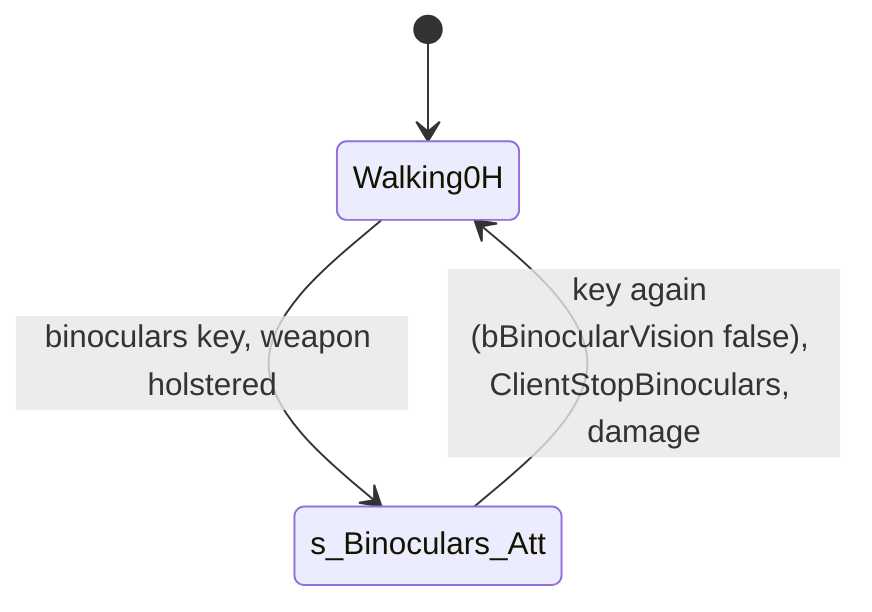

# Spy binoculars (state s_Binoculars_Att, vision mode 50)

Units:
- uc:SBase.SPlayerController:SwitchBinocularVision (spy branch), uc:SBase.SPlayerController:s_Binoculars_Att.* (DropAttack, BeginState,
  EndState, CanIUseBinocular, CanBeElbowShocked, UpdateCamRotation, ZoomIn, ZoomOut, WheelUp, WheelDown, PlayerMove, ProcessCrouch,
  CheckQuickInventory, Fire, AltFire, PlayerTick, ClientStopBinoculars, CanBeDropAttacked, CanSwitchGoggleManually, CanCrouch)
- nat:SBase.SHud.LockObjectiveBinocularsAtt (decoded 0x10a90f40), nat:SBase.SHud.DrawObjectivesBinocularsAtt (the target choice part, 0x10a90f70)
- uc:SBase.SGoggle:SwitchMode (mode 10, `vision-goggles.md`)

## Purpose
The spy's binoculars zoom the view to 30, 20 or 10 degrees, slow his walk, let him listen to a merc he looks at
(Hack Comm), and mark an objective under the reticle with the Use key. They need the Shocker holstered.

## Data
| Field | Default | Notes |
|---|---|---|
| DES_fJumelleSpeed_Att_Zoom1 / 2 / 3 | 5.0 / 2.9 / 1.5 | aim speed at 30 / 20 / 10 degrees |
| BinocularWalkSpeed | 0.2 | |
| Zoom steps | 30, 20, 10 | degrees; `fBinocularVisionFOV`, `fPreviousBinocularVisionFOV` |
| Sounds | zoom in JUMzoIn, zoom out SHud.Snd_SwitchBinoculars (JUMact), voice hacking ecouteJUM | |
| AudioZoomFactor | 0.33 / 0.66 / 1.0 | per zoom level; 0 when off |
| SHud.LockedObjective | None | the marked objective |
| bBinocularVision | false | the binoculars key toggle |

## Rules
1. **SwitchBinocularVision** (the binoculars key, global): a spy with the Shocker drawn only asks to leave the fire
   mode (`bForceExitFireMode`). Otherwise, while the goggle clip is idle, the state allows binoculars, the shock lock
   is over and the pad input is live: a spy not yet in binoculars switches the goggles to the binocular view
   (`SwitchMode(10)`) and changes to `s_Binoculars_Att`; then `bBinocularVision` toggles (pressing again asks to
   leave). The merc branch is the scope (`merc-scope.md`).
2. **BeginState**: the check timer, zoom flags and behind view off; FOV 30 (current and previous); the desired
   rotation is the view; HUD state `s_H_Binoculars_Att`; on the input machine the EMF visibility is re-tested (the
   binoculars make the spy EMF-visible); no pad-up gadget; a drawn weapon is holstered at once (weapon loaded 0, laser
   off, the quick holster clip, the stance's 2H to 0H and 0H walk actions); no draw reminder; audio zoom 0.33; no
   voice target.
3. **EndState**: behind view on, FOV 30 then the default FOV, the goggles leave the binocular view (`SwitchMode(10)`),
   no jump, HUD state None, audio zoom 0, the voice target cleared on the server, `bBinocularVision = false`; on the
   input machine, with the weapon holstered, no vision mode, no cloak and no spy mark, the pawn stops being
   EMF-visible.
4. **PlayerTick**: when `bBinocularVision` went false, leave to the stance's unarmed rest (`s_PlayerWalkingCr0H` or
   `St0H`) without the draw reminder; then the global tick. **ClientStopBinoculars** does the same at once.
5. **Zoom**: `ZoomIn` (and the wheel up) steps 30 to 20 to 10, `ZoomOut` (wheel down) 10 to 20 to 30; each step keeps
   the previous FOV, plays the zoom sound, 15 frames of view noise, sets the audio zoom (0.66 at 20, 1.0 at 10,
   0.33 at 30) and starts the zoom animation.
6. **PlayerMove**: `UpdateRotation(dt, 2)`; once per whole second of level time a line from the eye + 50 forward to
   the eye + `AudioZoomFactor x 6000` forward: a merc hit (with team-only voice chat off) becomes the voice target
   (the hacking sound and `ServerSetVoiceChatTarget`), anything else clears it; the zoom animation: 0.2 s plus the
   frame, FOV = target + (previous - target) x remaining x 5; the noise frames count down; crouch handling as the
   scope's (`ProcessCrouch` with the 0.5 s special-move guard); the stance curve on the forward and strafe inputs
   (`merc-scope.md` rule 15 values) times `BinocularWalkSpeed`; ground speed from the acceleration (`RunningSpeed x
   |accel| / 3000`, cut to 0 under 25 uu/s crouched or 40 standing, then no acceleration); the move; the HUD's sound
   timer; a Use press at most once per second marks the objective (`LockObjectiveBinocularsAtt`).
7. **UpdateCamRotation**: the view turns by `input x dt x sensitivity x zoom speed x 5` in yaw and pitch, pitch
   clamped to [-12000, 13000], and the desired rotation follows.
8. **LockObjectiveBinocularsAtt** (native, decoded 0x10a90f40): `LockedObjective` becomes None when it already is the
   objective currently under the reticle, else that objective. The HUD's objective overlay picks, each frame, the
   first objective trigger whose projected marker lies within the reticle box (40 px around the screen centre),
   on screen and in front of the view (decoded from 0x10a90f70; the port tests the view direction instead of the
   projected box).
9. **Other functions**: Fire, AltFire and CheckQuickInventory do nothing; `DropAttack` performs the drop attack; the
   state allows crouching, manual goggle switching, being drop-attacked and elbowed; it ignores ChangeSpeed, the
   torch and laser keys and PrevStickyCam. Damage is the combat spec's handler (it clears `bBinocularVision`).

## States

## Constants
| Name | Value | Unit | Provenance | Source |
|---|---|---|---|---|
| FOV steps | 30 / 20 / 10 | deg | decoded | s_Binoculars_Att |
| Zoom animation | 0.2 + dt, rate 5 | s | decoded | PlayerMove |
| Noise frames | 15 | frames | decoded | ZoomIn, ZoomOut |
| Voice trace | 50 to 6000 x audio zoom | uu | decoded | PlayerMove |
| Pitch clamp | -12000 / 13000 | rot | decoded | UpdateCamRotation |
| Mark repeat | 1 | s | decoded | PlayerMove |
| Reticle box | 40 | px | decoded | 0x10a90f70 |

## Network
- The state runs on the spy's machine and is mirrored on the server by `ChangeState`; the voice target is a client to
  server call; the objective mark is HUD state on the spy's machine.

## Edge cases
- Entering with the pistol drawn holsters it at once (no clip wait).
- A mark is a toggle: pressing Use again on the same objective clears it.

## Evidence
- local/re-out/uc/SBase/SPlayerController.uc 7334 to 7380 and 27419 to 27860; game natives 0x10a90f40 and
  0x10a90f70 (private Ghidra copy); local/reflect defaults of SPlayerController (DES_fJumelleSpeed_Att_*).
