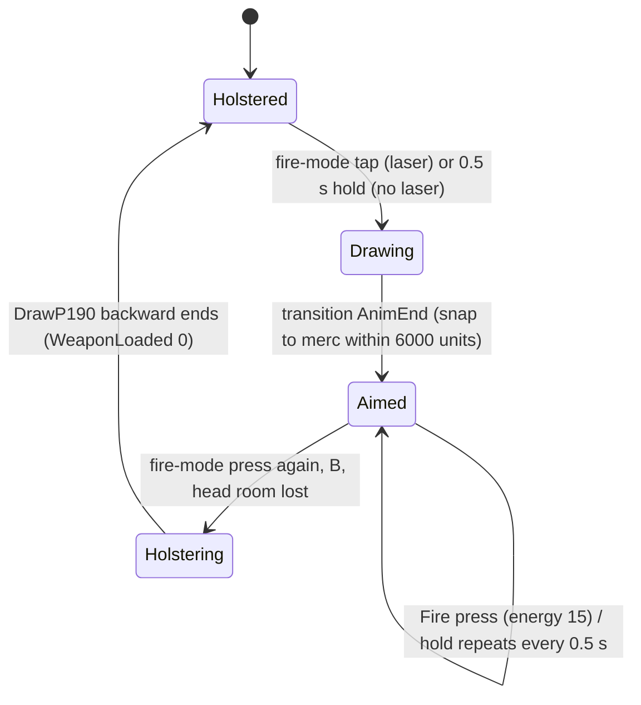

# Spy Shocker Gun (SStickyShocker / SWeaponAttaque): drawing, laser, firing

Units:
- uc:SBase.SStickyShocker:Fire, uc:SBase.SStickyShocker:GetFireStart, def:SBase.SStickyShocker
- uc:SBase.SWeaponAttaque:FireWeapon, uc:SBase.SWeaponAttaque:ServerFireWeaponWithLocation, uc:SBase.SWeaponAttaque:TraceFireWithPos,
  uc:SBase.SWeaponAttaque:GetAxesAndLocation, uc:SBase.SWeaponAttaque:ServerSound, uc:SBase.SWeaponAttaque:EventServerSound,
  uc:SBase.SWeaponAttaque:AddMuzzleCount, uc:SBase.SWeaponAttaque:Tick, uc:SBase.SWeaponAttaque:s_Selected.Tick,
  uc:SBase.SWeaponAttaque:ServerSwitchLaser, uc:SBase.SWeaponAttaque:EventServerSwitchLaser, uc:SBase.SWeaponAttaque:PostBeginPlay,
  uc:SBase.SWeaponAttaque:PostNetBeginPlay, uc:SBase.SWeaponAttaque:AnimateDrawWeapon, uc:SBase.SWeaponAttaque:AnimateUnDrawWeapon,
  uc:SBase.SWeaponAttaque:AnimateQuickDrawWeapon, uc:SBase.SWeaponAttaque:AnimateQuickUnDrawWeapon, uc:SBase.SWeaponAttaque:ChangeHandWeapon,
  uc:SBase.SWeaponAttaque:AnimEnd, uc:SBase.SWeaponAttaque:Destroyed, uc:SBase.SWeaponAttaque:Fire, uc:SBase.SWeaponAttaque:AltFire,
  uc:SBase.SWeaponAttaque:RenderHUD, uc:SBase.SWeaponAttaque:DisplayDebug, def:SBase.SWeaponAttaque
- uc:SBase.SPawnAttaque:AuthorizeEnergy, uc:SBase.SPawnAttaque:NotifyUndrawWeapon, uc:SBase.SPawnAttaque:NotifyDrawWeapon,
  uc:SBase.SPawnAttaque:NotifyChangeHandWeapon, uc:SBase.SPawnAttaque:NotifyDrawUndrawWeapon
- uc:SBase.SBasePawn:SetWeaponLoaded, uc:SBase.SBasePawn:EvSetWeaponLoaded
- uc:SBase.SPlayerController:PlayerTick (spy fire-mode block), uc:SBase.SPlayerController:s_PlayerWalkingSt0H.PlayerTick,
  uc:SBase.SPlayerController:s_PlayerWalkingCr0H.PlayerTick, uc:SBase.SPlayerController:s_PlayerWalkingSt2H.PlayerTick,
  uc:SBase.SPlayerController:s_PlayerWalkingCr2H.PlayerTick, uc:SBase.SPlayerController:s_PlayerWalkingMario_T_0HTo2H.BeginState,
  uc:SBase.SPlayerController:s_PlayerWalkingMario_T_0HTo2H.PlayerMove, uc:SBase.SPlayerController:s_PlayerWalkingMario_T_0HTo2H.AnimEnd,
  uc:SBase.SPlayerController:FindAttClosestTarget, uc:SBase.SPlayerController:s_PlayerWalkingWeapon.SwitchLaser, uc:SBase.SPlayerController:SwitchLaser (empty global),
  uc:SBase.SPlayerController:s_PlayerWalkingWeapon.CanActivateLaser, uc:SBase.SPlayerController:CanActivateLaser,
  uc:SBase.SPlayerController:SwitchBinocularVision (spy branch), uc:SBase.SPlayerController:CheckIfCanFire (spy branch)
- nat:SBase.SWeaponAttaque.TickSWeaponAttaque, nat:SBase.SPlayerController.NativeFindTargetToSnap,
  uc:SBase.SPlayerController:ComputeTargetDistance,
  eng:ASPlayerController::NativePlayerCalcView (rule 1.3 of spec/native/camera.md: the laser placement)
- rep:SBase.SWeaponAttaque.bLaserOn, rep:SBase.SWeaponAttaque.MuzzleCount, rep:SBase.SPawnAttaque.WeaponDummy

## Purpose
The spy's only weapon: a pistol that costs energy per shot, deals no health damage to pawns and instead applies a
sticky shock (victim side in `sticky-shock-effect.md`), disables devices, and shocks pawns standing in water hit by
the shot. It is drawn with a fire-mode button: a tap draws it with the aiming laser, a 0.5 s hold draws it without.

## Data
| Field | Class | Default | Notes |
|---|---|---|---|
| EnergyNeeded | SStickyShocker | 15 | energy per shot (`spy-energy.md`) |
| BaseDamage | SStickyShocker | 10 | applied only to non-pawn actors |
| MyDamageType | SStickyShocker | SDTStickyShocker (12) | |
| ReloadTime | SStickyShocker | 0.5 s | only spaces the empty-energy click |
| Ammo / MaxAmmo | SStickyShocker | 999 / 999 | never decremented |
| RateOfFire | SWeaponAttaque | 0.5 s | held-fire repeat interval |
| ShootingRange | SWeaponAttaque | 15000 uu | trace length |
| MaxDispersion | SWeaponAttaque | 1.0 | unused by script |
| DispersionActuelle | SWeapon | 0 | the shot spread passed to the trace (no script writer for the spy weapon) |
| LastShot | SWeaponAttaque | 0 | |
| bLaserShouldBeOn / bLaserOn | SWeaponAttaque | false | bLaserOn replicated |
| MuzzleCount / MyMuzzleCount | SWeaponAttaque | 0 | |
| OldWeaponLoaded | SWeaponAttaque | -1 | |
| SndLaserOn | SWeaponAttaque | Laser_shot_loop1 | |
| Sounds | SStickyShocker | StikyShok_SShot_1 shot, StikyShok_vide empty, RA_Reload_Att | |
| Mesh | SStickyShocker | SWeaponFirst.p190 | clips DrawP190 4/15 = 0.267 s, SnipeP190 5/15, WaitP190 5/15, UnDrawP190 4/15 |
| LaserProjectorDivider / LaserProjectorMinScale | SWeaponAttaque consts | 1500 / 0.05 | laser dot scale `max(dist / 1500, 0.05)` |
| ItemName / MagmaIconName | | "Shocker Gun" / W_P190 | |

`SBasePawn.WeaponLoaded` (byte, replicated initial-only): 0 holstered, 1 quick-drawn, 2 aimed, 3 drawing, 4
holstering, 7 other hand. Controller fields: `bFireMode` (InvButton alias FireMode, key E), `fDateFireMode`,
`bTestBoutonLache`, `bForceFireMode`, `bForceLaserFireMode`, `bForceExitFireMode`, `iTimeToStopStickyShock`.

## Rules
1. **Fire-mode button while holstered** (`PlayerTick`, spy, `WeaponLoaded == 0`), every tick:
   1. Held (`bFireMode > 0`) after a release (`bTestBoutonLache`): on the first such tick
      `fDateFireMode = now + 0.5`; on a later tick with `now > fDateFireMode`: `bForceFireMode = true`,
      `bForceLaserFireMode = false`, `bTestBoutonLache = false`, `fDateFireMode = 0` (hold: draw without laser).
   2. Not held: if `fDateFireMode > 0` (released within 0.5 s): `bForceFireMode = true`,
      `bForceLaserFireMode = true`, `bTestBoutonLache = false` (tap: draw with laser); else `bTestBoutonLache = true`.
      Then `fDateFireMode = 0`.
   With the weapon out: `fDateFireMode = 0`, and `bTestBoutonLache = true` while the button is up.
2. **Drawing** (`s_PlayerWalkingSt0H.PlayerTick` standing; `s_PlayerWalkingCr0H.PlayerTick` crouched): when
   `bForceFireMode` and not shocked: crouched only, first test head room with a box trace (extent 35, 35, 50) from the
   pawn up 20 uu; if blocked, cancel (`bFireMode = 0`, `bForceFireMode = false`). Otherwise clear the flag; if
   `bForceLaserFireMode` send `ServerSwitchLaser(true)`; if carrying a hand item go to `s_ThrowGoTo`, else play
   SA_WALK_ST_0Hto2H (or SA_WALK_CR_0Hto2H) and enter `s_PlayerWalkingMario_T_0HTo2H`.
3. **Draw transition and snap** (`s_PlayerWalkingMario_T_0HTo2H`; Fire, AltFire, gadget quick choice and binoculars
   ignored): `BeginState` runs `FindAttClosestTarget`: from the spy's pelvis + 40 uu Z, over visible pawns that are
   mercs, not this pawn, `CanSee`, not sleeping: target point pelvis + 15 uu Z; only beyond 200 uu; aim rotation
   `rotator(D + 12 * Normal(D.xy) x Z)` with roll 0; candidate if both `|yaw diff|` and `|pitch diff|` to the
   camera rotation are below 6000; keep the nearest; store it with `Pitch *= 1.133`. While the transition anim runs:
   if a target was found, turn the pawn yaw toward it at up to 100000 units/s and the camera at up to 25000 units/s
   (yaw and pitch); else turn the pawn toward the camera yaw at 65000 units/s while the difference exceeds 300.
   At AnimEnd of the transition channel (14) on the controlling machine: mark finished and set
   `bForceExitFireMode` if the head-room box trace is blocked. When finished (and, with a target, at once) set the
   final rotation, camera mode SecondPerson (Cr), pawn action SA_WALK_ST_2H / CR_2H and state
   `s_PlayerWalkingSt2H` / `s_PlayerWalkingCr2H`. (Enhanced makes the snap optional; `spec/enhanced/FEATURES.md`.
   The rewrite deliberately omits this draw snap and its settings toggle: drawing preserves the player's aim.)
4. **Weapon side of the draw**: the body anim notify calls `SPawnAttaque.NotifyDrawWeapon` -> weapon
   `AnimateDrawWeapon`: attach to `B R Hand`, play DrawP190, `SetWeaponLoaded(3)`, `LastShot = now + 0.1`. Weapon
   `AnimEnd` (channel 0): from 3 play SnipeP190 and set 2; from 4 play WaitP190 and set 0. Every weapon AnimEnd sets
   `LastShot = now - RateOfFire` (fire allowed at once). `SetWeaponLoaded(n > 0)` on the controlling machine also
   uncloaks over 2 s (`SetDesiredGlassValue(0, 2)`) and makes the spy EMF-visible (`SetEMFToServer`); `n == 0`
   removes EMF visibility unless goggles, binoculars, a spy mark, the cloak or phospho still require it.
5. **Holstering**: with the weapon out, `bForceExitFireMode`, or a fresh press of the fire-mode button
   (`bTestBoutonLache && bFireMode == 1`), when not frozen, not shocked and the crouch-roll flag matches the stance,
   plays SA_WALK_ST_2Hto0H / CR_2Hto0H and enters `s_PlayerWalkingMario_T_2HToOH`. The anim notify
   `NotifyUndrawWeapon` sends `ServerSwitchLaser(false)` and plays DrawP190 backward (`SetWeaponLoaded(4)`).
   `NotifyDrawUndrawWeapon` (quick draw/undraw used by traversal) toggles with WaitP190 (0 -> 1, or 1/2/7 -> 0 with
   laser off). B (binoculars) with the weapon out only requests `bForceExitFireMode`.
6. **Laser**: `ServerSwitchLaser(b)` (reliable client -> server) sets `bLaserShouldBeOn`. Server tick:
   `bLaserOn = bLaserShouldBeOn && Controller.CanActivateLaser()`. `CanActivateLaser` is true in
   `s_PlayerWalking` and the weapon-walking states (and the pipe-fire, Vandamme-weapon and back-to-wall fire
   states), false globally and in traversal, interaction, grab and charge states. Key L (`SwitchLaser`) in the
   weapon states toggles: `ServerSwitchLaser(!bLaserOn)`. The beam, the red dot projector and the muzzle mesh are
   drawn by the native `TickSWeaponAttaque` on every client from `bLaserOn` and `MuzzleCount`.
7. **Firing input**: a press calls exec `Fire` -> weapon `Fire` immediately (no rate check); holding fire
   repeats from `s_Selected.Tick`: when `bFire != 0`, `now - LastShot > RateOfFire`, (not shocked or
   `now > iTimeToStopStickyShock`) and not in transit, call `Fire(0)`. Exec `Fire` itself is refused while
   inventory mode, frozen input, shocked or in weapon transit (`merc-rifle.md` Rule 1).
8. **SStickyShocker.Fire**: return if the controller is in `GameEnded`. Requires `WeaponLoaded != 0` and not
   `bWeaponTransit`, then `CheckIfCanFire()` (spy branch: let `E` be the weapon `FX` bone origin; ray length 40 uu when
   walking, else `0.9 * |E - pawn location|`; trace from `E - length * vector(FX rotation)` to `E`; clear means allowed).
   Then `AuthorizeEnergy(15)`: if `EnergyLevel < 15` return false, else subtract 15 and return true. On success
   `FireWeapon()`. On failure, if `LastShot + ReloadTime < now`: `LastShot = now` and play the empty sound
   (radius 60).
9. **FireWeapon** (client): `LastShot = now`; `ServerFireWeaponWithLocation(weapon Location, Rotation.Yaw, .Pitch,
   .Roll)` (the pistol actor's current world placement on the client); pad rumble.
10. **ServerFireWeaponWithLocation** (server, reliable): count `ShotsFired`; build the rotator; `TraceFireWithPos(
    Position, Orientation, DispersionActuelle, 0, 0)`; play the shot sound on the pawn at `B L Hand` (radius 200)
    with `NotifyNoise(1.0)`; `MuzzleCount += 1` (replicated; clients spawn SMuzzleSticky, 0.1 s).
11. **TraceFireWithPos** (server):
    1. Axes: `SBasePawn.ShouldIGetPawnRot()` always returns false (no override exists), so the passed rotation is
       used (the dead branch would unpack yaw and pitch from `iYawPitchFromView`). `Start = Position + 30 X + 8 Z - 4 Y`.
    2. `End = Start + A (u1 - 0.5) 1000 Y + A (u2 - 0.5) 1000 Z + ShootingRange X` (A = 0 in practice, so FRand values
       are consumed but have no effect).
    3. `TraceBone(..., End, Start, Material, true)`.
    4. World geometry or Mover: damageable SBasicGamePlayObject takes `TakeDamage(10, ..., -HitNormal * 1000,
       SDTStickyShocker, PillTag)`. Impact (unless fake backdrop) at `Hit + 10 N` with random roll: metal surfaces ->
       SImpactEffectShockerMetal; MediumWater -> SImpactEffectShockerMetal and, when the hit actor is not the
       LevelInfo (a water mesh or mover), every pawn whose 100 uu downward trace from its location hits that same
       actor gets `PawnTakeDamage(0, ..., SDTStickyShocker, PillTag)` (shocked through the water, no team test,
       including the shooter); other surfaces -> SImpactEffectShocker.
    5. Other non-pawn actors: `TakeDamage(10, ..., SDTStickyShocker, PillTag)` (cameras, laser triggers and sensors
       treat shocker damage like chaff; device spec).
    6. SBasePawn: `PawnTakeDamage(0, Instigator, Hit, (Hit - Start) * 1000, SDTStickyShocker, PillTag)` on its
       controller (no team test); `ShotsHit` counts only enemies; impact SImpactEffectShocker at `Hit + 10 N`.
12. **Setup and cleanup**: `PostBeginPlay` on the server sets `Controller` and `SPawnAttaque.WeaponDummy = self`;
    `PostNetBeginPlay` plays SnipeP190 if `WeaponLoaded == 2`, else WaitP190. `ChangeHandWeapon` toggles
    `WeaponLoaded` between 7 and 2. `Destroyed` destroys the laser beam and projector. `EventServerSound` and
    `EventServerSwitchLaser` are native-callable wrappers of `ServerSound` and `ServerSwitchLaser`.
    `SStickyShocker.GetFireStart` (eye point) is not used by the shot, which starts at the pistol (Rule 11).
    `SWeaponAttaque.Fire` and `AltFire` are empty (SStickyShocker overrides Fire); `RenderHUD` and `DisplayDebug` are
    debug text only.
13. **Ammo**: none is consumed; energy is the only limit. Reload and FullReload do nothing for this class.

14. **Laser drawing (native)** (decoded: `execTickSWeaponAttaque` game 0x10ab7870, placement helper 0x10ab7c80
    called from `NativePlayerCalcView` 0x10aafe70). Every tick on every machine:
    1. `SBPawn` defaults to `Instigator`. When `WeaponLoaded` differs from `OldWeaponLoaded`: 0 attaches the pistol to
       `HOLSTER`, 7 to `B L Hand` with `RelativeLocation (2, -8, 2)` and `RelativeRotation (0, 0, 0x8000)`, anything
       else to `B R Hand` with zero offsets; then `OldWeaponLoaded = WeaponLoaded`.
    2. `bLaserOn` false: the projector and the beam are destroyed. True, and not a dedicated server: an
       `SLaserProjector` (the dot) is spawned for every spy pistol; an `SLaserBeam` only when
       `Level.LocalPlayerController.Pawn == Instigator` (a spy sees only his own beam; everyone sees every dot).
    3. `MyMuzzleCount < MuzzleCount`: one more per tick, and an `SMuzzleSticky` is spawned at the `FX` bone when the
       pistol's rotation has no zero component.
    4. Placement, once per `Level.TimeSeconds` from the local player's `NativePlayerCalcView` with bUpdate, for every
       `SBasePawn` with `SPawnType == SPAWNOFFENSE` whose `WeaponDummy` is an `SWeaponAttaque` with `bLaserOn`: the
       hand bone (`B L Hand` at `WeaponLoaded == 7`, else `B R Hand`); start `= O + 30 X - 4 Y + 8 Z` (`- 8 Z` in the
       other hand); a multi-hit line of `ShootingRange` along X, the first hit whose actor is not `bBulletGoTru`, else
       the line's end. The dot moves to `Hit - Dir * MaxTraceDistance / 2` (10 uu), turns along the line and gets
       `DrawScale = max(|Hit - view location| / 1500, 0.05)` (the local player's view point); on a pawn it projects
       on the actor (`bProjectActor` on, `bProjectOnBackfaces` and `bDynamicAttach` off) and attaches to it, else on
       the world (the opposite). The beam moves to the start, turns along the line, `DrawScale3D = (|Hit - Start| + 1,
       0.5, 0.5)`.
14a. **Where the drawn pistol is** (sandbox capture 2026-10-25, local/spyhand/capture.py: SteeE lane, a crouched and a
    standing spy drawn with a tap, the rig turning the view at 12 points from pitch -4639 to +2694; the pistol actor,
    its SLaserBeam and the B R Hand bone read every 5 frames). The pistol actor sits on B R Hand (rule 14.1) and the
    beam starts at its Location + 30 X - 4 Y + 8 Z in its own axes (within 0.4 uu), so the shot (rule 9) and the laser
    leave the same place. Against the controller's view rotation p (pitch, 65536 a turn) and its yaw frame:
    - the pistol's yaw is the view's (+1 to +8 units), its roll -30 to -43 units, its pitch 0.8498 p + 1.7 crouched,
      + 22.1 standing (residual under 23 units);
    - its Location from the pawn's: forward -2.558 - 0.000808 p, right 16.243, up 38.407 + 0.001584 p crouched;
      forward -3.668 - 0.000977 p, right 14.705, up 46.344 + 0.001410 p standing (residuals under 0.5 uu).
    The pistol does not follow the eye: the spy's EyeHeight was 55.5 crouched at spawn and 40 after a keyed crouch
    with the pistol in the same place (spec/movement/pawn.md "Eye position"). The port has no skeleton and uses these
    fits for the pistol's FX bone (CombatNatives.SpyPistolCoords; a still pose, WeaponLoaded 2).
14b. **Where the laser is drawn** (Ryan 2026-10-25: "the spy's laser doesn't seem to be coming out of the correct
    location on the gun"). Rule 14.4 runs on every machine from that machine's posed bones, so the beam and the dot
    leave the drawn pistol: the start is 30 X - 4 Y + 8 Z of the drawn hand bone's frame, 3.5 uu behind the drawn p190
    mesh's `FX` bone (the mesh's `FX` sits at 34.2 X, -3.2 Y, 9.5 Z of the actor frame), and the line runs along the
    hand's X axis. The client view draws both from the drawn hand of the pistol's pawn (own spy in third person, other
    players' and bots' spies on every screen), along the hand's X axis to the first hit of the laser's line; the
    simulation's placement (from the measured pistol frame of rule 14a) is drawn only for a pawn that is not drawn.
    In a still pose the drawn hand is within 0.5 uu of the measured pistol frame (play-lasers smoke); during the draw
    and a stance change it moves up to 40 uu away, and the drawn beam and dot follow it as the original's do. The
    pistol in the other hand (`WeaponLoaded == 7`) hangs on `B L Hand` at its relative place and the laser starts at
    `- 8 Z`. Another machine's spy has no controller there: his pistol frame takes his view from `iYawPitchFromView`
    (replicated to simulated proxies, also what aims his drawn arms), not the pawn's level rotation. The port drew the
    beam from the hand bone's origin, 35 uu behind the muzzle.
15. **Tap and hold draws in the original** (sandbox capture 2026-10-25, SteeE, standing spy, 60 fps, the fire-mode
    byte written as the key; local/difftest/shocker-draw): `bFireMode` is 1 while the key is held. Tap (held 6
    frames): the transition state starts on the first frame after the release (0.117 s after the press), WeaponLoaded
    3 three frames later, 2 after 0.267 s (DrawP190), the armed walk 18 frames (0.3 s) after the transition started,
    and `bLaserOn` with the projector and the beam on that same frame (`CanActivateLaser` is false in the transition
    state). Hold (60 frames): the transition starts on the first frame past press + 0.5 s (frame 32), then the same
    18 frames, the laser stays off. Both draws are the same animation at the same speed: the hold is "slower" only by
    its 0.5 s wait. Holster (tap with the gun out): the transition starts on the press frame, the laser goes off at
    once, WeaponLoaded 4 nine frames later and 0 after 0.217 s more. Pawn velocity: 0 through both draws; walking
    forward afterwards 150.1 to 150.2 uu/s in both cases. No actor of the level moved at 100 uu/s or more during
    either draw apart from the walking spy; the dot's velocity stays 0 (it is moved by FarMoveActor).
16. **Motion tracking and the draws.** The tracker (motion-tracking.md, GetActors decoded in stock and Reloaded
    form) locks only projectiles and pawns moving at 150 uu/s or more; it reads neither WeaponLoaded, nor bLaserOn,
    nor the laser actors (a Projector and an Effects, neither a Projectile nor a Pawn, and both still). With the
    capture's identical velocities, a tap-drawn and a hold-drawn spy are locked alike: both are locked while walking
    with the gun out (150.1 uu/s is just over the threshold), neither while standing. What differs for a merc is
    what he sees: the tap-drawn spy's laser dot (every machine draws every spy's dot, in every vision mode).
17. **Aim assist** (`NativeFindTargetToSnap`, native 1384, decoded game 0x10aab540; the global
    `ComputeTargetDistance` returns it, `s_PlayerCharging` replaces it with `FindTargetToCharge`). The global
    `PlayerTick` of the local player sets `bSnappedToTarget = ComputeTargetDistance()` every tick for a merc, and for
    a spy whose `WeaponLoaded` is 2. The native first clears `TargetPawn` and returns false unless
    `0.1 < fNormePadCam < 0.82` (the look input moved, but not to full deflection). Then it walks the level's pawns in
    list order and takes the first that passes every test:
    - an SBasePawn (or subclass) not being destroyed, of the other side (`SPawnType` differs from the controller's);
    - the target or the controller's own pawn moves (squared speed above 4, so over 2 uu/s);
    - the aim point is the target's `B Spine1` bone origin. A merc aims from his pawn's `Location` along
      `MyDesiredRotation`, with the line to the bone lowered by 10 uu; a spy aims from his pistol's `Location` along
      the pistol's `Rotation` (no lowering). The aim's X axis dotted with the normalised line must exceed 0.98;
    - a line trace (flags 0x286: level, movers, level geometry, first hit only, no pawns) from the aim start to the
      bone hits nothing or the target itself.
    For that target: `d = |line|` (with the merc's 10 uu lowering), `fSnapCoef = 1 - (clamp(d, 400, 2000) - 400) *
    0.000625` (1 at 400 uu and closer, 0 at 2000 uu and farther). `R = line.Rotation()`; `fSnapAngleX = R.Yaw - aim
    yaw`, `fSnapAngleY = R.Pitch - aim pitch` (integer differences turned to float), each clamped to
    `+-100 fSnapCoef`; `fSnapAngleY` is 0 unless the target's vertical speed, truncated, is at least 2 in size.
    `TargetPawn` = the target; returns true. The armed spy's view applies it (`UpdateCamRotation`:
    `Yaw += int(fSnapAngleX * 50 * dt)`, `Pitch += int(fSnapAngleY * 50 * dt)`); the merc's mouse path does not read
    it (only the merc pad view native `NativeRotationCameraDefenseur` does).
    The port wraps the yaw and pitch differences to -32768..32767 (the native subtracts the raw values; both are the
    same whenever the two rotations are normalised the same way).

## States

The pistol object itself only has the auto state `s_Selected` (held-fire repeat).

## Constants
| Name | Value | Unit | Provenance | Source |
|---|---|---|---|---|
| Hold threshold for no-laser draw | 0.5 | s | decoded | PlayerTick |
| Energy per shot | 15 | energy | decoded | def EnergyNeeded |
| Held repeat | strictly more than 0.5 | s | decoded | s_Selected.Tick |
| Empty click spacing | 0.5 | s | decoded | ReloadTime |
| Fire start offset | +30 X, +8 Z, -4 Y from the pistol | uu | decoded | GetAxesAndLocation |
| Trace length | 15000 | uu | decoded | def ShootingRange |
| Non-pawn damage | 10 | | decoded | def BaseDamage |
| Water conduction probe | 100 down | uu | decoded | TraceFireWithPos |
| Snap cone / min range | +-6000 yaw and pitch / 200 | units / uu | decoded | FindAttClosestTarget |
| Snap pitch factor / side offset | 1.133 / 12 | / uu | decoded | same |
| Turn rates during draw | pawn 100000 (65000 without target), camera 25000 | units/s | decoded | T_0HTo2H.PlayerMove |
| Muzzle check length | 40 walking, else 0.9 x FX distance | uu | decoded | CheckIfCanFire |
| Draw clip | 0.267 | s | decoded (clip data) | SWeaponFirst.ukx DefaultP190 |
| Shot sound radius | 200 | uu | decoded | ServerFireWeaponWithLocation |
| Drawn pistol placement | crouched 38.4 up, 16.2 right; standing 46.3 up, 14.7 right; pitch 0.85 of the view | uu | measured | rule 14a |
| Aim assist look input window | 0.1 < fNormePadCam < 0.82 | | decoded | game 0x10aab558 |
| Aim assist moving test | squared speed > 4 (target or own pawn) | uu^2/s^2 | decoded | game 0x10aab62a |
| Aim assist cone | dot > 0.98 | | decoded | game 0x10aab823 |
| Aim assist range scale | 1 at 400, 0 at 2000 (slope 0.000625) | uu | decoded | game 0x10aab8b3 |
| Aim assist step | +-100 x fSnapCoef, applied x 50 x dt | rotator units | decoded | game 0x10aab944; UpdateCamRotation |
| Aim assist merc line lowering | 10 | uu | decoded | game 0x10aab731 |
| Aim assist vertical gate | abs(int(target Velocity.Z)) >= 2 | uu/s | decoded | game 0x10aab986 |

## Network
- Owning client: fire-mode timing, draw and holster states, snap, exec Fire, held repeat, energy check and
  deduction (EnergyLevel is not replicated; the server never checks energy), CheckIfCanFire.
- Client -> server reliable: `ServerSwitchLaser`, `ServerFireWeaponWithLocation`, `ServerSound` (SWeapon).
- Server: laser gating by state, trace, effects, stats, `MuzzleCount`.
- Replicated: `bLaserOn`, `MuzzleCount` (reliable, Role == Authority), `SPawnAttaque.WeaponDummy`,
  `WeaponLoaded` (initial only; later changes travel through the pawn action stream).
- The shot origin and direction are the client's pistol placement, so the server trusts the client's position and
  rotation. Reloaded 4.0d hooks this path for fire prediction.

## Edge cases
- Click spam fires as fast as the player clicks; only energy (6 shots from a full bar) limits it.
- `DispersionActuelle` is 0 for the spy weapon, so shots are exact.
- A spy can shock a team mate, himself (water) or any pawn: no team filter in this path.
- Shooting water that belongs to the LevelInfo (BSP water) does not conduct.
- The draw is refused crouched under a low ceiling (box trace), and an aimed spy is forced to holster when head room
  is lost at the end of the transition.
- The fire-mode alias is `InvButton`; its exact press/release semantics are in Open questions.

## Evidence
- local/re-out/uc/SBase/SStickyShocker.uc, SWeaponAttaque.uc, SPawnAttaque.uc, SBasePawn.uc 1353-1373,
  SPlayerController.uc 3203-3420 (PlayerTick), 3603-3631, 3138-3180, 11451-11960.
- local/formats/classdefaults.json SBase.SStickyShocker, SWeaponAttaque; SWeaponFirst.ukx clip data.
- local/reflect/game.json TickSWeaponAttaque 0x10ab7870 (1287), NativeFindTargetToSnap 0x10aab540 (1384).
- local/re-out/c/natives2/game/10ab7870_*, 10ab7c80_*, 10aafe70_* (decompiles), local/re-out/c/natives2/reloaded/100ca650_*
  (Reloaded GetActors); sandbox capture local/difftest/shocker-draw/{tap,hold}.jsonl (script capture.py there).
- Bridge out/_effects/laser/SPEC.md section 3 (spy laser projector), docs/SPY_VIEW.md row 68 and 95.

## Open questions
- Whether a merc's renderer draws the projected laser dot in motion vision (mode 37); the beam and the dot are not
  hidden in normal vision and the projector has no vision flag of its own. Scenario: a merc in mode 37 facing a spy
  bot whose laser is on (needs a second player; the combat rig's target player cannot run PlayerTick).
- The trace flags of the laser's multi-hit line (0x10991940's internal flags were not read): the port uses the
  shot's flags.

### Resolved
- `InvButton` semantics: the byte is 1 while the key is held (capture, rule 15).
- TickSWeaponAttaque: rule 14 (it does not write `DispersionActuelle`).
- Why a tap-drawn spy "shows on motion tracking": not by the tracker (rule 16); the visible difference is the laser.
- NativeFindTargetToSnap and `ComputeTargetDistance` (pad aim assist while aiming, `fSnapAngleX/Y`): decoded, rule 17.
- The pistol actor's world rotation on the client comes from the hand bone (attachment), not the camera: measured
  in rule 14a (pitch 0.85 of the view, yaw the view's, 16 uu right of the view line).
- Where the drawn beam and dot start: rule 14b (sandbox capture local/lasers/capture.py --side spy with frames of
  the game; the play-lasers smoke checks the drawn side crouched, standing, walking and aiming up and down).
