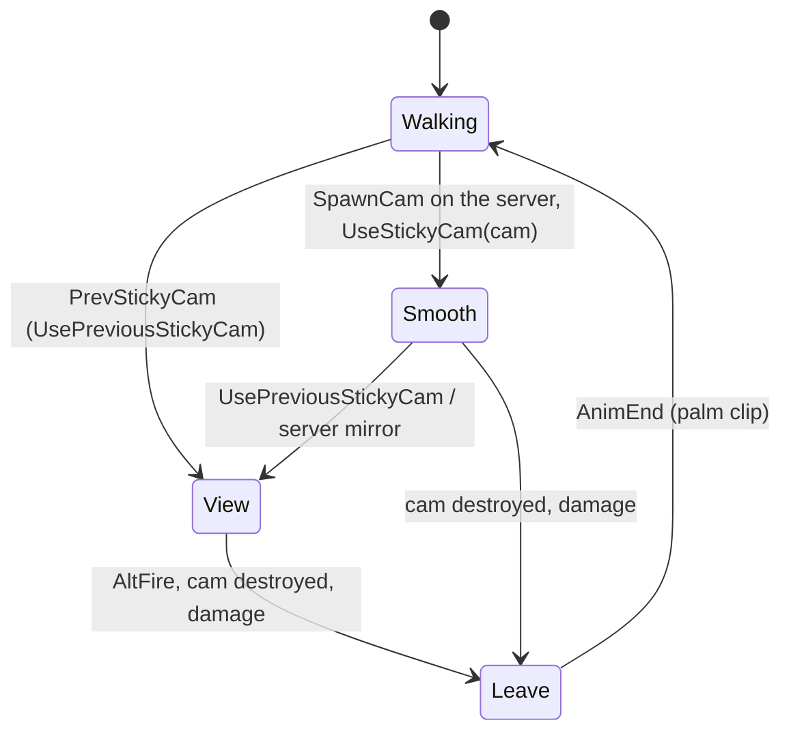

# Sticky cam (SGadStickyCam, SStickyCam, SStickyCamEmitter) and its remote view

Units:
- def:SBase.SGadStickyCam, nat:SBase.SGadStickyCam.UseStickyCam, nat:SBase.SGadStickyCam.CanUse,
  uc:SBase.SGadStickyCam:Use, uc:SBase.SGadStickyCam:SpawnCam, uc:SBase.SGadStickyCam:NetRoundVectorAxis,
  uc:SBase.SGadStickyCam:CreateStickyCam, uc:SBase.SGadStickyCam:TellClientToDecCharge, rep:SBase.SGadStickyCam.TellClientToDecCharge
- def:SBase.SStickyCam, uc:SBase.SStickyCam:Destroyed, uc:SBase.SStickyCam:Tick, uc:SBase.SStickyCam:Touch,
  uc:SBase.SStickyCam:PreBeginPlay, uc:SBase.SStickyCam:PostNetBeginPlay, uc:SBase.SStickyCam:PostBeginPlay,
  uc:SBase.SStickyCam:Timer, uc:SBase.SStickyCam:SpawnGaz, uc:SBase.SStickyCam:TakeDamage, uc:SBase.SStickyCam:EncroachedBy,
  rep:SBase.SStickyCam.Smoke_NbDoses, rep:SBase.SStickyCam.SpawnGaz
- def:SBase.SOrientableObject, uc:SBase.SOrientableObject:AcceptStickableGPO, uc:SBase.SOrientableObject:PostNetBeginPlay,
  uc:SBase.SOrientableObject:Destroyed, uc:SBase.SOrientableObject:Tick
- def:SBase.SStickyCamEmitter, uc:SBase.SStickyCamEmitter:EncroachedBy (its C++ tick ASStickyCamEmitter::Tick, game 0x10aa31c0,
  has no UFunction id; the gas point helper is 0x10aa3130 and the victim scan 0x10aa31f0)
- def:SBase.SStickyCamInteraction, uc:SBase.SStickyCamInteraction:PostBeginPlay, uc:SBase.SStickyCamInteraction:InitInteract
- uc:SBase.SPlayerController:UseStickyCam, uc:SBase.SPlayerController:UseStickyCamGas, uc:SBase.SPlayerController:ServerStickyCamGas,
  uc:SBase.SPlayerController:ServerSpawnStickyCam, uc:SBase.SPlayerController:RetirePredictedStickyCam,
  uc:SBase.SPlayerController:ReconcilePredictedStickyCam, uc:SBase.SPlayerController:GotoStickyInteractionMenu,
  uc:SBase.SPlayerController:UsePreviousStickyCam, uc:SBase.SPlayerController:StickyCamWasDestroyed,
  uc:SBase.SPlayerController:CleanStickyCamOnClient, uc:SBase.SPlayerController:LoseStickyCam, uc:SBase.SPlayerController:ReloadStickyCam,
  uc:SBase.SPlayerController:PrevStickyCam, uc:SBase.SPlayerController:CanUseCam, uc:SBase.SPlayerController:MirrorPredictedState,
  uc:SBase.SPlayerController:UpdateOrientableRotation, uc:SBase.SPlayerController:ServerUpdateOrientableRotation,
  uc:SBase.SPlayerController:PlayerTick (the predicted cam part)
- uc:SBase.SPlayerController:s_UseObject.* (BeginState, EndState, PlayerTick, PlayerMove, UpdateRotation, TopSynchro, StickyCamWasDestroyed),
  uc:SBase.SPlayerController:s_StickyCam_MenuInteraction.* (WheelUp, WheelDown, PlayerTick, CanIUseBinocular, BeginState, EndState,
  CanBeGrabbed, ClientDamage, ShowMenu, PlayerMove), uc:SBase.SPlayerController:s_UseObject_StickyCam_SmoothToPosition.* (PrevStickyCam,
  StickyCamWasDestroyed, BeginState, PlayerMove, EndState), uc:SBase.SPlayerController:s_UseObject_StickyCam.* (CanBeDropAttacked,
  CanBeElbowShocked, AnimEnd, AltFire, WheelUp, WheelDown, PlayerMove, EndState), uc:SBase.SPlayerController:s_UseObject_StickyCam_Leave.*
  (PlayerTick, AnimEnd, PlayerMove). The damage handlers of these states are in `spec/combat/state-damage-reactions.md`.

## Purpose
The spy's sticky cam is shot from the Shocker launcher onto a wall. The spy then looks through it from anywhere:
turns it within limits, zooms, and releases one dose of sleeping gas that knocks out a merc in front of it. Five cams
per pack; a cam that is destroyed or picked up comes back as a charge.

## Data
| Field | Default | Notes |
|---|---|---|
| SGadStickyCam.Charge | 5 | "Sticky Camera (5 Units Pack)" |
| SGadStickyCam.RefireRate | 1.0 s | |
| SGadStickyCam.MaxLaunchDist | 10000 uu | |
| SGadStickyCam.iNbSmokeChargeForCurrentSticky | -1 | gas doses the next cam gets (-1: its class default) |
| SGadStickyCam.iCurrentSelectedMenu, iCanUse[2] | 0, 0 | the sticky cam menu (0 new cam, 1 previous cam, 2 exit) |
| SGadStickyCam.TextMenu | "New cam", "Previous cam", "Exit" | localized |
| SStickyCam.Smoke_NbDoses | 1 | |
| SStickyCam.Smoke_ReusabilityPeriod / Smoke_RefillRate | 5 s / 0 | no refill timer by default |
| SStickyCam collision | 15 x 15 in defaults, set to 20 x 20 at PostBeginPlay | cylinder, `bAlwaysRelevant` |
| SStickyCam limits | pitch (0, -13000, 13000), yaw (0, -14000, 14000) | X is replaced by the placed rotation |
| SStickyCam zoom | fMinFOV 10, fMaxFOV 110, fCoeffZoomSpeed 0.1 | |
| SStickyCam sounds | activation StickCam_In_1, deactivation StickCam_Out_1, rotation StickCam_Zo_1, zoom JUMact, gas GRsmok_loop | |
| SStickyCam.InteractionClass | SStickyCamInteraction | radius 30, height 50, usable by spies, collision 75 x 75 based on the cam |
| SStickyCamEmitter | LifeSpan 6 s, RemoteRole SimulatedProxy, AutoDestroy | 15 sprites, life 5 to 7 s |
| SStickyCamEmitter GoInSmoke values | TimeBaseToCought 2.5, TimeBaseToFaint 1.0, TimeBaseToJamming 2.0, ForceBaseToJamming 0.25 | |
| SStickyCamEmitter.PawnsGazes[3], iNbPawnsGazes, RefLocation | | the gassed pawns, the gas point |
| SPlayerController.PredictedStickyCam, PredictedStickyCamDeadline | None, 0 | the client's local stand-in cam |
| SPlayerController.bStickyCamGasQueued, bStickyCamGasHeld | false | the gas key edge |

## Rules

### Firing a cam
1. **Use (gadget, Alt-fire)**: refused while `now - LastUsed < RefireRate` or with the Shocker holstered
   (`WeaponLoaded == 0`). If the pawn already uses a cam (`UsedObject != None`) the next cam gets the class default
   doses (`iNbSmokeChargeForCurrentSticky = -1`). `UseStickyCam(false)`; when it fails the HUD shows
   `TextCantSpawnStickyCam` for 3 s.
2. **UseStickyCam(bTest)** (native, decoded 0x10aa1e30) returns true when a cam can stick:
   1. needs the owner pawn, its weapon with a mesh, and the weapon drawn; unless testing, `now - LastUsed >=
      RefireRate`.
   2. no charge left (and not a tutorial map): the empty click (`SND_EmptyCharge`, volume 1, radius 100) and false.
   3. the aim: the weapon's FX bone, origin O and forward axis D. Start S = O - 10 D, end E = S + MaxLaunchDist D.
   4. a first line S to E against actors (other actors and world-geometry actors, stop at the first hit, skip
      backdrop surfaces): if it hits a gameplay object that refuses stickables (`AcceptStickableGPO()` false), fail.
   5. a second line S to E against everything that collides (level, movers, pawns, other actors, volumes): the hit
      must be world geometry, not a BlockingVolume, on a surface whose material does not have `bNoStickyCam`.
      Anything else fails (a laser projector is passed through, but the trace keeps one result, so it fails too).
   6. success: unless testing, `LastUsed = now`. N is the hit normal turned to face back along -D. The cam point
      P = hit location - 2.5 D, its rotation R = N's rotation. Four 5.5 uu probes push P out of nearby corners:
      along the side axis (R with yaw + 16384) both ways, then along world Z down and up; each probe that hits sets
      P = that hit + 5 n, with n its normal turned to face back along -D.
   7. unless testing, the event `SpawnCam(StickyCamClass, owner, P, R, iNbSmokeChargeForCurrentSticky, hit actor)`;
      return true.
3. **CanUse** (native 0x10aa2870): true when the owner pawn's `UsedObject` is None. Nothing in script calls it.
4. **SpawnCam** (simulated): the rotation is cut to its high byte (`& 0xFF00` per axis) and the location rounded
   with `NetRoundVectorAxis` (round half up: `int(v + 0.5)`, minus 1 when that is above `v + 0.5`), so a cam made on
   the client matches the server's.
   - Server (or standalone): `CreateStickyCam`; when a cam was made, `TellClientToDecCharge()` (server to owner:
     the owner's machine runs `DecCharge()`, which lowers its copy and asks the server to lower the real one; for a
     listen host's own player or offline it runs in place). One charge per cam in all cases.
   - Client: ask the server (`ServerSpawnStickyCam`); unless falling, also make a local predicted cam: no collision,
     its interaction object removed, `PostNetBeginPlay` run, kept in `PredictedStickyCam` with a 0.8 s deadline.
5. **CreateStickyCam**: spawn the class at P with rotation R, owned by the pawn. On a gameplay object the cam takes it
   as its base (a world-geometry one also lists the cam first in its `Attached`). A dose count other than -1 is
   written to `Smoke_NbDoses`.
6. **ServerSpawnStickyCam** (client to server): refused when the gadget is not the sender's pawn's or the pawn is dead.
7. **SStickyCam.PreBeginPlay**: on the server, when the owner pawn is not falling, the owner's controller
   `UseStickyCam(self)` enters the cam view at once. `Smoke_RefillRate != 0` starts a looping refill timer.
   **PostBeginPlay**: collision 20 x 20. **PostNetBeginPlay**: on a client, the server's cam that arrives while the
   own predicted cam is still alive does not play its activation sound; then the orientable start (rule 13).

### Using a cam
8. **UseStickyCam(cam)** (controller event): clear the gas edge flags, retire the predicted cam; a previous used cam
   is destroyed on the server and forgotten; `UsedObject = cam`; if alive, `MirrorPredictedState(
   's_UseObject_StickyCam_SmoothToPosition', keep previous state when coming from the menu)`.
   `MirrorPredictedState(state, bDontSave)`: change state here; a player without a local viewport also gets
   `PCChangeClientState` (as `MirrorState` without the acknowledgement refresh).
9. **s_UseObject** (base of the cam view): `PlayerTick` clears `bUsingNow` then the global tick; `BeginState` HUD
   state `s_Hud_UseObject`; `TopSynchro` on the input machine while repositioning plays SA_WALK_ST_2H; `PlayerMove`:
   `UpdateRotation`, the Use key leaves (`GotoWaitingState`), `bCrouchWithRoll` follows the stance, a still move;
   `UpdateRotation` as `spec/devices/cam-network.md` rule 7 (the cam's own angles, mouse above 150 scaled by
   `50 x sensitivity x dt x input x DesiredFOV / 110`, wrap, clamp on limits with both bounds non-zero, the rotation
   sound over 2 units, `UpdateOrientableRotation`); `EndState`: HUD state None, `UsedObject = None`,
   `UsedInterraction = None`, `AmbientSound = None`, the interaction post, `GotoWaitingState`. Ignores Fire, AltFire,
   PrevStickyCam. `StickyCamWasDestroyed` leaves to the previous state (on a hand-over-hand pipe, back to the wall or
   Vandamme) or to `s_UseObject_StickyCam_Leave`, then the global version.
10. **s_UseObject_StickyCam_SmoothToPosition** (the short entry): `BeginState`: FOV 110; on the input machine the
    palm clip (SA_PALM_USING when walking, else SA_NO_IK); the cam's `fVisionFOV = DesiredFOV`; HUD state
    `s_Hud_UseObject_StickyCam`. `PlayerMove`: `UpdateRotation`, `bCrouchWithRoll` from the stance, then true only
    when the previous state was `s_PipH_Fire4`; the cam is turned to face the pawn (rotation of pawn - cam); a held
    Use queues the gas (`bStickyCamGasQueued`); a still move. `EndState`: ambient sound off. `PrevStickyCam` empty.
    `StickyCamWasDestroyed`: leave as in rule 9, `CleanStickyCamOnClient`, then the base version. The entry ends in
    the camera native (`spec/native/camera.md` rule 4.4): once the view is within 80 uu of the cam,
    `ChangeState('s_UseObject_StickyCam', None, true)`.
11. **s_UseObject_StickyCam** (the view): ignores Fire, ChangeSpeed, PrevStickyCam; can be drop-attacked and
    elbowed.
    - `PlayerMove`: `bFire = 0`; zoom keys change `fVisionFOV` by `500 x fCoeffZoomSpeed x dt` per tick within
      [fMinFOV, fMaxFOV] and set the FOV; the gas: a queued gas or a new Use press (`bUsing` and not held last tick)
      calls `UseStickyCamGas`; `bStickyCamGasHeld = bUsing`; zoom sounds when the FOV moved (the original compares
      the FOV read after the zoom with itself, so they never trigger); `UpdateRotation`; the controller's ambient
      sound follows the cam's; a still move.
    - `WheelUp` / `WheelDown`: zoom by `3000 x fCoeffZoomSpeed x m_dT` (m_dT is the frame time) and set the FOV.
    - `AltFire`: unless a 2-hand landing clip plays on channel 0, leave: to the previous state when not walking, on a
      wall or in Vandamme, else to `s_UseObject_StickyCam_Leave`.
    - `AnimEnd(0)` of a 2-hand landing clip on the input machine: back to the 2-hand walk (stance) and SA_NO_IK.
    - `EndState`: ambient off, `bCrouchWithRoll` from the stance, no jump, HUD state None, the controller rotation
      levelled (pitch 0 from the pawn's rotation), `ResetFOV`, on the input machine SA_PALM_DESACTIVATE.
12. **s_UseObject_StickyCam_Leave** (extends the armed walk): ignores Fire, AltFire, PrevStickyCam; the global
    `PlayerTick`; a still move with `UpdateRotation`; at the end of the palm clip on the input machine: a spy with the
    pistol out holsters (SA_WALK_*_2Hto0H, `s_PlayerWalkingMario_T_2HToOH`), else `GotoWaitingState`.
13. **Damage in the cam states** (server, PawnTakeDamage; dead: the death or the fatal blast as everywhere).
    - Fly-in (`s_UseObject_StickyCam_SmoothToPosition`): `CleanStickyCamOnClient` first, for every hit. Charge and
      elbow run their handlers; a drop attack mirrors `s_FallDropAttacked`; a shock leaves the cam (mirrored, without
      saving the state: back to `PreviousState` on a horizontal pipe, on a wall or in Vandamme, else
      `s_UseObject_StickyCam_Leave`) then `Checkshock(Pill)`; any other hit leaves the cam the same way unless IK_Type
      is IKT_PIPH or IKT_JCVD or the damage is SDTBase_NoAnim. No hit animation.
    - View (`s_UseObject_StickyCam`, and the camera network view that extends it): a shock runs
      `Checkshock(Pill, true)` and goes on; charge, elbow and drop run their handlers and stop. Otherwise the view is
      left to `PreviousState` (mirrored, not saved); a previous state of `s_PlayerWaiting`, `s_ElbowShot_GoBackward`
      or `s_PlayerCharging` is first replaced by the walking state of the stance: a spy's 0H or 2H by WeaponLoaded, a
      merc's 2H.
    - Code: SPlayerController.StickyCamDamage.cs.

### The cam actor
13. **SOrientableObject**: `AcceptStickableGPO` false. `PostNetBeginPlay`: limit centres from the placed rotation,
    `iPitch`, `iYaw` and their replicated copies from it, the activation sound (radius 100). `Destroyed`: the
    deactivation sound; on the server, the owner pawn's `UsedObject` is cleared when it was this. `Tick` (every
    machine): a viewer that is not using this object adopts the replicated angles (a jump over 50 units plays the
    rotation sound); the rotation, zoom-in or zoom-out sound becomes the ambient sound for 0.2 s after its request;
    the actor rotation takes (`iPitch`, `iYaw`).
14. **SStickyCam.Tick**: on the local player's machine the cam is drawn at scale 0.1 while that player looks through
    it in `s_UseObject_StickyCam`, else at 1.0. Then the orientable tick.
15. **Touch** (server): a moving mover touching the cam destroys it, and the owner's controller gets
    `StickyCamWasDestroyed(None, doses)`. **EncroachedBy** (server): the same.
16. **TakeDamage**: ignored when the owner damages his own cam while looking through it. On the server the owner gets
    `StickyCamWasDestroyed`: with the picker's controller and the doses left when the hit location is the marker
    (-1, -2, -3) of a pick-up, else with None and the class default doses. Then the cam is destroyed.
17. **Pick-up**: the cam's interaction (spies only) calls `TakeDamage(1, picker's pawn, (-1, -2, -3), up, SDTBase)`.
18. **Timer** (refill, when enabled): `Smoke_NbDoses` stays clamped to [0, default] (the original's post-increment
    inside Clamp leaves the value unchanged).
19. **Destroyed**: on the server the interaction object goes; on the owner's machine a `UsedObject` pointing at the
    cam is cleared.

### Gas
20. **UseStickyCamGas** (controller): needs the used cam with doses. Server or standalone: `SpawnGaz` at once.
    Client: `ServerStickyCamGas(cam iPitch, iYaw)`, which writes the angles to the cam (and its rotation) on the
    server first, then `SpawnGaz`.
21. **SpawnGaz** (server): with doses left and `now >= NextUseTime`: `NextUseTime = int(now + 5)`, one dose less,
    spawn an `SStickyCamEmitter` at the cam (no collision check), play the gas sound (radius 100), count
    `Spy_StickyCamUsed`.
22. **Gas point** (native 0x10aa3130, the class's C++ `PostBeginPlay`: its only reference is slot 0xf8 of the
    ASStickyCamEmitter vtable 0x10bfb968, between the two `SetVolumes` and `setPhysics`, where AActor and AEmitter
    hold the empty 0x10968f20): once at spawn on every machine, `RefLocation = Location + 192 x forward axis of the
    emitter's rotation`.
23. **Gas scan** (native, every tick after the emitter's own tick, on every machine): for each pawn of the level:
    - already gassed (in `PawnsGazes`): its controller gets `GoInSmoke(2.5, 1, 2, 0.25)` every tick until the cloud
      dies (6 s), wherever the pawn goes;
    - else a pawn whose controller is an SPlayerController with an SBPawn that is not shocked, not lying on the
      ground, not wearing the gas mask, awake for more than 2 s (`now - fLastTimeWakeUp > 2`), within 128 uu of
      `RefLocation` (squared distance under 16384) and seen from the emitter (a line with flags 0x286 that hits
      nothing or the pawn): `GoInSmoke` with the same values and it is added to `PawnsGazes`.
    `GoInSmoke` only acts on mercs (`smoke-grenade.md` rule 5), so the faint comes 1 s after the first contact. The
    original does not bound the list at 3 entries; the port keeps at most 3 (a fourth victim would overwrite the
    emitter's own cough time).

### Menu, previous cam, refills
24. **PrevStickyCam** (exec, spies): with a sticky cam gadget: no used cam shows `TextNoStickyCamAvailable` (3 s);
    otherwise when `CanUseCam()` and not shocked, `UsePreviousStickyCam(UsedObject)`. `CanUseCam` is false in the
    class; the four resting walking states, the pipes, ladders, Vandamme, back to wall and a few others answer
    through their own ports (`spec/movement/walking.md`, `spec/combat`).
25. **UsePreviousStickyCam(cam)**: a given cam becomes the used one; with a used cam and alive: change state to
    `s_UseObject_StickyCam`, without saving the previous state when coming from the menu or the smooth entry.
26. **s_StickyCam_MenuInteraction** (extends walking; ignores Fire, AltFire, GadgetQuickChoice, the torch and laser
    keys, PrevStickyCam), entered by `GotoStickyInteractionMenu`: `BeginState` resets the button edges and allows
    being grabbed; on the input machine `iCanUse[1]` is whether a cam is in use and `iCanUse[0]` the result of
    `UseStickyCam(true)`. `WheelUp`/`WheelDown` (and the up/down keys on their press edge in `PlayerMove`) move
    `iCurrentSelectedMenu` over 0..2 with wrap, skipping 1 without a used cam. `PlayerTick`: back to waiting when the
    selected gadget is no longer the sticky cam; after the walking tick, while Alt-fire is no longer held: item 0
    fires a new cam with default doses (or shows `TextCantSpawnStickyCam` and leaves when `iCanUse[0]` was 0), item 1
    views the previous cam (or shows `TextNoStickyCamAvailable`), item 2 leaves; then the selection resets to 0.
    `ClientDamage` and `ShowMenu` leave to waiting (ShowMenu then opens the In-Game Menu). `EndState` forbids grabs again. Nothing in 4.0 script enters this
    menu (`GotoStickyInteractionMenu` has no caller).
27. **StickyCamWasDestroyed(instigator, doses)** (class): `LoseStickyCam(doses)`, then the instigator (a spy who
    picked it up) `ReloadStickyCam(doses)`.
28. **LoseStickyCam(doses)** (server to owner): the first sticky cam gadget among the first 4 selectable ones with
    fewer than its default charges gets `iNbSmokeChargeForCurrentSticky = -1`.
29. **ReloadStickyCam(doses)** (server to owner): the same search; that gadget gets one charge back (`AddCharge`) and
    `iNbSmokeChargeForCurrentSticky = doses`.
30. **CleanStickyCamOnClient** (server to owner): retire the predicted cam, `bCrouchWithRoll` from the stance, no
    jump, HUD state None, level the view, `ResetFOV`, on the input machine SA_PALM_DESACTIVATE.

### Prediction (Reloaded 4.0 script)
31. **PlayerTick**: with a predicted cam, `ReconcilePredictedStickyCam` each tick: when the server's cam has arrived
    as `UsedObject`, it takes the predicted cam's angles and FOV and the predicted cam is retired; while in a cam view
    without a used object, the predicted cam is used; after the 0.8 s deadline the predicted cam is retired and a cam
    view is left through `s_UseObject_StickyCam_Leave`.
32. **RetirePredictedStickyCam**: clears `UsedObject` when it was the predicted cam and destroys the predicted cam.
33. **UpdateOrientableRotation(obj, pitch, yaw)**: writes the angles; for any object but the predicted cam also sends
    `ServerUpdateOrientableRotation` (unreliable), which stores them in the replicated copies.
34. `PCChangeClientState` skips the server's order to enter the smooth entry while the predicted cam's deadline runs
    (`spec/game/netmode-branches.md`).

## States

## Constants
| Name | Value | Unit | Provenance | Source |
|---|---|---|---|---|
| Launch pull-back | 10 | uu | decoded | UseStickyCam 0x10aa1f9b |
| Hit pull-back | 2.5 | uu | decoded | 0x10aa21f3 |
| Corner probe / push | 5.5 / 5.0 | uu | decoded | 0x10aa2281, 0x10aa2367 |
| Sticky trace flags | 0x80290, then 0xc10bf | | decoded | UseStickyCam |
| Prediction deadline | 0.8 | s | decoded | SGadStickyCam const PredictionTimeout |
| Gas reuse | 5 | s | decoded | Smoke_ReusabilityPeriod |
| Gas point | 192 | uu ahead | decoded | 0x10aa3130 |
| Gas radius | 128 (16384 squared) | uu | decoded | 0x10aa31f0 |
| Wake grace | 2 | s | decoded | 0x10aa31f0 |
| Zoom keys / wheel | 500 / 3000 x 0.1 | deg per s | decoded | s_UseObject_StickyCam |
| Self view scale | 0.1 | | decoded | SStickyCam.Tick |
| Pick-up marker | (-1, -2, -3) | | decoded | SStickyCamInteraction.InitInteract |

## Network
- The client predicts its own cam and view; the server spawns the real one and mirrors the view state. The cam is
  `bAlwaysRelevant`, `Smoke_NbDoses` replicates.
- The charge: the server's `TellClientToDecCharge` reaches the owner, whose `DecCharge` lowers its own copy at once
  and asks the server (`ServerDecCharge`) to lower the replicated value: one charge per cam.
- Angles: the user's machine sends them unreliably; non-users adopt the replicated copies.
- Gas: `SpawnGaz` runs on the server (`ServerStickyCamGas`); the emitter replicates (SimulatedProxy) and its scan
  runs on every machine; the client-side `GoInSmoke` decides the merc's faint (`smoke-grenade.md` Network).

## Edge cases
- A side surface exactly parallel to the shot (its normal at 90 degrees to D) fails the "face back" test only by
  equality: `n . D >= 0` flips it, so a probe that hits such a surface moves the cam 5 uu past that face instead of
  away from it.
- A cam fired while falling is made on the server but the view is not entered (PreBeginPlay checks the physics).
- Picking up an enemy's cam is spies only (the interaction's `UsableBy`), so in practice spies pick up team mates'
  cams; the picker gets a charge only if he has one missing.
- `TakeDamage` from the owner while viewing is ignored, so the spy cannot shoot his own cam out from its view.
- Network cameras (SCamNetwork extends SStickyCam) have no owner pawn: the inherited damage handlers fail and the
  `bNoDelete` camera survives (`spec/devices/cam-network.md` rule 13).

## Evidence
- local/re-out/uc/SBase/SGadStickyCam.uc, SStickyCam.uc, SStickyCamEmitter.uc, SStickyCamInteraction.uc,
  SOrientableObject.uc, SPlayerController.uc (functions near 6851 to 7130, 7935 to 7970, states 24872 to 26180).
- Game natives (private Ghidra copy, local/ghidra-work/gadgets): UseStickyCam 0x10aa1e30, CanUse 0x10aa2870,
  ASStickyCamEmitter::Tick 0x10aa31c0, gas point 0x10aa3130, scan 0x10aa31f0. Global vectors 0x10ccacbc (0, 0, 1)
  and 0x10ccacc0 (zero), identified from FindBestAxisVectors 0x10950110.
- local/reflect/game.json: Material.bNoStickyCam at 0x38; event names SpawnCam, AcceptStickableGPO, GoInSmoke.

- Stick surface data (2026-10-26): the native reads `Material + 0x38` of the hit (`bNoStickyCam`, an int, no
  fallback or wrapped material followed). The converter writes the `noStickyCam` collision material flag from the
  same property of the same material object (class default when unset). Checked against the original packages:
  all 19 converted materials whose names say no sticky cam and carry the flag have `bNoStickyCam = 1` in their
  package (for example Penitentiary_TXT Floor_01_BH_D_NoSticky, Tex_Egouts SEV_BrickStickyCam); the two named
  "NoSticky" without the flag (Penitentiary_TXT RoofTile00_PTH_D_NoSticky, aqua_lightLUM1_NoSticky) have no
  `bNoStickyCam` property in the package either, so the converted data agrees with the original.

- Stick line decode (2026-10-26, game 0x10aa2107..0x10aa2170): the hit of `SingleLineCheck(0xc10bf)` is walked
  through its Next links: an actor that is bWorldGeometry and not a BlockingVolume passes when its Material is None
  or has `bNoStickyCam == 0`; a laser projector is stepped over (to the next result, which a single-result trace
  does not have); anything else (no hit, a pawn, a mover, a gameplay
  object that is not world geometry, a BlockingVolume, a flagged material) fails.
- Which surfaces the line sees: zone, sound, physics, damage and sensor volumes are not traced at all
  (AVolume::ShouldTrace under OnlyProjActor, `spec/native/collision-traces.md`); fake backdrop BSP surfaces
  (PF_FakeBackdrop) are dropped by SingleLineCheck with nothing behind them reported, so a cam aimed at a backdrop
  fails; a BlockingVolume is seen (world geometry by 0x80) and refuses the cam.
- Which material the hit reports: BSP, the surface's material; a static mesh, the actor's `Skins[slot]` when set,
  else the mesh section's material (`spec/native/collision-primitives.md` LineCheck rule 3). `bNoStickyCam` is a
  Material field, so every material class (Texture, Shader, FinalBlend, Combiner, TexModifier...) carries its own
  copy; the native reads the reported object's own value and never the texture inside a wrapper. The converter does
  the same: the property of the reported object (stored, else its class default).
- Survey of the 84 converted maps (2026-10-26): 162 collision materials with the flag in 50 maps; none in Club,
  Deft, Moun, Pola, Stee, Vert, Ware, SancE and the TME/TSP maps.

## Open questions
- Scenario: fire a cam at a wall corner and record the cam location (confirms the probe order and push).
- Whether Reloaded changes the gas scan (the emitter tick is not in the Reloaded hook list).
- Reloaded's sticky cam code (2026-10-28 reading of Reloaded.Core): at start-up it sets SStickyCam's class defaults of
  `iReplicatedPitch` and `iReplicatedYaw` to 12345678 (0x1000f790), so a cam whose angle is 0 (yaw 0 is east) still
  replicates it instead of being taken for the default; this is the "activation sound for clients when fired east"
  fix (rl:fix.stickycam_east_sound). Not ported: the rewrite's first bunch carries the cam's exact rotation and
  PostNetBeginPlay sets both angles from it, so a client's cam already starts at the right angle; whether the
  original's silence came from this alone is not known. The leave state hook (spec/native/reloaded-hooks.md rule 36,
  rl:fix.stickycam_stuck) is not ported. No Reloaded code deals with launching with no cams left
  (rl:fix.stickycam_none_left) or with the camo selection after a cam (rl:fix.camo_slot2): those are the Enhanced 4.0
  script, which the rewrite ports as is (rules 1 and 2: no charge gives the empty click and nothing else).
