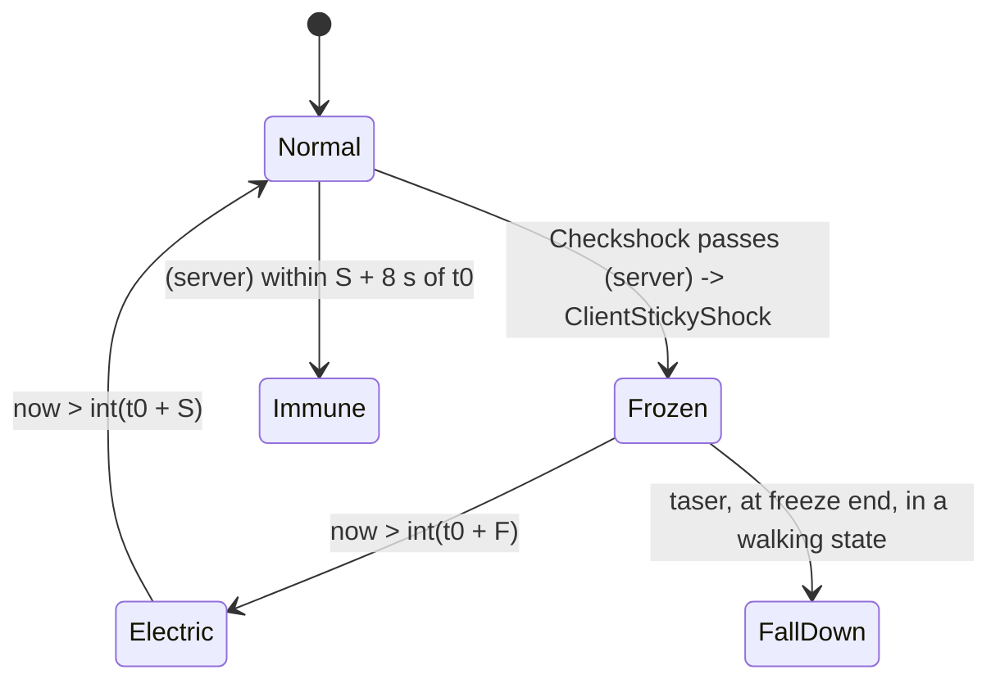

# Sticky shock on the victim (freeze, electric state, wet bonus, head-shot HUD shutdown)

Units:
- uc:SBase.SPlayerController:Checkshock, uc:SBase.SPlayerController:ClientStickyShock, uc:SBase.SPlayerController:PawnTakeDamage (SDTStickyShocker branch),
  uc:SBase.SPlayerController:s_PlayerWalking.PawnTakeDamage (sticky branch), uc:SBase.SPlayerController:StandardReactionsToDamage (ShockInstigator and taser parts),
  uc:SBase.SPlayerController:PlayerTick (shock timers), uc:SBase.SPlayerController:Vibration_StickyShock
- uc:SBase.SHud:HudShutDown, uc:SBase.SHud:StopHudShutDown, uc:SBase.SHud:StopHudPerturbation, nat:SBase.SHud.SetHudPerturbationLength
- uc:SBase.SBasePawn:StickyShockSfx, uc:SBase.SBasePawn:evStickyShockSfx
- def:SBase.SPAWNDEFENSE (Shock_*), def:SBase.SPawnAttaque (Shock_*), def:SBase.SPlayerController (TempsInvulSticky, fRainFreezeFactor)

## Purpose
What happens to a pawn hit by the Shocker Gun (or the merc taser): movement and input freeze, an electric state that
blocks firing and gadgets, a re-shock immunity window, a HUD perturbation, a longer HUD shutdown on a head shot
(mercs only), torch malfunction, goggles reset, and the scope closed.

## Data
| Field | Owner | Default | Notes |
|---|---|---|---|
| Shock_FreezeDuration | SPAWNDEFENSE / SPawnAttaque | 3.5 s / 3.0 s | |
| Shock_Duration[15] | SPAWNDEFENSE / SPawnAttaque | all 1.0 / all 0.0 | per PillTag - 1 |
| Shock_HeadShotHudSfxDuration | SBasePawn | 9.0 s | |
| Shock_AmplitudeCoeff | both | 1.0 | native |
| Shock_SpeedCoeffWhenFreezeStop | merc / spy | 0.0 / 1.0 | native (live CDO) |
| fRainFreezeFactor | SPlayerController | 1.3 | float32 1.2999999523 |
| TempsInvulSticky | SPlayerController | 8.0 s | |
| RealTimeInvulSticky | SPlayerController | 5.0 s initially | recomputed per shock |
| TimeShock / TimeShockForGrab | SPlayerController | 0 | |
| fGrabInvulneralbilityTimeAfterStickyShock | SPlayerController | 5.0 s | grab spec |
| iTimeToStopStickyShock / iTimeElecStickyShock | SPlayerController (int) | 0 | whole seconds |
| iDontUpdatePadInput | SPlayerController (int) | 0 | input freeze flag |
| bStickyShocking, bStickyShockedInTheHead, bWet | SBasePawn | false | none replicated |
| bTazered | SPlayerController | false | |
| ShockInstigator / ShockInstigatorTime | SPlayerController | | stats only |

## Rules
1. **Entry.** Any `PawnTakeDamage` with `SDTStickyShocker` first runs `StandardReactionsToDamage`, which records
   `ShockInstigator = instigatedBy`, `ShockInstigatorTime = now`, stops the scope, and (for PillTag in 1..15) applies
   `int(0 * table) = 0` damage. For the taser (`PillTag == -10`) it deals `int(default.Health * 0.51)` = 51 when the
   pawn is not `bStickyShocking` on the server and sets `TimeShock = now - 2 * RealTimeInvulSticky`. Then, if the pawn
   survived, the state's PawnTakeDamage calls `Checkshock(PillTag)` (most walking states pass `bPlayAnim = true`; the
   global handler passes false).
2. **Checkshock(PillTag, bPlayAnim)** (server): applies when `PillTag != -10 && now - TimeShock > RealTimeInvulSticky`,
   or `PillTag == -10 && !SBPawn.bStickyShocking`. Then:
   - `F = Shock_FreezeDuration`, times `fRainFreezeFactor` if `SBPawn.bWet`;
   - `S = F + Shock_Duration[PillTag - 1]` (UE2 clamps an out-of-range static array index to 0..14, so the taser's
     -11 and a PillTag of 0 read element 0);
   - `RealTimeInvulSticky = S + TempsInvulSticky`; `TimeShock = TimeShockForGrab = now`;
   - `ClientStickyShock(PillTag, bPlayAnim)`;
   - head-shot stat: if `PillTag == 1`, the victim is a merc, and the instigator recorded this same tick is a player,
     increment the instigator's `Spy_ShockerGunHeadshots`.
   Otherwise (immune), if the instigator recorded this tick is a spy player, he hears StikyShok_Paf1 (feedback).
   `ShockInstigator` is cleared in both cases.
3. **ClientStickyShock(PillTag, bPlayAnim)** (server -> owning client, reliable), in order:
   1. Cancel fire and gadget input: `bAltFire = 0`, ballistic gauge 0, `bFire = 0`, `TimerUSe = now`,
      `fThrowForce = 0`, `bUsingNow = false`.
   2. Recompute `F` and `S` as in Rule 2 (client copy) and `RealTimeInvulSticky`.
   3. Pad rumble for `F` seconds.
   4. `bStickyShockedInTheHead = (PillTag == 1)`; `bStickyShocking = true`; `iDontUpdatePadInput = 1`.
   5. If scoped, `ClientStopBinoculars()`.
   6. Pawn action SA_DMG_ELECTRIC (53) or SA_DMG_ELECTRIC_NOANIMS, forced. On every machine that runs the action,
      the native `ASBasePawn::ExecuteAction` (game 0x10ad6840, execute-action.md actions 53 and 54) calls
      `BeginStickySkin` (the Stickess body and head shaders), sets `bStickyShocking` and calls `evStickyShockSfx(1)`:
      `StickyShockSfx` spawns any missing one of the 7 SEffectShockedPawnEmitter at, and attached to, `B R ForeArm`,
      `B L ForeArm`, `B R Calf`, `B L Calf`, `B Pelvis`, `B Head`, `B Spine2` (the second turned like the right
      forearm), skipped on a dedicated server's own copy; the first carries a blinking blue light (LT_Blink, hue 145,
      saturation 174, brightness 150, radius 10). SA_DMG_ELECTRIC_STOP (55) clears `bStickyShocking` and calls
      `RestoreSkins` and `evStickyShockSfx(0)` (all seven destroyed). The jammer's SA_JAMMER_START and STOP (271,
      272) use the same sparks.
   7. Merc: weapon `GotoState('s_Dmg_Electric')` (laser off, no reticle, electric clip).
   8. `Goggle.ResetVisionMode()` (back to normal view with the goggle-up animation).
   9. Torch (if the pawn has one): `Malfunction(S)`.
   10. `PillTag == -10`: `bTazered = true`.
   11. `PillTag == 1`: `SHud.HudShutDown(1.0, F + Shock_HeadShotHudSfxDuration)`; the HUD only applies it to mercs
       (`HudShutDownLength = F + 9`, 1 s close time, HUD message 7, shutdown sound).
   12. `SHud.SetHudPerturbationLength(S)` (native: HUD perturbation for S seconds; while it lasts reload, full
       reload, goggle switching and scope entry are refused).
   13. `iTimeElecStickyShock = int(now + S)`; `iTimeToStopStickyShock = int(now + F)` (truncated toward zero).
   14. Play StikyShok_Paf1 and RA_onoPaf to the victim.
4. **While frozen** (`iDontUpdatePadInput != 0`): exec Fire, AltFire, SwitchROF, the torch and laser keys, the
   goggle keys and the binoculars are refused; `ComputeCrouchOrRoll` is skipped. Gadget selection (keys 1..6, wheel)
   is not blocked by the freeze. Movement freeze
   itself is done by the native input and pawn code (`Shock_AmplitudeCoeff`, `Shock_SpeedCoeffWhenFreezeStop`).
5. **End of freeze** (PlayerTick, when `iDontUpdatePadInput != 0 && now > iTimeToStopStickyShock`):
   `iDontUpdatePadInput = 0`, action SA_DMG_ELECTRIC_STOP_ANIM; merc weapon in `s_Dmg_Electric` or `s_Selected` ->
   `s_Dmg_Electric_End`; if `bTazered`: clear it and, when in a plain walking state (St2H, St0H, Cr0H, Cr2H), enter
   `s_FallDown` at label `DIE_InPlace` (knock-down).
6. **End of electric state** (PlayerTick, `bStickyShocking && now > iTimeElecStickyShock`): `bStickyShocking = false`,
   action SA_DMG_ELECTRIC_STOP, the same weapon transition. While `bStickyShocking` the merc cannot fire
   (`Fire` guard), cannot use gadgets (AltFire), cannot switch torch or laser, and the spy cannot cloak.
7. **State overrides** of `Checkshock` and `ClientStickyShock` (inactive, charging, grabbing, terminating, co-op and
   ladder-help states) change how the shock interrupts those moves; they are listed in INDEX.md as not specced and
   must be ported with their owning states.
8. **Re-shock immunity** is measured from `TimeShock` on the server: a new shock applies only after
   `S + 8` seconds (12.5 s for a dry merc).

## States

## Constants
Durations for a hit at time t0 (before whole-second truncation of the end times):

| Victim | Freeze F | Electric S | Re-shock after | Head-shot HUD shutdown | Torch malfunction |
|---|---|---|---|---|---|
| Merc, dry | 3.5 s | 4.5 s | 12.5 s | 12.5 s (1 s close) | 4.5 s |
| Merc, wet | 4.55 s | 5.55 s | 13.55 s | 13.55 s | 5.55 s |
| Spy, dry | 3.0 s | 3.0 s | 11.0 s | none | none |
| Spy, wet | 3.9 s | 3.9 s | 11.9 s | none | none |

| Name | Value | Unit | Provenance | Source |
|---|---|---|---|---|
| Wet factor | 1.3 | | decoded | def fRainFreezeFactor |
| Immunity add | 8 | s | decoded | def TempsInvulSticky |
| Initial immunity | 5 s from level time 0 | s | decoded | def RealTimeInvulSticky, TimeShock 0 |
| Head-shot HUD extra | 9 | s | decoded | def Shock_HeadShotHudSfxDuration |
| Taser damage | 51 | HP | decoded | int(100 * 0.51) |
| Grab immunity after a shock | 5 | s | decoded | fGrabInvulneralbilityTimeAfterStickyShock |

## Network
- Server: Checkshock, immunity, stats, taser damage. `bStickyShocking` is not replicated (reflection), so the
  server copy of a remote pawn's `bStickyShocking` stays false; server logic that needs "recently shocked" uses
  `TimeShock` / `TimeShockForGrab` instead.
- Owning client: everything in ClientStickyShock and the PlayerTick timers. Other clients see the shock through the
  pawn action stream (SA_DMG_ELECTRIC) and the native spark effects.
- `ClientStickyShock` is reliable server -> client; `SGadTorche.Malfunction` is then a client -> server RPC.

## Edge cases
- End times are truncated: the freeze ends on the first tick with `now > int(t0 + F)`, between 0 and 1 s early.
- No shock can apply in the first 5 s of level time (`now - 0 > 5` needed with the default RealTimeInvulSticky).
- A PillTag of 0 or outside 1..15 reads `Shock_Duration[0]` (clamped index), so all merc hits give S = F + 1.
- Water conduction shocks use the shot's PillTag for every pawn found in the water.
- An immune merc still gets the scope closed and the instigator recorded (Rule 1 runs before the test).
- `bWet` has no script writer; it is set natively (rain volumes or water). SteeE has no ERainVolume actor, so the wet
  bonus is unlikely to be reachable on the slice map (Open questions).

## Evidence
- local/re-out/uc/SBase/SPlayerController.uc 3931-3993 (ClientStickyShock), 4085-4140 (PawnTakeDamage), 4260-4294
  (Checkshock), 4296-4420 (StandardReactionsToDamage), 3256-3290 (PlayerTick timers); SHud.uc 660-689.
- local/formats/classdefaults.json and local/reflect/game_cdo.json (SPAWNDEFENSE, SPawnAttaque, SPlayerController).
- Bridge docs/GADGET_TIMINGS.md row "Shocker gun hit on a merc", gadget_timings.json `on_player_effects`.
- SHud.SetHudPerturbationLength native 0x10a92900 (1457); SHud.ProcessSFX is replaced by Reloaded.Core (rva 0x23660).
- evStickyShockSfx is name 0x282c and BeginStickySkin 0x2831 of the game's hardcoded names (FName::StaticInit);
  their only callers are the event thunks 0x10ae75b0 and 0x10ae7590, called from ASBasePawn::ExecuteAction.

## Open questions
- What sets `bWet` (native pawn tick: rain volume, water surface, sprinklers?). Scenario: shock a merc standing in an
  SFlaque puddle and under a sprinkler on another map; compare freeze length.
- Native freeze contract: how `Shock_AmplitudeCoeff` and `Shock_SpeedCoeffWhenFreezeStop` shape movement during and
  after the freeze, and whether camera input is frozen too. Trace pawn velocity and rotation through a shock.
- `SetHudPerturbationLength` and the HUD shutdown drawing (HUD spec), including `bPerturbation` start and end times.
