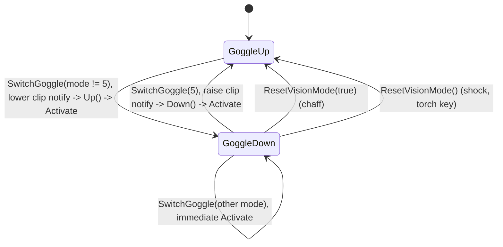

# Vision goggles (SGoggle): modes 5, 34, 36, 37, 38, 50 and switching

Units:
- uc:SBase.SGoggle:PostBeginPlay, uc:SBase.SGoggle:Activate, uc:SBase.SGoggle:SwitchMode, uc:SBase.SGoggle:SwitchVisionMode,
  uc:SBase.SGoggle:ResetVisionMode, uc:SBase.SGoggle:TellPawnAboutCurrentVisionMode,
  uc:SBase.SGoggle:GoggleUp.SwitchGoggle, uc:SBase.SGoggle:GoggleUp.Up, uc:SBase.SGoggle:GoggleUp.Down,
  uc:SBase.SGoggle:GoggleDown.SwitchGoggle, uc:SBase.SGoggle:GoggleDown.Up, uc:SBase.SGoggle:GoggleDown.Down,
  uc:SBase.SGoggle:SwitchGoggle, uc:SBase.SGoggle:Down, uc:SBase.SGoggle:Up (empty globals, only the state versions act), def:SBase.SGoggle
- uc:SBase.SPlayerController:SwitchHeadset, uc:SBase.SPlayerController:ClientChaffed, uc:SBase.SPlayerController:CanSwitchGoggleManually,
  uc:SBase.SPlayerController:PostBeginPlay (goggle spawn), uc:SBase.SPlayerController:SwitchBinocularVision (spy branch)
- uc:SBase.SGameInfo:ResetVisionMode
- uc:SBase.SBasePawn:AnimEvent_GoggleSwitchDown, uc:SBase.SBasePawn:AnimEvent_GoggleSwitchUp, uc:SBase.SBasePawn:ExecuteActionForGoggle,
  uc:SBase.SBasePawn:TestAndSetEMFVisible, uc:SBase.SBasePawn:SetEMF, uc:SBase.SBasePawn:UnSetEMF, uc:SBase.SBasePawn:SetEMFToServer,
  uc:SBase.SBasePawn:UnSetEMFToServer
- uc:SBase.SGoggleBeam:ChangeSkin, uc:SBase.SGoggleBeam_ATT:PostBeginPlay, uc:SBase.SPawnAttaque:PostBeginPlay (beam spawn),
  uc:SBase.SPAWNDEFENSE:PostBeginPlay (beam spawn), def:SBase.SGoggleBeam, def:SBase.SGoggleBeam_ATT, def:SBase.SGoggleBeam_DEF
- nat:SBase.SBasePawn.ExecuteAction (goggle actions only)

## Purpose
Per-player vision modes. Spies: night vision (34) and thermal (36), plus the binocular overlay flag (50). Mercs:
motion tracking (37) and electromagnetic (EMF, 38). Normal view is 5. Switching is gated by an animation (goggles
lowered or raised by the pawn) and by server availability flags. This spec covers the logic; how each mode renders
belongs to the renderer (Bridge docs/VISION_MODES.md).

## Data
| Field | Default | Notes |
|---|---|---|
| SGoggle.CurrentMode | 5 | REN_DynLight 5, REN_NightVision 34, REN_ThermalVision 36, REN_MotionTrackingVision 37, REN_EMFVision 38, REN_Binoculars 50 |
| SGoggle.SaveMode | 0 | unused |
| SGoggle.bNoThermalAvailable | false | no writer in script |
| SGoggle.bTorcheOn | false | merc torch was on before a vision mode |
| SGoggle.MotionTrackingVision | None | spawned on first mode 37 |
| SGoggle.SPC | owner controller | |
| Messages | MTOn "Motion Tracking on", MTOff "Motion Tracking off", EMFOn "Electromagnetic Tracking on", EMFOff "Electromagnetic Tracking off" | 3 s auxiliary |
| PlayerController.RendMap | | the render mode the engine uses |
| SBasePawn.bGogglesUp | true | toggled when the channel 18 goggle clip ends |
| SBasePawn.bBinocularsOn | false | spy binocular overlay flag |
| GRI availability | bAvlb_SPY_NightVision, bAvlb_SPY_ThermalVision, bAvlb_MERC_MotiontrackingVision, bAvlb_MERC_EMFVision | server settings, replicated in GRI |

Goggle clips (decoded from SPerso.ukx, normalised notify times): GoglStAlDn2 16 frames at 15 fps (1.067 s), notifies
AnimEvent_GoggleSwitchDown and AnimEvent_GoggleSwitchUp at 0.255..0.256 (about 0.27 s); spy GoglStSpDn2 (weapon out)
same length, 0.266 / 0.268; spy crouched GoglCrAlDn0 7 frames at 8 fps (0.875 s), Down at 0.338 (0.30 s), Up at 0.553
(0.48 s).

Pawn actions (SBasePawn consts): SA_VISION_EMF 66, SA_VISION_NIGHT 67, SA_VISION_THERMAL 68, SA_VISION_MOTION 69,
SA_GOG_SWITCH_WITHOUTANIM 70, SA_GOG_HEADMVT_ON 71 (lower goggles), SA_GOG_HEADMVT_OFF 72 (raise), SA_GOG_DYNNOANIM 269.

## Rules
1. **Spawn.** `SPlayerController.PostBeginPlay` spawns one SGoggle (owner = controller) when the machine is a client,
   standalone or a listen server, and the player is not a pure spectator. A dedicated server has no goggles, so
   every goggle call there does nothing. `SGoggle.PostBeginPlay`: `SPC = Owner`, base on the pawn, `CurrentMode = 5`.
2. **Keys.** F1 `SwitchHeadset 1`, F2 `SwitchHeadset 2`, Tab `SwitchHeadset 3`. `SwitchHeadset(i)` returns at once if
   the game is paused, `now < iTimeToStopStickyShock`, `iDontUpdatePadInput > 0`, or the requested mode is disabled
   (spy i = 1 needs night vision, i = 2 thermal; merc i = 1 motion, i = 2 EMF). For i = 3 (cycle): return if both of
   the team's modes are disabled; if only the second mode is available and the view is normal, switch straight to
   mode 2 (`SwitchMode(2)`); if the second mode is disabled and the first is on, switch off (`SwitchGoggle(5)`).
   Then, if the HUD is perturbed, projected, snowed (`bNeigeDisp`) or the player is jammed, show HUD number message 7
   and return. Otherwise `Goggle.SwitchMode(i)` (unless already handled above).
3. **SwitchMode(i)**: 1 -> spy 34, merc 37; 2 -> spy 36, merc 38 (both through `SwitchVisionMode`); 3 -> from 5 to
   mode 1, from 34 or 37 to mode 2, otherwise `SwitchGoggle(5)`; 10 -> spy only: toggle `bBinocularsOn` and
   `SwitchVisionMode(50)` (used by the spy binoculars state).
4. **SwitchVisionMode(m)**: refuse 36 when `bNoThermalAvailable`. If `CurrentMode != m`, `SwitchGoggle(m)`; else
   `SwitchGoggle(5)` (the same key again turns the mode off).
5. **State GoggleUp** (goggles raised, normal view; initial state):
   - `SwitchGoggle(m)`: remember the previous mode; unless m is 50 set `CurrentMode = m`. If now 5 and no binoculars:
     when coming from another mode, restore the merc torch (`Torche.Use(0)` if `bTorcheOn` and neither torch nor
     laser is on), clear `bTorcheOn`, `ResetVisionMode(true)`, `TestAndSetEMFVisible()`; return. Otherwise: for a merc,
     if the torch is on set `bTorcheOn = true` and unload it, else clear `bTorcheOn`; send the pawn the matching
     SA_VISION action; play SA_GOG_HEADMVT_ON (lower the goggles); unless m is 50, `TestAndSetEMFVisible()`.
   - `Up()` (and `Down()`): `Activate()`, then go to GoggleDown if the mode is not 5 or binoculars are on.
6. **Animation gate.** The pawn's goggle clip on channel 18 fires `AnimEvent_GoggleSwitchDown` (only if
   `bGogglesUp`) and `AnimEvent_GoggleSwitchUp` (only if not `bGogglesUp`); they call `Goggle.Down()` / `Goggle.Up()`.
   `bGogglesUp` flips when the channel 18 clip ends. So a mode takes effect about 0.27 s after the key (standing)
   and the view returns to normal at the same point of the raise clip. The rate is decoded (execute-action.md cases
   66 to 72): the vision actions (66 to 70, 269) only raise ExecuteActionForGoggle(Action) for the script; 71 and 72
   play the head clip GoglStAlDn2 (a spy with a loaded weapon: GoglStSpDn2) on channel 18 at rate 1, blending in
   from B Head over 0.3 s.
7. **State GoggleDown** (goggles on the eyes, a mode active):
   - `SwitchGoggle(m)`: unless m is 50, remember and set `CurrentMode = m`. If m is 50 and binoculars are now off:
     when the mode is 5, raise the goggles (SA_GOG_HEADMVT_OFF). Else if the mode is 5 and no binoculars: merc torch
     restore as in Rule 5 (else clear `bTorcheOn`), then SA_GOG_HEADMVT_OFF. Else (switching between two modes
     while down): SA_VISION action, SA_GOG_SWITCH_WITHOUTANIM, and the switch is immediate (`Activate()`; for m = 50
     only `RendMap = CurrentMode`). Unless m is 50, `TestAndSetEMFVisible()`.
   - `Down()` (and `Up()`): `Activate()`, then go to GoggleUp if the mode is 5 and binoculars are off.
8. **Activate()** (local): put the motion tracker in `s_Inactive` if present; stop the three loop sounds
   (JUMloop, VisionNight_loop, Emf_fond); then by mode: 36 thermal and 34 night play start sounds and their loop;
   37 plays the motion in/out sound and the loop, spawns the SMotionTrackingVision actor once (PlayerOwner = SPC),
   puts it in `s_Active`, message MTOn; 38 plays the EMF sounds, message EMFOn; 5 for a merc shows MTOff or EMFOff
   according to the previous `RendMap`. Finally `SPC.RendMap = CurrentMode` (the renderer switches).
9. **ResetVisionMode(bNoAnim)**: with bNoAnim: `CurrentMode = 5`, `Activate()`, SA_GOG_DYNNOANIM, go to GoggleUp. Else
   if channel 18 is animating: `CurrentMode = 5`, SA_GOG_HEADMVT_OFF forced, `Activate()`. Else `SwitchGoggle(5)` then
   `Up()`. Callers: sticky shock (with animation), chaff (`ClientChaffed`, no animation, every tick in a chaff field),
   `SGameInfo.ResetVisionMode` at spawn, the merc torch key in modes 37/38.
10. **Merc torch** never shines in a vision mode (`merc-flashlight.md` Rule 10). Spies have no torch.
11. **Who sees the goggle lights** (SGoggleBeam meshes on bone `B Head`): spies get SGoggleBeam_ATT (relative yaw
    1500), mercs SGoggleBeam_DEF (yaw 1250). A spy's beam is destroyed on any machine whose local player is a merc,
    so mercs never see spy goggle lights. The beam's mode follows the pawn actions: 68 -> 1 and 67 -> 2 (green), 69 ->
    3 (motion skin), 66 -> 4 (EMF skin), 72 and 269 -> 5 for a merc (orange) or 0 for a spy (no skin change).
    The full glow rules (spawn, skins, drawing) are in goggle-glow.md.
12. **EMF visibility** (`TestAndSetEMFVisible`, on the controlling machine): a spy is EMF-visible while any of:
    weapon drawn, goggle beam mode not 0 or 5 (a vision mode on), binoculars on, spy-marked, cloak target non-zero,
    phospho skin active. Mercs always are. Visible -> weapon `SetEMFWeapon` (`EMFOpacity` 1) and `SetEMFToServer`
    (server `SetEMF`: `bEMFIsOn = true`, `EMFOpacity = 1`); else `UnSetEMFWeapon` (0.3) and `UnSetEMFToServer`
    (`bEMFIsOn = false`, `EMFOpacity = 0`). Server `SetEMF` / `UnSetEMF` also call the weapon's `SetEMFWeapon` /
    `UnSetEMFWeapon`, so its replicated values follow. The two are server functions: a client sends them only for
    the pawn it controls (dropped for any other). Phospho skin active means `PhosphoSkinTime > 0` and not reached.
    `RestoreSkins` (also at the end of SPawnAttaque.PostBeginPlay) calls `TestAndSetEMFVisible` for a spy that is
    neither wet nor phospho on a machine whose local player is a spy (no local player reads as a spy), so on a
    dedicated server the spy starts EMF hidden; otherwise it keeps the class default (`EMFOpacity` 0.3, off) until
    its owner tests. Drawing in mode 38 is a renderer rule: the pawn view takes the live replicated values.
13. **Gameplay side effects of modes** owned elsewhere: flash blindness immunity in 36/37/38 (flash spec); cloak not
    drawn in vision modes (renderer); lasers drawn in 36 and 38 only (renderer); motion tracking (`motion-tracking.md`).

## States

## Constants
| Name | Value | Unit | Provenance | Source |
|---|---|---|---|---|
| Mode codes | 5, 34, 36, 37, 38, 50 | | decoded | SGoggle consts |
| Mode activation delay, standing | 0.255 x 1.067 = 0.272 | s | decoded (clip data and rate 1) | SPerso.ukx GoglStAlDn2; execute-action.md cases 71, 72 |
| Crouched spy delays | 0.30 down / 0.48 up | s | decoded (clip data) | GoglCrAlDn0 |
| Beam relative yaw | 1500 spy / 1250 merc | rotation units | decoded | PostBeginPlay |
| Message time | 3 | s | decoded | Activate |

## Network
- Entirely local to each client (SGoggle is a client-only actor; `CurrentMode` and `RendMap` are not replicated).
  Other players learn the mode only through the pawn action stream (SA_VISION_* and goggle head movement), which
  drives the beam skins and the goggle animation on their machines.
- EMF visibility travels to the server through `SetEMFToServer` / `UnSetEMFToServer` (reliable client -> server).
- Availability flags come from the replicated GRI.

## Edge cases
- Pressing the active mode's key turns vision off; pressing the other key while down switches without animation.
- A key press during the goggle animation still changes `CurrentMode` and the pending notify then activates it.
- Chaff resets vision every tick inside the field (no animation), so vision cannot be held there.
- The torch key while in 37/38 leaves the mode and lights the torch in one press.
- Spectators keep their own goggle handling (`s_BaseSpectating.SwitchHeadset` follows the spectated pawn's team);
  `GameEnded` and `s_UseObject_CamNetwork` override the key (camera network vision is its own system).

## Evidence
- local/re-out/uc/SBase/SGoggle.uc, SGoggleBeam*.uc, SPlayerController.uc 2927-2945 and 4618-4678, SBasePawn.uc
  2549 and 2759-2825, 3060-3125, 3733-3751.
- Packages/Animations/SPerso.ukx clip and notify data (read with scctpkg meshanim).
- Bridge docs/VISION_MODES.md (render paths), gadget_timings.json `on_player_effects` (flash immunity).
- SBasePawn.ExecuteAction is replaced by Reloaded.Core.dll (rva 0x23740) in the live reflection.

## Open questions
- Whether `bNoThermalAvailable` is ever set natively (no script writer).

### Resolved
- Play rate of the goggle clips under `ExecuteAction`. Resolved: rate 1, channel 18, 0.3 s blend from B Head; the
  vision actions only raise ExecuteActionForGoggle and the Reloaded wrapper passes them through. Rule 6. Evidence:
  execute-action.md cases 66 to 72 (ANSWERS-actions 14). A trace of F1 to `RendMap == 34` would still confirm it.
