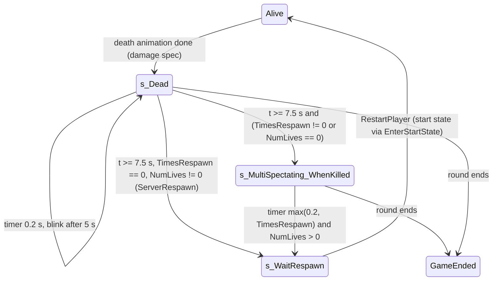

# Death, lives and the respawn timer

Units:
- uc:SBase.SGameInfo:Killed
- uc:SBase.SGameInfo:UpdateTeamNumLives
- uc:Engine.GameInfo:Killed (overridden, not called)
- uc:Engine.GameInfo:NotifyKilled (not called)
- uc:SBase.SPlayerController:s_Dead.BeginState
- uc:SBase.SPlayerController:s_Dead.EndState
- uc:SBase.SPlayerController:s_Dead.Timer
- uc:SBase.SPlayerController:s_Dead.PlayerMove
- uc:SBase.SPlayerController:s_Dead.PlayerTick
- uc:SBase.SPlayerController:s_Dead.Fire
- uc:SBase.SPlayerController:s_Dead.ServerReStartPlayer
- uc:SBase.SPlayerController:s_Dead.bIsDamageVolumeSensitive
- uc:SBase.SPlayerController:s_MultiSpectating_WhenKilled.BeginState
- uc:SBase.SPlayerController:s_MultiSpectating_WhenKilled.Timer
- uc:SBase.SPlayerController:s_WaitRespawn.BeginState
- uc:SBase.SPlayerController:s_WaitRespawn.EndState
- uc:SBase.SPlayerController:s_WaitRespawn.ServerReStartPlayer
- uc:SBase.SPlayerController:s_WaitRespawn.PlayerMove
- uc:SBase.SPlayerController:s_WaitRespawn.PlayerTick
- uc:SBase.SPlayerController:s_WaitRespawn.Fire
- uc:SBase.SPlayerController:s_WaitRespawn@code
- uc:SBase.SPlayerController:ServerRespawn
- uc:SBase.SPlayerController:Respawn
- uc:SBase.SPlayerController:ServerResign
- uc:SBase.SPlayerController:Resign
- uc:SBase.SPlayerController:AntiBugTellServerIAmDead
- uc:SBase.SPlayerController:CanPickRespawnWeapon
- uc:SBase.SPlayerController:BeginRespawnWeaponPick
- uc:SBase.SPlayerController:CheckRespawnWeaponKey
- uc:SBase.SPlayerController:ServerCycleRespawnWeapon
- uc:SBase.SPlayerController:SpawnWeaponFor
- uc:SBase.SPlayerController:MercWeaponIndex
- uc:SBase.SPlayerController:ClientSetRespawnWeapon

## Purpose
What the game does once a player's pawn has died: kill credit and life count, the death screen and body
fade, the switch to spectating, the respawn delay, and the respawn itself. Also covers the resign command
and the Merc Deathmatch respawn weapon pick. How a pawn reaches zero health and which state plays the death
animation belong to the damage and death-animation specs; this spec starts at `SGameInfo.Killed` and at
entry into `s_Dead`.

## Data
| Field | Owner | Type | Default | Notes |
|---|---|---|---|---|
| NumLives | PRI | int | 0 | lives left for this player; replicated |
| Deaths, Kills | PRI | int | 0 | replicated |
| bResigned | PRI | bool | false | not replicated (Enhanced addition) |
| bIsSpectator | PRI | bool | false | true while dead and spectating |
| TotalTeamLives[2] | GRI | int | 0 | sum of NumLives per side; replicated |
| TimesRespawn | GRI | int | from MatchInfo | respawn delay in seconds; replicated |
| fRespawnDate | SPlayerController | float | | death time, then respawn due time |
| fTempsAvantClignote | SPlayerController | float | 5.0 | seconds before the body starts blinking |
| bInstantRespawn | SPlayerController | bool | false | set by the fall-out-of-world state |
| RespawnTimeCount | SPlayerController | int | | reset to 0, otherwise unused |
| fGrabDate | SPlayerController | float | | spectate re-check clock (spectating.md) |
| RespawnWeapon | SPlayerController | class | None | Merc Deathmatch weapon choice |
| RespawnWeaponKey, bRespawnWeaponKeyHeld | SPlayerController | string, bool | | Merc DM UI |
| iTipNumber | PRI | int | | loading tip shown while dead |

## Rules
Kill bookkeeping, `SGameInfo.Killed(Killer, Killed, KilledPawn, DamageType)` (server). Callers: the damage
reaction when health drops to 0 or below (Killer = instigator's controller, or the damage volume's
trigger controller), the fall-out-of-world state (Killer = Killed, SFell), and the grab kills
(DamTypeGrabBreak, DamTypeGrabChoke). It does not call the base GameInfo.Killed, so ScoreKill,
NotifyKilled and GameStats never run.
1. If Killed is not None:
   a. `Killed.PRI.Deaths += 1`; `Killed.PRI.NumLives -= 1`.
   b. If Killer is not None and differs from Killed:
      - Enemy kill (teams differ) or any kill in Merc Deathmatch: `Killer.PRI.Kills++`; environmental kill
        check and carried-flag killer (scoring-and-stats.md rules 4 and 5).
      - Team kill (same team, not Merc DM): `Killer.Stats.TeamKills++`, `Killed.Stats.DeathFromTeammate++`.
   c. If Killer equals Killed: `Killed.Stats.Suicides++`; in Merc Deathmatch also `Killed.PRI.Kills--`.
   d. Killer None (falls, environment without instigator): no credit, no stats.
   e. `BroadcastDeathMessage(Killer, Killed, DamageType)` (scoring-and-stats.md rule 6).
   f. If `Killed.PRI.NumLives < 1`: send SGameMessages switch 56 ("<name> used his last life") to every
      PlayerController of the killed player's team (BroadcastTeamLocalizedMessage).
2. `BroadcastScoreTime = TimeSeconds + 2.0` (no effect).
3. If `sCheckEndGame()` then `sEndGame()` (end-of-round.md).
After Killed returns, the damage reaction awards points with AddPoint (scoring-and-stats.md rule 1).

`UpdateTeamNumLives()` (server; called by sCheckEndGame, StartMatch and StartLateJoiner):
4. `TotalTeamLives[0] = TotalTeamLives[1] = 0`; for every PlayerController whose `Team.TeamIndex < 2` and
   not bOnlySpectator: `TotalTeamLives[TeamIndex] += NumLives`. A controller with no team reads index 0.

Lives meaning:
5. NumLives is set at match start (match-lifecycle.md rule 23) to NumLivesATT for spies and NumLivesDEF for
   mercs (999999 when the option was 0). Each death subtracts 1. A player with `NumLives > 0` after the
   death respawns; a player with NumLives 0 or less spectates until the round ends. So "4 lives" means 4
   deaths are allowed and the 4th is final: the player plays 4 lives in total.

Death state `s_Dead` (entered on the server and on the owning client; entry is the death-animation spec's
job). It ignores CanActivateCloak, ChangeSpeed, GoInSmoke, MyFalling, PawnTakeDamage, PlayAnimDeath,
PlayAnimDmg, SwitchBinocularVision, SwitchEnhancedReality, SwitchHeadset; damage volumes ignore it; Fire and
ServerReStartPlayer do nothing.
6. BeginState, in order: stop the zip line slide sound; screen effect off; Disk Hunt: drop disks;
   authority: clear this player's spy-bullet radar mark (mercs: marker 0, spies: marker 1) and destroy the
   pawn's UsedObject; clear the 10 LastDamages types; owner: unload the selected gadget, end a running
   sticky shock (input, actions SA_DMG_ELECTRIC_STOP_ANIM and SA_DMG_ELECTRIC_STOP, merc weapon to
   s_Dmg_Electric_End) and turn the death screen effect on (strength 1.0); authority: stop team talk unless
   allowed, stop hack comms, clear voice target, stop the other team hearing this player, clear
   `bLyingOnGround`, release voice chat partners; `bCrouchWithRoll = btoCought = false`;
   `fRespawnDate = TimeSeconds`; pick the tip (`iTipNumber = 0` and clear bNewProfile for a new profile,
   else `Rand(team tip count)`, clamped to 0); drop any pickup and carried flag (DiscardPickup,
   DiscardFlag); empty the HUD alarm list; `bBehindView = true`; camera detached from the bone, mode
   ECM_Walking; delete all inventory; `RespawnTimeCount = 0`; reset vision mode; start a looping timer of
   0.2 s on the server and standalone, 1.0 s on a client; start the Merc DM weapon pick (rule 15).
7. PlayerTick: native input, client position update, PlayerMove (camera rotation only, zero acceleration
   sent or processed), respawn weapon key check.
8. Timer (both ends), with `t = TimeSeconds - fRespawnDate`:
   a. On a client first send `AntiBugTellServerIAmDead()` (server goes to s_Dead if it is not there).
   b. If `t > fTempsAvantClignote` or bInstantRespawn:
      - if `t < fTempsAvantClignote + 2.5` and not bInstantRespawn: toggle the body's bHidden (blink);
      - else: hide the body, turn its collision fully off, then: if `GRI.TimesRespawn != 0` or
        `PRI.NumLives == 0`, set `PRI.bIsSpectator = true` and `MirrorState('s_MultiSpectating_WhenKilled')`;
        otherwise call `ServerRespawn()` directly.
9. With the menus' respawn floor of 5 s, TimesRespawn is never 0 in normal play, so every death goes
   through spectating. `TimesRespawn == 0` (URL only) respawns at the end of the blink.
10. EndState: owner screen effect off; `btoCought = false`; `bFireMode = 0`;
    `fTempsAvantClignote = 5.0` (default restored); `bInstantRespawn = false`.

Respawn timer in `s_MultiSpectating_WhenKilled` (the spectating part of this state is in spectating.md):
11. BeginState (both ends): `fRespawnDate = GRI.TimesRespawn`; one-shot timer of
    `max(0.2, TimesRespawn)` seconds; `fRespawnDate += TimeSeconds` (respawn due time, for the HUD).
12. Timer (authority only): if `PRI.NumLives > 0`: show the HUD again, `PRI.bIsSpectator = false`,
    `ServerRespawn()`. If NumLives is 0 or less nothing happens and the player stays in this state for the
    rest of the round.
13. `ServerRespawn()` (client to server RPC; Respawn() just calls it), authority only: allow team talk again,
    release voice chat partners, `UnPossess()` (moves the controller to the pawn, sets the pawn to
    SimulatedProxy, UnPossessed, clears saved moves, views self if viewing the pawn, destroys the pawn,
    clears Pawn and SBPawn), `GotoState('s_WaitRespawn')`.
14. `s_WaitRespawn` (simulated state, server side; not mirrored to the client): ignores
    AntiBugTellServerIAmDead and SwitchBinocularVision; its state code calls `ServerReStartPlayer()` unless on
    a client, which calls `Level.Game.RestartPlayer(self)` (respawn-and-spawning.md). Possession moves the
    controller on to the start state. EndState: `bFireMode = 0`, `LocalMyDesiredRotation = Rotation`. If no
    start is found the controller stays here without a pawn.

Timeline (server, one death, network settings):
$$t_{respawn} = t_{s\_Dead} + t_{fade} + \max(0.2,\ \text{TimesRespawn})$$
where `t_fade` is the first 0.2 s timer tick with `t >= fTempsAvantClignote + 2.5`: about 7.6 s normally,
about 3.6 s after a strangle (that state sets fTempsAvantClignote to 1.0), about 0.2 s for a fall out of the
world (bInstantRespawn). For SteeE Story (TimesRespawn 10) a normal death respawns about 17.6 s after
s_Dead is entered (estimated; timer ticks are frame-quantized). The body is visible for 5.0 s, blinks for
2.5 s (toggling every 0.2 s on the server), then disappears.

Resign (`Resign` exec, or the `!resign` chat command added by Reloaded, both reach `ServerResign`):
15. Rejected when the match has not begun, the player is bOnlySpectator, `NumLives < 1`, or the controller
    is in GameEnded or s_BlastFloor.
16. `PRI.bResigned = true`. If the pawn is alive: `NumLives = 1`, then a self-inflicted hit of
    `Health + 100` with damage type Suicided (normal death path: Killed makes NumLives 0, suicide stats,
    death message switch 24, suicide points). Otherwise (dead or spectating with lives left):
    `NumLives = 0`, `BroadcastDeathMessage(self, self, Suicided)` (switch 24), team message 56, then
    sCheckEndGame and sEndGame if it returns true.

Merc Deathmatch respawn weapon (P1, not on the Story path):
17. `CanPickRespawnWeapon()`: mode is Merc DM, `NumLives > 0` and in s_Dead.
18. `BeginRespawnWeaponPick()` (owner): remember whether Use is held, find the key bound to "Use" (first of
    255 key names whose binding is "Use", localized name) for the prompt, default "Use".
19. `CheckRespawnWeaponKey()` each dead tick: on a Use press edge, `ServerCycleRespawnWeapon()`.
20. `ServerCycleRespawnWeapon()`: next entry in the team's ClassWeapon list after the current
    RespawnWeapon (wraps to 0; an unknown current gives index 0), sent back with ClientSetRespawnWeapon.
21. `SpawnWeaponFor(Requested)`: outside Merc DM return Requested; else if RespawnWeapon is None, set it to
    `ClassWeapon[max(index of Requested, 0)]` and tell the client; return RespawnWeapon.

## States

## Constants
| Name | Value | Unit | Provenance | Source |
|---|---|---|---|---|
| Body visible before blink | 5.0 | s | decoded | def:SBase.SPlayerController fTempsAvantClignote |
| Blink duration | 2.5 | s | decoded | s_Dead.Timer |
| Visible time after strangle | 1.0 | s | decoded | s_GrabbedByPlayer_Released_STRANGLE.BeginState |
| s_Dead timer, server / client | 0.2 / 1.0 | s | decoded | s_Dead.BeginState |
| Minimum spectate timer | 0.2 | s | decoded | s_MultiSpectating_WhenKilled.BeginState |
| Resign self damage | Health + 100 | hp | decoded | ServerResign |
| Last life message | SGameMessages 56, "used his last life" | | decoded | Killed |
| SteeE death to respawn (network) | about 17.6 | s | estimated | 7.6 + 10 |

## Network
- Killed, UpdateTeamNumLives, ServerRespawn, s_WaitRespawn, ServerResign: server.
- s_Dead runs on both: the server version decides; the client version drives its own visuals and keeps
  re-sending `AntiBugTellServerIAmDead` (client to server, reliable) every 1 s while dead.
- Transitions are mirrored server to client with PCChangeClientState (MirrorState); the client may also
  reach s_MultiSpectating_WhenKilled on its own timer first.
- RPCs: ServerRespawn, ServerResign, ServerCycleRespawnWeapon (client to server, reliable);
  ClientSetRespawnWeapon (server to client, reliable).
- Replicated: PRI.NumLives, Deaths, Kills, bIsSpectator; GRI.TotalTeamLives, TimesRespawn.

## Edge cases
- In Play Level lives are 999999 and TimesRespawn 15, so a death respawns about 22.6 s later and lives never
  run out (measured: "NumLives 999999 -> 999998").
- A late `AntiBugTellServerIAmDead` arriving after the server already respawned the player would send the
  live player to s_Dead (the walking states do not ignore it). Rare race; preserve or guard deliberately.
- With TimesRespawn 0, both the server timer and the client timer can call ServerRespawn; a late client
  call would destroy the freshly spawned pawn and respawn it again.
- The client's s_Dead timer reads the replicated NumLives, which can lag the server by a packet.
- NumLives can go negative only through repeated Killed calls on an already-out player (not expected).
- Killed for the grab kills passes the killer's pawn as KilledPawn; KilledPawn is not used by SGameInfo.
- The round can end inside Killed; AddPoint runs afterwards and calls sCheckEndGame again
  (end-of-round.md edge cases).

## Evidence
- local/re-out/uc/SBase/SGameInfo.uc: Killed (b10d5a56b22b), UpdateTeamNumLives (58e0ce862751)
- local/re-out/uc/SBase/SPlayerController.uc: s_Dead (BeginState 65baa40b262a, Timer 7d2972961306,
  EndState 65cba9d25687), s_MultiSpectating_WhenKilled (BeginState 463f217b6f0a, Timer 8b465213337e),
  s_WaitRespawn@code (58e4bc485ac5), ServerRespawn (b6afa6e0f015), ServerResign (210eaff07067),
  AntiBugTellServerIAmDead (fa429da9775d), respawn weapon functions, `bInstantRespawn = true` in
  s_PlayerFalling_OutOfWorld
- Callers of Killed: StandardReactionsToDamage (SPlayerController.uc around line 4509), grab kill code
  (around 5403 to 5445), s_PlayerFalling_OutOfWorld (around 19541)
- Memory note infection-mode-feasibility.md: Play Level death "NumLives 999999 -> 999998"
- Reloaded strings: `!resign`, `ServerResign`, `s_Dead`, `s_MultiSpectating_WhenKilled`

## Open questions
- Exact frame at which the server's 0.2 s timer first sees `t >= 7.5` at 60 Hz (UE2 timers carry the
  remainder). Trace: Play Level kill, sample PRI.bIsSpectator and the controller state name every frame.
- Delay between `GotoState('s_WaitRespawn')` and its state code running (same tick or next tick).
- Whether Reloaded's references to `s_Dead` and `s_MultiSpectating_WhenKilled` change their timings
  (for example a configurable respawn delay). Compare a respawn timeline with and without Reloaded.
- Interaction of the death screen effect (SetWeirdEffect) and the tip display with the HUD spec.
