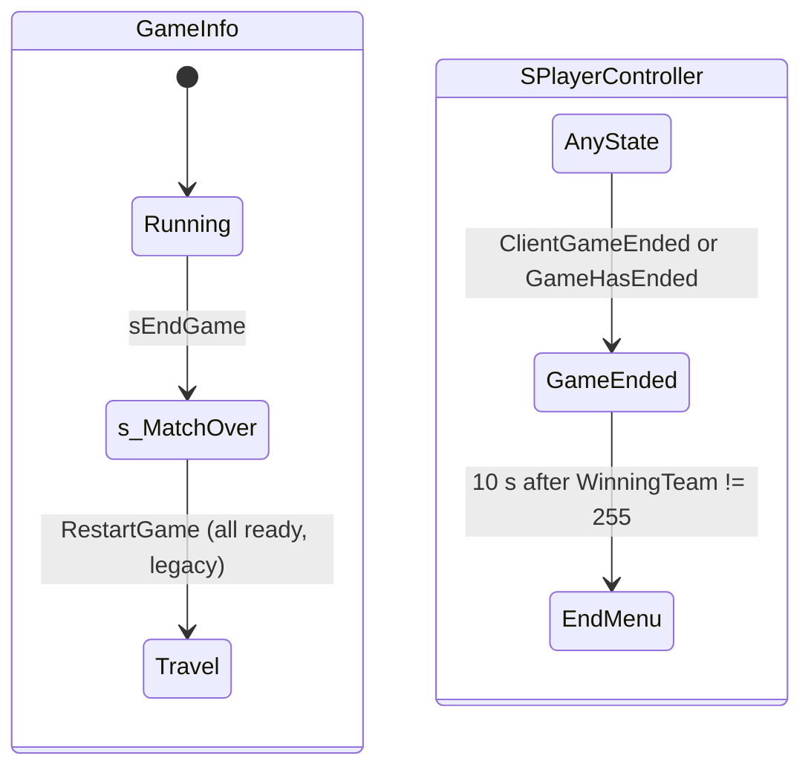

# End of round: win conditions, time limit and the match-over states

Units:
- uc:SBase.SGameInfo:sCheckEndGame
- uc:SBase.SGameInfo:sEndGame
- uc:SBase.SGameInfo:ReplicateWinningReason
- uc:SBase.SGameInfo:CountMercsStillIn
- uc:SBase.SGameInfo:GetTopKills
- uc:SBase.SGameInfo:GetNbSentries
- uc:SBase.SGameInfo:CheckEndGame
- uc:SBase.SGameInfo:EndGame
- uc:SBase.SGameInfo:NotifyObjectiveTaken
- uc:SBase.SGameInfo:NotifyDogTag
- uc:SBase.SGameInfo:BroadcastMusic
- uc:SBase.SGameInfo:Timer (time-limit clause)
- uc:SBase.SGameInfo:s_MatchOver.BeginState
- uc:SBase.SGameInfo:s_MatchOver.Timer
- uc:SBase.SGameInfo:s_MatchOver.ScoreKill
- uc:SBase.SGameInfo:s_MatchOver.ChangeTeam
- uc:Engine.GameInfo:CheckEndGame (overridden, not used)
- uc:Engine.GameInfo:EndGame (overridden, not used)
- uc:Engine.Controller:GameHasEnded
- uc:Engine.Controller:ClientGameEnded
- uc:Engine.Controller:GameEnded.BeginState (overridden for players)
- uc:Engine.PlayerController:GameEnded.ServerReStartPlayer
- uc:Engine.PlayerController:GameEnded.IsSpectating
- uc:Engine.PlayerController:GameEnded.ThrowWeapon
- uc:Engine.PlayerController:GameEnded.ServerRestartGame
- uc:Engine.PlayerController:GameEnded.FindGoodView
- uc:Engine.PlayerController:GameEnded@code
- uc:SBase.SPlayerController:GameEnded.BeginState
- uc:SBase.SPlayerController:GameEnded.EndState
- uc:SBase.SPlayerController:GameEnded.PlayerTick
- uc:SBase.SPlayerController:GameEnded.PlayerMove
- uc:SBase.SPlayerController:GameEnded.bIsDamageVolumeSensitive
- uc:SBase.SPlayerController:GameEnded.AnimEnd
- uc:SBase.SPlayerController:GameEnded.Timer
- uc:SBase.SPlayerController:GameEnded.Fire
- uc:SBase.SPlayerController:GameEnded.AltFire
- uc:SBase.SPlayerController:GameEnded.SwitchROF
- uc:SBase.SPlayerController:GameEnded.SwitchHeadset
- uc:SBase.SPlayerController:GameEnded.GadTorcheSwitch
- uc:SBase.SPlayerController:GameEnded.GadLaserSwitch
- uc:SBase.SPlayerController:GameEnded.UpdateRotation
- uc:SBase.SEndZoneTip:Touch
- uc:SBase.SEndZoneTip:s_DelayBeforeEnd.BeginState
- uc:SBase.SEndZoneTip:s_DelayBeforeEnd.Timer
- def:SBase.SEndZoneTip

## Purpose
Decides when a round is over and who won, then freezes the match: every player goes to the end screen,
the winner music plays, and after 10 s the end menu opens. The winning side and reason are published in
the GameReplicationInfo for every client.

## Data
| Field | Owner | Type | Default | Notes |
|---|---|---|---|---|
| WinnerTeam | SGameInfo | byte | 0 | scratch, reset to 255 at each check |
| bGameEnded | GameInfo | bool | false | |
| WinningTeam | GRI | byte | 255 | 0 spies, 1 mercs, 255 none; replicated |
| WinningReason | GRI | byte | 255 | EEndReason value, 255 none; replicated |
| bStopCountDown | GRI | bool | true | freezes RemainingTime |
| TimeLimit, ElapsedTime | GRI | int | | minutes, seconds since StartMatch |
| ObjectiveTaken | SObjective | bool | true (class default) | false only after a mission Reset activates it |
| EndGameDelay | SEndZoneTip | int | 5 | seconds |
| VictoryMusic / LooseMusic | SPlayerController | Sound | Interface.Objectifs.Jingle_Victoire1 / Interface.Objectifs.Jingl_YouLose | |

`EEndReason` (SGameInfo): 0 END_STORY (objectives done, or Merc DM kill limit), 1 END_TIMEOUT,
2 END_TEAMDEATH. The end menu shows "All objectives taken", "Mission timer elapsed" or "Team eradicated"
for 0, 1, 2 and "Shadownet Spies team wins" or "ARGUS PMC Mercenaries team wins" for WinningTeam 0 or 1.

## Rules
Callers of `sCheckEndGame()` (each followed by `sEndGame()` when it returns true): the 1 s GameInfo timer
when the time limit has passed (rule 1), `Killed`, `AddPoint`, `NotifyObjectiveTaken`, `NotifyDogTag`,
`Logout` (non-spectator leaver, server only, not in the Lobby), `ServerResign` (dead branch).
1. Timer clause: if MatchInfo exists, `GRI.TimeLimit > 0`, `GRI.ElapsedTime >= GRI.TimeLimit * 60` and
   `GRI.bMatchHasBegun`, run the check. ElapsedTime counts whole seconds since StartMatch (GRI clock,
   replication-info.md), so the round ends at the first GameInfo timer tick after 600 elapsed seconds for a
   10 minute limit.

`sCheckEndGame()`, in this exact order:
2. `UpdateTeamNumLives()`; `WinnerTeam = 255`.
3. If `!GRI.bMatchHasBegun`: return false (always the case in the editor's Play Level).
4. Time out: if `TimeLimit > 0` and `ElapsedTime >= TimeLimit * 60`: winner 1 (mercs), reason END_TIMEOUT,
   return true. This comes before every other test: once time is up, the mercs win whatever the objective
   or lives situation.
5. Count, over every PlayerController in ControllerList whose PRI is neither bOnlySpectator nor
   bQuittedMatch: per side the number of players (`NbPlayersSPY`, `NbPlayersSENTRY`) and the number with
   `NumLives > 0` (`NumTeam0`, `NumTeam1`). A player who is dead but still has lives counts as alive.
6. Merc Deathmatch (P1): `KillLimit = MatchInfo.ScoreLimit`, or 20 when below 1. If `GetTopKills() >=
   KillLimit`: winner 1, END_STORY, true. `NumStillIn = CountMercsStillIn()` (team 1 players, not spectator,
   not quit, with `NumLives > 0` or `Deaths == 0`); if `NumStillIn <= 1` and `NumStillIn < NbPlayersSENTRY`:
   winner 1, END_TEAMDEATH, true. Else return false (objectives never end Merc DM).
7. Standalone: if `NumTeam0 == 0` and `NumTeam1 == 0`: winner = 1 if `NbPlayersSPY > 0` else 0,
   END_TEAMDEATH, true. Otherwise, if the level has no SObjective actor at all, return false; else continue
   to rule 9 (the team death test of rule 8 is skipped offline).
8. Network (any NetMode except Standalone): if (`NumTeam0 == 0` and `NbPlayersSPY > 0`) or (`NumTeam1 == 0`
   and `NbPlayersSENTRY > 0`), and `NumTeam0 + NumTeam1 < GetNumPlayers()`: winner = (both zero:
   1 if NbPlayersSPY > 0 else 0; only spies out: 1; only mercs out: 0), END_TEAMDEATH, true. The
   NumPlayers test is normally always true when the first part is; it only fails if NumPlayers is smaller
   than the counted players.
9. Objectives: for every SObjective in the level (AllActors, missions included, all modes), if any has
   `ObjectiveTaken == false`, return false. Otherwise (all taken, or no objective in a network game):
   winner 0 (spies), END_STORY, true. Objectives of inactive missions keep their class default
   `ObjectiveTaken = true`, so only the active mission tree matters. When the active mission completes its
   quota, it deactivates its remaining children (native Desactivate, which is reported to set
   ObjectiveTaken true) before it marks itself taken, so the check passes on the mission's own
   NotifyObjectiveTaken (objectives spec).
10. `ReplicateWinningReason(Team, Reason)` writes `GRI.WinningTeam = Team` and `GRI.WinningReason = Reason`;
    it is called only on the true paths above (and by SEndZoneTip).

`sEndGame()`:
11. Merc Deathmatch: `GRI.NumDisks = GetTopKills()` (field reused to show the winning kill count).
12. `GRI.bStopCountDown = true`; `bGameEnded = true`; `TriggerEvent('EndGame', self, None)`;
    `GotoState('s_MatchOver')`. sEndGame does not set the winner; a caller that skips
    ReplicateWinningReason leaves WinningTeam at 255.

GameInfo state `s_MatchOver`:
13. BeginState: for every PlayerController: `ClientGameEnded()` (server to owner RPC: client enters
    GameEnded) then `GameHasEnded()` (server: `Pawn.bNoWeaponFiring = true` if a pawn exists, then
    `GotoState('GameEnded')` on the server copy). Then a 1.0 s looping timer replaces the normal GameInfo
    timer (poison drain, welcome messages, time limit and SendAtTime all stop).
14. Timer: if every controller's PRI has `bReadyToPlayAgain`, call RestartGame (round-travel.md). Players
    reset this flag to false when entering GameEnded, and only the legacy Restart_Menu sets it, so in
    practice the round is changed by the end menu instead.
15. RestartPlayer and ScoreKill do nothing; ChangeTeam returns false. Killed, AddPoint and Logout still run
    and still call sCheckEndGame.

Player state `GameEnded` (SPlayerController version; it replaces the Engine BeginState, so the pawn is not
frozen by script, it only stops receiving input):
16. Ignores Bump, SeePlayer, HearNoise, PawnTakeDamage, ChangeState, GotoState, MirrorState, MyFalling,
    GoInSmoke; damage volumes ignore it. Once entered, script cannot move the controller to another state
    until the map changes. Fire, AltFire, rate of fire, vision, torch, laser and rotation input are disabled;
    PlayerMove sends or processes zero acceleration; AnimEnd and Timer are empty. Inherited Engine parts:
    IsSpectating true, ServerReStartPlayer no-op, ThrowWeapon no-op.
17. BeginState: screen effect off, close the Magma menu, spawn the Magma end screen, `bGameEnded = true`,
    rumble off, `btoCought = false`, `ReadyToPlayAgain(false)` (sets PRI.bReadyToPlayAgain false on the
    server), clear the flash, `fGrabDate = TimeSeconds`, `bEndOfFade = false`, `bLineEffect = false`, reset
    vision, stop HUD perturbation. EndState clears bLineEffect, bGameEnded, btoCought.
18. PlayerTick: while `GRI.WinningTeam == 255`, keep `fGrabDate = TimeSeconds`. When the winner is known,
    once: play VictoryMusic if `WinningTeam == SPawnType`, else LooseMusic (fade transition). When
    `TimeSeconds - fGrabDate > 10` (10 s after the winner became known), once: Live with ranking opens
    UpdateRanking; LAN, Live or GameService close menus and open Ending_Menu; a tutorial map records
    tutorial progress and opens the next tutorial or the quit page; anything else (offline) opens the
    loading page with "VisitMapReturn" (travel back to the entry map). Then `bFire = 0` and the global
    PlayerTick.

`SEndZoneTip` (an SZoneTips subclass placed by designers; none in SteeE):
19. Touch by a pawn whose controller is an SPlayerController: remember its SPawnType as TouchedByTeam and go
    to `s_DelayBeforeEnd`. BeginState: with `EndGameDelay > 0` start a one-shot timer of that many seconds;
    otherwise, if a GameInfo exists, `ReplicateWinningReason(TouchedByTeam, END_TEAMDEATH)` and `sEndGame()`
    immediately. Timer does the same. The touching side wins, reported as "Team eradicated". It bypasses
    sCheckEndGame and works even while bMatchHasBegun is false.

Other entry points:
20. `NotifyObjectiveTaken(Obj)`: play `Interface.Objectifs.Jingl_objectifTaken` with no transition to team 0
    and to team 1 (BroadcastMusic sends ClientSetMusic to every SPlayerController whose Team.TeamIndex
    matches), `BroadcastScoreTime = TimeSeconds + 2`, then the end check.
21. `NotifyDogTag()`: `GRI.NumDogTagsTaken++`, then the end check (Deathmatch dog tags; objectives spec).
22. `CheckEndGame` returns false and `EndGame` is empty in SGameInfo: the Engine end path is disabled.

## States

## Constants
| Name | Value | Unit | Provenance | Source |
|---|---|---|---|---|
| Winner on time out | 1 (mercs) | team | decoded | sCheckEndGame |
| Winner when all objectives taken | 0 (spies) | team | decoded | sCheckEndGame |
| Merc DM default kill limit | 20 | kills | decoded | SMatchInfo.DefaultKillLimit |
| End menu delay | 10 | s | decoded | SPlayerController.GameEnded.PlayerTick |
| s_MatchOver timer | 1.0 | s | decoded | s_MatchOver.BeginState |
| SEndZoneTip delay | 5 | s | decoded | def:SBase.SEndZoneTip |
| Event fired at end | EndGame | name | decoded | sEndGame |
| Objective taken jingle | Interface.Objectifs.Jingl_objectifTaken | | decoded | NotifyObjectiveTaken |

## Network
- All checks run on the server. Clients learn the result through `GRI.WinningTeam`, `GRI.WinningReason`,
  `GRI.bStopCountDown` (replicated) and the `ClientGameEnded` RPC (reliable, server to owner).
- `ClientSetMusic` (reliable, server to owner) for the objective jingle; the victory or defeat music is
  chosen on each client from the replicated WinningTeam (ClientSetMusic called locally).
- Remote players' server copies also enter GameEnded (GameHasEnded); their cosmetic calls there do nothing
  useful on the server.

## Edge cases
- Play Level (Standalone, bMatchHasBegun false): no round ever ends from sCheckEndGame. Only SEndZoneTip
  would end it (and the RE+ docs report a crash when sEndGame was called directly from a test script in
  Play Level).
- The result can be rewritten after the end. sCheckEndGame keeps running in s_MatchOver (Killed after the
  end is blocked by GameEnded ignoring damage, but Logout and AddPoint are not). ElapsedTime keeps counting
  after the end, so if the time limit passes on the end screen and a player then leaves, rule 4 rewrites
  the result to a merc time-out win.
- Kill then AddPoint: the death that ends the round calls the check twice (Killed, then AddPoint). The
  second sEndGame fires the 'EndGame' event again and calls GotoState('s_MatchOver') while already in it
  (UE2 does not re-run BeginState for the current state; see Open questions).
- An objective completed in the same second the limit expires, before the GameInfo timer runs, still loses:
  its check hits rule 4 first.
- A side whose players have all quit (bQuittedMatch) is not "dead" (its player count is 0), so the match
  continues until objectives or time.
- A network level without any SObjective ends with a spy END_STORY win at the first sCheckEndGame call
  after the start that gets past the time and team tests (the first kill, point award, resign or leave).
- Spectators without a team receive team 0 music (None team reads index 0).

## Evidence
- local/re-out/uc/SBase/SGameInfo.uc: sCheckEndGame (2e66ff39356d), sEndGame (a80d0fa207bb),
  ReplicateWinningReason (4c14b9a7edfb), CountMercsStillIn (03d915549c8f), GetTopKills (f7d14b150827),
  NotifyObjectiveTaken (1f64cb8c19f7), NotifyDogTag (ca15710daa78), s_MatchOver functions, Timer
- local/re-out/uc/SBase/SPlayerController.uc: GameEnded.BeginState (e522e22ec10a), PlayerTick (fed749ef47dc)
- local/re-out/uc/Engine/Controller.uc: GameHasEnded (fbabb106e0f2), ClientGameEnded (69f8e4f2c85a)
- local/re-out/uc/SBase/SObjective.uc: `ObjectiveTaken=True` default; SMission.uc NotifyTaken
- local/re-out/uc/SBase/SEndZoneTip.uc
- local/formats/classdefaults_localized.json GUI.Ending_Menu (TextTeamWin, txt_Victory)
- RE+ docs/MapBuilderFacts.md line 176 (Play Level never ends; direct sEndGame crash in
  Reloaded.Core.dll+0x133A6)
- Memory note infection-mode-feasibility.md: `EndGame(PRI, ...)` is ignored; WinnerTeam plus
  `GRI.WinningTeam` plus `sEndGame()` shows the win screen
- Natives: SObjective.Desactivate and SMission.Desactivate share 0x10ae9c60 (1418, 1421);
  SMission.NotifyChildTaken 0x10abffb0 (1420); Object.GotoState 0x10949900 (141)

## Open questions
- UE2 GotoState into the current state: confirm that BeginState and EndState are skipped and only the
  state code restarts (Object.GotoState 0x10949900). Matters for repeated sEndGame and SEndZoneTip retouch.
- Native `Desactivate` (0x10ae9c60): confirm it sets ObjectiveTaken true for SObjective (the RE+ probe says
  so) and what it does for SMission; and that `NotifyChildTaken` (0x10abffb0) calls the mission's
  NotifyTaken when the quota is met. Trace: SteeE Story network match, take 4 of 6 objectives, log
  ObjectiveTaken on all 7 objective actors and the GRI winner fields each frame.
- The Reloaded crash on direct sEndGame in Play Level (Reloaded.Core.dll+0x133A6): which hook (end screen,
  music, or GotoState hook) fails when no network match exists.
- Exact second of the time-out end relative to StartMatch (GRI timer phase versus GameInfo timer phase).
  Trace: listen match with `TimeLimit=1`, log TimeSeconds at StartMatch and at sEndGame.
