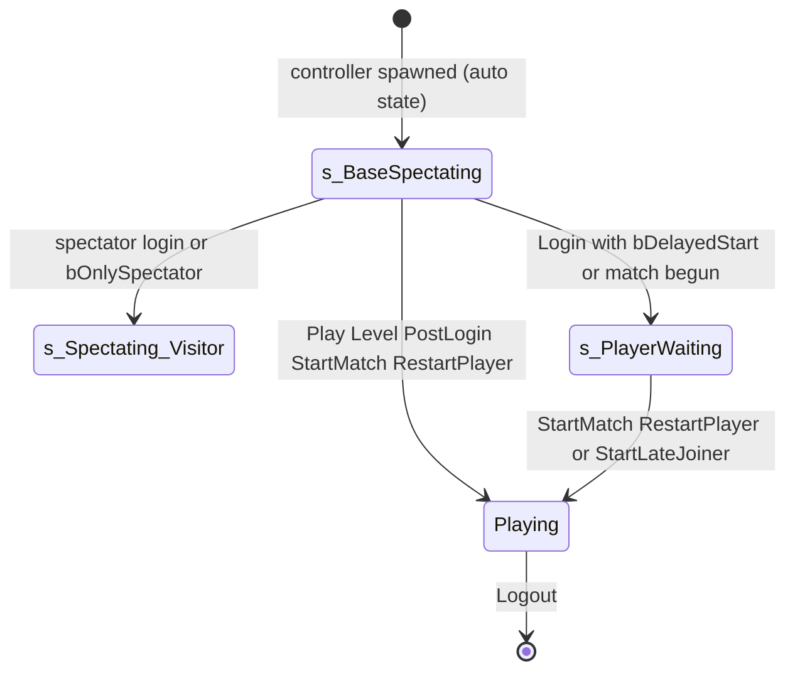

# Login, team assignment, late joiners and logout

Units:
- uc:SBase.SGameInfo:Login
- uc:SBase.SGameInfo:PickTeam
- uc:SBase.SGameInfo:ChangeTeam
- uc:SBase.SGameInfo:MoveEveryoneToMercs
- uc:SBase.SGameInfo:StartLateJoiner
- uc:SBase.SGameInfo:Logout
- uc:Engine.GameInfo:Logout
- uc:Engine.GameInfo:PreLogin (contract)
- uc:Engine.GameInfo:AtCapacity
- uc:Engine.GameInfo:ChangeName
- uc:Engine.GameInfo:GetNumPlayers
- uc:Engine.TeamInfo:AddToTeam
- uc:Engine.TeamInfo:RemoveFromTeam
- uc:Engine.Controller:SetPawnClass
- def:Engine.TeamInfo
- def:SBase.STeamInfo
- def:SBase.STeamAttaquant
- def:SBase.STeamDefenseur
- uc:SBase.SPlayerController:PlayerWaitingToPlayToServer
- uc:SBase.SPlayerController:PlayerOnlySpectatorToServer
- uc:SBase.SPlayerController:PlayerReadyToPlayToServer
- uc:SBase.SPlayerController:s_PlayerWaiting.ServerReStartPlayer
- uc:SBase.SPlayerController:s_PlayerWaiting@code
- uc:SBase.SPlayerController:PlayerWaiting.BeginState
- uc:SBase.SPlayerController:PlayerWaiting.EndState
- uc:SBase.SPlayerController:PlayerWaiting.ChangeTeam
- uc:SBase.SPlayerController:PlayerWaiting.ServerReStartPlayer
- uc:SBase.SPlayerController:PlayerWaiting.Fire

## Purpose
Turns a connection (or the local viewport) into a PlayerController on a team: capacity checks, spectator
handling, the requested team and its overrides (Revenge swap, Merc Deathmatch, balance), pawn class, FOV,
the waiting state before the match, late joiners, and what happens when a player leaves.

## Data
| Field | Owner | Type | Default | Notes |
|---|---|---|---|---|
| NumPlayers | GameInfo | int | 0 | non-spectator logins; `GetNumPlayers()` returns it |
| NumSpectators | GameInfo | int | 0 | |
| MaxPlayers | GameInfo | int | 16 (config) | clamped by InitGame |
| MaxSpectators | GameInfo | int | 2 (config) | |
| CurrentID | GameInfo | int | 0 | next PRI.PlayerID |
| MaxTeamSize | SGameInfo | int | 32 | 2 on PS2 only |
| bPlayersBalanceTeams | SGameInfo | bool | false | |
| PlayerControllerClass | GameInfo | class | None, loaded as SBase.SPlayerController | |
| Teams[2] | GRI | TeamInfo | spawned in SGameInfo.PostBeginPlay | 0 STeamAttaquant, 1 STeamDefenseur |
| TeamInfo.Size | int | 0 | replicated | |
| TeamInfo.TeamIndex | int | 0 spies, 1 mercs | replicated initially | |
| PRI.TeamID | int | | unique per team, see AddToTeam | |
| PRI.PlayerID, MyMeshNum, bOnlySpectator, bIsSpectator, bWaitingPlayer, bReadyToPlay, bQuittedMatch, bIAmServer | | | | replication-info.md |
| SPlayerController.SPawnType | PawnType | | SPAWNOFFENSE 0 (spy) or SPAWNDEFENSE 1 (merc), replicated |
| SPlayerController.SpyFOV / DefenderFOV | float | 75 / 95 | def:SBase.SPlayerController |

Team defaults: `STeamAttaquant` TeamName "Spies", TeamIndex 0, PawnList [SPawnAttaque_1Mesh],
DefaultPlayerClass SPawnAttaque, ClassWeapon [SStickyShocker]. `STeamDefenseur` TeamName "Mercenaries",
TeamIndex 1, PawnList [SPawnDefense_1Mesh], DefaultPlayerClass SPAWNDEFENSE, ClassWeapon [SWeaponDefense,
SWeaponDefense_Uzi, SWeaponDefense_Shotgun]. Both: iNBGadgets 4, RemoteRole DumbProxy, bAlwaysRelevant,
bOnlyDirtyReplication false, eight ClassInventory gadgets and localized tip strings (def: files).

## Rules
PreLogin (before Login, network joins only): `AccessControl.PreLogin(Options, Address, FailCode,
bSpectator)` where bSpectator is option `SpectatorOnly` equal to "true". Password and ban checks live in
AccessControl (not specced here).

`AtCapacity(bSpectator)`:
1. Standalone: never at capacity.
2. Spectator: `NumSpectators >= MaxSpectators && (NetMode != ListenServer || NumPlayers > 0)`.
3. Player: `MaxPlayers > 0 && NumPlayers >= MaxPlayers`.

`SGameInfo.Login(Portal, Options)` (server; returns the controller or None with an error string):
4. Parse `SpectatorOnly`, `NewProfile`, `ServerOnly` (each true only for "true"). The local `bAdmin` is
   never set, so the admin branches are dead.
5. If `AtCapacity(bSpectator)`: fail with "Server is already at capacity." There is no fallback from a
   full player slot to a spectator slot.
6. `InName = first 20 characters of Name`; `InTeam = byte(Team option, default 0)`; read AdminName,
   Password, Checksum (unused), `InLAN = LAN option` (stored in the GameInfo, last login wins),
   `GobalId`, `PB` (default 0).
7. Revenge swap: if `MatchInfo.Revenge` and `GetIntOption(Options, "GamesInARow", 2) < 2`, swap a
   requested team 0 to 1 and 1 to 0 (other values unchanged). With the GUI round URLs this swaps sides in
   the second game of a revenge pair (round-travel.md).
8. `ServerOnly`: `InTeam = 255` (host that does not play).
9. Load `SBase.SPlayerController` if PlayerControllerClass is None.
10. Spawn the controller:
    - ServerOnly: at (100000, 100000, 100000) with rotation 0; `MyDesiredRotation = (0,0,0)`. StartSpot
      stays None.
    - Otherwise: `StartSpot = FindPlayerStart(None, InTeam, Portal)`. Because the controller argument is
      None, FindPlayerStart replaces the team with `SPawnType` of None, which reads as 0: the login start is
      always chosen among spy starts (TeamNumber 0) whatever team was asked (spawn-selection.md).
      Rotation = start rotation with `Yaw += iSpyCam_InitAngle_Hor`, `Pitch += iSpyCam_InitAngle_Ver`, each
      wrapped once into -32768..32767 (subtract 65536 if above 32767, add 65536 if below -32768). Spawn at
      the start location; `MyDesiredRotation = StartSpot.Rotation` (without the offsets).
      If StartSpot is None the Spawn call reads None and the spawn location is the zero vector (the
      failure is reported later, rule 17).
11. Spawn failed: fail with "Could not spawn player".
12. `iPBEnabled` = 1 or 0 from `IsPBClientEnabled()` for the local viewport (native stub, false), else the
    `PB` option.
13. `GRI.m_ActualMapName = SMapSettings(GetLevelSettings(MatchInfo.LevelName)).MapName`.
14. `NewPlayer.StartSpot = StartSpot`; `bNewProfile`; `GameReplicationInfo = GRI`; spawn the Security
    object; `ChangeName(NewPlayer, InName, false)` (sets PRI.PlayerName unless the name is empty).
15. Spectator path: if `InTeam == 255`, or the match has begun and (mode is not Merc Deathmatch or
    bGameEnded): `bWelcomePending = true`, `InTeam = 255`, `PRI.bOnlySpectator = true`,
    `PRI.bIsSpectator = true`, `NumSpectators++`, `GotoState('s_Spectating_Visitor')`, return the
    controller. So in Story, anyone joining after the start becomes a spectator for the rest of the round.
16. Otherwise `InTeam = PickTeam(InTeam, NewPlayer)`; if `ChangeTeam(NewPlayer, InTeam, false)` fails,
    fail with "Could not find team for player". Note ChangeTeam clears `NewPlayer.StartSpot`.
17. Team 0: `SPawnType = SPAWNOFFENSE`, `DefaultFOV = DesiredFOV = SpyFOV` (75). Team 1:
    `SPawnType = SPAWNDEFENSE`, `DefaultFOV = DesiredFOV = DefenderFOV` (95). Then if the local StartSpot is
    None, fail with "Could not find a starting spot".
18. `PRI.PlayerID = CurrentID++`; `InMesh = byte(Mesh option, default 0)`; `PRI.MyMeshNum = InMesh`;
    `SetPawnClass(Team.PawnList[InMesh])` (dynamic load of the named SBase class; PawnClass is changed only
    if the load succeeds); `NumPlayers++`.
19. `Editeur` equals "true": `bDelayedStart = false`, `bWaitingToStartMatch = true`, `OnScriptEvent(3)`
    (native notification to the editor host).
20. If `bDelayedStart` or the match has begun: `GotoState('s_PlayerWaiting')`, return the controller.
21. Otherwise (Play Level): look for an existing pawn whose controller is a PlayerController with no
    `Player` (a disconnected player), `Health > 0` and `OwnerName` equal to InName ignoring case. If found,
    destroy the new controller, restore the old pawn's rotation and idle animation, and return the old
    controller (reconnect takeover). Else return the new controller (still in its auto state
    s_BaseSpectating). The match then starts from PostLogin (match-lifecycle.md rule 13).

`SGameInfo.PickTeam(num, C)`:
22. Merc Deathmatch: return 1.
23. If the current map URL is "Lobby": `bPlayersBalanceTeams = persistent bAutoBalance`; else set the
    persistent bAutoBalance and bPlayersBalanceTeams to false (no auto-balance inside a game map).
24. `SmallTeam = Teams[0]`, `BigTeam = Teams[1]`; swap them if `Teams[0].Size > Teams[1].Size` (a tie keeps
    team 0 as SmallTeam).
25. `NewTeam = Teams[num]` when `num < 2`, else None.
26. If `SmallTeam.Size < BigTeam.Size` and `GRI.bMatchLaunching`: `NewTeam = SmallTeam`.
27. If `bPlayersBalanceTeams` and `SmallTeam.Size < BigTeam.Size` and (NetMode is not Standalone or C is
    not a PlayerController): `NewTeam = SmallTeam`.
28. If NewTeam is None or `NewTeam.Size >= MaxTeamSize`: `NewTeam = SmallTeam`.
29. Return `NewTeam.TeamIndex`.
In a game map at Login time bMatchLaunching is false (it is set by StartMatch) and balance is off, so the
requested team is honoured unless it is full.

`SGameInfo.ChangeTeam(Other, num, bNewTeam)`:
30. Merc Deathmatch forces `num = 1`.
31. `NewTeam = Teams[num]`. If `NewTeam.Size >= MaxTeamSize` and NetMode is not Standalone: return false
    (Standalone ignores the cap).
32. If already on NewTeam: return false.
33. `Other.StartSpot = None`; old team `RemoveFromTeam` (Size--); `NewTeam.AddToTeam(Other)`; on success
    with bNewTeam and GameStats present, log a TeamChange event (inert).
34. `UpdateVoiceChatMuting(true)` (voice spec); return true.
35. In state s_MatchOver ChangeTeam always returns false.

`TeamInfo.AddToTeam(Other)`: false for None or a MessagingSpectator. Else `Size++`, `PRI.Team = self`,
`PRI.TeamID = 0` for a PlayerController (1 otherwise), then increment TeamID until no other controller
with bIsPlayer on the same team has the same TeamID. `RemoveFromTeam` only decrements Size.

`MoveEveryoneToMercs(bUnready)` (Merc Deathmatch; hooked by Reloaded): temporarily `MaxTeamSize = 255`;
every PlayerController with a PRI, not bOnlySpectator, whose team is None or not 1, gets
`ChangeTeam(P, 1, false)` and, when bUnready, `ForceUnreadyOnClient()`; restore MaxTeamSize.

Waiting and readiness:
36. `s_PlayerWaiting` (simulated state used by Login): ignores input, movement, damage and PlayerTick.
    Latent code: on a client with the Live service, init online; on the owning machine, outside Entry and
    Lobby, sleep in 1 s steps until `Player.GUIController` exists. Its `ServerReStartPlayer` (never called
    in the normal flow) would respawn after `WaitDelay` unless on a client, or mark bReadyToPlay while
    waiting to start.
37. `PlayerWaitingToPlayToServer(b)` (client to server): `PRI.bWaitingPlayer = b`; when true call
    `StartLateJoiner(self)`.
38. `StartLateJoiner(P)`: only if the match has begun and P is in `s_PlayerWaiting`: `PRI.NumLives =
    MatchInfo.NumLivesDEF` (merc lives, whatever the team; only Merc Deathmatch lets players reach this
    state after the start, see rule 15), `RestartPlayer(P)`, `resetConnectionPing()`, `UpdateTeamNumLives()`.
39. `PlayerReadyToPlayToServer(b)`: `PRI.bReadyToPlay = b` (used by the end-of-match menus).
40. `PlayerOnlySpectatorToServer(b)`: `PRI.bOnlySpectator = b`; when true, `NumPlayers--` and
    `NumSpectators++` (team Size is not changed).
41. Engine state `PlayerWaiting` (BeginState and EndState toggle `PRI.SetWaitingPlayer`, which sets both
    bIsSpectator and bWaitingPlayer; Fire calls LoadPlayers then ServerReStartPlayer; ChangeTeam forwards
    to the GameInfo). It is entered only through `PlayerController.Reset`, which this game never calls.
    Port for completeness, not on the slice path.

Logout (`SGameInfo.Logout(Exiting)`, server):
42. `Exiting.PRI.bQuittedMatch = true`.
43. Mute voice both ways between the leaver and every PlayerController.
44. If the map is not "Lobby" and NetMode is DedicatedServer or ListenServer: if the leaver is not
    bOnlySpectator, `bEndGame = sCheckEndGame()`; if bEndGame call `sEndGame()`, else broadcast GameMessage
    switch 4 ("<name> has left the game.").
45. Base Logout: if a PlayerController, `NumSpectators--` (spectator, and no message) or `NumPlayers--`;
    off Standalone remove it from the voice chatter table; on a client leave voice chat; if a message is
    allowed and NetMode is Dedicated or Listen, broadcast switch 4 again; GameStats disconnect (inert).
    A playing leaver whose exit does not end the game is therefore announced twice.
46. The leaver's team Size is not decremented by Logout; the team keeps counting the departed player for
    PickTeam/ChangeTeam caps until the map changes.

## States

"Playing" stands for the start state chosen by EnterStartState (respawn-and-spawning.md).

## Constants
| Name | Value | Unit | Provenance | Source |
|---|---|---|---|---|
| Name length cap | 20 | characters | decoded | SGameInfo.Login |
| ServerOnly controller location | (100000, 100000, 100000) | uu | decoded | SGameInfo.Login |
| Spectator team marker | 255 | | decoded | SGameInfo.Login |
| Spy FOV / merc FOV | 75 / 95 | degrees | decoded | def:SBase.SPlayerController |
| MoveEveryoneToMercs temporary cap | 255 | players | decoded | SGameInfo.MoveEveryoneToMercs |
| Leave message switch | 4 | GameMessage | decoded | Logout |
| Messages | "Server is already at capacity.", "Could not spawn player", "Could not find team for player", "Could not find a starting spot", "has left the game.", "entered the game." | | decoded | def:Engine.GameMessage |

## Network
- Login, PickTeam, ChangeTeam, StartLateJoiner, Logout: server only.
- `PlayerWaitingToPlayToServer`, `PlayerReadyToPlayToServer`, `PlayerOnlySpectatorToServer`,
  `ChangeMyMeshNumToServer`: client to server, reliable.
- `ForceUnreadyOnClient` sends script event 4 to the client UI.
- Replicated results: PRI.Team, TeamID, PlayerID, MyMeshNum, bOnlySpectator, bIsSpectator,
  bWaitingPlayer (bNetDirty, server to all); TeamInfo.Size (bNetDirty); SPawnType (reliable, server to
  owner and others per SPlayerController replication); PawnClass (owner only).

## Edge cases
- Team option absent means team 0 (spy).
- A merc login still places the new controller at a spy start (rule 10); if a map had no spy start at
  all, every non-ServerOnly login would fail with "Could not find a starting spot".
- `Mesh` out of range: the dynamic array read gives an empty name, the class load fails and PawnClass keeps
  its previous value.
- Full team in a network game: PickTeam falls back to SmallTeam; if that is also full ChangeTeam fails and
  the login is refused.
- Spectators (team 255) have no Team; code that reads `PRI.Team.TeamIndex` on them reads None and gets 0
  (UnrealScript None access yields zero values). The port must reproduce "None reads as zero" wherever
  script does this, or guard identically.
- Late joiner in Merc Deathmatch gets NumLivesDEF lives even when the merc lives box was used as the kill
  limit (ApplyMatchRules puts NumLivesATT 0 there; NumLivesDEF keeps the menu value).

## Evidence
- local/re-out/uc/SBase/SGameInfo.uc: Login (c0bf98c189db), PickTeam (5027c533ceb8), ChangeTeam
  (14e2f4f35b9e), MoveEveryoneToMercs (67cbe6837b89), StartLateJoiner (cdabc338f157), Logout (555d2f15665b)
- local/re-out/uc/Engine/GameInfo.uc: AtCapacity (ed9bfab6011b), Logout (ca0798e631ec), PreLogin
  (d7344781f78c), ChangeName (300ea02851b4)
- local/re-out/uc/Engine/TeamInfo.uc: AddToTeam (df6dc8c61386), RemoveFromTeam (7132f556a645)
- local/re-out/uc/SBase/SPlayerController.uc: PlayerWaitingToPlayToServer (486cdf37d507),
  PlayerOnlySpectatorToServer (1ea55cceeb22), s_PlayerWaiting@code (ea0a9f5fc4c2)
- local/formats/classdefaults_effective.json: SBase.STeamAttaquant, SBase.STeamDefenseur, SBase.SGameInfo
- Natives: Actor.OnScriptEvent 0x10a26570 (1798), Actor.IsPBClientEnabled 0x10949f40 (1699),
  Object.DynamicLoadObject_Fname 0x10949de0 (411), Actor.GetURLMap 0x10a31380 (547)
- Reloaded hooks `ChangeTeam` and `MoveEveryoneToMercs` (reloaded_core.txt 0x2b8970, 0x2b8988)

## Open questions
- What the engine does with the controller when Login returns None after spawning it (destroyed by native
  code?). Needs Ghidra on the login caller (ULevel::SpawnPlayActor equivalent).
- What Reloaded's hooks on ChangeTeam and MoveEveryoneToMercs change (team caps, unready). Compare a
  Reloaded and a plain run of a Merc Deathmatch launch, or read the hook in Ghidra.
- `OnScriptEvent(3)` effect in the editor host (native 0x10a26570).
- Whether a departed player's TeamInfo.Size really stays counted (rule 46) or a native path decrements it
  when the PRI is destroyed. Trace: 2v2 listen match, one client quits, read Teams[n].Size.
