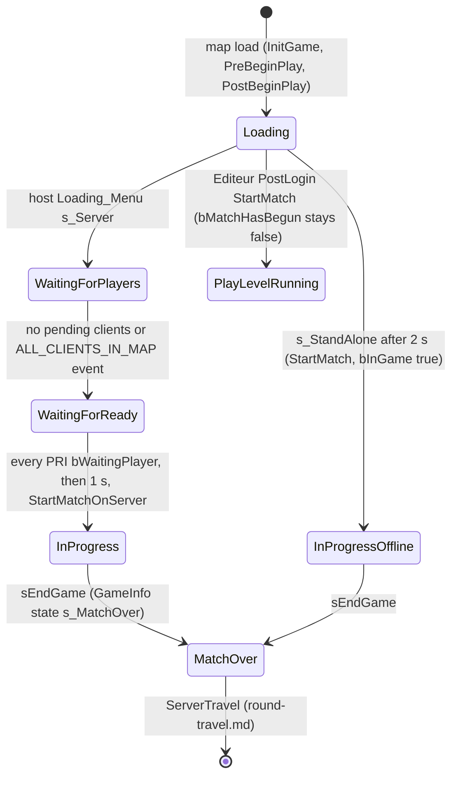

# Match lifecycle: setup, start gate and StartMatch

Units:
- uc:Engine.GameInfo:PreBeginPlay
- uc:Engine.GameInfo:PostBeginPlay
- uc:Engine.GameInfo:InitGameReplicationInfo
- uc:Engine.GameInfo:SetGameSpeed
- uc:Engine.GameInfo:InitLogging
- uc:Engine.GameInfo:StartMatch
- uc:Engine.GameInfo:PostLogin
- uc:Engine.GameInfo:SetPause
- uc:Engine.GameInfo:Timer (overridden, see below)
- uc:SBase.SGameInfo:PreBeginPlay
- uc:SBase.SGameInfo:PostBeginPlay
- uc:SBase.SGameInfo:InitGameReplicationInfo
- uc:SBase.SGameInfo:PostLogin
- uc:SBase.SGameInfo:StartMatch
- uc:SBase.SGameInfo:Timer
- uc:SBase.SGameInfo:CreateSLANServerLink
- uc:SBase.SPlayerController:StartMatchOnServer
- uc:SBase.SPlayerController:launchMatchNow
- uc:GUI.Loading_Menu:s_Init@code
- uc:GUI.Loading_Menu:s_Server@code
- uc:GUI.Loading_Menu:s_Client@code
- uc:GUI.Loading_Menu:s_StandAlone@code
- uc:GUI.Loading_Menu:InternalOnInfoEvent
- uc:GUI.loading:InternalOnInfoEvent
- nat:SBase.SPlayerController.NbPendingClientOnServer
- def:SBase.SGameInfo
- def:Engine.GameInfo

## Purpose
Defines the order in which a match is set up on the server, what holds the match back until everyone has
loaded, what `StartMatch` does (spawns, lives, missions, clock), and the flags that tell every other system
whether the match is running. The single most important flag is `GRI.bMatchHasBegun`: all end-of-round
checks, the time limit, resign and the late-join rule depend on it, and it is set differently in a network
match, an offline match and the editor's Play Level.

## Data
GameInfo / SGameInfo (server only, `RemoteRole = ROLE_None`):

| Field | Type | Default | Meaning |
|---|---|---|---|
| bDelayedStart | bool | true (def:Engine.GameInfo, not overridden) | when true, PostLogin does not start the match or spawn the player |
| bWaitingToStartMatch | bool | false | set true by Login when `Editeur=true`; cleared by StartMatch |
| bGameEnded | bool | false | set by sEndGame |
| bRestartLevel | bool | false (def:SBase.SGameInfo) | legacy UT flag; never true in practice |
| bWelcomePending | bool | false | request to broadcast "entered the game" for new spectators |
| GameReplicationInfoClass | class | Engine.GameReplicationInfo | GRI class spawned in PreBeginPlay |
| PlayersToWait | byte | from `NBPlayers` (default 1) | display only (loading screen counter) |
| BroadcastScoreTime | float | 0 | dead feature (BroadcastScore is empty) |
| FearCostFallOff | float | 0.95 | legacy bot path cost decay applied every timer tick |
| MatchInfo | SMatchInfo | created in InitGame | match settings (match-options.md) |
| rj45checker | SRJ45Checker | spawned in PostBeginPlay | network cable watcher (out of scope) |
| IamLANServer | SLANServerLink | None | LAN beacon link (out of scope) |
| InLAN | string | last Login's `LAN` option | "Server" marks the host's PRI.bIAmServer in PostLogin |

GRI flags used here (all replicated): bMatchLaunchingNow, bMatchLaunching, bMatchHasBegun, bStopCountDown,
WinningTeam, WinningReason, TimesRespawn, NumObjectives, NumDogTagsTaken (see replication-info.md).

PRI flags used by the start gate: bWaitingPlayer, bReadyToPlay, bOnlySpectator, bIAmServer.

## Rules
Setup (server, map load):
1. `InitGame(Options)` runs first (match-options.md).
2. `GameInfo.PreBeginPlay` (SGameInfo only calls super): `StartTime = 0`; `SetGameSpeed(GameSpeed)` which
   sets `Level.TimeDilation = max(GameSpeed, 0.1)` and starts the GameInfo timer with period
   `Level.TimeDilation`, looping (1.0 game second at normal speed); spawn the GRI; call
   `InitGameReplicationInfo`; `InitLogging` (spawns GameStats only on a dedicated server with stat logging,
   so never in Standalone or ListenServer).
3. `SGameInfo.InitGameReplicationInfo` (after the base copies `bTeamGame` and `GameName`): copies from
   MatchInfo and the host's persistent data into the GRI: GamesInARow, ServerName = MatchInfo.LevelName,
   ShortName = local player's name (None at this point, so ""), TimeLimit, TeamLivesATT = NumLivesATT,
   TeamLivesDEF = NumLivesDEF, TimesRespawn, GameMode, ServerOnly (persistent bDedicatedServer), Revenge,
   bRandomMap, GameWithRanking, allowVoiceChat, allowVoiceChatInLobby, NumDisks, NumDisksToWin.
4. `SGameInfo.PostBeginPlay`: spawn and initialize the RJ45 checker; if `GRI.Teams[0]` is None spawn
   `STeamAttaquant` (TeamIndex 0, spies); if `GRI.Teams[1]` is None spawn `STeamDefenseur` (TeamIndex 1,
   mercs); `BroadcastScoreTime = 0`; base PostBeginPlay (GameStats hooks, inert); `GRI.NumDogTagsTaken = 0`.

Per player (Login then PostLogin, detailed in login-and-teams.md):
5. `SGameInfo.PostLogin(NewPlayer)` first refreshes GRI fields from MatchInfo and persistent data
   (the rule 3 list plus the 13 `bAvlb_*` ability flags, `bAvlb_CinematicCamera`, team gadget restriction
   and gadget counts on both STeamInfo, VoiceChatMode mapping 1 Classic, 2 Team, 3 Open, anything else
   Modern), sends `ClientSetCinematicCamera`, sets `PRI.bIAmServer` when `InLAN` equals "Server" (ignoring
   case).
6. It then calls the base PostLogin with `bDelayedStart` forced to true while `GRI.bMatchHasBegun` is true
   (restored afterwards). The base PostLogin: if `bDelayedStart` is false, it sets `bRestartLevel = false`,
   then calls `StartMatch()` when `bWaitingToStartMatch` is true and the match has not begun, otherwise
   `RestartPlayer(NewPlayer)`, then restores `bRestartLevel` to its default. In all cases it sends
   `ClientSetHUD(SBase.SHud, scoreboard class named by ScoreBoardType)` and, if the player already has a
   pawn, `Pawn.ClientSetRotation(Pawn.Rotation)`.
7. On LAN with `InLAN == "Server"` and no pending clients, spawn the LAN server link (out of scope).
   `CreateSLANServerLink(PC)` is the same spawn-once-and-initialize as an event with no script caller
   (native or Reloaded entry point).

Start gate (network and offline menus). The match does not start from PostLogin because `bDelayedStart`
is true. It starts from the host's loading screen GUI page `Loading_Menu`:
8. `s_Init`: shows "joining"; every 0.5 s checks the NetMode: ListenServer goes to `s_Server`; Client goes
   to `s_Client`; Standalone goes to `s_StandAlone` once more than 2.0 s have passed since the page opened.
9. `s_Server` (host, listen server, including a host that does not play):
   a. Calls `PlayerWaitingToPlayToServer(true)` for the host (PRI.bWaitingPlayer = true; StartLateJoiner
      does nothing before the match).
   b. If `NbPendingClientOnServer() == 0` (native: number of clients still connecting), all players are in.
      Otherwise it loops every 1.0 s showing "Waiting for players (NumPlayers / PlayersToWait)" until the
      LAN service raises EVTLANINFO_CONNEXION_ALL_CLIENTS_IN_MAP. The pending count is not polled again
      inside this loop. PlayersToWait is only displayed; it never gates the start.
   c. Then every 1.0 s (label CheckPlayer): the match may start when every PRI in `GRI.PRIArray` from
      index `NumFirstPlayer` (1 when GRI.ServerOnly, else 0) has `bWaitingPlayer` true. Spectator PRIs are
      included. When true: (LAN) make sure the LAN server link exists; wait 1.0 s; set
      `Level.Game.bDelayedStart = false`; call `StartMatchOnServer()`; enable rumble; then UI and online
      service bookkeeping, and close the menus (or show the dedicated server page).
10. `StartMatchOnServer` (an SPlayerController server function, called by the host on itself) sets
    `GRI.bMatchHasBegun = true` and only then calls `Level.Game.StartMatch()`. So in network matches every
    RestartPlayer issued by StartMatch already sees bMatchHasBegun true.
11. `s_Client` (each client): calls `PlayerWaitingToPlayToServer(true)` (server RPC that sets its
    PRI.bWaitingPlayer), then every 0.5 s: if `GRI.bMatchHasBegun` (replicated) then: if
    `!bMatchLaunching` open the BackToLobby menu; else if `WinningTeam != 255` open Ending_Menu (joined
    after the end); else close the loading menu and play.
12. `s_StandAlone` (offline match started from the menus): `bDelayedStart = false`; `StartMatch()`; close
    menus. Here bMatchHasBegun is still false while StartMatch spawns players.
13. Editor Play Level (`Editeur=true`): Login sets `bDelayedStart = false` and `bWaitingToStartMatch =
    true`, so the base PostLogin calls `StartMatch()` directly for the first player. No loading page runs.

`GameInfo.StartMatch` (base part, called first by SGameInfo.StartMatch after the Merc Deathmatch move):
14. GameStats start (inert). Call `MatchStarting()` on every actor (AllActors order).
15. For each controller in `Level.ControllerList` that is a PlayerController with no pawn: if `bGameEnded`
    is true, return from the base StartMatch immediately (the SGameInfo part still runs); else if
    `CanRestartPlayer()` (`!PRI.bOnlySpectator`) call `RestartPlayer` (spawn, see respawn-and-spawning.md).
16. `bWaitingToStartMatch = false`; `GRI.WinningTeam = 255`; `GRI.WinningReason = 255`.
17. If `PlayerController(Level.ControllerList).Player.GUIController.bInGame` then `GRI.bMatchHasBegun = true`.
    `bInGame` is a GUI flag set by the loading page when the map finished loading through the menus. In the
    editor's Play Level it is false, so bMatchHasBegun is never set (measured: "Play Level never ends a
    round"). The test reads the head of ControllerList, which on a listen server may be a remote player's
    controller (its `Player` is a connection); the result does not matter there because rule 10 already
    set the flag.

`SGameInfo.StartMatch` (full order):
18. If GameMode is GM_MercDeathMatch, `MoveEveryoneToMercs(false)` (login-and-teams.md).
19. Base StartMatch (rules 14 to 17).
20. Call native `Desactivate()` on every SMission.
21. `GRI.NumObjectives = 0`.
22. For every SMission (AllActors order): skip all of them in Merc Deathmatch; if `M.GameMode ==
    MatchInfo.GameMode`: for Disk Hunt set `M.MinimumObjectives = persistent NumDisks`; call `M.Reset()`
    (activates objectives and adds to GRI.NumObjectives; objectives spec). Missions of other modes stay
    deactivated. SteeE has SMission28821 (mode 5, 4 of 6), SMission28822 (mode 4), SMission28823 (mode 6).
23. For each PlayerController in ControllerList: `SetPause(false)` (clears Level.Pauser); assign lives:
    pawn is an `SPawnAttaque` gives `Team.TeamIndex = 0` (writes the TeamInfo object, a no-op for the spy
    team) and `NumLives = MatchInfo.NumLivesATT`; pawn is an `SPAWNDEFENSE` (the merc pawn class) gives
    `Team.TeamIndex = 1` and `NumLives = NumLivesDEF`; otherwise (no pawn, for example a spectator), only
    in Merc Deathmatch: team 0 gets NumLivesATT, else NumLivesDEF. A non-Merc-DM player without a pawn
    keeps NumLives 0. Then `GRI.bMatchLaunching = true`, `GRI.TimesRespawn = MatchInfo.TimesRespawn`,
    `resetConnectionPing()` (native ping reset).
24. Rule 17 again (same bInGame test).
25. Standalone only: `SpawnMagmaHud()` on the head of ControllerList.
26. `GRI.Reset()`: clock restart (`ElapsedTime = 0`, `RemainingMinute = TimeLimit * 60`,
    `bStopCountDown = false`, GRI timer restarted at 1.0 s). See replication-info.md.
27. `UpdateTeamNumLives()` (death-lives-respawn.md).
28. `bWelcomePending = true`.

Pawns therefore spawn (rule 15) before lives are assigned (rule 23) and before missions reset (rule 22).

`SGameInfo.Timer` (every `Level.TimeDilation` game seconds, from PreBeginPlay until s_MatchOver replaces it):
29. For every SPlayerController with a `PoisonInstigator`, call `CountPoisonDrain()` (damage spec).
30. If `bWelcomePending`: clear it; if NetMode is not Standalone, for every PRI not yet `bWelcomed`: set
    bWelcomed; if the PRI is `bOnlySpectator` and not (bIAmServer and GRI.ServerOnly), broadcast
    GameMessage switch 1 ("<name> entered the game.").
31. `BroadcastHandler.UpdateSentText()`; every navigation point `FearCost *= 0.95` (inert in Versus).
32. Time limit (end-of-round.md rule 1).
33. `BroadcastScoreTime` check: compares a TimeSeconds-based value to `ElapsedTime`; calls the empty
    BroadcastScore. No observable effect; do not port beyond a no-op.
34. Level event at time: if `Level.SendAtTime > 0` and `ElapsedTime >= SendAtTime`, trigger `Level.Event`
    once and set SendAtTime 0; if `SendAtTime < 0` and `0 < RemainingTime <= -SendAtTime`, trigger once.
    ElapsedTime counts from map load until StartMatch resets it, so a positive SendAtTime can fire during
    the pre-match wait. SteeE does not set SendAtTime.

`launchMatchNow` (server to client RPC, also hooked by Reloaded) sets the receiving client's local copies of
`GRI.bMatchLaunchingNow` and `bMatchLaunching` to true (lobby countdown UI).

## Waiting for players

What Loading_Menu shows while the start gate waits (the gate itself is rules above):

- The host's page titles itself "Waiting for players (n / m)": n the players in, m the players to wait for (on a
  dedicated host the PRI count less one). Before every client is on the map it lists one line per expected player:
  "name ready" for a PRI that exists, " -" plus the connecting text for a slot with no PRI yet. Once all are in, every
  second it lists every PRI from NumFirstPlayer: "name ready" when `bWaitingPlayer` is set, "name loading ..." when
  not.
- A client's page (s_Client) titles itself "Waiting for players" and every half second lists every PRI the same way
  (ready or loading), until the match has begun; then it closes (or opens the lobby or the end menu when the match
  already ended).
- `TimedOutText` ("Player timed out...") is in the page's strings but no code shows it.
- Enhanced's GUI.int words: titleText "Waiting for players", ReadyText "is ready", LoadingText "is connecting",
  ConnectingText "Loading...", TimedOutText "Player timed out...".

The rewrite (`game/Scripts/Online/RoundStartList.cs`) draws the client's list over the round's view, with the counts
in the title, and adds what its session knows: a session player with no PRI on the map yet reads "Loading...", and a
player the server dropped for not loading in time (or who left while the round loaded) reads "Player timed out...".

## States

`PlayLevelRunning` never leaves on its own: no end check passes while bMatchHasBegun is false.

## Constants
| Name | Value | Unit | Provenance | Source |
|---|---|---|---|---|
| GameInfo timer period | Level.TimeDilation (1.0) | game s | decoded | SetGameSpeed |
| Loading_Menu standalone delay | 2.0 | s | decoded | Loading_Menu.s_Init |
| Loading_Menu poll (init, client) | 0.5 | s | decoded | Loading_Menu |
| Loading_Menu poll (server) | 1.0 | s | decoded | Loading_Menu.s_Server |
| Delay between all-ready and StartMatchOnServer | 1.0 | s | decoded | Loading_Menu.s_Server |
| Welcome message switch | 1 | GameMessage | decoded | SGameInfo.Timer |
| FearCost decay | 0.95 | per tick | decoded | def:Engine.GameInfo |

## Network
- Everything in SGameInfo runs only on the server (listen host, offline, Play Level).
- `Loading_Menu` runs on every machine (GUI); its server branch drives the start, its client branch only
  waits for the replicated `bMatchHasBegun`.
- RPCs: `PlayerWaitingToPlayToServer(bool)` client to server, reliable. `StartMatchOnServer()` client to
  server, reliable, but only ever called by the listen host on itself, so it executes locally.
  `launchMatchNow()` server to client, reliable. `ClientSetHUD`, `ClientSetCinematicCamera`,
  `resetConnectionPing` server to client, reliable.
- GRI and PRI replication: replication-info.md.

## Edge cases
- Network spawns see `bMatchHasBegun == true` (rule 10), Play Level spawns and respawns always see false,
  offline-menu initial spawns see false. This decides whether the PlayerStart Priority pass runs
  (spawn-selection.md) and whether rounds can end at all.
- In Play Level, a second loading flow can start if the 'loading' GUI page is ever open: its
  ALONE_IN_MAP event sets bInGame and opens Loading_Menu, which would call StartMatch a second time. Not
  expected from the editor; see Open questions.
- If StartMatch runs while `bGameEnded` is true, the base part returns before clearing
  bWaitingToStartMatch and the winning fields, but the SGameInfo part still resets missions and the clock.
- A player whose RestartPlayer failed (no start spot) keeps NumLives 0 and is treated as out of lives.
- `Loading_Menu.s_Server` keeps looping after the start until the page is closed; if it were not closed it
  would call StartMatchOnServer again every second.

## Evidence
- local/re-out/uc/SBase/SGameInfo.uc: PostBeginPlay (53506c5e2ab6), InitGameReplicationInfo (faae61ae6785),
  PostLogin (3fc446f7d35b), StartMatch (9591cd4c170a), Timer (4a9e8934382b)
- local/re-out/uc/Engine/GameInfo.uc: PreBeginPlay (771552325f2d), StartMatch (7179e8cadb9c), PostLogin
  (97a800899971), SetGameSpeed (73155b2fbc99), InitLogging (1e59a4c804d8)
- local/re-out/uc/SBase/SPlayerController.uc: StartMatchOnServer (63cb6be29304), launchMatchNow
  (47f6e8efb693)
- local/re-out/uc/GUI/Loading_Menu.uc: s_Init@code (63767988a408), s_Server@code (87b1b951e07b),
  s_Client@code (1e6687475023), s_StandAlone@code (29c6a1e6485b)
- local/re-out/uc/GUI/loading.uc InternalOnInfoEvent (a7fdf5cbd6bf): sets GUIController.bInGame
- Natives: SPlayerController.NbPendingClientOnServer 0x10ab1630 (native 1665), resetConnectionPing
  0x10a21f00 (1683), Controller.GotoState 0x58dc0320 (1175, address inside Reloaded.Core.dll: hooked)
- RE+ docs/MapBuilderFacts.md line 176: Play Level keeps bMatchHasBegun 0 and never ends a round
- Reloaded strings (local/reloaded_strings/reloaded_core.txt): `launchMatchNow`, `GotoWaitingState`,
  `ChangeTeam`, `MoveEveryoneToMercs` are hooked names
- SteeE missions read with scctpkg: SMission28821 GameMode 5 MinimumObjectives 4 bChained false

## Open questions
- `NbPendingClientOnServer` (0x10ab1630): exact definition of "pending" (connected but not yet logged in?
  logged in but not yet in map?). Needs Ghidra.
- Which LAN service event fires EVTLANINFO_CONNEXION_ALL_CLIENTS_IN_MAP in an internet (Reloaded master
  server) game, and whether Reloaded hooks this start path. Trace: 2-machine listen match, log the time
  of each PRI.bWaitingPlayer change and of GRI.bMatchHasBegun.
- Order of `Level.ControllerList` (UE2 inserts new controllers at the head, so the newest login is first):
  confirm in this build, since it decides spawn order and therefore distance-rated spawn choices.
- Whether a closed GUIPage stops its latent state code (rule 9 loop).

### Resolved
- Whether Reloaded's hook of Controller.GotoState (0x58dc0320) changes any state transition used here. Resolved:
  no for normal play; it keeps the stock sequence and only adds Reloaded's integrity check for the local player's
  controller, which replaces the requested state when the check fails. Evidence: reloaded-hooks.md rule 3.
