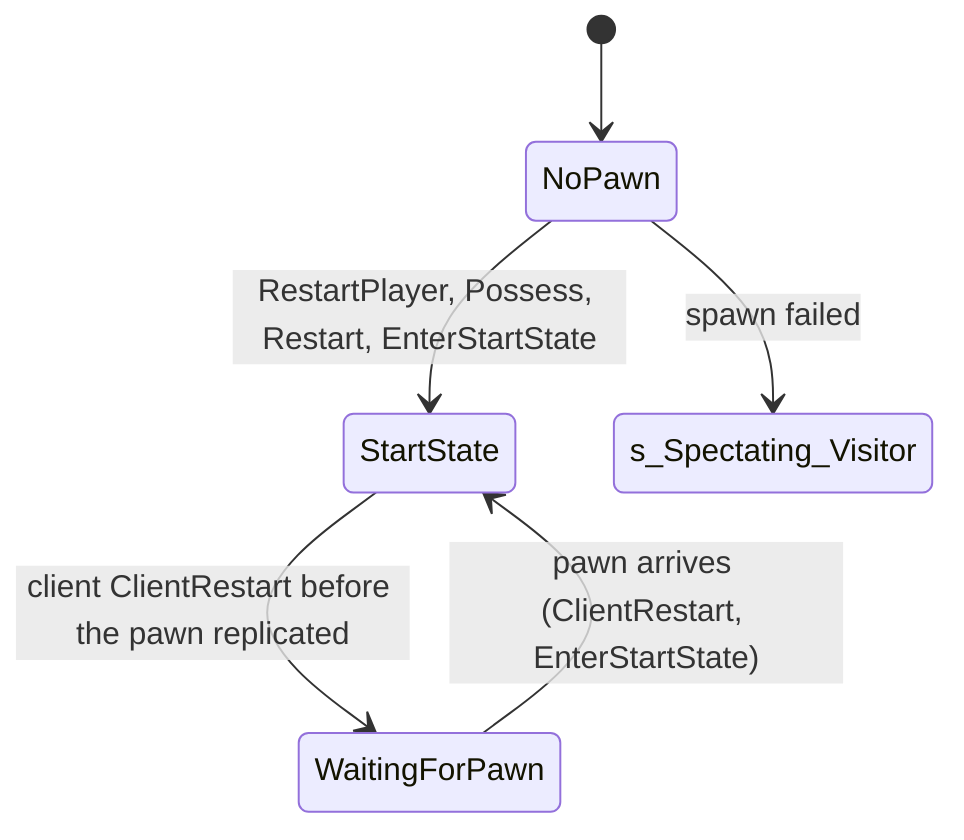

# Spawning a pawn: RestartPlayer, possession, start state and spawn protection

Units:
- uc:SBase.SGameInfo:RestartPlayer
- uc:SBase.SGameInfo:AddDefaultInventory
- uc:SBase.SGameInfo:ResetVisionMode
- uc:SBase.SGameInfo:s_MatchOver.RestartPlayer
- uc:Engine.GameInfo:RestartPlayer (empty base)
- uc:SBase.SPlayerController:Possess
- uc:SBase.SPlayerController:UnPossess
- uc:SBase.SPlayerController:EnterStartState
- uc:SBase.SPlayerController:ClientRestart
- uc:SBase.SPlayerController:ClientSetRotation
- uc:SBase.SPlayerController:GivePawn
- uc:SBase.SPlayerController:StandardReactionsToDamage (spawn protection clause only)
- uc:SBase.SPlayerController:WaitingForPawn.BeginState
- uc:SBase.SPlayerController:WaitingForPawn.EndState
- uc:SBase.SPlayerController:WaitingForPawn.PlayerTick
- uc:SBase.SPlayerController:WaitingForPawn.Timer
- uc:SBase.SPlayerController:WaitingForPawn.Fire
- uc:SBase.SPlayerController:WaitingForPawn.AltFire
- uc:Engine.PlayerController:Restart
- uc:Engine.PlayerController:AskForPawn
- uc:Engine.PlayerController:GivePawn
- uc:Engine.PlayerController:CanRestartPlayer
- uc:Engine.Controller:Restart
- uc:Engine.Controller:Possess

## Purpose
Everything between "this controller should have a pawn now" and "the player is walking": picking the start
(spawn-selection.md), placing the pawn on the floor, possession, initial camera rotation, inventory, the
start event and sound, the spawn shock that stuns enemies standing on a spawn, the start state for each
side, and the short explosion immunity after spawning.

## Data
| Field | Owner | Type | Default | Notes |
|---|---|---|---|---|
| StartSpot | Controller | PlayerStart | None | replicated (Role == Authority) |
| PawnClass, PreviousPawnClass | Controller | class | from SetPawnClass | PawnClass replicated to owner |
| Pawn.Anchor, LastStartSpot, LastStartTime | Pawn | | | written, not read by gameplay |
| fSpawnProtectionEnd | SPlayerController | float | 0 | TimeSeconds + 3.0 at EnterStartState |
| MyDesiredRotation | SPlayerController | Rotator | | replicated initially |
| PlayerStartSound | SGameInfo | Sound | Interface.Menu.Menu_start_point | |
| DefaultFOV, DesiredFOV, FovAngle | PlayerController | float | | SpyFOV 75, DefenderFOV 95 |
| SpawnProtectionTime | SPlayerController const | 3.0 | | declared constant; code uses the literal 3.0 |
| MercDMGunProtectionTime | SPlayerController const | 1.0 | | declared; code uses `end - 3.0 + 1.0` |

## Rules
`SGameInfo.RestartPlayer(aPlayer)` (server):
1. Return if `PRI.bOnlySpectator`. Return if `bRestartLevel` and NetMode is neither Dedicated nor Listen
   (bRestartLevel is false in this game, so this never triggers).
2. `TeamNum = PRI.Team.TeamIndex`, or 255 without a PRI or team.
3. `StartSpot = FindPlayerStart(aPlayer, TeamNum)`; return if None (the player stays without a pawn).
   `aPlayer.StartSpot = StartSpot`.
4. If `PawnClass` is set: trace from the start location straight down 200 uu with a box extent
   (35, 35, 10), colliding with actors as well as world:
   `End = Start - (0, 0, 200)`. If something is hit, spawn at `(Start.X, Start.Y, HitLocation.Z + 79)`;
   else spawn at the start location. Rotation is the start rotation. The spawn ignores blocking collision
   (bNoCollisionFail), so pawns can overlap.
5. If no pawn exists after this: make the player a spectator (`bOnlySpectator = bIsSpectator = true`,
   `NumSpectators++`, `GotoState('s_Spectating_Visitor')`) and return. NumPlayers is not decremented.
6. `Pawn.Anchor = StartSpot`, `Pawn.LastStartSpot = StartSpot`, `Pawn.LastStartTime = TimeSeconds`,
   `PreviousPawnClass = Pawn.Class`, `Possess(Pawn)`, `PawnClass = Pawn.Class`,
   `Pawn.PlayTeleportEffect(true, true)`.
7. Camera rotation: team 0 (spy) gets the start rotation plus `iSpyCam_InitAngle_Hor` on Yaw and
   `iSpyCam_InitAngle_Ver` on Pitch, each wrapped once into -32768..32767, sent with
   `ClientSetRotation`; any other team gets `ClientSetRotation(Pawn.Rotation)`. SPlayerController's
   `ClientSetRotation` runs the Engine one (controller rotation, pawn yaw) and then sets `MyDesiredRotation` and
   `LocalMyDesiredRotation` to the new controller rotation, so the aim does not swing back to the old one.
8. `AddDefaultInventory(Pawn)`: `SBasePawn.UpdateInventory(GameMode)` then `AddDefaultGadgets(GameMode)`
   (inventory spec).
9. `TriggerEvent(StartSpot.Event, StartSpot, Pawn)` (nothing when Event is None).
10. `MyDesiredRotation = aPlayer.Rotation`; `ClientPlaySound(PlayerStartSound)` to the owner.
11. Spawn shock: for every other controller with a pawn and a team different from TeamNum:
    `D = other.Pawn.Location - newPawn.Location`. If `D.Z > 20` and `|D| < 220`, or `|D.Z| <= 20` and
    `|D| < 170`, call `other.PawnTakeDamage(0, newPawn, other.Location, D, SDTStickyShocker, PillTag -10)`.
    An enemy more than 20 uu below the new pawn is never shocked. On an SPlayerController target, a
    sticky-shock hit with PillTag -10 deals `int(0.51 * default Health)` if the target is not already
    sticky-shocking (0 otherwise) and starts the sticky shock reaction (damage spec). Teammates are not
    affected.
12. In GameInfo state `s_MatchOver`, RestartPlayer does nothing.
12a. `SGameInfo.ResetVisionMode(Pawn)` calls `Goggle.ResetVisionMode()` on the pawn's controller. No script
    caller exists (possibly called from native code); port it as a plain helper.

Possession (`SPlayerController.Possess(aPawn)`, server):
13. Authority: spawn the SInteractionManager once (owned, no collision fail).
14. Return if `bOnlySpectator`.
15. Controller location = pawn location. Rotation: start rotation plus the two spy camera offsets
    (no wrap) when StartSpot is set, else the pawn rotation.
16. `aPawn.PossessedBy(self)`, `Pawn = SBPawn = aPawn`, `bStasis = false`, clear saved moves (netcode
    spec), `ServerSetHandedness`, then `Restart()`.
17. `PlayerController.Restart`: Controller.Restart (`Enemy = None`), `ServerTimeStamp = 0`,
    `TimeMargin = 0`, `EnterStartState()`, `SetViewTarget(Pawn)`, `bBehindView = Pawn.PointOfView()`,
    `ClientRestart()` (server to owner RPC; runs locally for the host's own player).

`EnterStartState()` (runs on the server from Restart and on the owning client from ClientRestart):
18. `fSpawnProtectionEnd = TimeSeconds + 3.0`; `LocalMyDesiredRotation = MyDesiredRotation = Rotation`;
    refresh `SBPawn`; clear `bActionsSendByServerMove`, `bActionsHasBeenSentByServerMove`, `bTazered`.
19. For every SZoneTips with cylinder collision whose cylinder contains `StartSpot.Location`
    (`dx^2 + dy^2 <= R^2` and `dz^2 <= H^2`), call its Touch with the pawn (tips spec).
20. Spy: `DefaultFOV = SpyFOV`, `bCrouchWithRoll = true`, camera ECM_WalkingCr, start state
    `s_PlayerWalkingCr0H`, pawn actions "wants to crouch" and action 75, both forced. The spy always
    spawns crouched with no weapon in hand.
21. Merc: `DefaultFOV = DefenderFOV`, camera ECM_FirstPerson, start state `s_PlayerWalkingSt2H`, action
    SA_WALK_ST_2H forced, HUD colour flash (slot 0, full colour to 255 over 1.0 s at 0.25 linear), HUD
    perturbation 0, `SetWeaponLoaded(2)`, weapon to `s_Selected`, reticle on unless the laser was on.
22. `DesiredFOV = FovAngle = DefaultFOV`; reset the zip line memory (`LastZipP` far away).
23. On the owning machine (IAmOnClient): refresh special chat, then enter the start state (call BeginState
    again if already in it). On the authority: `MirrorState(start state)`, which on a remote player also
    sends PCChangeClientState to the client.

`SPlayerController.ClientRestart()` (owner):
24. If the pawn is torn off, drop it. If there is no pawn yet (replication lag), go to `WaitingForPawn`
    and return.
25. Else: `bFireMode = 0`, `LocalMyDesiredRotation = Rotation`, set up the pawn's blob shadow,
    `Pawn.ClientRestart()`, `SetViewTarget(Pawn)`, `bBehindView = Pawn.PointOfView()`, clear saved moves,
    `EnterStartState()`.
26. `WaitingForPawn`: BeginState sets a 0.2 s looping timer and calls `AskForPawn()`; Timer calls
    AskForPawn; PlayerTick runs the global tick, then if the pawn has arrived sets `Pawn.Controller = self`,
    `bUpdateEyeheight = true` and calls ClientRestart, else re-arms the 0.2 s timer if it stopped or is
    slower than 1 s. Fire also asks. EndState clears behind view and the timer.
27. `AskForPawn()` (client to server): if the server is in GameEnded, send the client to GameEnded; else
    if the server controller has a pawn, `GivePawn(Pawn)` back (server to client RPC that sets Pawn,
    Pawn.Controller and calls ClientRestart; the SBase version also refreshes SBPawn); else
    `ServerReStartPlayer()` (the per-state server restart, which does nothing in most states).

Spawn protection (inside `StandardReactionsToDamage`, server, after the early health checks):
28. A spy (`SPawnType == SPAWNOFFENSE`) takes no damage at all from `SDamage_Explosion` while
    `TimeSeconds < fSpawnProtectionEnd` (the first 3.0 s after the spawn).
29. In Merc Deathmatch only, any player: no damage from `SDamage_Explosion` for 3.0 s, and no damage from
    `SDTBase`, `SDTBase_NoAnim` or `SDTSnipeShot` while `TimeSeconds < fSpawnProtectionEnd - 3.0 + 1.0`
    (the first 1.0 s).
30. Nothing else is filtered: in Story, mercs have no spawn protection and spies can be shot, grabbed or
    stunned immediately. Order inside StandardReactionsToDamage: early return for a dead pawn or a
    zero-damage fall; instigator substitution (GPO instigator, damage volume trigger controller); for
    SDTStickyShocker, `ShockInstigator` and `ShockInstigatorTime` are recorded; then the protection checks
    of rules 28 and 29. A protected hit returns before any damage, stats or reaction, but after the sticky
    shock instigator was recorded.

## States

StartState is `s_PlayerWalkingCr0H` for spies and `s_PlayerWalkingSt2H` for mercs (movement specs).

## Constants
| Name | Value | Unit | Provenance | Source |
|---|---|---|---|---|
| Floor probe length | 200 | uu | decoded | RestartPlayer |
| Floor probe extent | (35, 35, 10) | uu | decoded | RestartPlayer |
| Spawn height above hit | 79 | uu | decoded | RestartPlayer |
| Spawn shock, enemy above (dz > 20) | 220 | uu (3D distance) | decoded | RestartPlayer |
| Spawn shock, same level (abs dz <= 20) | 170 | uu (3D distance) | decoded | RestartPlayer |
| Spawn shock damage | int(0.51 * default Health) | hp | decoded | StandardReactionsToDamage PillTag -10 |
| Spawn protection | 3.0 | s | decoded | EnterStartState, StandardReactionsToDamage |
| Merc DM gun protection | 1.0 | s | decoded | StandardReactionsToDamage |
| WaitingForPawn retry | 0.2 | s | decoded | WaitingForPawn |
| Spy start state | s_PlayerWalkingCr0H | | decoded | EnterStartState |
| Merc start state | s_PlayerWalkingSt2H | | decoded | EnterStartState |
| Merc spawn HUD flash | 255 over 1.0 s, 0.25 | | decoded | EnterStartState |

## Network
- RestartPlayer, Possess, the spawn shock and the protection checks are server only.
- `ClientRestart` (server to owner, reliable), `ClientSetRotation` (server to owner, reliable),
  `ClientPlaySound` (server to owner, unreliable), `GivePawn` (server to owner, reliable), `AskForPawn`
  (owner to server, reliable), `PCChangeClientState` (server to owner, reliable) from MirrorState.
- EnterStartState runs on both ends, so `fSpawnProtectionEnd` exists on both; only the server's copy
  matters because damage is decided on the server.
- The pawn itself replicates as a new actor; StartSpot replicates to clients.

## Edge cases
- The floor probe collides with actors, so a pawn or mover under the start changes the spawn height.
- Spawning ignores blocking, so two players given the same start (Priority pass, or a single valid start)
  overlap; the shock only affects enemies.
- In a network match, if both the host and a client spawn in the same StartMatch pass, earlier spawns
  influence later starts only through RateStartByDistance.
- A failed spawn turns a playing player into a permanent spectator with NumLives untouched.
- Rule 15 adds the spy camera offsets to the controller rotation even for mercs (Possess does not test the
  team); rule 7 sends the client a corrected rotation only for spies, using the pawn rotation for mercs.

## Evidence
- local/re-out/uc/SBase/SGameInfo.uc: RestartPlayer (eae9c00cb697), AddDefaultInventory (06ba094941fd)
- local/re-out/uc/SBase/SPlayerController.uc: Possess (07fe15922022), UnPossess (1eaf9ce248c6),
  EnterStartState (57d15df2c32b), ClientRestart (b9ecf3c85e81), GivePawn (c428f2fcae80),
  StandardReactionsToDamage (3d3a25f936e2), WaitingForPawn state functions
- local/re-out/uc/Engine/PlayerController.uc: Restart (df4b2e9df93d), AskForPawn (2537e694b9fe)
- Natives: Actor.Trace 0x10a27450 (277), Actor.Spawn 0x10a27800 (278), Actor.SetRotation 0x58dc0420
  (299, inside Reloaded.Core.dll: hooked)

## Open questions
- Exact HitLocation convention of an extent trace in this engine (box centre at contact is the UE2 rule,
  giving spawn Z = floor + 10 + 79). Measure: Play Level on SteeE, read a fresh pawn's Location.Z and the
  floor Z under PlayerStart256.
- Whether native Spawn with the no-collision-fail flag still adjusts the location (encroachment
  push-out). Same scenario.
- What Reloaded's hook on Actor.SetRotation (0x58dc0420) changes for spawn rotations.
- Ordering inside one server frame between Possess, MirrorState and ClientRestart on the wire (both are
  reliable; the client may process ClientRestart before the pawn actor arrives, which is why
  WaitingForPawn exists). Trace on a 2-machine LAN game with packet capture.
