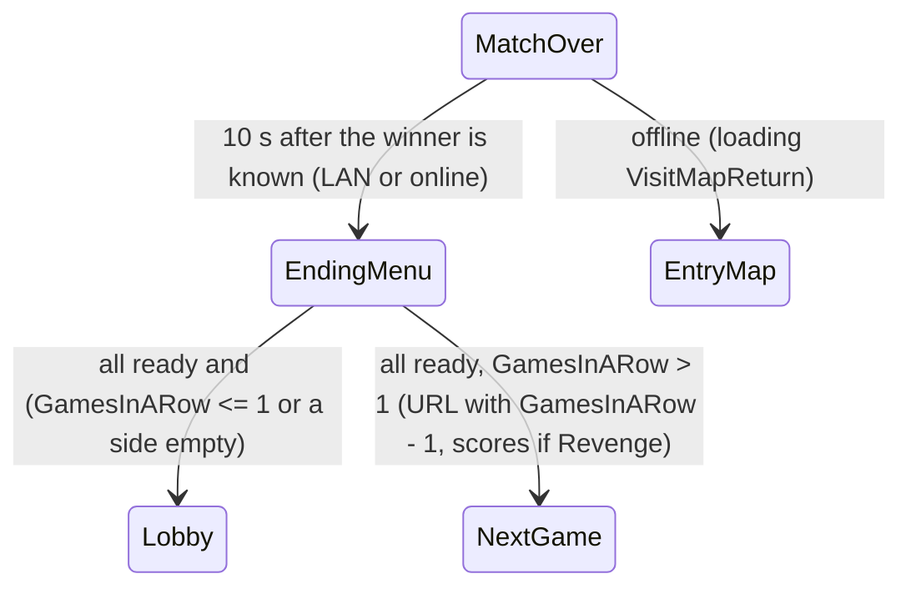

# Round restart and map travel: GamesInARow, Revenge, ScoreATT and ScoreDEF

Units:
- uc:SBase.SGameInfo:RestartGame
- uc:SBase.SGameInfo:ProcessServerTravel
- uc:Engine.GameInfo:ProcessServerTravel (overridden)
- uc:Engine.LevelInfo:ServerTravel
- uc:Engine.PlayerController:SwitchLevel
- nat:Engine.PlayerController.ClientTravel
- uc:GUI.Ending_Menu:Timer (contract)
- uc:GUI.Ending_Menu:InitComponent (contract)
- uc:GUI.GUIComponent:AllPlayerReady (contract)
- uc:GUI.GUIComponent:HowManyPlayersInTeam (contract)
- uc:SBase.SPlayerController:ReadyToPlayAgain
- uc:SBase.SPlayerController:ServerReadyToPlayAgain
- uc:SBase.SPlayerController:CLientForceMenuLobby
- uc:SBase.SPlayerController:ClientForceMenuEntry
- uc:SBase.SGameInfo:ForceMenuLobby
- uc:SBase.SGameInfo:ForceMenuQuit
- uc:SBase.SGameInfo:ForceMenuClientEntry

## Purpose
What happens after the end screen: the next game of a series on the same map (GamesInARow), the revenge
pair where both sides swap and the team point counters are carried over swapped, or the return to the
lobby. Covers the URL each path builds and how the server tells clients to follow.

## Data
| Field | Owner | Type | Notes |
|---|---|---|---|
| MatchInfo.GamesInARow | SMatchInfo | int | games left in the series, counted down by the next URL |
| MatchInfo.Revenge | SMatchInfo | bool | revenge pair: GamesInARow forced to 2 by the menus |
| GRI.GamesInARow | GRI | int | replicated copy |
| Level.NextURL | LevelInfo | string | pending travel; a non-empty value blocks a second ServerTravel |
| Level.bNextItems | LevelInfo | bool | |
| Level.NextSwitchCountdown | LevelInfo | float | native travel countdown; 0 means travel now |
| Level.waitedClients | LevelInfo | int | number of remote clients told to travel (read by native code) |
| PRI.bReadyToPlay | PRI | bool | set from the end menus (PlayerReadyToPlayToServer) |
| PRI.bReadyToPlayAgain | PRI | bool | legacy restart flag |

## Rules
Normal path (driven by the host's end menu, GUI):
1. After the end screen (end-of-round.md rule 18) LAN and online players open `Ending_Menu`. On every
   machine its InitComponent sends `PlayerReadyToPlayToServer(false)`, records stats in the GUI, and on the
   host (PRI.bIAmServer) starts a 0.5 s timer.
2. Host timer: when every PRI in GRI.PRIArray has bReadyToPlay (set when each player confirms in the
   following stats menu) and the native `canStartTravelOnServer()` allows it, the host calls
   `refuseClientsConnections()` (native), optionally picks a random map (when bRandomMap and not inside a
   revenge pair), then:
   a. If `MatchInfo.GamesInARow <= 1`, or either side has no player (HowManyPlayersInTeam counts PRIs from
      index 1 when ServerOnly, and reads a team-less PRI as side 0): reset GamesInARow to the lobby's value
      and `SwitchLevel("Lobby" + GetOptionsString())`.
   b. Else: `URL = LevelName + GetOptionsString()`; if Revenge append
      `?ScoreDEF=<Level.NbPointsAttack>?ScoreATT=<Level.NbPointsDefense>` (the counters swap with the sides);
      append `?GamesInARow=<GamesInARow - 1>`; `SwitchLevel(URL)`.
3. `SwitchLevel(URL)` only acts on Standalone or ListenServer: `Level.ServerTravel(URL, false)`.
4. `LevelInfo.ServerTravel(URL, bItems)`: ignored if a travel is already pending (`NextURL != ""`). Else
   store NextURL and bNextItems and call `Game.ProcessServerTravel(URL, bItems)` (or set the countdown to
   0 when there is no GameInfo). The native engine performs the actual map change when NextSwitchCountdown
   runs out.

`SGameInfo.ProcessServerTravel(URL, bItems)`:
5. `bSwitchTeams = MatchInfo.Revenge and GetIntOption(URL, "GamesInARow", 2) < 2` (script parse: first
   occurrence of the key).
6. End logging (inert). For every PlayerController with a network connection: append the team to the URL
   (`?Team=` the other side when bSwitchTeams, else the current side), count it, and send
   `ClientTravel(URL + "?IdentifiedTravel", TRAVEL_Relative, bItems)`. The URL variable is extended in
   place, so each later client's URL also contains the earlier clients' `?Team=` items; the native URL
   parser keeps the last value of a repeated key (UE2 behaviour), so each client still ends up with its own
   team. Local (viewport) controllers get `PreClientTravel()` and are remembered as the local player.
7. `Level.waitedClients = number of clients told to travel`.
8. Listen server with a local player: append the local player's team the same way to `Level.NextURL`.
9. Not a server (Standalone): `Level.NextSwitchCountdown = 0` (travel immediately).

Team swap in a revenge pair, in practice:
10. The GUI URL of rule 2b contains `GamesInARow` twice: first the current value from GetOptionsString (2 in
    the first game of a pair), then the decremented one (1). ProcessServerTravel (rule 5) reads the first
    one, so bSwitchTeams is false and every player travels with its current team. On the new map, InitGame
    and Login see the options rebuilt by the native parser, which keeps the last value (1); Login's revenge
    rule (`Revenge` and GamesInARow < 2) then swaps each player's requested team (login-and-teams.md rule
    7). Net effect: one swap per revenge pair, done at Login.
11. InitGame of the second game reads `ScoreATT` and `ScoreDEF` into `NbPointsAttack` and `NbPointsDefense`
    (match-options.md rule 16), so each side keeps its points under its new role.

Legacy path, `SGameInfo.RestartGame()` (reached only from s_MatchOver.Timer when every player has
bReadyToPlayAgain, which only the unused Restart_Menu sets):
12. RestartPlayer for every controller (a no-op in s_MatchOver).
13. URL starts empty; Revenge appends `?ScoreDEF=<NbPointsAttack>?ScoreATT=<NbPointsDefense>`; if
    `GamesInARow > 0` append `?GamesInARow=<GamesInARow - 1>`; if still empty use `?Restart`.
    `Level.ServerTravel(URL, false)` (a relative URL: same map, options merged by native code).
14. With this URL ProcessServerTravel sees GamesInARow 1 and swaps teams in the travel URL, and Login then
    swaps them again: the legacy path would put players back on their original sides. Keep it, but it is
    not on the normal path.

Other menu commands (server to client RPCs): `CLientForceMenuLobby` clears the client's bMatchLaunching and
opens BackToLobby; `ClientForceMenuEntry` closes menus and returns to the entry menu; `ForceMenuLobby`,
`ForceMenuQuit`, `ForceMenuClientEntry` on SGameInfo send these to all or all but one player.
`ReadyToPlayAgain(b)` sends `ServerReadyToPlayAgain(b)` which sets PRI.bReadyToPlayAgain.

## States

## Constants
| Name | Value | Unit | Provenance | Source |
|---|---|---|---|---|
| Host end menu poll | 0.5 | s | decoded | Ending_Menu.InitComponent |
| Revenge GamesInARow | 2 | games | decoded | Create_Match.ApplyMatchRules |
| Travel marker option | ?IdentifiedTravel | | decoded | ProcessServerTravel |
| Legacy restart option | ?Restart | | decoded | RestartGame |
| Default GamesInARow when absent (Login and ProcessServerTravel tests) | 2 | | decoded | Login, ProcessServerTravel |

## Network
- The host (listen server) decides and travels; clients receive `ClientTravel` (server to client,
  reliable, native 1185) with a relative URL and reconnect to the new map.
- `PlayerReadyToPlayToServer` and `ServerReadyToPlayAgain`: client to server, reliable.
- Native: `canStartTravelOnServer` (0x10ab15c0), `refuseClientsConnections` (0x10ab15e0),
  `unregisterClientTravel` (0x10ab1430) manage the travel handshake and use `Level.waitedClients`.

## Edge cases
- A second SwitchLevel during a pending travel is ignored (NextURL set).
- If a side is empty at the end of a game, the series stops and everyone returns to the lobby even with
  games left.
- Random map selection skips the second game of a revenge pair (`!Revenge or GamesInARow <= 1`).
- Offline matches never use these paths: the end screen sends the player back to the entry map.
- The Lobby travel uses GetOptionsString, so the lobby keeps the current match settings.

## Evidence
- local/re-out/uc/SBase/SGameInfo.uc: ProcessServerTravel (86bbac280aa9), RestartGame (70fdcf296c3a),
  s_MatchOver.Timer
- local/re-out/uc/Engine/LevelInfo.uc ServerTravel (bb8a7d7297ff); Engine/PlayerController.uc SwitchLevel
  (ed2fa429bc8c)
- local/re-out/uc/GUI/Ending_Menu.uc Timer (e3427438754b), InitComponent (37dfe3809924);
  GUI/GUIComponent.uc AllPlayerReady (744c9f5d40b0), HowManyPlayersInTeam (54e2de1a0922);
  GUI/Restart_Menu.uc (only setter of bReadyToPlayAgain true)
- Memory note objective-player-counts.md: "RestartGame travels with ?ScoreDEF ?ScoreATT ?GamesInARow
  ?Restart (relative URL, keeps options)"
- Natives: PlayerController.ClientTravel 0x10a21f30 (1185), SPlayerController.canStartTravelOnServer
  0x10ab15c0 (1661), refuseClientsConnections 0x10ab15e0 (1666), unregisterClientTravel 0x10ab1430 (1660)

## Open questions
- Native URL merge rules for TRAVEL_Relative and repeated keys (rules 6, 10, 14). Trace: 2v2 LAN revenge
  pair, log every Login Options string on the host and the teams after the second load.
- How the native travel uses `waitedClients` and when it actually switches (NextSwitchCountdown handling,
  waiting for clients). Needs Ghidra on the level tick and the three travel natives.
- Whether Reloaded changes the series flow (it has `rmap_next`, `rmap_prev`, `!map`, `!next` commands).
