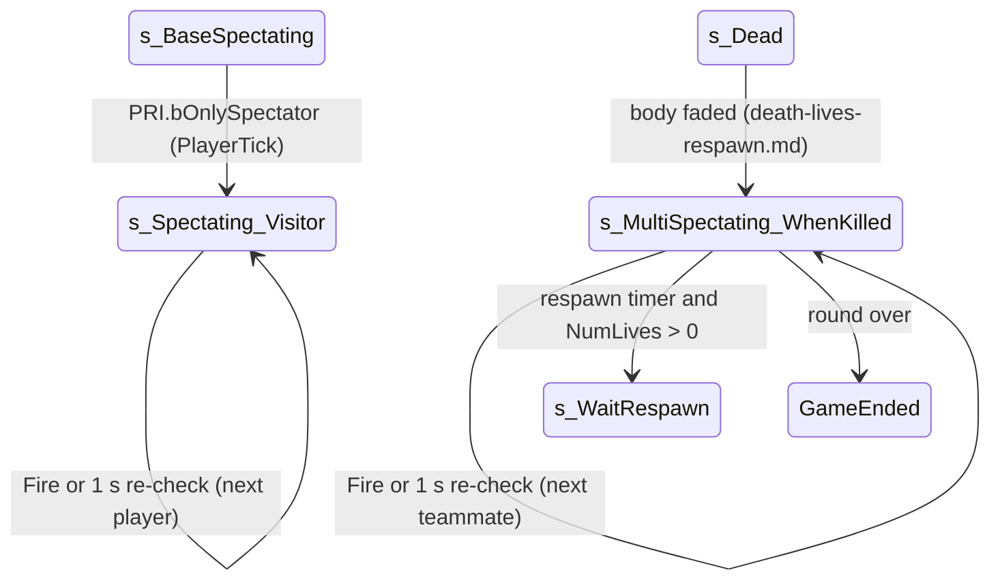

# Spectating: dead players, out-of-lives players and visitors

Units:
- uc:SBase.SPlayerController:s_BaseSpectating.BeginState
- uc:SBase.SPlayerController:s_BaseSpectating.EndState
- uc:SBase.SPlayerController:s_BaseSpectating.MyProcessMove
- uc:SBase.SPlayerController:s_BaseSpectating.PlayerMove
- uc:SBase.SPlayerController:s_BaseSpectating.PlayerTick
- uc:SBase.SPlayerController:s_BaseSpectating.UpdateRotation
- uc:SBase.SPlayerController:s_BaseSpectating.GadTorcheSwitch
- uc:SBase.SPlayerController:s_BaseSpectating.SwitchHeadset
- uc:SBase.SPlayerController:s_MultiSpectating.IsSpectating
- uc:SBase.SPlayerController:s_MultiSpectating.TeamSay
- uc:SBase.SPlayerController:s_MultiSpectating.Say
- uc:SBase.SPlayerController:s_MultiSpectating.PlayerTick
- uc:SBase.SPlayerController:s_MultiSpectating.SnapShot
- uc:SBase.SPlayerController:s_MultiSpectating.Fire
- uc:SBase.SPlayerController:s_MultiSpectating.PlayerMove
- uc:SBase.SPlayerController:s_MultiSpectating.UpdateRotation
- uc:SBase.SPlayerController:s_MultiSpectating.SwitchEnhancedReality
- uc:SBase.SPlayerController:s_MultiSpectating_WhenKilled.Fire
- uc:SBase.SPlayerController:s_MultiSpectating_WhenKilled.PlayerTick
- uc:SBase.SPlayerController:s_MultiSpectating_WhenKilled.SwitchEnhancedReality
- uc:SBase.SPlayerController:s_MultiSpectating_WhenKilled.BeginState (spectating part; timer part in death-lives-respawn.md)
- uc:SBase.SPlayerController:s_Spectating_Visitor.BeginState
- uc:SBase.SPlayerController:s_Spectating_Visitor.Fire
- uc:SBase.SPlayerController:s_Spectating_Visitor.PlayerTick
- uc:SBase.SPlayerController:s_Spectating_Visitor.SwitchEnhancedReality
- uc:SBase.SPlayerController:Server_FindNextFriend
- uc:SBase.SPlayerController:Server_FindNextVisitor
- uc:SBase.SPlayerController:ClientSetViewTarget, uc:Engine.PlayerController:ClientSetViewTarget,
  uc:Engine.PlayerController:ServerVerifyViewTarget
- uc:SBase.SPlayerController:BaseSpectating.IsSpectating
- uc:SBase.SPlayerController:BaseSpectating.MyProcessMove
- uc:SBase.SPlayerController:BaseSpectating.PlayerMove

Also covered: the empty state `spectating` (no functions and no code, so no unit of its own).

## Purpose
How a player who is dead, out of lives, or joined as a spectator watches the match: which pawn they are
attached to, how they cycle targets, how often the target is re-validated, and what they may do (chat,
vision modes). A dead player with lives left spectates teammates until the respawn timer fires; a player
with no lives left stays in the same state for the rest of the round.

## Data
| Field | Owner | Type | Notes |
|---|---|---|---|
| SpecTarget | SPlayerController | SBasePawn | pawn being watched; replicated (reliable, server to all) |
| PC_spectated | SPlayerController | PlayerController | controller of the watched pawn (server side) |
| bForceReplicationForSpecTarget | SPlayerController | bool | asks the netcode to replicate the watched pawn eagerly |
| fGrabDate | SPlayerController | float | next re-validation time |
| bDedicatedServerinSpyingMode | SPlayerController | bool | host-only spectator UI mode |
| bOnlySpectator, bIsSpectator | PRI | bool | replicated |
| fSensibiliteSouris | SPlayerController | float | 1.0, mouse sensitivity used for spectator look |
| bInvertHorizontalAxisCamSpy, bInvertVerticalAxis | SPlayerController | bool | look inversion |

## Rules
State tree: `s_BaseSpectating` (auto state of every new controller) is the parent of `s_MultiSpectating`,
which is the parent of `s_MultiSpectating_WhenKilled` and `s_Spectating_Visitor`.

`s_BaseSpectating`:
1. Ignores AltFire, AntiBugTellServerIAmDead, ChangeSpeed, DropAttack, Fire, GadgetQuickChoice, GoInSmoke,
   MyFalling, MyNotifyLanded, PawnTakeDamage, PlayAnimDeath, PlayAnimDmg, SwitchBinocularVision, SwitchROF.
2. BeginState: `bCollideWorld = true`. EndState: show the HUD, `bCollideWorld = false`, reset vision mode,
   `SpecTarget = None`, `bForceReplicationForSpecTarget = true`.
3. PlayerTick (this level only): if `PRI.bOnlySpectator`, `MirrorState('s_Spectating_Visitor')`.
4. PlayerMove: free-fly acceleration `0.02 * (aForward * X + aStrafe * Y + aUp * Z)` from the view axes,
   rotation update (empty here), sent with the move protocol or processed with
   `MoveSmooth(2 * Pawn.default.AirSpeed * Normal(Acceleration) * dt)`.
5. SwitchHeadset (vision modes while spectating): uses the watched pawn's side when SpecTarget is set.
   Mode 1 is night (spy) or motion (merc), 2 thermal (spy) or EMF (merc), 3 cycles; modes disabled in the GRI
   `bAvlb_*` flags are refused or skipped; choosing the active mode turns vision off. Then `Goggle.Activate()`
   (vision spec).
5a. `ClientSetViewTarget(A)` (server to owner, also run by the server for a local player): the Engine part sets the
   view target; a None target first asks the server to resend (`ServerVerifyViewTarget`, client to server: the server
   calls `ClientSetViewTarget` with its own view target again unless that is the controller itself). Then, in `s_Spectating_Visitor` with a pawn `A`: a goggle mode the watched side cannot use is
   dropped (EMF or motion tracking while watching a spy, night or thermal while watching a merc): `CurrentMode`
   becomes REN_DynLight (5) and `Goggle.Activate()`.
6. GadTorcheSwitch toggles HUD visibility.

`s_MultiSpectating` (overrides):
7. `IsSpectating()` true. SwitchEnhancedReality disabled. Say and TeamSay only when the host is in
   dedicated mode or `CanTextChatWhileSpectating()` (Enhanced chat rule; chat spec).
8. PlayerTick: native input, client position update, PlayerMove (rotation only, no movement), then
   `UpdatePositionForServer(Location, Rotation)`.
9. UpdateRotation:
   $$\text{yaw} \mathrel{+}= \operatorname{trunc}(50 \cdot s \cdot dt \cdot aTurn) \qquad \text{pitch} \mathrel{+}= \operatorname{trunc}(\pm 50 \cdot s \cdot dt \cdot aLookUp)$$
   with `s = fSensibiliteSouris`, yaw subtracted instead of added for a spy with
   `bInvertHorizontalAxisCamSpy`, pitch sign negative with `bInvertVerticalAxis`; trunc rounds toward zero
   (UnrealScript float to int). Pitch is masked to 16 bits,
   mapped to -32768..32767, then clamped to -15000..15000. `SetRotation` with the result.
10. Fire does nothing (overridden below). SnapShot takes a screenshot.

`s_MultiSpectating_WhenKilled` (dead players, both with and without lives left):
11. BeginState (spectating part): on the authority, every SPlayerController whose `SpecTarget` is this
    player's pawn loses it (`SpecTarget = None`, `PC_spectated = itself`, force replication); team talk is
    cut unless allowed; `fGrabDate = TimeSeconds + 1.0`; `Server_FindNextFriend(false)`.
12. PlayerTick: when `TimeSeconds > fGrabDate`, set `fGrabDate = TimeSeconds + 1.0` and call
    `Server_FindNextFriend(true)` (re-validate); then the parent tick.
13. Fire: `Server_FindNextFriend(false)` (next teammate).

`Server_FindNextFriend(bCheckOnly)` (client to server RPC, reliable; authority only):
14. With bCheckOnly: keep the current target and return if PC_spectated and SpecTarget are set, the
    watched controller's SBPawn is SpecTarget, and that controller is not itself in
    s_MultiSpectating_WhenKilled.
15. Return unless this controller is in s_MultiSpectating_WhenKilled.
16. Collect every PlayerController (AllPlayerControllers order, at most 12 slots) and find the index of the
    current PC_spectated (-1 if none). Starting after that index and wrapping, take the first controller
    that has an SBPawn, has the same SPawnType (same side) and is not this controller.
17. If found: `PC_spectated` and `SpecTarget` set, force replication, `UnPossess()` (this destroys the
    dead player's own body if it still exists), `SetViewTarget(SpecTarget)`, `ClientSetViewTarget`,
    camera mode ECM_Walking. If nobody qualifies, nothing changes: the player keeps looking at their own
    hidden body from the death camera. The camera (decoded, camera.md rules 3, 4.1): the following camera uses
    SpecTarget when the spectator has no own pawn; the controller's state picks the spectating view (behind view
    on) and the current camera mode's table entry (here ECM_Walking) applies to the target pawn. "Force
    replication" is bForceReplicationForSpecTarget: the controller's native list then sends SpecTarget once and
    clears the flag (net-replists.md, ANSWERS-net rep-controller 1).
18. A teammate that is itself dead but still has its body (still in s_Dead) qualifies, because only
    SBPawn existing is tested; one that is already spectating does not keep the target (rule 14).

`s_Spectating_Visitor` (bOnlySpectator: late joiners, the non-playing host, players whose spawn failed):
19. BeginState: `fGrabDate = TimeSeconds + 1`; unless in dedicated host mode, `Server_FindNextVisitor(false)`.
20. Fire: in dedicated host mode leave spying mode and show the menu; else `Server_FindNextVisitor(false)`.
21. PlayerTick: every 1 s: not dedicated, `Server_FindNextVisitor(true)`; dedicated host in spying mode whose
    target became invalid (rule 14 test fails), leave spying mode and show the menu. Then the parent tick.
22. `Server_FindNextVisitor(bCheckOnly)` first calls `GotoState('s_Spectating_Visitor')` on whichever machine
    runs it, then on the authority: rule 14 check; collect all PlayerControllers (at most 12), muting this
    spectator for each of them (HearVoiceChatter with mute), and pick the next controller after the current
    one that has an SBPawn and is not this controller, from either side. Same attach steps as rule 17.

`BaseSpectating` and `spectating` (Engine-style states kept in SPlayerController): BaseSpectating offers
free-fly movement identical to rule 4 and `IsSpectating()` true; it is the parent of PlayerWaiting and
WaitingForPawn. `spectating` is empty. Neither is used for dead players.

## States

## Constants
| Name | Value | Unit | Provenance | Source |
|---|---|---|---|---|
| Target re-check period | 1.0 | s | decoded | WhenKilled and Visitor PlayerTick |
| Free-fly acceleration factor | 0.02 | | decoded | s_BaseSpectating.PlayerMove |
| Free-fly speed | 2 * Pawn.default.AirSpeed | uu/s | decoded | MyProcessMove |
| Look rate | 50 * sensitivity * input | rotator units per s | decoded | s_MultiSpectating.UpdateRotation |
| Pitch clamp | -15000..15000 | rotator units | decoded | s_MultiSpectating.UpdateRotation |
| Candidate slots | 12 | controllers | decoded | Server_FindNextFriend/Visitor locals |

## Network
- Target choice is server side (`Server_FindNextFriend`, `Server_FindNextVisitor`: client to server,
  reliable). The result reaches the client through `ClientSetViewTarget` (server to client, reliable) and
  the replicated `SpecTarget`.
- The spectator's view rotation is local and reported with `UpdatePositionForServer` (client to server,
  unreliable).
- bForceReplicationForSpecTarget is read by native relevancy code (netcode spec).

## Edge cases
- More than 12 PlayerControllers overflows the fixed candidate array (UnrealScript logs and drops writes
  out of bounds); 4v4 plus spectators can reach it.
- A dead player with no living teammate sees their own death camera until a teammate respawns (the 1 s
  re-check then attaches).
- Spectators of the other side are never chosen in WhenKilled (side test), but visitors watch both sides.
- `Server_FindNextVisitor` switches the state even on a client before the authority check.

## Evidence
- local/re-out/uc/SBase/SPlayerController.uc lines around 27866 to 28530: s_BaseSpectating, s_MultiSpectating,
  s_MultiSpectating_WhenKilled, s_Spectating_Visitor, BaseSpectating; Server_FindNextFriend (bae1ff480e9e),
  Server_FindNextVisitor (f302d8f35105)
- Reloaded strings: `Server_FindNextVisitor`, `ClientSetViewTarget`, `ClientSetBehindView` are referenced
  (hooks or calls), reloaded_core.txt around 0x2b7c2c
- Natives: Actor.AllPlayerControllers 0x10a28350 (1144), SPlayerController.NativePlayerInput 0x10aaa8d0 (1382)

## Open questions
- What Reloaded does with Server_FindNextVisitor; compare spectator behaviour with and without Reloaded. (The
  free camera, `ServerRequestFreeCam` and its `ClientSetViewTarget` call, is for living players only:
  spec/hud/cinematic-camera.md.)

### Resolved
- Camera placement while attached to SpecTarget. Resolved: the following camera uses SpecTarget when the spectator
  has no own pawn; the state picks the spectating view (behind view on) and the current camera mode's entry
  applies. Rule 17. Evidence: camera.md rules 3, 4.1 (ANSWERS-actions 22).
- How bForceReplicationForSpecTarget is consumed natively. Resolved: the ASPlayerController native list sends
  SpecTarget once when the flag is set and clears it. Rule 17. Evidence: net-replists.md, editor 0x111eecc0
  (ANSWERS-net rep-controller 1).
