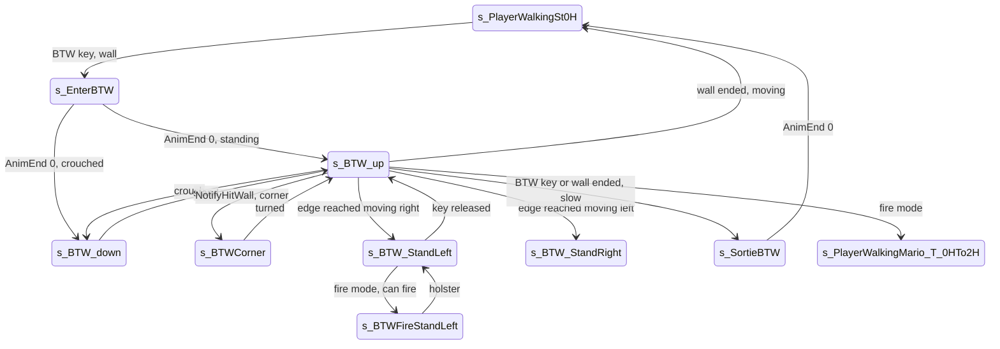

# Back to wall (BTW): enter, sidestep, corner, peek and fire

Units:
- uc:SBase.SPlayerController:s_PlayerWalkingMario.ProcessWorldInteract
- uc:SBase.SPlayerController:s_BTW_Base.CanUseCam
- uc:SBase.SPlayerController:s_BTW_Base.ReinitIfTazered
- uc:SBase.SPlayerController:s_BTW_Base.BeginState
- uc:SBase.SPlayerController:s_BTW_Base.PawnTakeDamage
- uc:SBase.SPlayerController:s_BTW_Base.PlayAnimDmg
- uc:SBase.SPlayerController:s_BTW_Base.PlayerMove
- uc:SBase.SPlayerController:s_EnterBTW.Fire
- uc:SBase.SPlayerController:s_EnterBTW.AnimEnd
- uc:SBase.SPlayerController:s_BTW.BeginState
- uc:SBase.SPlayerController:s_BTW.CanBeDropAttacked
- uc:SBase.SPlayerController:s_BTW.CanActivateLaser
- uc:SBase.SPlayerController:s_BTW.CanBeBlasted
- uc:SBase.SPlayerController:s_BTW.ExplosionHit
- uc:SBase.SPlayerController:s_BTW.MyPlayerMove
- uc:SBase.SPlayerController:s_BTW.NotifyHitWall
- uc:SBase.SPlayerController:s_BTWCorner.Fire
- uc:SBase.SPlayerController:s_BTWCorner.PlayerMove
- uc:SBase.SPlayerController:s_BTW_up.PlayerMove
- uc:SBase.SPlayerController:s_BTW_down.PlayerMove
- uc:SBase.SPlayerController:s_SortieBTW.Fire
- uc:SBase.SPlayerController:s_SortieBTW.EndState
- uc:SBase.SPlayerController:s_SortieBTW.AnimEnd
- uc:SBase.SPlayerController:s_SortieBTW.PlayerMove
- uc:SBase.SPlayerController:s_BTW_StandLeft.BeginState
- uc:SBase.SPlayerController:s_BTW_StandLeft.PlayAnimDmg
- uc:SBase.SPlayerController:s_BTW_StandLeft.PlayerMove
- uc:SBase.SPlayerController:s_BTWFireStandLeft.BeginState
- uc:SBase.SPlayerController:s_BTWFireStandLeft.SwitchLaser
- uc:SBase.SPlayerController:s_BTWFireStandLeft.PlayerMove
- uc:SBase.SPlayerController:s_BTW_StandRight.PlayAnimDmg
- uc:SBase.SPlayerController:s_BTW_StandRight.BeginState
- uc:SBase.SPlayerController:s_BTW_StandRight.PlayerMove
- uc:SBase.SPlayerController:s_BTWFireStandRight.BeginState
- uc:SBase.SPlayerController:s_BTWFireStandRight.SwitchLaser
- uc:SBase.SPlayerController:s_BTWFireStandRight.PlayerMove
- uc:SBase.SPlayerController:s_BTW_CrouchLeft.BeginState
- uc:SBase.SPlayerController:s_BTW_CrouchLeft.PlayAnimDmg
- uc:SBase.SPlayerController:s_BTW_CrouchLeft.PlayerMove
- uc:SBase.SPlayerController:s_BTWFireCrouchLeft.BeginState
- uc:SBase.SPlayerController:s_BTWFireCrouchLeft.SwitchLaser
- uc:SBase.SPlayerController:s_BTWFireCrouchLeft.PlayerMove
- uc:SBase.SPlayerController:s_BTW_CrouchRight.BeginState
- uc:SBase.SPlayerController:s_BTW_CrouchRight.PlayAnimDmg
- uc:SBase.SPlayerController:s_BTW_CrouchRight.PlayerMove
- uc:SBase.SPlayerController:s_BTWFireCrouchRight.BeginState
- uc:SBase.SPlayerController:s_BTWFireCrouchRight.SwitchLaser
- uc:SBase.SPlayerController:s_BTWFireCrouchRight.PlayerMove
- uc:SBase.SBasePawn:AnimEnd (channel 14 BTW part)
- uc:SBase.SBasePawn:NotifyTakeArmControlForBTWFireLeft
- uc:SBase.SBasePawn:NotifyTakeArmControlForBTWFireRight
- uc:SBase.SBasePawn:RemoveBTWArmControl
- uc:SBase.SBasePawn:AnimateBTW
- nat:SBase.SPlayerController.CheckBTW
- nat:SBase.SPlayerController.CheckBTWCorner
- nat:SBase.SPlayerController.CheckBTWEyes
- nat:SBase.SPlayerController.bTestCanFireInBTW

## Purpose

The spy presses Z (bUseBackToWall) near a wall to put his back against it. He sidesteps along it, turns round
outside corners, peeks round the end of the wall (left or right, standing or crouched), draws the pistol to fire
round the corner, and leaves by pressing Z again, moving away, or drawing the weapon.

## Data

| Field | Owner | Notes |
|---|---|---|
| vWallNormal | SPlayerController | wall normal from CheckBTW; the pawn faces along it (away from the wall) |
| bToggleBTW, oldbUseBackToWall | SPlayerController | edge detector for the BTW key (walking.md step 4) |
| BTW, OldBTW | SBasePawn | enum BTW_: NOBTW, BTWStand, BTWCrouch, BTWStandLeft, BTWStandRight, BTWCrouchLeft, BTWCrouchRight, BTWFire* ; BTW replicated with bNetInitial |
| IK_Type | SBasePawn | IKT_BTW while firing round a corner |
| m_LastSpecialMoveTime | SPlayerController | corner and stance cooldowns |

Naming: "Left" states are entered by the Right key (iMove & 2) and "Right" states by the Left key (iMove & 1): the
names follow the spy's own left and right with his back to the wall, facing the player.

## Rules

### Entering (s_PlayerWalkingMario.ProcessWorldInteract)

Runs when bToggleBTW == 1 (the BTW key went down this frame) and the stick is inside the 5000 radius
(`aForward^2 + aStrafe^2 < 25000000`), not in weapon transit, unarmed (only the Mario states call it):
1. `CheckBTW(true)` (native; with Reverse true it probes along the pawn's forward axis, so a wall in front of the
   spy): SA_BTW_ENTER, SetInfoForVandamme(vWallNormal), s_EnterBTW.
2. else `CheckBTW()` (a wall behind the spy): SetInfoForVandamme(vWallNormal), SA_BTW_ENTERBACK, s_EnterBTW.
   On the wall the spy faces away from it, so the every-frame `CheckBTW()` of rule 3 looks behind him.

CheckBTW (decoded, natives2-traversal.md rule 1; game 0x10aa97e0): a world probe (zero-extent line, flags 0x2df,
counting only hits on PHYS_None actors such as level geometry and static meshes, never movers or pawns) from
Location 1.5 R along the probe direction; then, along the horizontal direction into the wall found, two waist
probes from 0.5 R either side lowered by 0.5 H and one head probe at 0.8 H, each 1.5 R long, must all hit.
vWallNormal = SafeNormal of the sum of the three later normals (not flattened), X = 1 when that is zero.
3. Returns true when entered.

s_EnterBTW (Fire disabled): AnimEnd channel 0 (controlling side): crouched SA_BTW_CR, s_BTW_down; standing SA_BTW_ST,
s_BTW_up. Its PlayerMove is the base one (camera rotation only, zero move).

### s_BTW_Base (common)

Ignores Bump, SeePlayer, HearNoise. CanUseCam true. ReinitIfTazered (BeginState of the base and of most children):
on the controlling side, if bTazered: face along vWallNormal (pitch, roll 0), SA_BTW_OUT, and go to the resting
state for the stance and hands (Cr0H, Cr2H, St0H, St2H with their actions). Damage: StandardReactionsToDamage;
death goes to s_Dead (or the fatal blast path); charge and drop-attack damage are handled; elbow shocks are
ignored; any other non-lethal hit while unarmed (or a sticky shock) plays PlayAnimDmg, which here faces along the
wall normal, plays SA_BTW_OUT and returns to the resting state (a hit knocks the spy off the wall).

### On the wall (s_BTW_up standing, s_BTW_down crouched; both extend s_BTW)

s_BTW.BeginState: face along vWallNormal (pitch, roll 0), camera ECM_BTW, ReinitIfTazered.

s_BTW_up.PlayerMove: if the crouch latch is set: when the pawn can crouch and the 0.5 s stance cooldown passed,
stamp the time, SA_WANTS_TO_CROUCH, SA_BTW_CR, s_BTW_down; else clear the latch. Then MyPlayerMove.
s_BTW_down.PlayerMove: if the latch is clear: when CanUnCrouch and the cooldown passed, SA_WANTS_TO_UNCROUCH,
SA_BTW_ST, stamp, s_BTW_up; else set the latch again. Then MyPlayerMove.

MyPlayerMove:
1. Clear bPressedJump; face along vWallNormal; UpdateRotation (normal spy view).
2. Draw (bForceFireMode, not sticky-shocking): laser on if bForceLaserFireMode; clear bForceFireMode; SA_BTW_OUT;
   crouched SA_WALK_CR_0Hto2H, standing SA_WALK_ST_0Hto2H unless carrying a HandItem; s_PlayerWalkingMario_T_0HTo2H;
   send a zero move and return.
3. Leave: the BTW key held (bUseBackToWall == 1) or `CheckBTW()` false (the wall ended): if `|Velocity| > 70`
   SA_BTW_OUT and the walking state (Cr0H with SA_WALK_CR_0H or St0H with SA_WALK_ST_0H); else SA_BTW_END and
   s_SortieBTW; zero move, return.
4. Sidestep: aStrafe = +6000 for Left (iMove & 1), -6000 for Right (iMove & 2), else 0; crouched x 0.62.
   `newAccel = -aStrafe * Y` (pawn right axis), Z = 0, zero below length 1; `newAccel *= 0.17`.
   `GroundSpeed = 385 |newAccel| / 3000`: 130.9 standing, 81.2 crouched; zeroed below 100 standing or 50 crouched.
5. Edge: `r = CheckBTWEyes(aStrafe > 0)` (native, decoded in natives2-traversal.md rule 2: a (5, 5, 5) box from
   R + 4 to that side at 0.8 H, 2 R toward the wall; when the wall goes on, a floor probe beside (H + 31 down) gives
   1 if the floor goes on, -1 for a drop; when the wall ends, a line 100 to that side gives 0 if clear, else -1).
   r == 0 with GroundSpeed > 0 and |aStrafe| > 1000: GroundSpeed = 0, and peek: crouched SA_BTW_LEFT ->
   s_BTW_CrouchLeft when aStrafe < 0, SA_BTW_RIGHT -> s_BTW_CrouchRight otherwise; standing the same with
   s_BTW_StandLeft / s_BTW_StandRight. r == -1: GroundSpeed = 0 (blocked, no peek).
6. Zero newAccel when GroundSpeed is 0; set Pawn.GroundSpeed; send the move.

s_BTW.NotifyHitWall (controlling side): when 2 s passed since m_LastSpecialMoveTime and `CheckBTWCorner(HitNormal)`
(native): vWallNormal = HitNormal, SetInfoForVandamme(vWallNormal), SA_BTW_CORNER, stamp the time, s_BTWCorner.
CheckBTWCorner (decoded, natives2-traversal.md rule 3) has no angle window: a world probe 1.5 R against HitNormal
must find a wall in the same plane (`|HitNormal x N| <= 0.1`) and CheckBTW's three waist and head probes must pass
against it; it neither reads nor writes vWallNormal.
Always returns true.

s_BTW: drop attacks allowed; laser allowed when armed and not in transit; a blast within BlastDistMax plays
SA_BTW_OUT then SA_BLAST_LOOP and goes to s_Blast.

### Corner (s_BTWCorner, Fire disabled)

PlayerMove: camera rotation; turn the pawn yaw toward `rotator(vWallNormal).Yaw` by at most `3 * 16384 * dt` per
frame (270 degrees per second); when the remaining difference is 0: SA_BTW_CORNEROFF, s_BTW_down or s_BTW_up by
stance. Zero move.

### Leaving (s_SortieBTW, Fire disabled)

EndState faces along vWallNormal. PlayerMove: clear jump, UpdateRotation; if the stick leaves the 100 dead square:
SA_BTW_OUT, GotoWaitingState. AnimEnd channel 0: SA_BTW_OUT, Cr0H (SA_WALK_CR_0H) or St0H (SA_WALK_ST_0H).

### Peeking (s_BTW_StandLeft / StandRight / CrouchLeft / CrouchRight)

BeginState: camera ECM_BTWPeakRight for the Left states, ECM_BTWPeakLeft for the Right states; ReinitIfTazered.
PlayerMove (Left states shown; Right states mirror with the Left key):
1. View limited to yaw -15000..15000, pitch -15000..15000 around `Pawn.Yaw + 32768` (looking back along the wall).
2. Unless in weapon transit:
   - wall lost (`CheckBTW()` false) or BTW key held: SA_BTW_OUT, standing SA_WALK_ST_0H -> s_PlayerWalkingSt0H,
     crouched SA_WALK_CR_0H -> s_PlayerWalkingCr0H; camera ECM_Walking; zero move, return;
   - key released ((iMove & 2) == 0): SA_BTW_ST -> s_BTW_up (crouched: SA_BTW_CR -> s_BTW_down);
   - fire mode (bForceFireMode, not sticky-shocking): clear it; if `bTestCanFireInBTW(true)` (false for the Right
     states): laser if requested, SA_BTW_FIRE_ST_LEFT_TR (crouched SA_BTW_FIRE_CR_LEFT_TR), s_BTWFireStandLeft
     (s_BTWFireCrouchLeft);
   - stance change with the 0.5 s cooldown: standing with the latch set and bCanCrouch: SA_WANTS_TO_CROUCH,
     SA_BTW_LEFT, s_BTW_CrouchLeft (else clear the latch); crouched with the latch clear and CanUnCrouch:
     SA_WANTS_TO_UNCROUCH, SA_BTW_LEFT, s_BTW_StandLeft (else set the latch).
3. Zero move. A hit (PlayAnimDmg, owner) leaves the wall: the heartbeat, the pawn faced along vWallNormal (pitch
   and roll 0), SA_BTW_OUT, then always the unarmed rest (crouched with the latch or crouched: SA_WALK_CR_0H,
   s_PlayerWalkingCr0H; else SA_WALK_ST_0H, s_PlayerWalkingSt0H). The s_BTW_Base version (every other back-to-wall
   state, the fire states included) does the same but keeps a drawn pistol: WeaponLoaded != 0 goes to the 2H rest.
   The damage handler calls it only with WeaponLoaded 0 or for a shock.
4. Order of the branches: s_BTW_StandLeft tests the released key before the fire request; s_BTW_StandRight,
   s_BTW_CrouchLeft and s_BTW_CrouchRight test the fire request first.

### Firing round the corner (s_BTWFire* states)

BeginState: camera ECM_BTWRightFP for the Left states, ECM_BTWLeftFP for the Right states; ReinitIfTazered.
SwitchLaser toggles the laser. View limited around `Pawn.Yaw + 32768`: Left states yaw -10000..50, Right states
-50..10000, pitch -10000..10000. Unless in transit: holster on bForceExitFireMode, released fire mode
(bTestBoutonLache with bFireMode != 0), key released, or BTW key held (not sticky-shocking): clear the fire flags,
SA_BTW_FIRE_ST_LEFT_UNTR / _RIGHT_UNTR / SA_BTW_FIRE_CR_LEFT_UNTR / SA_BTW_FIRE_CR_RIGHT_UNTR (192), back to the
matching peek state. Stance change as in peeking, with actions SA_BTW_FIRE_LEFT / SA_BTW_FIRE_RIGHT. Zero move.

The pawn's channel-14 AnimEnd and the clip notifies NotifyTakeArmControlForBTWFireLeft/Right maintain SBasePawn.BTW
and IK_Type (BTWFire* while the draw clip plays forward, back to the peek value when it plays backward) and call
AnimateBTW (animation spec).

The weapon itself is loaded by the draw clips' own notifies (BackStSpBgL/R, BackCrSpBgL/R at 0.3125):
NotifyDrawUndrawWeapon is the spy's quick draw (WeaponLoaded 0 to 1) forward and the quick holster (1, 2 or 7 to 0,
laser off) backward; the right clips also carry NotifyChangeHandWeapon (0.5625 crouched, 0.625 standing), which puts
the pistol in the other hand (1 or 2 to 7, 7 to 2). Backward clips fire their notifies at mirrored times, so the hand
change comes before the holster. The shot is the class Fire (no state overrides it): refused in weapon transit, so
only once the draw clip ends. The binocular key in a fire state is the global one: a spy with the pistol out asks
for the holster (bForceExitFireMode).

Port note: bTestCanFireInBTW is not decoded (open question 4); the port uses CheckBTWEyes toward the peek side
(a Left state is the spy's left, CheckBTWEyes(false)) and refuses only -1 (blocked or a drop). The notifies only act
for these four clips; the other clips with NotifyDrawUndrawWeapon (pipe, split jump) load the weapon at their action.

## States

Physics: PHYS_Walking throughout; the sidestep is ordinary walking with a forced facing.

## Constants

| Name | Value | Unit | Provenance | Source |
|---|---|---|---|---|
| Entry stick limit | 5000 radius | input units | decoded | ProcessWorldInteract |
| Sidestep input | 6000, crouched x 0.62, then x 0.17 | input units | decoded | s_BTW.MyPlayerMove |
| Sidestep speed | 130.9 standing, 81.2 crouched | uu/s | decoded | 385 x accel / 3000 |
| Sidestep dead zones | 100 standing, 50 crouched | uu/s | decoded | s_BTW.MyPlayerMove |
| Peek trigger | |aStrafe| > 1000 at the edge | input units | decoded | same |
| Leave speed split | 70 | uu/s | decoded | same |
| Corner turn rate | 3 x 16384 = 49152 | rotator units/s | decoded | s_BTWCorner.PlayerMove |
| Corner cooldown | 2 | s | decoded | s_BTW.NotifyHitWall |
| Stance cooldown | 0.5 | s | decoded | BTW stance changes |
| Peek view | yaw +-15000, pitch +-15000 around pawn yaw + 32768 | rotator units | decoded | peek states |
| Fire view | Left yaw -10000..50, Right -50..10000, pitch +-10000 | rotator units | decoded | fire states |
| Exit dead square | 100 | input units | decoded | s_SortieBTW.PlayerMove |

## Network

- Controlling side decides; ChangeState to the server; SetInfoForVandamme sends the wall normal (x 1000) so the
  server faces the pawn the same way.
- SBasePawn.BTW replicates with bNetInitial; later changes reach other clients through the action stream.

## Edge cases

- Only reachable unarmed from the Mario states; the merc has no back-to-wall.
- Holding the BTW key on the wall leaves it (the toggle edge enters, holding exits on the next frames once
  bUseBackToWall is still 1): a quick tap enters and stays.
- The wall test (CheckBTW) runs every frame; walking past the end of a short wall at speed above 70 drops straight
  to walking, below 70 plays the exit clip.
- The corner probe only runs after 2 s on the wall since the last special move.

## Evidence

- Decompiled: local/re-out/uc/SBase/SPlayerController.uc (s_BTW_Base, s_EnterBTW, s_BTW, s_BTWCorner, s_BTW_up,
  s_BTW_down, s_SortieBTW, the eight peek and fire states, ProcessWorldInteract), SBase/SBasePawn.uc (BTW_ enum,
  AnimEnd channel 14, NotifyTakeArmControlForBTWFire*, RemoveBTWArmControl, AnimateBTW).
- Natives: CheckBTW game 0x10aa97e0 (editor exec 0x111e5640), CheckBTWCorner 0x10aa91c0 (editor exec 0x111e5050),
  CheckBTWEyes 0x10aaa000 (editor exec 0x111e5dc0), bTestCanFireInBTW 0x10ab22a0 (editor exec 0x111e8690).
- Measured: corner peek along the MuseD wall matches the original frame by frame (Bridge traversal note).

## Open questions

4. bTestCanFireInBTW: the clearance test for the pistol round the corner. Game 0x10ab22a0 is not a procedure in
   the local REA analysis of SCCT_Versus_game.exe (not_in_procedure); decode it from the editor (exec 0x111e8690)
   or the full Ghidra project. Until then the port uses the stand-in above.
5. The -1 of CheckBTWEyes for a drop beside the wall end is read from the probe geometry; a BTW golden at a wall end
   over a drop would confirm the script reaction (natives2-traversal.md open question 2).

### Resolved

1. CheckBTW(Reverse): probes, wall rules, normal. Resolved: Reverse probes forward, else backward, 1.5 R; then two
   waist probes at +-0.5 R (-0.5 H) and a head probe (0.8 H) along the wall direction; every hit must be a
   PHYS_None actor; vWallNormal = SafeNormal(sum of the three later normals), X = 1 when zero. The entry rules
   above had the two directions swapped and are corrected: ENTER uses the wall in front, ENTERBACK the one behind.
   Evidence: natives2-traversal.md rule 1; game 0x10aa97e0 (ANSWERS-natives2 1).
2. CheckBTWEyes returns. Resolved: 1 the wall and the floor go on; 0 the wall ends at head height on that side and
   100 uu beside are clear (peek); -1 blocked beside, or no floor beside (drop). Boxes (5, 5, 5), side point R + 4.
   Rule 5. Evidence: natives2-traversal.md rule 2 (ANSWERS-natives2 2).
3. CheckBTWCorner accepted angles. Resolved: no angle window; a full flat wall in the same plane as HitNormal (cross
   length at most 0.1) with the three CheckBTW probes passing. Evidence: natives2-traversal.md rule 3
   (ANSWERS-natives2 3).
