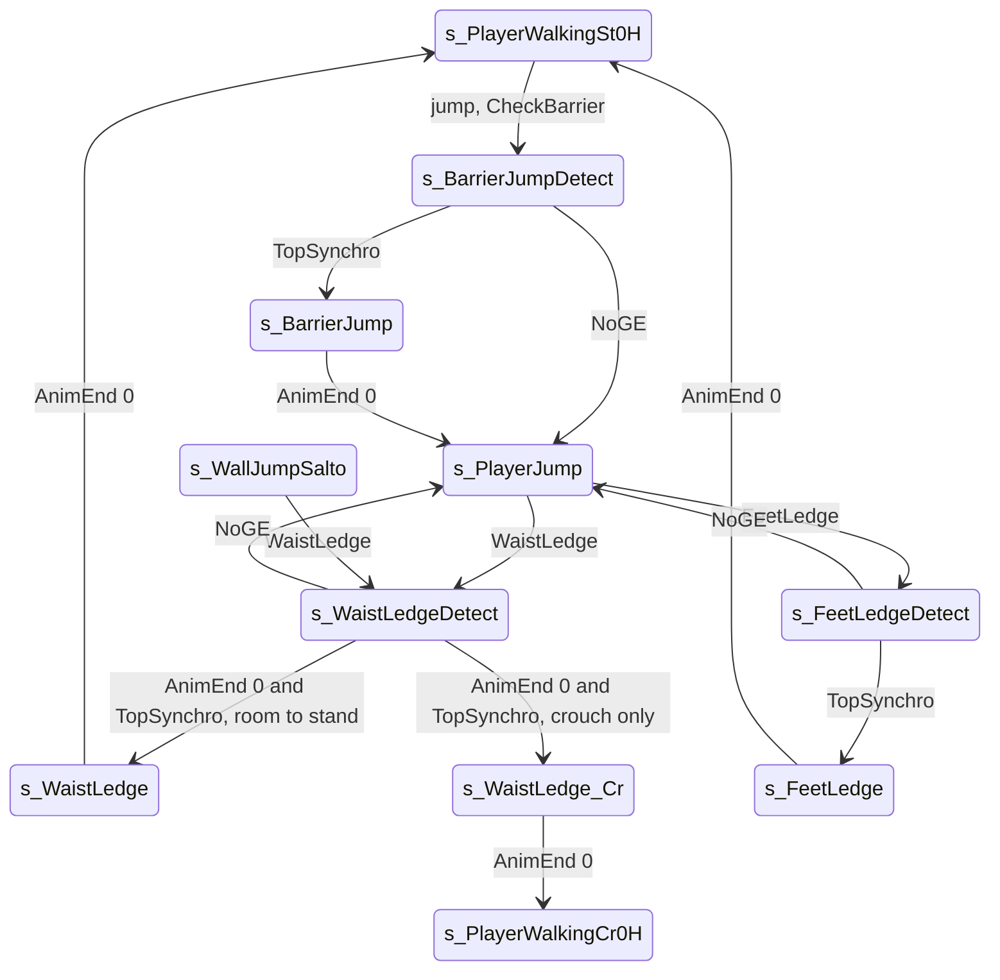

# Barrier vault, waist ledge and feet ledge

Units:
- uc:SBase.SPlayerController:s_BarrierJumpDetect.TopSynchro
- uc:SBase.SPlayerController:s_BarrierJumpDetect.NoGE
- uc:SBase.SPlayerController:s_BarrierJumpDetect.PlayerMove
- uc:SBase.SPlayerController:s_BarrierJump.AnimEnd
- uc:SBase.SPlayerController:s_BarrierJump.PlayerMove
- uc:SBase.SPlayerController:s_FeetLedge.AnimEnd
- uc:SBase.SPlayerController:s_FeetLedge.PlayerMove
- uc:SBase.SPlayerController:s_FeetLedgeDetect.TopSynchro
- uc:SBase.SPlayerController:s_FeetLedgeDetect.NoGE
- uc:SBase.SPlayerController:s_FeetLedgeDetect.PlayerMove
- uc:SBase.SPlayerController:s_WaistLedge.AnimEnd
- uc:SBase.SPlayerController:s_WaistLedge.PlayerMove
- uc:SBase.SPlayerController:s_WaistLedge_Cr.BeginState
- uc:SBase.SPlayerController:s_WaistLedge_Cr.AnimEnd
- uc:SBase.SPlayerController:s_WaistLedgeDetect.CheckFeetZone
- uc:SBase.SPlayerController:s_WaistLedgeDetect.BeginState
- uc:SBase.SPlayerController:s_WaistLedgeDetect.AnimEnd
- uc:SBase.SPlayerController:s_WaistLedgeDetect.TopSynchro
- uc:SBase.SPlayerController:s_WaistLedgeDetect.NoGE
- uc:SBase.SPlayerController:s_WaistLedgeDetect.PlayerMove
- uc:SBase.SPlayerController:FeetLedge
- uc:SBase.SPlayerController:WaistLedge
- uc:SBase.SPlayerController:AutoFeetLedge
- nat:SBase.SPlayerController.CheckBarrier

## Purpose

Three short climbs over low obstacles. The barrier vault jumps over a waist-high rail or wall top when the spy
presses jump next to it. The waist ledge pulls the spy onto a ledge at waist height caught while jumping (or out
of a wall jump). The feet ledge steps onto a ledge at feet height caught in the air. A low ledge in front of the
feet while walking makes the spy hop by himself (AutoFeetLedge).

## Data

| Field | Owner | Default | Notes |
|---|---|---|---|
| bWaistLedgeCanGoUnCrouch | SPlayerController | false | from the WaistLedge event: room to stand on top |
| bCanStop | SPlayerController | false | s_WaistLedgeDetect: first of AnimEnd / TopSynchro seen |
| ZipP1, ZipP2, LastZipP | SBasePawn | - | the GE caught, and the last one left |
| fTimeOfFeetLedge | SBasePawn | -10.0 | native bookkeeping for the feet ledge |
| TypeLedge | SBasePawn | LEDGE_NORMAL | set by the detect actions: SA_WAISTLEDGE_DETECT 1 (WAIST), SA_BARRIER_JUMP_DETECT 2 (BARRIER), SA_FEETLEDGE_DETECT 3 (FEET); physLedge picks the snap target by it |

## Rules

### Entry

| Move | Started from | Condition | Action, state |
|---|---|---|---|
| Barrier vault | s_PlayerWalkingMario (and its children), jump pressed | `CheckBarrier()` true; crouched spies must be able to stand (else no vault, the jump stays pending) | crouched: SA_WANTS_TO_UNCROUCH first; SA_BARRIER_JUMP_DETECT, SendZipPToServer, s_BarrierJumpDetect, jump cleared |
| Waist ledge | s_PlayerJump, PlayerFalling, s_WallJumpSalto | WaistLedge(bCanGoNoCrouch); spy; `ZipP1 != LastZipP`; unarmed | store bWaistLedgeCanGoUnCrouch, bFindGE, SA_WAISTLEDGE_DETECT, SendZipPToServer, s_WaistLedgeDetect |
| Feet ledge | s_PlayerJump, PlayerFalling | FeetLedge; not rolling; standing | SA_FEETLEDGE_DETECT, SendZipPToServer, s_FeetLedgeDetect |
| Auto hop | s_PlayerWalkingMario | AutoFeetLedge | bFindGE = true, bPressedJump = true (an ordinary jump that frame, walking.md) |

The barrier test runs before the arms and feet zone checks of the same frame, and a vault sets bFindGE so neither
zone check runs.

The natives behind the entries (decoded, physics-ge-queries.md 4, 6, 11):
- CheckBarrier is an LG GE in the arms zone plus geometry (natives2-traversal.md rule 10): with the ledge-grab zone
  point and G = closest point + (R + 2) N, the facing must be within 0.7, the height reference
  (Location.Z plus the PrePivot change) between G.Z - 40 and G.Z + 5, the forward velocity above -1, the horizontal
  distance to G squared below 900; then a (35, 35, 22.5) box from (ref.XY, C.Z + 23.5) over the top 140 beyond and
  20 aside, and down 85.2, must be clear; ZipP1/ZipP2 = the LG points.
- WaistLedge and AutoFeetLedge come from CheckArmsZone through the LG arms test: AutoFeetLedge only while walking
  (an LG 40 to 64 above the feet, running faster than 300 forward, with clear boxes up and 112.4 across), WaistLedge
  only when not walking. bCanGoNoCrouch is true when the standing clearance (114.5 up, 56 over) passes, false when
  only the crouched one (109.2 up, 77 over) does.
- FeetLedge comes from CheckFeetZone through CheckLedgeGrabFeet.

### Detect states (repositioning)

The *_DETECT actions (172, 175, 204) set PHYS_Ledge (not PHYS_Repositionnal) with TypeLedge FEET 3, WAIST 1 or
BARRIER 2 (execute-action.md section 4). physLedge (physics-traversal.md physLedge 3, 4) then snaps the pawn along
the ledge normal only, toward a target chosen by TypeLedge: WAIST keeps Location.XY with Z = C.Z - 20; BARRIER keeps
Location.XY with Z = Location.Z when `C.Z - Location.Z < 10`, else C.Z - 10; FEET keeps Location.XY with
Z = C.Z + 50.5 (C the hands' point on the ledge). The snap moves at 500 uu/s while the yaw turns toward the wall at
3000 per call; TopSynchro is raised once the snap is complete and the yaw faces the wall; a blocked snap raises NoGE
(as does a GE that disappeared or is masked out by LevelInfo.GEActivationMask). All three detect states:
- PlayerMove: `UpdateCamRotation(dt)` (spy view, no limits), zero acceleration. s_BarrierJumpDetect also clears
  bPressedJump.
- NoGE (controlling side): SA_LEDGEFALL, LastZipP = ZipP1, s_PlayerJump.

s_BarrierJumpDetect.TopSynchro (controlling side): SA_BARRIER_JUMP, s_BarrierJump.

s_FeetLedgeDetect.TopSynchro (controlling side): SA_FEETLEDGE, s_FeetLedge.

s_WaistLedgeDetect: BeginState bCanStop = false; its CheckFeetZone is overridden to do nothing. AnimEnd channel 0
and TopSynchro both run the same step on the controlling side: the first one only sets bCanStop; the second one
decides: if `not bWaistLedgeCanGoUnCrouch` or the crouch latch is set, SA_WAISTLEDGE_CR and s_WaistLedge_Cr, else
SA_WAISTLEDGE and s_WaistLedge. So the move waits for both the grab clip and the repositioning, in either order.

### Climb states

| State | Enter | Each frame | AnimEnd channel 0 (controlling side) |
|---|---|---|---|
| s_BarrierJump | - | ignores CheckArmsZone and MyFalling; UpdateCamRotation, jump cleared, zero move | smooth camera, SA_FALL_AFTERBARRIER, s_PlayerJump (falls on the far side; landing table applies) |
| s_WaistLedge | - | UpdateCamRotation, jump cleared, zero move | smooth camera, SA_WALK_ST_0H, s_PlayerWalkingSt0H |
| s_WaistLedge_Cr | camera ECM_SmoothTransitionCentered, SA_WANTS_TO_CROUCH | as s_WaistLedge | smooth camera, crouch latch on, SA_WALK_CR_0H, SA_WANTS_TO_CROUCH, s_PlayerWalkingCr0H |
| s_FeetLedge | - | spy UpdateCamRotation, jump cleared, zero move | smooth camera; unarmed SA_WALK_ST_0H_AFTERFL -> s_PlayerWalkingSt0H; armed SA_WALK_ST_2H_AFTERFL -> s_PlayerWalkingSt2H |

The vault (JumpStAlBr0, about 147 uu forward of root motion, actor yaw swings about 30 degrees) and the waist and
feet climbs are root-motion moves (PHYS_RootMotion 5, mesh locked).

## States

## Constants

| Name | Value | Unit | Provenance | Source |
|---|---|---|---|---|
| Barrier root-motion end (native) | C_BARRIER_LEDGE (140, 20, 12.8) | uu | decoded | SBasePawn consts |
| Waist climb end (native) | C_WAIST_LEDGE (56, 0, 114.5), crouched C_WAIST_LEDGECR (77, 0, 109.2) | uu | decoded | SBasePawn consts |
| Feet climb end (native) | C_FEET_LEDGE (112.4, -, 39); right-hand version (95.4, -, 39) | uu | decoded | SBasePawn consts; execute-action.md case 171 |
| Barrier test | facing 0.7; box (35, 35, 22.5) 140 beyond, 20 aside, down 85.2 | uu, cosine | decoded | physics-ge-queries.md 11 |
| Waist clearance | standing 114.5 up, 56 over; crouched 109.2 up, 77 over | uu | decoded | physics-ge-queries.md 4 |
| Detect snap | 500 uu/s along the ledge normal, turn 3000 per call; targets by TypeLedge (WAIST C.Z - 20, BARRIER C.Z - 10, FEET C.Z + 50.5) | uu/s, uu | decoded | physics-traversal.md physLedge 3, 4 |
| Sill hopped at a run | 96, 104 and 112 (spy); none (merc) | uu | measured | RE+ "Limits measured in game" |
| Jump onto | 112 spy, 80 merc | uu | measured | same |
| Stall counter vaulted | 110 spy; merc cannot | uu | measured | RE+ MapBuilderFacts |
| Vault root motion | about 147 forward, yaw swing about 30 degrees | uu, degrees | measured | Bridge traversal note |

## Network

- Controlling side decides; ChangeState to the server; ServerGetZipP sends the GE points.
- The repositioning and the root-motion clips run on both sides from the replicated actions; TopSynchro and NoGE
  are acted on only by the controlling side.

## Edge cases

- The waist ledge needs two signals (clip end and TopSynchro); if one never comes (for example the native never
  finishes the repositioning) the spy stays in s_WaistLedgeDetect. There is no timeout in script.
- The feet ledge is refused while crouched and while rolling.
- A merc never vaults (CheckBarrier is only called from the spy's Mario walking states).

## Evidence

- Decompiled: local/re-out/uc/SBase/SPlayerController.uc (s_BarrierJumpDetect, s_BarrierJump, s_FeetLedge,
  s_FeetLedgeDetect, s_WaistLedge, s_WaistLedge_Cr, s_WaistLedgeDetect; s_PlayerWalkingMario.PlayerMove barrier
  block; s_PlayerJump.FeetLedge and WaistLedge; s_WallJumpSalto.WaistLedge), SBase/SBasePawn.uc (consts, LedgeType).
- Natives: CheckBarrier game 0x10aa5390 (editor exec 0x111ea600, ASBasePawn::CheckIfBarrier 0x112108f0); feet and
  waist ledge events come from CheckFeetZone 0x10aa7a80 / CheckArmsZone 0x10aa54d0 (editor CheckLedgeGrabFeet
  0x111ed2f0); repositioning ASBasePawn::physRepositionning 0x111fc7a0, EndPhysRepositionning 0x111fcbc0.
- Root motion: Bridge docs/handoff/traversal_2026-09-28.md (JumpStAlBr0).

## Open questions

None left from the native study. Trace a vault over rails of 80, 96, 112 and 128 to confirm the decoded height
window.

### Resolved

1. CheckBarrier / CheckIfBarrier: GE or geometry. Resolved: an LG GE in the arms zone plus geometry (facing within
   0.7, a height window, a (35, 35, 22.5) box over the top 140 beyond and 20 aside, down 85.2); ZipP = the LG
   points. Rule "Entry". Evidence: physics-ge-queries.md 11; game 0x10aa5390 (ANSWERS-physics 25).
2. Which zone check raises WaistLedge, FeetLedge and AutoFeetLedge; bCanGoNoCrouch. Resolved: WaistLedge and
   AutoFeetLedge from CheckArmsZone through the LG arms test (AutoFeetLedge only while walking, WaistLedge only when
   not walking); FeetLedge from CheckFeetZone through CheckLedgeGrabFeet; bCanGoNoCrouch from the standing (114.5,
   56) versus crouched (109.2, 77) clearance. Rule "Entry". Evidence: physics-ge-queries.md 4, 6
   (ANSWERS-physics 26).
3. The repositioning target, speed and TopSynchro. Resolved, with a correction: the detect actions use PHYS_Ledge
   with TypeLedge (not the repositioning mode); physLedge snaps at 500 uu/s to a TypeLedge target and raises
   TopSynchro once in place and facing the wall, NoGE when blocked. (The repositioning mode itself, used by the
   interactions and coop, runs at fPhysReposLinearSpeed with TopSynchro within 1 and the yaw matching:
   native-contracts.md.) Rule "Detect states". Evidence: execute-action.md cases 172, 175, 204;
   physics-traversal.md physLedge 3, 4; physics-rootmotion-repositioning.md (ANSWERS-actions 1, ANSWERS-physics
   27).
