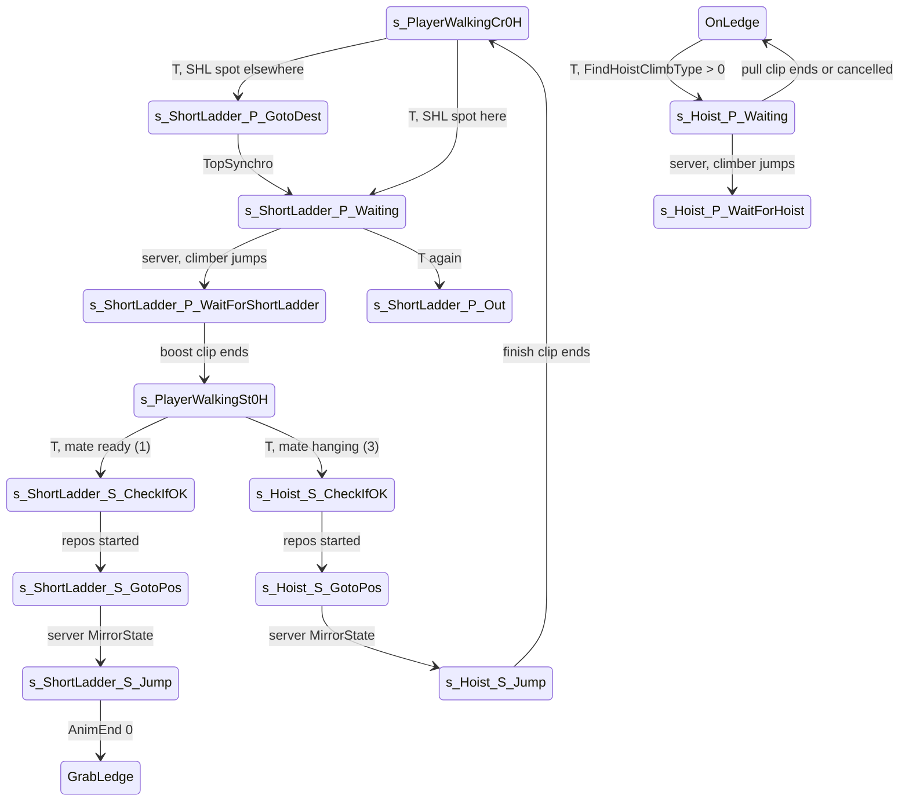

# Co-op moves: short ladder (boost) and hoist climb

Units:
- uc:SBase.SPlayerController:DoCoopInteraction
- uc:SBase.SPlayerController:AskServerToStartCoopInteraction
- uc:SBase.SPlayerController:SetMateTarget
- uc:SBase.SPlayerController:PerformCoopMvt
- uc:SBase.SPlayerController:CanHoistClimbHelp
- uc:SBase.SPlayerController:CanShortLadderHelp
- uc:SBase.SPlayerController:s_ItTarget_S_CheckIfOK.PlayerMove
- uc:SBase.SPlayerController:s_Coop_S_Base.PawnTakeDamage
- uc:SBase.SPlayerController:s_Coop_S_Base.DropAttack
- uc:SBase.SPlayerController:s_Coop_S_Base.performDropAttack
- uc:SBase.SPlayerController:s_Coop_S_Base.CanBeBlasted
- uc:SBase.SPlayerController:s_Coop_S_Base.ExplosionHit
- uc:SBase.SPlayerController:s_Coop_S_Base.CanSwitchGoggleManually
- uc:SBase.SPlayerController:s_Coop_S_Base.CanActivateLaser
- uc:SBase.SPlayerController:s_Coop_S_Goto.BeginState
- uc:SBase.SPlayerController:s_Coop_S_Goto.Timer
- uc:SBase.SPlayerController:s_Coop_S_Goto.ClientStickyShock
- uc:SBase.SPlayerController:s_Coop_S_Goto.PawnTakeDamage
- uc:SBase.SPlayerController:s_Hoist_P_Base.PlayerTick
- uc:SBase.SPlayerController:s_Hoist_P_Base.CanUncrouchAndUndraw
- uc:SBase.SPlayerController:s_Hoist_P_WaitForHoist.PlayerMove
- uc:SBase.SPlayerController:s_Hoist_P_Waiting.BeginState
- uc:SBase.SPlayerController:s_Hoist_P_Waiting.PerformCoopMvt
- uc:SBase.SPlayerController:s_Hoist_P_Waiting.ClientDamage
- uc:SBase.SPlayerController:s_Hoist_P_Waiting.GadgetQuickChoice
- uc:SBase.SPlayerController:s_Hoist_P_Waiting.PlayerMove
- uc:SBase.SPlayerController:s_Hoist_P_Waiting.AnimEnd
- uc:SBase.SPlayerController:s_Hoist_P_Waiting.EndState
- uc:SBase.SPlayerController:s_Hoist_S_GotoPos.BeginState
- uc:SBase.SPlayerController:s_Hoist_S_GotoPos.NotifyBump
- uc:SBase.SPlayerController:s_Hoist_S_GotoPos.TopSynchro
- uc:SBase.SPlayerController:s_Hoist_S_GotoPos.PlayerMove
- uc:SBase.SPlayerController:s_Hoist_S_CheckIfOK.PlayerMove
- uc:SBase.SPlayerController:s_Hoist_S_Jump.ClientStickyShock
- uc:SBase.SPlayerController:s_Hoist_S_Jump.PlayerMove
- uc:SBase.SPlayerController:s_Hoist_S_Jump.BeginState
- uc:SBase.SPlayerController:s_Hoist_S_Jump.EndState
- uc:SBase.SPlayerController:s_Hoist_S_Jump.AnimEnd
- uc:SBase.SPlayerController:s_ShortLadder_P_Base.PawnTakeDamage
- uc:SBase.SPlayerController:s_ShortLadder_P_Base.ClientDamage
- uc:SBase.SPlayerController:s_ShortLadder_P_Base.PlayerTick
- uc:SBase.SPlayerController:s_ShortLadder_P_Base.PlayerMove
- uc:SBase.SPlayerController:s_ShortLadder_P_GotoDest.NotifyBump
- uc:SBase.SPlayerController:s_ShortLadder_P_GotoDest.EndState
- uc:SBase.SPlayerController:s_ShortLadder_P_GotoDest.BeginState
- uc:SBase.SPlayerController:s_ShortLadder_P_GotoDest.PlayerMove
- uc:SBase.SPlayerController:s_ShortLadder_P_GotoDest.TopSynchro
- uc:SBase.SPlayerController:s_ShortLadder_P_WaitForShortLadder.PlayerMove
- uc:SBase.SPlayerController:s_ShortLadder_P_WaitForShortLadder.ClientDamage
- uc:SBase.SPlayerController:s_ShortLadder_P_WaitForShortLadder.AnimEnd
- uc:SBase.SPlayerController:s_ShortLadder_P_Waiting.BeginState
- uc:SBase.SPlayerController:s_ShortLadder_P_Waiting.PerformCoopMvt
- uc:SBase.SPlayerController:s_ShortLadder_P_Waiting.GadgetQuickChoice
- uc:SBase.SPlayerController:s_ShortLadder_P_Waiting.PlayerMove
- uc:SBase.SPlayerController:s_ShortLadder_P_Waiting.AnimEnd
- uc:SBase.SPlayerController:s_ShortLadder_P_Out.EndState
- uc:SBase.SPlayerController:s_ShortLadder_P_Out.AnimEnd
- uc:SBase.SPlayerController:s_ShortLadder_S_Base.PlayerTick
- uc:SBase.SPlayerController:s_ShortLadder_S_GotoPos.NotifyBump
- uc:SBase.SPlayerController:s_ShortLadder_S_GotoPos.TopSynchro
- uc:SBase.SPlayerController:s_ShortLadder_S_GotoPos.PlayerMove
- uc:SBase.SPlayerController:s_ShortLadder_S_CheckIfOK.PlayerMove
- uc:SBase.SPlayerController:s_ShortLadder_S_Jump.ClientStickyShock
- uc:SBase.SPlayerController:s_ShortLadder_S_Jump.PlayerMove
- uc:SBase.SPlayerController:s_ShortLadder_S_Jump.BeginState
- uc:SBase.SPlayerController:s_ShortLadder_S_Jump.AnimEnd
- nat:SBase.SPlayerController.CheckIfCanInteractWithMate
- nat:SBase.SPlayerController.AreaIsSafeToInteract
- nat:SBase.SBasePawn.CheckIfCanStartSHL
- nat:SBase.SBasePawn.FindHoistClimbType
- uc:SBase.SPlayerController:s_Hoist_P_Base.CanUseCam
- uc:SBase.SPlayerController:s_Hoist_P_Base.CanSwitchGoggleManually
- uc:SBase.SPlayerController:s_Hoist_P_Base.CanActivateLaser
- uc:SBase.SPlayerController:s_Hoist_P_Base.CanShortLadderHelp
- uc:SBase.SPlayerController:s_Hoist_P_Base.CanIUseBinocular
- uc:SBase.SPlayerController:s_Hoist_P_WaitForHoist.PerformCoopMvt
- uc:SBase.SPlayerController:s_ShortLadder_P_Base.CanUseCam
- uc:SBase.SPlayerController:s_ShortLadder_P_Base.CanSwitchGoggleManually
- uc:SBase.SPlayerController:s_ShortLadder_P_Base.CanActivateLaser
- uc:SBase.SPlayerController:s_ShortLadder_P_Base.CanShortLadderHelp
- uc:SBase.SPlayerController:s_ShortLadder_P_Base.CanIUseBinocular
- uc:SBase.SPlayerController:s_ShortLadder_P_Base.CanUncrouchAndUndraw
- uc:SBase.SPlayerController:s_ShortLadder_S_Base.CanUncrouchAndUndraw

## Purpose

Two spies help each other climb. Short ladder: one spy (the helper, "P") crouches with cupped hands at the foot of
a high ledge; the other ("S", the climber) runs to him and is boosted up into a ledge grab. Hoist: the helper hangs
from a ledge; the climber stands below, jumps, and is pulled up over the edge. Key T (PerformCoopMvt) starts both.

## Data

| Field | Owner | Default | Notes |
|---|---|---|---|
| m_InteractionTarget | SBasePawn | None | the mate (replicated reliably from the server) |
| bReadyForShortLadder, bReadyForHoistClimb | SBasePawn | false | helper ready, set by the native for the waiting actions |
| iHoistClimbType | SPlayerController | 0 | SHL_* type of the hoist (FindHoistClimbType) |
| bAlreadyReceivedEventTopSynchro | SPlayerController | false | hoist climber guard |
| JumpX_SHL, JumpZ_SHL | SBasePawn | 350, 100 | boost jump (native use) |
| fMaxDistToShortLadder | SPlayerController | 350.0 | mate search range (native use) |
| HoistOffsetX, HoistOffsetZ | SPlayerController consts | 130.7, 296.7 | climber spot under the hanging helper |
| CA_None, CA_ShortLadder, CA_HoistClimb | SPlayerController consts | 0, 1, 3 | CheckIfCanInteractWithMate results |
| SHL_None .. SHL_Palissade | SBasePawn consts | 0 None, 1 Standard, 2 Barrier, 3 StandardNoWall, 4 BarrierNoWall, 5 Palissade | hoist climb types |

## Rules

### Starting (DoCoopInteraction, from PerformCoopMvt in Mario walking or OnLedge)

Nothing in the tutorial level. Otherwise by `CheckIfCanInteractWithMate(PC)` (native):
- 0 (no ready mate: become the helper):
  - if the state allows short-ladder help (CanShortLadderHelp: true in s_PlayerWalkingSt0H and
    s_PlayerWalkingCr0H) and `CheckIfCanStartSHL(DestLoc, DestRot)` (native: a spot with a ledge above):
    if DestLoc differs from the pawn location or DestRot from its facing, vVandammePos = DestLoc,
    SetInfoForVandamme(DestRot), s_ShortLadder_P_GotoDest; else s_ShortLadder_P_Waiting. Return true.
  - else if the state allows hoist help (CanHoistClimbHelp: true in OnLedge) and `FindHoistClimbType(true) > 0`:
    s_Hoist_P_Waiting, return true.
  - else return false.
- 1 (a mate is ready to boost): if `AreaIsSafeToInteract(PC)`: set the mate as m_InteractionTarget (also
  SetMateTarget), s_ShortLadder_S_CheckIfOK, return true.
- 3 (a mate hangs ready to hoist): set the mate, s_Hoist_S_CheckIfOK, return true.
- anything else: log only.
After a case that did not return: if CanShortLadderHelp, s_ShortLadder_P_Waiting and return true; else false.

### Short ladder, helper

s_ShortLadder_P_Base extends s_PlayerWalkingCr0H: Fire, AltFire, GadgetQuickChoice ignored; no camera, goggles,
laser, binoculars or nested coop; PlayerTick clears bFireMode, bCrouch and bRoll before the global tick; zero move;
damage: death -> s_FallDropAttacked, drop attack -> s_FallDropAttacked; ClientDamage plays SA_SHL_P_STOP and, if
alive, GotoWaitingState.

1. s_ShortLadder_P_GotoDest: BeginState SA_REPOS (move to DestLoc, facing DestRot); spy camera rotation (a merc
   would keep the pawn yaw); TopSynchro (controlling side): s_ShortLadder_P_Waiting; NotifyBump: SA_EXIT_REPOS,
   GotoWaitingState; EndState on the controlling side resends the final position (vVandammePos = Location,
   SetInfoForVandamme(facing)).
2. s_ShortLadder_P_Waiting: BeginState (controlling side) SA_SHL_P_BEGIN forced; crouch (latch on,
   SA_WANTS_TO_CROUCH) if standing. AnimEnd channel 0 of CoopCrAlHpBgP: SA_SHL_P_WAITING (the native then sets
   bReadyForShortLadder). Any of reload, rate of fire, jump, fire mode, fire, or the stick outside the 100 square
   cancels (SA_SHL_P_STOP, GotoWaitingState) unless the boost clip CoopCrAlHpEdP is playing. PerformCoopMvt again
   while ready (or with jump pressed): SA_SHL_P_LEAVE, s_ShortLadder_P_Out. A quick grenade launch cancels too.
3. s_ShortLadder_P_WaitForShortLadder (set by the server when the climber jumps): zero move; damage cancels
   unless CoopCrAlHpEdP is playing; AnimEnd of CoopCrAlHpEdP: SA_SHL_P_FINISH forced, latch off, smooth camera,
   SA_WALK_ST_0H forced, s_PlayerWalkingSt0H.
4. s_ShortLadder_P_Out: AnimEnd channel 0 -> GotoWaitingState.

### Short ladder, climber

1. s_ShortLadder_S_CheckIfOK (extends s_ItTarget_S_CheckIfOK: Fire, AltFire, gadgets, headset, rate of fire
   ignored): aim spot = mate Location + 70.5 X_mate with Z = own Location.Z (+27.5 if crouched); vVandammePos =
   spot; SetInfoForVandamme(-vector(mate rotation)) (face the mate); SA_SHL_S_REPOS; s_ShortLadder_S_GotoPos.
2. s_ShortLadder_S_GotoPos (extends s_Coop_S_Goto: an 8 s timeout on the controlling side returns to the waiting
   state; a sticky shock aborts): cancel when the mate is no longer bReadyForShortLadder; ZoneHorsCrouch; camera
   rotation. TopSynchro or bumping into the mate: AskServerToStartCoopInteraction. Bumping anything else:
   GotoWaitingState.
3. AskServerToStartCoopInteraction (reliable client to server): if the mate is gone or either is dead,
   GotoWaitingState; mate ready to hoist: MirrorState('s_Hoist_S_Jump') for the climber and
   MirrorState('s_Hoist_P_WaitForHoist') for the mate; mate ready for the short ladder: MirrorState
   ('s_ShortLadder_S_Jump') and MirrorState('s_ShortLadder_P_WaitForShortLadder') for the mate; otherwise
   GotoWaitingState. The server starts both halves at once.
4. s_ShortLadder_S_Jump: BeginState (controlling side) camera ECM_SmoothTransitionCentered and SA_SHL_S_JUMP (the
   boost clip as a root-motion move with collision off, rule 7; JumpX_SHL and JumpZ_SHL are not used). A sticky shock: SA_JUMP_ST_0H, s_PlayerJump. AnimEnd
   channel 0 (controlling side): SA_LEDGE_GRAB, m_LastSpecialMoveTime = now, bFindGE, GrabLedge (ledge.md).
   SA_LEDGE_GRAB (111) needs no GE: it only sets Ledge physics, TypeLedge 0 and plays LedgStAlBg0. physLedge then
   raises NoGE when no LG contains the hands, so a boost that does not reach a ledge drops the climber through the
   NoGE handler of GrabLedge (execute-action.md case 111, physics-traversal.md).

### Hoist, helper (hanging)

s_Hoist_P_Base extends OnLedge (so the hang physics and ledge events stay): Fire, AltFire, GadgetQuickChoice
ignored; no camera, goggles, laser, short ladder or binoculars; PlayerTick clears bFireMode, bCrouch, bRoll.

1. s_Hoist_P_Waiting: BeginState (controlling side) SA_HOIST_P_WAITING forced (the native then sets
   bReadyForHoistClimb). Leaving (SA_HOIST_P_LEAVE, OnLedge): PerformCoopMvt again when ready or with jump, any
   damage while alive, a quick gadget, or any of reload, rate of fire, jump, fire mode, fire, stick outside the 100
   square unless the pull clip CoopDynHstBP / CoopDynHstBPf is playing. AnimEnd of that clip (controlling side):
   clear jump and latch, SA_ONLEDGE, OnLedge. EndState (controlling side): SA_HOIST_P_STOP forced.
2. s_Hoist_P_WaitForHoist (set by the server): PerformCoopMvt disabled; zero move, camera rotation. The climber's
   s_Hoist_S_Jump.EndState on the server returns the helper to OnLedge with MirrorState.

### Hoist, climber

1. s_Hoist_S_CheckIfOK: spot = mate Location - 130.7 X_mate - 296.7 Z_mate; if the spot is more than 15 above the
   climber, use the climber's own Z; vVandammePos = spot; SetInfoForVandamme(vector(mate rotation)) (face the same
   way as the mate, toward the wall); SA_SHL_S_REPOS; s_Hoist_S_GotoPos.
2. s_Hoist_S_GotoPos (extends s_Coop_S_Goto, 8 s timeout): cancel when the mate is no longer bReadyForHoistClimb;
   ZoneHorsCrouch; bump into anything but the mate: GotoWaitingState; first TopSynchro:
   AskServerToStartCoopInteraction.
3. s_Hoist_S_Jump: BeginState (controlling side) camera ECM_SmoothTransitionCentered; iHoistClimbType =
   mate.FindHoistClimbType(true, true); type 3 or 4 SA_HOIST_S_JUMP_NOWALL else SA_HOIST_S_JUMP. Mate gone or dead:
   SA_JUMP_ST_0H, s_PlayerJump. A sticky shock during CoopDynHstBSBg(f): shock with animation, SA_JUMP_ST_0H,
   s_PlayerJump. AnimEnd channel 0 (controlling side): after CoopDynHstBSBg(f), by type 1 SA_HOIST_S_FINISH, 2
   SA_HOIST_S_BARRIER, 3 SA_HOIST_S_FINISH_NOWALL, 4 SA_HOIST_S_BARRIER_NOWALL (stay in the state for the finish
   clip); after the finish clip: crouch (latch on, SA_WANTS_TO_CROUCH) and SA_WALK_CR_0H forced, s_PlayerWalkingCr0H.

s_Coop_S_Base (climber parent): Fire, AltFire, gadgets, headset, rate of fire ignored; no goggles or laser; death ->
s_FallDropAttacked (s_Coop_S_Goto: s_Dead); drop attacks of the climber deal 17 (as in roll.md); blasts as in
walking.

### Who can start a co-op move

1. Only spies: the co-op key handler (exec PerformCoopMvt, key T) calls DoCoopInteraction only in the
   s_PlayerWalkingMario family (s_PlayerWalkingSt0H, s_PlayerWalkingCr0H and their transitions) and in OnLedge; a
   merc's walking states (s_PlayerWalkingWeapon) have no handler. The mate search only accepts a pawn of the same
   SPawnType, so both pawns are spies of the same team side.
2. A helper must be unarmed: CanShortLadderHelp is true only in s_PlayerWalkingSt0H and s_PlayerWalkingCr0H;
   CanHoistClimbHelp only in OnLedge. A climber may start from any Mario walking state or from OnLedge (the mate
   search runs first).
3. Nothing on tutorial maps (CurLevelIsTutorial). The HUD icons (team-interactions.md, HUD prompts) tell the player
   which move T will start: Move_coop "offer a ladder", Move_coop2 "climb on him", Move_coop3 "offer a hoist"
   (hanging, FindHoistClimbType > 0), Move_coop4 "be boosted up" (a mate hangs ready); all hidden while the own pawn
   is the ready helper.

### Boost: positions and timeline

Notation: G is the ledge (LG) the boost reaches, at height Zg; n is its horizontal normal pointing away from the
wall; "d from G" is the horizontal distance from the LG line. The helper's floor is Zg - 510 (ANSWERS-moveset.md M4).
All clip figures are from the converted clips (15 fps, root track keys at clip frames).

4. Helper spot (CheckIfCanStartSHL): d = R + 10 = 45 from G, facing n (back to the wall). The helper walks there with
   SA_REPOS (180 uu/s, s_ShortLadder_P_GotoDest) when not already on it.
5. Helper begin: SA_SHL_P_BEGIN plays CoopCrAlHpBgP (6 frames, 0.333 s; tween 0 when already crouched, else 0.5 and
   the crouch latch is set). Its AnimEnd plays SA_SHL_P_WAITING, the CoopCrAlHpNtP loop (9 frames at 8 fps, 1.0 s per
   loop); that case sets bReadyForShortLadder (only when the pawn is not in root motion). So a helper is ready about
   0.33 s after T.
6. Climber spot (s_ShortLadder_S_CheckIfOK): helper Location + 70.5 X_helper, so 115.5 from G, facing the helper and
   the wall (SetInfoForVandamme(-vector(helper rotation))). The climber slides there with SA_SHL_S_REPOS (380 uu/s,
   walking collision, Z kept). The approach ends on TopSynchro (within 1 uu and the yaw reached) or on a bump into
   the helper, then AskServerToStartCoopInteraction.
7. Throw (server MirrorState of both controllers, then the climber's controlling side plays SA_SHL_S_JUMP, which first
   runs SA_SHL_P_PERFORM on the helper, see Partner actions):
   - climber: CoopBtwAlHpEdS, 24 frames, 1.533 s, PHYS_RootMotion lock 1, no additional physics (collision off for
     the whole clip), Acceleration 0. Root track: no move up to frame 14 (0.933 s, the run-up and the foot in the
     hands are drawn by the root bone, rule 22), then 76.9 up every 2 frames to 269.1 at frame 21 (1.40 s), then to
     42.8 forward and 335.7 up at frame 23 (1.533 s);
   - helper: CoopCrAlHpEdP, 34 frames, 2.2 s, PHYS_RootMotion lock 3 (translation and yaw) through Walking. Root
     track: still up to frame 22 (1.47 s), then a half turn and 130.7 along the lock frame's forward axis (away from
     the wall) by frame 31 (2.07 s). bReadyForShortLadder is cleared.
8. Where the climber is when the clip ends: 72.7 from G and Zg - 86.8 (floor + 87.5 + 335.7). His arms zone point
   (39, 0, 117) is then 33.7 from G horizontally and 30.2 above it: 45.1 from the ledge line, so the hands are just
   outside the 40 uu arms radius until the hang snap has moved him (rule 10).
9. Helper end: AnimEnd of CoopCrAlHpEdP (controlling side): SA_SHL_P_FINISH (Walking, UnCrouch), smooth camera,
   SA_WALK_ST_0H, s_PlayerWalkingSt0H. He stands facing the wall, 175.7 from G (estimated: the root track read in the
   lock frame).

### Boost: the ledge grab at the top

10. AnimEnd of CoopBtwAlHpEdS on channel 0 (controlling side; in root motion a one-shot ends one tick after its last
    frame, anim.md): SA_LEDGE_GRAB (PHYS_Ledge, TypeLedge 0, LedgStAlBg0 at rate 2 with tween 0.08, so 0.233 s),
    m_LastSpecialMoveTime = now, bFindGE, GrabLedge. No ledge test is made here: the ledge is the one in ZipP1 and
    ZipP2, which the climber's own mate search wrote when T was pressed (ANSWERS-moveset.md M2, SendZipPToServer).
11. physLedge then holds the climber on that ledge (physics-traversal.md physLedge): the hang target is 39 out from G
    and 117 under it, reached at 500 uu/s along n and in height (33.7 in and 30.2 down here, about 0.09 s), the yaw
    turned to face the wall at 3000 per call; TopSynchro when settled. Each call, after the hold move, the arms zone
    (39, 0, 117) with radius 40 must find an LG whose segment contains the hands' projection, else NoGE. With the
    numbers of rule 8 the first call at 60 Hz leaves the hands 36.8 from G, so the search succeeds from the first
    call on. A blocked hold move also raises NoGE.
12. GrabLedge.AnimEnd (LedgStAlBg0 ended, about 0.23 s after the grab): SA_ONLEDGE, OnLedge. From there the climber
    hangs as after any ledge grab (ledge.md): forward pulls up (TestTopLedge), back drops, T offers a hoist (rule 14).
13. A boost that does not reach a ledge: NoGE in GrabLedge gives SA_LEDGEFALL, LastZipP = ZipP1, s_PlayerJump (the
    climber falls back down). This is the only failure path of the throw.

### Hoist chain: from a boosted hang to the climb over the top

The "legs bent" move: a spy hanging on a ledge offers his legs to a spy below, who jumps, grabs them and is pulled
up over the edge. After a boost (rules 4 to 12) the booster below is exactly placed for it: the boost ledge is 510
above his floor and the hoist needs about 502 to 516 (rule 16).

14. Offer (hanging spy, OnLedge, T): CheckIfCanInteractWithMate first (a ready mate takes priority), then with
    FindHoistClimbType(true) > 0 (the exec form: P = L - 296.7 Up, D = away from the wall, pawns ignored) the helper
    enters s_Hoist_P_Waiting. Its BeginState (controlling side) plays SA_HOIST_P_WAITING forced: PHYS_Ledge, the
    CoopDynHstBPnt loop (9 frames at 8 fps, 1.0 s, tween 0.3, the legs bent forward), bReadyForHoistClimb set.
15. Leaving the offer (back to OnLedge with SA_HOIST_P_LEAVE: LedgStAlNt0 loop, tween 0.3, ready cleared): T again
    when ready or with jump, a quick gadget key, ClientDamage while alive, or reload, rate of fire, jump, fire mode,
    fire, or the stick outside the 100 square, unless the pull clip CoopDynHstBP or CoopDynHstBPf already plays.
    s_Hoist_P_Waiting.EndState (controlling side) always plays SA_HOIST_P_STOP forced (Ledge physics, ready cleared,
    no clip). Gadgets, laser, goggles, binoculars, camera and the boost offer are off while in s_Hoist_P_*.
16. The spy below (climber), T in a Mario walking state: CheckIfCanInteractWithMate returns 3 for a ready hanging
    mate M when, with F the climber's flat facing and Fm the mate's: M.L.Z - L.Z is between 237.36 and 356.04, the
    flat distance is under 300, F points at M.L + 40 Fm (dot over 0.2), F . Fm > 0 (both face the wall),
    FindHoistClimbType of M with the quick barrier test is not 0, and a (R, R, 0.85 H) box from the climber to the
    climb spot is clear. FindHoistClimbType's floor probe (a (defR, defR, 5) box swept from 83 to 97 under P must hit)
    puts the climber's floor about 88 to 102 under P, so the ledge about 502 to 516 above that floor; the height
    window above then always holds for a standing climber.
17. Climb spot (s_Hoist_S_CheckIfOK): M.L - 130.7 X_M - 296.7 Z_M (the hanging helper is 39 out from G, so the spot is
    169.7 from G); when the spot is more than 15 above the climber his own Z is used. Facing: the helper's own facing
    (toward the wall). Approach: SA_SHL_S_REPOS at 380 uu/s; bumps into anything but the helper abort; the first
    TopSynchro asks the server (bAlreadyReceivedEventTopSynchro guards a second one); the helper no longer ready
    aborts.
18. Server start (AskServerToStartCoopInteraction): mate ready for a hoist: MirrorState s_Hoist_S_Jump for the climber
    and s_Hoist_P_WaitForHoist for the helper (both reliable to their clients). The helper's EndState of
    s_Hoist_P_Waiting plays SA_HOIST_P_STOP (rule 15); the CoopDynHstBPnt loop keeps playing.
19. Jump (s_Hoist_S_Jump.BeginState, controlling side): camera ECM_SmoothTransitionCentered; iHoistClimbType =
    M.FindHoistClimbType(true, true). Types 3 and 4 (no wall under the ledge) play SA_HOIST_S_JUMP_NOWALL, the others
    SA_HOIST_S_JUMP. Both first run the helper's half (276 SA_HOIST_P_PERFORM: CoopDynHstBP, 70 frames, 4.6 s, or 286
    with CoopDynHstBPf, 76 frames, 5.0 s; PHYS_Ledge, no root motion, tween 0.1, ready cleared), then the climber's:
    CoopDynHstBSBg or CoopDynHstBSBgf, 36 frames, 2.333 s, root motion lock 1, collision off, Acceleration 0. Root
    track: 59 forward over frames 0 to 6 (0.4 s: the run to the wall), then up to 280.25 by frame 26 (1.73 s: the
    jump to the legs and the climb up the helper's body), held to the end. The climber is then 110.7 from G and 133.5
    under it (his Location).
20. Finish (AnimEnd of the jump clip, controlling side), by type, all "Walking then root motion lock 1, collision off,
    Acceleration 0" (execute-action.md 280 to 282, 287 to 289):
    - 1 Standard: SA_HOIST_S_FINISH, CoopDynHstBSGround, 31 frames, 2.0 s: up 233.8 by frame 15 (1.0 s), then 166.2
      forward by frame 25 (1.67 s). He ends 55.5 past G on the top, his feet 12.8 above it;
    - 2 Barrier: SA_HOIST_S_BARRIER, CoopDynHstBSRailUp, 47 frames, 3.067 s: 168.5 forward, up to 247.4 and down to
      233.7 at the end (over a rail);
    - 3, 4: the "f" clips CoopDynHstBSGroundf (2.0 s) and CoopDynHstBSRailUpf (3.067 s), same tracks;
    - after the finish clip: crouch (latch on, SA_WANTS_TO_CROUCH) when standing, SA_WALK_CR_0H forced,
      s_PlayerWalkingCr0H (walking physics lets him settle the last 12.8 onto the top).
21. Helper after the climb: s_Hoist_P_WaitForHoist has no AnimEnd. When the climber leaves s_Hoist_S_Jump the server
    returns the helper to OnLedge with MirrorState (s_Hoist_S_Jump.EndState, authority side, only when the helper is
    still in s_Hoist_P_WaitForHoist). No ledge action is played by that change, so the pull clip runs to its end and
    holds its last frame until the next ledge action (shimmy, pull-up, drop). Standard timeline: the climber is on
    top at 4.33 s, the helper's pull clip ends at 4.6 s; barrier: 5.4 s and 4.6 s.
    Climber failures: mate gone or dead (checked every PlayerMove), SA_JUMP_ST_0H and s_PlayerJump; a sticky shock
    during the jump clip: shocked with the animation, SA_JUMP_ST_0H, s_PlayerJump (after the jump clip only the shock).

### Partner actions (X(m_InteractionTarget, n))

22. Cases 252 and 268 (boost) and 281 and 287 (hoist) call the full ExecuteAction of the other half on
    m_InteractionTarget before doing their own work (decoded order in case 252: the partner call first, then
    Acceleration, the root-motion fields, setPhysics, PlayAnim). The partner's call has its own prologue (BlendChangeTime
    0.25, fBlendTimeWithC0 0, the tween cache of its mesh) and epilogue. The partner's action is not written to its
    sAction and is never sent: every machine that plays the climber's action plays the helper's half itself.
23. So the helper's half runs: on the climber's controlling machine (on its copy of the helper), on the server (from
    the climber's action stream), on the helper's own client (from the climber proxy's action playback, on the
    helper's autonomous pawn, which then runs the root motion locally) and on every other client (on its helper
    proxy). m_InteractionTarget replicates to all clients (reliable, authority), which this needs.

### Drawn pose during the co-op clips (root lock)

24. While a root-motion lock is set, the drawn root bone is moved by the root motion measured since the lock, not
    pinned: drawn root = root bone(t) + R(lock) - R(t), where R is the same root sample the physics uses (the root
    track when the clip has one, else the root bone) in the lock frame. For a clip without a track this is the root
    bone at the lock (pinned). For a clip with a track the body shows the bone's own movement around the moving actor.
    Lock bit 2 also turns the root (position and rotation) back by its yaw since the lock, which the actor carries;
    bit 4 restores the unturned height, a change only in a backward play (anim.md rules 3.5 and 5.6); a backward
    play uses R(frame 0) as well (bone + 2 R(lock) - R(0) - R(t)). All 94 clips with a root track (75 spy, 19 merc)
    sample R from the track, including the 11 whose track has a single position key (held: LedgStAlTiL, the
    Xxxx*2 poses, XxxxDnAlBk0), and turn by the track's rotation keys (none for a single rotation key, so the
    hoists' CoopDynHstBS* clips do not turn the actor).
25. What that shows in the co-op clips (bone minus track, forward and up, uu):
    - CoopBtwAlHpEdS: by frame 14 the climber's body has run 48.7 forward and is 22.3 up while the actor has not moved
      (the foot in the helper's hands); during the rise the body trails the actor (frame 20: 54.7 forward, 45 down);
      at the end 7.8 forward, 21.8 down;
    - CoopCrAlHpEdP: the helper's body rises 40 (stands into the throw) and sways 13 back before the actor moves;
    - CoopDynHstBSBg: the climber's body reaches 135 forward while the actor stops at 59 (his body meets the helper's
      legs at the wall).

### Sounds (clip notifies, every machine that plays the clip)

26. CoopBtwAlHpEdS: RA_matos_Walk (radius 14, volume 16, at the right foot) 0.29 s, SW_FootWalk (10, 40) 0.50 s.
    CoopCrAlHpEdP: RA_breath (14, 8, head) 0.95 s, RA_Frottement_Faible (14, 14) 1.25 s, SW_FootWalk 1.71, 1.95, 2.16 s.
    CoopCrAlHpBgP: RA_matos_Walk 0.08 s. CoopDynHstBSBg: RA_sauPerMur 0.44, 0.99, 1.59, 2.28 s, SW_saisir 0.84,
    1.96 s. CoopDynHstBP: SW_FootRun 0.52 s, RA_breath 3.03 s. CoopDynHstBSGround: SW_saisir 0.63 s, RA_matos_Walk
    1.06 s, SW_FootWalk 1.35, 1.58, 1.87 s. LedgStAlBg0 at rate 2: SW_saisir at the right hand and RA_matos_Run.
    The clips also stop the slide loops (Zline_Gliss_Loop, TUBSLIDE_2) at their start.

## States

Physics: helpers keep their state's physics (walking crouched, or PHYS_Ledge for the hoist); repositioning is
PHYS_Repositionnal; boost and pull clips are root-motion moves. The repositioning speeds are set by the actions:
SA_SHL_S_REPOS (253) 380 uu/s, SA_REPOS (148) 180, SA_FAST_REPOS (161) 300, all with
bUseAdditionnalPhysicsForRepos, so the repositioning pawn walks with collision (execute-action.md constants;
tolerances and TopSynchro in physics-rootmotion-repositioning.md).

## Constants

| Name | Value | Unit | Provenance | Source |
|---|---|---|---|---|
| Hoist climber spot | 130.7 back, 296.7 down from the hanging helper | uu | decoded | consts HoistOffsetX/Z, s_Hoist_S_CheckIfOK |
| Hoist spot Z tolerance | 15 | uu | decoded | s_Hoist_S_CheckIfOK |
| Short ladder climber spot | 70.5 in front of the helper; +27.5 when crouched | uu | decoded | s_ShortLadder_S_CheckIfOK |
| Coop approach timeout | 8 | s | decoded | s_Coop_S_Goto.BeginState |
| Cancel dead square | 100 | input units | decoded | helper waiting states |
| Boost jump fields | JumpX_SHL 350, JumpZ_SHL 100 | uu/s | decoded value; use estimated none | def:SBase.SBasePawn; the boost cases 252 and 268 are root motion and do not read them |
| Mate search range (native) | fMaxDistToShortLadder 350 | uu | decoded | def:SBase.SPlayerController |
| Repositioning speeds | SA_SHL_S_REPOS 380, SA_REPOS 180, SA_FAST_REPOS 300 | uu/s | decoded | execute-action.md constants (fPhysReposLinearSpeed writes) |
| Helper boost spot | R + 10 = 45 from the LG line, floor 510 under the LG, facing away from the wall | uu | decoded | ANSWERS-moveset.md M4 |
| Boost clip (climber) | CoopBtwAlHpEdS 1.533 s; track still to 0.933 s, end 42.8 forward, 335.7 up | s, uu | decoded | clip data (SPerso.PRO), case 252 |
| Boost clip (helper) | CoopCrAlHpEdP 2.2 s; half turn and 130.7 forward between 1.47 and 2.07 s | s, uu | decoded | clip data, case 254 |
| Helper begin and wait | CoopCrAlHpBgP 0.333 s; CoopCrAlHpNtP loop 1.0 s | s | decoded | clip data, cases 256, 259 |
| Climber at the clip end | 72.7 from the LG line, 86.8 under it; hands 45.1 from it | uu | decoded | rules 6 to 8 |
| Hang snap | 500 uu/s, target 39 out and 117 under the LG, arms radius 40 | uu/s, uu | decoded | physLedge 0x11204870 |
| Grab clip | LedgStAlBg0 at rate 2: 0.233 s | s | decoded | case 111, clip data |
| Hoist offer loop | CoopDynHstBPnt 1.0 s, tween 0.3 | s | decoded | case 278, clip data |
| Hoist pull (helper) | CoopDynHstBP 4.6 s; CoopDynHstBPf 5.0 s; no root motion | s | decoded | cases 276, 286, clip data |
| Hoist jump (climber) | CoopDynHstBSBg(f) 2.333 s; 59 forward by 0.4 s, 280.25 up by 1.73 s | s, uu | decoded | cases 281, 287, clip data |
| Hoist finish | Ground(f) 2.0 s, 233.8 up then 166.2 forward; RailUp(f) 3.067 s, 168.5 forward, 247.4 then 233.7 up | s, uu | decoded | cases 280, 282, 288, 289, clip data |
| Hoist floor under the ledge | about 502 to 516 | uu | decoded (box edge handling estimated) | FindHoistClimbType 0x11211130 floor probe |
| Helper end spot after the boost | 175.7 from the LG line, facing the wall | uu | estimated | root track read in the lock frame |

## Network

- PerformCoopMvt and the check states run on the controlling side; AskServerToStartCoopInteraction is reliable
  client to server; the server then MirrorStates both controllers (reliable PCChangeClientState to each client).
- m_InteractionTarget replicates reliably from the server.
- bReadyForShortLadder and bReadyForHoistClimb are not replicated: each machine derives them from the helper's
  actions (the server from the helper's action stream).
- The climber's mate search runs on his controlling machine with the helper as that machine sees him; the ledge
  ends it writes to ZipP go to the server with SendZipPToServer. The ledge hold after the throw (physLedge's GE
  check and its NoGE) runs on the climber's controlling side only (rule 11); the server's copy only follows.
- The other half of a move is never sent: every machine runs it from the climber's action (rules 22 and 23).
- Who sees what: the climber's clips and the helper's half are drawn on every machine from the climber's action
  stream (proxy playback), the helper's own begin, wait and leave clips from the helper's stream.

## Edge cases

- The climber's approach can be stopped by any bump other than the mate (hoist: mate bumps are ignored and the
  TopSynchro decides; short ladder: bumping the mate starts the move).
- A helper who moves the stick, fires or jumps cancels unless the final boost or pull clip has already started.
- CheckIfCanInteractWithMate results other than 0, 1 and 3 fall through to "become a short-ladder helper" when the
  state allows it.

## Evidence

- Decompiled: local/re-out/uc/SBase/SPlayerController.uc (DoCoopInteraction, AskServerToStartCoopInteraction,
  SetMateTarget, s_ItTarget_S_CheckIfOK, s_Coop_S_Base, s_Coop_S_Goto, s_Hoist_*, s_ShortLadder_*), SBase/
  SBasePawn.uc (SHL_* consts, JumpX_SHL, JumpZ_SHL, bReadyFor*).
- Natives: CheckIfCanInteractWithMate game 0x10aae290 (editor 0x111effc0), AreaIsSafeToInteract 0x10aad9f0,
  CheckIfCanStartSHL 0x10ae6ff0 (editor exec 0x112125a0), FindHoistClimbType 0x10ae5150 (editor 0x11211130, exec
  0x11215680); bodies in ANSWERS-moveset.md M1 to M6.
- ExecuteAction (editor body 0x11215980): cases 111, 252 to 259, 268, 276 to 282, 286 to 289 in
  local/re-out/c/actions/cases/editor (case 252: the partner call before the own fields).
- physLedge editor 0x11204870 (hold before the GE check, TopSynchro before the hold move, NoGE on a blocked hold or
  no LG containing the hands).
- Drawn root during a lock (rule 24): pose build game 0x109ba4f0 (fields +0x1f0, +0x250, +0x2b0, lock +0x184), root
  update game 0x109b9c40, LockRootMotion game 0x109b82b0; pose build editor 0x11109a50 (bone 0 with a lock: root + field 0x224 - field
  0x284, the backward branch with field 0x2e4), root update 0x111015f0 (root track sampler when the clip has track
  keys, else the root bone; writes 0x284, or 0x2e4 for frame 0), LockRootMotion 0x11105e70 (0x224 = the root at the
  lock). The field roles are read from these three functions; the names are ours.
- Clip data: .content/shared/chars/SPerso/PRO.anim.json (rootTrack and rootBone of every clip above).
- Port evidence (smokes, local/fixsim/team-*.log, SteeE): the boosted bot climber's track samples match rule 7
  exactly (Z -79, -69.3, -40.5, -21.3, 65.3, 206.8 during CoopBtwAlHpEdS), it is in PHYS_Ledge at (-3340, 2429.6,
  251.2) one 60 Hz snap after the clip end, and its next states are GrabLedge, s_PlayerJump, PlayerLanding (a NoGE
  drop, never OnLedge). SteeE geometry there: LG GE63 at y 2496, z 344, floor -168, the wall plane y 2496 from -168
  to 344 (collision.bin), so the hang target is clear. That drop was the play-team step placing the bot for the
  next step during GrabLedge, and the player's own boost missing the ledge was the network reinit leaving the root
  locked (ReinitRootMotionTests). With both out of the way the chain runs end to end on SteeE from the keys, host
  and client: the boosted player hangs at the hang target (y 2457, z 227), offers a hoist with T, and the bot below
  climbs his legs onto the top (play-team coop steps; CoopTests with the converted clips).

## Open questions

1. The helper's end spot after the boost (rule 9) assumes the track is read in the lock frame; a two-spy capture
   in the real game would confirm it. Not needed for the climber.
2. Whether the hoist floor probe counts a box that starts in the floor (the 502 bound of rule 16).

### Resolved

5. CheckIfCanInteractWithMate, CheckIfCanStartSHL and FindHoistClimbType (old question 1). Resolved:
   ANSWERS-moveset.md M1 to M6, folded into rules 4, 14 and 16.
6. The boost and pull clips' root motion and where the climber ends (old question 2). Resolved from the clip data:
   rules 7, 8, 19 and 20.

3. Whether the GrabLedge after the boost needs an LG GE above. Resolved: SA_LEDGE_GRAB itself needs no GE (Ledge
   physics, TypeLedge 0, LedgStAlBg0); physLedge then raises NoGE when no LG contains the hands. Rule "Short
   ladder, climber" 4. Evidence: execute-action.md case 111, physics-traversal.md (ANSWERS-actions 20).
4. Repositioning speeds of the SHL approach (asked with terminal-hack). Resolved: SA_SHL_S_REPOS 380 uu/s with
   bUseAdditionnalPhysicsForRepos; see Physics under States. Evidence: execute-action.md constants
   (ANSWERS-actions 18).
