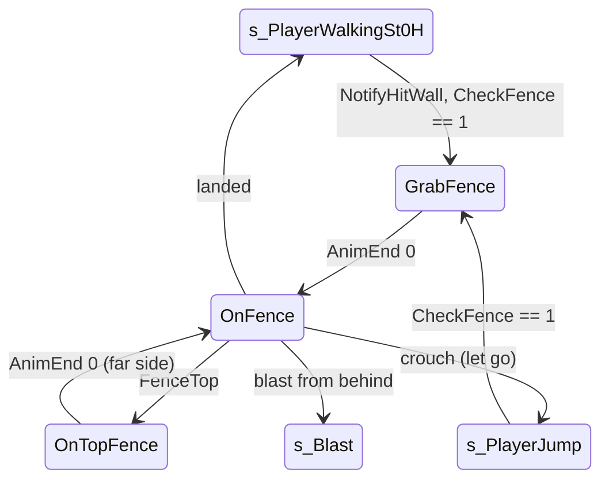

# Fence climb (FENCE GE and climbable surfaces)

Units:
- uc:SBase.SPlayerController:GrabFence.BeginState
- uc:SBase.SPlayerController:GrabFence.CanBeBlasted
- uc:SBase.SPlayerController:GrabFence.ExplosionHit
- uc:SBase.SPlayerController:GrabFence.AnimEnd
- uc:SBase.SPlayerController:GrabFence.PlayerMove
- uc:SBase.SPlayerController:OnTopFence.AnimEnd
- uc:SBase.SPlayerController:OnTopFence.PlayerMove
- uc:SBase.SPlayerController:BackFromTopFence.AnimEnd
- uc:SBase.SPlayerController:BackFromTopFence.PlayerMove
- uc:SBase.SPlayerController:OnFence.BeginState
- uc:SBase.SPlayerController:OnFence.CanUseCam
- uc:SBase.SPlayerController:OnFence.CanBeBlasted
- uc:SBase.SPlayerController:OnFence.ExplosionHit
- uc:SBase.SPlayerController:OnFence.EndState
- uc:SBase.SPlayerController:OnFence.CanBeDropAttacked
- uc:SBase.SPlayerController:OnFence.FenceTop
- uc:SBase.SPlayerController:OnFence.PlayerMove
- uc:SBase.SPlayerController:OnFence.MyNotifyLanded
- uc:SBase.SPlayerController:FenceTop
- uc:SBase.SBasePawn:SetFenceZones
- nat:SBase.SBasePawn.CheckFence
- uc:SBase.SPlayerController:GrabFence.SwitchBinocularVision
- uc:SBase.SPlayerController:OnTopFence.SwitchBinocularVision
- uc:SBase.SPlayerController:OnFence.SwitchBinocularVision

## Purpose

A spy grabs a climbable fence (mesh faces with a climbable material) by running or jumping into it, climbs up,
down and sideways on it, crosses over the top to the far side, and lets go. Mercs cannot climb fences.

## Data

| Field | Owner | Notes |
|---|---|---|
| vNormalFence | SPlayerController | fence surface normal returned by CheckFence |
| m_FenceArmsZone / Radius | SBasePawn | (45.72, 0, 90) / 25 |
| Material.bClimbable | Engine.Material | int flag on the surface material (18 stock textures carry it) |
| BlastDistMax, BlastSpeedMin, BlastSpeedMax | SPlayerController | 1000, 350, 800 |

## Rules

### Getting on

1. From Mario walking: `NotifyHitWall(HitNormal, Wall)` (native, the pawn ran into a wall) on the controlling side,
   unarmed, not rolling, not in weapon transit, and able to stand if crouched: when
   `CheckFence(vNormalFence, Wall, Location) == 1` (native): SA_FENCEGRAB, GrabFence.
2. From the air (s_PlayerJump.PlayerMove step 3, every frame): `CheckFence(...) == 1`, at least 1 s since
   m_LastSpecialMoveTime, living unarmed spy, standing or able to stand: SA_FENCEGRAB_JUMP, GrabFence, jump cleared.
3. The merc's walking states never call CheckFence (only Mario walking and the jump states do, and the jump test
   requires a spy).
4. CheckFence (decoded, physics-ge-queries.md 10) is pure geometry and material, no GE: two opposite probes and four
   corner probes (at R + 10 and H - 15) must hit the same plane; it returns 1 when the surface's material has
   bClimbable, 2 for a flat face that is not climbable, 0 for nothing. vNormalFence gets the plane normal and Wall
   the hit actor. A FENCE GE only matters for the top (FenceTop below).

### GrabFence (simulated)

BeginState: camera ECM_NoTargetCol, SetFenceZones (arms (45.72, 0, 90) r 25), ZoneHorsCrouch, crouch latch off.
PlayerMove: view limited to yaw -15000..15000 and pitch -15000..15000 around the pawn yaw; jump and latch cleared;
zero move. AnimEnd channel 0: SA_ONFENCE, OnFence.

### Climbing (OnFence, simulated)

PlayerMove:
1. Limited view as in GrabFence. X, Y = pawn axes.
2. Vertical: Forward (iMove & 4) newAccel = (0, 0, 120); Back (iMove & 8) (0, 0, -120); else zero.
3. Sideways: straf = +1 Right, -1 Left; if straf != 0: `newAccel += 120 straf Y`, then rescale newAccel to length
   120 (diagonals are no faster).
4. Pawn.Acceleration = newAccel.
5. Crouch latch: latch off, clear jump, `MyDoJump()`, SA_LEDGEFALL, s_PlayerJump (let go).
6. Send newAccel.

Events:
- FenceTop(locationEnd, rot) (native, the climber reached the fence's top line, controlling side): SA_TOPFENCE,
  OnTopFence.
- MyNotifyLanded (controlling side): clear jump, SA_WALK_ST_0H, s_PlayerWalkingSt0H, return true (feet on the
  floor while climbing down). Note that the global landing part (footprints, landing time, move flush) is not run.
- EndState stamps m_LastSpecialMoveTime.

In PHYS_OnVerticalPlane (8) the native moves the pawn on the fence plane with newAccel as a velocity in uu/s
(up/down along Z, sideways along the pawn's right axis). Decoded (physics-traversal.md physOnVerticalPlane,
physics-ge-queries.md 5): the pawn moves only while CheckFence at the target returns 1, which is what limits it at
the fence edges; FenceTop is raised when a FENCE GE in the arms zone lies above the hands and the boxes (35, 35, 20)
up 127.5, over 75 and down 198.25 are clear, and the climb stops there.

### Crossing the top

OnTopFence (simulated; binoculars disabled): limited view, zero move. The crossing clip FencStAlCo0 is a root-motion
move (PHYS_RootMotion, mesh lock) that ends on the far side. AnimEnd channel 0: smooth camera, SA_ONFENCE, crouch
latch off, OnFence (now hanging on the far side). BackFromTopFence has the same AnimEnd and PlayerMove; no script
code enters it.

Measured: over and hanging on the far side 2.5 s after the jump, from either side; then let go; forward climbs back.

### Blasts while on the fence

CanBeBlasted / ExplosionHit in GrabFence and OnFence only accept a blast from behind the climber
(`vector(Rotation) . Momentum < 0`) within BlastDistMax: blast speed
`BlastSpeedMax + (BlastSpeedMin - BlastSpeedMax) * |M| / BlastDistMax`, direction normal(M / |M| with Z = 1),
SA_BLAST_LOOP, s_Blast (blast spec).

## States

Physics: OnFence PHYS_OnVerticalPlane (8) (FencStAlBg0 / FencStAlNt0 measured on StatD); crossing PHYS_RootMotion
(5, FencStAlCo0, lock).

## Constants

| Name | Value | Unit | Provenance | Source |
|---|---|---|---|---|
| Climb speed | 120 (vertical, sideways, and diagonal total) | uu/s | decoded | OnFence.PlayerMove |
| View window | yaw +-15000, pitch +-15000 around the pawn yaw | rotator units | decoded | fence states |
| Air re-grab cooldown | 1 | s | decoded | s_PlayerJump.PlayerMove |
| Fence arms zone | (45.72, 0, 90), r 25 | uu | decoded | def:SBase.SBasePawn |
| Top crossing end (native) | C_TOPFENCE (75, 0, -3.25) | uu | decoded | SBasePawn consts |
| Fence probes | two opposite and four corner probes at R + 10, H - 15 | uu | decoded | physics-ge-queries.md 10 |
| FenceTop clearance | boxes (35, 35, 20) up 127.5, over 75, down 198.25 | uu | decoded | physics-ge-queries.md 5 |
| Crossing time | about 2.5 s from the jump to hanging on the far side | s | measured | RE+ MapBuilderFacts FENCE |
| Stock fence GE height | 232 over the foot (CHU01_SM.Fence01 panel 184 x 232) | uu | measured | RE+ MapBuilderFacts |

## Network

- Controlling side decides; ChangeState to the server. No GE points are sent for fences (no SendZipP call).
- Blast handling runs on the controlling side and sends the blast velocity with ServerSetVelocityAndOrientationForBlast.

## Edge cases

- OnFence.MyNotifyLanded skips the global landing code, so fTimeOfLastLanding is not updated and the pending move
  is not flushed on that frame.
- On the server copy of a remote player MyNotifyLanded returns false (not handled), letting the native use its
  default landing.
- RE+ notes: teleporting a pawn while it is on a fence leaves it stuck in PHYS 8; a rail along the top stops the
  climber at the top; the fence mesh must have no collision hull.

## Evidence

- Decompiled: local/re-out/uc/SBase/SPlayerController.uc (GrabFence, OnTopFence, BackFromTopFence, OnFence,
  s_PlayerWalkingMario.NotifyHitWall, s_PlayerJump.PlayerMove), SBase/SBasePawn.uc (SetFenceZones), Engine/Material.uc
  (bClimbable).
- Natives: SBasePawn.CheckFence game 0x10acf300 (editor exec 0x112085a0); editor ASBasePawn::physOnVerticalPlane
  0x11208670.
- Measurements: RE+ docs/MapBuilderFacts.md (FENCE), Bridge docs/handoff/traversal_2026-09-28.md (StatD gate,
  FencStAlBg0 / FencStAlNt0 PHYS 8, FencStAlCo0 PHYS 5 with lock).

## Open questions

3. The FenceTop event's locationEnd and orientationEnd: are they used by the native crossing move?

### Resolved

1. CheckFence: return values, GE versus material, probes, outputs. Resolved: no GE; 0 nothing, 1 climbable (material
   bClimbable), 2 a flat face that is not climbable; two opposite and four corner probes (R + 10, H - 15) must hit
   the same plane; Wall = the hit actor. Rule "Getting on" 4. Evidence: physics-ge-queries.md 10; game 0x10acf300
   (ANSWERS-physics 21).
2. physOnVerticalPlane limits and FenceTop. Resolved: the pawn moves only while CheckFence at the target returns 1
   (the edge limit); a FENCE GE in the arms zone above the hands with the clear boxes (35, 35, 20) up 127.5, over 75
   and down 198.25 raises FenceTop and stops the climb. Rule "Climbing". Evidence: physics-traversal.md,
   physics-ge-queries.md 5 (ANSWERS-physics 22).
