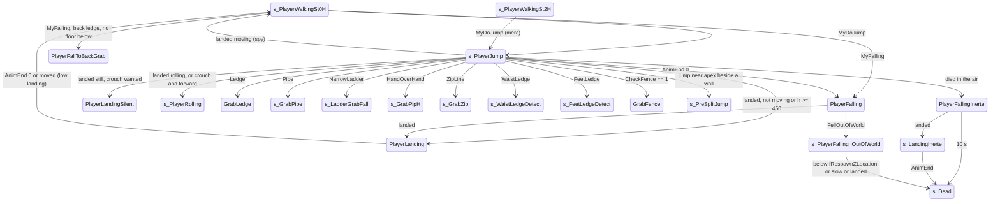

# Jump, fall, landing, fall damage and falling out of the world

Units:
- uc:SBase.SPlayerController:s_PlayerJump.BeginState
- uc:SBase.SPlayerController:s_PlayerJump.EndState
- uc:SBase.SPlayerController:s_PlayerJump.AnimEnd
- uc:SBase.SPlayerController:s_PlayerJump.PlayerMove
- uc:SBase.SPlayerController:s_PlayerJump.MyProcessMove
- uc:SBase.SPlayerController:s_PlayerJump.MyNotifyLanded
- uc:SBase.SPlayerController:s_PlayerJump.NotifyBump
- uc:SBase.SPlayerController:s_PlayerJump.FeetLedge
- uc:SBase.SPlayerController:s_PlayerJump.Pipe
- uc:SBase.SPlayerController:s_PlayerJump.NarrowLadder
- uc:SBase.SPlayerController:s_PlayerJump.WaistLedge
- uc:SBase.SPlayerController:s_PlayerJump.Ledge
- uc:SBase.SPlayerController:s_PlayerJump.HandOverHand
- uc:SBase.SPlayerController:s_PlayerJump.ZipLine
- uc:SBase.SPlayerController:s_PlayerJump.PawnTakeDamage
- uc:SBase.SPlayerController:s_PlayerJump.CanBeDropAttacked
- uc:SBase.SPlayerController:s_PlayerJump.CanBeElbowShocked
- uc:SBase.SPlayerController:s_PlayerJump.AltFire
- uc:SBase.SPlayerController:s_PlayerJump.PlayAnimDmg
- uc:SBase.SPlayerController:PlayerFalling.BeginState
- uc:SBase.SPlayerController:PlayerFalling.EndState
- uc:SBase.SPlayerController:PlayerFalling.DropAttack
- uc:SBase.SPlayerController:PlayerFallToBackGrab.BeginState
- uc:SBase.SPlayerController:PlayerFallingInerte.BeginState
- uc:SBase.SPlayerController:PlayerFallingInerte.NotifyBump
- uc:SBase.SPlayerController:PlayerFallingInerte.MyNotifyLanded
- uc:SBase.SPlayerController:PlayerFallingInerte.Timer
- uc:SBase.SPlayerController:PlayerFallingInerte.DropAttack
- uc:SBase.SPlayerController:PlayerFallingKO.BeginState
- uc:SBase.SPlayerController:PlayerFallingKO.MyNotifyLanded
- uc:SBase.SPlayerController:PlayerLanding.BeginState
- uc:SBase.SPlayerController:PlayerLanding.AnimEnd
- uc:SBase.SPlayerController:PlayerLanding.PlayerMove
- uc:SBase.SPlayerController:PlayerLanding.NotifyHitWall
- uc:SBase.SPlayerController:PlayerLanding@code
- uc:SBase.SPlayerController:PlayerLandingSilent.BeginState
- uc:SBase.SPlayerController:s_LandingInerte.MyFalling
- uc:SBase.SPlayerController:s_LandingInerte.AnimEnd
- uc:SBase.SPlayerController:s_LandingInerte.PlayerMove
- uc:SBase.SPlayerController:s_PlayerFalling_OutOfWorld.BeginState
- uc:SBase.SPlayerController:s_PlayerFalling_OutOfWorld.EndState
- uc:SBase.SPlayerController:s_PlayerFalling_OutOfWorld.MyNotifyLanded
- uc:SBase.SPlayerController:s_PlayerFalling_OutOfWorld.PlayerTick
- uc:SBase.SPlayerController:s_FallDropAttacked.BeginState
- uc:SBase.SPlayerController:s_FallDropAttacked.MyNotifyLanded
- uc:SBase.SPlayerController:s_FallDropAttacked.PlayerMove
- uc:SBase.SPlayerController:s_FallFallDropAttacked.MyNotifyLanded
- uc:SBase.SPlayerController:s_BlastFallAfterObstacle.MyNotifyLanded (fall damage part)
- uc:SBase.SPlayerController:MyFalling
- uc:SBase.SPlayerController:MyNotifyLanded
- uc:SBase.SPlayerController:FellOutOfWorld
- uc:SBase.SPlayerController:GotoWaitingState
- uc:SBase.SBasePawn:TakeFallingDamage
- uc:SBase.SBasePawn:PlayLandingSound
- uc:SBase.SBasePawn:ClientPlayLandingSound
- uc:SBase.SBasePawn:ServerPlayLandingSound
- uc:SBase.SBasePawn:BaseChange
- nat:SBase.SBasePawn.MyDoJump
- nat:SBase.SPlayerController.CheckBackFeetZone
- nat:SBase.SPlayerController.MyReplicateMoveWithoutMoving
- def:Engine.LevelInfo (DefaultGravity)
- uc:SBase.SPlayerController:s_FallDropAttacked.SwitchBinocularVision
- uc:SBase.SPlayerController:s_FallFallDropAttacked.BeginState
- uc:SBase.SPlayerController:PlayerLanding.GadgetQuickChoice
- uc:SBase.SPlayerController:PlayerLanding.PlayAnimDmg

## Purpose

What happens between leaving the ground and standing again: the jump impulse, the spy's air control, the GE
grabs that can interrupt a fall, the landing decision (quiet, low, high, roll, keep walking), fall damage, the
inert falls of a dead or knocked-out player, and falling out of the world.

## Data

| Field | Owner | Default | Notes |
|---|---|---|---|
| JumpZ | Pawn | spy 610.0, merc 495.0 | def:SBase.SPawnAttaque / SPAWNDEFENSE |
| DefaultGravity | LevelInfo | -1500.0 | def:Engine.LevelInfo; replicated |
| MaxFallSpeed | Pawn | 1200.0 | not read by the native (measured 2110 uu/s after 1500); the 3D speed cap is 2500 |
| AirControl, AirSpeed | Pawn | 2.0, 600.0 | AirControl x AccelRate (4096) clamps the air acceleration; AirSpeed is not read |
| Fell_MinHeightForDmg | SBasePawn | spy 600, merc 450 (base class 300) | |
| Fell_MaxHeightForDmg | SBasePawn | spy 1500, merc 1000 (base class 800) | |
| Fell_MaxHeightForBigLand | SBasePawn | 450 for both | big-landing threshold |
| fZMaxFalling | SPlayerController | 0 | the highest Z of the current airborne phase: setPhysics sets it to Location.Z on entering Falling from any other mode; physFalling and physFallingInRootMotion raise it to the current Location.Z at the end of every call; physWalking and MyDoJump do not write it |
| fTimeOfLastLanding | SPlayerController | -5.0 | |
| bWantsToMove | SPlayerController | false | stick outside the 100 dead square during the jump |
| bBlockControlForJump | SPlayerController | false | no air control (set by wall-jump exits) |
| bTestBackFeetGrab | SPlayerController | false | spy is turning to grab a ledge behind its feet |
| nJumpNumber | SBasePawn | 0 | 1 after a ground jump, 2 after the split-jump impulse (native) |
| iMove, iOldMove | SPlayerController | 0 | iOldMove holds last frame's move mask during jumps |
| fRespawnZLocation, vCamLocWhenFallingDead, bInstantRespawn | SPlayerController | - | out of world |

## Rules

### Starting a jump

1. The walking states call the native `MyDoJump()` then play SA_JUMP_ST_0H (spy unarmed) or SA_JUMP_ST_2H, then
   ChangeState('s_PlayerJump'). Conditions are in walking.md.
2. MyDoJump contract (native): sets Physics to PHYS_Falling, Velocity.Z = JumpZ (keeping horizontal velocity),
   sets nJumpNumber to 1 and starts the jump animation. Peak height `JumpZ^2 / (2 * 1500)`: spy 124.0, merc
   81.7 (measured 124 and 82).
3. s_PlayerJump.BeginState: ResetZones, bTestBackFeetGrab = false, stop the zip-line slide sound, clear
   bPressedJump, camera ECM_Walking, and play the merc weapon's jump animation if armed.

### Leaving the ground without a jump (MyFalling)

MyFalling(LeftTime) is called by the native walking physics when the floor is lost. Global version:
1. On the owning client, if no action has gone out with a server move this frame, flush the move so far:
   `MyReplicateMoveWithoutMoving(LeftTime, Acceleration)`.
2. On the controlling side (RemoteRole != AutonomousProxy):
   - leaving back-to-wall: action SA_BTW_OUT;
   - unless the base channel is playing LandStAlAk0, action SA_FALL_ST_0H (unarmed) or SA_FALL_ST_2H;
   - bTestBackFeetGrab = false;
   - spy with `fNormePadMove < 0.7`: if `CheckBackFeetZone()` (native, a ledge GE behind the feet) is true,
     trace down 175 from Location with extent (35, 35, 87.5): floor found: ChangeState('PlayerFalling'); no
     floor: bTestBackFeetGrab = true, Pawn.Velocity = 0, ChangeState('PlayerFallToBackGrab'). Without a back
     ledge: ChangeState('PlayerFalling');
   - everyone else: ChangeState('PlayerFalling').
   This is how a spy walking slowly off an edge turns round and hangs from it (ledge.md); at full stick
   (fNormePadMove >= 0.7) he just falls.
3. States that override MyFalling: s_PlayerRolling (action only), s_LandingInerte (to PlayerFallingInerte),
   PlayerFallingInerte and PlayerFallingKO (ignored), and several traversal states (their own specs).

### In the air (s_PlayerJump.PlayerMove; PlayerFalling inherits it)

Each frame, in order:
1. `ZoneHorsCrouch()`: stand up if crouched (forced SA_WANTS_TO_UNCROUCH) and set the crouch latch.
2. iOldMove = iMove; aStrafeRoulade = aStrafe; aForwardRoulade = aForward (raw values, before clamping).
3. Fence: `CheckFence(vNormalFence, Wall, Location)` (native). If it returns 1, at least 1 s has passed since
   m_LastSpecialMoveTime, the pawn is a living unarmed spy, and it is standing or can stand: SA_FENCEGRAB_JUMP,
   ChangeState('GrabFence'), clear bPressedJump (fence.md).
4. bWantsToMove = the stick is outside the square |aForward| < 100 and |aStrafe| < 100.
5. Split jump: if bPressedJump, clear it; a spy with nJumpNumber == 1 and |Velocity.Z| < 150 (near the top of
   the jump) tests `CheckWallJump(X, Y, Z, vWallNormal)` with the pawn axes (split-jump-vandamme.md).
6. Use edge: bToggleUsing = bUsing when it changed (oldbUsing).
7. GE search: only when not attacking a pawn (m_AttackTarget == None): bFindGE = false; `CheckArmsZone()`;
   `CheckFeetZone()` if nothing found.
8. Steering:
   - bTestBackFeetGrab: `UpdateRotation(dt, 1)`, no acceleration, and turn the pawn yaw toward
     `rotator(SBPawn.vBackFeetNormal).Yaw` by at most `80000 dt` per frame (same wrap rule as the Mario turn).
   - otherwise clamp the stick to 6000, `UpdateRotation(dt, 1)`, then newAccel = 0 when bBlockControlForJump,
     else `UpdatePawnRotationMarioJump(dt, int(0.5 aForward), int(0.5 aStrafe))`; zero below length 1.
9. `GroundSpeed = RunningSpeed * |newAccel| / 3000`.
10. Merc: the pawn's yaw is set to the view yaw (pitch and roll 0), MyDesiredRotation = Rotation,
    `UpdateDesiredRotation`, LocalMyDesiredRotation updated. The merc keeps facing the view while airborne.
11. Send the move. s_PlayerJump's MyProcessMove only sets Pawn.Acceleration.

Native air control (decoded, physics-falling.md 2, 5): Acceleration.XY is clamped to AirControl x AccelRate =
4096 (with a boost below 10 uu/s), gravity is a fixed -1500, the velocity is integrated half a step before the
move and extrapolated after it, horizontal air speed is capped at 417 uu/s each sub-step and the 3D speed at 2500.
AirSpeed and MaxFallSpeed are not read.

AnimEnd on channel 0 (controlling side): action SA_FALL_ST_0H or SA_FALL_ST_2H by hands, ChangeState
('PlayerFalling'). So s_PlayerJump lasts as long as the jump clip; the rest of the air time is PlayerFalling,
which has the same PlayerMove and events.

NotifyBump(Other) while in the air: if Other is a Mover moving up slower than the pawn
(`Other.Velocity.Z < Pawn.Velocity.Z`), reset fZMaxFalling = Location.Z (being carried by a mover is not a fall).

AltFire in the air: only a merc whose team carries gadgets (iNBGadgets above 0) runs the global AltFire (his grenade
throw); for a spy it does nothing. PlayAnimDmg does nothing (no hit animation in the air).

### GE grabs while airborne

The events below are raised by the native zone checks of step 7 (contracts in native-contracts.md). Each one
that fires changes state immediately; details of each move are in its own spec.

| Event | Conditions in s_PlayerJump | Action, next state |
|---|---|---|
| FeetLedge | not rolling, standing | SA_FEETLEDGE_DETECT, SendZipPToServer, s_FeetLedgeDetect |
| Pipe(loc, rot) | spy, not in weapon transit, unarmed | camera smooth, SA_PIPE_GRABFALL, SendZipPAndNormalToServer, s_GrabPipe |
| NarrowLadder | spy, not in transit, unarmed, 1 s since m_LastSpecialMoveTime | camera smooth, SA_LADDER_CATCH when Velocity.Z < -400 else SA_LADDER_GRABFALL, SendZipPAndNormalToServer, s_LadderGrabFall |
| WaistLedge(bCanGoNoCrouch) | spy, ZipP1 != LastZipP, unarmed | store bWaistLedgeCanGoUnCrouch, SA_WAISTLEDGE_DETECT, SendZipPToServer, s_WaistLedgeDetect |
| Ledge | first ZoneHorsCrouch; then standing, `|ZipP1.Z - LastZipP.Z| > 20`, spy, unarmed | SA_LEDGE_GRAB, m_LastSpecialMoveTime = now, SendZipPToServer, GrabLedge |
| HandOverHand | not merc, not in transit, ZipP1 != LastZipP | SendZipPToServer, SA_PIPH_GRAB, s_GrabPipH |
| ZipLine(loc, rot) | not merc, not in transit, unarmed; a trace with the pawn's cylinder from Location to loc hits nothing; 2 s since m_LastSpecialMoveTime | SendZipPToServer, SA_ZIP_GRAB, s_GrabZip |

Every grab sets bFindGE. `LastZipP` is the attach point of the previous GE; the `ZipP1 != LastZipP` tests stop the
spy re-grabbing the GE he just left. The merc grabs nothing in the air (only ladders, from the ground).

### Landing (s_PlayerJump.MyNotifyLanded; PlayerFalling inherits it)

MyNotifyLanded(HitNormal, fTimeLeft, LandedOn) is called by the native falling physics on touching a floor
(decoded, physics-falling.md 7): a floor hit needs Normal.Z >= 0.7; bCanLand then needs a box hit 0.2 H + 8 below
the pawn (0.9 cylinder); physFalling calls Controller.MyNotifyLanded only on the controlling side (not on the server
for a remote client) and then restarts physics with the remaining time. processLanded (wall-slide landings) calls
it with no role test. Root-motion falling calls it above Normal.Z 0.707 and NotifyHitWall otherwise. The engine's
Landed event is never called.

1. Global part: FootPrint(false) then FootPrint(true), fTimeOfLastLanding = now, and on the owning client
   `MyReplicateMoveWithoutMoving(fTimeLeft, Acceleration)`. Returns true.
2. Return on the server copy of a remote player (RemoteRole == AutonomousProxy).
3. If SBPawn.bIsRolling: ChangeState('s_PlayerRolling'), return.
4. If the horizontal speed is below 40, bWantsToMove = false.
5. On the controlling side, with `h = fZMaxFalling - Location.Z`, "crouch wanted" = bCrouchWithRoll or already
   crouched, and "make crouched" = action SA_WANTS_TO_CROUCH if not yet crouched:

| h | Moving | Hands | Crouch wanted | Result |
|---|---|---|---|---|
| < 450 | no | 0H | yes | make crouched, SA_LAND_CR_0H_QUIET, PlayerLandingSilent |
| < 450 | no | 2H | yes | make crouched, SA_LAND_CR_2H_QUIET, PlayerLandingSilent |
| < 450 | no | 0H | no | merc SA_LAND_ST_0H_HIGH, spy SA_LAND_ST_0H_LOW, PlayerLanding |
| < 450 | no | 2H | no | SA_LAND_ST_2H_LOW, PlayerLanding |
| < 450 | yes | 0H | yes, spy | make crouched; forward held last frame (iOldMove & 4): SA_ROLLING with the stick scaled to 3000, s_PlayerRolling; else SA_WALK_CR_0H, s_PlayerWalkingCr0H |
| < 450 | yes | 0H | yes, merc | uncrouch if crouched, clear the latch, SA_LAND_ST_0H_HIGH, PlayerLanding |
| < 450 | yes | 0H | no, merc | SA_LAND_ST_0H_HIGH, PlayerLanding |
| < 450 | yes | 0H | no, spy | SA_WALK_ST_0H then SA_WALK_ST_LAND_OH, s_PlayerWalkingSt0H (lands running) |
| < 450 | yes | 2H | yes | landing sound, make crouched, SA_WALK_CR_2H, s_PlayerWalkingCr2H |
| < 450 | yes | 2H | no | landing sound, SA_WALK_ST_2H, s_PlayerWalkingSt2H |
| >= 450 | any | 0H | yes | make crouched, SA_LAND_ST_0H_HIGH, PlayerLanding |
| >= 450 | any | 2H | yes | make crouched, SA_LAND_CR_2H_QUIET, PlayerLanding |
| >= 450 | any | 0H | no | SA_LAND_ST_0H_HIGH, PlayerLanding |
| >= 450 | any | 2H | no | SA_LAND_ST_2H_HIGH, PlayerLanding |

   Armed mercs also play the weapon's land animation (AnimateLand below 450, AnimateLandHigh at or above).
   The roll vector for the landing roll comes from aStrafeRoulade/aForwardRoulade, the raw stick of the last
   airborne frame.

### Landing states

PlayerLanding (extends s_PlayerWalkingMario; ignores AutoFeetLedge, NarrowLadder, PerformCoopMvt, Pipe,
SwitchBinocularVision, TopLadder, TopPipe; no quick gadget, no damage animation, NotifyHitWall does nothing):
1. BeginState: bTestBackFeetGrab = false; an armed merc plays the weapon land clip unless one is already playing;
   an unarmed standing spy makes a landing noise (`NotifyNoise(1.0)`); then the Mario BeginState.
2. PlayerMove: clear bPressedJump. Unless the base channel plays LandStAlAk0: if the stick is outside the 100
   dead square and the landing action is not one of SA_LAND_ST_0H_HIGH, SA_LAND_ST_0HTo2H_HIGH, SA_LAND_ST_2H_HIGH
   (a low landing can be cancelled by moving), play the landing sound when the base channel frame is still
   negative (tweening in) and call `GotoWaitingState()`. Then UpdateRotation; the merc keeps facing the view;
   send a zero-acceleration move. The player cannot walk out of a high landing.
3. AnimEnd channel 0 (controlling side): `GotoWaitingState()`; if sticky-shocking on the controlling side,
   action SA_DMG_ELECTRIC (forced).
4. Label DropAttack (state code entered by a drop-attack landing): on the controlling side action
   SA_LAND_DROPATTACK, then stop.

PlayerLandingSilent: the same, but BeginState only plays the merc weapon land clip (no noise, no Mario
BeginState).

GotoWaitingState picks the resting state: spy coming back from s_PipH_Fire2, s_PipH_Fire4 or VandammeWeapon
(PreviousState) returns there with bDontSaveCurrentState; otherwise by stance and hands: Cr0H (SA_WALK_CR_0H),
St0H (SA_WALK_ST_0H), Cr2H (SA_WALK_CR_2H), St2H (SA_WALK_ST_2H), each action forced. A merc always goes to Cr2H
or St2H. GotoWaitingState is also a reliable server-to-client function, so the server can force it.

### Fall damage

Fall damage is script-side; the engine's TakeFallingDamage is empty in SBasePawn (Landed still calls it). The
formula used everywhere is

    Dmg = (h - Fell_MinHeightForDmg) / (Fell_MaxHeightForDmg - Fell_MinHeightForDmg) * default.Health,  h = fZMaxFalling - Location.Z

applied only when h > Fell_MinHeightForDmg, converted to int by truncation. With default Health 100: spy
`100 (h - 600) / 900`, merc `100 (h - 450) / 550` (measured exactly so, within a point, at every height to
1500). Where it is applied:

| Place | Who computes | How |
|---|---|---|
| s_PlayerJump.EndState (also reached from PlayerFalling.EndState through super) | server only (Role == Authority) | PawnTakeDamage(int Dmg, Pawn, Location, (0,0,1), SFell); fZMaxFalling is not reset |
| PlayerFallingKO.MyNotifyLanded | controlling side | at least 10; lethal: Health damage via DamagePawn_C2S then s_LandingInerte; else DamagePawn_C2S(int Dmg), fLyingOnGroundDuration = fKOAfterBerserkOrCharge (3.0), s_LyingOnGround; fZMaxFalling reset when the fall exceeded the threshold |
| s_BlastFallAfterObstacle and s_FallAfterGrabbedFromLedge MyNotifyLanded | controlling side | lethal: SA_DIE_FALLING, DamagePawn_C2S(Health), s_Dead; else DamagePawn_C2S(int Dmg); fZMaxFalling reset; and a 4 s airborne limit kills (s_BlastFallAfterObstacle.PlayerMove) |

`DamagePawn_C2S` is a reliable client-to-server call (combat spec). Both teams are held about 1.4 s on a landing
above 450 (the high landing clip; measured), 0.07 s below.

### Inert falls

PlayerFallingInerte (dead or dying in the air; ignores AnimEnd, CheckArmsZone, MyFalling):
1. BeginState: ResetZones; on the controlling side SetTimer(10, false), action SA_FALL_INERTE, and if the pawn was
   on a ladder, pipe or fence (PHYS_OnLadder, PHYS_OnPipe, PHYS_OnVerticalPlane) push it off with
   `SetVelocityForDyingPawn(-200 X)`; a merc switches to the behind view. Merc weapon fall clip.
2. NotifyBump(Other): on the controlling side, landing on top of another SBasePawn
   (`Other.Location.Z + 0.8 Other.CollisionHeight <= Location.Z - CollisionHeight`): StickyBlast(Other) if that
   pawn is sticky-skinned, else `TellServerToFallAttack(Other)` (drop attack, combat spec).
3. MyNotifyLanded: global part; controlling side: SA_LAND_INERTE and s_LandingInerte (unless GameEnded). Merc
   weapon land clip.
4. Timer (10 s without landing): SA_LAND_INERTE, s_Dead.

PlayerFallingKO (knocked out while airborne; ignores AnimEnd, MyFalling, CheckArmsZone): BeginState hides the
reticule and plays SA_FALL_INERTE on the controlling side; landing rule in the fall damage table.

s_LandingInerte (extends s_Inactive): MyFalling -> PlayerFallingInerte; AnimEnd (any channel) -> s_Dead; moves
are zero-acceleration with view rotation only.

s_FallDropAttacked / s_FallFallDropAttacked (knocked down by a drop attack): if still walking play a jump action
(SA_JUMP_ST_0H for an unarmed spy, else SA_JUMP_ST_2H); otherwise (already airborne) clear the weapon on the
controlling side, SA_FALL_INERTE, GotoState('s_FallFallDropAttacked'). Landing: s_FallDropAttacked goes to
s_FallDown label DIE_InPlace; s_FallFallDropAttacked on the controlling side goes to s_FallDown with
SA_LAND_INERTE unless it landed on a pawn, and landing on a pawn deals that pawn 17 SDamage_DropAttacked through
DamagePawn_C2S.

PlayerFallToBackGrab: BeginState zeroes the horizontal velocity, then PlayerFalling's BeginState.

PlayerFalling: BeginState ResetZones and the merc weapon fall clip; EndState clears m_AttackTarget then runs
s_PlayerJump.EndState (fall damage); DropAttack(P) -> performDropAttack(P).

### Falling out of the world

FellOutOfWorld (native event when the pawn passes below the world): if Physics is PHYS_Falling and the state is
not already s_PlayerFalling_OutOfWorld, ChangeState('s_PlayerFalling_OutOfWorld').

s_PlayerFalling_OutOfWorld (extends s_Inactive; ignores ClientUpdatePosition, FellOutOfWorld, MyFalling,
PawnTakeDamage, ReinitPawnBecauseOfDivergences):
1. BeginState: ResetZones. Controlling side: action SA_FALL_DEAD; trace straight down 15000 from Location (zero
   extent); hit: fRespawnZLocation = HitLocation.Z + 8 CollisionHeight (700 above the hit for both teams), else
   Location.Z - 1500; remember the camera position; fade the screen to black over 0.5 s. Server: drop the flag,
   clear fire and throw inputs, and if the pawn is alive count a kill by the world
   (`Level.Game.Killed(self, self, Pawn, SFell)`) and the suicide score. Then Health = 0 and bInstantRespawn =
   true on both sides.
2. PlayerTick: on the controlling side, when `Location.Z <= fRespawnZLocation` or `|Velocity| < 100`, action 0
   (SA_NONE) and ChangeState('s_Dead'); then the parent PlayerTick.
3. MyNotifyLanded: controlling side, action 0 and s_Dead.
4. EndState: move pawn and controller to StartSpot (location and rotation) when there is one, hide the pawn, and on
   the controlling side reset camera effects and fade back in over 1.5 s.

## States

Physics: PHYS_Falling (2) in every state of this file. PlayerLanding is PHYS_Walking.

## Constants

| Name | Value | Unit | Provenance | Source |
|---|---|---|---|---|
| Gravity | -1500 | uu/s^2 | decoded and measured | def:Engine.LevelInfo DefaultGravity; RE+ jump heights and fall times |
| JumpZ | spy 610, merc 495 | uu/s | decoded | def:SBase.SPawnAttaque / SPAWNDEFENSE |
| Jump peak | spy 124.0, merc 81.7 | uu | decoded and measured | JumpZ^2 / 3000; measured 124 and 82 |
| Terminal speed | none in practice; the native caps the 3D speed at 2500 | uu/s | decoded and measured | physics-falling.md 5; 2110 uu/s after a 1500 drop |
| Air acceleration clamp | AirControl x AccelRate = 4096 | uu/s^2 | decoded | physics-falling.md 2 |
| Horizontal air speed cap | 417 per sub-step | uu/s | decoded | physics-falling.md 5 |
| Landing floor | Normal.Z >= 0.7 (root motion 0.707); bCanLand box 0.2 H + 8 below, 0.9 cylinder | - | decoded | physics-falling.md 7 |
| Big landing height | 450 | uu | decoded | Fell_MaxHeightForBigLand |
| Fall damage start / full | spy 600 / 1500, merc 450 / 1000 | uu | decoded and measured | defaults; RE+ ClimbLabD |
| KO fall minimum damage | 10 | hit points | decoded | PlayerFallingKO.MyNotifyLanded |
| Landing still threshold | 40 | uu/s | decoded | s_PlayerJump.MyNotifyLanded |
| Stick dead square | 100 | input units | decoded | s_PlayerJump.PlayerMove, PlayerLanding.PlayerMove |
| Back ledge stick limit | fNormePadMove < 0.7 | stick | decoded | MyFalling |
| Back ledge floor probe | down 175, extent (35, 35, 87.5) | uu | decoded | MyFalling |
| Back ledge turn rate | 80000 | rotator units/s | decoded | s_PlayerJump.PlayerMove |
| Split jump apex window | |Velocity.Z| < 150 | uu/s | decoded | s_PlayerJump.PlayerMove |
| Air grab cooldowns | fence 1 s, ladder 1 s, zip 2 s | s | decoded | s_PlayerJump |
| Ladder catch speed | Velocity.Z < -400 | uu/s | decoded | s_PlayerJump.NarrowLadder |
| Ledge re-grab height | 20 | uu | decoded | s_PlayerJump.Ledge |
| Inert fall timeout | 10 | s | decoded | PlayerFallingInerte.BeginState |
| Inert push-off | 200 | uu/s | decoded | PlayerFallingInerte.BeginState |
| Blast fall timeout | 4 | s | decoded | s_BlastFallAfterObstacle.PlayerMove |
| Out of world probe | 15000 down; respawn line hit + 8 x CollisionHeight, else -1500 | uu | decoded | s_PlayerFalling_OutOfWorld.BeginState |
| Out of world speed exit | 100 | uu/s | decoded | s_PlayerFalling_OutOfWorld.PlayerTick |
| Fade | out 0.5 s, in 1.5 s | s | decoded | same |
| Landing hold | about 1.4 above 450, 0.07 below | s | measured | RE+ MoveLabD |
| Landing sound | Sound_Persos.FootSteps.SW_Landing, volume 1.0, radius 300 | - | decoded | SBasePawn.PlayLandingSound |

## Network

- Jumps, landings and their states are decided on the controlling side. The client calls ChangeState, which sends
  `PCChangeServerState` (reliable) so the server's controller follows (state-and-network.md).
- MyFalling and MyNotifyLanded flush the client's pending move with `MyReplicateMoveWithoutMoving` (native) so
  the server sees the take-off and the touch-down in the right frame.
- Ground fall damage is applied by the server when its copy of the state leaves s_PlayerJump or PlayerFalling.
  Because the server changes state when the client's PCChangeServerState arrives, the server measures h with its
  own pawn location at that moment.
- The KO and blast fall damage is computed by the client and sent with DamagePawn_C2S.
- PlayLandingSound: plays locally; the authority also calls ClientPlayLandingSound (unreliable, server to
  client, plays only on clients where the pawn has no controller, i.e. other players); a client calls
  ServerPlayLandingSound (unreliable), which plays on the server and multicasts ClientPlayLandingSound.

## Edge cases

- Fall damage on the server can be applied twice for one fall: when the jump clip ends during the fall,
  s_PlayerJump.EndState runs on the change to PlayerFalling, and PlayerFalling.EndState runs it again on landing;
  fZMaxFalling is not reset by either. If the server applies the first change after its pawn has already dropped
  more than Fell_MinHeightForDmg below the apex (late PCChangeServerState), both calls deal damage. RE+ measured a
  merc jumping off a 448 ledge (fall 530, single damage 14) taking 14 to 28: consistent with this.
- fZMaxFalling tracking is native; script only resets it on mover bumps and after KO/blast damage. The native does
  not refresh it while walking, but setPhysics resets it to Location.Z whenever the pawn enters Falling from
  another mode, so every fall starts from its own take-off height (physics-dispatch.md, physics-falling.md 8).
- A spy can never hang from a ledge behind him at full stick (fNormePadMove >= 0.7).
- AutoFeetLedge-type hops and running off small steps go through PlayerFalling and the full landing table.
- Landing on another pawn: Mario jumps are refused while standing on a pawn (walking.md), and BaseChange is empty
  in SBasePawn, so the engine's "jump off pawn" push is disabled.

## Evidence

- Decompiled: local/re-out/uc/SBase/SPlayerController.uc (s_PlayerJump, PlayerFalling, PlayerFallToBackGrab,
  PlayerFallingInerte, PlayerFallingKO, PlayerLanding, PlayerLandingSilent, s_LandingInerte,
  s_PlayerFalling_OutOfWorld, s_FallDropAttacked, s_FallFallDropAttacked, s_BlastFallAfterObstacle, MyFalling,
  MyNotifyLanded, FellOutOfWorld, GotoWaitingState). SBase/SBasePawn.uc (TakeFallingDamage, BaseChange,
  PlayLandingSound). Engine/Pawn.uc (Landed, TakeFallingDamage), Engine/LevelInfo.uc (DefaultGravity).
- Natives: MyDoJump game 0x10ae00b0 (editor ASBasePawn::MyDoJump 0x111f9cf0, exec 0x111f9f00); CheckBackFeetZone
  0x10aa7e00 (editor exec 0x111ec6d0, CheckBackLedgeGrabFeet 0x111e4ef0); MyReplicateMoveWithoutMoving
  0x10aae310; editor ASBasePawn::physFalling 0x11213090, physFallingInRootMotion 0x1120c440, processLanded
  0x11210660, bCanLand 0x11210450, PlayLanding 0x111f99d0, PlayJumpStart 0x111f97a0, APawn::jumpLanding
  0x110dc6d0.
- Measurements: RE+ docs/MapBuilderPatterns.md "Limits measured in game" (jump heights, fall times, unhurt drops,
  damage formula, 1.4 s hold, 448 ledge jumps).

## Open questions

2. MyDoJump: exact effects on a ground jump (Velocity.Z = JumpZ or +=, any horizontal boost). The jump actions (90,
   91) set Falling and play the jump start, the velocity comes from MyDoJump (execute-action.md); its Falling
   branch (split impulse) is decoded in wall-jump-split-vandamme.md. Ghidra 0x10ae00b0; trace the velocity on the
   jump frame.
4. The double fall-damage case: confirm on a dedicated server with lag, and decide whether the port reproduces it
   (faithful) or fixes it behind a flag.

### Resolved

1. fZMaxFalling: which native writes it and when. Resolved: setPhysics sets it to Location.Z on entering Falling
   from any other mode; physFalling and physFallingInRootMotion raise it to the current Location.Z at the end of
   every call; physWalking and MyDoJump do not write it. Data table and Edge cases above. Evidence:
   physics-dispatch.md, physics-falling.md 8 (ANSWERS-physics 3).
3. Air control: how Acceleration, AirControl 2.0 and AirSpeed 600 combine. Resolved: the air acceleration is
   clamped to AirControl x AccelRate = 4096, gravity a fixed -1500, half-step integration, horizontal cap 417 per
   sub-step, 3D cap 2500; AirSpeed and MaxFallSpeed are not read. Rule "In the air". Evidence: physics-falling.md
   2, 5 (ANSWERS-physics 4).
5. MyNotifyLanded vs Landed, which native calls it, the landing slope. Resolved: floor Normal.Z >= 0.7 and the
   bCanLand box test; physFalling calls MyNotifyLanded only on the controlling side and restarts physics with the
   remaining time; processLanded calls it with no role test; root-motion falling uses 0.707; Engine Landed is
   never called. Rule "Landing". Evidence: physics-falling.md 7 (ANSWERS-physics 5).
6. Who raises DropAttack in the air. Resolved: physFalling and physFallingInRootMotion (the server-side trigger and
   homing), besides physWalking and physLinear. Evidence: physics-falling.md 4 (ANSWERS-physics 31).
