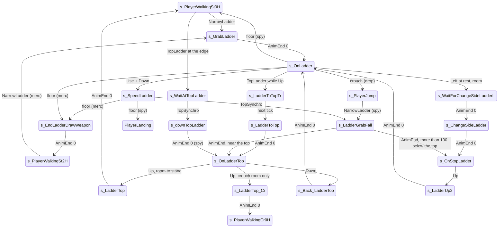

# Ladder (LADDER GE)

Units:
- uc:SBase.SPlayerController:s_GrabLadder.BeginState
- uc:SBase.SPlayerController:s_GrabLadder.AnimEnd
- uc:SBase.SPlayerController:s_GrabLadder.EndState
- uc:SBase.SPlayerController:s_GrabLadder.PlayerMove
- uc:SBase.SPlayerController:s_LadderBase.JumpFromLadder
- uc:SBase.SPlayerController:s_LadderBase.BeginState
- uc:SBase.SPlayerController:s_LadderBase.EndState
- uc:SBase.SPlayerController:s_LadderBase.CanBeDropAttacked
- uc:SBase.SPlayerController:s_LadderBase.NotifyHitWall
- uc:SBase.SPlayerController:s_EndLadderDrawWeapon.AnimEnd
- uc:SBase.SPlayerController:s_EndLadderDrawWeapon.PlayerMove
- uc:SBase.SPlayerController:s_OnLadder.CanUseCam
- uc:SBase.SPlayerController:s_OnLadder.BeginState
- uc:SBase.SPlayerController:s_OnLadder.PlayerMove
- uc:SBase.SPlayerController:s_OnLadder.TopLadder
- uc:SBase.SPlayerController:s_WaitForChangeSideLadderL.AnimEnd
- uc:SBase.SPlayerController:s_WaitForChangeSideLadderL.PlayerMove
- uc:SBase.SPlayerController:s_WaitForChangeSideLadderR.AnimEnd
- uc:SBase.SPlayerController:s_WaitForChangeSideLadderR.PlayerMove
- uc:SBase.SPlayerController:s_ChangeSideLadder.AnimEnd
- uc:SBase.SPlayerController:s_ChangeSideLadder.PlayerMove
- uc:SBase.SPlayerController:s_LadderToTopTr.PlayerMove
- uc:SBase.SPlayerController:s_LadderToTopTr@code
- uc:SBase.SPlayerController:s_LadderToTop.AnimEnd
- uc:SBase.SPlayerController:s_LadderToTop.PlayerMove
- uc:SBase.SPlayerController:s_OnLadderTop.BeginState
- uc:SBase.SPlayerController:s_OnLadderTop.PlayerMove
- uc:SBase.SPlayerController:s_Back_LadderTop.AnimEnd
- uc:SBase.SPlayerController:s_Back_LadderTop.PlayerMove
- uc:SBase.SPlayerController:s_LadderTop.AnimEnd
- uc:SBase.SPlayerController:s_LadderTop.PlayerMove
- uc:SBase.SPlayerController:s_LadderTop_Cr.AnimEnd
- uc:SBase.SPlayerController:s_LadderDownFromTop.AnimEnd
- uc:SBase.SPlayerController:s_LadderDownFromTop.PlayerMove
- uc:SBase.SPlayerController:s_WaitAtTopLadder.PlayerMove
- uc:SBase.SPlayerController:s_WaitAtTopLadder.TopSynchro
- uc:SBase.SPlayerController:s_WaitAtTopLadder.NotifyBump
- uc:SBase.SPlayerController:s_downTopLadder.AnimEnd
- uc:SBase.SPlayerController:s_downTopLadder.PlayerMove
- uc:SBase.SPlayerController:s_SpeedLadder.PlayerMove
- uc:SBase.SPlayerController:s_SpeedLadder.TopSynchro
- uc:SBase.SPlayerController:s_SpeedLadder.NotifyHitWall
- uc:SBase.SPlayerController:s_SpeedLadderFromTop.TopSynchro
- uc:SBase.SPlayerController:s_SpeedLadderFromTop.PlayerMove
- uc:SBase.SPlayerController:s_OnStopLadder.PlayerMove
- uc:SBase.SPlayerController:s_LadderUp2.AnimEnd
- uc:SBase.SPlayerController:s_LadderUp2.PlayerMove
- uc:SBase.SPlayerController:s_LadderGrabFall.AnimEnd
- uc:SBase.SPlayerController:s_LadderGrabFall.TopLadder
- uc:SBase.SPlayerController:s_LadderGrabFall.PlayerMove
- uc:SBase.SPlayerController:ResetMercCam
- nat:SBase.SPlayerController.bTestTopLadder
- nat:SBase.SPlayerController.CheckCeilingForLadder
- nat:SBase.SPlayerController.CheckRoomToChangeSideLadder

## Purpose

Ladders are the only traversal both teams use. A ladder GE (kind LADDER, 16) has bottom, top and side points.
The pawn climbs rung by rung (64 uu apart) at 126 uu/s, can slide down holding Use, can swap hands to the other
side of the ladder, climbs out at the top standing or crouched, gets on from the top, catches it while falling, and
drops off with crouch. A merc climbs with a head-attached camera and its weapon put away, and draws it again at the
bottom.

## Data

| Field | Owner | Default | Notes |
|---|---|---|---|
| ZipP1, ZipP2 | SBasePawn | - | the ladder's two end points (one is the bottom, one the top; script takes min and max Z) |
| bCanStop | SPlayerController | false | at a rung, may stop (script) |
| SBasePawn.bCanStop | SBasePawn | false | rest flag used for the side change; set (with bIsStopped and bBeginSpecial12Anim) by the ladder hold actions 155, 156 (SA_ON_LADDERW) and 302 |
| bIsLeftPart | SBasePawn | false | which hand side the pawn is on |
| iMove, iOldMove, iRealMove | SPlayerController | 0 | Up 16, Down 32, Left 1, Right 2 |
| SpeedForLadder | SPlayerController const | 126 | climb speed |
| LadderSpeed | Pawn | 200.0 | engine field, unused by these states |
| m_NarrowLadderArmsZone / Radius | SBasePawn | (37.5, 0, 100.5) / 19.05 | GE search sphere on a ladder |
| C_LadderDecalZ | SPlayerController const | 2.0 | the "+ 2" in the rung formula |

## Rules

### Getting on

| From | Event / condition | Action, state |
|---|---|---|
| Mario walking (spy) | NarrowLadder, not in weapon transit | SA_LADDER_GRAB, SendZipPAndNormalToServer, s_GrabLadder |
| Weapon walking (merc only) | NarrowLadder, not in transit, weapon not reloading | SA_LADDER_GRABW, SendZipPAndNormalToServer, s_GrabLadder |
| Mario walking at the top edge | TopLadder, not in transit (merc: not reloading) | SetInfoForVandamme(m_geoNormal), SendZipPAndNormalToServer, SA_REPOS, s_WaitAtTopLadder |
| Weapon walking at the top edge (merc) | TopLadder, same conditions | SendZipPAndNormalToServer, SetInfoForVandamme(m_geoNormal), SA_FAST_REPOS, s_WaitAtTopLadder |
| s_PlayerJump / PlayerFalling | NarrowLadder, spy, unarmed, not in transit, 1 s since m_LastSpecialMoveTime | camera smooth; SA_LADDER_CATCH when Velocity.Z < -400 else SA_LADDER_GRABFALL; SendZipPAndNormalToServer; s_LadderGrabFall |

### Grab (s_GrabLadder)

Ignores Bump, SeePlayer, HearNoise, Fire, AltFire, SwitchBinocularVision. BeginState, merc on the controlling
side: camera attached to the 'B Head' bone at offset (13, 0, 9), weapon not drawn, behind view, no reticule,
bFirstPersonWithPawn. PlayerMove: ZoneHorsCrouch, crouch latch off; spy UpdateRotation, merc limited view around
the pawn; move with acceleration (0, 20, 0). AnimEnd channel 0: spy SA_ON_LADDER, merc SA_ON_LADDERW (156);
camera ECM_OnLadder; s_OnLadder. EndState stamps m_LastSpecialMoveTime.

### Common ladder behaviour (s_LadderBase and every state that extends it)

- Ignores Bump, SeePlayer, HearNoise, Fire, AltFire, SwitchBinocularVision. BeginState turns binoculars off and
  copies MyDesiredRotation to LocalMyDesiredRotation; EndState does the same copy.
- JumpFromLadder (drop): crouch latch off, `MyDoJump()`, m_LastSpecialMoveTime = now; merc camera detached,
  behind view off, reticule back unless the laser was on, bFirstPersonWithPawn off; SA_FALL_ST_0H; s_PlayerJump.
  Every ladder state calls it when the crouch latch becomes set.
- NotifyHitWall (controlling side, the floor at the bottom): camera ECM_Walking, latch and jump cleared; spy
  SA_WALK_ST_0H, s_PlayerWalkingSt0H; merc ResetMercCam, SA_LADDER_DOWNW, s_EndLadderDrawWeapon. Returns true.
- Merc view on a ladder (all ladder states): `YawDiff = wrap(Rotation.Yaw - Pawn.Yaw)` into -32768..32768, then
  `MyDesiredRotation = Rotation` with `Yaw = int(Pawn.Yaw + 1.4 YawDiff)`, `UpdateDesiredRotation`, and
  LocalMyDesiredRotation updated. The merc's aim reported to the server is the view yaw exaggerated by 1.4 around
  the ladder direction. Spy view: limited by the camera window around the pawn's yaw and pitch.

### Climbing (s_OnLadder)

BeginState: crouch latch off, m_LastSpecialMoveTime = now, bCanStop = true. CanUseCam only while still at a rung
(iMove == 0 and bCanStop).

PlayerMove, in order:
1. View rules above. bPressedJump cleared.
2. iRealMove = iMove. If Up is pressed and `CheckCeilingForLadder()` is false (no room above), remove the Up bit
   from iMove.
3. iMyMove = iMove if bCanStop, else iOldMove (finish the step in progress).
4. Crouch latch set: JumpFromLadder and skip to 7.
5. Use held and Down (iMove & 32): SA_SPEEDLADDER, s_SpeedLadder.
   Else with `zb = min(ZipP1.Z, ZipP2.Z)`, `d = Location.Z - zb - 26 - 2`, `n = int(d / 64)`:
   - Moving up (iMyMove & 16), `r = 64 - (d - 64 n)` (distance to the next rung):
     - Up released (iMove has no Up): newAccel = (0, 0, 126); if `r / dt < 126`, newAccel.Z = r / dt and
       bCanStop = true (land exactly on the rung this frame), else bCanStop = false.
     - Up held and `r / dt < 126`: if the ceiling check fails, newAccel.Z = r / dt and bCanStop = true (stop at
       this rung), else newAccel = (0, 0, 126), bCanStop = false.
     - Up held otherwise: newAccel = (0, 0, 126), bCanStop = false.
   - Moving down (iMyMove & 32):
     - Down released: `r = d - 64 n` (distance down to the current rung); newAccel = (0, 0, -126); if
       `r / dt < 126`, newAccel.Z = -r / dt and bCanStop = true; else bCanStop = false.
     - Down held: newAccel = (0, 0, -126), bCanStop = false.
   - Side change: if SBPawn.bCanStop, newAccel.Z == 0, latch not set and not falling: Left with
     `CheckRoomToChangeSideLadder(true)` or Right with `CheckRoomToChangeSideLadder(false)`: action
     SA_LADDER_TOTOP_L when bIsLeftPart else SA_LADDER_TOTOP_R, then s_WaitForChangeSideLadderL or ...R.
6. iOldMove = iMyMove. Spy: limited view.
7. Send newAccel (zero when idle).

TopLadder event (controlling side) while Up is pressed (iRealMove & 16): ChangeState('s_LadderToTopTr').

In PHYS_OnLadder (13) the native moves the pawn along the ladder by newAccel.Z (uu/s). Rungs sit at
`zb + 28 + 64 k`; the pawn always comes to rest with Location.Z on a rung. physOnLadder (decoded,
physics-traversal.md physOnLadder): the pawn is pulled horizontally to the ladder line at 500 uu/s and turned to
face the ladder (1000 per call); Z climbs at Acceleration.Z; `|Acceleration.Y| > 10` (the (0, 20, 0) and
(0, 15, 0) approach moves) snaps Z to the nearest 64 uu rung at 100 uu/s; `|Acceleration.X| > 10` slides (floors
of -200 and -700, a slow -64 with a TopSynchro at each rung). TopLadder is raised when the hands pass the ladder
top.

### Changing side

s_WaitForChangeSideLadderL / R: view rules, zero move; AnimEnd channel 0: SA_CHANGESIDELADDER_L / _R,
s_ChangeSideLadder. s_ChangeSideLadder: AnimEnd channel 0: SA_AFTER_CHANGESIDELADDER, camera ECM_OnLadder,
s_OnStopLadder.

s_OnStopLadder (at rest after a side change or a catch): crouch latch -> JumpFromLadder; otherwise Up (after the
ceiling filter) SA_LADDER_UP2 -> s_LadderUp2; Down SA_BACK_LADDER_TOP -> s_Back_LadderTop; Left/Right with room
SA_CHANGESIDELADDER_L / _R -> s_ChangeSideLadder. Zero move.

s_LadderUp2: move (0, 0, 126) every frame; AnimEnd channel 0: SA_ON_LADDER, s_OnLadder; drop on the latch.

s_Back_LadderTop: AnimEnd channel 0: SA_ON_LADDER, s_OnLadder; crouch latch -> drop; Use and Down ->
SA_SPEEDLADDER, s_SpeedLadder. Zero move.

### Climbing out at the top

1. s_LadderToTopTr (simulated): moves up at (0, 0, 126) with the ladder view rules. State code at Begin: wait one
   tick (Sleep 0), then on the controlling side SA_LADDER_TOTOP_L (bIsLeftPart) or SA_LADDER_TOTOP_R, and
   s_LadderToTop.
2. s_LadderToTop: zero move, latch and jump cleared; AnimEnd channel 0: SA_ON_LADDERTOP, s_OnLadderTop.
3. s_OnLadderTop (hands at the top): merc camera smooth and ECM_OnLadder. PlayerMove: latch -> drop; Up:
   `bTestTopLadder(iCanUncrouch)` (decoded, physics-ge-queries.md 9: spy up 192 then forward 73.9, merc up 196 then
   forward 68.8, true when both are clear; iCanUncrouch 1 when a (35, 35, 8) box from 20 below to 79.5 above that
   spot is clear) true: iCanUncrouch == 1: SA_LADDER_TOP, s_LadderTop; else camera
   ECM_SmoothTransitionCentered, SA_LADDER_TOP_CR, s_LadderTop_Cr. Down: SA_BACK_LADDER_TOP, s_Back_LadderTop. Merc
   view rule plus a limited view. Move (0, 20, 0).
4. s_LadderTop: latch and jump cleared; spy limited view; merc unarmed reports Rotation, armed merc in behind view
   resets the camera. AnimEnd channel 0: smooth camera, merc ResetMercCam; crouched: spy SA_WALK_CR_0H ->
   s_PlayerWalkingCr0H, merc SA_WALK_CR_2H -> s_PlayerWalkingCr2H; standing: spy SA_WALK_ST_0H -> St0H, merc
   SA_WALK_ST_2H -> St2H.
5. s_LadderTop_Cr: AnimEnd channel 0: merc ResetMercCam, smooth camera, SA_WANTS_TO_CROUCH, then spy
   SA_WALK_CR_0H -> Cr0H or merc SA_WALK_CR_2H -> Cr2H.

### Getting on from the top

1. s_WaitAtTopLadder (ignores Bump, SeePlayer, HearNoise, Fire, AltFire, SwitchBinocularVision): zero move,
   latch and jump cleared; spy UpdateRotation, merc ladder view rule and limited view. The SA_REPOS / SA_FAST_REPOS
   action repositions the pawn at the ladder top (PHYS_Repositionnal). TopSynchro (controlling side): camera
   ECM_SmoothTransitionCentered, SA_LADDER_DOWN_FROM_TOP, s_downTopLadder. NotifyBump (controlling side):
   SA_EXIT_REPOS, GotoWaitingState.
2. s_downTopLadder: latch off; spy UpdateRotation, merc yaw locked to the pawn (window -1..1) with the camera's
   pitch window. AnimEnd channel 0: stand up if crouched (SA_WANTS_TO_UNCROUCH); spy smooth camera; merc head camera
   (as in s_GrabLadder); camera ECM_OnLadder; then spy SA_ON_LADDERTOP -> s_OnLadderTop; merc without Down:
   SA_LADDER_CATCH -> s_LadderGrabFall; merc holding Down: SA_SPEED_LADDER_FROM_TOP -> s_SpeedLadderFromTop.
3. s_LadderDownFromTop (no script entry in the movement states; kept): Use held and Down not pressed:
   SA_SPEEDLADDER, s_SpeedLadder. AnimEnd channel 0: merc head camera; SA_ON_LADDER, s_OnLadder. Merc view yaw locked
   (-1..0).

### Fast slide down (s_SpeedLadder, s_SpeedLadderFromTop)

s_SpeedLadder (extends s_LadderBase): newAccel = (524, 0, -126) when Down is not held, (-524, 0, -126) when held;
latch -> drop; view rules. TopSynchro (controlling side: the slide reached the bottom part of the GE): smooth
camera, SA_LADDER_CATCH, bCanStop = true, aForward = 0, s_LadderGrabFall. NotifyHitWall (controlling side, the
floor): oldbUseBackToWall = 1 (swallows a held back-to-wall key); spy SA_LAND_ST_0H_LOW, camera ECM_Walking,
PlayerLanding; merc ResetMercCam, SA_LADDER_DOWNW, s_EndLadderDrawWeapon.

s_SpeedLadderFromTop: TopSynchro does nothing; Down released -> s_SpeedLadder; Down held: newAccel =
(-525, 0, -126) (525, not 524).

### Catching while falling (s_LadderGrabFall)

Move (0, 15, 0); view rules; latch -> drop. TopLadder is ignored. AnimEnd channel 0: with
`t = Location.Z - max(ZipP1.Z, ZipP2.Z)`: t < -130: SA_ON_STOPLADDER, camera ECM_OnLadder, s_OnStopLadder; else
SA_ON_LADDERTOP, camera ECM_OnLadder, s_OnLadderTop.

### Merc weapon at the bottom (s_EndLadderDrawWeapon)

Ignores AltFire and Fire. Latch and jump cleared; spy UpdateRotation; merc: bFirstPersonWithPawn, view yaw snapped
to the pawn yaw, sent with UpdateDesiredRotation, SetRotation. AnimEnd channel 0: merc ResetMercCam;
SA_WALK_ST_2H, s_PlayerWalkingSt2H.

ResetMercCam: detach the camera from the bone, behind view off, reticule back unless the laser was on,
bFirstPersonWithPawn off, SetRotation(pawn rotation), MyDesiredRotation = Rotation, UpdateDesiredRotation,
LocalMyDesiredRotation updated.

## States

Physics: climbing PHYS_OnLadder (13); top exit LaddStAlEuR unlocked in place then LaddStAlEu0 as a root-motion
move (lock 1) per the Bridge traversal note; repositioning at the top PHYS_Repositionnal (11).

## Constants

| Name | Value | Unit | Provenance | Source |
|---|---|---|---|---|
| Climb speed | 126 | uu/s | decoded and measured | const SpeedForLadder; RE+ "ladder 126" (both teams) |
| Rung spacing | 64 | uu | decoded | s_OnLadder.PlayerMove |
| Rung offset | 26 + 2 above the lower end | uu | decoded | same (2 = C_LadderDecalZ) |
| Slide accel term | 524 (525 from the top) | native units | decoded | s_SpeedLadder, s_SpeedLadderFromTop |
| Native slide floors | -200 and -700; slow slide -64 with a TopSynchro per rung | uu/s | decoded | physics-traversal.md physOnLadder |
| Pull to the ladder line, rung snap | 500, 100 (Y component above 10) | uu/s | decoded | same |
| Top room test | spy up 192, forward 73.9; merc up 196, forward 68.8; uncrouch box (35, 35, 8) from -20 to +79.5 | uu | decoded | physics-ge-queries.md 9 |
| Grab / top approach accel | (0, 20, 0); catch (0, 15, 0) | native units | decoded | s_GrabLadder, s_OnLadderTop, s_LadderGrabFall |
| Catch: near-top split | 130 below the top | uu | decoded | s_LadderGrabFall.AnimEnd |
| Air catch speed split | Velocity.Z < -400 | uu/s | decoded | s_PlayerJump.NarrowLadder |
| Merc aim exaggeration | 1.4 | factor | decoded | ladder states |
| Merc head camera offset | (13, 0, 9) on 'B Head' | uu | decoded | s_GrabLadder.BeginState |
| Top offsets (native) | C_TOP_LADDER (73.9, -, 192), C_TOP_LADDERW (68.8, -, 196), C_TOP_LADDER_CR (75, -, 156), C_DOWNTOP_LADDER (72, -, -192) | uu | decoded | SBasePawn consts, native use |
| Ladder top-out time | 5.4 s spy, 5.9 s merc for a 600 ladder | s | measured | RE+ ClimbLabD |

## Network

- Controlling side decides; ChangeState to the server; the ladder points go with ServerGetZipPAndNormal.
- The merc's exaggerated desired rotation goes to the server with UpdateDesiredRotation (unreliable).
- The latent Sleep(0) in s_LadderToTopTr runs on whichever side is in that state; only the controlling side
  changes state after it.

## Edge cases

- Releasing Up or Down never stops between rungs: the pawn moves on to the next rung (up) or back to the current
  one (down), with the last frame's speed reduced so it lands exactly on it.
- A ceiling above the ladder (CheckCeilingForLadder false) turns Up into "stop at this rung".
- The top exit is only offered while Up is held (iRealMove), so holding Up at the top climbs out; letting go
  waits at s_OnLadderTop only if the TopLadder event already fired.
- s_LadderGrabFall ignores TopLadder; the top or middle decision is made once at the end of the catch clip.
- RE+ measured that a ladder also needs its mesh, and that the ladder mesh stops a player at the edge when the
  ladder rises above it.

## Evidence

- Decompiled: local/re-out/uc/SBase/SPlayerController.uc (all ladder states listed above, ResetMercCam, the
  NarrowLadder and TopLadder events of walking and jump states).
- Natives: bTestTopLadder game 0x10ab1140 (editor ASPlayerController::bTestTopLadder 0x111e7c60, exec 0x111e7f10),
  CheckCeilingForLadder 0x10aa3a40 (editor exec 0x111e44c0), CheckRoomToChangeSideLadder 0x10aa3b00; editor
  APawn::physOnLadder 0x1120b5d0, CheckLadderFeet 0x111ecf30.
- Measurements: RE+ docs/MapBuilderPatterns.md (ladder 126 both teams, top-out times, from above at 126) and the
  Bridge docs/handoff/traversal_2026-09-28.md (MissE ladder, PHYS 13, top exit lock 1).

## Open questions

3. CheckRoomToChangeSideLadder: the clearance probe. CheckCeilingForLadder: probe height above the head.

### Resolved

1. physOnLadder: the Y component, the X slide term, the pull to the line. Resolved: pulled to the ladder line at 500
   uu/s, facing turned at 1000 per call; Z climbs at Acceleration.Z; `|Y| > 10` snaps to the nearest 64 uu rung at
   100 uu/s; `|X| > 10` slides (floors -200 and -700, slow -64 with a TopSynchro at each rung); TopLadder when the
   hands pass the top. Rule "Climbing". Evidence: physics-traversal.md physOnLadder; editor 0x1120b5d0
   (ANSWERS-physics 19).
2. bTestTopLadder. Resolved: spy up 192 then forward 73.9, merc up 196 then 68.8; true when both are clear;
   iCanUncrouch 1 when a (35, 35, 8) box from 20 below to 79.5 above that spot is clear. Rule "Climbing out at the
   top" 3. Evidence: physics-ge-queries.md 9 (ANSWERS-physics 20).
4. Where SBasePawn.bCanStop is set on ladders. Resolved: by the hold actions 155, 156 and 302 (with bIsStopped and
   bBeginSpecial12Anim). Evidence: execute-action.md cases 155, 156, 302
   (ANSWERS-actions 19).
