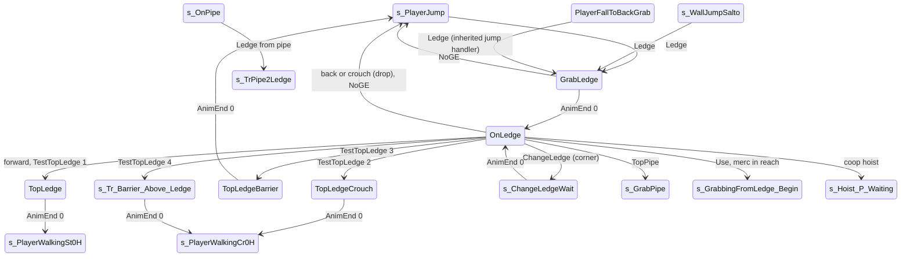

# Ledge grab, hang, shimmy, corners and pull-up (LG GE)

Units:
- uc:SBase.SPlayerController:GrabLedge.BeginState
- uc:SBase.SPlayerController:GrabLedge.NoGE
- uc:SBase.SPlayerController:GrabLedge.AnimEnd
- uc:SBase.SPlayerController:GrabLedge.TopSynchro
- uc:SBase.SPlayerController:GrabLedge.PlayerMove
- uc:SBase.SPlayerController:s_TrPipe2Ledge.BeginState
- uc:SBase.SPlayerController:OnLedge.BeginState
- uc:SBase.SPlayerController:OnLedge.PlayerMove
- uc:SBase.SPlayerController:OnLedge.ChangeLedge
- uc:SBase.SPlayerController:OnLedge.MyNotifyLanded
- uc:SBase.SPlayerController:OnLedge.NoGE
- uc:SBase.SPlayerController:OnLedge.CanGrabPawn
- uc:SBase.SPlayerController:OnLedge.AskToGrabPawn
- uc:SBase.SPlayerController:OnLedge.CanHoistClimbHelp
- uc:SBase.SPlayerController:OnLedge.PerformCoopMvt
- uc:SBase.SPlayerController:OnLedge.CanUseCam
- uc:SBase.SPlayerController:OnLedge.CanBeDropAttacked
- uc:SBase.SPlayerController:s_ChangeLedgeWait.BeginState
- uc:SBase.SPlayerController:s_ChangeLedgeWait.AnimEnd
- uc:SBase.SPlayerController:s_ChangeLedgeWait.PlayerMove
- uc:SBase.SPlayerController:TopLedge.AnimEnd
- uc:SBase.SPlayerController:TopLedge.PlayerMove
- uc:SBase.SPlayerController:TopLedgeCrouch.BeginState
- uc:SBase.SPlayerController:TopLedgeCrouch.AnimEnd
- uc:SBase.SPlayerController:TopLedgeCrouch.PlayerMove
- uc:SBase.SPlayerController:TopLedgeBarrier.BeginState
- uc:SBase.SPlayerController:TopLedgeBarrier.AnimEnd
- uc:SBase.SPlayerController:TopLedgeBarrier.PlayerMove
- uc:SBase.SPlayerController:s_Tr_Barrier_Above_Ledge.BeginState
- uc:SBase.SPlayerController:s_Tr_Barrier_Above_Ledge.EndState
- uc:SBase.SPlayerController:s_Tr_Barrier_Above_Ledge.AnimEnd
- uc:SBase.SPlayerController:s_Tr_Barrier_Above_Ledge.PlayerMove
- uc:SBase.SPlayerController:Ledge
- uc:SBase.SPlayerController:ChangeLedge
- uc:SBase.SPlayerController:NoGE
- uc:SBase.SPlayerController:TopSynchro
- uc:SBase.SBasePawn:SetLedgeGrabZones
- uc:SBase.SBasePawn:SendZipPToServer
- nat:SBase.SPlayerController.TestTopLedge
- nat:SBase.SPlayerController.bTestGrabLedgeGeo
- nat:SBase.SPlayerController.CheckBackFeetZone
- rl:input.ledgeassist (Reloaded ledge assist, below)

## Purpose

The spy catches ledge GEs (kind LG, 8: two points along the top edge) in the air, hangs, shimmies left and right,
turns inside and outside corners onto the joining ledge, pulls up standing or crouched, vaults over a low wall top
from the hang, drops, and can grab a merc standing at the edge. A spy walking slowly off an edge turns round and
hangs from it.

## Data

| Field | Owner | Default | Notes |
|---|---|---|---|
| ZipP1, ZipP2 | SBasePawn | - | the ledge segment being hung on |
| LastZipP | SBasePawn | (-10000000, 0, -10000000) at spawn | attach point of the GE just left (no instant re-grab) |
| vWallJumpDir, vVandammePos | SBasePawn | - | reused as the next ledge's P1/P2 during a corner change |
| m_LedgeGrabArmsZone / Radius | SBasePawn | (39, 0, 117) / 40 | arms search sphere while hanging |
| m_CurrentArmsZone / Radius | SBasePawn | - | active sphere (set by SetLedgeGrabZones) |
| TypeLedge | SBasePawn | LEDGE_NORMAL | enum LedgeType: NORMAL, WAIST, BARRIER, FEET |
| bCanStop | SPlayerController | false | GrabLedge: repositioning finished |
| fGrabFromLedgeDist1, fGrabFromLedgeDist2, fGrabFromLedgeHalfAngle | SPlayerController | 150, 100, -1.1 | grab-a-merc test |
| fWakeInvulnerabilityTime | SPlayerController | 3.8 | |

## Rules

### Catching a ledge

The native arms-zone check raises `Ledge()` when a valid LG GE is inside the arms sphere (contract in
native-contracts.md, GE queries rule 6; decoded in physics-ge-queries.md 4: the hang spot C + 39 n at C.Z - 117
must be clear, two box traces of extent (35, 35, 87.5) and flags 0x2DF from the current spot to the hang spot and
from there 50 up; C at least 24.5 from the ledge ends, Velocity.Z > -1270, the height window -5 to +35 and a
horizontal distance squared below 830). The native does not compare with LastZipP; the handlers do. Handlers:

| State | Conditions | Result |
|---|---|---|
| s_PlayerJump / PlayerFalling / split jump | ZoneHorsCrouch first; standing; `|ZipP1.Z - LastZipP.Z| > 20`; spy; unarmed | SA_LEDGE_GRAB, m_LastSpecialMoveTime = now, SendZipPToServer, bFindGE, GrabLedge |
| s_WallJumpSalto | `fGEZLocation - Location.Z < 150`; clip rule (wall-jump spec) | SA_LEDGE_GRAB, SendZipPToServer, bFindGE, GrabLedge |
| s_OnPipe | bCanTakeLedgeFromPipe(right) or (left) | SA_TR_PIPELEDGE_R / _L, s_TrPipe2Ledge |
| any other state | global Ledge is empty | nothing |

The walking states have no Ledge handler: a ledge is only caught from the air. Hanging from an edge one walks off
goes through MyFalling: a spy with `fNormePadMove < 0.7` and `CheckBackFeetZone()` true and no floor within 175
below goes to PlayerFallToBackGrab with zero velocity, turns to face the wall (`vBackFeetNormal`, 80000 units/s),
and the arms check then raises Ledge (jump-fall-land.md). CheckBackFeetZone (decoded, physics-ge-queries.md 7): the
back-feet point mirrors the feet zone (X negated, yaw only, ZCDecal correction); the nearest LG within the feet
radius fills ZipP, vBackFeetNormal is set to that ledge's horizontal normal on the pawn's forward side, and it
returns true.

### Reloaded ledge assist

Reloaded.Core replaces the movement part of the input mapping (its hook at game 0x10aaa973 jumps to Reloaded
0x1001ab50; spec/native/input.md rule 1). After it computes `fNormePadMove` (capped at 1), it applies one more
rule: while `bUsing` is held (the Use key), in slow mode (`bFastSpeed` clear) and with `fNormePadMove > 0.4`,
`fNormePadMove` becomes 0.4. A slow spy walking off an edge with a diagonal held then still passes MyFalling's
`fNormePadMove < 0.7` test (a slow diagonal gives 0.8 crouched, about 0.57 standing with Reloaded's diagonal scale)
and turns back to grab the ledge (PlayerFallToBackGrab above). Without Use, or in fast mode, nothing changes.

Two other Reloaded patches sit in the ledge code itself; both are decoded but not ported:
- CheckLedgeArms (game 0x10aa4420): the conditional jump at 0x10aa470b (the `Fwd . N < -0.7` test of the walking
  branch) is rewritten into a plain jump to the function's "no grab" exit, so AutoFeetLedge is never raised from
  the arms test. Whether Reloaded raises it elsewhere (its foot climb fix, rl:fix.footclimb_fps) is open.
- eventWaistLedge (game 0x10ab2df0): its entry jumps to Reloaded 0x1001a210, which sends the event only when at
  least 1/64 s (15.625 ms, the high resolution clock difference over 1e9) has passed since the local player last
  entered `s_PlayerJump` (a state entry hook stores the time). It stops a waist grab in the frame a jump starts at
  high frame rates; at the rewrite's 60 Hz step the next tick is already past it.

### GrabLedge (simulated)

1. BeginState: camera ECM_OnLedge, smooth 5.0; bTestBackFeetGrab = false; SetLedgeGrabZones (arms sphere
   (39, 0, 117) r 40); ZoneHorsCrouch; crouch latch off; bCanStop = false.
2. PlayerMove: view limited by the camera window with references 0, 0; Pawn.Acceleration = 0; zero move.
3. TopSynchro (controlling side): bCanStop = true (the pawn reached the hang position).
4. AnimEnd channel 0 (controlling side): SA_ONLEDGE, OnLedge.
5. NoGE (controlling side): the GE vanished or was rejected: SA_LEDGEFALL, LastZipP = ZipP1, s_PlayerJump.

s_TrPipe2Ledge extends GrabLedge: BeginState also, on the controlling side, copies NewZipP1/NewZipP2 into
ZipP1/ZipP2 and sends them (SendZipPToServer).

### Hanging (OnLedge, simulated)

BeginState: ZoneHorsCrouch, crouch latch off, camera ECM_OnLedge, oldbUsing = bUsing, bToggleUsing = 0.

PlayerMove, in order:
1. View limited by the camera window, references 0, 0. Pawn axes X (facing the wall), Y (right).
2. Forward (iMove & 4) or jump pressed: `iTop = TestTopLedge(bPressedJump)` (native; the jump press asks for the
   crouch-only climb). TestTopLedge (decoded, physics-ge-queries.md 8; boxes with flags 0x2DF): unless bCrouchOnly,
   a (35, 35, 87.5) box up 210.8 then 57.8 forward, both clear, gives 1; otherwise (or when that failed) a
   (35, 35, CrouchHeight) box from the crouched centre up 206.1 then 75.7 forward gives 2; with 1 or 2, a
   (35, 35, 44) box from 162 above Location 95 forward, then down to 78 above Location, both clear, turns the result
   into 3; with no result, an LG 90 to 102 above the current ledge (arms zone (37, 0, 210), the point 20 to the left
   inside it and the point 75 to the right inside the current ledge) with clear boxes up to it, 75 - R to the
   right, 95 forward and up to +173 gives 4; else 0. With bCrouchOnly (jump pressed) the native returns test 2's
   result at once: no vault and no barrier test (natives2-traversal.md 9):
   - 4: crouch latch off, SA_BARRIER_ABOVE_LEDGE_CR, clear jump and bUsing, s_Tr_Barrier_Above_Ledge.
   - 3: latch off, SA_LEDGE_BARRIER, clear jump and bUsing, TopLedgeBarrier (vault over a wall top from the hang).
   - 1: latch off, SA_TOPLEDGE, clear jump and bUsing, TopLedge (pull up standing).
   - 2: SA_TOPLEDGECROUCH, clear jump, latch off, clear bUsing, TopLedgeCrouch (pull up crouched).
   - anything else: no climb (blocked).
   Else Back (iMove & 8): set the crouch latch (drop, step 5).
3. Clear bPressedJump. Shimmy: straf = +1 for Right (iMove & 2), -1 for Left (iMove & 1), else 0;
   `Pawn.Acceleration = 80 * straf * Y`. The native ledge physics (PHYS_Ledge, 9; decoded in physics-traversal.md
   physLedge 6 to 8) moves the hands by Acceleration dt along the ledge (so 80 uu/s) and stops them 36 from an
   end; it raises NoGE when the ledge (or a connected LG) no longer contains the hands, and ChangeLedge at a
   corner: the two ledges must share an end within 2 and be perpendicular (within 0.1), and an outside corner
   needs 75 + 75 of clearance; collinear ledges simply merge (no event).
4. Use edge: bToggleUsing = bUsing on change, else 0.
5. Drop: if the crouch latch is set (Back pressed or crouch key): latch off, clear jump and bUsing, `MyDoJump()`,
   SA_LEDGEFALL, LastZipP = ZipP1, s_PlayerJump.
6. Grab a merc: on a Use edge, if `bTestGrabLedgeGeo()` (native, decoded in natives2-traversal.md 7: an LG 90 to
   102 from the current ledge height, found with the arms zone (37, 0, 210), aligned with the current ledge within
   10, with the controller's Location +-20 Right projecting inside it) and AskToGrabPawn(): SA_GRABFROMLEDGE_BEGIN,
   GotoState('s_GrabbingFromLedge_Begin') (a local GotoState, not ChangeState), and the reliable
   AskServerToGrabPawnFromLedge(target) (grab spec).
7. Send the move with the shimmy acceleration.

AskToGrabPawn (OnLedge): refuse while sticky-shocking or when GRI.bAvlb_SPY_Grab is false. Otherwise the first
SPAWNDEFENSE pawn (iteration order of AllPawns) other than self with CanGrabPawn true, bCanBeGrabbed and not
sticky-shocking becomes m_AttackTarget.

CanGrabPawn(P): false if P is crouched and cannot stand. With `zIdeal = Location.Z + 210 - CollisionHeight +
P.CollisionHeight` (the Z of a pawn standing on the ledge top), `v = Pawn2D - P2D`, X, Y the hanging pawn's axes:
true when all hold: `now - P.iLastWakeTime > fWakeInvulnerabilityTime` (3.8), `|v . X| < 150`, `|v . Y| < 100`,
`|zIdeal - P.Location.Z| < 10`, `normal(P2D - Pawn2D) . normal(vector(Rotation)) > 0.75`, and
`normal(vector(P.Rotation)) . normal(vector(Rotation)) < -fGrabFromLedgeHalfAngle` (= 1.1, always true).

Events while hanging:
- ChangeLedge(iType, P1, P2) (native, at a corner, controlling side): vWallJumpDir = P1, vVandammePos = P2; iType
  0 SA_CHANGELEDGE_IR, 1 SA_CHANGELEDGE_IL, 2 SA_CHANGELEDGE_OR, 3 SA_CHANGELEDGE_OL (inside/outside, right/left);
  s_ChangeLedgeWait. Other values: nothing.
- NoGE (controlling side): SA_LEDGEFALL, LastZipP = ZipP1, s_PlayerJump.
- MyNotifyLanded: global part, then on the controlling side GotoWaitingState (feet touched a floor).
- TopPipe(bLeft): SA_TR_LEDGEPIPE_L or _R, SendZipPAndNormalToServer, s_GrabPipe.
- PerformCoopMvt: DoCoopInteraction (hoist help, coop.md). CanHoistClimbHelp true.

### Corner change (s_ChangeLedgeWait)

BeginState: smooth camera. Limited view, zero move. AnimEnd channel 0 (controlling side): ZipP1 = vWallJumpDir,
ZipP2 = vVandammePos (the new ledge), SendZipPToServer, SA_ONLEDGE, camera smooth 5.0, OnLedge.

### Climbing up

| State | Enter | AnimEnd channel 0 | Notes |
|---|---|---|---|
| TopLedge | - | smooth camera, SA_WALK_ST_0H, s_PlayerWalkingSt0H | limited view, zero move |
| TopLedgeCrouch | camera ECM_SmoothTransitionCentered (controlling side), SA_WANTS_TO_CROUCH | smooth 80, latch on, SA_WALK_CR_0H, SA_WANTS_TO_CROUCH, s_PlayerWalkingCr0H | UpdateRotation, zero move |
| TopLedgeBarrier | camera ECM_SmoothTransitionCentered | SA_FALL_AFTERLEDGEBARRIER, s_PlayerJump (lands beyond the wall) | limited view |
| s_Tr_Barrier_Above_Ledge | same camera | smooth, SA_WANTS_TO_CROUCH, SA_WALK_CR_0H, s_PlayerWalkingCr0H; EndState sets the crouch latch | UpdateRotation |

All four call the parent AnimEnd afterwards. The climb clips are root-motion moves (LedgStAlUp0 lock 3 with the
root rising about 204; the crouched climb steps Location up 306 then down 100 per the Bridge note). Location is
moved by the native on its own schedule (see native-contracts.md, root-motion section).

## States

Physics: hanging PHYS_Ledge (9), unlocked in-place cycle; grab, climbs and corner changes root-motion or
repositioning moves set by the actions.

## Constants

| Name | Value | Unit | Provenance | Source |
|---|---|---|---|---|
| Shimmy accel | 80 | native units | decoded | OnLedge.PlayerMove |
| Ledge arms zone | (39, 0, 117), r 40 | uu | decoded | def:SBase.SBasePawn |
| Re-grab height | 20 | uu | decoded | s_PlayerJump.Ledge |
| Hang clearance traces | extent (35, 35, 87.5), flags 0x2DF, to the hang spot (C + 39 n, C.Z - 117), then 50 up from it | uu | decoded | game 0x10aa4420; physics-ge-queries.md 4 |
| Ledge catch conditions | end margin 24.5, Velocity.Z > -1270, height window -5 to +35, distance squared < 830 | uu, uu/s | decoded | physics-ge-queries.md 4 |
| Top tests | stand up 210.8 / fwd 57.8; crouch up 206.1 / fwd 75.7; vault box Z 44, 95 fwd at +162, down to +78; barrier LG 90 to 102 higher, to +173 | uu | decoded | physics-ge-queries.md 8 |
| Shimmy end stop | 36 from a ledge end | uu | decoded | physics-traversal.md physLedge |
| Corner tolerances | shared end within 2, perpendicular within 0.1, outside corner clearance 75 + 75 | uu, cosine | decoded | physics-traversal.md physLedge 6 to 8 |
| Grab-a-merc reach | forward 150, side 100, height 10, cone 0.75 | uu, cosine | decoded | def:SBase.SPlayerController, OnLedge.CanGrabPawn |
| Ledge top height for a standing target | 210 - CollisionHeight + target CollisionHeight | uu | decoded | OnLedge.CanGrabPawn |
| Wake invulnerability | 3.8 | s | decoded | def fWakeInvulnerabilityTime |
| Climb offsets (native) | C_LEDGE_UPST (57.8, 0, 210.8), C_LEDGE_UPCR (75.7, 0, 206.1), C_LEDGE_BARRIER (95, 0, 121), C_BARRIER_ABOVE_LEDGE_CR (95, 0, 173), C_LEDGE_CORNER (75, 75) | uu | decoded | SBasePawn consts, native use |
| Hang reach | standing jump catches tops 208 to 320 above the floor | uu | measured | RE+ MapBuilderFacts LG |
| Grab to standing on top | 1.7 to 2.0 | s | measured | RE+ GELabD |
| Usable ledge length | at least 80 recommended (44-50 failed) | uu | measured | RE+ memory note |

## Network

- Decided on the controlling side; GrabLedge and OnLedge are simulated states. The ledge points go to the server
  with ServerGetZipP (reliable); the corner change sends the new points at the end of the clip.
- The grab of a merc uses a local GotoState plus the reliable AskServerToGrabPawnFromLedge; the server mirrors the
  merc with MirrorStateForMercGrabbedFromLedge (grab spec).

## Edge cases

- `fGrabFromLedgeHalfAngle` is -1.1, so the facing test compares a dot product with 1.1 and always passes: the merc
  can be grabbed whichever way he faces. Keep it.
- AskToGrabPawn picks the first matching merc in pawn-list order, not the nearest.
- TestTopLedge receives bPressedJump as its bCrouchOnly argument, so pressing jump asks for the crouched climb
  (bCrouchOnly returns the crouch test's result at once: no standing, vault or barrier result) while forward asks
  for a standing one when there is room (decoded, physics-ge-queries.md 8, natives2-traversal.md 9).
- Drop and climb both clear bUsing so the same Use press does not start an interaction on landing.
- A hanging spy whose feet touch a floor (MyNotifyLanded) leaves the ledge to the resting state.

## Evidence

- Decompiled: local/re-out/uc/SBase/SPlayerController.uc (GrabLedge, s_TrPipe2Ledge, OnLedge, s_ChangeLedgeWait,
  TopLedge, TopLedgeCrouch, TopLedgeBarrier, s_Tr_Barrier_Above_Ledge, the Ledge handlers in s_PlayerJump,
  s_WallJumpSalto, s_OnPipe, MyFalling), SBase/SBasePawn.uc (SetLedgeGrabZones, LedgeType, consts).
- Natives: TestTopLedge game 0x10aac030 (editor exec 0x111e6920, ASBasePawn::TestTopLedge 0x1120f610),
  bTestGrabLedgeGeo 0x10aac090 (editor exec 0x111e6980), CheckBackFeetZone 0x10aa7e00; editor APawn::physLedge
  0x11204870, ASBasePawn::CheckForLedges 0x111face0, CheckLedgeGrabFeet 0x111ed2f0, CheckBackLedgeGrabFeet
  0x111e4ef0; game ledge test helper at image offset +0x1A4420 (RE+ engine spike).
- GE data: local/formats/ge/SteeE.json (220 LG, one with ID 4 cleared by SGETrigger271 when the crane wall falls).
- Root motion: Bridge docs/handoff/traversal_2026-09-28.md; memory note scct-root-motion-lock.

## Open questions

Traces still useful to confirm the decoded top tests: pull up under a 150 uu ceiling, at a 30 uu thick wall top,
with jump and with forward.

- Reloaded's CheckLedgeArms patch turns off AutoFeetLedge from the arms test (above). Before porting it, check in
  the reference game that running into a 40 to 64 uu ledge no longer climbs it, and whether another Reloaded hook
  (physWalking 0x10ac6b40 is patched too) gives the foot climb back.

### Resolved

1. TestTopLedge return codes and bCrouchOnly. Resolved: 1 standing room (up 210.8, forward 57.8), 2 crouch room
   (crouched up 206.1, forward 75.7), 3 vault over the top (box Z 44, 95 forward at +162, down to +78) after 1 or
   2, 4 a barrier above the ledge crouched (an LG 90 to 102 higher, traces to +173), 0 none; bCrouchOnly returns
   test 2's result at once (ANSWERS-natives2 9 completes result 4). Rule "Hanging" 2. Evidence: physics-ge-queries.md 8; game 0x10aac030 (ANSWERS-physics 12).
2. physLedge shimmy, GE ends, ChangeLedge, NoGE. Resolved: the hands move by Acceleration dt along the ledge and stop
   36 from an end; NoGE when no LG (or connected LG) contains the hands; corners need a shared end within 2 and
   perpendicular segments (0.1), outside corners 75 + 75 clearance; collinear ledges merge. Rule "Hanging" 3.
   Evidence: physics-traversal.md physLedge 6 to 8 (ANSWERS-physics 13).
3. CheckBackFeetZone geometry and vBackFeetNormal. Resolved: mirror of the feet zone (X negated, yaw only, ZCDecal
   correction), nearest LG within the feet radius, vBackFeetNormal = the ledge's horizontal normal on the pawn's
   forward side. "Catching a ledge" above. Evidence: physics-ge-queries.md 7 (ANSWERS-physics 14).
4. bTestGrabLedgeGeo. Resolved: an LG 90 to 102 from the current ledge height, aligned within 10, with the
   controller's Location +-20 Right inside it; no output. Rule "Hanging" 6. Evidence: natives2-traversal.md 7; game
   0x10aac090 (ANSWERS-natives2 7).
