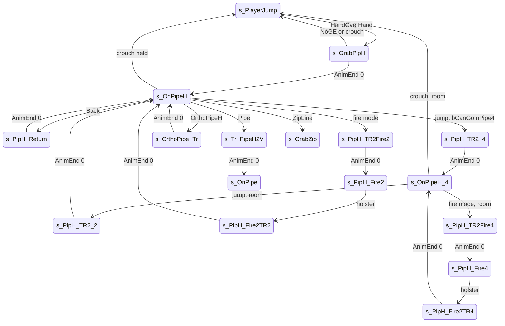

# Horizontal pipe, hand over hand (HOH GE)

Units:
- uc:SBase.SPlayerController:s_PipeH_Base.SwitchBinocularVision
- uc:SBase.SPlayerController:s_PipeH_Base.CanActivateLaser
- uc:SBase.SPlayerController:s_GrabPipH.AnimEnd
- uc:SBase.SPlayerController:s_GrabPipH.Pipe
- uc:SBase.SPlayerController:s_GrabPipH.ZipLine
- uc:SBase.SPlayerController:s_GrabPipH.EndState
- uc:SBase.SPlayerController:s_GrabPipH.NoGE
- uc:SBase.SPlayerController:s_GrabPipH.PlayerMove
- uc:SBase.SPlayerController:s_OnPipeH.CanUseCam
- uc:SBase.SPlayerController:s_OnPipeH.BeginState
- uc:SBase.SPlayerController:s_OnPipeH.ZipLine
- uc:SBase.SPlayerController:s_OnPipeH.PlayerMove
- uc:SBase.SPlayerController:s_OnPipeH.Pipe
- uc:SBase.SPlayerController:s_OnPipeH.OrthoPipeH
- uc:SBase.SPlayerController:s_OrthoPipe_Tr.AnimEnd
- uc:SBase.SPlayerController:s_OrthoPipe_Tr.PlayerMove
- uc:SBase.SPlayerController:s_Tr_PipeH2V.AnimEnd
- uc:SBase.SPlayerController:s_PipH_Return.BeginState
- uc:SBase.SPlayerController:s_PipH_Return.AnimEnd
- uc:SBase.SPlayerController:s_PipH_Return.PlayerMove
- uc:SBase.SPlayerController:s_PipH_TR2_4.AnimEnd
- uc:SBase.SPlayerController:s_PipH_TR2_4.EndState
- uc:SBase.SPlayerController:s_PipH_TR2_4.PlayerMove
- uc:SBase.SPlayerController:s_OnPipeH_4.CanUseCam
- uc:SBase.SPlayerController:s_OnPipeH_4.PlayerMove
- uc:SBase.SPlayerController:s_PipH_TR2Fire2.AltFire
- uc:SBase.SPlayerController:s_PipH_TR2Fire2.AnimEnd
- uc:SBase.SPlayerController:s_PipH_TR2Fire2.EndState
- uc:SBase.SPlayerController:s_PipH_TR2Fire2.PlayerMove
- uc:SBase.SPlayerController:s_PipH_Fire2.CanActivateLaser
- uc:SBase.SPlayerController:s_PipH_Fire2.CanUseCam
- uc:SBase.SPlayerController:s_PipH_Fire2.SwitchLaser
- uc:SBase.SPlayerController:s_PipH_Fire2.PlayerMove
- uc:SBase.SPlayerController:s_PipH_Fire2TR2.AltFire
- uc:SBase.SPlayerController:s_PipH_Fire2TR2.AnimEnd
- uc:SBase.SPlayerController:s_PipH_Fire2TR2.EndState
- uc:SBase.SPlayerController:s_PipH_Fire2TR2.PlayerMove
- uc:SBase.SPlayerController:s_PipH_TR2Fire4.AltFire
- uc:SBase.SPlayerController:s_PipH_TR2Fire4.AnimEnd
- uc:SBase.SPlayerController:s_PipH_TR2Fire4.EndState
- uc:SBase.SPlayerController:s_PipH_TR2Fire4.PlayerMove
- uc:SBase.SPlayerController:s_PipH_Fire4.CanActivateLaser
- uc:SBase.SPlayerController:s_PipH_Fire4.CanUseCam
- uc:SBase.SPlayerController:s_PipH_Fire4.SwitchLaser
- uc:SBase.SPlayerController:s_PipH_Fire4.PlayerMove
- uc:SBase.SPlayerController:s_PipH_Fire2TR4.AltFire
- uc:SBase.SPlayerController:s_PipH_Fire2TR4.AnimEnd
- uc:SBase.SPlayerController:s_PipH_Fire2TR4.EndState
- uc:SBase.SPlayerController:s_PipH_Fire2TR4.PlayerMove
- uc:SBase.SPlayerController:s_PipH_TR2_2.AnimEnd
- uc:SBase.SPlayerController:s_PipH_TR2_2.EndState
- uc:SBase.SPlayerController:s_PipH_TR2_2.PlayerMove
- uc:SBase.SPlayerController:HandOverHand
- uc:SBase.SPlayerController:OrthoPipeH
- uc:SBase.SPlayerController:TestRoomAfterPipe4
- uc:SBase.SBasePawn:NotifyTakeArmControlForPipH2
- uc:SBase.SBasePawn:NotifyTakeArmControlForPipH4
- uc:SBase.SBasePawn:ChangeRightArmRotPipH2
- uc:SBase.SBasePawn:ChangeRightArmRotPipH4
- nat:SBase.SPlayerController.bCanGoInPipe4
- nat:SBase.SBasePawn.CanSetColAfterPipe4

## Purpose

A spy hangs under a horizontal pipe (GE kind HOH, 4) by the hands ("2" stance) and moves hand over hand. Jump
swings the legs over the pipe into the "4" stance (hanging by hands and knees under it, body horizontal), where he
crawls forward and back. In both stances he can draw the pistol and fire (from "4" upside down, aiming behind),
turn round, switch to a perpendicular pipe, change to a vertical pipe or a zip line, and drop.

## Data

| Field | Owner | Default | Notes |
|---|---|---|---|
| ZipP1, ZipP2, NewZipP1, NewZipP2 | SBasePawn | - | current and next GE points |
| PipHFire | SBasePawn | NOPipH | enum PipHFire_: NOPipH, NoPipHFire, PipH4, PipH2, PipH4NoFire; replicated with bNetInitial |
| m_HandOverHandArmsZone / Radius | SBasePawn | (0, 0, 128) / 50 | arms search sphere |
| Pipe4Height | SBasePawn | 27.5 | half height of the body in stance 4 |
| Pipe4DecalCol, bIsPipe4Decal | SBasePawn | - | native collision offset for stance 4 |
| ZoneConfig ZC_PipeH4 | SBasePawn | - | zone configuration used in stance 4 |

## Rules

### Getting on

| From | Event / condition | Action, state |
|---|---|---|
| s_PlayerJump / PlayerFalling | HandOverHand; not merc; not in weapon transit; `ZipP1 != LastZipP` | bFindGE, SendZipPToServer, SA_PIPH_GRAB, s_GrabPipH |
| s_OnPipe, s_GrabPipe (vertical pipe) | HandOverHand (controlling side) | via s_Tr_PipeV2H_Oriente(_Down) and s_Tr_PipeV2H to s_OnPipeH (pipe-vertical.md) |
| s_OnPipeH | OrthoPipeH(bToLeft) | perpendicular pipe, below |

The only ground entry is a jump into the pipe: no walking state handles HandOverHand. The jump handler refuses a
merc explicitly.

### s_PipeH_Base

Parent of every state here: binoculars disabled, CanActivateLaser false (overridden in the fire states).

### s_GrabPipH

PlayerMove: `UpdateCamRotation(dt)`; crouch latch: clear jump, `MyDoJump()`, SA_ZIPFALL, s_PlayerJump, latch off;
zero move. AnimEnd channel 0 (controlling side): SA_ON_PIPEH, s_OnPipeH. NoGE (controlling side): SA_LEDGEFALL,
LastZipP = ZipP1, s_PlayerJump. EndState stamps m_LastSpecialMoveTime. Pipe and ZipLine as in s_OnPipeH.

### Moving by the hands (s_OnPipeH)

BeginState: camera ECM_NoTargetCol, jump and crouch latch cleared.

PlayerMove:
1. newAccel = 0.
2. Crouch button held (`bCrouch > 0`, the raw button, not the latch): clear jump, `MyDoJump()`, SA_ZIPFALL,
   latch off, s_PlayerJump.
3. Otherwise:
   - jump pressed: if `bCanGoInPipe4()` (native, room for stance 4) SA_PIPH_UP4 and s_PipH_TR2_4; else the press is
     dropped;
   - if no jump is pending: fire-mode request (bForceFireMode, not sticky-shocking): clear it, laser on if
     bForceLaserFireMode, SA_PIPH_TR_FIRE2, s_PipH_TR2Fire2; else Forward or Up (iMove & 4 or & 16):
     `newAccel.X = 126`; else Back (iMove & 8): SA_PIPH_TURN, s_PipH_Return (turn round).
4. `UpdateCamRotation(dt)`; send newAccel.

In PHYS_OnPipeH (14) the native moves the pawn along the pipe in the direction it faces, using newAccel.X
(decoded, physics-traversal.md physOnPipeH): the speed is Acceleration.X along the pipe, uncapped; the pawn stops 27
from an end (95 in the legs-over pose). Events: ZipLine at an end within 3 of a ZL (input at least 120);
OrthoPipeH for a perpendicular HOH within 31; Pipe for a PIPE; NoGE when the hold move is blocked. The measured
hand-over-hand speed is 105 uu/s for a request of 126, which the native alone does not explain (open question 1).

Events:
- ZipLine: SendZipPToServer, SA_ZIP_GRAB, s_GrabZip.
- Pipe (a vertical pipe at the end): SendZipPAndNormalToServer; zmin = min(ZipP1.Z, ZipP2.Z); bFindGE; smooth
  camera 5.0; SA_TR_PIPEH_V when zmin < Location.Z (pipe goes down) else SA_TR_PIPEH_V_UP; s_Tr_PipeH2V.
  s_Tr_PipeH2V.AnimEnd: smooth camera, SA_ON_PIPE, s_OnPipe.
- OrthoPipeH(bToLeft): on the controlling side copy NewZipP1/NewZipP2 into ZipP1/ZipP2 and send them;
  SA_TR_ORTHOPIPE_L or _R; s_OrthoPipe_Tr. s_OrthoPipe_Tr: camera rotation, zero move; AnimEnd channel 0: smooth
  camera, SA_ON_PIPEH, s_OnPipeH.

### Turning round (s_PipH_Return)

BeginState: the pawn rotation is set to the reverse of its facing (`rotator(-vector(Rotation))`). Crouch latch:
drop (SA_ZIPFALL). AnimEnd channel 0: SA_ON_PIPEH, s_OnPipeH.

### Stance 4 (legs over the pipe)

1. s_PipH_TR2_4: camera rotation, jump cleared, zero move; AnimEnd channel 0: SA_ON_PIPEH_4, s_OnPipeH_4; EndState
   stamps m_LastSpecialMoveTime. The native switches the collision to the stance-4 body (SetColForPipe4: half height
   Pipe4Height 27.5).
2. s_OnPipeH_4.PlayerMove:
   - jump pressed: cleared; if `TestRoomAfterPipe4()`: SA_PIPH_DOWN2, s_PipH_TR2_2 (back to hanging by the hands);
   - otherwise: crouch latch with room: SA_PIPH_JUMP4, s_PlayerJump, latch off (drop from stance 4); fire-mode
     request: laser on if requested, clear bForceFireMode, with room SA_PIPH_TR_FIRE4 and s_PipH_TR2Fire4, else
     clear bFireMode; Forward (& 4) `newAccel.X = 113`, Back (& 8) `newAccel.X = -113`;
   - camera rotation; send newAccel.
3. TestRoomAfterPipe4 (room to leave stance 4), with X the pawn's facing and box extent (35, 35, 27.5):
   trace from Location to Location + 70 X; if clear, trace from there down 120; if clear, raise the point by 60 and
   trace back 70 X with extent (35, 35, 87.5) (a standing body); true only when all three are clear.
4. s_PipH_TR2_2: AnimEnd channel 0: SA_ON_PIPEH, s_OnPipeH; jump cleared; zero move.

### Firing from the pipe

| State | View | Leaves |
|---|---|---|
| s_PipH_TR2Fire2 (AltFire disabled) | limited: yaw -10000..10000, pitch -10000..5000 around the pawn yaw | AnimEnd 0: SA_PIPH_FIRE2, s_PipH_Fire2; EndState camera ECM_HOHFP; crouch latch drops (SA_ZIPFALL) |
| s_PipH_Fire2 (laser allowed, SwitchLaser toggles it) | camera window around the pawn yaw | holster on bForceExitFireMode, released fire mode (bTestBoutonLache and bFireMode 1) or a jump press, not sticky-shocking: clear the fire flags, camera ECM_NoTargetCol, SA_PIPH_FIRE_TR2, s_PipH_Fire2TR2; crouch latch drops |
| s_PipH_Fire2TR2 (AltFire disabled) | camera rotation | AnimEnd 0: SA_ON_PIPEH, s_OnPipeH; crouch latch drops |
| s_PipH_TR2Fire4 (AltFire disabled) | limited: yaw -10000..10000, pitch -10000..10000 around pawn yaw + 32768 | AnimEnd 0: SA_PIPH_FIRE4, s_PipH_Fire4; EndState camera ECM_HOHFPHanged |
| s_PipH_Fire4 | limited: yaw -16300..16300, pitch -10000..10000 around pawn yaw + 32768 (aiming behind, upside down) | holster as Fire2 but camera ECM_Walking and SA_PIPH_FIRE_TR4 -> s_PipH_Fire2TR4; crouch latch: clear fire flags, camera ECM_Walking, SA_PIPH_JUMPFIRE4, s_PlayerJump |
| s_PipH_Fire2TR4 (AltFire disabled) | camera rotation | AnimEnd 0: SA_ON_PIPEH_4, s_OnPipeH_4 |

All fire-transition states stamp m_LastSpecialMoveTime in EndState. After a landing, GotoWaitingState returns a
spy whose PreviousState was s_PipH_Fire2 or s_PipH_Fire4 to that state.

Arm IK: NotifyTakeArmControlForPipH2 / PipH4 (clip notifies) set PipHFire and the IK type IKT_PIPH;
ChangeRightArmRotPipH2 / PipH4 aim the right arm at the view (spec/native/aim-ik.md rule 5).

## States

Physics: PHYS_OnPipeH (14) on the pipe (PipHStAlFdRL layered over PipHStAlNt0, measured); transitions are
animation-driven moves set by the actions.

## Constants

| Name | Value | Unit | Provenance | Source |
|---|---|---|---|---|
| Stance 2 move request | 126 | native units | decoded | s_OnPipeH.PlayerMove |
| Stance 2 measured speed | 105 | uu/s | measured | RE+ "hand over hand 105" |
| End stops | 27 from an end (95 legs over) | uu | decoded | physics-traversal.md physOnPipeH |
| Chain distances | ZL within 3 (input at least 120), perpendicular HOH within 31 | uu | decoded | same |
| Stance 4 move request | +-113 | native units | decoded | s_OnPipeH_4.PlayerMove |
| Stance 4 body half height | 27.5 | uu | decoded | def Pipe4Height; TestRoomAfterPipe4 |
| Room test | 70 ahead, 120 down, 60 up and 70 back standing | uu | decoded | TestRoomAfterPipe4 |
| HOH arms zone | (0, 0, 128), r 50 | uu | decoded | def:SBase.SBasePawn |
| Fire 2 view | yaw +-10000, pitch -10000..5000 | rotator units | decoded | s_PipH_TR2Fire2 |
| Fire 4 view | yaw +-10000 (transition) / +-16300, pitch +-10000, reference yaw + 32768 | rotator units | decoded | s_PipH_TR2Fire4, s_PipH_Fire4 |
| Ortho pipe offsets (native) | C_TR_ORTHO_PIPE_R (30, 30, 0), C_TR_ORTHO_PIPE_L (30, -30, 0) | uu | decoded | SBasePawn consts |

## Network

- Controlling side decides; ChangeState to the server; ServerGetZipP / ServerGetZipPAndNormal carry the GE points.
- PipHFire replicates server to clients with bNetInitial (and through actions afterwards) so others see the
  stance and the firing pose.

## Edge cases

- s_OnPipeH reads the raw crouch button, so holding crouch while grabbing drops the spy as soon as he reaches
  s_OnPipeH; the other pipe states use the toggle latch.
- A jump press in s_OnPipeH without room for stance 4 is discarded, and in that frame the fire-mode and move
  branches still run.
- In s_OnPipeH_4 the move keys still apply on the frame the crouch or fire-mode branch starts a transition.

## Evidence

- Decompiled: local/re-out/uc/SBase/SPlayerController.uc (s_PipeH_Base and the 14 states that extend it, s_Tr_PipeH2V,
  TestRoomAfterPipe4, the HandOverHand handlers), SBase/SBasePawn.uc (PipHFire_, Pipe4Height, the PipH arm notifies).
- Natives: bCanGoInPipe4 game 0x10aab310 (editor exec 0x111e6680), CanSetColAfterPipe4 0x10acd360 (editor exec
  0x111fc240, SetColAfterPipe4 0x111fbed0, SetColForPipe4 0x111fc0e0); editor APawn::physOnPipeH 0x112092c0,
  CheckHOHArms 0x111ed7a0.
- Measurements: RE+ docs/MapBuilderPatterns.md (hand over hand 105) and the Bridge traversal note (WareD pipe,
  PHYS 14, PipHStAlFdRL over PipHStAlNt0).

## Open questions

1. Why the measured hand-over-hand speed is 105 uu/s for a request of 126 when the native moves at Acceleration.X
   uncapped: script scaling of the request or collision. Trace a 400 uu HOH traverse with Acceleration and
   Velocity per frame.
2. bCanGoInPipe4 and the stance-4 collision switch (SetColForPipe4 / SetColAfterPipe4): exact cylinder and offset.
3. Whether the pipe-4 crawl speed differs forward and back (same magnitude requested).

### Resolved

1. (part) physOnPipeH speed, ends and events. Resolved: speed is Acceleration.X along the pipe, uncapped; it stops
   27 from an end (95 in the legs-over pose); ZipLine at an end within 3 of a ZL (input at least 120); OrthoPipeH
   for a perpendicular HOH within 31; Pipe for a PIPE; NoGE when the hold move is blocked. The 105 versus 126 gap
   stays open (question 1 above). Evidence: physics-traversal.md physOnPipeH; editor 0x112092c0
   (ANSWERS-physics 28).
